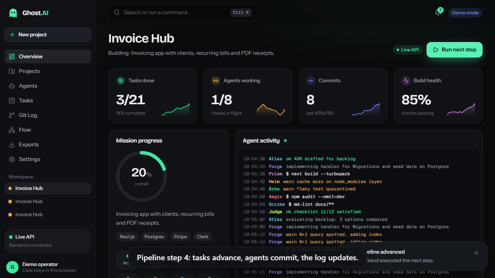
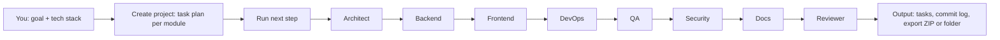
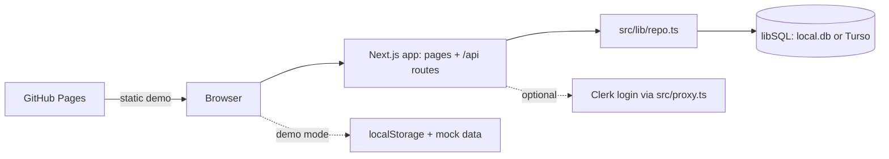
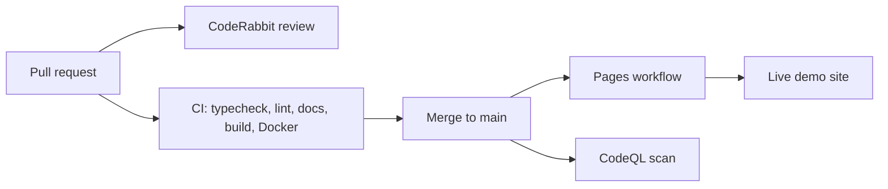

<p align="center">
  
</p>

<h1 align="center">Ghost AI</h1>

<p align="center">
  <b>Give it a goal and a tech stack. Watch a crew of specialised AI agents plan, build, test, commit and ship.</b>
</p>

<p align="center">
  <a href="https://github.com/reddypranith80-max/ghost-ai/actions/workflows/ci.yml"></a>
  <a href="https://github.com/reddypranith80-max/ghost-ai/actions/workflows/pages.yml"></a>
  <a href="https://github.com/reddypranith80-max/ghost-ai/actions/workflows/codeql.yml"></a>
  <a href="https://nextjs.org/"></a>
  <a href="https://www.typescriptlang.org/"></a>
  
</p>

<p align="center">
  <a href="https://reddypranith80-max.github.io/ghost-ai/"><b>▶ Live demo</b></a> ·
  <a href="https://reddypranith80-max.github.io/ghost-ai/dashboard/">Dashboard</a> ·
  <a href="https://reddypranith80-max.github.io/ghost-ai/demo/">Demo video page</a> ·
  <a href="https://raw.githubusercontent.com/reddypranith80-max/ghost-ai/main/notebooks/ghost-notebook.ipynb">Download notebook</a> ·
  <a href="docs/book/">Book (PDF)</a>
</p>

---

## Demo (90 seconds)

<p align="center">
  <a href="https://reddypranith80-max.github.io/ghost-ai/demo/">
    
  </a>
</p>

<video src="public/demo/ghost-ai-demo.webm" poster="public/demo/poster.png" controls muted width="860">
  Your viewer cannot play inline video. Use the links below.
</video>

GitHub does not always play a repository `.webm` inline, so use whichever link works for you:

- Watch on the live demo page: <https://reddypranith80-max.github.io/ghost-ai/demo/>
- Raw video file (about 11 MB, 89 s): [`public/demo/ghost-ai-demo.webm`](public/demo/ghost-ai-demo.webm)
- Re-record it yourself: `npm run demo:record` (script: [`scripts/record-demo.mjs`](scripts/record-demo.mjs))

**What you will see in 90 seconds**

1. The marketing site: hero, how it works, the agent crew, pricing and docs pages.
2. The dashboard with sample projects, stats and a live activity feed.
3. The **New project** wizard: name, goal, stack picker, create.
4. **Run next step** moving tasks across the board (todo, running, review, done) and creating commits.
5. The agent roster, the git-log timeline and the flow graph of the 8-agent pipeline.
6. **Exports**: the file tree and a ZIP download of the whole project.

## Table of contents

- [What is Ghost AI](#what-is-ghost-ai)
- [How it works](#how-it-works)
- [The crew](#the-crew)
- [Every major component explained](#every-major-component-explained)
- [Architecture](#architecture)
- [Tech stack](#tech-stack)
- [Project structure](#project-structure)
- [Run it](#run-it)
- [Run the tests](#run-the-tests)
- [Troubleshooting](#troubleshooting)
- [Fork and clone](#fork-and-clone)
- [Download the notebook](#download-the-notebook)
- [Book](#book)
- [Honest status and known limitations](#honest-status-and-known-limitations)
- [Contributing](#contributing)
- [Credits](#credits)

## What is Ghost AI

**The problem.** Going from "I have an app idea" to a planned, structured project means juggling architecture, backend, UI, deployment, testing, security, docs and review. It is easy to lose track of who is doing what and what is done.

**The idea.** Ghost AI models that work as a crew of eight specialised lead agents, each with three side agents. You describe an app and pick a stack. Ghost AI creates a project with a task plan, then walks it through a pipeline (Architect, Backend, Frontend, DevOps, QA, Security, Docs, Reviewer). Every step moves a task forward and records a commit in a git-style log. You can watch it on a kanban board and a flow graph, and export everything.

**Who it is for.** Learners and builders who want to see what a multi-agent build pipeline looks like, people who want a polished full-stack Next.js reference project (API, database, auth, CI/CD, docs, tests), and anyone evaluating the concept.

> **Important and honest:** the agents are **simulated**. No real AI model is called. Tasks, progress and commits are generated by deterministic code in [`src/lib/sim.ts`](src/lib/sim.ts) and [`src/lib/repo.ts`](src/lib/repo.ts). Ghost AI shows the workflow and the product shape; it does not write your app for you.

## How it works



Each click on **Run next step** advances the pipeline: a task in `review` becomes `done` (and a commit is logged), a `running` task moves to `review`, and the next `todo` task starts `running`. When every task is done the API answers `409 pipeline_complete`.

> **Explain like I am 5.** Imagine eight helpers in a toy factory. One draws the plan, one builds the engine, one paints it, one packs the box, one tests every button, one checks for dangers, one writes the instructions, and the last one says "OK to ship". You give the factory an idea, and you watch each helper take their turn. Longer version with analogies: [docs/EXPLAIN-LIKE-IM-5.md](docs/EXPLAIN-LIKE-IM-5.md).

## The crew

Source of truth: [`src/lib/agent-catalog.ts`](src/lib/agent-catalog.ts) (also served by `GET /api/agents`).

| Agent | Codename | Job | Tools | Produces | Sub-agents |
|---|---|---|---|---|---|
| Architect | ATLAS | Turns a brief into a blueprint. | Mermaid, ADR, OpenAPI | ADRs, architecture diagram, API contract | Stack Scout (picks libraries that fit your stack), Schema Smith (designs tables and relations), Contract Clerk (writes the API contract) |
| Backend | FORGE | Builds the engine room. | Drizzle, Zod, Route Handlers | APIs, database, auth hooks, jobs | Data Digger (migrations and seed data), Route Runner (REST endpoints with validation), Gatekeeper (sessions, roles, permissions) |
| Frontend | PRISM | Makes it beautiful and clickable. | Next.js, Tailwind, shadcn/ui | Pages, components, design system | Pixel Painter (components and layout), Motion Maker (animations and transitions), Access Ally (accessibility and responsive checks) |
| DevOps | HELM | Gets it online and keeps it there. | Docker, GitHub Actions, Vercel | Pipelines, containers, deploy docs | Pipeline Pilot (CI workflows), Box Builder (Dockerfiles and images), Watch Tower (health checks and logs) |
| QA | ECHO | Clicks everything so users don't have to. | Playwright, Vitest | Test suites, coverage, bug reports | Click Tester (end-to-end browser tests), Unit Inspector (function-level tests), Load Lifter (stress and speed checks) |
| Security | AEGIS | Thinks like an attacker, acts like a guard. | npm audit, Threat model, CSP | Findings and fixes | Dependency Dog (scans packages for known holes), Authz Auditor (checks who can do what), Secret Sniffer (finds leaked keys) |
| Docs | SCRIBE | Explains it so anyone can run it. | Markdown, Mermaid | README, guides, changelog | Kid Translator (plain-language explainers), API Archivist (endpoint reference), Changelog Keeper (release notes) |
| Reviewer | JUDGE | The final Go / No-Go gate. | CodeRabbit, Checklists | Go / No-Go + required fixes | PR Patrol (reviews every pull request), Style Sheriff (consistency and lint), Ship Marshal (definition-of-done check) |

More: [docs/agents.md](docs/agents.md).

## Every major component explained

### Landing and marketing site
Route group `src/app/(marketing)` with pages `/how-it-works`, `/agents` (plus `/agents/[slug]`), `/demo`, `/docs` (plus `/docs/[slug]`), `/pricing`, `/security`, `/api-reference` and `/changelog`. The home page is `src/app/page.tsx`. Navigation links live in [`src/components/site/nav-data.ts`](src/components/site/nav-data.ts). It connects to the dashboard through the call-to-action buttons and to the docs pages through `/docs`.

### Design system and fonts
A dark, cyan/violet "ghost kit" theme in [`src/app/ghost-kit.css`](src/app/ghost-kit.css) and [`src/app/globals.css`](src/app/globals.css), on top of Tailwind CSS v4. Fonts come from `next/font/google`: Space Grotesk (headings), Inter (body) and JetBrains Mono (code), wired up in [`src/app/layout.tsx`](src/app/layout.tsx). Base components (button, card, dialog, input, table, tabs, badge) are in `src/components/ui/`; the logo is `public/brand/ghost-ai-logo.svg`.

### Dashboard
`/dashboard` has **8 views**, each a route under `src/app/dashboard/`: overview, projects, tasks (kanban with drag and move), agents, git (commit timeline), flow (pipeline graph), exports and settings. There is a **command palette** (open with `Ctrl K`) and a **New project wizard** (`new-project-wizard.tsx`). State is managed by [`src/components/dashboard/store.tsx`](src/components/dashboard/store.tsx), which reads from the API or from demo data. Components are in `src/components/dashboard/`.

### Demo mode vs Live mode
The dashboard starts on **demo data** (mock data kept in your browser's `localStorage`, from `src/lib/mock-data.ts` and `src/lib/client-data.ts`). If it can reach the backend (`/api/health`), it switches to **live** mode and talks to the real API and database, then shows a "Live API connected" toast. Setting `NEXT_PUBLIC_DEMO=1` forces demo mode and is how the static GitHub Pages site is built.

### Export (folder save and ZIP)
The Exports view builds a project bundle in the browser (JSON, report, CSV, git log, README and docs) with [`src/lib/export.ts`](src/lib/export.ts). You can **download a ZIP** (a store-only ZIP written by the app, no extra library) or **save to a folder** using the browser's directory picker where supported (Chromium-based browsers). The server also exposes `GET /api/projects/:id/export?format=json|md`.

### API
Thirteen JSON endpoints under `src/app/api/`, validated with Zod ([`src/lib/contracts.ts`](src/lib/contracts.ts)), with error bodies like `{"error":{"code":"...","message":"..."}}`, CORS headers, and a per-IP write rate limit of 60 requests per minute (HTTP 429). The OpenAPI document is generated by [`src/lib/openapi.ts`](src/lib/openapi.ts). Examples assume `http://localhost:3000`.

| Method | Path | Description | Sample |
|---|---|---|---|
| GET | `/api/health` | Liveness plus database check (`503` if the DB is down) | `curl localhost:3000/api/health` |
| GET | `/api/openapi` | OpenAPI document | `curl localhost:3000/api/openapi` |
| GET | `/api/agents` | The agent catalog (8 agents with sub-agents) | `curl localhost:3000/api/agents` |
| GET | `/api/agents/:name` | One agent, e.g. `Architect` (`404` if unknown) | `curl localhost:3000/api/agents/Architect` |
| GET | `/api/stack` | Stack options grouped by category | `curl localhost:3000/api/stack` |
| GET | `/api/stats` | Counts: projects, tasks by status, commits, completion % | `curl localhost:3000/api/stats` |
| GET | `/api/projects` | List projects | `curl localhost:3000/api/projects` |
| POST | `/api/projects` | Create a project (`name` 2-60, `brief` 10-2000, `stack` 1-20 items) | `curl -X POST localhost:3000/api/projects -H "Content-Type: application/json" -d '{"name":"Todo App","brief":"A small todo app with login","stack":["Next.js","Drizzle"]}'` |
| GET | `/api/projects/:id` | Project detail with tasks, git log and agent states | `curl localhost:3000/api/projects/<id>` |
| DELETE | `/api/projects/:id` | Delete a project | `curl -X DELETE localhost:3000/api/projects/<id>` |
| POST | `/api/projects/:id/run` | Advance the pipeline one step (`409` when complete) | `curl -X POST localhost:3000/api/projects/<id>/run` |
| GET | `/api/projects/:id/tasks` | Tasks, filter with `?status=`, `?module=`, `?agent=` | `curl "localhost:3000/api/projects/<id>/tasks?status=done"` |
| PATCH | `/api/projects/:id/tasks/:taskId` | Update `status` and/or `progress` (0-100) | `curl -X PATCH localhost:3000/api/projects/<id>/tasks/<taskId> -H "Content-Type: application/json" -d '{"status":"done","progress":100}'` |
| GET | `/api/projects/:id/gitlog` | Commit log, optional `?limit=` | `curl "localhost:3000/api/projects/<id>/gitlog?limit=5"` |
| GET | `/api/projects/:id/export` | Download as `json` (default) or `md` with `?format=md` | `curl "localhost:3000/api/projects/<id>/export?format=md"` |

(That is 15 method and path combinations across 13 route files.) Full reference: [docs/COMMANDS.md](docs/COMMANDS.md) and [docs/methods.md](docs/methods.md).

### Database
Drizzle ORM over libSQL ([`src/db/`](src/db)). By default it is a local SQLite file (`DATABASE_URL=file:local.db`, created on first use and seeded with two sample projects); set `DATABASE_URL` and `DATABASE_AUTH_TOKEN` to use Turso. Tables in [`src/db/schema.ts`](src/db/schema.ts):

| Table | Columns |
|---|---|
| `projects` | id, name, brief, stack (JSON array), status (planning, building, shipped), created_at, owner_id |
| `tasks` | id, project_id, title, module, agent, status, progress, position, sub_agent |
| `gitlog` | id, project_id, hash, message, agent, files, at |

All data access goes through [`src/lib/repo.ts`](src/lib/repo.ts).

### Auth (Clerk)
Optional sign-in with email and GitHub via Clerk. With no keys the app runs in **demo mode**: `/dashboard` is open and `/sign-in` and `/sign-up` show an explainer with a "Continue in demo mode" button. With keys, [`src/proxy.ts`](src/proxy.ts) protects `/dashboard` and the write endpoints (`POST`, `PATCH`, `DELETE` on `/api/projects*` return `401` without a session); reads and `/api/health` stay public. Setup: [docs/auth.md](docs/auth.md).

### Docs
Guides in [`docs/`](docs/README.md): run guide, explain-like-I-am-5, command reference, workflows, code tour, architecture, ADRs and Mermaid diagrams. `npm run docs:check` parses every Mermaid block in the README and docs (CI runs it). `npm run check:links` checks every link ([report](docs/LINK-REPORT.md)).

### Tests
**55 Playwright end-to-end tests** (per [STATUS.md](STATUS.md)) in `tests/e2e/`: site links and mobile menu, dashboard views, wizard, drag and move, ZIP export CRC check, folder save with a stubbed picker, and every API route including 400, 404 and 409 cases. They run against a production build in demo mode on port 3500 using Microsoft Edge.

### CI/CD
Workflows in [`.github/workflows/`](.github/workflows):

| Workflow | Trigger | What it does |
|---|---|---|
| `ci.yml` (CI) | push to main, pull requests | Typecheck, lint, `docs:check`, build; a non-blocking `npm audit` of production dependencies; Docker build plus a smoke test of `/api/health` (checks the container does not run as root) |
| `pages.yml` (Deploy demo to GitHub Pages) | push to main, manual | Builds the static demo with `npm run build:pages` and deploys it to GitHub Pages |
| `codeql.yml` (CodeQL) | push and PR to main, weekly | Code scanning for JavaScript/TypeScript, skipped on private repositories |

Dependabot (`.github/dependabot.yml`) opens weekly update PRs for npm, GitHub Actions and Docker. Details: [docs/WORKFLOWS.md](docs/WORKFLOWS.md), [docs/devops.md](docs/devops.md).

### CodeRabbit PR reviews
[`.coderabbit.yaml`](.coderabbit.yaml) configures the CodeRabbit AI reviewer (assertive profile, reviews PRs targeting `main`, with extra instructions for `src/app/api/**` and `src/components/**`). It needs the CodeRabbit GitHub app installed on the repository. Setup and chat commands: [docs/coderabbit.md](docs/coderabbit.md).

### Docker
[`Dockerfile`](Dockerfile) is a multi-stage build on `node:24-bookworm-slim` using Next.js standalone output, runs as a non-root user, keeps SQLite in the `/data` volume and has a health check on `/api/health`. [`docker-compose.yml`](docker-compose.yml) runs it on port 3000 with the volume `ghost-data` and an optional `.env`. The image is built and smoke-tested in CI.

### GitHub Pages static build
`npm run build:pages` ([`scripts/pages-build.mjs`](scripts/pages-build.mjs)) produces a fully static export in `out/`. A static host cannot run servers, so the script temporarily moves `src/app/api` and `src/proxy.ts` aside, builds with `GITHUB_PAGES=true` and `NEXT_PUBLIC_DEMO=1`, and restores them. The base path comes from `NEXT_PUBLIC_BASE_PATH`, which the workflow sets to `/<repository name>`. On Windows, Next.js writes segment prefetch files with nested folders that the browser does not request; [`scripts/fix-win-export.mjs`](scripts/fix-win-export.mjs) flattens them (it does nothing on Linux, where CI builds). [`scripts/static-smoke.mjs`](scripts/static-smoke.mjs) checks the output.

## Architecture



Delivery pipeline:



More: [docs/architecture.md](docs/architecture.md), [docs/CODE-TOUR.md](docs/CODE-TOUR.md), [docs/connectivity.md](docs/connectivity.md).

## Tech stack

| Area | Choice |
|---|---|
| Framework | Next.js 16 (App Router), React 19 |
| Language | TypeScript 5 |
| Styling and UI | Tailwind CSS v4, shadcn-style components, Base UI, framer-motion, lucide-react |
| Data | Drizzle ORM over libSQL (local SQLite file, Turso for hosted) |
| Validation | Zod |
| Auth | Clerk (optional) |
| Lint | ESLint 9 |
| Docs tooling | Mermaid, mermaid-cli, jsdom |
| Tests | Playwright (Edge channel) |
| Delivery | Docker (Node 24), GitHub Actions, GitHub Pages, Vercel config, CodeQL, Dependabot, CodeRabbit |

## Project structure

```text
.
├── .github/                 workflows (ci, pages, codeql), dependabot, PR/issue templates, CODEOWNERS
├── docs/                    guides, ADRs, Mermaid diagrams, book/
├── notebooks/               ghost-notebook.ipynb
├── public/                  brand/ (logo), demo/ (video + poster)
├── scripts/                 pages-build, fix-win-export, static-smoke, record-demo, check-mermaid, check-links
├── src/
│   ├── app/
│   │   ├── (marketing)/     landing pages: how-it-works, agents, demo, docs, pricing, security ...
│   │   ├── (auth)/          sign-in and sign-up
│   │   ├── api/             13 route handlers
│   │   └── dashboard/       8 views: overview, projects, tasks, agents, git, flow, exports, settings
│   ├── components/          dashboard, site, landing, marketing, auth, brand, ui
│   ├── db/                  Drizzle schema and client
│   ├── lib/                 repo, sim, contracts, agent-catalog, export, openapi, api-utils ...
│   └── proxy.ts             Clerk middleware (only active with keys)
├── tests/e2e/               Playwright specs
├── Dockerfile, docker-compose.yml, .env.example, .coderabbit.yaml
└── package.json
```

## Run it

Requirements: Node.js 20 or newer (24 recommended, CI and Docker use 24), git. Docker only for mode C. Run commands in the folder that contains `package.json`.

```bash
git clone https://github.com/reddypranith80-max/ghost-ai.git
cd ghost-ai
npm ci
```

### Mode A: zero-config demo (start here)

```bash
npm run dev
```

Expected: `Local: http://localhost:3000` and `Ready`. Open <http://localhost:3000>, click **Dashboard**. No keys needed; `local.db` is created on first API use. For a production build: `npm run build` then `npm start` (also port 3000).

### Mode B: with Clerk sign-in

1. Create an app at <https://dashboard.clerk.com/sign-in>, enable Email and the GitHub connection ([docs/auth.md](docs/auth.md)).
2. Copy `.env.example` to `.env.local` in the project root (the folder with `package.json`). Mac/Linux: `cp .env.example .env.local`; PowerShell: `Copy-Item .env.example .env.local`.
3. Fill `NEXT_PUBLIC_CLERK_PUBLISHABLE_KEY` and `CLERK_SECRET_KEY` from Clerk's **API keys** page.
4. Restart `npm run dev`; `/dashboard` now redirects to `/sign-in`.

### Mode C: Docker

```bash
docker compose up --build        # same as: npm run docker:up
curl http://localhost:3000/api/health
```

Port 3000; data persists in the `ghost-data` volume. Put Clerk keys in a `.env` file next to `docker-compose.yml` if you want sign-in.

### Other commands

| Command | Purpose |
|---|---|
| `npm run typecheck` | `tsc --noEmit` |
| `npm run lint` | ESLint (`npm run lint:fix` to auto-fix) |
| `npm run docs:check` | Parse all Mermaid blocks (`npm run docs:diagrams` also renders SVGs) |
| `npm run check:links` | Check README and docs links (see [docs/LINK-REPORT.md](docs/LINK-REPORT.md)) |
| `npm run build:pages` | Static export to `out/` for GitHub Pages |
| `npm run demo:record` | Re-record the demo video |
| `npm run docker:build` | Build image `ghost-ai-web:local` |

All of them, with expected output: [docs/COMMANDS.md](docs/COMMANDS.md). Beginner walkthrough: [docs/RUN-ME.md](docs/RUN-ME.md).

## Run the tests

```bash
npm run build          # tests run against the production build
npm run test:e2e       # playwright test: starts `next start -p 3500` itself
```

The config ([`playwright.config.ts`](playwright.config.ts)) uses the installed Microsoft Edge (`channel: "msedge"`), so no browser download is needed; on other machines change the channel or install a Playwright browser. The server runs without Clerk keys, so tests cover demo mode.

## Troubleshooting

| Symptom | Likely cause | Fix |
|---|---|---|
| `EADDRINUSE` / port 3000 busy | Another server uses the port | Stop it, or `npx next dev -p 3001` |
| Build fails with a lock or odd cache error | Two builds (`dev`, `build`, `build:pages`) running in one folder | Stop all, delete `.next/`, run once |
| `/dashboard` redirects to `/sign-in` in dev | Clerk keys are set | Remove them from `.env.local`, or sign in |
| Keys set but still demo mode | `NEXT_PUBLIC_DEMO=1` is set or the server was not restarted | Unset it, restart |
| Dashboard shows demo data, not the database | API unreachable, or `NEXT_PUBLIC_DEMO=1` | Check `http://localhost:3000/api/health`; unset the variable |
| `npm run test:e2e` cannot launch the browser | Edge is not installed | Install Edge, or change `channel` in `playwright.config.ts` |
| Static site assets 404 under a sub-path | Missing base path | Build with `NEXT_PUBLIC_BASE_PATH=/<repo>` |
| Folder save button missing | Browser lacks the directory picker | Use Chrome or Edge, or download the ZIP |
| Mermaid render fails | No Chrome/Edge found | Set `PUPPETEER_EXECUTABLE_PATH`, or use `npm run docs:check` (no render) |

More: [docs/RUN-ME.md](docs/RUN-ME.md).

## Fork and clone

Click **Fork** on GitHub, clone your fork, run `npm ci && npm run dev`, and your own copy of the live demo is one setting away (Settings, Pages, Source: GitHub Actions). Step-by-step, including keeping your fork in sync, your own Clerk app, and opening a PR back: **[docs/FORK-AND-CLONE.md](docs/FORK-AND-CLONE.md)**.

## Download the notebook

The **Ghost Notebook** is a Jupyter notebook that clones the repo, starts the server and calls every API route from Python (tables, a pipeline run, an export to a local folder, a progress chart).

- Download (raw file): <https://raw.githubusercontent.com/reddypranith80-max/ghost-ai/main/notebooks/ghost-notebook.ipynb>
- View on GitHub: [notebooks/ghost-notebook.ipynb](notebooks/ghost-notebook.ipynb)
- Open in Google Colab: [](https://colab.research.google.com/github/reddypranith80-max/ghost-ai/blob/main/notebooks/ghost-notebook.ipynb)
- View on nbviewer: <https://nbviewer.org/github/reddypranith80-max/ghost-ai/blob/main/notebooks/ghost-notebook.ipynb>

## Book

The **Ghost AI Book** is a long-form PDF that tells how the project was built, chapter by chapter.

- Read or download: [docs/book/Ghost-AI-Book.pdf](docs/book/Ghost-AI-Book.pdf)
- Source in Markdown: [docs/book/Ghost-AI-Book.md](docs/book/Ghost-AI-Book.md)
- Rebuild it: `npm run docs:book` (script: `scripts/build-book.mjs`)

## Honest status and known limitations

- **The agents are simulated.** No AI model is called.
- **Real Clerk sign-in needs the owner's keys** and has not been verified by the automated tests (they run in demo mode).
- **The static demo** (GitHub Pages) uses mock data and `localStorage`. There is no API or database there.
- **The Docker image is built in CI**; Docker was not available on the author's machine, so it has not been run locally. It is not pushed to a registry.
- **E2E tests were run locally only on Microsoft Edge**; other browsers are untested.
- **There is no `LICENSE` file yet**, so the license is undefined until the owner adds one.

Project notes: [STATUS.md](STATUS.md).

## Contributing

Read [CONTRIBUTING.md](CONTRIBUTING.md). In short: branch from `main`, keep changes small, run `npm run typecheck`, `npm run lint`, `npm run docs:check` and `npm run build`, then open a pull request. Fill in the PR template; CodeRabbit reviews automatically and CI must be green. Changes are logged in [CHANGELOG.md](CHANGELOG.md).

## Credits

Built by Pranith ([@reddypranith80-max](https://github.com/reddypranith80-max)) with a team of AI coding agents (Claude Code). Thanks to the open-source projects behind it: Next.js, React, Tailwind CSS, Drizzle ORM, libSQL, Zod, Clerk, Base UI, framer-motion, lucide, Mermaid and Playwright.
