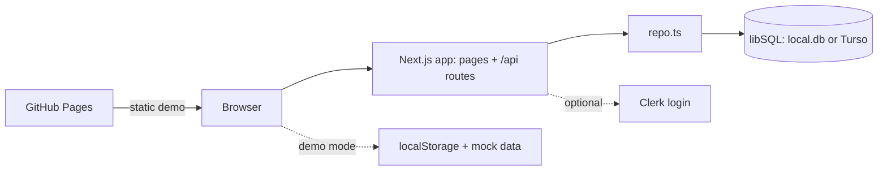

<p align="center">
  
</p>

<h1 align="center">Ghost AI</h1>

<p align="center">
  Give it a goal and a tech stack. Watch a crew of specialised AI agents plan, build, test, commit and ship.
</p>

<p align="center">
  <!-- Replace <user>/<repo> with your GitHub account and repository name -->
  <a href="https://github.com/<user>/<repo>/actions/workflows/ci.yml">/<repo>/actions/workflows/ci.yml/badge.svg" /></a>
  <a href="https://github.com/<user>/<repo>/actions/workflows/pages.yml">/<repo>/actions/workflows/pages.yml/badge.svg" /></a>
  <a href="https://github.com/<user>/<repo>/blob/main/LICENSE">/<repo>" /></a>
  <a href="https://<user>.github.io/<repo>/"></a>
</p>

> `<user>` and `<repo>` are placeholders. Replace them with the real GitHub account and repository name. This repository does not yet contain a `LICENSE` file, so the license badge will show "not found" until one is added.

## Demo

A screen recording will live at [`public/demo/ghost-ai-demo.webm`](public/demo/ghost-ai-demo.webm). It appears there after the QA agent records it; until then the link is empty and the `/demo` page plays a scripted storyboard.

## What it does

You describe an app and pick a stack. Ghost AI creates a project with a task plan and lets you watch eight lead agents (each with three side agents) move the work through a pipeline: Architect, Backend, Frontend, DevOps, QA, Security, Docs and Reviewer.

- **Projects**: create from a goal and stack; tasks are generated per module.
- **Run next step**: advance the pipeline (todo, running, review, done) and get a commit per step.
- **Dashboard**: overview, projects, task board, agent roster, git-log timeline, flow graph, exports, settings.
- **Export**: ZIP with JSON, report, CSV, git log, README and docs, built in the browser.
- **JSON API**: 13 endpoints with an OpenAPI document at `/api/openapi`.
- **Optional login**: email and GitHub through Clerk; works with no keys in demo mode.
- **Three ways to run**: local dev server, Docker, or the static GitHub Pages demo.

## Quick start

```bash
git clone https://github.com/<user>/<repo>.git && cd <repo>
npm ci
npm run dev
```

Open http://localhost:3000 and click **Dashboard**. No secrets needed. Need more hand-holding? Read [docs/RUN-ME.md](docs/RUN-ME.md).

## Architecture



Read more: [docs/architecture.md](docs/architecture.md) and [docs/CODE-TOUR.md](docs/CODE-TOUR.md).

## Documentation

| Doc | For |
|---|---|
| [docs/RUN-ME.md](docs/RUN-ME.md) | Run it in 5 minutes (all modes, troubleshooting) |
| [docs/EXPLAIN-LIKE-IM-5.md](docs/EXPLAIN-LIKE-IM-5.md) | The whole project with simple analogies |
| [docs/COMMANDS.md](docs/COMMANDS.md) | Every command, API call and environment variable |
| [docs/WORKFLOWS.md](docs/WORKFLOWS.md) | CI, Pages, CodeQL, PR lifecycle, deploys, agent loop |
| [docs/CODE-TOUR.md](docs/CODE-TOUR.md) | Folder-by-folder tour of the code |
| [docs/README.md](docs/README.md) | Index of all docs |
| [CONTRIBUTING.md](CONTRIBUTING.md) | How to contribute |
| [CHANGELOG.md](CHANGELOG.md) | What changed |

## Tech stack

| Area | Choice |
|---|---|
| Framework | Next.js 16 (App Router), React 19 |
| Styling and UI | Tailwind CSS v4, shadcn/ui style components, Base UI, framer-motion, lucide-react |
| Data | Drizzle ORM over libSQL (local SQLite file, Turso for hosted) |
| Validation | Zod |
| Auth | Clerk (optional) |
| Language and checks | TypeScript 5, ESLint 9 |
| Docs tooling | Mermaid, mermaid-cli, jsdom |
| Tests | `@playwright/test` installed, no specs yet |
| Delivery | Docker (Node 24), GitHub Actions, GitHub Pages, Vercel config, CodeQL, Dependabot, CodeRabbit |

## Status and known limitations

Honest list:

- **The agents are simulated.** No real AI model is called; tasks, logs and commits are generated by `src/lib/sim.ts` and `src/lib/repo.ts`.
- **Clerk sign-in needs the owner's keys.** Without keys the app runs in demo mode and the sign-in pages are an explainer. The sign-in flow has not been verified with real keys in this repo.
- **The Docker image is built only in CI** (build plus smoke test). It is not pushed to a registry.
- **The Pages demo is static** and uses mock data in your browser; there is no API or database there.
- **No automated browser tests yet.** `npm run test:e2e` is a placeholder.
- Project progress notes live in [STATUS.md](STATUS.md).

## Contributing

See [CONTRIBUTING.md](CONTRIBUTING.md). In short: branch, make small changes, run `npm run typecheck`, `npm run lint`, `npm run docs:check`, `npm run build`, open a PR.
