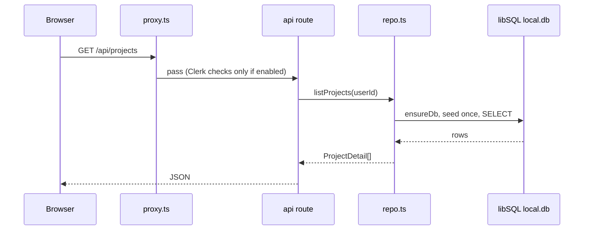
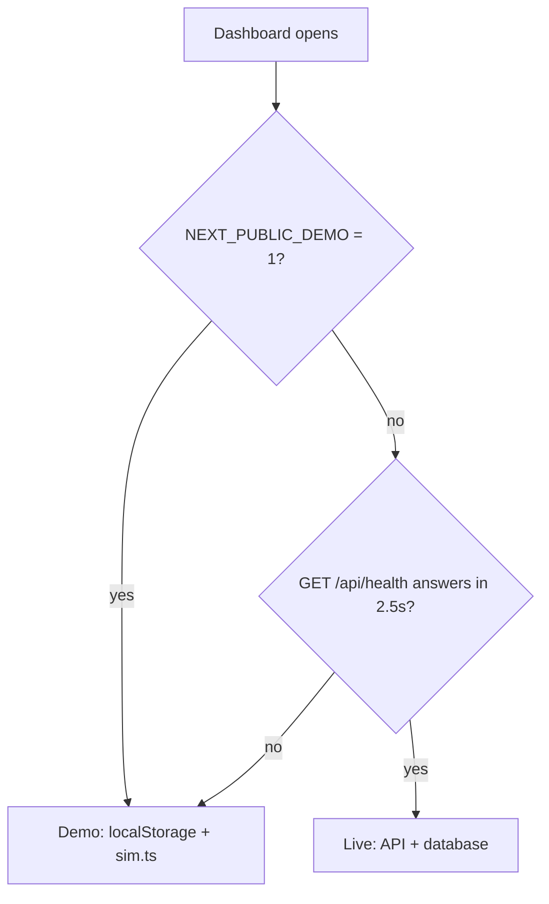

# Code tour

A walk through the repo. Paths are relative to the folder with `package.json`.

## Folder map

```text
.
├── README.md                  landing page of the project
├── STATUS.md                  current progress (owned by the orchestrator)
├── package.json               npm scripts + dependencies
├── next.config.ts             Next.js config: normal / Docker standalone / Pages static export
├── Dockerfile, docker-compose.yml, .dockerignore   container build and run
├── vercel.json                Vercel install/build commands
├── drizzle.config.ts          Drizzle Kit config
├── .env.example               every setting you can change
├── .coderabbit.yaml           AI reviewer config
├── .github/
│   ├── workflows/             ci.yml, pages.yml, codeql.yml
│   ├── dependabot.yml, CODEOWNERS, PULL_REQUEST_TEMPLATE.md, ISSUE_TEMPLATE/
├── scripts/
│   ├── pages-build.mjs        static export for GitHub Pages
│   └── check-mermaid.mjs      validates/renders Mermaid diagrams in the docs
├── docs/                      all documentation (you are here)
├── public/
│   ├── brand/ghost-ai-logo.svg
│   └── demo/                  demo video appears here after recording
└── src/
    ├── proxy.ts               optional Clerk gate
    ├── app/                   pages and API routes (Next.js App Router)
    ├── components/            React pieces
    ├── lib/                   logic shared by server and browser
    └── db/                    database
```

### `src/app` (every URL)

| Path | URL | What it is |
|---|---|---|
| `page.tsx`, `layout.tsx` | `/` | Landing page and the root layout (loads fonts Bricolage Grotesque, Instrument Sans, Geist Mono, and the auth provider) |
| `(marketing)/` | `/agents`, `/agents/[slug]`, `/api-reference`, `/changelog`, `/demo`, `/docs`, `/docs/[slug]`, `/how-it-works`, `/pricing`, `/security` | Public info pages |
| `(auth)/sign-in`, `(auth)/sign-up` | `/sign-in`, `/sign-up` | Clerk forms, or an explainer in demo mode |
| `dashboard/` | `/dashboard` (overview), `/dashboard/projects`, `/dashboard/tasks`, `/dashboard/agents`, `/dashboard/git`, `/dashboard/flow`, `/dashboard/exports`, `/dashboard/settings` | The control room |
| `api/` | `/api/*` | JSON routes (list below) |
| `globals.css`, `ghost-kit.css` | | Styles (Tailwind v4 + the dark Ink & Signal design system, see DESIGN-SYSTEM.md) |
| `not-found.tsx`, `icon.svg` | | 404 page and tab icon |

API routes: `health`, `openapi`, `stats`, `stack`, `agents`, `agents/[name]`, `projects`, `projects/[id]`, `projects/[id]/run`, `projects/[id]/tasks`, `projects/[id]/tasks/[taskId]`, `projects/[id]/gitlog`, `projects/[id]/export`. Examples: [COMMANDS.md](COMMANDS.md#5-api-examples-curl).

### `src/components`

| Folder | Contents |
|---|---|
| `dashboard/` | `shell.tsx` (sidebar, top bar, command palette), `store.tsx` (all dashboard state; picks live vs demo), `overview`, `projects`, `tasks`, `agents`, `gitlog`, `flow`, `exports`, `settings`, `new-project-wizard`, `kit.tsx` (small shared widgets) |
| `landing/` | Home page sections (`hero`, `crew`, `pipeline-diagram`, `agent-terminal`, `io-demo`...) |
| `marketing/` | Info pages parts (`agent-directory`, `api-explorer`, `demo-player`, `guides.ts` = text of `/docs/[slug]`) |
| `site/` | Header, footer, mobile nav, `nav-data.ts` (menu links) |
| `auth/` | Clerk look and feel (`appearance.ts`), `auth-shell`, `clerk-form`, nav buttons |
| `auth-provider.tsx` | The on/off switch for Clerk |
| `brand/logo.tsx` | The logo component |
| `ui/` | Base buttons, cards, dialog, tabs, table (shadcn style) |

### `src/lib`

| File | Job |
|---|---|
| `contracts.ts` | The agreement: Zod schemas and TypeScript types (`ProjectInput`, `Task`, `ProjectDetail`, agent names). Server and browser both use it. |
| `agent-catalog.ts` | The 8 agents, their codenames, tools and sub-agents. Single source of truth. |
| `stack-catalog.ts` | Tech choices offered in the new-project wizard |
| `repo.ts` | **All database work**: list/create/delete projects, advance pipeline, update task, stats. Also seeds sample data on first use. |
| `api-utils.ts` | Helpers for routes: `json`, `fail`, `readBody` (validate), `rateLimit`, CORS |
| `auth.ts` | `getUserId()`: Clerk user id or `null` |
| `openapi.ts` | Builds the OpenAPI document served at `/api/openapi` |
| `client-data.ts` | Browser side: talks to the API or falls back to demo data |
| `sim.ts` | Pretend pipeline engine used in demo mode (and for log lines, commits, sparklines) |
| `mock-data.ts` | Sample projects (`demo-1` Nebula CRM...) used for seeding and demo |
| `export.ts` | Builds export files and a ZIP in the browser |
| `utils.ts` | Tiny helpers (`cn`) |

### `src/db`

`schema.ts` defines tables `projects`, `tasks`, `gitlog` (Drizzle). `index.ts` creates the libSQL client (`DATABASE_URL`, default `file:local.db`), creates the tables with `CREATE TABLE IF NOT EXISTS`, and adds later columns (`owner_id`, `sub_agent`) if missing. There is no separate migration step.

## How a request flows



A write (for example `POST /api/projects`) adds: rate limit check, `readBody` validation with the Zod schema from `contracts.ts` (400 on bad input), then the insert. Errors become `{ "error": { code, message } }` through `toErrorResponse`; unknown errors are logged and shown as a generic 500.

## Demo mode vs live mode

Decided in the browser by `src/lib/client-data.ts` and `src/components/dashboard/store.tsx`.



- **Live**: `probeLive`, `loadLive`, `createRemote`, `runRemote` call the real API.
- **Demo**: `loadDemo` (saved copy in `localStorage` key `ghost-ai:v2:projects`, otherwise `demoSeed()`), `createDemo`, and `advance` from `sim.ts`. Nothing leaves your browser.
- The GitHub Pages build is demo-only because the API folder is removed and `NEXT_PUBLIC_DEMO=1`.
- The Settings page lets you point the dashboard at another API base URL (`setApiBase`, saved under `ghost-ai:v2:api-base`).

## Auth is optional

1. `src/components/auth-provider.tsx`: `AUTH_ENABLED` is true only if `NEXT_PUBLIC_CLERK_PUBLISHABLE_KEY` is set and `NEXT_PUBLIC_DEMO` is not `1`. Clerk is loaded lazily so the static build never bundles it.
2. `src/proxy.ts`: when enabled, uses `clerkMiddleware` to protect `/dashboard/**` and non-GET `/api/projects/**`. When disabled it just passes requests through.
3. `src/lib/auth.ts`: routes call `getUserId()` which returns `null` without Clerk.
4. `src/lib/repo.ts`: with no user everything is visible; with a user you see your own projects plus owner-less sample projects, and cannot change the samples.

Setup steps: [auth.md](auth.md).

## The agent catalog drives UI and API

`src/lib/agent-catalog.ts` is the only place agents are defined. It feeds:

- `GET /api/agents` and `/api/agents/:name`
- the `/agents` pages and landing "crew" section
- the dashboard agents/flow views and sub-agent progress (`sim.ts`)
- task generation in `repo.ts` (`plan()` gives each task an `agent` and `subAgent` id)
- the docs exported by `src/lib/export.ts` (`docs/agents.md`)

Change an agent in that one file and all of these follow.

## How export works

`src/components/dashboard/exports.tsx` -> `buildExport(project, groups)` in `src/lib/export.ts` returns files (`project.json`, `REPORT.md`, `data/tasks.csv`, `data/gitlog.txt`, `README.md`, `docs/*.md`). Then one of:

- `downloadZip` -> `buildZip` writes a store-only ZIP (own CRC32, no library) and triggers a download;
- `downloadFile` for a single file;
- `saveToFolder` using the browser's directory picker, where supported (`canPickFolder`).

Separately, the server route `GET /api/projects/:id/export?format=json|md` returns a one-file download.

## Where to change things

| I want to... | Edit |
|---|---|
| Add an API route | new folder in `src/app/api/`, use helpers from `api-utils.ts`, add types to `contracts.ts`, add to `openapi.ts` |
| Change a table | `src/db/schema.ts` and the DDL/`migrate` in `src/db/index.ts` |
| Change an agent | `src/lib/agent-catalog.ts` |
| Add a dashboard page | `src/app/dashboard/<name>/page.tsx` + a component in `src/components/dashboard/`, link in `shell.tsx` |
| Change the menu | `src/components/site/nav-data.ts` |

Note: this is a very new Next.js version. `AGENTS.md` says to read `node_modules/next/dist/docs/` before writing Next.js code.
