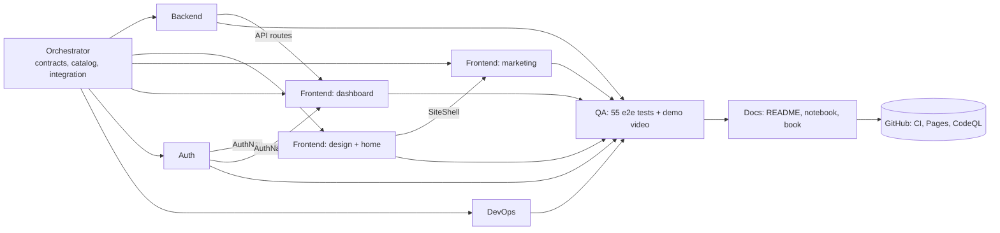

# Commit history, in order

This is the real history of `main`, oldest first, mapped to the area of the product and the agent that produced the work.
Regenerate the raw list any time with `git log --reverse --date=short --format='%h %ad %s'`.

> **Read this first: why commits are big.**
> Ghost AI was built by an orchestrator running several specialist agents **in parallel**, each owning separate files.
> The orchestrator committed after agents finished, not after each file, so a commit holds the work of several agents.
> We did not split them into fake per-component commits with invented timestamps. The tables below show what each commit really contains.
> Per-agent attribution comes from file ownership (see [agents.md](agents.md) and [WORKFLOWS.md](WORKFLOWS.md)).

All commits are dated 2026-11-01 (the whole build happened in one session).

## Timeline

| # | Commit | Message | Size |
|---|--------|---------|------|
| 1 | `0c701eb` | Initial commit from Create Next App | 17 files |
| 2 | `468f9a9` | chore: checkpoint multi-agent build (phase 1 in progress) | 133 files, +20,161 / -4,239 |
| 3 | `3f85f45` | feat: phase 1 agents output (api routes restored, dashboard v2, marketing, auth) | 14 files |
| 4 | `9da51aa` | test: Playwright e2e suite (site, dashboard, API) on Edge channel | 23 files |
| 5 | `cc54900` | fix(pages): flatten static-export segment files on Windows; add static smoke test | 3 files |
| 6 | `0befd76` | feat(demo): record-demo script, demo video + poster, e2e teardown | 7 files |
| 7 | `a12927f` | docs: update STATUS with verified/unverified state | 1 file |
| 8 | `163c25f` | fix(ci): make typecheck pass on clean checkout, gate CodeQL on public repos, audit prod deps only; track .env.example | 5 files |
| 9 | `b99e188` | docs(book): generate 'Building Ghost AI from Scratch' (md + pdf) | 13 files |
| 10 | `c77d3de` | docs: premium README, Ghost Notebook, fork guide, link checker and report | 10 files |
| 11 | (this one) | fix: correct GitHub owner in CODEOWNERS and site link; add commit history | see `git log` |

## What each commit contains

### 1. `0c701eb` Scaffold
Next.js 16, Tailwind v4, TypeScript, ESLint from `create-next-app`. No product code yet.
Before commit 2 (not in git, done by the orchestrator): shadcn/ui components, Clerk, Drizzle, libSQL, Zod, framer-motion, lucide-react installed.

### 2. `468f9a9` Checkpoint of the first multi-agent wave
The orchestrator first acted as the **Architect**: product brief, shared contracts (`src/lib/contracts.ts`), seed data (`src/lib/mock-data.ts`), and the agent catalog (`src/lib/agent-catalog.ts`).
Then specialist agents worked in parallel on disjoint files. This commit holds their output:

| Area / agent | What landed | Where (counts from the commit) |
|---|---|---|
| **Backend** | Drizzle schema + libSQL client, repository layer (`repo.ts`), API utilities, OpenAPI document, stack catalog | `src/db` (2), `src/lib` (12) |
| **Frontend: design system + home** | Fonts, logo, favicon, design tokens, landing page sections, site header/footer/shell | `src/components/landing` (8), `site` (5), `brand` (1), `src/app/page.tsx`, `layout.tsx` |
| **Frontend: marketing pages** | `/how-it-works`, `/agents` (+8 detail pages), `/demo`, `/pricing`, `/docs`, `/api-reference`, `/changelog`, `/security`, 404 | `src/app/(marketing)` (10), `src/components/marketing` (7), `not-found.tsx` |
| **Frontend: dashboard v2** | Shell, overview, agents, tasks kanban, git log, flow graph, exports, projects wizard, settings; client data layer with API/demo fallback; export (ZIP + folder save) | `src/app/dashboard` (9), `src/components/dashboard` (12) |
| **Auth** | Clerk sign-in / sign-up pages, `AuthNav`, optional proxy, `getUserId()` | `src/components/auth` (5), `src/app/(auth)` (2), `src/proxy.ts`, `auth-provider.tsx` |
| **DevOps** | Dockerfile, compose, CI / Pages / CodeQL workflows, CodeRabbit config, Dependabot, PR + issue templates, Mermaid check script, `pages-build.mjs` | `.github` (9), `scripts` (2), `vercel.json` |
| **Docs** | Architecture, context, methods, logs, connectivity, prose, agents, auth, devops, coderabbit, RUN-ME, EXPLAIN-LIKE-IM-5, COMMANDS, WORKFLOWS, CODE-TOUR | `docs` (18) |

Collaboration points in this wave: the agents shared only the contracts and the catalog. The design agent created `SiteShell`, the auth agent created `AuthNav`, and the other agents imported them rather than recreating them.

### 3. `3f85f45` API routes restored
The 13 API route files (`src/app/api/**`) were first written in this wave but were **deleted from disk by a build race**: two agents ran `scripts/pages-build.mjs` at once, and the second run deleted the first run's stash of `src/app/api` and `src/proxy.ts`. The Backend agent rewrote the routes, and this commit is where they first enter git.
It also adds the lock in `pages-build.mjs` that makes a second concurrent run refuse to start.
Routes: `health`, `projects`, `projects/[id]`, `.../tasks`, `.../tasks/[taskId]`, `.../gitlog`, `.../export`, `.../run`, `agents`, `agents/[name]`, `stats`, `stack`, `openapi`.

### 4. `9da51aa` End-to-end tests (QA agent)
Playwright on the Edge channel: 55 tests in 3 files covering links, mobile menu, FAQ, dashboard flows, wizard, drag and move, ZIP export (CRC verified), folder save with a stubbed picker, and every API route including 400/404/409.

### 5. `cc54900` Windows static-export fix (QA + DevOps)
Next 16.4.3 on Windows wrote prefetch files in nested folders while the client asked for flat names, so every `Link` prefetch 404'd in the static demo. `scripts/fix-win-export.mjs` flattens them (no-op on Linux). Adds `scripts/static-smoke.mjs`.

### 6. `0befd76` Demo video (QA agent)
`scripts/record-demo.mjs` drives the app with Playwright and records `public/demo/ghost-ai-demo.webm` (about 89 s, captioned) plus `poster.png`.

### 7. `a12927f` Status
`STATUS.md` records what is verified and what is not.

### 8. `163c25f` CI fixes after the first run on GitHub
The first CI run on GitHub failed in four places. Fixes: explicit `children` type in `layout.tsx` (the global `LayoutProps` type only exists after a local build), CodeQL skipped on private repos, `npm audit --omit=dev`, and `.env.example` un-ignored. Pages was failing separately because it had not been enabled; that is a repo setting, not a commit.

### 9. `b99e188` The book
`scripts/build-book.mjs` builds `docs/book/Ghost-AI-Book.md` and `.pdf` (315 pages) from the real repo.

### 10. `c77d3de` README, notebook, fork guide, link checker
Main README with demo at the top, `notebooks/ghost-notebook.ipynb` (executed against a local server), `docs/FORK-AND-CLONE.md`, `scripts/check-links.mjs`, `docs/LINK-REPORT.md`.

## Agent collaboration, in one picture

Rule that kept parallel agents from colliding: **each agent owns a fixed set of paths** and never edits another agent's files. The one collision that did happen (the build race in commit 3) came from a shared *script*, not shared source files.
