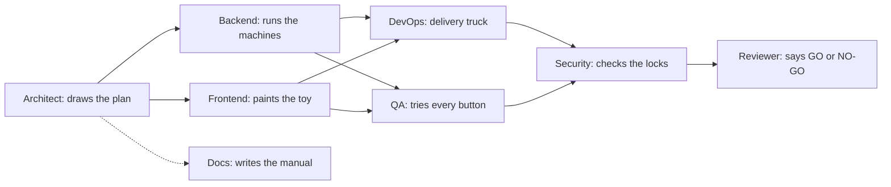
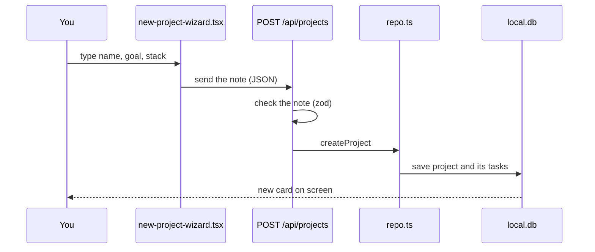
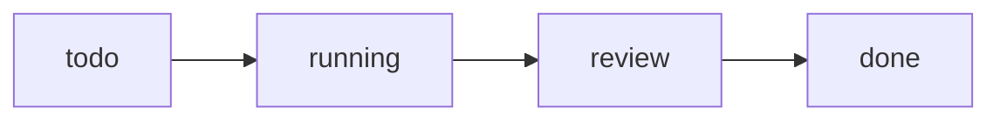
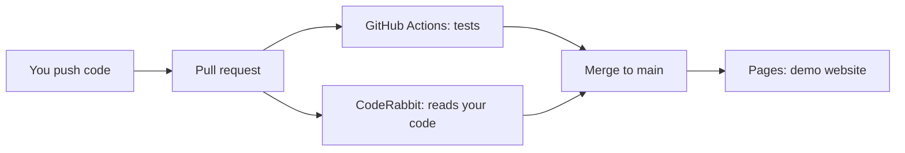

# Ghost AI, explained like you are 5

## The big idea

Imagine a **toy workshop**.

You walk in and say: "I want a toy robot."

A team of helpers makes it. One draws the plan. One builds the machines. One paints it. One packs the box. Another checks it works.

**Ghost AI is that workshop, but for software.** You say what app you want. A team of AI helpers (we call them *agents*) plans it, builds it, tests it and ships it. You watch it happen on a screen.

> Honest note: in this repo the agents are a **simulation**. The app shows how the work would flow, with sample tasks and fake commits. It does not call a real AI model. The workshop is a very good model train set.

## Who is who?

| Agent | Workshop job | Real files |
|---|---|---|
| Architect | Draws the plan | `src/lib/agent-catalog.ts` (the list of agents) |
| Backend | Runs the machines (the server) | `src/app/api/**`, `src/lib/repo.ts`, `src/db/` |
| Frontend | Paints what you see | `src/app/**`, `src/components/**` |
| DevOps | Packs and delivers | `Dockerfile`, `.github/workflows/` |
| QA | Tries every button | (tests are not written yet) |
| Security | Checks the locks | `src/proxy.ts`, `src/lib/api-utils.ts` |
| Docs | Writes the manual | `docs/`, `README.md` |
| Reviewer | Final yes or no | CodeRabbit + you |

Each lead agent has **sub-agents**: small helpers. Think of the Painter having a Colour-Mixer helper and an Animation helper. They are listed under each agent in `src/lib/agent-catalog.ts` (for example Frontend has Pixel Painter, Motion Maker, Access Ally).

## The parts of the shop

| Real thing | Kid analogy | Where |
|---|---|---|
| The website | **Shop window**: what people see | `src/app/page.tsx`, `src/components/landing/` |
| The dashboard | **Control room** with buttons and boards | `src/app/dashboard/`, `src/components/dashboard/` |
| The database (`local.db`) | **Toy box**: where things are kept | `src/db/schema.ts`, `src/db/index.ts` |
| `repo.ts` | **The toy-box keeper**: only person allowed to open the box | `src/lib/repo.ts` |
| API routes | **Order window**: you pass a note in, you get an answer back | `src/app/api/` |
| Clerk | **Doorman with ID cards** (only if you turn him on) | `src/proxy.ts`, `src/components/auth-provider.tsx` |
| Demo mode | **Play shop** with pretend toys, no doorman | `src/lib/client-data.ts`, `src/lib/mock-data.ts` |
| GitHub Actions | **Robot delivery truck**: tests and delivers by itself | `.github/workflows/` |
| CodeRabbit | **Friendly teacher** who checks homework | `.coderabbit.yaml` |
| Docker | **Lunchbox**: the whole shop packed so it runs anywhere | `Dockerfile`, `docker-compose.yml` |

## What happens when you click

### 1. "New project" (make a toy order)

Steps in kid words:

1. You fill in a form. File: `src/components/dashboard/new-project-wizard.tsx`.
2. The form passes a note to the order window. If the server is awake, it goes to `POST /api/projects` (`src/app/api/projects/route.ts`). Rules for a good note (name 2 to 60 letters, goal 10 to 2000, 1 to 20 stack items) live in `src/lib/contracts.ts`.
3. A bad note gets sent back with "400, fix your note".
4. A good note goes to the keeper `createProject` in `src/lib/repo.ts`, who puts it in the toy box and makes a list of tasks.
5. If no server answers (play-shop mode), `createDemo` in `src/lib/client-data.ts` makes a pretend project in your browser instead, and saves it in your browser's memory (`localStorage`).

### 2. "Run next step" (the workers move forward)

Each click moves work one notch:

- the task in **review** becomes **done** (and a commit is added),
- the task that was **running** moves to **review**,
- the next **todo** starts **running**.

Real code: button in `src/components/dashboard/overview.tsx`; calls `runNext` in `src/components/dashboard/store.tsx`; server version is `POST /api/projects/:id/run` -> `advancePipeline` in `src/lib/repo.ts`. In play-shop mode the browser does the same thing with `advance` in `src/lib/sim.ts`. When everything is done the server says "409, nothing left to do".

A *commit* is like a photo of the work at that moment. The **Git** page shows the photos in a timeline.

### 3. "Export" (take your toy home)

1. Open **Exports** in the side menu (`src/app/dashboard/exports/page.tsx` -> `src/components/dashboard/exports.tsx`).
2. Tick what you want: JSON, report, CSV, git log, README, docs.
3. `buildExport` in `src/lib/export.ts` builds the files in your browser.
4. `buildZip` in the same file packs them into a ZIP **without any extra library**, and `downloadZip` hands it to you. Browsers that support it can also write straight into a folder (`saveToFolder`).
5. The server also has a plain download: `GET /api/projects/:id/export?format=md` (or `json`).

## The doorman (login)

Clerk is optional.

- **No keys**: no doorman. Everyone walks in. This is "demo mode".
- **With keys**: the doorman checks ID cards (email or GitHub) before the dashboard, and before any change to `/api/projects`.

One line decides it, in `src/components/auth-provider.tsx`: is `NEXT_PUBLIC_CLERK_PUBLISHABLE_KEY` set, and is `NEXT_PUBLIC_DEMO` not `1`?

## The robot delivery truck and the teacher

- **GitHub Actions** runs checks by itself (typecheck, lint, build, Docker). Files: `.github/workflows/ci.yml`, `codeql.yml`, `pages.yml`.
- **CodeRabbit** leaves friendly comments like a teacher with a red pen. Config: `.coderabbit.yaml`.
- After merging to `main`, the truck builds the **static demo** and puts it on GitHub Pages.

More in [WORKFLOWS.md](WORKFLOWS.md).

## Now you try

1. [RUN-ME.md](RUN-ME.md): start the shop.
2. [CODE-TOUR.md](CODE-TOUR.md): walk through the rooms.
3. [COMMANDS.md](COMMANDS.md): every button on the control panel.
