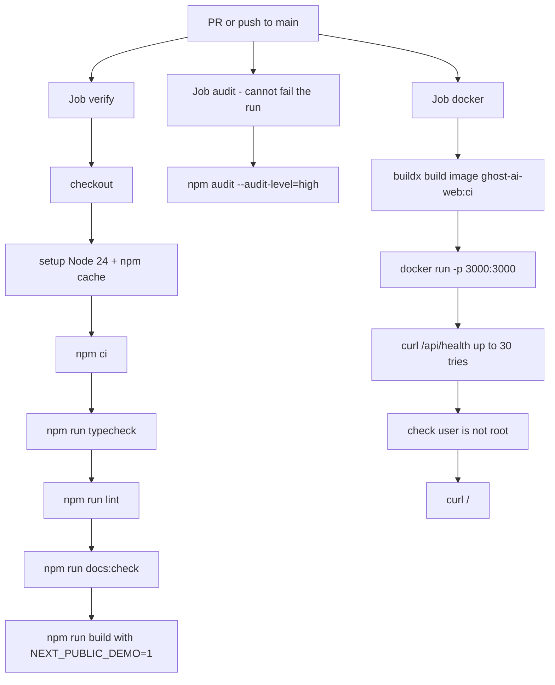
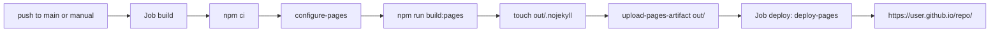
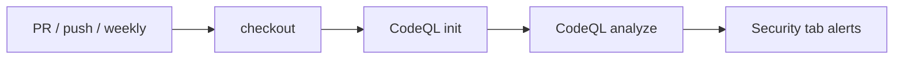
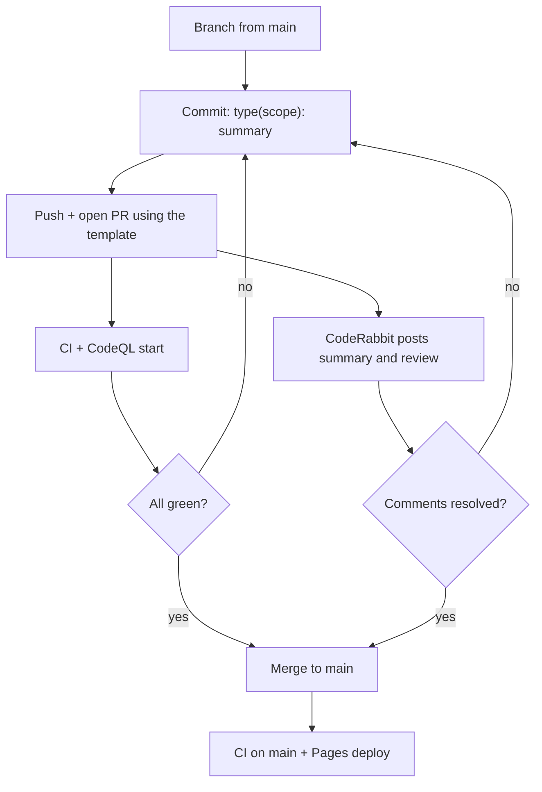
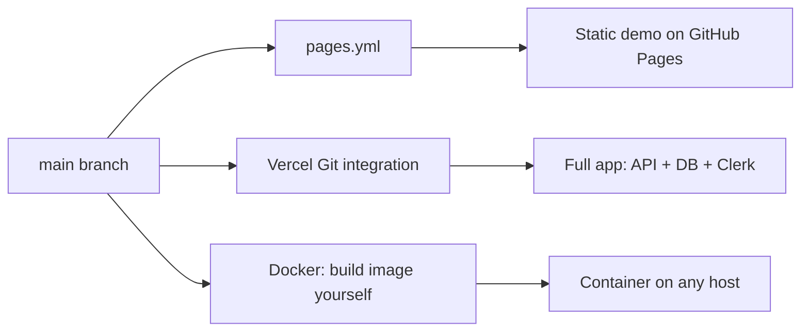
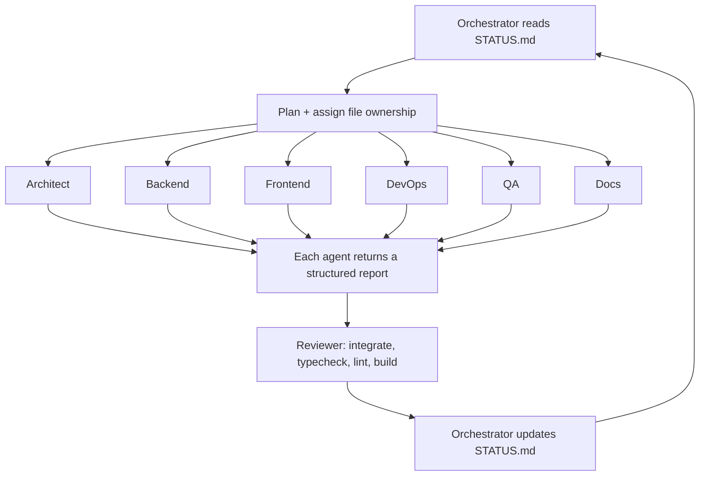

# Workflows

Everything that runs automatically, step by step. Source files: `.github/workflows/ci.yml`, `pages.yml`, `codeql.yml`, `.github/dependabot.yml`, `.coderabbit.yaml`.

## 1. CI (`ci.yml`)

Runs on every pull request and every push to `main`. A newer run on the same branch cancels the older one. Permissions: read-only.

| Job (display name) | Steps | Fails the PR? |
|---|---|---|
| `verify` ("Typecheck, lint, build") | checkout, Node 24, `npm ci`, `typecheck`, `lint`, `docs:check`, `build` (with `NEXT_PUBLIC_DEMO=1`) | yes |
| `audit` ("npm audit (non-blocking)") | `npm audit --audit-level=high` | no (`continue-on-error`) |
| `docker` ("Docker build and smoke test") | build the image (GitHub Actions cache), start it, poll `/api/health` every 2 s up to 30 times, confirm the process user id is not 0, fetch `/`, always print container logs | yes |

Run the same checks yourself: [COMMANDS.md](COMMANDS.md#1-npm-scripts).

## 2. GitHub Pages (`pages.yml`)

Runs on push to `main` and by hand (Actions tab, "Run workflow").

Details:

- `build:pages` runs `scripts/pages-build.mjs`. It moves `src/app/api`, `src/proxy.ts` (and `src/middleware.ts` if present) into `.pages-stash/`, runs `next build` with `GITHUB_PAGES=true` and `NEXT_PUBLIC_DEMO=1`, then always moves them back.
- `NEXT_PUBLIC_BASE_PATH=/<repo name>` is set so links work under `https://<user>.github.io/<repo>/`.
- `next.config.ts` switches to `output: "export"` when `GITHUB_PAGES=true`.
- The result is fully static: no API, no database, no login. The dashboard runs on browser mock data ([CODE-TOUR.md](CODE-TOUR.md#demo-mode-vs-live-mode)).
- One-time setup: repo Settings -> Pages -> Source: **GitHub Actions**.

## 3. CodeQL (`codeql.yml`)

Runs on PRs to `main`, pushes to `main`, and weekly (Mondays 03:17 UTC). Steps: checkout, `codeql-action/init` for `javascript-typescript`, `codeql-action/analyze`. Results appear under Security -> Code scanning.

## 4. Dependabot

`.github/dependabot.yml`: weekly update PRs for npm (minor and patch grouped, max 5 open), GitHub Actions and the Docker base image.

## PR lifecycle

CodeRabbit (`.coderabbit.yaml`): profile `assertive`, requests changes until its comments are resolved, auto-reviews non-draft PRs into `main`, ignores lockfiles, `.next`, `out`, SVG and `docs/diagrams`. It has extra instructions per path (API routes need zod validation and auth checks; components need accessibility; docs must match the code and valid Mermaid; workflows need least privilege). Install and chat commands (`@coderabbitai review`, `resolve`, `pause`...) are in [coderabbit.md](coderabbit.md).

Recommended branch protection for `main` (Settings -> Branches): require a PR, require the checks `Typecheck, lint, build` and `Docker build and smoke test`.

## Deploy flows

- **GitHub Pages**: automatic via `pages.yml` (above). Mock data only.
- **Vercel**: import the repo in Vercel; `vercel.json` sets `npm ci` and `npm run build`. Add env vars in the Vercel dashboard (Clerk keys, `DATABASE_URL` + `DATABASE_AUTH_TOKEN` for Turso; a local file does not persist on serverless). No workflow in this repo deploys to Vercel; it relies on Vercel's own Git integration.
- **Docker**: CI builds and smoke-tests the image but does **not** push it to any registry. To deploy, build it yourself (`npm run docker:build`) and run it.

## Multi-agent build loop

How this project itself was built (the same cast as the product):

Rules (see [agents.md](agents.md)): each agent edits only the files it owns; each returns a report with Status, What I Did, Files, Tests Run, Risks, Next Steps; only the orchestrator writes `STATUS.md` (current goal, health, completed, not verified, next). Read `STATUS.md` first to see where the project stands.
