# Building Ghost AI from Scratch

An annotated, reproducible mirror of the Ghost AI repository: the story, the architecture, every source file, the layout and the execution log.

- Generated from commit `df2a896` (2026-11-02, "docs: update README, code tour and auth guide for the redesign; extend commit history; ignore agent scratch files")
- Generator: `node scripts/build-book.mjs` (`npm run docs:book`)
- Repository: Ghost AI, package `web` 0.1.0

## Table of contents

- [How to read this book](#how-to-read-this-book)

**Part I. The story**

- [1. The product brief](#1-the-product-brief)
- [2. Multi-agent orchestration](#2-multi-agent-orchestration)
- [3. The build timeline](#3-the-build-timeline)
- [4. Problems hit and how they were solved](#4-problems-hit-and-how-they-were-solved)

**Part II. Architecture and design**

- [5. Context](#5-context)
- [6. Ghost AI in plain words](#6-ghost-ai-in-plain-words)
- [7. Architecture](#7-architecture)
- [8. Connectivity](#8-connectivity)
- [9. Methods and API summary](#9-methods-and-api-summary)
- [10. Logs and conventions](#10-logs-and-conventions)
- [11. Agents](#11-agents)
- [12. Authentication](#12-authentication)
- [13. DevOps guide](#13-devops-guide)
- [14. CodeRabbit](#14-coderabbit)
- [15. ADR 0001: Technology stack](#15-adr-0001-technology-stack)
- [16. Code tour](#16-code-tour)
- [17. Run me](#17-run-me)
- [18. Explain like I'm 5](#18-explain-like-im-5)
- [19. Commands](#19-commands)
- [20. Workflows](#20-workflows)
- [21. Documentation index](#21-documentation-index)

**Part III. Complete source code**

- [22. How to read the listings](#22-how-to-read-the-listings)
- [23. Root configuration, containers and tooling](#23-root-configuration-containers-and-tooling)
- [24. Root documents](#24-root-documents)
- [25. GitHub automation and templates](#25-github-automation-and-templates)
- [26. Scripts](#26-scripts)
- [27. Shared library and data layer](#27-shared-library-and-data-layer)
- [28. API route handlers](#28-api-route-handlers)
- [29. App shell, styles and public pages](#29-app-shell-styles-and-public-pages)
- [30. Dashboard routes](#30-dashboard-routes)
- [31. Components: UI primitives, brand and auth](#31-components-ui-primitives-brand-and-auth)
- [32. Components: site chrome](#32-components-site-chrome)
- [33. Components: landing page](#33-components-landing-page)
- [34. Components: marketing pages](#34-components-marketing-pages)
- [35. Components: dashboard](#35-components-dashboard)
- [36. Tests](#36-tests)
- [37. Public assets](#37-public-assets)
- [38. Book generator inputs](#38-book-generator-inputs)
- [39. Other files](#39-other-files)

**Part IV. Layout and structure**

- [40. Directory tree](#40-directory-tree)
- [41. Route map](#41-route-map)
- [42. Data model](#42-data-model)
- [43. Design-token reference](#43-design-token-reference)
- [44. Component inventory](#44-component-inventory)
- [45. Agent and stack catalogues](#45-agent-and-stack-catalogues)
- [46. API reference with curl examples](#46-api-reference-with-curl-examples)

**Part V. Execution log**

- [47. What was run and what happened](#47-what-was-run-and-what-happened)

**Part A. Appendices**

- [A. Environment variable reference](#a-environment-variable-reference)
- [B. Troubleshooting](#b-troubleshooting)
- [C. Glossary](#c-glossary-kid-friendly)
- [D. License note](#d-license-note)
- [E. Changelog](#e-changelog)
- [F. File index](#f-file-index)

## How to read this book

This book is generated from the Ghost AI repository by `node scripts/build-book.mjs`. Every listing, table, count and command result in it is read from the repository or captured when the book was built; nothing is copied by hand except the narrative paragraphs, which are kept in `docs/book/chapters/` and `docs/book/file-notes.json`. If the code changes, rebuild the book and it changes with it.

### Who it is for

- **A newcomer** who wants to understand what Ghost AI is and how it was made: read Part I, then the "Explain like I'm 5" and "Run me" chapters in Part II.
- **A developer** who wants to change the code: read the architecture and code-tour chapters in Part II, then use Part III as an annotated reference. Each file has a short "what, why, how it connects" note before its full listing.
- **A reviewer or operator** who wants to know what has actually been checked: go straight to Part V, which separates what was verified (with the command and result) from what was not.

### How the parts fit together

| Part | Question it answers |
|---|---|
| I. The story | What was built, by whom, in what order, and what went wrong on the way? |
| II. Architecture and design | How is the system put together, and how do you run, operate and review it? |
| III. Complete source code | What is in every tracked source and configuration file? |
| IV. Layout and structure | Where is everything: directories, routes, data model, design tokens, components, API? |
| V. Execution log | Which commands were run, what happened, and what has not been verified? |
| Appendices | Environment variables, troubleshooting, glossary, license note, changelog, file index. |

### Conventions

- File paths are relative to the repository root (the folder that contains `package.json`).
- Code listings in Part III have line numbers; long lines wrap, and the wrapped continuation carries no number.
- A line such as "Exports: ..." is detected automatically from the source text; it is a convenience, not a full type analysis.
- "Demo mode" means the app runs without Clerk keys and, in the static build, simulates the backend in the browser.
- The product's agents are simulated. That is stated in the changelog's known gaps and repeated here so nobody reads this book as a claim that real model calls happen inside the app.

### What this book is not

It is not a tutorial that you can follow line by line to recreate the project from an empty folder: the repository is the tutorial, and the book is its annotated mirror. Length comes from the content that actually exists (roughly eleven thousand lines of source, configuration, tests and documentation). The PDF page count is measured from the generated file and reported in the build summary rather than promised in advance.


# Part I. The story

What was built, in what order, by which agents, and what went wrong along the way.

- [1. The product brief](#1-the-product-brief)
- [2. Multi-agent orchestration](#2-multi-agent-orchestration)
- [3. The build timeline](#3-the-build-timeline)
- [4. Problems hit and how they were solved](#4-problems-hit-and-how-they-were-solved)

## 1. The product brief

Ghost AI is a web application where you give a goal and a technology stack, and a crew of specialised agents plans, builds, reviews and ships a software-as-a-service product while you watch. The pitch fits in one sentence: *one place to feed in a goal and a stack, and watch agents plan tasks, split modules, commit code and ship.*

The brief below is the project's own, taken verbatim from `docs/product-brief.md`.

**Problem**: Teams building with AI agents lack one place to feed in a goal + tech stack and watch specialised agents plan tasks, split modules, commit code and ship.
**Users**: Solo founders and small teams shipping SaaS with agent help.
**Core features**: (1) Create a project from brief + stack, (2) Agent roster with live status, (3) Task board by module, (4) Git-log timeline of agent commits, (5) Flow graph of the pipeline (Architect→Backend/Frontend→DevOps/QA→Security→Reviewer), (6) Auth (Clerk) with demo-mode fallback.
**NFRs**: deploys on Vercel (full stack) and GitHub Pages (static demo), SQLite/libSQL (Turso in prod), no secrets required to run locally.
**Stack**: Next.js (App Router), React, Tailwind v4, shadcn/ui, Clerk, Drizzle + libSQL, Zod, framer-motion.


### What the brief turned into

The six core features in the brief map directly onto routes and files that exist in the repository today:

| Brief item | Where it lives |
|---|---|
| Create a project from brief and stack | `/dashboard/projects` plus the three-step wizard in `src/components/dashboard/new-project-wizard.tsx`; `POST /api/projects` on the server side |
| Agent roster with live status | `/dashboard/agents`, `src/components/dashboard/agents.tsx`; `AgentState` derived in `src/lib/repo.ts` |
| Task board by module | `/dashboard/tasks`, `src/components/dashboard/tasks.tsx` (kanban with drag and drop) |
| Git-log timeline of agent commits | `/dashboard/git`, `src/components/dashboard/gitlog.tsx`; `GET /api/projects/:id/gitlog` |
| Flow graph of the pipeline | `/dashboard/flow`, `src/components/dashboard/flow.tsx` |
| Auth (Clerk) with demo-mode fallback | `src/components/auth-provider.tsx`, `src/proxy.ts`, `src/lib/auth.ts` |

Beyond the brief, the build added an `exports` view that bundles a generated project as a ZIP in the browser, a marketing site (agents, how-it-works, demo, docs, API reference, pricing, security, changelog), and a full DevOps surface (Docker, CI, CodeQL, Pages, Dependabot, CodeRabbit).

### Honest scope

The agents inside the product are a *simulation*: `src/lib/sim.ts` advances tasks through `todo`, `running`, `review` and `done` deterministically and invents plausible log lines and commits. No model is called at runtime. The project's own changelog lists this under "Known gaps". What is real is the product shell around that simulation: the data model, the API with validation, rate limiting and optional authentication, the dashboard, the export bundle, the tests and the delivery pipeline.

### The demo, as recorded

The repository includes a recorded product tour (`public/demo/ghost-ai-demo.webm`, about 89 seconds, produced by `scripts/record-demo.mjs`). Its poster frame:

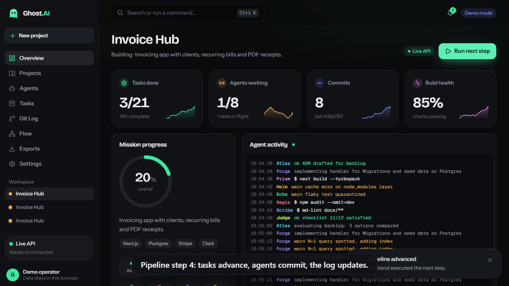


## 2. Multi-agent orchestration

Ghost AI was built the way it describes itself: by a team of role-specialised agents coordinated by one orchestrator. This chapter explains that arrangement, using only what the repository records.

### The orchestrator and the role agents

One orchestrating session owned the plan, the contracts and `STATUS.md` (the code tour calls `STATUS.md` "owned by the orchestrator"). Work was delegated to role agents, each with a narrow remit. The roster below is the project's own, from `docs/agents.md`, and it is the same roster the product shows to its users.

| Agent | Responsibility |
|---|---|
| Architect | Brief, contracts, module split, mock data |
| Backend | API routes, DB schema, validation |
| Frontend | Pages, components, UX |
| DevOps | Docker, CI/CD, hosting config |
| QA | Tests and acceptance checks |
| Security | Auth, secrets, dependency and input review |
| Docs | README, RUN-ME, COMMANDS, WORKFLOWS, CODE-TOUR, architecture, ADRs |
| Reviewer | Final review and integration sign-off |

Two rules from `docs/agents.md` shaped the whole build:

1. **Each agent edits only the files it owns.** This is what makes parallel work safe: the Frontend agent does not touch `src/app/api`, the Docs agent does not touch `src/**`, and the DevOps agent owns the Dockerfile, workflows and build scripts. (The book you are reading was written under the same rule: its generator may only create `scripts/build-book.mjs` and files under `docs/book/`.)
2. **Every agent ends with a structured report**: status (done, partial or blocked), what it did, files, tests run, risks and next steps. The orchestrator reads reports, not diffs, and records the verified facts in `STATUS.md`.

### Contracts first

The Architect's first deliverable is the contract that every other agent codes against. In this repository that is `src/lib/contracts.ts` (Zod schemas and shared types: `ProjectInput`, `Project`, `Task`, `GitLog`, `AgentState`, `ProjectDetail`, `Stats`) together with the agent catalogue in `src/lib/agent-catalog.ts`, the stack catalogue, and the mock data. `docs/context.md` names `contracts.ts` as the source of truth. Backend, Frontend and QA all import from it, so type errors rather than meetings catch disagreements, and `tsc --noEmit` is the integration check.

### The pipeline, as a product and as a process

The product brief defines the flow graph: *Architect, then Backend and Frontend, then DevOps and QA, then Security, then Reviewer.* The build followed the same shape:

| Stage | Agents | Repository evidence |
|---|---|---|
| Plan | Architect | `docs/product-brief.md`, `docs/adr/0001-stack.md`, `src/lib/contracts.ts`, `src/lib/mock-data.ts` |
| Build | Backend, Frontend | `src/db`, `src/lib/repo.ts`, `src/app/api/**`; landing, marketing and dashboard components |
| Ship and test | DevOps, QA | `Dockerfile`, `.github/workflows/*`, `scripts/*`; `tests/e2e/*`, `playwright.config.ts` |
| Harden | Security | `src/proxy.ts`, rate limiting in `src/lib/api-utils.ts`, CodeQL workflow, `npm audit` job |
| Explain | Docs | `README.md`, `docs/*` |
| Sign off | Reviewer | `.coderabbit.yaml`, PR template, CODEOWNERS |

### Sub-agents ("side agents")

Each lead agent in `src/lib/agent-catalog.ts` has three sub-agents with their own names and one-line roles. They appear in the product as the cards you expand on the landing page, `/agents/[slug]`, and the dashboard's Agents view, and they are what the `Task.subAgent` column refers to. The full table, generated from the catalogue:

| Lead agent | Sub-agent id | Name | Role |
|---|---|---|---|
| **Architect** (ATLAS) | `arch-stack` | Stack Scout | Picks libraries that fit your stack |
|  | `arch-schema` | Schema Smith | Designs tables and relations |
|  | `arch-contract` | Contract Clerk | Writes the API contract |
| **Backend** (FORGE) | `be-db` | Data Digger | Migrations and seed data |
|  | `be-api` | Route Runner | REST endpoints with validation |
|  | `be-auth` | Gatekeeper | Sessions, roles, permissions |
| **Frontend** (PRISM) | `fe-ui` | Pixel Painter | Components and layout |
|  | `fe-motion` | Motion Maker | Animations and transitions |
|  | `fe-a11y` | Access Ally | Accessibility and responsive checks |
| **DevOps** (HELM) | `do-ci` | Pipeline Pilot | CI workflows |
|  | `do-box` | Box Builder | Dockerfiles and images |
|  | `do-watch` | Watch Tower | Health checks and logs |
| **QA** (ECHO) | `qa-e2e` | Click Tester | End-to-end browser tests |
|  | `qa-unit` | Unit Inspector | Function-level tests |
|  | `qa-load` | Load Lifter | Stress and speed checks |
| **Security** (AEGIS) | `sec-dep` | Dependency Dog | Scans packages for known holes |
|  | `sec-authz` | Authz Auditor | Checks who can do what |
|  | `sec-secret` | Secret Sniffer | Finds leaked keys |
| **Docs** (SCRIBE) | `doc-eli5` | Kid Translator | Plain-language explainers |
|  | `doc-api` | API Archivist | Endpoint reference |
|  | `doc-log` | Changelog Keeper | Release notes |
| **Reviewer** (JUDGE) | `rev-pr` | PR Patrol | Reviews every pull request |
|  | `rev-style` | Style Sheriff | Consistency and lint |
|  | `rev-ship` | Ship Marshal | Definition-of-done check |

### Commits as the audit trail

`docs/logs.md` fixes the commit format as Conventional Commits (`type(scope): summary`) and says real agent commits carry `Co-Authored-By` trailers. The history in the next chapter follows that. The multi-agent nature of the work is visible in the commit titles themselves: "checkpoint multi-agent build (phase 1 in progress)", then "phase 1 agents output", then the QA, DevOps and Docs deliverables landing as separate commits.

### What orchestration did not solve

Parallel agents sharing one working directory are not isolated, and Chapter 4 documents the consequences: a build script run by one agent moved files another agent was editing, and file locks on a OneDrive-synced `.next` folder broke builds. The fixes (a lock directory in `scripts/pages-build.mjs`, documentation of the OneDrive problem) are small, but the lesson is structural: agents need separate worktrees or explicit locks for any tool that mutates shared paths.


## 3. The build timeline

The repository has **20 commits** in total (2026-11-01 to 2026-11-02), touching 195 distinct paths with 51,093 lines added and 6,463 removed (lockfile and binary files included in the counts where git reports them). The list below is chronological and is generated from `git log --stat`; times are as recorded by git, in the author's time zone.

### At a glance

| # | Commit | Date and time | Files | Added | Removed | Message |
|---|---|---|---|---|---|---|
| 1 | `0c701eb` | 2026-11-01 20:35:05 +05:30 | 17 | 7,088 | 0 | Initial commit from Create Next App |
| 2 | `468f9a9` | 2026-11-01 21:13:34 +05:30 | 133 | 20,161 | 4,239 | chore: checkpoint multi-agent build (phase 1 in progress) |
| 3 | `3f85f45` | 2026-11-01 21:16:33 +05:30 | 14 | 283 | 1 | feat: phase 1 agents output (api routes restored, dashboard v2, marketing, auth) |
| 4 | `9da51aa` | 2026-11-01 21:32:19 +05:30 | 23 | 1,576 | 40 | test: Playwright e2e suite (site, dashboard, API) on Edge channel |
| 5 | `cc54900` | 2026-11-01 21:34:23 +05:30 | 3 | 99 | 0 | fix(pages): flatten static-export segment files on Windows; add static smoke test |
| 6 | `0befd76` | 2026-11-01 21:43:00 +05:30 | 7 | 210 | 10 | feat(demo): record-demo script, demo video + poster, e2e teardown |
| 7 | `a12927f` | 2026-11-01 21:44:15 +05:30 | 1 | 15 | 11 | docs: update STATUS with verified/unverified state |
| 8 | `163c25f` | 2026-11-01 22:04:05 +05:30 | 5 | 17 | 2 | fix(ci): make typecheck pass on clean checkout, gate CodeQL on public repos, audit prod deps only; track .env.example |
| 9 | `b99e188` | 2026-11-01 22:11:32 +05:30 | 13 | 16,737 | 1 | docs(book): generate 'Building Ghost AI from Scratch' (md + pdf) via scripts/build-book.mjs |
| 10 | `c77d3de` | 2026-11-01 22:12:47 +05:30 | 10 | 1,434 | 55 | docs: premium README, Ghost Notebook, fork guide, link checker and report |
| 11 | `1726171` | 2026-11-01 22:14:41 +05:30 | 8 | 1,232 | 75 | fix: correct GitHub owner in CODEOWNERS and site link; add commit history; rebuild book |
| 12 | `4f081f9` | 2026-11-01 22:20:14 +05:30 | 2 | 5 | 11 | docs: drop unresolved nbviewer link; refresh link report (0 failures) |
| 13 | `27f1a67` | 2026-11-01 23:06:07 +05:30 | 9 | 194 | 10 | fix(auth): make real Clerk sign-in work end to end |
| 14 | `ef6f662` | 2026-11-01 23:42:02 +05:30 | 17 | 409 | 287 | Design system overhaul: Ink & Signal tokens, fonts, logo, ui kit, site chrome |
| 15 | `f2d44a4` | 2026-11-01 23:42:51 +05:30 | 3 | 8 | 1 | chore: NEXT_DIST_DIR so parallel builds do not collide |
| 16 | `865fa95` | 2026-11-01 23:50:04 +05:30 | 8 | 481 | 793 | Redesign home page in Ink & Signal system |
| 17 | `45b62c4` | 2026-11-02 01:15:28 +05:30 | 19 | 416 | 337 | Restyle marketing pages and auth screens with Ink & Signal |
| 18 | `d97ef0a` | 2026-11-02 01:15:38 +05:30 | 12 | 696 | 583 | Dashboard redesign: Ink & Signal shell, KPI tiles, kanban, timeline, flow graph, dialogs |
| 19 | `61a1b73` | 2026-11-02 01:27:20 +05:30 | 3 | 2 | 2 | feat(demo): re-record demo video and poster on the Ink & Signal redesign |
| 20 | `df2a896` | 2026-11-02 01:28:09 +05:30 | 5 | 30 | 5 | docs: update README, code tour and auth guide for the redesign; extend commit history; ignore agent scratch files |

Lines added per commit, excluding `package-lock.json` (a bar is proportional to the largest commit):

```text
 1 0c701eb  #                                                  310
 2 468f9a9  #####################                              8,488
 3 3f85f45  #                                                  283
 4 9da51aa  ####                                               1,504
 5 cc54900                                                     99
 6 0befd76  #                                                  210
 7 a12927f                                                     15
 8 163c25f                                                     17
 9 b99e188  ##########################################         16,737
10 c77d3de  ####                                               1,434
11 1726171  ###                                                1,232
12 4f081f9                                                     5
13 27f1a67                                                     153
14 ef6f662  #                                                  409
15 f2d44a4                                                     8
16 865fa95  #                                                  481
17 45b62c4  #                                                  416
18 d97ef0a  ##                                                 696
19 61a1b73                                                     2
20 df2a896                                                     30
```

### 1. `0c701eb` Initial commit from Create Next App

- **Date:** 2026-11-01T20:35:05+05:30
- **Author:** Pranith
- **Full hash:** `0c701eb6a62c673e7799ecb7369ce2dd2daf210d`
- **Change size:** 17 files, +7,088 / -0
- **Status mix:** 17 added

The untouched `create-next-app` scaffold: Next.js app router, Tailwind setup, default assets and TypeScript/ESLint configuration. Everything after this commit is the Ghost AI build.

Where the files landed: `(root)` 8, `public` 5, `src/app` 4.

| St | File | Added | Removed |
|---|---|---|---|
| A | `.gitignore` | 41 | 0 |
| A | `AGENTS.md` | 9 | 0 |
| A | `README.md` | 36 | 0 |
| A | `eslint.config.mjs` | 18 | 0 |
| A | `next.config.ts` | 17 | 0 |
| A | `package-lock.json` | 6778 | 0 |
| A | `package.json` | 26 | 0 |
| A | `public/file.svg` | 1 | 0 |
| A | `public/globe.svg` | 1 | 0 |
| A | `public/next.svg` | 1 | 0 |
| A | `public/vercel.svg` | 1 | 0 |
| A | `public/window.svg` | 1 | 0 |
| A | `src/app/favicon.ico` | bin | bin |
| A | `src/app/globals.css` | 26 | 0 |
| A | `src/app/layout.tsx` | 29 | 0 |
| A | `src/app/page.tsx` | 69 | 0 |
| A | `tsconfig.json` | 34 | 0 |

### 2. `468f9a9` chore: checkpoint multi-agent build (phase 1 in progress)

- **Date:** 2026-11-01T21:13:34+05:30
- **Author:** Pranith
- **Full hash:** `468f9a935b90403f93454e80000419bef148b9aa`
- **Change size:** 133 files, +20,161 / -4,239
- **Status mix:** 124 added, 8 modified, 1 deleted

Commit message body:

```text
Co-Authored-By: Claude Sonnet 5.5 <noreply@anthropic.com>
```

A checkpoint of the first multi-agent phase, committed while work was still in progress. It is by far the largest commit: the landing page, marketing pages, the dashboard (store, shell, views), the simulation library, auth wiring, the Docker/CI/Pages/CodeQL/Dependabot/CodeRabbit files, the Mermaid tooling and most of `docs/`. `package-lock.json` alone accounts for a large share of the line counts.

Where the files landed: `src/components` 46, `src/app` 28, `docs` 18, `(root)` 13, `src/lib` 12, `.github` 9, `public` 2, `scripts` 2, `src/db` 2, `src/proxy.ts` 1.

| St | File | Added | Removed |
|---|---|---|---|
| A | `.coderabbit.yaml` | 41 | 0 |
| A | `.dockerignore` | 15 | 0 |
| A | `.github/CODEOWNERS` | 6 | 0 |
| A | `.github/ISSUE_TEMPLATE/bug_report.yml` | 15 | 0 |
| A | `.github/ISSUE_TEMPLATE/config.yml` | 1 | 0 |
| A | `.github/ISSUE_TEMPLATE/feature_request.yml` | 11 | 0 |
| A | `.github/PULL_REQUEST_TEMPLATE.md` | 15 | 0 |
| A | `.github/dependabot.yml` | 15 | 0 |
| A | `.github/workflows/ci.yml` | 66 | 0 |
| A | `.github/workflows/codeql.yml` | 20 | 0 |
| A | `.github/workflows/pages.yml` | 41 | 0 |
| M | `.gitignore` | 6 | 0 |
| A | `Dockerfile` | 33 | 0 |
| M | `README.md` | 24 | 26 |
| A | `STATUS.md` | 13 | 0 |
| A | `components.json` | 25 | 0 |
| A | `docker-compose.yml` | 16 | 0 |
| A | `docs/adr/0001-stack.md` | 14 | 0 |
| A | `docs/agents.md` | 22 | 0 |
| A | `docs/architecture.md` | 69 | 0 |
| A | `docs/auth.md` | 37 | 0 |
| A | `docs/coderabbit.md` | 23 | 0 |
| A | `docs/connectivity.md` | 21 | 0 |
| A | `docs/context.md` | 7 | 0 |
| A | `docs/devops.md` | 46 | 0 |
| A | `docs/diagrams/architecture-1.svg` | 99 | 0 |
| A | `docs/diagrams/architecture-2.svg` | 99 | 0 |
| A | `docs/diagrams/architecture-3.svg` | 99 | 0 |
| A | `docs/diagrams/architecture-4.svg` | 99 | 0 |
| A | `docs/diagrams/connectivity-1.svg` | 99 | 0 |
| A | `docs/diagrams/devops-1.svg` | 99 | 0 |
| A | `docs/logs.md` | 13 | 0 |
| A | `docs/methods.md` | 17 | 0 |
| A | `docs/product-brief.md` | 7 | 0 |
| A | `docs/prose.md` | 5 | 0 |
| A | `drizzle.config.ts` | 10 | 0 |
| M | `next.config.ts` | 16 | 3 |
| M | `package-lock.json` | 11673 | 4115 |
| M | `package.json` | 27 | 2 |
| A | `public/brand/ghost-ai-logo.svg` | 1 | 0 |
| A | `public/demo/README.md` | 1 | 0 |
| A | `scripts/check-mermaid.mjs` | 87 | 0 |
| A | `scripts/pages-build.mjs` | 35 | 0 |
| A | `src/app/(auth)/sign-in/[[...sign-in]]/page.tsx` | 13 | 0 |
| A | `src/app/(auth)/sign-up/[[...sign-up]]/page.tsx` | 12 | 0 |
| A | `src/app/(marketing)/agents/[slug]/page.tsx` | 74 | 0 |
| A | `src/app/(marketing)/agents/page.tsx` | 37 | 0 |
| A | `src/app/(marketing)/api-reference/page.tsx` | 34 | 0 |
| A | `src/app/(marketing)/changelog/page.tsx` | 50 | 0 |
| A | `src/app/(marketing)/demo/page.tsx` | 32 | 0 |
| A | `src/app/(marketing)/docs/[slug]/page.tsx` | 44 | 0 |
| A | `src/app/(marketing)/docs/page.tsx` | 30 | 0 |
| A | `src/app/(marketing)/how-it-works/page.tsx` | 136 | 0 |
| A | `src/app/(marketing)/pricing/page.tsx` | 87 | 0 |
| A | `src/app/(marketing)/security/page.tsx` | 54 | 0 |
| A | `src/app/dashboard/agents/page.tsx` | 8 | 0 |
| A | `src/app/dashboard/exports/page.tsx` | 8 | 0 |
| A | `src/app/dashboard/flow/page.tsx` | 8 | 0 |
| A | `src/app/dashboard/git/page.tsx` | 8 | 0 |
| A | `src/app/dashboard/layout.tsx` | 8 | 0 |
| A | `src/app/dashboard/page.tsx` | 5 | 0 |
| A | `src/app/dashboard/projects/page.tsx` | 8 | 0 |
| A | `src/app/dashboard/settings/page.tsx` | 8 | 0 |
| A | `src/app/dashboard/tasks/page.tsx` | 8 | 0 |
| D | `src/app/favicon.ico` | bin | bin |
| A | `src/app/ghost-kit.css` | 61 | 0 |
| M | `src/app/globals.css` | 191 | 15 |
| A | `src/app/icon.svg` | 1 | 0 |
| M | `src/app/layout.tsx` | 12 | 14 |
| A | `src/app/not-found.tsx` | 21 | 0 |
| M | `src/app/page.tsx` | 5 | 64 |
| A | `src/components/auth-provider.tsx` | 11 | 0 |
| A | `src/components/auth/appearance.ts` | 19 | 0 |
| A | `src/components/auth/auth-nav.tsx` | 23 | 0 |
| A | `src/components/auth/auth-shell.tsx` | 66 | 0 |
| A | `src/components/auth/clerk-form.tsx` | 16 | 0 |
| A | `src/components/auth/clerk-nav.tsx` | 30 | 0 |
| A | `src/components/brand/logo.tsx` | 39 | 0 |
| A | `src/components/dashboard/agents.tsx` | 226 | 0 |
| A | `src/components/dashboard/exports.tsx` | 127 | 0 |
| A | `src/components/dashboard/flow.tsx` | 156 | 0 |
| A | `src/components/dashboard/gitlog.tsx` | 134 | 0 |
| A | `src/components/dashboard/kit.tsx` | 154 | 0 |
| A | `src/components/dashboard/new-project-wizard.tsx` | 165 | 0 |
| A | `src/components/dashboard/overview.tsx` | 110 | 0 |
| A | `src/components/dashboard/projects.tsx` | 100 | 0 |
| A | `src/components/dashboard/settings.tsx` | 106 | 0 |
| A | `src/components/dashboard/shell.tsx` | 275 | 0 |
| A | `src/components/dashboard/store.tsx` | 359 | 0 |
| A | `src/components/dashboard/tasks.tsx` | 157 | 0 |
| A | `src/components/landing/agent-terminal.tsx` | 75 | 0 |
| A | `src/components/landing/crew.tsx` | 103 | 0 |
| A | `src/components/landing/hero.tsx` | 145 | 0 |
| A | `src/components/landing/io-demo.tsx` | 250 | 0 |
| A | `src/components/landing/landing.tsx` | 23 | 0 |
| A | `src/components/landing/pipeline-diagram.tsx` | 88 | 0 |
| A | `src/components/landing/reveal.tsx` | 89 | 0 |
| A | `src/components/landing/static-sections.tsx` | 406 | 0 |
| A | `src/components/marketing/agent-directory.tsx` | 72 | 0 |
| A | `src/components/marketing/agent-extras.ts` | 52 | 0 |
| A | `src/components/marketing/api-explorer.tsx` | 78 | 0 |
| A | `src/components/marketing/copy-button.tsx` | 32 | 0 |
| A | `src/components/marketing/demo-player.tsx` | 107 | 0 |
| A | `src/components/marketing/guides.ts` | 48 | 0 |
| A | `src/components/marketing/ui.tsx` | 90 | 0 |
| A | `src/components/site/mobile-nav.tsx` | 79 | 0 |
| A | `src/components/site/nav-data.ts` | 9 | 0 |
| A | `src/components/site/site-footer.tsx` | 105 | 0 |
| A | `src/components/site/site-header.tsx` | 48 | 0 |
| A | `src/components/site/site-shell.tsx` | 14 | 0 |
| A | `src/components/ui/badge.tsx` | 51 | 0 |
| A | `src/components/ui/button.tsx` | 57 | 0 |
| A | `src/components/ui/card.tsx` | 102 | 0 |
| A | `src/components/ui/dialog.tsx` | 160 | 0 |
| A | `src/components/ui/input.tsx` | 19 | 0 |
| A | `src/components/ui/table.tsx` | 115 | 0 |
| A | `src/components/ui/tabs.tsx` | 81 | 0 |
| A | `src/db/index.ts` | 51 | 0 |
| A | `src/db/schema.ts` | 41 | 0 |
| A | `src/lib/agent-catalog.ts` | 29 | 0 |
| A | `src/lib/api-utils.ts` | 71 | 0 |
| A | `src/lib/auth.ts` | 9 | 0 |
| A | `src/lib/client-data.ts` | 129 | 0 |
| A | `src/lib/contracts.ts` | 30 | 0 |
| A | `src/lib/export.ts` | 266 | 0 |
| A | `src/lib/mock-data.ts` | 28 | 0 |
| A | `src/lib/openapi.ts` | 58 | 0 |
| A | `src/lib/repo.ts` | 232 | 0 |
| A | `src/lib/sim.ts` | 322 | 0 |
| A | `src/lib/stack-catalog.ts` | 36 | 0 |
| A | `src/lib/utils.ts` | 1 | 0 |
| A | `src/proxy.ts` | 30 | 0 |
| A | `vercel.json` | 6 | 0 |

### 3. `3f85f45` feat: phase 1 agents output (api routes restored, dashboard v2, marketing, auth)

- **Date:** 2026-11-01T21:16:33+05:30
- **Author:** Pranith
- **Full hash:** `3f85f45fb187fbc61feac49a7edb3ad393767272`
- **Change size:** 14 files, +283 / -1
- **Status mix:** 1 modified, 13 added

Commit message body:

```text
Co-Authored-By: Claude Sonnet 5.5 <noreply@anthropic.com>
```

The phase 1 output of the agents. Its message says the API routes were restored: the thirteen route handlers under `src/app/api` are re-added here after the concurrent Pages build incident described in Chapter 4.

Where the files landed: `src/app` 13, `scripts` 1.

| St | File | Added | Removed |
|---|---|---|---|
| M | `scripts/pages-build.mjs` | 6 | 1 |
| A | `src/app/api/agents/[name]/route.ts` | 9 | 0 |
| A | `src/app/api/agents/route.ts` | 7 | 0 |
| A | `src/app/api/health/route.ts` | 18 | 0 |
| A | `src/app/api/openapi/route.ts` | 7 | 0 |
| A | `src/app/api/projects/[id]/export/route.ts` | 72 | 0 |
| A | `src/app/api/projects/[id]/gitlog/route.ts` | 29 | 0 |
| A | `src/app/api/projects/[id]/route.ts` | 28 | 0 |
| A | `src/app/api/projects/[id]/run/route.ts` | 14 | 0 |
| A | `src/app/api/projects/[id]/tasks/[taskId]/route.ts` | 21 | 0 |
| A | `src/app/api/projects/[id]/tasks/route.ts` | 27 | 0 |
| A | `src/app/api/projects/route.ts` | 25 | 0 |
| A | `src/app/api/stack/route.ts` | 7 | 0 |
| A | `src/app/api/stats/route.ts` | 13 | 0 |

### 4. `9da51aa` test: Playwright e2e suite (site, dashboard, API) on Edge channel

- **Date:** 2026-11-01T21:32:19+05:30
- **Author:** Pranith
- **Full hash:** `9da51aa297e8c1955ad86483237d53fd31e1d3dd`
- **Change size:** 23 files, +1,576 / -40
- **Status mix:** 9 modified, 14 added

Commit message body:

```text
Co-Authored-By: Claude Sonnet 5.5 <noreply@anthropic.com>
```

QA and Docs deliverables: the Playwright end-to-end suite on the Edge channel (`playwright.config.ts`, `tests/e2e/*`), plus the user-facing documentation set (RUN-ME, EXPLAIN-LIKE-IM-5, COMMANDS, WORKFLOWS, CODE-TOUR, docs index), CONTRIBUTING, CHANGELOG, a rewritten README and adjusted architecture, devops and methods docs.

Where the files landed: `docs` 11, `(root)` 7, `tests` 5.

| St | File | Added | Removed |
|---|---|---|---|
| M | `.gitignore` | 2 | 0 |
| A | `CHANGELOG.md` | 20 | 0 |
| A | `CONTRIBUTING.md` | 28 | 0 |
| M | `README.md` | 86 | 20 |
| A | `docs/CODE-TOUR.md` | 163 | 0 |
| A | `docs/COMMANDS.md` | 151 | 0 |
| A | `docs/EXPLAIN-LIKE-IM-5.md` | 142 | 0 |
| A | `docs/README.md` | 24 | 0 |
| A | `docs/RUN-ME.md` | 165 | 0 |
| A | `docs/WORKFLOWS.md` | 117 | 0 |
| M | `docs/agents.md` | 1 | 1 |
| M | `docs/architecture.md` | 3 | 0 |
| M | `docs/connectivity.md` | 1 | 1 |
| M | `docs/devops.md` | 2 | 2 |
| M | `docs/methods.md` | 23 | 10 |
| M | `package-lock.json` | 72 | 5 |
| M | `package.json` | 3 | 1 |
| A | `playwright.config.ts` | 27 | 0 |
| A | `tests/e2e/api.spec.ts` | 103 | 0 |
| A | `tests/e2e/dashboard.spec.ts` | 211 | 0 |
| A | `tests/e2e/fixtures.ts` | 36 | 0 |
| A | `tests/e2e/site.spec.ts` | 160 | 0 |
| A | `tests/e2e/zip.ts` | 36 | 0 |

### 5. `cc54900` fix(pages): flatten static-export segment files on Windows; add static smoke test

- **Date:** 2026-11-01T21:34:23+05:30
- **Author:** Pranith
- **Full hash:** `cc54900b6fb67031350bf0285828dc5736babf7c`
- **Change size:** 3 files, +99 / -0
- **Status mix:** 2 added, 1 modified

Commit message body:

```text
Co-Authored-By: Claude Sonnet 5.5 <noreply@anthropic.com>
```

The Windows static-export fix: `scripts/fix-win-export.mjs` flattens the prefetch segment files, `scripts/pages-build.mjs` calls it, and `scripts/static-smoke.mjs` tests the exported site under the `/ghost-ai/` base path.

Where the files landed: `scripts` 3.

| St | File | Added | Removed |
|---|---|---|---|
| A | `scripts/fix-win-export.mjs` | 31 | 0 |
| M | `scripts/pages-build.mjs` | 2 | 0 |
| A | `scripts/static-smoke.mjs` | 66 | 0 |

### 6. `0befd76` feat(demo): record-demo script, demo video + poster, e2e teardown

- **Date:** 2026-11-01T21:43:00+05:30
- **Author:** Pranith
- **Full hash:** `0befd76e893b75bcfbcec90090a59ef495c82c4a`
- **Change size:** 7 files, +210 / -10
- **Status mix:** 3 modified, 4 added

Commit message body:

```text
Co-Authored-By: Claude Sonnet 5.5 <noreply@anthropic.com>
```

The recorded demo: `scripts/record-demo.mjs`, the demo video and poster under `public/demo`, a Playwright global teardown that removes projects created by the tests, and test and config adjustments.

Where the files landed: `public` 3, `tests` 2, `(root)` 1, `scripts` 1.

| St | File | Added | Removed |
|---|---|---|---|
| M | `playwright.config.ts` | 1 | 0 |
| M | `public/demo/README.md` | 1 | 1 |
| A | `public/demo/ghost-ai-demo.webm` | bin | bin |
| A | `public/demo/poster.png` | bin | bin |
| A | `scripts/record-demo.mjs` | 190 | 0 |
| A | `tests/e2e/global-teardown.ts` | 10 | 0 |
| M | `tests/e2e/site.spec.ts` | 8 | 9 |

### 7. `a12927f` docs: update STATUS with verified/unverified state

- **Date:** 2026-11-01T21:44:15+05:30
- **Author:** Pranith
- **Full hash:** `a12927f83bb409b58b85e24c70e3cef32a1bf2b8`
- **Change size:** 1 files, +15 / -11
- **Status mix:** 1 modified

Commit message body:

```text
Co-Authored-By: Claude Sonnet 5.5 <noreply@anthropic.com>
```

A documentation-only commit that rewrites `STATUS.md` into the verified / not-verified form that Part V builds on.

Where the files landed: `(root)` 1.

| St | File | Added | Removed |
|---|---|---|---|
| M | `STATUS.md` | 15 | 11 |

### 8. `163c25f` fix(ci): make typecheck pass on clean checkout, gate CodeQL on public repos, audit prod deps only; track .env.example

- **Date:** 2026-11-01T22:04:05+05:30
- **Author:** Pranith
- **Full hash:** `163c25f6d6709b4a4608d6899388ddadb4ca77ed`
- **Change size:** 5 files, +17 / -2
- **Status mix:** 1 added, 4 modified

Commit message body:

```text
- layout.tsx used the global LayoutProps type that only exists after next generates .next/types; use an explicit type.
- CodeQL needs a public repo or Advanced Security; skip cleanly on private repos.
- npm audit now checks production dependencies (dev-only tooling findings were failing the job).
- .gitignore ignored .env.example, so clones were missing it.

Co-Authored-By: Claude Sonnet 5.5 <noreply@anthropic.com>
```

A CI hardening fix made after the first verification pass: the root layout stops depending on the generated `LayoutProps` type so `tsc` passes on a clean checkout, CodeQL is skipped for private repositories, `npm audit` only looks at production dependencies, and `.env.example` becomes a tracked file.

Where the files landed: `(root)` 2, `.github` 2, `src/app` 1.

| St | File | Added | Removed |
|---|---|---|---|
| A | `.env.example` | 12 | 0 |
| M | `.github/workflows/ci.yml` | 1 | 1 |
| M | `.github/workflows/codeql.yml` | 2 | 0 |
| M | `.gitignore` | 1 | 0 |
| M | `src/app/layout.tsx` | 1 | 1 |

### 9. `b99e188` docs(book): generate 'Building Ghost AI from Scratch' (md + pdf) via scripts/build-book.mjs

- **Date:** 2026-11-01T22:11:32+05:30
- **Author:** Pranith
- **Full hash:** `b99e188361a381ecbf87aaf6e1ac0056973c81fe`
- **Change size:** 13 files, +16,737 / -1
- **Status mix:** 12 added, 1 modified

Commit message body:

```text
Adds the reproducible book generator, hand-written chapters and per-file notes,
the generated Markdown and PDF, and the real dockerfilelint output.

Co-Authored-By: Claude Sonnet 5.5 <noreply@anthropic.com>
```

Touches `docs` (11), `(root)` (1), `scripts` (1).

Where the files landed: `docs` 11, `(root)` 1, `scripts` 1.

| St | File | Added | Removed |
|---|---|---|---|
| A | `docs/book/.gitignore` | 1 | 0 |
| A | `docs/book/Ghost-AI-Book.md` | 15448 | 0 |
| A | `docs/book/Ghost-AI-Book.pdf` | bin | bin |
| A | `docs/book/build-info.json` | 23 | 0 |
| A | `docs/book/chapters/00-how-to-read.md` | 32 | 0 |
| A | `docs/book/chapters/01-brief.md` | 32 | 0 |
| A | `docs/book/chapters/02-orchestration.md` | 45 | 0 |
| A | `docs/book/chapters/04-problems.md` | 75 | 0 |
| A | `docs/book/chapters/glossary.md` | 53 | 0 |
| A | `docs/book/docker-lint.txt` | 11 | 0 |
| A | `docs/book/file-notes.json` | 150 | 0 |
| M | `package.json` | 2 | 1 |
| A | `scripts/build-book.mjs` | 865 | 0 |

### 10. `c77d3de` docs: premium README, Ghost Notebook, fork guide, link checker and report

- **Date:** 2026-11-01T22:12:47+05:30
- **Author:** Pranith
- **Full hash:** `c77d3deab74cdef3abe18d6afbcdffda53c71927`
- **Change size:** 10 files, +1,434 / -55
- **Status mix:** 6 modified, 4 added

Commit message body:

```text
Co-Authored-By: Claude Sonnet 5.5 <noreply@anthropic.com>
```

Touches `docs` (6), `(root)` (2), `notebooks` (1), `scripts` (1).

Where the files landed: `docs` 6, `(root)` 2, `notebooks` 1, `scripts` 1.

| St | File | Added | Removed |
|---|---|---|---|
| M | `README.md` | 322 | 50 |
| M | `docs/COMMANDS.md` | 4 | 3 |
| A | `docs/FORK-AND-CLONE.md` | 129 | 0 |
| A | `docs/LINK-REPORT.md` | 39 | 0 |
| M | `docs/README.md` | 10 | 0 |
| M | `docs/RUN-ME.md` | 1 | 1 |
| M | `docs/devops.md` | 1 | 1 |
| A | `notebooks/ghost-notebook.ipynb` | 602 | 0 |
| M | `package.json` | 1 | 0 |
| A | `scripts/check-links.mjs` | 325 | 0 |

### 11. `1726171` fix: correct GitHub owner in CODEOWNERS and site link; add commit history; rebuild book

- **Date:** 2026-11-01T22:14:41+05:30
- **Author:** Pranith
- **Full hash:** `1726171226cc1a87a1f2c817cd9fd120d5d5335d`
- **Change size:** 8 files, +1,232 / -75
- **Status mix:** 7 modified, 1 added

Commit message body:

```text
- CODEOWNERS and the site's GitHub link pointed at the wrong account.
- docs/COMMIT-HISTORY.md maps every commit to the area and agent behind it.
- Book regenerated (332 pages) to include the README, notebook, link checker and history.

Co-Authored-By: Claude Sonnet 5.5 <noreply@anthropic.com>
```

Touches `docs` (5), `.github` (1), `(root)` (1), `src/components` (1).

Where the files landed: `docs` 5, `.github` 1, `(root)` 1, `src/components` 1.

| St | File | Added | Removed |
|---|---|---|---|
| M | `.github/CODEOWNERS` | 5 | 5 |
| M | `README.md` | 2 | 0 |
| A | `docs/COMMIT-HISTORY.md` | 97 | 0 |
| M | `docs/README.md` | 1 | 0 |
| M | `docs/book/Ghost-AI-Book.md` | 1114 | 57 |
| M | `docs/book/Ghost-AI-Book.pdf` | bin | bin |
| M | `docs/book/build-info.json` | 12 | 12 |
| M | `src/components/site/nav-data.ts` | 1 | 1 |

### 12. `4f081f9` docs: drop unresolved nbviewer link; refresh link report (0 failures)

- **Date:** 2026-11-01T22:20:14+05:30
- **Author:** Pranith
- **Full hash:** `4f081f9b47a11e407ad435966b928a5339c4720e`
- **Change size:** 2 files, +5 / -11
- **Status mix:** 2 modified

Commit message body:

```text
Co-Authored-By: Claude Sonnet 5.5 <noreply@anthropic.com>
```

Touches `(root)` (1), `docs` (1).

Where the files landed: `(root)` 1, `docs` 1.

| St | File | Added | Removed |
|---|---|---|---|
| M | `README.md` | 0 | 1 |
| M | `docs/LINK-REPORT.md` | 5 | 10 |

### 13. `27f1a67` fix(auth): make real Clerk sign-in work end to end

- **Date:** 2026-11-01T23:06:07+05:30
- **Author:** Pranith
- **Full hash:** `27f1a67a5f84abffb25c011869b55f297743bd62`
- **Change size:** 9 files, +194 / -10
- **Status mix:** 7 modified, 2 added

Commit message body:

```text
Found by running against a real (accountless) Clerk dev instance:
- next build failed once keys were present: Clerk's SignIn/SignUp/header button render in the browser and need a Suspense boundary under Cache Components. Added boundaries with a skeleton.
- Verified sign-up hung on /sign-up/verify-email-address: Clerk's before-setActive hook awaits a server action that throws here. ClerkActionGuard replaces it with one that always resolves.
- Clerk form text was unreadable: this Clerk version ignores colorText/colorInputBackground; use colorForeground/colorMutedForeground/colorInput.
- Added npm run test:clerk (9 checks: sign-up, dashboard, protected API write, sign-out lock) using @clerk/testing, plus docs for no-account dev keys.

Co-Authored-By: Claude Sonnet 5.5 <noreply@anthropic.com>
```

Touches `src/components` (5), `(root)` (2), `docs` (1), `scripts` (1).

Where the files landed: `src/components` 5, `(root)` 2, `docs` 1, `scripts` 1.

| St | File | Added | Removed |
|---|---|---|---|
| M | `docs/auth.md` | 20 | 0 |
| M | `package-lock.json` | 41 | 0 |
| M | `package.json` | 3 | 1 |
| A | `scripts/clerk-auth-check.mjs` | 63 | 0 |
| M | `src/components/auth-provider.tsx` | 9 | 2 |
| M | `src/components/auth/appearance.ts` | 12 | 5 |
| M | `src/components/auth/auth-nav.tsx` | 6 | 1 |
| M | `src/components/auth/auth-shell.tsx` | 20 | 1 |
| A | `src/components/auth/clerk-action-guard.tsx` | 20 | 0 |

### 14. `ef6f662` Design system overhaul: Ink & Signal tokens, fonts, logo, ui kit, site chrome

- **Date:** 2026-11-01T23:42:02+05:30
- **Author:** Pranith
- **Full hash:** `ef6f662466912347f09f668343a9f26f339e9d29`
- **Change size:** 17 files, +409 / -287
- **Status mix:** 1 added, 16 modified

Commit message body:

```text
Co-Authored-By: Claude Sonnet 5.5 <noreply@anthropic.com>
```

Touches `src/components` (11), `src/app` (4), `docs` (1), `public` (1).

Where the files landed: `src/components` 11, `src/app` 4, `docs` 1, `public` 1.

| St | File | Added | Removed |
|---|---|---|---|
| A | `docs/DESIGN-SYSTEM.md` | 41 | 0 |
| M | `public/brand/ghost-ai-logo.svg` | 1 | 1 |
| M | `src/app/ghost-kit.css` | 158 | 43 |
| M | `src/app/globals.css` | 123 | 145 |
| M | `src/app/icon.svg` | 1 | 1 |
| M | `src/app/layout.tsx` | 5 | 5 |
| M | `src/components/brand/logo.tsx` | 12 | 18 |
| M | `src/components/site/mobile-nav.tsx` | 9 | 14 |
| M | `src/components/site/site-footer.tsx` | 15 | 14 |
| M | `src/components/site/site-header.tsx` | 5 | 6 |
| M | `src/components/ui/badge.tsx` | 6 | 6 |
| M | `src/components/ui/button.tsx` | 16 | 17 |
| M | `src/components/ui/card.tsx` | 4 | 4 |
| M | `src/components/ui/dialog.tsx` | 3 | 3 |
| M | `src/components/ui/input.tsx` | 1 | 1 |
| M | `src/components/ui/table.tsx` | 4 | 4 |
| M | `src/components/ui/tabs.tsx` | 5 | 5 |

### 15. `f2d44a4` chore: NEXT_DIST_DIR so parallel builds do not collide

- **Date:** 2026-11-01T23:42:51+05:30
- **Author:** Pranith
- **Full hash:** `f2d44a4888694e1aa3681bfbc8fb0f0c28e58429`
- **Change size:** 3 files, +8 / -1
- **Status mix:** 3 modified

Commit message body:

```text
Co-Authored-By: Claude Sonnet 5.5 <noreply@anthropic.com>
```

Touches `(root)` (3).

Where the files landed: `(root)` 3.

| St | File | Added | Removed |
|---|---|---|---|
| M | `.gitignore` | 1 | 0 |
| M | `next.config.ts` | 2 | 0 |
| M | `tsconfig.json` | 5 | 1 |

### 16. `865fa95` Redesign home page in Ink & Signal system

- **Date:** 2026-11-01T23:50:04+05:30
- **Author:** Pranith
- **Full hash:** `865fa9599d2f5836a3db0bc85e294278a186ec1f`
- **Change size:** 8 files, +481 / -793
- **Status mix:** 7 modified, 1 deleted

Commit message body:

```text
Co-Authored-By: Claude Sonnet 5.5 <noreply@anthropic.com>
```

Touches `src/components` (8).

Where the files landed: `src/components` 8.

| St | File | Added | Removed |
|---|---|---|---|
| M | `src/components/landing/agent-terminal.tsx` | 79 | 37 |
| M | `src/components/landing/crew.tsx` | 22 | 50 |
| M | `src/components/landing/hero.tsx` | 27 | 131 |
| D | `src/components/landing/io-demo.tsx` | 0 | 250 |
| M | `src/components/landing/landing.tsx` | 7 | 8 |
| M | `src/components/landing/pipeline-diagram.tsx` | 117 | 42 |
| M | `src/components/landing/reveal.tsx` | 13 | 20 |
| M | `src/components/landing/static-sections.tsx` | 216 | 255 |

### 17. `45b62c4` Restyle marketing pages and auth screens with Ink & Signal

- **Date:** 2026-11-02T01:15:28+05:30
- **Author:** Pranith
- **Full hash:** `45b62c460fbcec5bb3ee3eb7cd0d7cd038cc673c`
- **Change size:** 19 files, +416 / -337
- **Status mix:** 19 modified

Commit message body:

```text
Co-Authored-By: Claude Sonnet 5.5 <noreply@anthropic.com>
```

Touches `src/app` (10), `src/components` (9).

Where the files landed: `src/app` 10, `src/components` 9.

| St | File | Added | Removed |
|---|---|---|---|
| M | `src/app/(marketing)/agents/[slug]/page.tsx` | 30 | 27 |
| M | `src/app/(marketing)/agents/page.tsx` | 6 | 5 |
| M | `src/app/(marketing)/api-reference/page.tsx` | 8 | 7 |
| M | `src/app/(marketing)/changelog/page.tsx` | 19 | 14 |
| M | `src/app/(marketing)/demo/page.tsx` | 6 | 5 |
| M | `src/app/(marketing)/docs/[slug]/page.tsx` | 24 | 7 |
| M | `src/app/(marketing)/how-it-works/page.tsx` | 54 | 40 |
| M | `src/app/(marketing)/pricing/page.tsx` | 26 | 22 |
| M | `src/app/(marketing)/security/page.tsx` | 14 | 16 |
| M | `src/app/not-found.tsx` | 10 | 12 |
| M | `src/components/auth/appearance.ts` | 19 | 16 |
| M | `src/components/auth/auth-nav.tsx` | 2 | 4 |
| M | `src/components/auth/auth-shell.tsx` | 48 | 35 |
| M | `src/components/auth/clerk-nav.tsx` | 1 | 4 |
| M | `src/components/marketing/agent-directory.tsx` | 25 | 25 |
| M | `src/components/marketing/api-explorer.tsx` | 12 | 12 |
| M | `src/components/marketing/copy-button.tsx` | 6 | 6 |
| M | `src/components/marketing/demo-player.tsx` | 32 | 30 |
| M | `src/components/marketing/ui.tsx` | 74 | 50 |

### 18. `d97ef0a` Dashboard redesign: Ink & Signal shell, KPI tiles, kanban, timeline, flow graph, dialogs

- **Date:** 2026-11-02T01:15:38+05:30
- **Author:** Pranith
- **Full hash:** `d97ef0a917fdafad72eeb74948ae6ca8a7ea1528`
- **Change size:** 12 files, +696 / -583
- **Status mix:** 12 modified

Commit message body:

```text
Co-Authored-By: Claude Sonnet 5.5 <noreply@anthropic.com>
```

Touches `src/components` (12).

Where the files landed: `src/components` 12.

| St | File | Added | Removed |
|---|---|---|---|
| M | `src/components/dashboard/agents.tsx` | 85 | 82 |
| M | `src/components/dashboard/exports.tsx` | 28 | 28 |
| M | `src/components/dashboard/flow.tsx` | 49 | 51 |
| M | `src/components/dashboard/gitlog.tsx` | 44 | 66 |
| M | `src/components/dashboard/kit.tsx` | 111 | 60 |
| M | `src/components/dashboard/new-project-wizard.tsx` | 44 | 42 |
| M | `src/components/dashboard/overview.tsx` | 58 | 48 |
| M | `src/components/dashboard/projects.tsx` | 46 | 33 |
| M | `src/components/dashboard/settings.tsx` | 40 | 35 |
| M | `src/components/dashboard/shell.tsx` | 129 | 80 |
| M | `src/components/dashboard/store.tsx` | 5 | 5 |
| M | `src/components/dashboard/tasks.tsx` | 57 | 53 |

### 19. `61a1b73` feat(demo): re-record demo video and poster on the Ink & Signal redesign

- **Date:** 2026-11-02T01:27:20+05:30
- **Author:** Pranith
- **Full hash:** `61a1b732d77c4aa2dad9ddb179d2bdecf2e80112`
- **Change size:** 3 files, +2 / -2
- **Status mix:** 3 modified

Commit message body:

```text
Captions restyled to match; opening caption no longer mentions the removed I/O demo.

Co-Authored-By: Claude Sonnet 5.5 <noreply@anthropic.com>
```

Touches `public` (2), `scripts` (1).

Where the files landed: `public` 2, `scripts` 1.

| St | File | Added | Removed |
|---|---|---|---|
| M | `public/demo/ghost-ai-demo.webm` | bin | bin |
| M | `public/demo/poster.png` | bin | bin |
| M | `scripts/record-demo.mjs` | 2 | 2 |

### 20. `df2a896` docs: update README, code tour and auth guide for the redesign; extend commit history; ignore agent scratch files

- **Date:** 2026-11-02T01:28:09+05:30
- **Author:** Pranith
- **Full hash:** `df2a896284b09294d32778fd2cd9ebd7e1c7cec9`
- **Change size:** 5 files, +30 / -5
- **Status mix:** 5 modified

Commit message body:

```text
Co-Authored-By: Claude Sonnet 5.5 <noreply@anthropic.com>
```

Touches `docs` (3), `(root)` (2).

Where the files landed: `docs` 3, `(root)` 2.

| St | File | Added | Removed |
|---|---|---|---|
| M | `.gitignore` | 4 | 0 |
| M | `README.md` | 1 | 1 |
| M | `docs/CODE-TOUR.md` | 2 | 2 |
| M | `docs/COMMIT-HISTORY.md` | 22 | 1 |
| M | `docs/auth.md` | 1 | 1 |

## 4. Problems hit and how they were solved

This chapter is deliberately blunt. Each entry gives the symptom, the cause, the fix, and where the fix lives in the repository so you can verify it. Where a fact comes from the repository itself (a code comment, a commit message, a troubleshooting table) it is marked **Evidence**. Where it comes from the build agents' own account and the original console output is not preserved in the repository, it is marked **Reported**, and the explanation of the cause should be read as the best available account, not a forensic reconstruction.

### 1. The serif-font fallback (a CSS variable cycle)

**Symptom.** Headings and body text rendered in the browser's default serif font instead of Inter and Space Grotesk, even though the fonts loaded.

**Cause.** The shadcn/Tailwind starter maps theme font tokens in `@theme inline` (for example `--font-sans: var(--font-sans)`), while `next/font` can publish its own CSS variable under the very same name. A custom property that refers to itself is a cycle; the browser treats it as invalid at computed-value time, the `font-family` declaration is dropped, and the default (serif) face is used. **Reported.**

**Fix.** The `next/font` variables were given names that cannot collide with the theme tokens, and the theme tokens refer to them. In `src/app/layout.tsx`: `Space_Grotesk({ variable: "--font-grotesk" })`, `Inter({ variable: "--font-body" })`, `JetBrains_Mono({ variable: "--font-code" })`. In `src/app/globals.css`: `--font-sans: var(--font-body), ...`, `--font-display` and `--font-heading: var(--font-grotesk), ...`, `--font-mono: var(--font-code), ...`. **Evidence** (the resulting code; both files are listed in Part III). The Playwright suite checks for console errors on 21 pages but does not assert computed fonts, so this fix is covered by inspection only.

### 2. Clerk uses server actions, which cannot be statically exported

**Symptom.** The GitHub Pages build (`output: "export"`) failed or produced a broken site as soon as `ClerkProvider` was in the tree.

**Cause.** Clerk's Next.js integration relies on server actions and dynamic request APIs, neither of which exist in a fully static export. **Evidence:** the comment in `src/components/auth-provider.tsx`: "Required lazily so the static demo build never bundles Clerk (it uses server actions)."

**Fix.** Clerk became strictly optional and lazily loaded. `AUTH_ENABLED` is true only when a publishable key exists and `NEXT_PUBLIC_DEMO` is not `"1"`. When disabled, `AuthProvider` returns its children untouched and `require("@clerk/nextjs")` is never executed, so the bundler never pulls Clerk in. The same lazy pattern is used in `src/components/auth/*` and `src/lib/auth.ts`, which does a dynamic `import("@clerk/nextjs/server")`. The sign-in and sign-up routes export `generateStaticParams` so their optional catch-all segments can be exported, and in demo mode they render an explainer with a "Continue in demo mode" button instead of Clerk's form. The dashboard, its API calls and its data all work without Clerk.

### 3. Cache Components and partial prerendering are unsupported in a static export

**Symptom.** Enabling the Next.js 16 `cacheComponents` and `partialPrefetching` options for the server build made the static export fail.

**Cause.** Partial Prerendering needs a server runtime to stream dynamic holes; a plain folder of HTML files has none. **Evidence:** the comment in `next.config.ts`: "PPR features are unsupported in static export (GitHub Pages demo)."

**Fix.** The two options are conditional: `cacheComponents: !isPages` and `partialPrefetching: !isPages`, where `isPages` is `GITHUB_PAGES === "true"`. The normal and Docker builds keep the features; only the Pages build turns them off. API routes that read request data call `connection()` from `next/server` (see `src/app/api/projects/route.ts`) so they opt into dynamic rendering explicitly.

### 4. Static export on Windows requests prefetch files that were written in the wrong place

**Symptom.** On a Windows machine the exported site loaded, but client navigation requested files such as `__next.dashboard.tasks.__PAGE__.txt` that did not exist.

**Cause.** Next.js writes segment-prefetch files as nested paths (`__next.dashboard/tasks/__PAGE__.txt`) because `path.join` produces backslashes on Windows, but the browser requests the flat dotted name. On Linux the framework emits the flat names itself. **Evidence:** the header comment of `scripts/fix-win-export.mjs`.

**Fix.** `scripts/fix-win-export.mjs` walks the output folder, moves each nested file to the flat dotted name, and removes the emptied directory. It is a no-op on Linux (so CI is unaffected) and `scripts/pages-build.mjs` runs it after a successful export. `scripts/static-smoke.mjs` was added in the same commit (`cc54900`, "flatten static-export segment files on Windows; add static smoke test") to prove the exported site loads under the `/ghost-ai/` base path without console errors.

### 5. A concurrent Pages build deleted `src/app/api`

**Symptom.** The API routes vanished from the working tree in the middle of the build; a later commit message calls it out: "api routes restored" (commit `3f85f45`).

**Cause.** The static build cannot export route handlers or the Clerk proxy, so `scripts/pages-build.mjs` temporarily moves `src/app/api` and `src/proxy.ts` into a `.pages-stash` folder and restores them in a `finally` block. When two builds ran at once, the second run found the API already stashed, moved nothing, and then deleted the stash directory on exit, destroying the first run's only copy. **Evidence:** the comment in `scripts/pages-build.mjs`: "A second concurrent run would find the API already stashed, move nothing, then delete the stash."

**Fix.** A lock. The script now exits immediately with an explanatory message if `.pages-stash` exists, and only removes the stash after verifying every moved item has been put back. The recovery steps are in the RUN-ME troubleshooting table, `.pages-stash/` is in `.gitignore`, and the rule "Do not run `npm run build:pages` while `npm run dev` or another build is running in the same folder" was documented. The structural lesson is in Chapter 2.

### 6. `EPERM` on `.next` when the project lives in OneDrive

**Symptom.** `next dev` or `next build` failed with `EPERM`, `EBUSY` or "operation not permitted" while writing under `.next`.

**Cause.** The working folder is under OneDrive. The sync client and antivirus scan and lock files that Next.js is rewriting. **Evidence:** the RUN-ME troubleshooting table and the in-app guide in `src/components/marketing/guides.ts` ("EPERM on .next").

**Fix.** Stop running servers, delete `.next`, rebuild; best of all, move the project out of a synced folder. The Playwright tests and the demo recorder use a production build on dedicated ports (3500 for tests, 3501 for the recorder) so they do not compete with a dev server for `.next`.

### 7. Git Bash rewrote environment values that looked like paths

**Symptom.** Building the Pages site with `NEXT_PUBLIC_BASE_PATH=/ghost-ai` from Git Bash produced a base path like `C:/Program Files/Git/ghost-ai`, and asset URLs in the export were wrong.

**Cause.** MSYS (the layer under Git Bash) converts arguments and environment values that start with `/` into Windows paths. **Reported.** The repository's trace of this is the instruction in the header of `scripts/static-smoke.mjs`, which gives the PowerShell form `$env:NEXT_PUBLIC_BASE_PATH='/ghost-ai'; node scripts/pages-build.mjs` instead of a Bash one-liner.

**Fix.** Set such values from PowerShell or `cmd`, or in Git Bash disable conversion with `MSYS_NO_PATHCONV=1`. CI is unaffected because it runs on Linux, where `pages.yml` sets `NEXT_PUBLIC_BASE_PATH: /${{ github.event.repository.name }}`.

### 8. A linter that disagrees with Docker

`npx dockerfilelint Dockerfile` reports one "Invalid Argument Format" issue on the `HEALTHCHECK` line. The line uses `--start-period=20s`, an option Docker has supported since 17.09; the linter is an old tool that does not know it. The real output is kept in `docs/book/docker-lint.txt` and discussed in Part V. It is recorded here because "the linter said so" is exactly the kind of result that must be read, not obeyed.

### 9. Typecheck failed on a clean checkout

**Symptom.** `npm run typecheck` passed on the development machine but would fail in CI on a fresh clone.

**Cause.** `src/app/layout.tsx` typed its props with `LayoutProps<"/">`, a global type that Next.js generates into `.next/types` during `next dev` or `next build`. On a clean checkout those files do not exist yet. **Evidence:** commit `163c25f` ("make typecheck pass on clean checkout") and the one-line change in the layout.

**Fix.** The layout props are now typed as `{ children: React.ReactNode }`. The same commit gated CodeQL on public repositories, restricted `npm audit` to production dependencies and tracked `.env.example`. It is a reminder that "green locally" and "green in CI" are different claims until CI has actually run.

### The pattern behind the problems

Most incidents have the same shape: **a feature that needs a server (Clerk actions, PPR, route handlers, middleware) meets a deployment target that has none (static export), or a tool that mutates shared paths meets parallel actors (OneDrive, concurrent builds).** The repository's answers are a single switch (`GITHUB_PAGES` / `NEXT_PUBLIC_DEMO`) that selects the static variant, and explicit locks around anything that moves files.


# Part II. Architecture and design

How the system is put together, and the project's own documentation, reproduced in full.

- [5. Context](#5-context)
- [6. Ghost AI in plain words](#6-ghost-ai-in-plain-words)
- [7. Architecture](#7-architecture)
- [8. Connectivity](#8-connectivity)
- [9. Methods and API summary](#9-methods-and-api-summary)
- [10. Logs and conventions](#10-logs-and-conventions)
- [11. Agents](#11-agents)
- [12. Authentication](#12-authentication)
- [13. DevOps guide](#13-devops-guide)
- [14. CodeRabbit](#14-coderabbit)
- [15. ADR 0001: Technology stack](#15-adr-0001-technology-stack)
- [16. Code tour](#16-code-tour)
- [17. Run me](#17-run-me)
- [18. Explain like I'm 5](#18-explain-like-im-5)
- [19. Commands](#19-commands)
- [20. Workflows](#20-workflows)
- [21. Documentation index](#21-documentation-index)

## 5. Context

*Source: `docs/context.md` (7 lines), reproduced in full.*

- **Problem**: teams using AI agents lack one place to give a goal and stack and watch agents plan, commit and ship.
- **Users**: solo founders and small teams shipping SaaS with agent help.
- **Constraints**: deploy to Vercel (full stack) and GitHub Pages (static demo); SQLite locally, Turso in prod; no secrets needed locally.
- **Modes**: full (Clerk + DB + API) and demo (`NEXT_PUBLIC_DEMO=1`, mock data, static export).
- **Source of truth**: `src/lib/contracts.ts` (Zod schemas and types), `docs/product-brief.md`, `STATUS.md`.


## 6. Ghost AI in plain words

*Source: `docs/prose.md` (5 lines), reproduced in full.*

You tell Ghost AI what you want to build and which tools to use. A team of AI specialists gets to work. The Architect draws the plan and splits it into modules. Backend and Frontend build their halves. DevOps sets up shipping, QA tests, Security checks for holes, and a Reviewer signs off. Docs writes it all down.

You watch it happen: a roster shows who is busy, a board shows tasks by module, a timeline shows each commit, and a flow graph shows how work moves. Sign in to keep your projects, or try the demo with no account.


## 7. Architecture

*Source: `docs/architecture.md` (72 lines), reproduced in full.*

### System context
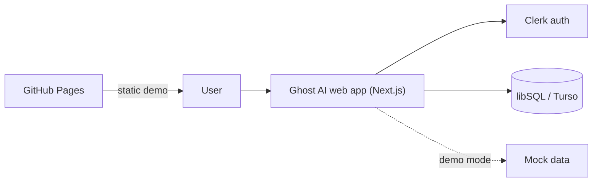

### Layers
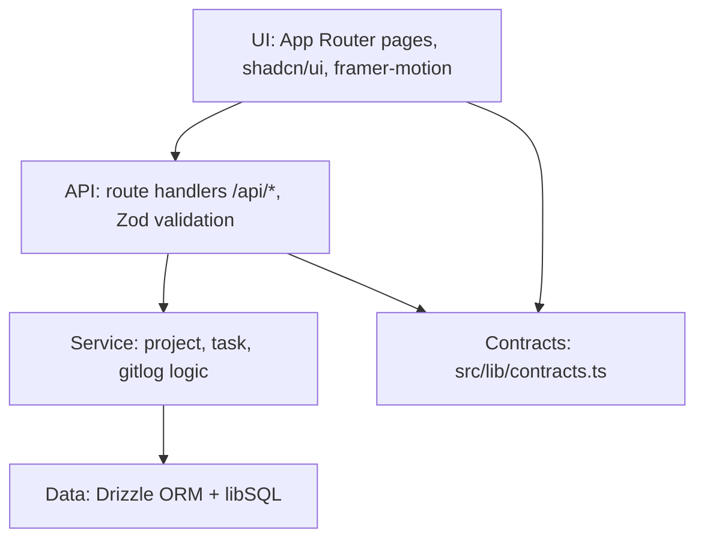

### Data model
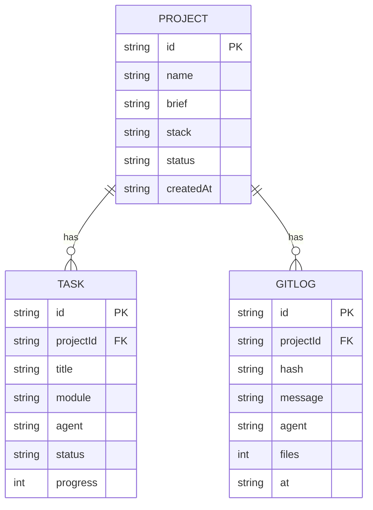

### Agent pipeline
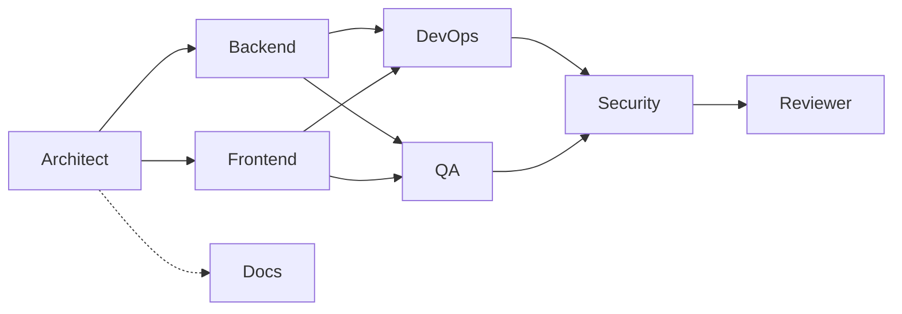

### Where the code lives
Pages and API routes: `src/app/`. UI parts: `src/components/`. Shared logic and the agent catalog: `src/lib/`. Database: `src/db/`. See [CODE-TOUR.md](CODE-TOUR.md) for a walk-through and the request flow, and [WORKFLOWS.md](WORKFLOWS.md) for the pipelines.


## 8. Connectivity

*Source: `docs/connectivity.md` (21 lines), reproduced in full.*

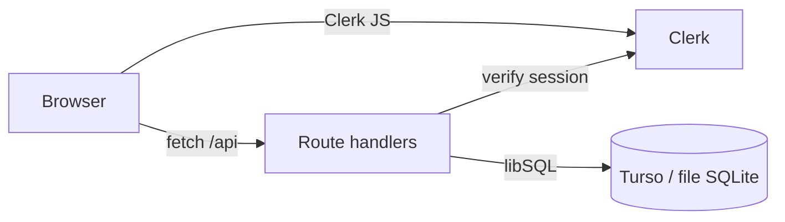

The Clerk proxy (`src/proxy.ts`) guards routes; API handlers read the session and query the DB through Drizzle.

### Env vars
See the table in [COMMANDS.md](COMMANDS.md#6-environment-variables).

### Hosting topologies
| Topology | Build | Notes |
|---|---|---|
| Vercel | `npm run build` | Full stack; Clerk and Turso vars set in the dashboard |
| Docker | `DOCKER=1` standalone | Port 3000; use Turso or a mounted volume |
| GitHub Pages | `scripts/pages-build.mjs` | Static export, demo mode, no API or auth; basePath is the repo name |


## 9. Methods and API summary

*Source: `docs/methods.md` (30 lines), reproduced in full.*

### API (JSON)
Full examples: [COMMANDS.md](COMMANDS.md#5-api-examples-curl). Live OpenAPI document: `GET /api/openapi`.

| Method | Path | Body / query | Response |
|---|---|---|---|
| GET | `/api/health` | - | health payload (503 if DB down) |
| GET | `/api/openapi` | - | OpenAPI 3.1 JSON |
| GET | `/api/stats` | - | totals across visible projects |
| GET | `/api/stack` | - | stack catalog by category |
| GET | `/api/agents` | - | 8 agents with sub-agents |
| GET | `/api/agents/:name` | - | one agent (case-insensitive); 404 if unknown |
| GET | `/api/projects` | - | `ProjectDetail[]` |
| POST | `/api/projects` | `ProjectInput` (name 2-60, brief 10-2000, stack 1-20) | 201 `ProjectDetail`; 400 on Zod failure |
| GET | `/api/projects/:id` | - | `ProjectDetail`; 404 if missing |
| DELETE | `/api/projects/:id` | - | `{ ok, id }`; 403 read-only, 404 |
| POST | `/api/projects/:id/run` | - | advances the simulated pipeline one step; 409 when all done |
| GET | `/api/projects/:id/tasks` | `status`, `module`, `agent` | `Task[]` |
| PATCH | `/api/projects/:id/tasks/:taskId` | `status` and/or `progress` (0-100) | updated `ProjectDetail` |
| GET | `/api/projects/:id/gitlog` | `limit` (1-500), `agent` | `GitLog[]`, newest first |
| GET | `/api/projects/:id/export` | `format=json\|md` | file download |

Write routes are rate limited (60 per minute per IP, then 429). With Clerk enabled, writes to `/api/projects*` need a session (401 otherwise); reads stay public.

### Internal methods
- `ProjectInput.parse / safeParse`: request validation (`src/lib/contracts.ts`).
- `src/lib/repo.ts`: the data-access layer (Drizzle): `listProjects`, `getProject`, `createProject`, `deleteProject`, `advancePipeline`, `updateTask`, `projectStats`. Seeds sample data once.
- Agent state derivation: `working` if the agent owns a `running` or `review` task, `done` if all its tasks are done, otherwise `idle`.
- `src/lib/sim.ts` + `src/lib/mock-data.ts`: the browser-side simulation and sample data used in demo mode.


## 10. Logs and conventions

*Source: `docs/logs.md` (13 lines), reproduced in full.*

### Commit format
Conventional Commits: `type(scope): summary`, e.g. `feat(api): add project detail route`.
Types: feat, fix, docs, chore, ci, refactor, test.

### Agent commits in the Git Log UI
Each `GitLog` row (`hash`, `message`, `agent`, `files`, `at`) is one agent commit. The UI shows the short hash, message, an agent badge and file count in a reverse-chronological timeline. Real git commits by agents carry `Co-Authored-By` trailers.

### Observability
- `GET /api/health` for uptime checks.
- Server logs go to stdout and are collected by Vercel or `docker logs`.
- Client errors surface through the Next.js error boundary.


## 11. Agents

*Source: `docs/agents.md` (22 lines), reproduced in full.*

| Agent | Responsibility |
|---|---|
| Architect | Brief, contracts, module split, mock data |
| Backend | API routes, DB schema, validation |
| Frontend | Pages, components, UX |
| DevOps | Docker, CI/CD, hosting config |
| QA | Tests and acceptance checks |
| Security | Auth, secrets, dependency and input review |
| Docs | README, RUN-ME, COMMANDS, WORKFLOWS, CODE-TOUR, architecture, ADRs |
| Reviewer | Final review and integration sign-off |

Each agent edits only the files it owns.

### Structured report format
1. Status (done / partial / blocked)
2. What I Did
3. Files
4. Tests Run
5. Risks
6. Next Steps


## 12. Authentication

*Source: `docs/auth.md` (57 lines), reproduced in full.*

Auth is optional. Without keys the app runs in **demo mode**: no sign-in, `/dashboard` is open, and `/sign-in` and `/sign-up` show an explainer with a "Continue in demo mode" button.

### Enable it
1. Create an app at https://dashboard.clerk.com (development instance is fine).
2. Copy **API keys** into `.env.local` (see `.env.example`):
   ```
   NEXT_PUBLIC_CLERK_PUBLISHABLE_KEY=pk_test_...
   CLERK_SECRET_KEY=sk_test_...
   NEXT_PUBLIC_CLERK_SIGN_IN_URL=/sign-in
   NEXT_PUBLIC_CLERK_SIGN_UP_URL=/sign-up
   NEXT_PUBLIC_CLERK_SIGN_IN_FALLBACK_REDIRECT_URL=/dashboard
   NEXT_PUBLIC_CLERK_SIGN_UP_FALLBACK_REDIRECT_URL=/dashboard
   ```
3. In Clerk: **Configure -> User & authentication -> Email, phone, username**: enable **Email address** (sign-up with email code or password).
4. **Configure -> SSO connections -> Add connection -> For all users -> GitHub**. Development instances use Clerk's shared OAuth credentials, so nothing else is needed. For production, create a GitHub OAuth App and paste its Client ID/Secret; the callback URL is shown in the Clerk form.
5. Restart `npm run dev`.

### Test flow
- Visit `/dashboard` signed out: redirected to `/sign-in`.
- Sign up with email (or "Continue with GitHub"), land on `/dashboard`.
- Header shows the user button; sign out returns to `/`.
- `POST/PATCH/DELETE /api/projects*` return 401 without a session; `GET /api/health` and GET reads stay public.

### How it works
- `src/components/auth-provider.tsx`: `AUTH_ENABLED` = publishable key present and `NEXT_PUBLIC_DEMO !== "1"`. Clerk is `require()`d lazily so it is never bundled when disabled.
- `src/proxy.ts`: `clerkMiddleware` only when enabled; protects `/dashboard(.*)` and non-GET `/api/projects(.*)`.
- `src/lib/auth.ts`: `getUserId()` for route handlers (null in demo mode).
- `src/components/auth/*`: `AuthNav` (header), `AuthShell` (split-screen pages), dark mint-accent theme via `appearance.variables`.
- Static GitHub Pages build (`NEXT_PUBLIC_DEMO=1`): the proxy is moved aside, Clerk is excluded, and the auth pages export as the explainer.

### Troubleshooting
- Blank/erroring sign-in: key typo, or the key's instance domain is unreachable; check the browser console.
- Redirect loop: make sure `NEXT_PUBLIC_CLERK_SIGN_IN_URL=/sign-in` and the proxy matcher is unchanged.
- GitHub button missing: the connection is not enabled in the Clerk dashboard.
- Keys set but still demo: `NEXT_PUBLIC_DEMO=1` is set, or the dev server was not restarted.

### No Clerk account yet? Get temporary dev keys in one command
Clerk's CLI can create throwaway development keys with **no account**:

```bash
# run it in an EMPTY scratch folder (it scaffolds files into whatever folder it runs in)
mkdir clerk-scratch && cd clerk-scratch
npx clerk@latest init --accountless --framework next --pm npm --no-skills
```
Copy `NEXT_PUBLIC_CLERK_PUBLISHABLE_KEY` and `CLERK_SECRET_KEY` from the scratch folder's `.env.local` into this repo's `.env.local` (git-ignored). Run `clerk auth login` later to claim the instance as your own.
A fresh accountless instance offers **email + Google**. To get the **GitHub** button, enable it in the Clerk dashboard (step 4 above) after claiming.

### Automated sign-up check
`npm run test:clerk` signs up a throwaway user with a `+clerk_test` email (verification code is always `424242`, no email is sent), lands on `/dashboard`, creates a project through the protected API, signs out and confirms the dashboard and API are locked again.
It uses `@clerk/testing` to pass Clerk's bot protection. Start the app first and point `BASE_URL` at it (default `http://localhost:3210`).
Last verified: 9/9 checks pass on both `next dev` and a production `next start` build (keys from a temporary accountless instance). The GitHub OAuth round trip is **not** automated: it needs a real GitHub login.

### Two fixes worth knowing about
- **Suspense around Clerk UI.** With Cache Components on, `<SignIn/>`, `<SignUp/>` and the header button render in the browser and must sit inside `<Suspense>`. Without it, `next build` fails with "client rendering was requested outside a Suspense boundary" as soon as keys are present (a keyless build hides this).
- **`ClerkActionGuard`.** Clerk's Next provider runs a server action before every sign-in and only continues when it resolves. In this setup it threw ("`cookies` was called outside a request scope"), so a verified sign-up hung on the verify page. `src/components/auth/clerk-action-guard.tsx` replaces that hook with one that always resolves; Clerk's own after-hook still calls `router.refresh()`. If a future Clerk/Next release fixes this, the guard can be deleted.


## 13. DevOps guide

*Source: `docs/devops.md` (46 lines), reproduced in full.*

### Pipelines at a glance

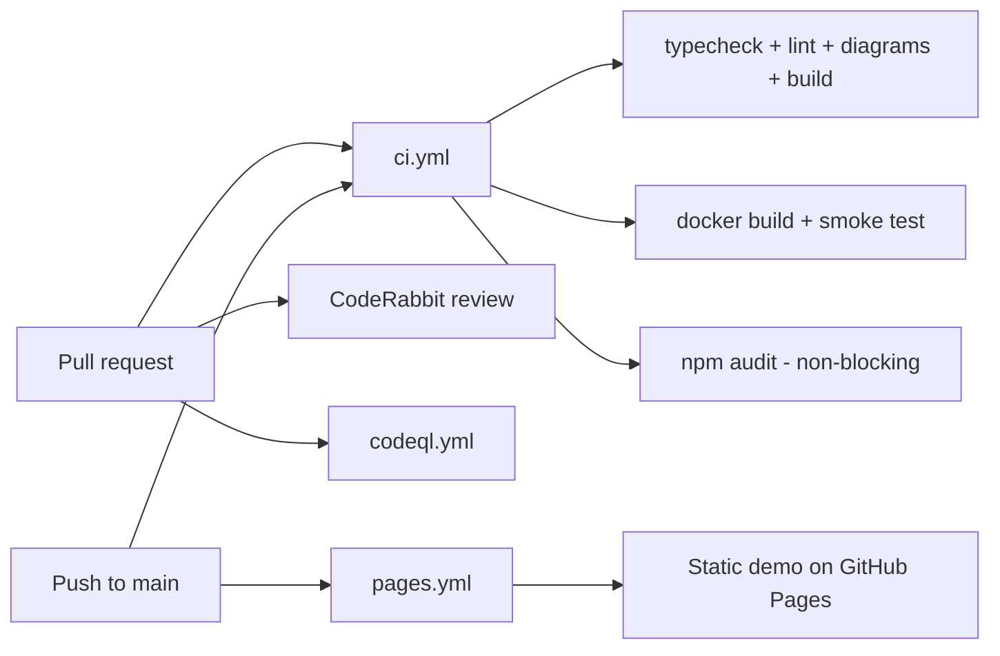

| Workflow | Trigger | What it does |
|---|---|---|
| `ci.yml` | PR, push to main | `npm run typecheck`, `lint`, `docs:check` (Mermaid parse), `build`; separate `audit` job (`npm audit --audit-level=high`, never fails the run); `docker` job builds the image, starts it and curls `/api/health`, and checks it does not run as root. |
| `pages.yml` | push to main, manual | `scripts/pages-build.mjs` stashes `src/app/api` and the proxy, runs a static export (`GITHUB_PAGES=true`, `NEXT_PUBLIC_DEMO=1`, base path = `/<repo name>`), uploads `out/` and deploys. Enable Pages with source "GitHub Actions" in repo settings. |
| `codeql.yml` | PR, push, weekly | Security scanning for JS/TS. |
| Dependabot | weekly | npm, GitHub Actions and Docker base image updates. |
| CodeRabbit | every non-draft PR | AI review; see [coderabbit.md](coderabbit.md). |

### Docker

```bash
npm run docker:build        # image ghost-ai-web:local
docker compose up --build   # http://localhost:3000, data in volume ghost-data
```

- Multi-stage on `node:24-bookworm-slim` (glibc; libsql ships prebuilt gnu binaries).
- `DOCKER=1` makes Next emit `output: "standalone"`; the runner copies `.next/standalone`, `.next/static` and `public`.
- Runs as non-root user `app` (uid 1001). SQLite lives at `/data/local.db` (`DATABASE_URL=file:/data/local.db`) on a volume.
- `HEALTHCHECK` calls `/api/health`.
- Secrets (Clerk keys, `DATABASE_AUTH_TOKEN`) go in `.env` (compose `env_file`) or `-e`; they are never baked into the image.

### Vercel
`vercel.json` uses `npm ci` and `npm run build`. Set env vars in the Vercel dashboard. Use a Turso `DATABASE_URL` (plus `DATABASE_AUTH_TOKEN`) there; local files do not persist on serverless.

### Diagrams
`npm run docs:diagrams` parses every Mermaid block in `README.md` and `docs/**/*.md` and renders SVGs to `docs/diagrams/` (needs Edge or Chrome locally; set `PUPPETEER_EXECUTABLE_PATH` if not auto-detected). `npm run docs:check` only parses and is what CI runs.

### Useful scripts
`typecheck`, `lint`, `build`, `build:pages`, `docs:diagrams`, `docs:check`, `docker:build`, `docker:up`, `test:e2e`, `check:links`.


## 14. CodeRabbit

*Source: `docs/coderabbit.md` (23 lines), reproduced in full.*

Config lives in `.coderabbit.yaml` (validated against the published v2 schema).

### Install
1. Open https://github.com/apps/coderabbitai and click Install.
2. Choose the account/org and select this repository (or all repositories).
3. Sign in to coderabbit.ai with GitHub if prompted. Open a PR; a summary and walkthrough should appear within a minute or two.

### Require it before merge
Settings > Branches > add a rule for `main` (or a ruleset):
- Require a pull request before merging.
- Require status checks: `Typecheck, lint, build`, `Docker build and smoke test`, and `CodeRabbit` once it has reported on a PR (the check only appears in the picker after its first run).
- Optionally require conversation resolution. With `request_changes_workflow: true` CodeRabbit requests changes until its comments are resolved and approves afterward.

### Talking to it in a PR
- `@coderabbitai review` : review new commits (also useful for draft PRs).
- `@coderabbitai full review` : re-review everything.
- `@coderabbitai summary` : regenerate the PR summary.
- `@coderabbitai resolve` : resolve all of its comments.
- `@coderabbitai pause` / `resume` : stop or restart automatic reviews.
- `@coderabbitai generate docstrings` : propose docstrings.
- Reply to any of its comments with a question; `chat.auto_reply` is on, so it answers without a mention.


## 15. ADR 0001: Technology stack

*Source: `docs/adr/0001-stack.md` (14 lines), reproduced in full.*

Status: Accepted

### Context
One codebase must deploy to Vercel (full stack) and GitHub Pages (static demo) and run locally with no secrets.

### Decision
Next.js App Router + React; Tailwind v4 + shadcn/ui; framer-motion; Clerk auth with demo fallback; Drizzle ORM over libSQL (local SQLite, Turso in prod); Zod contracts shared by client and server.

### Consequences
- Static export needs API routes and the proxy removed at build time (`scripts/pages-build.mjs`).
- libSQL keeps local dev dependency-free and prod serverless-friendly.
- Clerk is an external dependency, mitigated by demo mode.


## 16. Code tour

*Source: `docs/CODE-TOUR.md` (163 lines), reproduced in full.*

A walk through the repo. Paths are relative to the folder with `package.json`.

### Folder map

```text
.
├── README.md                  landing page of the project
├── STATUS.md                  current progress (owned by the orchestrator)
├── package.json               npm scripts + dependencies
├── next.config.ts             Next.js config: normal / Docker standalone / Pages static export
├── Dockerfile, docker-compose.yml, .dockerignore   container build and run
├── vercel.json                Vercel install/build commands
├── drizzle.config.ts          Drizzle Kit config
├── .env.example               every setting you can change
├── .coderabbit.yaml           AI reviewer config
├── .github/
│   ├── workflows/             ci.yml, pages.yml, codeql.yml
│   ├── dependabot.yml, CODEOWNERS, PULL_REQUEST_TEMPLATE.md, ISSUE_TEMPLATE/
├── scripts/
│   ├── pages-build.mjs        static export for GitHub Pages
│   └── check-mermaid.mjs      validates/renders Mermaid diagrams in the docs
├── docs/                      all documentation (you are here)
├── public/
│   ├── brand/ghost-ai-logo.svg
│   └── demo/                  demo video appears here after recording
└── src/
    ├── proxy.ts               optional Clerk gate
    ├── app/                   pages and API routes (Next.js App Router)
    ├── components/            React pieces
    ├── lib/                   logic shared by server and browser
    └── db/                    database
```

#### `src/app` (every URL)

| Path | URL | What it is |
|---|---|---|
| `page.tsx`, `layout.tsx` | `/` | Landing page and the root layout (loads fonts Bricolage Grotesque, Instrument Sans, Geist Mono, and the auth provider) |
| `(marketing)/` | `/agents`, `/agents/[slug]`, `/api-reference`, `/changelog`, `/demo`, `/docs`, `/docs/[slug]`, `/how-it-works`, `/pricing`, `/security` | Public info pages |
| `(auth)/sign-in`, `(auth)/sign-up` | `/sign-in`, `/sign-up` | Clerk forms, or an explainer in demo mode |
| `dashboard/` | `/dashboard` (overview), `/dashboard/projects`, `/dashboard/tasks`, `/dashboard/agents`, `/dashboard/git`, `/dashboard/flow`, `/dashboard/exports`, `/dashboard/settings` | The control room |
| `api/` | `/api/*` | JSON routes (list below) |
| `globals.css`, `ghost-kit.css` | | Styles (Tailwind v4 + the dark Ink & Signal design system, see DESIGN-SYSTEM.md) |
| `not-found.tsx`, `icon.svg` | | 404 page and tab icon |

API routes: `health`, `openapi`, `stats`, `stack`, `agents`, `agents/[name]`, `projects`, `projects/[id]`, `projects/[id]/run`, `projects/[id]/tasks`, `projects/[id]/tasks/[taskId]`, `projects/[id]/gitlog`, `projects/[id]/export`. Examples: [COMMANDS.md](COMMANDS.md#5-api-examples-curl).

#### `src/components`

| Folder | Contents |
|---|---|
| `dashboard/` | `shell.tsx` (sidebar, top bar, command palette), `store.tsx` (all dashboard state; picks live vs demo), `overview`, `projects`, `tasks`, `agents`, `gitlog`, `flow`, `exports`, `settings`, `new-project-wizard`, `kit.tsx` (small shared widgets) |
| `landing/` | Home page sections (`hero`, `crew`, `pipeline-diagram`, `agent-terminal`, `io-demo`...) |
| `marketing/` | Info pages parts (`agent-directory`, `api-explorer`, `demo-player`, `guides.ts` = text of `/docs/[slug]`) |
| `site/` | Header, footer, mobile nav, `nav-data.ts` (menu links) |
| `auth/` | Clerk look and feel (`appearance.ts`), `auth-shell`, `clerk-form`, nav buttons |
| `auth-provider.tsx` | The on/off switch for Clerk |
| `brand/logo.tsx` | The logo component |
| `ui/` | Base buttons, cards, dialog, tabs, table (shadcn style) |

#### `src/lib`

| File | Job |
|---|---|
| `contracts.ts` | The agreement: Zod schemas and TypeScript types (`ProjectInput`, `Task`, `ProjectDetail`, agent names). Server and browser both use it. |
| `agent-catalog.ts` | The 8 agents, their codenames, tools and sub-agents. Single source of truth. |
| `stack-catalog.ts` | Tech choices offered in the new-project wizard |
| `repo.ts` | **All database work**: list/create/delete projects, advance pipeline, update task, stats. Also seeds sample data on first use. |
| `api-utils.ts` | Helpers for routes: `json`, `fail`, `readBody` (validate), `rateLimit`, CORS |
| `auth.ts` | `getUserId()`: Clerk user id or `null` |
| `openapi.ts` | Builds the OpenAPI document served at `/api/openapi` |
| `client-data.ts` | Browser side: talks to the API or falls back to demo data |
| `sim.ts` | Pretend pipeline engine used in demo mode (and for log lines, commits, sparklines) |
| `mock-data.ts` | Sample projects (`demo-1` Nebula CRM...) used for seeding and demo |
| `export.ts` | Builds export files and a ZIP in the browser |
| `utils.ts` | Tiny helpers (`cn`) |

#### `src/db`

`schema.ts` defines tables `projects`, `tasks`, `gitlog` (Drizzle). `index.ts` creates the libSQL client (`DATABASE_URL`, default `file:local.db`), creates the tables with `CREATE TABLE IF NOT EXISTS`, and adds later columns (`owner_id`, `sub_agent`) if missing. There is no separate migration step.

### How a request flows

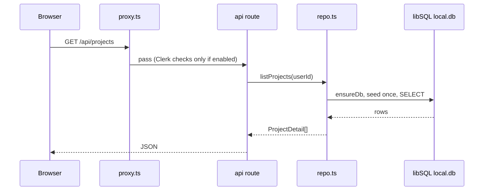

A write (for example `POST /api/projects`) adds: rate limit check, `readBody` validation with the Zod schema from `contracts.ts` (400 on bad input), then the insert. Errors become `{ "error": { code, message } }` through `toErrorResponse`; unknown errors are logged and shown as a generic 500.

### Demo mode vs live mode

Decided in the browser by `src/lib/client-data.ts` and `src/components/dashboard/store.tsx`.

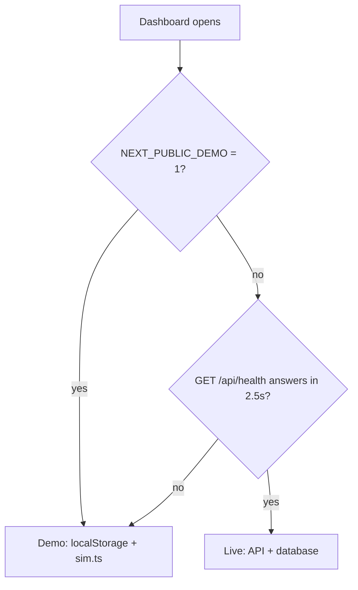

- **Live**: `probeLive`, `loadLive`, `createRemote`, `runRemote` call the real API.
- **Demo**: `loadDemo` (saved copy in `localStorage` key `ghost-ai:v2:projects`, otherwise `demoSeed()`), `createDemo`, and `advance` from `sim.ts`. Nothing leaves your browser.
- The GitHub Pages build is demo-only because the API folder is removed and `NEXT_PUBLIC_DEMO=1`.
- The Settings page lets you point the dashboard at another API base URL (`setApiBase`, saved under `ghost-ai:v2:api-base`).

### Auth is optional

1. `src/components/auth-provider.tsx`: `AUTH_ENABLED` is true only if `NEXT_PUBLIC_CLERK_PUBLISHABLE_KEY` is set and `NEXT_PUBLIC_DEMO` is not `1`. Clerk is loaded lazily so the static build never bundles it.
2. `src/proxy.ts`: when enabled, uses `clerkMiddleware` to protect `/dashboard/**` and non-GET `/api/projects/**`. When disabled it just passes requests through.
3. `src/lib/auth.ts`: routes call `getUserId()` which returns `null` without Clerk.
4. `src/lib/repo.ts`: with no user everything is visible; with a user you see your own projects plus owner-less sample projects, and cannot change the samples.

Setup steps: [auth.md](auth.md).

### The agent catalog drives UI and API

`src/lib/agent-catalog.ts` is the only place agents are defined. It feeds:

- `GET /api/agents` and `/api/agents/:name`
- the `/agents` pages and landing "crew" section
- the dashboard agents/flow views and sub-agent progress (`sim.ts`)
- task generation in `repo.ts` (`plan()` gives each task an `agent` and `subAgent` id)
- the docs exported by `src/lib/export.ts` (`docs/agents.md`)

Change an agent in that one file and all of these follow.

### How export works

`src/components/dashboard/exports.tsx` -> `buildExport(project, groups)` in `src/lib/export.ts` returns files (`project.json`, `REPORT.md`, `data/tasks.csv`, `data/gitlog.txt`, `README.md`, `docs/*.md`). Then one of:

- `downloadZip` -> `buildZip` writes a store-only ZIP (own CRC32, no library) and triggers a download;
- `downloadFile` for a single file;
- `saveToFolder` using the browser's directory picker, where supported (`canPickFolder`).

Separately, the server route `GET /api/projects/:id/export?format=json|md` returns a one-file download.

### Where to change things

| I want to... | Edit |
|---|---|
| Add an API route | new folder in `src/app/api/`, use helpers from `api-utils.ts`, add types to `contracts.ts`, add to `openapi.ts` |
| Change a table | `src/db/schema.ts` and the DDL/`migrate` in `src/db/index.ts` |
| Change an agent | `src/lib/agent-catalog.ts` |
| Add a dashboard page | `src/app/dashboard/<name>/page.tsx` + a component in `src/components/dashboard/`, link in `shell.tsx` |
| Change the menu | `src/components/site/nav-data.ts` |

Note: this is a very new Next.js version. `AGENTS.md` says to read `node_modules/next/dist/docs/` before writing Next.js code.


## 17. Run me

*Source: `docs/RUN-ME.md` (165 lines), reproduced in full.*

This page is for a complete beginner. Copy each command, paste it into a terminal, press Enter. After every step you will see what the screen should say.

> Every command here exists in `package.json` or is a standard tool command. Nothing is made up.

### 0. What is a "terminal"?

A text window where you type commands.

| System | How to open it |
|---|---|
| Windows | Press the Windows key, type `PowerShell`, press Enter |
| Mac | Press Cmd+Space, type `Terminal`, press Enter |
| Linux | Press Ctrl+Alt+T |

### 1. Install the tools (one time)

| Tool | Needed? | Get it | Check it worked |
|---|---|---|---|
| Node.js 20 or newer (24 recommended; CI and Docker use 24) | yes | https://nodejs.org (pick "LTS" or the newest) | `node -v` prints `v20...` or higher |
| git | yes (to download the code) | https://git-scm.com/downloads | `git --version` prints a version |
| Docker Desktop | only for Mode C | https://www.docker.com/products/docker-desktop | `docker --version` prints a version |

`npm` comes with Node. Check: `npm -v` prints a number.

### 2. Get the code

```bash
git clone https://github.com/<user>/<repo>.git
cd <repo>
```

(`<user>/<repo>` is a placeholder: use the real address of your copy of this project. The Next.js app lives in the folder that contains `package.json`; if your repo has a `web/` folder, run `cd web` too.)

You should see: `Cloning into '<repo>'...` then your prompt in the new folder. Check with `ls` (Mac/Linux) or `dir` (Windows): you should see `package.json`.

### 3. Install the packages

```bash
npm ci
```

Expected: a progress bar, then something like `added NNN packages`. Takes 1-3 minutes. (`npm ci` installs exactly what `package-lock.json` says, the same as CI does.)

### Mode A: zero-config demo mode (start here)

No accounts. No keys. No settings. The database file `local.db` is created by itself the first time the API is used.

```bash
npm run dev
```

Expected output (version numbers may differ):

```text
▲ Next.js 16.x
- Local:  http://localhost:3000
✓ Ready in ...
```

Now open **http://localhost:3000** in your browser.

What you should see:

1. A dark landing page with the Ghost AI logo and a hero section.
2. Click **Dashboard** (or go to http://localhost:3000/dashboard). With no Clerk keys the dashboard is open to everyone.
3. Two sample projects are already there (they are seeded into `local.db` on first use).
4. Click **New project**, type a name, a goal of at least 10 characters, pick a stack, create it.
5. Click **Run next step** a few times. Tasks move todo, running, review, done and commits appear.
6. Open **Exports** in the side menu to download the project as a ZIP.

Stop the server: press **Ctrl+C** in the terminal.

Want the app to use only browser mock data and never call the API? Force demo:

| System | Command |
|---|---|
| Mac / Linux | `NEXT_PUBLIC_DEMO=1 npm run dev` |
| Windows PowerShell | `$env:NEXT_PUBLIC_DEMO="1"; npm run dev` |

### Mode B: with Clerk (email + GitHub sign-in)

Clerk is an outside service that handles sign-in. You need your own free Clerk account; the project owner's keys are not in the repo.

1. Make an app at https://dashboard.clerk.com.
2. Copy the example settings file:
   - Mac / Linux: `cp .env.example .env.local`
   - Windows PowerShell: `Copy-Item .env.example .env.local`
3. Open `.env.local` and fill in these two lines with your keys (the rest can stay):
   ```text
   NEXT_PUBLIC_CLERK_PUBLISHABLE_KEY=pk_test_...
   CLERK_SECRET_KEY=sk_test_...
   ```
4. In Clerk turn on **Email address** and add the **GitHub** connection. Details: [auth.md](auth.md).
5. Stop the server (Ctrl+C) and start again: `npm run dev`.
6. Open http://localhost:3000/dashboard. You should be sent to `/sign-in`. After signing in you land on `/dashboard`.

Always use `http://localhost:3000` (not a LAN IP) with development keys.

### Mode C: Docker

Needs Docker Desktop running.

```bash
docker compose up --build
```

(Same as `npm run docker:up`.) The first build takes a few minutes. Expected last lines: the `web` container starts and Next.js says it is ready. Open http://localhost:3000. Check health:

```bash
curl http://localhost:3000/api/health
```

Expected: JSON like `{"ok":true,"db":"up","version":"0.1.0",...,"authEnabled":false,...}`.

Data is kept in the Docker volume `ghost-data`. To use Clerk, put the keys in a `.env` file next to `docker-compose.yml` (compose reads it if present). Stop with Ctrl+C, or `docker compose down` (add `-v` to also delete the data).

Just build the image without running: `npm run docker:build` (makes `ghost-ai-web:local`).

### Run the checks (what CI runs)

```bash
npm run typecheck     # TypeScript errors? expected: no output, exit code 0
npm run lint          # code style. expected: no output / no errors
npm run docs:check    # Mermaid diagrams in the docs parse. expected: all OK
npm run build         # production build. expected: route table, no errors
```

Tests: run `npm run build` and then `npm run test:e2e` (Playwright, uses Microsoft Edge, starts its own server on port 3500). See [COMMANDS.md](COMMANDS.md#4-playwright).

### Build the static GitHub Pages demo

```bash
npm run build:pages
```

This temporarily moves `src/app/api` and `src/proxy.ts` aside (a static site cannot have a server), builds, and puts them back. Output goes to the `out/` folder. To look at it locally:

```bash
npx serve out
```

(`serve` is downloaded on demand by npx; then open the address it prints.) If you set a base path for a project site, also set `NEXT_PUBLIC_BASE_PATH=/<repo>` when building, like `.github/workflows/pages.yml` does.

Do not run `npm run build:pages` while `npm run dev` or another build is running in the same folder.

### Something went wrong?

| Symptom | Why | Fix |
|---|---|---|
| `EPERM`, `EBUSY` or "operation not permitted" on `.next` (common when the folder is inside OneDrive) | OneDrive or antivirus is syncing/locking files that Next.js is trying to rewrite | Stop the dev server. Delete `.next` (`rm -rf .next` or `Remove-Item -Recurse -Force .next`). Best: move the project out of OneDrive (for example `C:\dev\ghost-ai`) or pause OneDrive syncing. Then `npm run dev` again. |
| `Port 3000 is in use` / `EADDRINUSE` | Another program (maybe an old dev server) uses 3000 | Stop the other one, or use another port: `npm run dev -- -p 3001` and open http://localhost:3001 |
| Clerk says `Invalid host` or sign-in will not load | Development keys only work on `localhost`; or the key is wrong | Open `http://localhost:3000` exactly. Re-copy both keys. Restart the server. More in [auth.md](auth.md). |
| Page is blank or white | Dev server still compiling, a crashed build, or stale cache | Wait for `✓ Ready`. Hard-refresh (Ctrl+Shift+R). Look at the terminal for red errors. Try deleting `.next` and restarting. |
| Dashboard shows sample data but never saves to the server | It fell back to browser demo mode because `/api/health` did not answer, or `NEXT_PUBLIC_DEMO=1` is set | Make sure the server is running and `curl http://localhost:3000/api/health` works. Unset `NEXT_PUBLIC_DEMO`. |
| `database is locked` / `SQLITE_BUSY` | Two processes use the same `local.db` | Stop the extra server. Then restart. If still stuck: stop everything and delete `local.db` (you lose local projects; it is recreated and re-seeded). |
| `Unsupported engine` / `SyntaxError` / strange errors on install | Node is too old | `node -v` must be v20 or higher (24 recommended). Install a newer Node, delete `node_modules`, run `npm ci` again. |
| Keys are set but the app still acts like demo mode | `NEXT_PUBLIC_DEMO=1` is set, or the server was not restarted | Remove the variable, restart `npm run dev`. |
| `docker: command not found` / cannot connect to daemon | Docker not installed or not running | Start Docker Desktop, wait for the whale icon to be steady, retry. |
| `npm run build:pages` says `.pages-stash exists` | A previous Pages build crashed halfway | Move the contents of `.pages-stash/` back into `src/` (`api` to `src/app/api`, `proxy.ts` to `src/proxy.ts`), delete `.pages-stash`, retry. |

Still stuck? Open an issue (template in `.github/ISSUE_TEMPLATE`) and paste the terminal text.

Next: [EXPLAIN-LIKE-IM-5.md](EXPLAIN-LIKE-IM-5.md) to understand it, [COMMANDS.md](COMMANDS.md) for every command.


## 18. Explain like I'm 5

*Source: `docs/EXPLAIN-LIKE-IM-5.md` (142 lines), reproduced in full.*

### The big idea

Imagine a **toy workshop**.

You walk in and say: "I want a toy robot."

A team of helpers makes it. One draws the plan. One builds the machines. One paints it. One packs the box. Another checks it works.

**Ghost AI is that workshop, but for software.** You say what app you want. A team of AI helpers (we call them *agents*) plans it, builds it, tests it and ships it. You watch it happen on a screen.

> Honest note: in this repo the agents are a **simulation**. The app shows how the work would flow, with sample tasks and fake commits. It does not call a real AI model. The workshop is a very good model train set.

### Who is who?

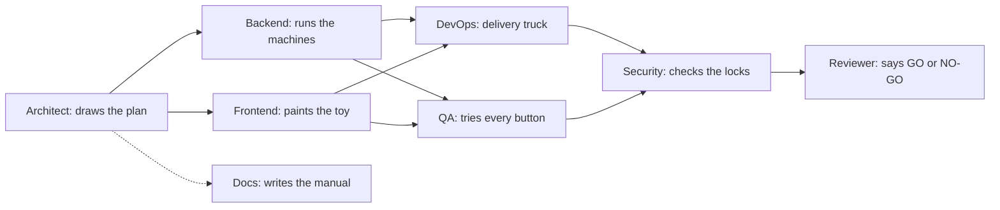

| Agent | Workshop job | Real files |
|---|---|---|
| Architect | Draws the plan | `src/lib/agent-catalog.ts` (the list of agents) |
| Backend | Runs the machines (the server) | `src/app/api/**`, `src/lib/repo.ts`, `src/db/` |
| Frontend | Paints what you see | `src/app/**`, `src/components/**` |
| DevOps | Packs and delivers | `Dockerfile`, `.github/workflows/` |
| QA | Tries every button | (tests are not written yet) |
| Security | Checks the locks | `src/proxy.ts`, `src/lib/api-utils.ts` |
| Docs | Writes the manual | `docs/`, `README.md` |
| Reviewer | Final yes or no | CodeRabbit + you |

Each lead agent has **sub-agents**: small helpers. Think of the Painter having a Colour-Mixer helper and an Animation helper. They are listed under each agent in `src/lib/agent-catalog.ts` (for example Frontend has Pixel Painter, Motion Maker, Access Ally).

### The parts of the shop

| Real thing | Kid analogy | Where |
|---|---|---|
| The website | **Shop window**: what people see | `src/app/page.tsx`, `src/components/landing/` |
| The dashboard | **Control room** with buttons and boards | `src/app/dashboard/`, `src/components/dashboard/` |
| The database (`local.db`) | **Toy box**: where things are kept | `src/db/schema.ts`, `src/db/index.ts` |
| `repo.ts` | **The toy-box keeper**: only person allowed to open the box | `src/lib/repo.ts` |
| API routes | **Order window**: you pass a note in, you get an answer back | `src/app/api/` |
| Clerk | **Doorman with ID cards** (only if you turn him on) | `src/proxy.ts`, `src/components/auth-provider.tsx` |
| Demo mode | **Play shop** with pretend toys, no doorman | `src/lib/client-data.ts`, `src/lib/mock-data.ts` |
| GitHub Actions | **Robot delivery truck**: tests and delivers by itself | `.github/workflows/` |
| CodeRabbit | **Friendly teacher** who checks homework | `.coderabbit.yaml` |
| Docker | **Lunchbox**: the whole shop packed so it runs anywhere | `Dockerfile`, `docker-compose.yml` |

### What happens when you click

#### 1. "New project" (make a toy order)

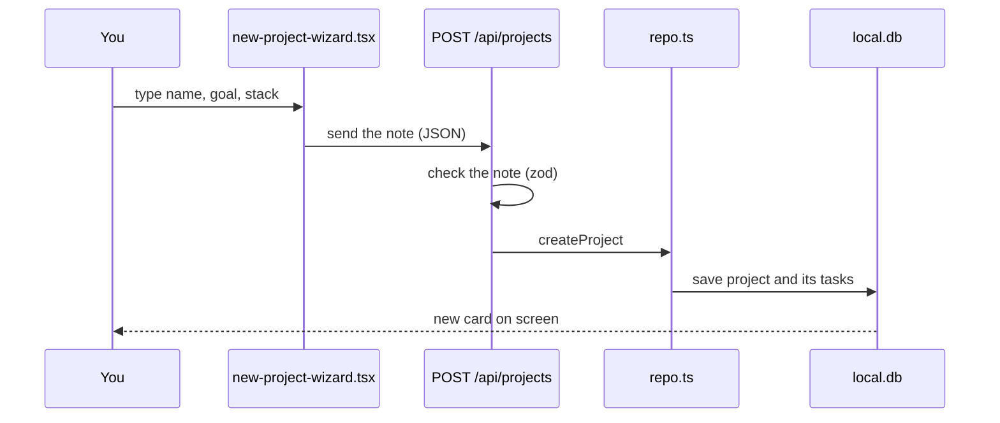

Steps in kid words:

1. You fill in a form. File: `src/components/dashboard/new-project-wizard.tsx`.
2. The form passes a note to the order window. If the server is awake, it goes to `POST /api/projects` (`src/app/api/projects/route.ts`). Rules for a good note (name 2 to 60 letters, goal 10 to 2000, 1 to 20 stack items) live in `src/lib/contracts.ts`.
3. A bad note gets sent back with "400, fix your note".
4. A good note goes to the keeper `createProject` in `src/lib/repo.ts`, who puts it in the toy box and makes a list of tasks.
5. If no server answers (play-shop mode), `createDemo` in `src/lib/client-data.ts` makes a pretend project in your browser instead, and saves it in your browser's memory (`localStorage`).

#### 2. "Run next step" (the workers move forward)

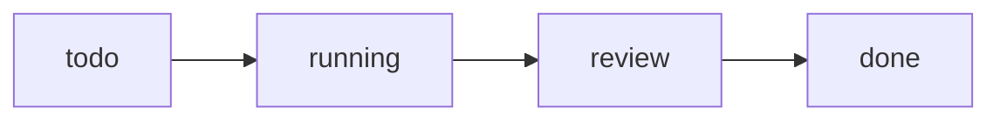

Each click moves work one notch:

- the task in **review** becomes **done** (and a commit is added),
- the task that was **running** moves to **review**,
- the next **todo** starts **running**.

Real code: button in `src/components/dashboard/overview.tsx`; calls `runNext` in `src/components/dashboard/store.tsx`; server version is `POST /api/projects/:id/run` -> `advancePipeline` in `src/lib/repo.ts`. In play-shop mode the browser does the same thing with `advance` in `src/lib/sim.ts`. When everything is done the server says "409, nothing left to do".

A *commit* is like a photo of the work at that moment. The **Git** page shows the photos in a timeline.

#### 3. "Export" (take your toy home)

1. Open **Exports** in the side menu (`src/app/dashboard/exports/page.tsx` -> `src/components/dashboard/exports.tsx`).
2. Tick what you want: JSON, report, CSV, git log, README, docs.
3. `buildExport` in `src/lib/export.ts` builds the files in your browser.
4. `buildZip` in the same file packs them into a ZIP **without any extra library**, and `downloadZip` hands it to you. Browsers that support it can also write straight into a folder (`saveToFolder`).
5. The server also has a plain download: `GET /api/projects/:id/export?format=md` (or `json`).

### The doorman (login)

Clerk is optional.

- **No keys**: no doorman. Everyone walks in. This is "demo mode".
- **With keys**: the doorman checks ID cards (email or GitHub) before the dashboard, and before any change to `/api/projects`.

One line decides it, in `src/components/auth-provider.tsx`: is `NEXT_PUBLIC_CLERK_PUBLISHABLE_KEY` set, and is `NEXT_PUBLIC_DEMO` not `1`?

### The robot delivery truck and the teacher

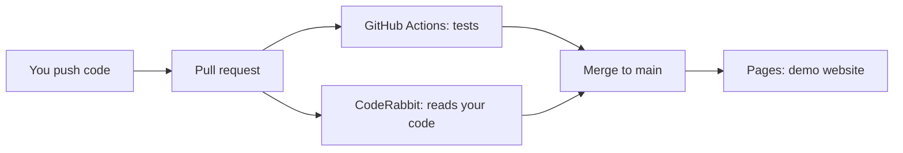

- **GitHub Actions** runs checks by itself (typecheck, lint, build, Docker). Files: `.github/workflows/ci.yml`, `codeql.yml`, `pages.yml`.
- **CodeRabbit** leaves friendly comments like a teacher with a red pen. Config: `.coderabbit.yaml`.
- After merging to `main`, the truck builds the **static demo** and puts it on GitHub Pages.

More in [WORKFLOWS.md](WORKFLOWS.md).

### Now you try

1. [RUN-ME.md](RUN-ME.md): start the shop.
2. [CODE-TOUR.md](CODE-TOUR.md): walk through the rooms.
3. [COMMANDS.md](COMMANDS.md): every button on the control panel.


## 19. Commands

*Source: `docs/COMMANDS.md` (152 lines), reproduced in full.*

Run all commands from the folder that contains `package.json`. How verified: npm scripts are read from `package.json`; curl examples are read from `src/app/api/**` route code.

### 1. npm scripts

| Command | What it does | When to use | Expected result |
|---|---|---|---|
| `npm ci` | Installs exact versions from `package-lock.json` | First time, and after pulling changes to `package.json` | `added N packages` |
| `npm run dev` | `next dev`: development server with hot reload | Daily work | `Local: http://localhost:3000`, `Ready` |
| `npm run build` | `next build`: production build | Before pushing; CI runs it | Route list, exit 0 |
| `npm start` | `next start`: serves the production build | After `npm run build` | Server on port 3000 |
| `npm run lint` | `eslint` | Before every commit | No errors |
| `npm run lint:fix` | `eslint --fix`: auto-fixes what it can | When lint complains about style | Fewer or zero errors |
| `npm run typecheck` | `tsc --noEmit`: type errors only, no files written | Before every commit | No output, exit 0 |
| `npm run build:pages` | `node scripts/pages-build.mjs`: static export to `out/` (moves `src/app/api` and `src/proxy.ts` away, then restores) | Test the GitHub Pages demo | `out/` folder created |
| `npm run docs:check` | `node scripts/check-mermaid.mjs --no-render`: parses every Mermaid block in `README.md` and `docs/**/*.md` | After editing any doc with a diagram; CI runs it | Every block OK |
| `npm run docs:diagrams` | `node scripts/check-mermaid.mjs`: same, and renders SVGs to `docs/diagrams/` (needs Edge/Chrome; set `PUPPETEER_EXECUTABLE_PATH` if not found) | When you want fresh SVG pictures | SVG files updated |
| `npm run test:e2e` | `playwright test`: Playwright end-to-end tests (needs `npm run build` first; starts `next start -p 3500` itself; uses Microsoft Edge) | Before pushing UI or API changes | A list of passing tests |
| `npm run check:links` | `node scripts/check-links.mjs`: checks links in `README.md` and `docs/**/*.md`; add `--site <url>` to crawl a running site; writes `docs/LINK-REPORT.md` | After editing docs | Counts and `PASS`, or the list of broken links |
| `npm run docker:build` | `docker build -t ghost-ai-web:local .` | Build the image | Image `ghost-ai-web:local` |
| `npm run docker:up` | `docker compose up --build` | Run in Docker | Site on http://localhost:3000 |

Pass extra flags to Next after `--`: `npm run dev -- -p 3001` (use port 3001).

Set an env var for one run:

| System | Example |
|---|---|
| Mac / Linux | `NEXT_PUBLIC_DEMO=1 npm run dev` |
| Windows PowerShell | `$env:NEXT_PUBLIC_DEMO="1"; npm run dev` |
| Windows cmd | `set NEXT_PUBLIC_DEMO=1 && npm run dev` |

### 2. Git workflow

```bash
git checkout -b feat/short-name            # new branch (never work on main)
git status                                 # see what changed
git add path/to/file                       # stage chosen files
git commit -m "feat(api): add project detail route"
git push -u origin feat/short-name         # first push of the branch
```

Then open a Pull Request on GitHub (`gh pr create` if you use the GitHub CLI). See [WORKFLOWS.md](WORKFLOWS.md#pr-lifecycle).

Commit message format (Conventional Commits, from [logs.md](logs.md)): `type(scope): summary`

Types: `feat`, `fix`, `docs`, `chore`, `ci`, `refactor`, `test`.

Before pushing run: `npm run typecheck && npm run lint && npm run build` (the PR template asks for this). On Mac/Linux/Git Bash `&&` works; in Windows PowerShell 5 run them one per line.

### 3. Docker

| Command | What it does |
|---|---|
| `npm run docker:build` | Build image `ghost-ai-web:local` |
| `docker compose up --build` (or `npm run docker:up`) | Build and run on port 3000, data in volume `ghost-data` |
| `docker compose up -d` | Run in background |
| `docker compose logs -f web` | Follow logs |
| `docker compose down` | Stop and remove the container (data stays) |
| `docker compose down -v` | Also delete the data volume |
| `docker run -d --name ghost -p 3000:3000 ghost-ai-web:local` | Run the image directly (what CI does with tag `ghost-ai-web:ci`) |
| `docker exec ghost id -u` | Shows the user id inside; must not be `0` (non-root) |
| `docker logs ghost` | Container logs |
| `docker rm -f ghost` | Remove that container |

The image has a built-in `HEALTHCHECK` on `/api/health`.

### 4. Playwright

The specs are in `tests/e2e/` and the config is `playwright.config.ts` (system Microsoft Edge via `channel: "msedge"`, production build served on port 3500, no Clerk keys). `npm run test:e2e` runs them; these standard Playwright commands also apply:

| Command | What it does |
|---|---|
| `npx playwright install chromium` | Download the test browser (one time) |
| `npx playwright test` | Run all tests |
| `npx playwright test --ui` | Interactive mode |
| `npx playwright show-report` | Open the last HTML report |

You can also test by hand: `npm run dev`, click through `/dashboard` (New project, Run next step, Exports).

### 5. API examples (curl)

Server must be running (`npm run dev`). `$B` below means `http://localhost:3000`. Seeded sample project ids: `demo-1` (Nebula CRM) and others. Responses are JSON. Errors look like `{"error":{"code":"...","message":"..."}}`.

| Method and path | Purpose | Example |
|---|---|---|
| `GET /api/health` | Is it alive? DB up? (503 if DB down) | `curl http://localhost:3000/api/health` |
| `GET /api/openapi` | OpenAPI 3.1 document | `curl http://localhost:3000/api/openapi` |
| `GET /api/stats` | Totals for visible projects | `curl http://localhost:3000/api/stats` |
| `GET /api/stack` | Stack catalog by category | `curl http://localhost:3000/api/stack` |
| `GET /api/agents` | The 8 agents with sub-agents | `curl http://localhost:3000/api/agents` |
| `GET /api/agents/:name` | One agent, case-insensitive | `curl http://localhost:3000/api/agents/architect` |
| `GET /api/projects` | List projects | `curl http://localhost:3000/api/projects` |
| `POST /api/projects` | Create (name 2-60, brief 10-2000, stack 1-20 items); 201 | see below |
| `GET /api/projects/:id` | One project with tasks, gitlog, agents; 404 if missing | `curl http://localhost:3000/api/projects/demo-1` |
| `DELETE /api/projects/:id` | Delete (403 if read-only sample or not yours) | `curl -X DELETE http://localhost:3000/api/projects/<id>` |
| `POST /api/projects/:id/run` | Advance the simulated pipeline one step; 409 when all done | `curl -X POST http://localhost:3000/api/projects/demo-1/run` |
| `GET /api/projects/:id/tasks` | List tasks, filters `status`, `module`, `agent` | `curl "http://localhost:3000/api/projects/demo-1/tasks?status=running&agent=frontend"` |
| `PATCH /api/projects/:id/tasks/:taskId` | Set `status` and/or `progress` (0-100; `done` needs 100) | see below |
| `GET /api/projects/:id/gitlog` | Commits newest first, filters `limit` (1-500), `agent` | `curl "http://localhost:3000/api/projects/demo-1/gitlog?limit=5"` |
| `GET /api/projects/:id/export` | Download; `format=json` (default) or `md` | `curl -OJ "http://localhost:3000/api/projects/demo-1/export?format=md"` |

Create a project (Mac/Linux/Git Bash):

```bash
curl -X POST http://localhost:3000/api/projects \
  -H "Content-Type: application/json" \
  -d '{"name":"Toy Shop","brief":"A small shop to sell toys online.","stack":["Next.js","Drizzle"]}'
```

Windows PowerShell:

```powershell
curl.exe -X POST http://localhost:3000/api/projects -H "Content-Type: application/json" -d '{\"name\":\"Toy Shop\",\"brief\":\"A small shop to sell toys online.\",\"stack\":[\"Next.js\",\"Drizzle\"]}'
```

Update a task:

```bash
curl -X PATCH http://localhost:3000/api/projects/<id>/tasks/<taskId> \
  -H "Content-Type: application/json" -d '{"status":"done","progress":100}'
```

Notes:

- Write routes (POST, PATCH, DELETE) allow 60 requests per minute per IP, then answer 429.
- With Clerk keys set, writes to `/api/projects*` without a session return 401 (`src/proxy.ts`). Reads stay public.
- All routes answer `OPTIONS` with CORS headers (`*`).

### 6. Environment variables

Defined in `.env.example`; copy to `.env.local` for local use.

| Name | Required | Used by | Meaning |
|---|---|---|---|
| `DATABASE_URL` | no | `src/db/index.ts` | libSQL URL. Default `file:local.db`. Docker sets `file:/data/local.db`. Use a Turso `libsql://...` URL for hosted. |
| `DATABASE_AUTH_TOKEN` | only for Turso | `src/db/index.ts` | Token for remote libSQL |
| `NEXT_PUBLIC_CLERK_PUBLISHABLE_KEY` | for sign-in | auth-provider, proxy, health | Clerk frontend key |
| `CLERK_SECRET_KEY` | for sign-in | Clerk server code | Clerk backend key |
| `NEXT_PUBLIC_CLERK_SIGN_IN_URL` | no | Clerk | `/sign-in` |
| `NEXT_PUBLIC_CLERK_SIGN_UP_URL` | no | Clerk | `/sign-up` |
| `NEXT_PUBLIC_CLERK_SIGN_IN_FALLBACK_REDIRECT_URL` | no | Clerk | `/dashboard` |
| `NEXT_PUBLIC_CLERK_SIGN_UP_FALLBACK_REDIRECT_URL` | no | Clerk | `/dashboard` |
| `NEXT_PUBLIC_DEMO` | no | auth-provider, proxy, client-data | `1` = no Clerk, no API calls, browser mock data |
| `GITHUB_PAGES` | build only | `next.config.ts` | `true` = static export (set by `build:pages` / pages.yml) |
| `NEXT_PUBLIC_BASE_PATH` | Pages only | `next.config.ts`, marketing UI | e.g. `/<repo>` |
| `DOCKER` | build only | `next.config.ts` | `1` = standalone output (set in Dockerfile) |
| `PORT`, `HOSTNAME` | Docker | Dockerfile | `3000`, `0.0.0.0` |
| `PUPPETEER_EXECUTABLE_PATH` | optional | `docs:diagrams` | Path to Edge/Chrome for rendering |

Never commit real keys. `.env*` files are for your machine only.


## 20. Workflows

*Source: `docs/WORKFLOWS.md` (117 lines), reproduced in full.*

Everything that runs automatically, step by step. Source files: `.github/workflows/ci.yml`, `pages.yml`, `codeql.yml`, `.github/dependabot.yml`, `.coderabbit.yaml`.

### 1. CI (`ci.yml`)

Runs on every pull request and every push to `main`. A newer run on the same branch cancels the older one. Permissions: read-only.

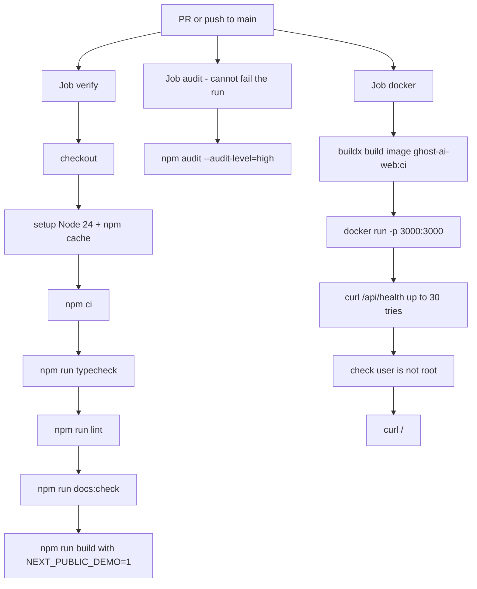

| Job (display name) | Steps | Fails the PR? |
|---|---|---|
| `verify` ("Typecheck, lint, build") | checkout, Node 24, `npm ci`, `typecheck`, `lint`, `docs:check`, `build` (with `NEXT_PUBLIC_DEMO=1`) | yes |
| `audit` ("npm audit (non-blocking)") | `npm audit --audit-level=high` | no (`continue-on-error`) |
| `docker` ("Docker build and smoke test") | build the image (GitHub Actions cache), start it, poll `/api/health` every 2 s up to 30 times, confirm the process user id is not 0, fetch `/`, always print container logs | yes |

Run the same checks yourself: [COMMANDS.md](COMMANDS.md#1-npm-scripts).

### 2. GitHub Pages (`pages.yml`)

Runs on push to `main` and by hand (Actions tab, "Run workflow").

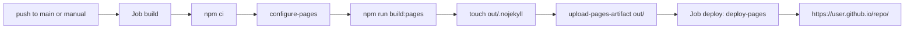

Details:

- `build:pages` runs `scripts/pages-build.mjs`. It moves `src/app/api`, `src/proxy.ts` (and `src/middleware.ts` if present) into `.pages-stash/`, runs `next build` with `GITHUB_PAGES=true` and `NEXT_PUBLIC_DEMO=1`, then always moves them back.
- `NEXT_PUBLIC_BASE_PATH=/<repo name>` is set so links work under `https://<user>.github.io/<repo>/`.
- `next.config.ts` switches to `output: "export"` when `GITHUB_PAGES=true`.
- The result is fully static: no API, no database, no login. The dashboard runs on browser mock data ([CODE-TOUR.md](CODE-TOUR.md#demo-mode-vs-live-mode)).
- One-time setup: repo Settings -> Pages -> Source: **GitHub Actions**.

### 3. CodeQL (`codeql.yml`)

Runs on PRs to `main`, pushes to `main`, and weekly (Mondays 03:17 UTC). Steps: checkout, `codeql-action/init` for `javascript-typescript`, `codeql-action/analyze`. Results appear under Security -> Code scanning.

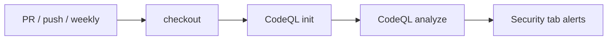

### 4. Dependabot

`.github/dependabot.yml`: weekly update PRs for npm (minor and patch grouped, max 5 open), GitHub Actions and the Docker base image.

### PR lifecycle

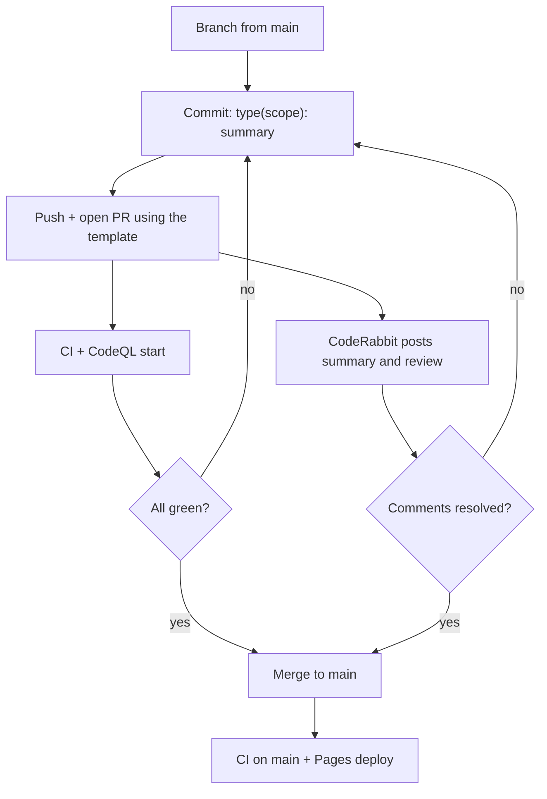

CodeRabbit (`.coderabbit.yaml`): profile `assertive`, requests changes until its comments are resolved, auto-reviews non-draft PRs into `main`, ignores lockfiles, `.next`, `out`, SVG and `docs/diagrams`. It has extra instructions per path (API routes need zod validation and auth checks; components need accessibility; docs must match the code and valid Mermaid; workflows need least privilege). Install and chat commands (`@coderabbitai review`, `resolve`, `pause`...) are in [coderabbit.md](coderabbit.md).

Recommended branch protection for `main` (Settings -> Branches): require a PR, require the checks `Typecheck, lint, build` and `Docker build and smoke test`.

### Deploy flows

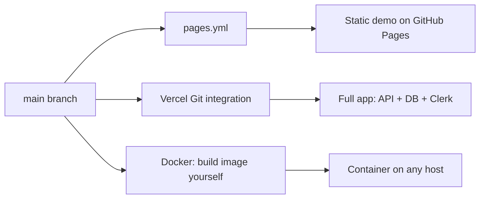

- **GitHub Pages**: automatic via `pages.yml` (above). Mock data only.
- **Vercel**: import the repo in Vercel; `vercel.json` sets `npm ci` and `npm run build`. Add env vars in the Vercel dashboard (Clerk keys, `DATABASE_URL` + `DATABASE_AUTH_TOKEN` for Turso; a local file does not persist on serverless). No workflow in this repo deploys to Vercel; it relies on Vercel's own Git integration.
- **Docker**: CI builds and smoke-tests the image but does **not** push it to any registry. To deploy, build it yourself (`npm run docker:build`) and run it.

### Multi-agent build loop

How this project itself was built (the same cast as the product):

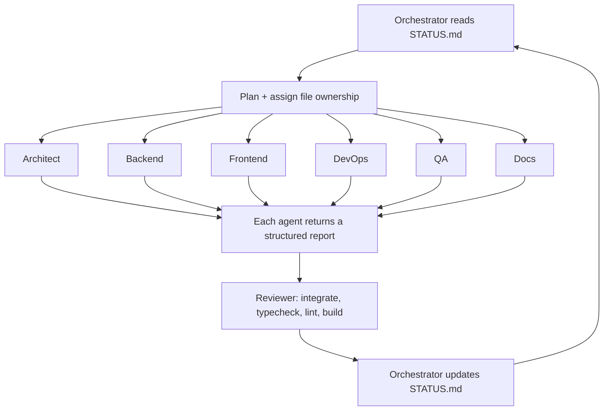

Rules (see [agents.md](agents.md)): each agent edits only the files it owns; each returns a report with Status, What I Did, Files, Tests Run, Risks, Next Steps; only the orchestrator writes `STATUS.md` (current goal, health, completed, not verified, next). Read `STATUS.md` first to see where the project stands.


## 21. Documentation index

*Source: `docs/README.md` (35 lines), reproduced in full.*

Start here if you are new:

1. [RUN-ME.md](RUN-ME.md): run the project in 5 minutes
2. [EXPLAIN-LIKE-IM-5.md](EXPLAIN-LIKE-IM-5.md): the project with simple analogies
3. [CODE-TOUR.md](CODE-TOUR.md): where everything lives
3b. [COMMIT-HISTORY.md](COMMIT-HISTORY.md): every commit in order, mapped to the agent that did the work
4. [FORK-AND-CLONE.md](FORK-AND-CLONE.md): fork it, run it, host your own demo, send a PR

Extras:

| Item | Content |
|---|---|
| [../notebooks/ghost-notebook.ipynb](../notebooks/ghost-notebook.ipynb) | Ghost Notebook: call every API route from Python, run the pipeline, export to a local folder |
| [LINK-REPORT.md](LINK-REPORT.md) | Latest result of `npm run check:links` (docs links and site crawl) |
| [book/Ghost-AI-Book.pdf](book/Ghost-AI-Book.pdf) | The Ghost AI Book (build with `npm run docs:book`) |
| [../README.md](../README.md) | Project front page: demo, components, how to run |

Reference:

| Doc | Content |
|---|---|
| [COMMANDS.md](COMMANDS.md) | npm scripts, git, Docker, Playwright, API curl, env vars |
| [WORKFLOWS.md](WORKFLOWS.md) | GitHub Actions, PR lifecycle, deploys, agent loop |
| [architecture.md](architecture.md) | Layers, data model, agent pipeline |
| [auth.md](auth.md) | Enable Clerk (email + GitHub) |
| [devops.md](devops.md) | CI, Docker, Vercel, diagrams |
| [coderabbit.md](coderabbit.md) | AI reviewer setup and chat commands |
| [methods.md](methods.md) | API table and internal methods |
| [connectivity.md](connectivity.md) | How the pieces connect, hosting options |
| [agents.md](agents.md) | The agent roles and report format |
| [logs.md](logs.md) | Commit format, logs |
| [context.md](context.md), [product-brief.md](product-brief.md), [prose.md](prose.md) | Why this exists |
| [adr/0001-stack.md](adr/0001-stack.md) | Stack decision |


# Part III. Complete source code

Every tracked source and configuration file, with a note on what it is and how it connects, followed by the complete listing.

- [22. How to read the listings](#22-how-to-read-the-listings)
- [23. Root configuration, containers and tooling](#23-root-configuration-containers-and-tooling)
- [24. Root documents](#24-root-documents)
- [25. GitHub automation and templates](#25-github-automation-and-templates)
- [26. Scripts](#26-scripts)
- [27. Shared library and data layer](#27-shared-library-and-data-layer)
- [28. API route handlers](#28-api-route-handlers)
- [29. App shell, styles and public pages](#29-app-shell-styles-and-public-pages)
- [30. Dashboard routes](#30-dashboard-routes)
- [31. Components: UI primitives, brand and auth](#31-components-ui-primitives-brand-and-auth)
- [32. Components: site chrome](#32-components-site-chrome)
- [33. Components: landing page](#33-components-landing-page)
- [34. Components: marketing pages](#34-components-marketing-pages)
- [35. Components: dashboard](#35-components-dashboard)
- [36. Tests](#36-tests)
- [37. Public assets](#37-public-assets)
- [38. Book generator inputs](#38-book-generator-inputs)
- [39. Other files](#39-other-files)

## 22. How to read the listings

Part III covers **151 files** (11,401 lines). Excluded on purpose: `package-lock.json` (generated), `public/demo/*` (binary video and poster), `docs/diagrams/*.svg` (generated renderings of the diagrams in Part II), and `docs/*.md` (reproduced in Part II).

Each entry has: the path; line count and size; the language; exports and routes detected from the text; a note written by reading the file (kept in `docs/book/file-notes.json`); the files it imports and the files that use it (resolved from import statements, including the `@/` alias); and then the complete source with line numbers.

| Chapter | Files | Lines |
|---|---|---|
| Root configuration, containers and tooling | 14 | 386 |
| Root documents | 5 | 447 |
| GitHub automation and templates | 9 | 192 |
| Scripts | 8 | 1,669 |
| Shared library and data layer | 15 | 1,333 |
| API route handlers | 13 | 277 |
| App shell, styles and public pages | 18 | 1,060 |
| Dashboard routes | 9 | 69 |
| Components: UI primitives, brand and auth | 15 | 851 |
| Components: site chrome | 5 | 250 |
| Components: landing page | 7 | 867 |
| Components: marketing pages | 7 | 505 |
| Components: dashboard | 12 | 2,182 |
| Tests | 6 | 555 |
| Public assets | 6 | 6 |
| Book generator inputs | 1 | 150 |
| Other files | 1 | 602 |

## 23. Root configuration, containers and tooling

The files at the repository root that configure the toolchain: package manifest, TypeScript, ESLint, Next.js, Drizzle, shadcn, Playwright, Docker, Vercel, CodeRabbit and ignore rules.

### `package.json`

**Lines:** 57 · **Size:** 1.6 KB · **Language:** json

Scripts (dev, build, lint, typecheck, build:pages, docs:diagrams, docs:check, docs:book, test:e2e, demo:record, docker:*), runtime dependencies (Next 16.4.3, React 19.3, Clerk, libSQL, Drizzle, Zod, framer-motion, lucide) and dev dependencies (Playwright, mermaid, jsdom, eslint, TypeScript). The book generator is wired in as `docs:book`.

```json
{
  "name": "web",
  "version": "0.1.0",
  "private": true,
  "scripts": {
    "dev": "next dev",
    "build": "next build",
    "start": "next start",
    "lint": "eslint",
    "typecheck": "tsc --noEmit",
    "lint:fix": "eslint --fix",
    "build:pages": "node scripts/pages-build.mjs",
    "docs:diagrams": "node scripts/check-mermaid.mjs",
    "docs:check": "node scripts/check-mermaid.mjs --no-render",
    "check:links": "node scripts/check-links.mjs",
    "test:e2e": "playwright test",
    "demo:record": "node scripts/record-demo.mjs",
    "docker:build": "docker build -t ghost-ai-web:local .",
    "docker:up": "docker compose up --build",
    "docs:book": "node scripts/build-book.mjs",
    "test:clerk": "node scripts/clerk-auth-check.mjs"
  },
  "dependencies": {
    "@base-ui/react": "^1.9.0",
    "@clerk/nextjs": "^7.9.23",
    "@libsql/client": "^0.18.0",
    "class-variance-authority": "^0.7.1",
    "cn": "^0.5.1",
    "drizzle-orm": "^0.45.4",
    "framer-motion": "^14.9.0",
    "lucide-react": "^1.66.0",
    "next": "16.4.3",
    "react": "19.3.0",
    "react-dom": "19.3.0",
    "shadcn": "^4.23.0",
    "tw-animate-css": "^1.4.0",
    "zod": "^4.6.7"
  },
  "devDependencies": {
    "@clerk/testing": "^2.2.53",
    "@mermaid-js/mermaid-cli": "^12.0.0",
    "@playwright/test": "^1.64.1",
    "@tailwindcss/turbopack": "^4",
    "@types/node": "^20",
    "@types/react": "^19",
    "@types/react-dom": "^19",
    "ajv-cli": "^5.0.0",
    "drizzle-kit": "^0.31.11",
    "eslint": "^9",
    "eslint-config-next": "16.4.3",
    "js-yaml": "^5.5.0",
    "jsdom": "^30.1.3",
    "mermaid": "^11.17.2",
    "tailwindcss": "^4",
    "typescript": "^5"
  }
}
```

### `next.config.ts`

**Lines:** 32 · **Size:** 928 B · **Language:** typescript · **Exports:** `default`

Central build switches. When GITHUB_PAGES=true it turns on static export (`output: export`, unoptimized images, trailing slashes, basePath/assetPrefix) and turns OFF cacheComponents and partialPrefetching because Partial Prerendering is not supported in a static export. When DOCKER=1 it uses `output: standalone`. It also routes CSS through the Tailwind Turbopack loader.

```ts
import type { NextConfig } from "next";

const isPages = process.env.GITHUB_PAGES === "true";
const basePath = process.env.NEXT_PUBLIC_BASE_PATH || "";

const nextConfig: NextConfig = {
  // Lets parallel builds/servers use separate output folders (e.g. NEXT_DIST_DIR=.next-home). Default: .next
  distDir: process.env.NEXT_DIST_DIR || ".next",
  // PPR features are unsupported in static export (GitHub Pages demo).
  cacheComponents: !isPages,
  partialPrefetching: !isPages,
  turbopack: {
    rules: {
      "*.css": {
        loaders: ["@tailwindcss/turbopack"],
        as: "*.css",
      },
    },
  },
  ...(isPages
    ? {
        output: "export" as const,
        images: { unoptimized: true },
        trailingSlash: true,
        ...(basePath ? { basePath, assetPrefix: basePath } : {}),
      }
    : process.env.DOCKER === "1"
      ? { output: "standalone" as const }
      : {}),
};

export default nextConfig;
```

### `tsconfig.json`

**Lines:** 38 · **Size:** 809 B · **Language:** json

TypeScript configuration: strict mode, bundler module resolution, the @/* path alias to src/*, and Next plugin settings.

```json
{
  "compilerOptions": {
    "target": "ES2017",
    "lib": ["dom", "dom.iterable", "esnext"],
    "allowJs": true,
    "skipLibCheck": true,
    "strict": true,
    "noEmit": true,
    "esModuleInterop": true,
    "module": "esnext",
    "moduleResolution": "bundler",
    "resolveJsonModule": true,
    "isolatedModules": true,
    "jsx": "react-jsx",
    "incremental": true,
    "plugins": [
      {
        "name": "next"
      }
    ],
    "paths": {
      "@/*": ["./src/*"]
    }
  },
  "include": [
    "next-env.d.ts",
    "**/*.ts",
    "**/*.tsx",
    ".next/types/**/*.ts",
    ".next/dev/types/**/*.ts",
    ".next-home/types/**/*.ts",
    ".next-mkt/types/**/*.ts",
    ".next-dash/types/**/*.ts",
    ".next-qa/types/**/*.ts",
    "**/*.mts"
  ],
  "exclude": ["node_modules", ".next-*/**"]
}
```

### `eslint.config.mjs`

**Lines:** 18 · **Size:** 465 B · **Language:** javascript · **Exports:** `default`

Flat ESLint config: Next.js core-web-vitals and TypeScript presets plus ignores for .next, out, build and next-env.d.ts. `npm run lint` and CI use it; the last local run printed nothing (clean).

```js
import { defineConfig, globalIgnores } from "eslint/config";
import nextVitals from "eslint-config-next/core-web-vitals";
import nextTs from "eslint-config-next/typescript";

const eslintConfig = defineConfig([
  ...nextVitals,
  ...nextTs,
  // Override default ignores of eslint-config-next.
  globalIgnores([
    // Default ignores of eslint-config-next:
    ".next/**",
    "out/**",
    "build/**",
    "next-env.d.ts",
  ]),
]);

export default eslintConfig;
```

### `playwright.config.ts`

**Lines:** 28 · **Size:** 858 B · **Language:** typescript · **Exports:** `default`

End-to-end test configuration: tests in tests/e2e, single worker, Microsoft Edge via channel `msedge` (no browser download), baseURL on port 3500, a webServer that runs `next start -p 3500` with Clerk keys blanked so the app is in demo mode, and a global teardown that deletes projects created by the tests.

```ts
import { defineConfig } from "@playwright/test";

// Runs against the production build in demo mode (no Clerk keys). Build first: `npm run build`.
// Uses the system Microsoft Edge so no browser download is needed.
export default defineConfig({
  testDir: "./tests/e2e",
  fullyParallel: false,
  workers: 1,
  timeout: 45_000,
  expect: { timeout: 8_000 },
  reporter: [["list"]],
  outputDir: "test-results",
  globalTeardown: "./tests/e2e/global-teardown.ts",
  use: {
    baseURL: "http://localhost:3500",
    channel: "msedge",
    video: "off",
    trace: "retain-on-failure",
    screenshot: "only-on-failure",
  },
  webServer: {
    command: "npx next start -p 3500",
    url: "http://localhost:3500/api/health",
    reuseExistingServer: true,
    timeout: 120_000,
    env: { NEXT_PUBLIC_CLERK_PUBLISHABLE_KEY: "", CLERK_SECRET_KEY: "" },
  },
});
```

### `drizzle.config.ts`

**Lines:** 10 · **Size:** 365 B · **Language:** typescript · **Exports:** `default`

Drizzle Kit configuration pointing at src/db/schema.ts and the SQLite/libSQL dialect for schema tooling. Runtime tables are actually created by ensureDb() in src/db/index.ts.

```ts
import { defineConfig } from "drizzle-kit";

const url = process.env.DATABASE_URL || "file:local.db";

export default defineConfig({
  schema: "./src/db/schema.ts",
  out: "./drizzle",
  dialect: url.startsWith("libsql:") || url.startsWith("https:") ? "turso" : "sqlite",
  dbCredentials: { url, authToken: process.env.DATABASE_AUTH_TOKEN } as { url: string },
});
```

### `components.json`

**Lines:** 25 · **Size:** 520 B · **Language:** json

shadcn/ui CLI configuration: style `base-nova`, Tailwind CSS entry src/app/globals.css with CSS variables, and the aliases @/components, @/lib and @/lib/utils. It controls where `npx shadcn add` writes components, e.g. src/components/ui/*.

```json
{
  "$schema": "https://ui.shadcn.com/schema.json",
  "style": "base-nova",
  "rsc": true,
  "tsx": true,
  "tailwind": {
    "config": "",
    "css": "src/app/globals.css",
    "baseColor": "neutral",
    "cssVariables": true,
    "prefix": ""
  },
  "iconLibrary": "lucide",
  "rtl": false,
  "aliases": {
    "components": "@/components",
    "utils": "@/lib/utils",
    "ui": "@/components/ui",
    "lib": "@/lib",
    "hooks": "@/hooks"
  },
  "menuColor": "default",
  "menuAccent": "subtle",
  "registries": {}
}
```

### `Dockerfile`

**Lines:** 33 · **Size:** 1.4 KB · **Language:** dockerfile

Three-stage build on node:24-bookworm-slim (deps, build, runner). Debian is used because @libsql/client ships glibc native binaries. DOCKER=1 switches Next to `output: standalone`; the runner copies only the standalone server, static assets and public/, runs as a non-root `app` user (uid 1001), stores SQLite on the /data volume and defines a HEALTHCHECK against /api/health. Not built locally because Docker is not installed on the dev machine; CI is expected to build it.

```dockerfile
# syntax=docker/dockerfile:1
# Debian (glibc) base: @libsql/client ships prebuilt glibc native binaries
# (@libsql/linux-x64-gnu / linux-arm64-gnu), so avoid alpine/musl surprises.
FROM node:24-bookworm-slim AS deps
WORKDIR /app
COPY package.json package-lock.json ./
RUN npm ci

FROM node:24-bookworm-slim AS build
WORKDIR /app
ENV DOCKER=1 NEXT_TELEMETRY_DISABLED=1
COPY --from=deps /app/node_modules ./node_modules
COPY . .
# public/ may be absent in a fresh checkout; make sure the COPY below never fails.
RUN mkdir -p public && npm run build

FROM node:24-bookworm-slim AS runner
WORKDIR /app
ENV NODE_ENV=production NEXT_TELEMETRY_DISABLED=1 PORT=3000 HOSTNAME=0.0.0.0 \
    DATABASE_URL=file:/data/local.db
# /data holds the SQLite file; mount a volume here to persist it.
RUN groupadd --system --gid 1001 app \
 && useradd --system --uid 1001 --gid app --home-dir /app app \
 && mkdir -p /data && chown app:app /data
COPY --from=build --chown=app:app /app/.next/standalone ./
COPY --from=build --chown=app:app /app/.next/static ./.next/static
COPY --from=build --chown=app:app /app/public ./public
USER app
VOLUME ["/data"]
EXPOSE 3000
HEALTHCHECK --interval=30s --timeout=5s --start-period=20s --retries=3 \
  CMD node -e "fetch('http://127.0.0.1:'+(process.env.PORT||3000)+'/api/health').then(r=>process.exit(r.ok?0:1)).catch(()=>process.exit(1))"
CMD ["node", "server.js"]
```

### `docker-compose.yml`

**Lines:** 16 · **Size:** 294 B · **Language:** yaml

One-command local container run: builds the Dockerfile, publishes port 3000, optionally loads a .env file, sets DATABASE_URL to the /data volume and restarts unless stopped. The named volume `ghost-data` keeps SQLite data between runs.

```yaml
services:
  web:
    build: .
    image: ghost-ai-web:local
    ports:
      - "3000:3000"
    env_file:
      - path: .env
        required: false
    environment:
      DATABASE_URL: file:/data/local.db
    volumes:
      - ghost-data:/data
    restart: unless-stopped
volumes:
  ghost-data:
```

### `.coderabbit.yaml`

**Lines:** 41 · **Size:** 1.4 KB · **Language:** yaml

Configuration for the CodeRabbit AI reviewer: assertive profile, request-changes workflow, auto-review of non-draft PRs against main, and path filters that skip the lockfile and build output. It connects to the Reviewer agent in the catalogue and to docs/coderabbit.md, which explains the chat commands. It only takes effect after the CodeRabbit GitHub app is installed on a pushed repo, which has not happened yet.

```yaml
# yaml-language-server: $schema=https://coderabbit.ai/integrations/schema.v2.json
language: en-US
early_access: false
reviews:
  profile: assertive
  request_changes_workflow: true
  high_level_summary: true
  poem: false
  review_status: true
  collapse_walkthrough: false
  auto_review:
    enabled: true
    drafts: false
    base_branches:
      - main
  path_filters:
    - "!package-lock.json"
    - "!**/*.lock"
    - "!.next/**"
    - "!out/**"
    - "!docs/diagrams/**"
    - "!**/*.svg"
  path_instructions:
    - path: "src/app/api/**"
      instructions: |
        Validate all input with zod, return correct HTTP status codes, check authentication/authorization
        (Clerk) before touching data, never leak internal error details, and avoid SQL string concatenation.
    - path: "src/components/**"
      instructions: |
        Check accessibility (labels, keyboard focus, aria, contrast), avoid needless client components and
        re-renders, and keep components small and typed.
    - path: "docs/**"
      instructions: |
        Check accuracy against the code, clarity for newcomers, and that Mermaid diagrams are valid.
    - path: ".github/**"
      instructions: |
        Check least-privilege workflow permissions, pinned action versions, and no secret exposure.
    - path: "Dockerfile"
      instructions: Check for non-root user, small final image, layer caching, and no secrets baked in.
chat:
  auto_reply: true
```

### `.dockerignore`

**Lines:** 15 · **Size:** 141 B · **Language:** plaintext

Keeps node_modules, .next, out, .git, .github, docs, markdown files, env files (except .env.example), local databases and the Docker files themselves out of the build context so the image build is small and cannot leak secrets. Read by `docker build` and the CI docker job.

```text
node_modules
.next
out
.git
.github
.pages-stash
docs
*.md
.env*
!.env.example
*.db
*.db-journal
*.tsbuildinfo
Dockerfile
docker-compose.yml
```

### `.env.example`

**Lines:** 12 · **Size:** 498 B · **Language:** plaintext

Template of every environment variable the app reads: DATABASE_URL (default file:local.db), DATABASE_AUTH_TOKEN for Turso, and the Clerk keys and redirect URLs. All values are blank or safe defaults; copy to .env.local to configure. It is tracked on purpose (the .gitignore has an exception `!.env.example`) and documented in docs/auth.md.

```text
# Database (libSQL). Defaults to a local SQLite file; no setup required.
DATABASE_URL=file:local.db
# Only for Turso / remote libSQL
DATABASE_AUTH_TOKEN=

# Clerk auth: email + GitHub (optional; app runs in demo mode without keys). See docs/auth.md
NEXT_PUBLIC_CLERK_PUBLISHABLE_KEY=
CLERK_SECRET_KEY=
NEXT_PUBLIC_CLERK_SIGN_IN_URL=/sign-in
NEXT_PUBLIC_CLERK_SIGN_UP_URL=/sign-up
NEXT_PUBLIC_CLERK_SIGN_IN_FALLBACK_REDIRECT_URL=/dashboard
NEXT_PUBLIC_CLERK_SIGN_UP_FALLBACK_REDIRECT_URL=/dashboard
```

### `.gitignore`

**Lines:** 55 · **Size:** 648 B · **Language:** plaintext

Ignores dependencies, build output (.next, out), local SQLite databases, env files (with an exception for .env.example), Playwright results and the temporary pages stash. The `.pages-stash` entry exists because of the concurrent pages-build incident described in Part I.

```text
# See https://help.github.com/articles/ignoring-files/ for more about ignoring files.

# dependencies
/node_modules
/.pnp
.pnp.*
.yarn/*
!.yarn/patches
!.yarn/plugins
!.yarn/releases
!.yarn/versions

# testing
/coverage

# next.js
/.next/
/.next-*/
/out/

# production
/build

# misc
.DS_Store
*.pem

# debug
npm-debug.log*
yarn-debug.log*
yarn-error.log*
.pnpm-debug.log*

# env files (can opt-in for committing if needed)
.env*
!.env.example

# vercel
.vercel

# typescript
*.tsbuildinfo
next-env.d.ts

# local database
local.db*

# pages build stash
.pages-stash/
test-results/
playwright-report/

# agent scratch files
*.tmp.mjs
pw-*.config.ts
```

### `vercel.json`

**Lines:** 6 · **Size:** 147 B · **Language:** json

Vercel project settings: Next.js framework, `npm ci` install and `npm run build`.

```json
{
  "$schema": "https://openapi.vercel.sh/vercel.json",
  "framework": "nextjs",
  "installCommand": "npm ci",
  "buildCommand": "npm run build"
}
```

## 24. Root documents

The Markdown documents at the repository root. The `docs/` folder is reproduced in Part II.

### `README.md`

**Lines:** 373 · **Size:** 25.9 KB · **Language:** markdown

Project front door: what Ghost AI is, a quick start, scripts, the stack, and a link map into docs/. It embeds one Mermaid diagram.

````markdown
<p align="center">
  
</p>

<h1 align="center">Ghost AI</h1>

<p align="center">
  <b>Give it a goal and a tech stack. Watch a crew of specialised AI agents plan, build, test, commit and ship.</b>
</p>

<p align="center">
  <a href="https://github.com/reddypranith80-max/ghost-ai/actions/workflows/ci.yml"></a>
  <a href="https://github.com/reddypranith80-max/ghost-ai/actions/workflows/pages.yml"></a>
  <a href="https://github.com/reddypranith80-max/ghost-ai/actions/workflows/codeql.yml"></a>
  <a href="https://nextjs.org/"></a>
  <a href="https://www.typescriptlang.org/"></a>
  
</p>

<p align="center">
  <a href="https://reddypranith80-max.github.io/ghost-ai/"><b>▶ Live demo</b></a> ·
  <a href="https://reddypranith80-max.github.io/ghost-ai/dashboard/">Dashboard</a> ·
  <a href="https://reddypranith80-max.github.io/ghost-ai/demo/">Demo video page</a> ·
  <a href="https://raw.githubusercontent.com/reddypranith80-max/ghost-ai/main/notebooks/ghost-notebook.ipynb">Download notebook</a> ·
  <a href="docs/book/">Book (PDF)</a>
</p>

---

## Demo (90 seconds)

<p align="center">
  <a href="https://reddypranith80-max.github.io/ghost-ai/demo/">
    
  </a>
</p>

<video src="public/demo/ghost-ai-demo.webm" poster="public/demo/poster.png" controls muted width="860">
  Your viewer cannot play inline video. Use the links below.
</video>

GitHub does not always play a repository `.webm` inline, so use whichever link works for you:

- Watch on the live demo page: <https://reddypranith80-max.github.io/ghost-ai/demo/>
- Raw video file (about 11 MB, 89 s): [`public/demo/ghost-ai-demo.webm`](public/demo/ghost-ai-demo.webm)
- Re-record it yourself: `npm run demo:record` (script: [`scripts/record-demo.mjs`](scripts/record-demo.mjs))

**What you will see in 90 seconds**

1. The marketing site: hero, how it works, the agent crew, pricing and docs pages.
2. The dashboard with sample projects, stats and a live activity feed.
3. The **New project** wizard: name, goal, stack picker, create.
4. **Run next step** moving tasks across the board (todo, running, review, done) and creating commits.
5. The agent roster, the git-log timeline and the flow graph of the 8-agent pipeline.
6. **Exports**: the file tree and a ZIP download of the whole project.

## Table of contents

- [What is Ghost AI](#what-is-ghost-ai)
- [How it works](#how-it-works)
- [The crew](#the-crew)
- [Every major component explained](#every-major-component-explained)
- [Architecture](#architecture)
- [Tech stack](#tech-stack)
- [Project structure](#project-structure)
- [Run it](#run-it)
- [Run the tests](#run-the-tests)
- [Troubleshooting](#troubleshooting)
- [Fork and clone](#fork-and-clone)
- [Download the notebook](#download-the-notebook)
- [Book](#book)
- [Honest status and known limitations](#honest-status-and-known-limitations)
- [Contributing](#contributing)
- [Credits](#credits)

## What is Ghost AI

**The problem.** Going from "I have an app idea" to a planned, structured project means juggling architecture, backend, UI, deployment, testing, security, docs and review. It is easy to lose track of who is doing what and what is done.

**The idea.** Ghost AI models that work as a crew of eight specialised lead agents, each with three side agents. You describe an app and pick a stack. Ghost AI creates a project with a task plan, then walks it through a pipeline (Architect, Backend, Frontend, DevOps, QA, Security, Docs, Reviewer). Every step moves a task forward and records a commit in a git-style log. You can watch it on a kanban board and a flow graph, and export everything.

**Who it is for.** Learners and builders who want to see what a multi-agent build pipeline looks like, people who want a polished full-stack Next.js reference project (API, database, auth, CI/CD, docs, tests), and anyone evaluating the concept.

> **Important and honest:** the agents are **simulated**. No real AI model is called. Tasks, progress and commits are generated by deterministic code in [`src/lib/sim.ts`](src/lib/sim.ts) and [`src/lib/repo.ts`](src/lib/repo.ts). Ghost AI shows the workflow and the product shape; it does not write your app for you.

## How it works

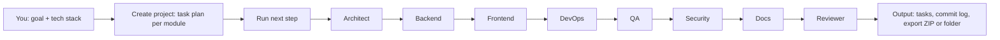

Each click on **Run next step** advances the pipeline: a task in `review` becomes `done` (and a commit is logged), a `running` task moves to `review`, and the next `todo` task starts `running`. When every task is done the API answers `409 pipeline_complete`.

> **Explain like I am 5.** Imagine eight helpers in a toy factory. One draws the plan, one builds the engine, one paints it, one packs the box, one tests every button, one checks for dangers, one writes the instructions, and the last one says "OK to ship". You give the factory an idea, and you watch each helper take their turn. Longer version with analogies: [docs/EXPLAIN-LIKE-IM-5.md](docs/EXPLAIN-LIKE-IM-5.md).

## The crew

Source of truth: [`src/lib/agent-catalog.ts`](src/lib/agent-catalog.ts) (also served by `GET /api/agents`).

| Agent | Codename | Job | Tools | Produces | Sub-agents |
|---|---|---|---|---|---|
| Architect | ATLAS | Turns a brief into a blueprint. | Mermaid, ADR, OpenAPI | ADRs, architecture diagram, API contract | Stack Scout (picks libraries that fit your stack), Schema Smith (designs tables and relations), Contract Clerk (writes the API contract) |
| Backend | FORGE | Builds the engine room. | Drizzle, Zod, Route Handlers | APIs, database, auth hooks, jobs | Data Digger (migrations and seed data), Route Runner (REST endpoints with validation), Gatekeeper (sessions, roles, permissions) |
| Frontend | PRISM | Makes it beautiful and clickable. | Next.js, Tailwind, shadcn/ui | Pages, components, design system | Pixel Painter (components and layout), Motion Maker (animations and transitions), Access Ally (accessibility and responsive checks) |
| DevOps | HELM | Gets it online and keeps it there. | Docker, GitHub Actions, Vercel | Pipelines, containers, deploy docs | Pipeline Pilot (CI workflows), Box Builder (Dockerfiles and images), Watch Tower (health checks and logs) |
| QA | ECHO | Clicks everything so users don't have to. | Playwright, Vitest | Test suites, coverage, bug reports | Click Tester (end-to-end browser tests), Unit Inspector (function-level tests), Load Lifter (stress and speed checks) |
| Security | AEGIS | Thinks like an attacker, acts like a guard. | npm audit, Threat model, CSP | Findings and fixes | Dependency Dog (scans packages for known holes), Authz Auditor (checks who can do what), Secret Sniffer (finds leaked keys) |
| Docs | SCRIBE | Explains it so anyone can run it. | Markdown, Mermaid | README, guides, changelog | Kid Translator (plain-language explainers), API Archivist (endpoint reference), Changelog Keeper (release notes) |
| Reviewer | JUDGE | The final Go / No-Go gate. | CodeRabbit, Checklists | Go / No-Go + required fixes | PR Patrol (reviews every pull request), Style Sheriff (consistency and lint), Ship Marshal (definition-of-done check) |

More: [docs/agents.md](docs/agents.md).

## Every major component explained

### Landing and marketing site
Route group `src/app/(marketing)` with pages `/how-it-works`, `/agents` (plus `/agents/[slug]`), `/demo`, `/docs` (plus `/docs/[slug]`), `/pricing`, `/security`, `/api-reference` and `/changelog`. The home page is `src/app/page.tsx`. Navigation links live in [`src/components/site/nav-data.ts`](src/components/site/nav-data.ts). It connects to the dashboard through the call-to-action buttons and to the docs pages through `/docs`.

### Design system and fonts
A sleek dark "Ink & Signal" theme (near-black canvas, mint / amber / blue / coral accents, soft 12-16px surfaces; see [docs/DESIGN-SYSTEM.md](docs/DESIGN-SYSTEM.md)) in [`src/app/ghost-kit.css`](src/app/ghost-kit.css) and [`src/app/globals.css`](src/app/globals.css), on top of Tailwind CSS v4. Fonts come from `next/font/google`: Bricolage Grotesque (headings), Instrument Sans (body) and Geist Mono (hashes and code), wired up in [`src/app/layout.tsx`](src/app/layout.tsx). Base components (button, card, dialog, input, table, tabs, badge) are in `src/components/ui/`; the logo is `public/brand/ghost-ai-logo.svg`.

### Dashboard
`/dashboard` has **8 views**, each a route under `src/app/dashboard/`: overview, projects, tasks (kanban with drag and move), agents, git (commit timeline), flow (pipeline graph), exports and settings. There is a **command palette** (open with `Ctrl K`) and a **New project wizard** (`new-project-wizard.tsx`). State is managed by [`src/components/dashboard/store.tsx`](src/components/dashboard/store.tsx), which reads from the API or from demo data. Components are in `src/components/dashboard/`.

### Demo mode vs Live mode
The dashboard starts on **demo data** (mock data kept in your browser's `localStorage`, from `src/lib/mock-data.ts` and `src/lib/client-data.ts`). If it can reach the backend (`/api/health`), it switches to **live** mode and talks to the real API and database, then shows a "Live API connected" toast. Setting `NEXT_PUBLIC_DEMO=1` forces demo mode and is how the static GitHub Pages site is built.

### Export (folder save and ZIP)
The Exports view builds a project bundle in the browser (JSON, report, CSV, git log, README and docs) with [`src/lib/export.ts`](src/lib/export.ts). You can **download a ZIP** (a store-only ZIP written by the app, no extra library) or **save to a folder** using the browser's directory picker where supported (Chromium-based browsers). The server also exposes `GET /api/projects/:id/export?format=json|md`.

### API
Thirteen JSON endpoints under `src/app/api/`, validated with Zod ([`src/lib/contracts.ts`](src/lib/contracts.ts)), with error bodies like `{"error":{"code":"...","message":"..."}}`, CORS headers, and a per-IP write rate limit of 60 requests per minute (HTTP 429). The OpenAPI document is generated by [`src/lib/openapi.ts`](src/lib/openapi.ts). Examples assume `http://localhost:3000`.

| Method | Path | Description | Sample |
|---|---|---|---|
| GET | `/api/health` | Liveness plus database check (`503` if the DB is down) | `curl localhost:3000/api/health` |
| GET | `/api/openapi` | OpenAPI document | `curl localhost:3000/api/openapi` |
| GET | `/api/agents` | The agent catalog (8 agents with sub-agents) | `curl localhost:3000/api/agents` |
| GET | `/api/agents/:name` | One agent, e.g. `Architect` (`404` if unknown) | `curl localhost:3000/api/agents/Architect` |
| GET | `/api/stack` | Stack options grouped by category | `curl localhost:3000/api/stack` |
| GET | `/api/stats` | Counts: projects, tasks by status, commits, completion % | `curl localhost:3000/api/stats` |
| GET | `/api/projects` | List projects | `curl localhost:3000/api/projects` |
| POST | `/api/projects` | Create a project (`name` 2-60, `brief` 10-2000, `stack` 1-20 items) | `curl -X POST localhost:3000/api/projects -H "Content-Type: application/json" -d '{"name":"Todo App","brief":"A small todo app with login","stack":["Next.js","Drizzle"]}'` |
| GET | `/api/projects/:id` | Project detail with tasks, git log and agent states | `curl localhost:3000/api/projects/<id>` |
| DELETE | `/api/projects/:id` | Delete a project | `curl -X DELETE localhost:3000/api/projects/<id>` |
| POST | `/api/projects/:id/run` | Advance the pipeline one step (`409` when complete) | `curl -X POST localhost:3000/api/projects/<id>/run` |
| GET | `/api/projects/:id/tasks` | Tasks, filter with `?status=`, `?module=`, `?agent=` | `curl "localhost:3000/api/projects/<id>/tasks?status=done"` |
| PATCH | `/api/projects/:id/tasks/:taskId` | Update `status` and/or `progress` (0-100) | `curl -X PATCH localhost:3000/api/projects/<id>/tasks/<taskId> -H "Content-Type: application/json" -d '{"status":"done","progress":100}'` |
| GET | `/api/projects/:id/gitlog` | Commit log, optional `?limit=` | `curl "localhost:3000/api/projects/<id>/gitlog?limit=5"` |
| GET | `/api/projects/:id/export` | Download as `json` (default) or `md` with `?format=md` | `curl "localhost:3000/api/projects/<id>/export?format=md"` |

(That is 15 method and path combinations across 13 route files.) Full reference: [docs/COMMANDS.md](docs/COMMANDS.md) and [docs/methods.md](docs/methods.md).

### Database
Drizzle ORM over libSQL ([`src/db/`](src/db)). By default it is a local SQLite file (`DATABASE_URL=file:local.db`, created on first use and seeded with two sample projects); set `DATABASE_URL` and `DATABASE_AUTH_TOKEN` to use Turso. Tables in [`src/db/schema.ts`](src/db/schema.ts):

| Table | Columns |
|---|---|
| `projects` | id, name, brief, stack (JSON array), status (planning, building, shipped), created_at, owner_id |
| `tasks` | id, project_id, title, module, agent, status, progress, position, sub_agent |
| `gitlog` | id, project_id, hash, message, agent, files, at |

All data access goes through [`src/lib/repo.ts`](src/lib/repo.ts).

### Auth (Clerk)
Optional sign-in with email and GitHub via Clerk. With no keys the app runs in **demo mode**: `/dashboard` is open and `/sign-in` and `/sign-up` show an explainer with a "Continue in demo mode" button. With keys, [`src/proxy.ts`](src/proxy.ts) protects `/dashboard` and the write endpoints (`POST`, `PATCH`, `DELETE` on `/api/projects*` return `401` without a session); reads and `/api/health` stay public. Setup: [docs/auth.md](docs/auth.md).

### Docs
Guides in [`docs/`](docs/README.md): run guide, explain-like-I-am-5, command reference, workflows, code tour, architecture, ADRs and Mermaid diagrams. `npm run docs:check` parses every Mermaid block in the README and docs (CI runs it). `npm run check:links` checks every link ([report](docs/LINK-REPORT.md)).

### Tests
**55 Playwright end-to-end tests** (per [STATUS.md](STATUS.md)) in `tests/e2e/`: site links and mobile menu, dashboard views, wizard, drag and move, ZIP export CRC check, folder save with a stubbed picker, and every API route including 400, 404 and 409 cases. They run against a production build in demo mode on port 3500 using Microsoft Edge.

### CI/CD
Workflows in [`.github/workflows/`](.github/workflows):

| Workflow | Trigger | What it does |
|---|---|---|
| `ci.yml` (CI) | push to main, pull requests | Typecheck, lint, `docs:check`, build; a non-blocking `npm audit` of production dependencies; Docker build plus a smoke test of `/api/health` (checks the container does not run as root) |
| `pages.yml` (Deploy demo to GitHub Pages) | push to main, manual | Builds the static demo with `npm run build:pages` and deploys it to GitHub Pages |
| `codeql.yml` (CodeQL) | push and PR to main, weekly | Code scanning for JavaScript/TypeScript, skipped on private repositories |

Dependabot (`.github/dependabot.yml`) opens weekly update PRs for npm, GitHub Actions and Docker. Details: [docs/WORKFLOWS.md](docs/WORKFLOWS.md), [docs/devops.md](docs/devops.md).

### CodeRabbit PR reviews
[`.coderabbit.yaml`](.coderabbit.yaml) configures the CodeRabbit AI reviewer (assertive profile, reviews PRs targeting `main`, with extra instructions for `src/app/api/**` and `src/components/**`). It needs the CodeRabbit GitHub app installed on the repository. Setup and chat commands: [docs/coderabbit.md](docs/coderabbit.md).

### Docker
[`Dockerfile`](Dockerfile) is a multi-stage build on `node:24-bookworm-slim` using Next.js standalone output, runs as a non-root user, keeps SQLite in the `/data` volume and has a health check on `/api/health`. [`docker-compose.yml`](docker-compose.yml) runs it on port 3000 with the volume `ghost-data` and an optional `.env`. The image is built and smoke-tested in CI.

### GitHub Pages static build
`npm run build:pages` ([`scripts/pages-build.mjs`](scripts/pages-build.mjs)) produces a fully static export in `out/`. A static host cannot run servers, so the script temporarily moves `src/app/api` and `src/proxy.ts` aside, builds with `GITHUB_PAGES=true` and `NEXT_PUBLIC_DEMO=1`, and restores them. The base path comes from `NEXT_PUBLIC_BASE_PATH`, which the workflow sets to `/<repository name>`. On Windows, Next.js writes segment prefetch files with nested folders that the browser does not request; [`scripts/fix-win-export.mjs`](scripts/fix-win-export.mjs) flattens them (it does nothing on Linux, where CI builds). [`scripts/static-smoke.mjs`](scripts/static-smoke.mjs) checks the output.

## Architecture

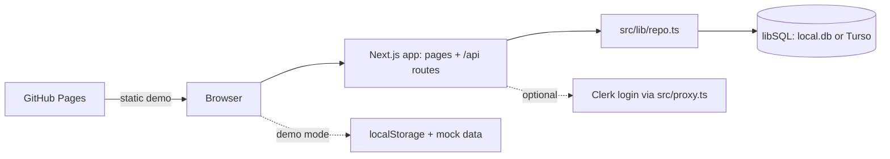

Delivery pipeline:

```mermaid
flowchart LR
  P["Pull request"] --> CR["CodeRabbit review"]
  P --> CI["CI: typecheck, lint, docs, build, Docker"]
  CI --> M["Merge to main"]
  M --> PG["Pages workflow"] --> LIVE["Live demo site"]
  M --> CQ["CodeQL scan"]
```

More: [docs/architecture.md](docs/architecture.md), [docs/CODE-TOUR.md](docs/CODE-TOUR.md), [docs/connectivity.md](docs/connectivity.md).

Build history, commit by commit and mapped to each agent: [docs/COMMIT-HISTORY.md](docs/COMMIT-HISTORY.md).

## Tech stack

| Area | Choice |
|---|---|
| Framework | Next.js 16 (App Router), React 19 |
| Language | TypeScript 5 |
| Styling and UI | Tailwind CSS v4, shadcn-style components, Base UI, framer-motion, lucide-react |
| Data | Drizzle ORM over libSQL (local SQLite file, Turso for hosted) |
| Validation | Zod |
| Auth | Clerk (optional) |
| Lint | ESLint 9 |
| Docs tooling | Mermaid, mermaid-cli, jsdom |
| Tests | Playwright (Edge channel) |
| Delivery | Docker (Node 24), GitHub Actions, GitHub Pages, Vercel config, CodeQL, Dependabot, CodeRabbit |

## Project structure

```text
.
├── .github/                 workflows (ci, pages, codeql), dependabot, PR/issue templates, CODEOWNERS
├── docs/                    guides, ADRs, Mermaid diagrams, book/
├── notebooks/               ghost-notebook.ipynb
├── public/                  brand/ (logo), demo/ (video + poster)
├── scripts/                 pages-build, fix-win-export, static-smoke, record-demo, check-mermaid, check-links
├── src/
│   ├── app/
│   │   ├── (marketing)/     landing pages: how-it-works, agents, demo, docs, pricing, security ...
│   │   ├── (auth)/          sign-in and sign-up
│   │   ├── api/             13 route handlers
│   │   └── dashboard/       8 views: overview, projects, tasks, agents, git, flow, exports, settings
│   ├── components/          dashboard, site, landing, marketing, auth, brand, ui
│   ├── db/                  Drizzle schema and client
│   ├── lib/                 repo, sim, contracts, agent-catalog, export, openapi, api-utils ...
│   └── proxy.ts             Clerk middleware (only active with keys)
├── tests/e2e/               Playwright specs
├── Dockerfile, docker-compose.yml, .env.example, .coderabbit.yaml
└── package.json
```

## Run it

Requirements: Node.js 20 or newer (24 recommended, CI and Docker use 24), git. Docker only for mode C. Run commands in the folder that contains `package.json`.

```bash
git clone https://github.com/reddypranith80-max/ghost-ai.git
cd ghost-ai
npm ci
```

### Mode A: zero-config demo (start here)

```bash
npm run dev
```

Expected: `Local: http://localhost:3000` and `Ready`. Open <http://localhost:3000>, click **Dashboard**. No keys needed; `local.db` is created on first API use. For a production build: `npm run build` then `npm start` (also port 3000).

### Mode B: with Clerk sign-in

1. Create an app at <https://dashboard.clerk.com/sign-in>, enable Email and the GitHub connection ([docs/auth.md](docs/auth.md)).
2. Copy `.env.example` to `.env.local` in the project root (the folder with `package.json`). Mac/Linux: `cp .env.example .env.local`; PowerShell: `Copy-Item .env.example .env.local`.
3. Fill `NEXT_PUBLIC_CLERK_PUBLISHABLE_KEY` and `CLERK_SECRET_KEY` from Clerk's **API keys** page.
4. Restart `npm run dev`; `/dashboard` now redirects to `/sign-in`.

### Mode C: Docker

```bash
docker compose up --build        # same as: npm run docker:up
curl http://localhost:3000/api/health
```

Port 3000; data persists in the `ghost-data` volume. Put Clerk keys in a `.env` file next to `docker-compose.yml` if you want sign-in.

### Other commands

| Command | Purpose |
|---|---|
| `npm run typecheck` | `tsc --noEmit` |
| `npm run lint` | ESLint (`npm run lint:fix` to auto-fix) |
| `npm run docs:check` | Parse all Mermaid blocks (`npm run docs:diagrams` also renders SVGs) |
| `npm run check:links` | Check README and docs links (see [docs/LINK-REPORT.md](docs/LINK-REPORT.md)) |
| `npm run build:pages` | Static export to `out/` for GitHub Pages |
| `npm run demo:record` | Re-record the demo video |
| `npm run docker:build` | Build image `ghost-ai-web:local` |

All of them, with expected output: [docs/COMMANDS.md](docs/COMMANDS.md). Beginner walkthrough: [docs/RUN-ME.md](docs/RUN-ME.md).

## Run the tests

```bash
npm run build          # tests run against the production build
npm run test:e2e       # playwright test: starts `next start -p 3500` itself
```

The config ([`playwright.config.ts`](playwright.config.ts)) uses the installed Microsoft Edge (`channel: "msedge"`), so no browser download is needed; on other machines change the channel or install a Playwright browser. The server runs without Clerk keys, so tests cover demo mode.

## Troubleshooting

| Symptom | Likely cause | Fix |
|---|---|---|
| `EADDRINUSE` / port 3000 busy | Another server uses the port | Stop it, or `npx next dev -p 3001` |
| Build fails with a lock or odd cache error | Two builds (`dev`, `build`, `build:pages`) running in one folder | Stop all, delete `.next/`, run once |
| `/dashboard` redirects to `/sign-in` in dev | Clerk keys are set | Remove them from `.env.local`, or sign in |
| Keys set but still demo mode | `NEXT_PUBLIC_DEMO=1` is set or the server was not restarted | Unset it, restart |
| Dashboard shows demo data, not the database | API unreachable, or `NEXT_PUBLIC_DEMO=1` | Check `http://localhost:3000/api/health`; unset the variable |
| `npm run test:e2e` cannot launch the browser | Edge is not installed | Install Edge, or change `channel` in `playwright.config.ts` |
| Static site assets 404 under a sub-path | Missing base path | Build with `NEXT_PUBLIC_BASE_PATH=/<repo>` |
| Folder save button missing | Browser lacks the directory picker | Use Chrome or Edge, or download the ZIP |
| Mermaid render fails | No Chrome/Edge found | Set `PUPPETEER_EXECUTABLE_PATH`, or use `npm run docs:check` (no render) |

More: [docs/RUN-ME.md](docs/RUN-ME.md).

## Fork and clone

Click **Fork** on GitHub, clone your fork, run `npm ci && npm run dev`, and your own copy of the live demo is one setting away (Settings, Pages, Source: GitHub Actions). Step-by-step, including keeping your fork in sync, your own Clerk app, and opening a PR back: **[docs/FORK-AND-CLONE.md](docs/FORK-AND-CLONE.md)**.

## Download the notebook

The **Ghost Notebook** is a Jupyter notebook that clones the repo, starts the server and calls every API route from Python (tables, a pipeline run, an export to a local folder, a progress chart).

- Download (raw file): <https://raw.githubusercontent.com/reddypranith80-max/ghost-ai/main/notebooks/ghost-notebook.ipynb>
- View on GitHub: [notebooks/ghost-notebook.ipynb](notebooks/ghost-notebook.ipynb)
- Open in Google Colab: [](https://colab.research.google.com/github/reddypranith80-max/ghost-ai/blob/main/notebooks/ghost-notebook.ipynb)

## Book

The **Ghost AI Book** is a long-form PDF that tells how the project was built, chapter by chapter.

- Read or download: [docs/book/Ghost-AI-Book.pdf](docs/book/Ghost-AI-Book.pdf)
- Source in Markdown: [docs/book/Ghost-AI-Book.md](docs/book/Ghost-AI-Book.md)
- Rebuild it: `npm run docs:book` (script: `scripts/build-book.mjs`)

## Honest status and known limitations

- **The agents are simulated.** No AI model is called.
- **Real Clerk sign-in needs the owner's keys** and has not been verified by the automated tests (they run in demo mode).
- **The static demo** (GitHub Pages) uses mock data and `localStorage`. There is no API or database there.
- **The Docker image is built in CI**; Docker was not available on the author's machine, so it has not been run locally. It is not pushed to a registry.
- **E2E tests were run locally only on Microsoft Edge**; other browsers are untested.
- **There is no `LICENSE` file yet**, so the license is undefined until the owner adds one.

Project notes: [STATUS.md](STATUS.md).

## Contributing

Read [CONTRIBUTING.md](CONTRIBUTING.md). In short: branch from `main`, keep changes small, run `npm run typecheck`, `npm run lint`, `npm run docs:check` and `npm run build`, then open a pull request. Fill in the PR template; CodeRabbit reviews automatically and CI must be green. Changes are logged in [CHANGELOG.md](CHANGELOG.md).

## Credits

Built by Pranith ([@reddypranith80-max](https://github.com/reddypranith80-max)) with a team of AI coding agents (Claude Code). Thanks to the open-source projects behind it: Next.js, React, Tailwind CSS, Drizzle ORM, libSQL, Zod, Clerk, Base UI, framer-motion, lucide, Mermaid and Playwright.
````

### `STATUS.md`

**Lines:** 17 · **Size:** 1.2 KB · **Language:** markdown

Short, evidence-based status page: what is verified (tsc, eslint, build, 55 Playwright tests, static build, demo video) and what is NOT verified (real Clerk login, Docker build, GitHub Actions, other browsers). The book's Part V is derived from it.

```markdown
# Project Status
**Current Goal**: Ship Ghost AI to GitHub with a live Pages demo.
**Overall Health**: GREEN locally; not yet pushed or deployed.
## Verified (with evidence)
- `tsc`, `eslint`, `next build` clean (47 static pages, 13 API routes, proxy)
- Playwright e2e on Edge: 55/55 pass (links, mobile menu, FAQ, dashboard views, wizard, drag/move, ZIP export CRC check, folder-save with stubbed picker, every API route incl. 400/404/409)
- Static GitHub Pages build works under /ghost-ai/ (Windows export bug fixed in scripts/fix-win-export.mjs)
- Demo video recorded: public/demo/ghost-ai-demo.webm (~11 MB, 89 s)
- Docs: RUN-ME, EXPLAIN-LIKE-IM-5, COMMANDS, WORKFLOWS, CODE-TOUR; 19 Mermaid diagrams parse
- Workflow YAML + .coderabbit.yaml validate against their schemas
## NOT verified
- Real Clerk sign-in (email + GitHub): needs owner's Clerk keys
- Docker image build (no Docker locally; CI job will test it)
- GitHub Actions runs, GitHub Pages deploy, CodeRabbit (needs push + app install)
- Browsers other than Edge; Linux static export
## Next
Owner supplies GitHub user/repo + Clerk keys -> push -> enable Pages (Actions) -> install CodeRabbit -> confirm live URL.
```

### `AGENTS.md`

**Lines:** 9 · **Size:** 679 B · **Language:** markdown

Instructions for AI coding agents working in the repository, including the warning that this Next.js version differs from older training data and that the bundled docs in node_modules/next/dist/docs should be consulted. It is the contract that keeps the orchestrated agents honest about framework APIs.

```markdown
<!-- BEGIN:nextjs-agent-rules -->

## This is NOT the Next.js you know

This version has breaking changes — APIs, conventions, and file structure may all differ from your training data. Read the relevant guide in `node_modules/next/dist/docs/` (resolved from this file's directory; in monorepos the `next` package may not be visible from the repo root) before writing any code. Heed deprecation notices.

This block is written and re-added by `next dev` — verify at `node_modules/next/dist/server/lib/generate-agent-files.js`. Removing it from a diff only re-creates the uncommitted change; committing it with your work keeps the tree clean.

<!-- END:nextjs-agent-rules -->
```

### `CHANGELOG.md`

**Lines:** 20 · **Size:** 956 B · **Language:** markdown

Human-readable release notes in Keep-a-Changelog style. The in-app /changelog page presents the same story.

```markdown
# Changelog

Format loosely follows Keep a Changelog. Nothing is released yet.

## Unreleased

### Added
- Landing page, marketing pages (`/agents`, `/how-it-works`, `/demo`, `/docs`, `/api-reference`, `/pricing`, `/security`, `/changelog`).
- Dashboard: overview, projects, tasks, agents, git log, flow, exports, settings.
- JSON API: health, openapi, stats, stack, agents, projects, run, tasks, gitlog, export.
- Drizzle + libSQL storage with automatic table creation and seed data.
- Optional Clerk sign-in (email + GitHub) with demo-mode fallback.
- Browser-side project export (ZIP, no extra library).
- Docker image, `docker-compose.yml`, CI, CodeQL, GitHub Pages workflow, Dependabot, CodeRabbit config.
- Docs: RUN-ME, EXPLAIN-LIKE-IM-5, COMMANDS, WORKFLOWS, CODE-TOUR; premium README; CONTRIBUTING.

### Known gaps
- Agents are simulated, not real AI calls.
- No Playwright specs yet; `npm run test:e2e` is a placeholder.
- No `LICENSE` file yet.
```

### `CONTRIBUTING.md`

**Lines:** 28 · **Size:** 1.4 KB · **Language:** markdown

Contributor guide: branch from main, make a small focused change, stay inside the folder you own if you are an agent, then run typecheck, lint and the other CI checks locally before opening a PR. Points to docs/RUN-ME.md and docs/agents.md.

````markdown
# Contributing

Thanks for helping. Start with [docs/RUN-ME.md](docs/RUN-ME.md) to get the app running.

## Steps

1. Branch from `main`: `git checkout -b feat/short-name`.
2. Make a small, focused change. Keep to the folder you own if you are an agent (see [docs/agents.md](docs/agents.md)).
3. Check everything, same as CI:
   ```bash
   npm run typecheck
   npm run lint
   npm run docs:check
   npm run build
   ```
4. Commit with Conventional Commits: `type(scope): summary`, for example `fix(api): return 404 for missing task`. Types: feat, fix, docs, chore, ci, refactor, test.
5. Push and open a pull request. Fill in the PR template (`.github/PULL_REQUEST_TEMPLATE.md`).
6. Answer CodeRabbit comments and wait for CI to turn green. See [docs/WORKFLOWS.md](docs/WORKFLOWS.md).

## Rules of thumb

- No secrets in git. If you add an environment variable, add it to `.env.example` and the table in [docs/COMMANDS.md](docs/COMMANDS.md).
- Validate API input with Zod (`src/lib/contracts.ts`) and think about auth.
- Changing docs with Mermaid diagrams? Run `npm run docs:check`.
- Do not run two builds (`npm run build`, `npm run build:pages`, `npm run dev`) in the same folder at the same time.
- This Next.js version is new. Read `node_modules/next/dist/docs/` before changing framework code (see `AGENTS.md`).

All commands are listed in [docs/COMMANDS.md](docs/COMMANDS.md).
````

## 25. GitHub automation and templates

Workflows (CI, CodeQL, Pages), Dependabot, code owners and the issue and pull request templates.

### `.github/CODEOWNERS`

**Lines:** 6 · **Size:** 221 B · **Language:** plaintext

Declares the default code owner for every path so GitHub requests the owner's review on each pull request. Works together with CodeRabbit and the CI required checks.

```text
# Default owner for everything
*                 @reddypranith80-max
/.github/         @reddypranith80-max
/Dockerfile       @reddypranith80-max
/src/app/api/     @reddypranith80-max
/src/db/          @reddypranith80-max
```

### `.github/dependabot.yml`

**Lines:** 15 · **Size:** 375 B · **Language:** yaml

Weekly Dependabot update schedule for npm packages, GitHub Actions versions and the Docker base image, keeping the supply chain current without manual effort.

```yaml
version: 2
updates:
  - package-ecosystem: npm
    directory: /
    schedule: { interval: weekly }
    open-pull-requests-limit: 5
    groups:
      minor-and-patch:
        update-types: [minor, patch]
  - package-ecosystem: github-actions
    directory: /
    schedule: { interval: weekly }
  - package-ecosystem: docker
    directory: /
    schedule: { interval: weekly }
```

### `.github/ISSUE_TEMPLATE/bug_report.yml`

**Lines:** 15 · **Size:** 474 B · **Language:** yaml

GitHub issue form for bug reports (what happened, expected behaviour, repro steps). Gives contributors a consistent structure so the Reviewer and QA roles can triage quickly.

```yaml
name: Bug report
description: Something is broken
labels: [bug]
body:
  - type: textarea
    id: what
    attributes: { label: What happened?, description: Include expected vs actual behaviour. }
    validations: { required: true }
  - type: textarea
    id: repro
    attributes: { label: Steps to reproduce }
    validations: { required: true }
  - type: input
    id: env
    attributes: { label: Environment, placeholder: "Browser / OS / Docker or local / commit SHA" }
```

### `.github/ISSUE_TEMPLATE/config.yml`

**Lines:** 1 · **Size:** 28 B · **Language:** yaml

Issue-chooser setting `blank_issues_enabled: false`, forcing contributors to use the bug or feature forms.

```yaml
blank_issues_enabled: false
```

### `.github/ISSUE_TEMPLATE/feature_request.yml`

**Lines:** 11 · **Size:** 281 B · **Language:** yaml

GitHub issue form for feature requests, mirroring the bug-report form so requests arrive in a predictable shape.

```yaml
name: Feature request
description: Suggest an improvement
labels: [enhancement]
body:
  - type: textarea
    id: problem
    attributes: { label: Problem or goal }
    validations: { required: true }
  - type: textarea
    id: proposal
    attributes: { label: Proposed solution }
```

### `.github/PULL_REQUEST_TEMPLATE.md`

**Lines:** 15 · **Size:** 438 B · **Language:** markdown

Pull-request description template with a checklist; it is the human counterpart of the CodeRabbit review and the Definition of Done the Reviewer agent enforces.

```markdown
## Summary
<!-- What and why, in 1-3 sentences. -->

## Changes
-

## How to test
- [ ] `npm run typecheck && npm run lint && npm run build`
- [ ] Manually verified (describe)

## Checklist
- [ ] No secrets committed; `.env.example` updated if env vars changed
- [ ] Docs updated (`docs/`) and Mermaid diagrams pass `npm run docs:check`
- [ ] API inputs validated (zod) and auth considered
- [ ] CodeRabbit comments addressed or resolved
```

### `.github/workflows/ci.yml`

**Lines:** 66 · **Size:** 1.7 KB · **Language:** yaml

The main CI workflow. Job `verify` runs typecheck, lint, the Mermaid diagram parse check and `next build` in demo mode; `audit` runs `npm audit --omit=dev --audit-level=high` (production dependencies only) as a non-blocking job; `docker` builds the image with buildx, starts it, polls /api/health, asserts the process is not root and fetches the home page. None of these jobs has run on GitHub yet because the repo has not been pushed.

```yaml
name: CI
on:
  push:
    branches: [main]
  pull_request:
permissions:
  contents: read
concurrency:
  group: ci-${{ github.ref }}
  cancel-in-progress: true
jobs:
  verify:
    name: Typecheck, lint, build
    runs-on: ubuntu-latest
    steps:
      - uses: actions/checkout@v4
      - uses: actions/setup-node@v4
        with:
          node-version: 24
          cache: npm
      - run: npm ci
      - run: npm run typecheck
      - run: npm run lint
      - run: npm run docs:check
      - run: npm run build
        env:
          NEXT_PUBLIC_DEMO: "1"

  audit:
    name: npm audit (non-blocking)
    runs-on: ubuntu-latest
    continue-on-error: true
    steps:
      - uses: actions/checkout@v4
      - uses: actions/setup-node@v4
        with:
          node-version: 24
      - run: npm audit --omit=dev --audit-level=high

  docker:
    name: Docker build and smoke test
    runs-on: ubuntu-latest
    steps:
      - uses: actions/checkout@v4
      - uses: docker/setup-buildx-action@v3
      - uses: docker/build-push-action@v6
        with:
          context: .
          load: true
          push: false
          tags: ghost-ai-web:ci
          cache-from: type=gha
          cache-to: type=gha,mode=max
      - name: Run container and hit /api/health
        run: |
          docker run -d --name ghost -p 3000:3000 ghost-ai-web:ci
          for i in $(seq 1 30); do
            if curl -fsS http://127.0.0.1:3000/api/health; then echo; ok=1; break; fi
            sleep 2
          done
          if [ -z "$ok" ]; then docker logs ghost; exit 1; fi
          docker exec ghost id -u | grep -qv '^0$'   # must not run as root
          curl -fsS -o /dev/null http://127.0.0.1:3000/
      - name: Container logs
        if: always()
        run: docker logs ghost || true
```

### `.github/workflows/codeql.yml`

**Lines:** 22 · **Size:** 551 B · **Language:** yaml

CodeQL static security scanning for JavaScript/TypeScript on pull requests, pushes and a weekly schedule. The job is skipped for private repositories (`if: !github.event.repository.private`) because code scanning needs a public repo or GitHub Advanced Security. Complements npm audit (dependencies) by analysing the project's own code.

```yaml
name: CodeQL
on:
  push:
    branches: [main]
  pull_request:
    branches: [main]
  schedule:
    - cron: "17 3 * * 1"
permissions:
  contents: read
  security-events: write
jobs:
  analyze:
    # Code scanning needs a public repo or GitHub Advanced Security; skip cleanly otherwise.
    if: ${{ !github.event.repository.private }}
    runs-on: ubuntu-latest
    steps:
      - uses: actions/checkout@v4
      - uses: github/codeql-action/init@v3
        with:
          languages: javascript-typescript
      - uses: github/codeql-action/analyze@v3
```

### `.github/workflows/pages.yml`

**Lines:** 41 · **Size:** 965 B · **Language:** yaml

Deploys the static demo to GitHub Pages on every push to main. It sets GITHUB_PAGES, NEXT_PUBLIC_DEMO=1 and a base path equal to the repository name, runs `npm run build:pages`, adds .nojekyll, uploads `out/` and deploys. Demo mode means the exported site simulates the backend in the browser.

```yaml
name: Deploy demo to GitHub Pages
on:
  push:
    branches: [main]
  workflow_dispatch:
permissions:
  contents: read
  pages: write
  id-token: write
concurrency:
  group: pages
  cancel-in-progress: true
jobs:
  build:
    runs-on: ubuntu-latest
    steps:
      - uses: actions/checkout@v4
      - uses: actions/setup-node@v4
        with:
          node-version: 24
          cache: npm
      - run: npm ci
      - uses: actions/configure-pages@v5
      - run: npm run build:pages
        env:
          GITHUB_PAGES: "true"
          NEXT_PUBLIC_DEMO: "1"
          NEXT_PUBLIC_BASE_PATH: /${{ github.event.repository.name }}
      - run: touch out/.nojekyll
      - uses: actions/upload-pages-artifact@v3
        with:
          path: out
  deploy:
    needs: build
    runs-on: ubuntu-latest
    environment:
      name: github-pages
      url: ${{ steps.deployment.outputs.page_url }}
    steps:
      - id: deployment
        uses: actions/deploy-pages@v4
```

## 26. Scripts

Node scripts for the static Pages build, the Windows export workaround, smoke testing, demo recording, Mermaid checking and this book.

### `scripts/build-book.mjs`

**Lines:** 865 · **Size:** 72.0 KB · **Language:** javascript

This book's generator: reads the repo, git history, docs and tests; renders Mermaid diagrams, builds Markdown and HTML, and prints a PDF with headless Edge. Running it again regenerates the book from the current repo state.

````js
// Builds "Building Ghost AI from Scratch": docs/book/Ghost-AI-Book.md and docs/book/Ghost-AI-Book.pdf.
//
//   node scripts/build-book.mjs [--no-pdf] [--no-checks] [--no-render]
//
// Everything is read from the real repository: git history, docs/, source files, tests, configs. Narrative
// chapters live in docs/book/chapters/*.md and per-file notes in docs/book/file-notes.json. The PDF is printed
// with the system Microsoft Edge through Playwright (channel "msedge"); the TOC page numbers are measured by
// printing every chapter on its own first (each chapter starts on a fresh page, so offsets add up exactly).
//
//   --no-pdf     write only the Markdown
//   --no-checks  reuse the last captured tsc/eslint/playwright --list results (docs/book/.cache/checks.json)
//   --no-render  do not render missing Mermaid diagrams (use docs/diagrams/*.svg or leave a placeholder)
import fs from "node:fs";
import path from "node:path";
import crypto from "node:crypto";
import os from "node:os";
import { fileURLToPath } from "node:url";
import { spawnSync, execFileSync } from "node:child_process";
import { marked } from "marked";
import hljs from "highlight.js";
import * as jsyaml from "js-yaml";

const ROOT = path.resolve(path.dirname(fileURLToPath(import.meta.url)), "..");
process.chdir(ROOT);
const BOOK = "docs/book";
const CACHE = path.join(BOOK, ".cache");
fs.mkdirSync(CACHE, { recursive: true });
const args = new Set(process.argv.slice(2));
const T0 = Date.now();
const log = (...a) => console.log(`[book ${((Date.now() - T0) / 1000).toFixed(0)}s]`, ...a);

// ---------------------------------------------------------------- helpers
const rd = (p) => fs.readFileSync(p, "utf8").replace(/\r\n/g, "\n");
const exists = (p) => fs.existsSync(p);
const git = (...a) => execFileSync("git", a, { encoding: "utf8", maxBuffer: 256 * 1024 * 1024 }).replace(/\r\n/g, "\n");
const esc = (s) => s.replace(/&/g, "&amp;").replace(/</g, "&lt;").replace(/>/g, "&gt;");
const fmtKB = (n) => (n < 1024 ? `${n} B` : `${(n / 1024).toFixed(1)} KB`);
const countLines = (t) => (t === "" ? 0 : t.replace(/\n$/, "").split("\n").length);
const ghSlug = (s) =>
  s.toLowerCase().trim().replace(/<[^>]*>/g, "").replace(/[^\p{L}\p{N}\s_-]/gu, "").replace(/\s/g, "-");
const mdCell = (s) => String(s).replace(/\|/g, "\\|").replace(/\n/g, " ");
const fence = (code, lang = "") => {
  const longest = Math.max(2, ...[...code.matchAll(/`+/g)].map((m) => m[0].length));
  const f = "`".repeat(longest + 1);
  return `${f}${lang}\n${code.replace(/\n$/, "")}\n${f}`;
};
const table = (head, rows) =>
  `| ${head.join(" | ")} |\n|${head.map(() => "---").join("|")}|\n${rows.map((r) => `| ${r.map(mdCell).join(" | ")} |`).join("\n")}`;
/** Demote markdown headings by `by` levels (fence aware) and drop the first H1 when `dropH1`. */
function demote(md, by, dropH1) {
  let inFence = null;
  let dropped = !dropH1;
  const out = [];
  for (const line of md.split("\n")) {
    const f = line.match(/^\s*(`{3,}|~{3,})/);
    if (f) {
      if (!inFence) inFence = f[1][0].repeat(f[1].length);
      else if (f[1][0] === inFence[0] && f[1].length >= inFence.length) inFence = null;
      out.push(line);
      continue;
    }
    const h = !inFence && line.match(/^(#{1,6})\s+(.*)$/);
    if (h) {
      if (!dropped && h[1].length === 1) {
        dropped = true;
        continue;
      }
      out.push(`${"#".repeat(Math.min(6, h[1].length + by))} ${h[2]}`);
    } else out.push(line);
  }
  return out.join("\n").replace(/^\n+/, "");
}
const run = (cmd, argv, opts = {}) => {
  const t = Date.now();
  const r = spawnSync(cmd, argv, { encoding: "utf8", shell: true, maxBuffer: 64 * 1024 * 1024, ...opts });
  return { code: r.status, ms: Date.now() - t, out: ((r.stdout || "") + (r.stderr || "")).replace(/\r\n/g, "\n").replace(/\x1b\[[0-9;]*m/g, "") };
};

// ---------------------------------------------------------------- repository data
const head = git("log", "-1", "--pretty=%h|%H|%aI|%s").trim().split("|");
const HEAD = { short: head[0], full: head[1], date: head[2], subject: head.slice(3).join("|") };
const dirty = git("status", "--porcelain").trim().length > 0;
const OWN_UNTRACKED = ["scripts/build-book.mjs", "docs/book/file-notes.json", "docs/book/docker-lint.txt", "docs/book/.gitignore"];
const tracked = git("ls-files", "-z").split("\0").filter(Boolean);
const GENERATED = /^docs\/book\/(Ghost-AI-Book\.(md|pdf)|build-info\.json|\.cache\/)/;
const allFiles = [...new Set([...tracked, ...OWN_UNTRACKED.filter(exists)])].filter((f) => !GENERATED.test(f)).sort();
const notes = JSON.parse(rd(`${BOOK}/file-notes.json`));
const packageJson = JSON.parse(rd("package.json"));

const BINARY = /\.(png|jpe?g|gif|ico|webm|mp4|woff2?|ttf|pdf|zip)$/i;
const isListed = (f) =>
  !/(^|\/)package-lock\.json$/.test(f) &&
  !f.startsWith("public/demo/") &&
  !f.startsWith("docs/diagrams/") &&
  !(f.startsWith("docs/") && f !== "docs/book/file-notes.json" && !f.startsWith("docs/book/") ) &&
  !(f.startsWith("docs/book/") && f !== "docs/book/file-notes.json") &&
  !BINARY.test(f);
const listed = allFiles.filter(isListed);
const text = new Map(); // path -> content
for (const f of allFiles) if (!BINARY.test(f) && !f.endsWith("package-lock.json") && exists(f)) text.set(f, rd(f));

const langOf = (f) => {
  const b = path.basename(f);
  if (b === "Dockerfile") return "dockerfile";
  const e = path.extname(f).toLowerCase();
  return { ".ts": "typescript", ".tsx": "typescript", ".mjs": "javascript", ".js": "javascript", ".json": "json", ".css": "css", ".yml": "yaml", ".yaml": "yaml", ".md": "markdown", ".svg": "xml", ".txt": "plaintext" }[e] ?? "plaintext";
};
const fenceLang = (f) => ({ typescript: path.extname(f) === ".tsx" ? "tsx" : "ts", javascript: "js", plaintext: "text", dockerfile: "dockerfile", xml: "xml" })[langOf(f)] ?? langOf(f);

// exports / imports / routes
function detectExports(src) {
  const names = [];
  for (const m of src.matchAll(/^export\s+(default\s+)?(?:async\s+)?(?:function\*?|const|let|class|type|interface|enum)\s+(\w+)/gm)) names.push(m[1] ? `${m[2]} (default)` : m[2]);
  for (const m of src.matchAll(/^export\s*\{([^}]*)\}/gm)) for (const n of m[1].split(",")) if (n.trim()) names.push(n.trim().split(/\s+as\s+/).pop());
  if (/^export\s+default\s+(?!async\s+function|function|class)/m.test(src) && !names.some((n) => n.includes("(default)"))) names.push("default");
  return [...new Set(names)];
}
function resolveImport(from, spec) {
  let base;
  if (spec.startsWith("@/")) base = path.posix.join("src", spec.slice(2));
  else if (spec.startsWith(".")) base = path.posix.join(path.posix.dirname(from), spec);
  else return null;
  for (const c of [base, `${base}.ts`, `${base}.tsx`, `${base}.mjs`, `${base}.css`, `${base}/index.ts`, `${base}/index.tsx`]) if (text.has(c)) return c;
  return null;
}
const importsOf = new Map();
const usedBy = new Map();
for (const [f, src] of text) {
  if (!/\.(tsx?|mjs|js|css)$/.test(f)) continue;
  const specs = new Set();
  for (const m of src.matchAll(/(?:from|import|require)\s*\(?\s*["']([^"']+)["']/g)) specs.add(m[1]);
  for (const m of src.matchAll(/@import\s+["']([^"']+)["']/g)) specs.add(m[1]);
  const res = [...specs].map((s) => resolveImport(f, s)).filter(Boolean);
  importsOf.set(f, res);
  for (const r of res) usedBy.set(r, [...(usedBy.get(r) ?? []), f]);
}
function routeOf(f) {
  if (!f.startsWith("src/app/")) return null;
  const rel = f.slice("src/app/".length);
  const isPage = /(^|\/)page\.tsx$/.test(rel);
  const isRoute = /(^|\/)route\.ts$/.test(rel);
  if (!isPage && !isRoute) return null;
  const segs = rel.split("/").slice(0, -1).filter((s) => !/^\(.*\)$/.test(s)).map((s) => (s.startsWith("[[...") ? "*" : s.startsWith("[") ? `:${s.slice(1, -1)}` : s));
  return { kind: isPage ? "page" : "api", url: "/" + segs.join("/") };
}
const METHODS = ["GET", "POST", "PUT", "PATCH", "DELETE", "OPTIONS", "HEAD"];
const methodsOf = (src) => METHODS.filter((m) => new RegExp(`export\\s+(?:async\\s+function\\s+${m}\\b|const\\s+${m}\\b)`).test(src));

// ---------------------------------------------------------------- git timeline
function loadCommits() {
  const rec = git("log", "--reverse", "--numstat", "--pretty=format:%x1e%H%x1f%h%x1f%an%x1f%aI%x1f%s%x1f%b%x1f").split("\x1e").filter(Boolean);
  const ns = git("log", "--reverse", "--name-status", "--pretty=format:%x1e%H%x1f").split("\x1e").filter(Boolean);
  const status = new Map();
  for (const r of ns) {
    const [h, rest] = r.split("\x1f");
    const m = new Map();
    for (const l of rest.split("\n").filter(Boolean)) {
      const p = l.split("\t");
      m.set(p[p.length - 1], p[0][0]);
    }
    status.set(h, m);
  }
  return rec.map((r) => {
    const parts = r.split("\x1f");
    const [full, short, author, date, subject, body] = parts;
    const files = (parts[6] ?? "").split("\n").filter(Boolean).map((l) => {
      const [a, d, ...p] = l.split("\t");
      const file = p.join("\t");
      return { file, add: a === "-" ? null : +a, del: d === "-" ? null : +d, st: status.get(full)?.get(file.replace(/.*=> /, "").replace(/[{}]/g, "")) ?? status.get(full)?.get(file) ?? "M" };
    });
    return { full, short, author, date, subject, body: body.trim(), files };
  });
}
const commits = loadCommits();

// ---------------------------------------------------------------- Mermaid diagrams
const docFiles = ["docs/context.md", "docs/prose.md", "docs/architecture.md", "docs/connectivity.md", "docs/methods.md", "docs/logs.md", "docs/agents.md", "docs/auth.md", "docs/devops.md", "docs/coderabbit.md", "docs/adr/0001-stack.md", "docs/CODE-TOUR.md", "docs/RUN-ME.md", "docs/EXPLAIN-LIKE-IM-5.md", "docs/COMMANDS.md", "docs/WORKFLOWS.md", "docs/README.md", "docs/product-brief.md"];
const mermaidSvg = new Map(); // trimmed code -> svg text
const mermaidStats = { blocks: 0, rendered: 0, cached: 0, fromDiagramsDir: 0, failed: 0 };
function edgePath() {
  return [process.env.PUPPETEER_EXECUTABLE_PATH, process.env.CHROME_PATH, "C:/Program Files (x86)/Microsoft/Edge/Application/msedge.exe", "C:/Program Files/Microsoft/Edge/Application/msedge.exe", "C:/Program Files/Google/Chrome/Application/chrome.exe", "/usr/bin/google-chrome", "/usr/bin/chromium"].filter(Boolean).find(exists);
}
function prepareMermaid() {
  const exe = edgePath();
  const mmdc = path.join(ROOT, "node_modules", "@mermaid-js", "mermaid-cli", "src", "cli.js");
  fs.mkdirSync(path.join(CACHE, "diagrams"), { recursive: true });
  const cfg = path.join(os.tmpdir(), "book-puppeteer.json");
  if (exe) fs.writeFileSync(cfg, JSON.stringify({ executablePath: exe, args: ["--no-sandbox", "--disable-setuid-sandbox"] }));
  for (const f of docFiles) {
    if (!exists(f)) continue;
    let idx = 0;
    for (const m of rd(f).matchAll(/```mermaid\n([\s\S]*?)\n```/g)) {
      idx++;
      mermaidStats.blocks++;
      const code = m[1].trim();
      const hash = crypto.createHash("sha1").update(code).digest("hex").slice(0, 16);
      const cached = path.join(CACHE, "diagrams", `${hash}.svg`);
      if (exists(cached)) { mermaidSvg.set(code, rd(cached)); mermaidStats.cached++; continue; }
      if (exe && !args.has("--no-render") && exists(mmdc)) {
        const inp = path.join(os.tmpdir(), `book-${hash}.mmd`);
        fs.writeFileSync(inp, code);
        const r = run(`"${process.execPath}"`, [`"${mmdc}"`, "-i", `"${inp}"`, "-o", `"${cached}"`, "-p", `"${cfg}"`, "-b", "white", "-q"]);
        if (r.code === 0 && exists(cached)) { mermaidSvg.set(code, rd(cached)); mermaidStats.rendered++; log(`rendered diagram ${f} #${idx}`); continue; }
        log(`diagram render failed ${f} #${idx}: ${r.out.split("\n")[0]}`);
      }
      const fallback = `docs/diagrams/${path.basename(f, ".md").toLowerCase()}-${idx}.svg`;
      if (exists(fallback)) { mermaidSvg.set(code, rd(fallback)); mermaidStats.fromDiagramsDir++; } else mermaidStats.failed++;
    }
  }
}
function svgToImg(svg) {
  const vb = svg.match(/viewBox="([\d.\-\s]+)"/);
  let w = 600, h = 300;
  if (vb) { const p = vb[1].trim().split(/\s+/).map(Number); w = Math.round(p[2]); h = Math.round(p[3]); }
  let s = svg.replace(/<svg([^>]*)>/, (m, a) => `<svg${a.replace(/\s(width|height)="[^"]*"/g, "").replace(/style="[^"]*"/, "")} width="${w}" height="${h}">`);
  if (!/xmlns=/.test(s.slice(0, 300))) s = s.replace("<svg", '<svg xmlns="http://www.w3.org/2000/svg"');
  return ``;
}

// ---------------------------------------------------------------- generated content (markdown)
const catalogSrc = rd("src/lib/agent-catalog.ts");
const AGENT_CATALOG = new Function(`return ${catalogSrc.slice(catalogSrc.indexOf("= [", catalogSrc.indexOf("AGENT_CATALOG")) + 2, catalogSrc.indexOf("];", catalogSrc.indexOf("AGENT_CATALOG")) + 1)}`)();
const stackSrc = rd("src/lib/stack-catalog.ts");
let STACK = [];
try {
  const i = stackSrc.indexOf("const items");
  const a = stackSrc.indexOf("= [", i) + 2;
  STACK = new Function(`return ${stackSrc.slice(a, stackSrc.indexOf("];", a) + 1)}`)();
} catch { /* leave empty */ }

function genRolesTable() {
  const roles = rd("docs/agents.md").match(/\|\s*Agent[\s\S]*?\n\n/)?.[0] ?? "";
  return roles.trim();
}
function genSubagentTable() {
  const rows = [];
  for (const a of AGENT_CATALOG) a.subAgents.forEach((s, i) => rows.push([i === 0 ? `**${a.name}** (${a.codename})` : "", `\`${s.id}\``, s.name, s.role]));
  return table(["Lead agent", "Sub-agent id", "Name", "Role"], rows);
}
function genAgentCatalogTable() {
  return table(["Agent", "Codename", "Colour", "Tagline", "Tools", "Produces"], AGENT_CATALOG.map((a) => [a.name, a.codename, a.color, a.tagline, a.tools.join(", "), a.produces]));
}
function genStackTable() {
  if (!STACK.length) return "_Stack catalogue could not be parsed._";
  return table(["Category", "Id", "Label", "Why", "Popular"], STACK.map((s) => [s.category, `\`${s.id}\``, s.label, s.why, s.popular ? "yes" : ""]));
}

const COMMIT_NOTES = {
  "0c701eb": "The untouched `create-next-app` scaffold: Next.js app router, Tailwind setup, default assets and TypeScript/ESLint configuration. Everything after this commit is the Ghost AI build.",
  "468f9a9": "A checkpoint of the first multi-agent phase, committed while work was still in progress. It is by far the largest commit: the landing page, marketing pages, the dashboard (store, shell, views), the simulation library, auth wiring, the Docker/CI/Pages/CodeQL/Dependabot/CodeRabbit files, the Mermaid tooling and most of `docs/`. `package-lock.json` alone accounts for a large share of the line counts.",
  "3f85f45": "The phase 1 output of the agents. Its message says the API routes were restored: the thirteen route handlers under `src/app/api` are re-added here after the concurrent Pages build incident described in Chapter 4.",
  "9da51aa": "QA and Docs deliverables: the Playwright end-to-end suite on the Edge channel (`playwright.config.ts`, `tests/e2e/*`), plus the user-facing documentation set (RUN-ME, EXPLAIN-LIKE-IM-5, COMMANDS, WORKFLOWS, CODE-TOUR, docs index), CONTRIBUTING, CHANGELOG, a rewritten README and adjusted architecture, devops and methods docs.",
  "cc54900": "The Windows static-export fix: `scripts/fix-win-export.mjs` flattens the prefetch segment files, `scripts/pages-build.mjs` calls it, and `scripts/static-smoke.mjs` tests the exported site under the `/ghost-ai/` base path.",
  "0befd76": "The recorded demo: `scripts/record-demo.mjs`, the demo video and poster under `public/demo`, a Playwright global teardown that removes projects created by the tests, and test and config adjustments.",
  "163c25f": "A CI hardening fix made after the first verification pass: the root layout stops depending on the generated `LayoutProps` type so `tsc` passes on a clean checkout, CodeQL is skipped for private repositories, `npm audit` only looks at production dependencies, and `.env.example` becomes a tracked file.",
  a12927f: "A documentation-only commit that rewrites `STATUS.md` into the verified / not-verified form that Part V builds on.",
};
function topDirs(files) {
  const c = {};
  for (const f of files) { const d = f.file.includes("/") ? f.file.split("/").slice(0, f.file.startsWith("src/") ? 2 : 1).join("/") : "(root)"; c[d] = (c[d] ?? 0) + 1; }
  return Object.entries(c).sort((a, b) => b[1] - a[1]);
}
function genTimeline() {
  const out = [];
  const totalAdd = commits.reduce((s, c) => s + c.files.reduce((x, f) => x + (f.add ?? 0), 0), 0);
  const totalDel = commits.reduce((s, c) => s + c.files.reduce((x, f) => x + (f.del ?? 0), 0), 0);
  out.push(`The repository has **${commits.length} commits** in total (${commits[0].date.slice(0, 10)} to ${commits.at(-1).date.slice(0, 10)}), touching ${new Set(commits.flatMap((c) => c.files.map((f) => f.file))).size} distinct paths with ${totalAdd.toLocaleString("en")} lines added and ${totalDel.toLocaleString("en")} removed (lockfile and binary files included in the counts where git reports them). The list below is chronological and is generated from \`git log --stat\`; times are as recorded by git, in the author's time zone.`);
  out.push("");
  out.push("### At a glance");
  out.push("");
  out.push(table(["#", "Commit", "Date and time", "Files", "Added", "Removed", "Message"], commits.map((c, i) => [i + 1, `\`${c.short}\``, c.date.replace("T", " ").replace(/([+-]\d\d:\d\d)$/, " $1"), c.files.length, c.files.reduce((x, f) => x + (f.add ?? 0), 0).toLocaleString("en"), c.files.reduce((x, f) => x + (f.del ?? 0), 0).toLocaleString("en"), c.subject])));
  out.push("");
  const maxAdd = Math.max(...commits.map((c) => c.files.reduce((x, f) => x + (f.add ?? 0), 0)));
  out.push("Lines added per commit, excluding `package-lock.json` (a bar is proportional to the largest commit):");
  out.push("");
  out.push(fence(commits.map((c, i) => { const a = c.files.filter((f) => f.file !== "package-lock.json").reduce((x, f) => x + (f.add ?? 0), 0); return `${String(i + 1).padStart(2)} ${c.short}  ${"#".repeat(Math.round((a / Math.max(1, maxAdd)) * 50)).padEnd(50)} ${a.toLocaleString("en")}`; }).join("\n"), "text"));
  commits.forEach((c, i) => {
    const add = c.files.reduce((x, f) => x + (f.add ?? 0), 0), del = c.files.reduce((x, f) => x + (f.del ?? 0), 0);
    out.push("", `### ${i + 1}. \`${c.short}\` ${c.subject}`, "");
    out.push(`- **Date:** ${c.date}`, `- **Author:** ${c.author}`, `- **Full hash:** \`${c.full}\``, `- **Change size:** ${c.files.length} files, +${add.toLocaleString("en")} / -${del.toLocaleString("en")}`);
    const st = {};
    for (const f of c.files) st[f.st] = (st[f.st] ?? 0) + 1;
    out.push(`- **Status mix:** ${Object.entries(st).map(([k, v]) => `${v} ${{ A: "added", M: "modified", D: "deleted", R: "renamed" }[k] ?? k}`).join(", ") || "none"}`);
    if (c.body) out.push("", "Commit message body:", "", fence(c.body, "text"));
    out.push("", COMMIT_NOTES[c.short] ?? `Touches ${topDirs(c.files).slice(0, 4).map(([d, n]) => `\`${d}\` (${n})`).join(", ")}.`, "");
    out.push(`Where the files landed: ${topDirs(c.files).map(([d, n]) => `\`${d}\` ${n}`).join(", ")}.`, "");
    out.push(table(["St", "File", "Added", "Removed"], c.files.map((f) => [f.st, `\`${f.file}\``, f.add ?? "bin", f.del ?? "bin"])));
  });
  return out.join("\n");
}
function genTree() {
  const root = {};
  for (const f of allFiles) { let n = root; for (const s of f.split("/")) n = n[s] ??= {}; }
  const lines = [".  (repository root, tracked files; * = counted lines)"];
  const walk = (n, prefix, p) => {
    const keys = Object.keys(n).sort((a, b) => (Object.keys(n[a]).length ? 0 : 1) - (Object.keys(n[b]).length ? 0 : 1) || a.localeCompare(b));
    keys.forEach((k, i) => {
      const last = i === keys.length - 1;
      const full = p ? `${p}/${k}` : k;
      const isDir = Object.keys(n[k]).length > 0;
      const t = text.get(full);
      lines.push(`${prefix}${last ? "└── " : "├── "}${k}${isDir ? "/" : t !== undefined ? `  (${countLines(t)})` : ""}`);
      if (isDir) walk(n[k], prefix + (last ? "    " : "│   "), full);
    });
  };
  walk(root, "", "");
  return fence(lines.join("\n"), "text");
}
function genRoutes() {
  const pages = [], api = [];
  for (const f of allFiles) {
    const r = routeOf(f);
    if (!r) continue;
    if (r.kind === "page") pages.push([r.url, `\`${f}\``, f.startsWith("src/app/dashboard") ? "dashboard" : f.includes("(auth)") ? "auth" : f.includes("(marketing)") ? "marketing" : "site"]);
    else api.push([methodsOf(text.get(f)).filter((m) => m !== "OPTIONS").join(", ") + " (+OPTIONS)", `\`${r.url}\``, `\`${f}\``]);
  }
  pages.sort((a, b) => a[0].localeCompare(b[0]));
  api.sort((a, b) => a[1].localeCompare(b[1]));
  return { pages, api, md: `### Pages (${pages.length} page files)\n\n${table(["URL pattern", "File", "Area"], pages)}\n\nDynamic segments are shown as \`:name\`; \`*\` is an optional catch-all. \`/agents/:slug\` and \`/docs/:slug\` are pre-rendered for every entry of the agent catalogue and the guides list through \`generateStaticParams\`.\n\n### API routes (${api.length} route handlers)\n\n${table(["Methods", "URL pattern", "File"], api)}\n\nEvery handler also exports \`OPTIONS\` (CORS preflight). Methods are detected from the exports in each \`route.ts\` file.` };
}
function genDataModel() {
  const s = text.get("src/db/schema.ts");
  const out = [];
  for (const m of s.matchAll(/export const (\w+) = sqliteTable\(\s*"(\w+)",\s*\{([\s\S]*?)\n\s*\}/g)) {
    const rows = [];
    for (const c of m[3].split("\n")) {
      const cm = c.match(/^\s*(\w+):\s*(text|integer)\("(\w+)"(?:,\s*\{\s*mode:\s*"(\w+)"\s*\})?\)(.*?),?\s*$/);
      if (!cm) continue;
      const mods = [cm[5].includes("primaryKey") && "primary key", cm[5].includes("notNull") && "not null", (cm[5].match(/default\(([^)]*)\)/) ?? [])[1] && `default ${cm[5].match(/default\(([^)]*)\)/)[1]}`, cm[4] && `mode ${cm[4]}`, (cm[5].match(/\$type<([^>]*(?:>[^>]*)?)>/) ?? [])[1] && `type ${cm[5].match(/\$type<(.*)>\(\)/)?.[1] ?? ""}`].filter(Boolean).join(", ");
      rows.push([`\`${cm[1]}\``, `\`${cm[3]}\``, cm[2] === "text" ? "TEXT" : "INTEGER", mods]);
    }
    out.push(`### Table \`${m[2]}\` (Drizzle \`${m[1]}\`)`, "", table(["Field", "Column", "SQL type", "Notes"], rows), "");
  }
  const er = rd("docs/architecture.md").match(/```mermaid\n(erDiagram[\s\S]*?)\n```/);
  const ddl = [...text.get("src/db/index.ts").matchAll(/`((?:CREATE|ALTER)[^`]+)`/g)].map((m) => m[1]);
  return `${out.join("\n")}\nThe tables are created idempotently at first use by \`ensureDb()\` in \`src/db/index.ts\`. The statements it runs:\n\n${fence(ddl.join(";\n") + ";", "sql")}\n\nTwo columns, \`projects.owner_id\` and \`tasks.sub_agent\`, are added by the additive migration in the same file (\`addColumn\` checks \`PRAGMA table_info\` first). There are no foreign key constraints; \`project_id\` columns are indexed and joined in \`src/lib/repo.ts\`.\n\n${er ? "Entity relationship diagram (from the architecture document):\n\n" + fence(er[1], "mermaid") : ""}\n\n### Shared types (\`src/lib/contracts.ts\`)\n\n${fence(text.get("src/lib/contracts.ts"), "ts")}`;
}
function parseVars(css) {
  const groups = [];
  const cleaned = css.replace(/\/\*[\s\S]*?\*\//g, "");
  for (const m of cleaned.matchAll(/([^{}]+)\{([^{}]*)\}/g)) {
    const vars = [...m[2].matchAll(/(--[\w-]+)\s*:\s*([^;]+);/g)].map((v) => [`\`${v[1]}\``, `\`${v[2].trim().replace(/\s+/g, " ")}\``]);
    if (vars.length) groups.push({ sel: m[1].trim().replace(/\s+/g, " "), vars });
  }
  return groups;
}
function genTokens() {
  const out = [];
  for (const f of ["src/app/globals.css", "src/app/ghost-kit.css"]) {
    const g = parseVars(text.get(f));
    out.push(`### Custom properties in \`${f}\``, "");
    for (const grp of g) out.push(`**\`${grp.sel}\`** (${grp.vars.length} properties)`, "", table(["Property", "Value"], grp.vars), "");
  }
  const classes = new Map();
  for (const f of ["src/app/globals.css", "src/app/ghost-kit.css"]) for (const m of text.get(f).matchAll(/^\s*\.([a-z][\w-]*)[^{\n]*\{/gm)) if (!classes.has(m[1])) classes.set(m[1], f);
  out.push("### Utility classes defined by the Ghost kit", "", table(["Class", "Defined in"], [...classes].map(([c, f]) => [`\`.${c}\``, `\`${f}\``])), "");
  out.push("### How the tokens are used", "", "- The shadcn tokens (`--background`, `--primary`, ...) are written in `oklch` for both `:root` and `.dark`. Because `src/app/layout.tsx` always sets the `dark` class on `<html>`, the dark values are the ones users see.", "- The `--gh-*` tokens carry the brand: `--gh-void` (page background), `--gh-panel` and `--gh-line` (glass panels and borders), `--gh-cyan` and `--gh-violet` (accent pair, used in `.gh-text-gradient` and the primary button gradient), `--gh-text-dim` (secondary text).", "- Fonts are three `next/font` variables (`--font-grotesk`, `--font-body`, `--font-code`) mapped to the Tailwind theme names (`--font-display`/`--font-heading`, `--font-sans`, `--font-mono`).", "- The dashboard additionally lets the user pick an accent colour (`ACCENTS` in `src/components/dashboard/store.tsx`).");
  return out.join("\n");
}
function genComponents() {
  const rows = [];
  for (const f of listed.filter((x) => x.startsWith("src/components/")).sort()) {
    const src = text.get(f);
    rows.push([`\`${f.slice("src/components/".length)}\``, detectExports(src).slice(0, 8).join(", ") || "(shadcn parts)", countLines(src), (usedBy.get(f) ?? []).length]);
  }
  const groups = {};
  for (const r of rows) { const g = r[0].replace(/`/g, "").split("/")[1] ? r[0].replace(/`/g, "").split("/")[0] : "(top level)"; (groups[g] ??= []).push(r); }
  return Object.entries(groups).map(([g, rs]) => `### ${g}\n\n${table(["File (under src/components/)", "Exports", "Lines", "Imported by (files)"], rs)}`).join("\n\n") + `\n\n**Total:** ${rows.length} component and component-data files, ${rows.reduce((s, r) => s + r[2], 0).toLocaleString("en")} lines.`;
}

const API_REF = [
  ["GET", "/api/health", "", "Liveness and database check. 200 with `{ ok, db, authEnabled }`; 503 if the database is down."],
  ["GET", "/api/openapi", "", "OpenAPI 3.1 document."],
  ["GET", "/api/stats", "", "Totals across visible projects."],
  ["GET", "/api/stack", "", "Stack catalogue grouped by category."],
  ["GET", "/api/agents", "", "All eight agents with sub-agents."],
  ["GET", "/api/agents/:name", "", "One agent, case-insensitive; 404 if unknown."],
  ["GET", "/api/projects", "", "List of ProjectDetail."],
  ["POST", "/api/projects", '{"name":"Acme Helpdesk","brief":"A ticketing app with SLA timers.","stack":["Next.js","Clerk","Postgres"]}', "Create. 201 ProjectDetail; 400 with Zod issues; 429 when rate limited."],
  ["GET", "/api/projects/:id", "", "One ProjectDetail; 404 if missing."],
  ["DELETE", "/api/projects/:id", "", "Delete. `{ ok, id }`; 403 read-only; 404."],
  ["POST", "/api/projects/:id/run", "", "Advance the simulated pipeline one step; 409 when everything is done."],
  ["GET", "/api/projects/:id/tasks?status=running&agent=Backend", "", "Task list; filters status, module, agent."],
  ["PATCH", "/api/projects/:id/tasks/:taskId", '{"status":"review","progress":80}', "Update a task; returns the updated ProjectDetail."],
  ["GET", "/api/projects/:id/gitlog?limit=20&agent=QA", "", "Commit list, newest first; limit 1-500."],
  ["GET", "/api/projects/:id/export?format=md", "", "Download the project as json or md."],
];
function genApiRef() {
  const out = ["All examples assume the server runs on `http://localhost:3000` (`npm run dev`). Replace `PROJECT_ID` with an id from `GET /api/projects`. With Clerk enabled, add the session cookie or token; reads stay public.", ""];
  const checkRoutes = genRoutes().api.length;
  for (const [m, p, body, desc] of API_REF) {
    out.push(`### \`${m} ${p.split("?")[0]}\``, "", desc, "");
    const url = `http://localhost:3000${p.replace(":id", "PROJECT_ID").replace(":taskId", "TASK_ID").replace(":name", "architect")}`;
    out.push(fence(`curl -s ${m === "GET" ? "" : `-X ${m} `}${body ? `-H "Content-Type: application/json" -d '${body}' ` : ""}"${url}"`, "bash"), "");
  }
  out.push(`The route table above covers ${API_REF.length} method-and-path combinations over ${checkRoutes} route files; \`OPTIONS\` is available on every path.`, "", "### Response and error shapes", "", "Success responses are the types in `src/lib/contracts.ts` serialised as JSON. Errors always use one envelope:", "", fence('{ "error": { "code": "invalid_input", "message": "Invalid input", "issues": [ ... ] } }', "json"), "", table(["Status", "Code", "When"], [[400, "invalid_json / invalid_input", "Body is not JSON or fails Zod validation"], [401, "unauthorized", "Clerk enabled, no session, write to /api/projects*"], [403, "(forbidden)", "Deleting a read-only demo project"], [404, "not_found", "Unknown project, task or agent"], [409, "(conflict)", "Run requested after all tasks are done"], [429, "rate_limited", "More than 60 writes per minute from one IP"], [500, "internal_error", "Unexpected failure; details only in server logs"]]), "", "The status-code list is taken from `docs/methods.md`, `src/lib/api-utils.ts` and `tests/e2e/api.spec.ts`; codes in parentheses are not confirmed by name in the source I read for this table.");
  return out.join("\n");
}

const ENV_DESC = {
  NEXT_PUBLIC_DEMO: "Set to `1` for demo mode: no Clerk, mock data in the browser. Used for the static Pages build and in CI builds.",
  NEXT_PUBLIC_CLERK_PUBLISHABLE_KEY: "Clerk publishable key. Presence (with demo off) enables authentication.",
  CLERK_SECRET_KEY: "Clerk secret key, server only.",
  DATABASE_URL: "libSQL URL. Default `file:local.db`; Docker uses `file:/data/local.db`; Turso uses a `libsql://` URL.",
  DATABASE_AUTH_TOKEN: "Auth token for a remote libSQL/Turso database.",
  GITHUB_PAGES: "`true` switches `next.config.ts` to static export and disables cacheComponents/partialPrefetching.",
  NEXT_PUBLIC_BASE_PATH: "Base path for a project site on GitHub Pages, e.g. `/ghost-ai`.",
  DOCKER: "`1` makes Next emit `output: standalone` for the Docker image.",
  NODE_ENV: "Standard Node environment flag; `production` in the Docker runner.",
  PORT: "Port the standalone server listens on (Docker: 3000).",
  HOSTNAME: "Bind address of the standalone server (Docker: 0.0.0.0).",
  NEXT_TELEMETRY_DISABLED: "Disables Next.js telemetry in Docker builds.",
  PUPPETEER_EXECUTABLE_PATH: "Chrome or Edge executable for Mermaid rendering and this book's PDF.",
  CHROME_PATH: "Alternative Chrome path for Mermaid rendering.",
  NEXT_PUBLIC_CLERK_SIGN_IN_URL: "Clerk sign-in route (`/sign-in`); documented in `docs/auth.md`.",
  NEXT_PUBLIC_CLERK_SIGN_UP_URL: "Clerk sign-up route (`/sign-up`).",
  NEXT_PUBLIC_CLERK_SIGN_IN_FALLBACK_REDIRECT_URL: "Where to land after sign-in (`/dashboard`).",
  NEXT_PUBLIC_CLERK_SIGN_UP_FALLBACK_REDIRECT_URL: "Where to land after sign-up (`/dashboard`).",
};
function genEnv() {
  const found = new Map();
  for (const [f, src] of text) {
    if (f.startsWith("docs/book/")) continue;
    for (const m of src.matchAll(/process\.env\.([A-Z][A-Z0-9_]+)|process\.env\[["']([A-Z][A-Z0-9_]+)["']\]/g)) { const n = m[1] ?? m[2]; found.set(n, new Set([...(found.get(n) ?? []), f])); }
  }
  for (const [f, src] of text) if (/Dockerfile|docker-compose|\.yml$/.test(f)) for (const m of src.matchAll(/\b([A-Z][A-Z0-9]+(?:_[A-Z0-9]+)+)\s*[:=]/g)) if (ENV_DESC[m[1]]) found.set(m[1], new Set([...(found.get(m[1]) ?? []), f]));
  for (const k of Object.keys(ENV_DESC)) if (!found.has(k)) found.set(k, new Set(["docs/auth.md"]));
  const rows = [...found].sort((a, b) => a[0].localeCompare(b[0])).map(([k, fs_]) => [`\`${k}\``, ENV_DESC[k] ?? "(no description recorded)", [...fs_].slice(0, 4).map((x) => `\`${x}\``).join(", ") + (fs_.size > 4 ? ` +${fs_.size - 4}` : "")]);
  return `Variables detected by scanning \`process.env.*\` in every tracked text file, plus compose/workflow settings. Secrets belong in \`.env.local\` (git-ignored; \`.env*\` is in \`.gitignore\`), the host's secret store or \`docker run -e\`, never in the image.\n\n${table(["Variable", "Meaning", "Used in"], rows)}`;
}
function genTroubleshooting() {
  const g = text.get("src/components/marketing/guides.ts");
  const items = [...g.matchAll(/\{\s*h:\s*"([^"]+)",\s*p:\s*"([^"]+)"\s*\}/g)].map((m) => [m[1], m[2]]);
  const runme = rd("docs/RUN-ME.md");
  const tbl = runme.match(/\| Symptom \| Why \| Fix \|[\s\S]*?\n\n/)?.[0].trim() ?? "";
  return `### From the run guide (\`docs/RUN-ME.md\`)\n\n${tbl}\n\n### From the in-app troubleshooting guide (\`src/components/marketing/guides.ts\`)\n\n${items.length ? table(["Problem", "Advice"], items) : "_not found_"}\n\n### Additional entries learned during the build\n\n${table(["Symptom", "Likely cause", "Fix"], [["Static build fails or API 404s after `build:pages` crashed", "Files left in `.pages-stash`", "Move `.pages-stash/api` back to `src/app/api` and `.pages-stash/proxy.ts` to `src/proxy.ts`, delete `.pages-stash`"], ["Exported site requests `__next.*.__PAGE__.txt` and gets 404 (Windows)", "Nested prefetch files", "`node scripts/fix-win-export.mjs out` (done automatically by `pages-build.mjs`)"], ["Base path looks like `C:/Program Files/Git/...`", "Git Bash converted `/ghost-ai` into a Windows path", "Use PowerShell or `MSYS_NO_PATHCONV=1`"], ["Text is serif despite loaded fonts", "A `--font-*` variable referring to itself", "Keep `next/font` variable names distinct from theme tokens (see Chapter 4)"], ["`npx dockerfilelint` flags HEALTHCHECK", "Outdated linter does not know `--start-period`", "Ignore; verify with a real `docker build` in CI"], ["Playwright cannot start", "Edge missing", "`channel: \"msedge\"` needs Microsoft Edge installed; otherwise remove the channel and run `npx playwright install chromium`"]])}`;
}

// ---------------------------------------------------------------- checks (Part V)
function captureChecks() {
  const cacheFile = path.join(CACHE, "checks.json");
  if (args.has("--no-checks") && exists(cacheFile)) return JSON.parse(rd(cacheFile));
  const c = {};
  log("running tsc --noEmit"); c.tsc = run("npx", ["tsc", "--noEmit"]);
  log("running eslint"); c.eslint = run("npx", ["eslint"]);
  log("running playwright --list"); c.pwList = run("npx", ["playwright", "test", "--list"]);
  log("running check-mermaid --no-render"); c.mermaid = run(`"${process.execPath}"`, ["scripts/check-mermaid.mjs", "--no-render"]);
  c.versions = { node: process.version, platform: `${os.type()} ${os.release()} (${process.platform})`, next: packageJson.dependencies.next, typescript: run("npx", ["tsc", "-v"]).out.trim(), playwright: run("npx", ["playwright", "--version"]).out.trim(), edge: fs.readdirSync("C:/Program Files (x86)/Microsoft/Edge/Application").find((d) => /^\d+\./.test(d)) ?? "n/a" };
  fs.writeFileSync(cacheFile, JSON.stringify(c, null, 1));
  return c;
}
function yamlReport() {
  const rows = [];
  for (const f of allFiles.filter((x) => /^(\.github\/(workflows|ISSUE_TEMPLATE)\/.*\.yml|\.github\/dependabot\.yml|\.coderabbit\.yaml|docker-compose\.yml)$/.test(x))) {
    try {
      const d = (jsyaml.load ?? jsyaml.default.load)(text.get(f));
      const jobs = d?.jobs ? Object.keys(d.jobs).map((j) => `${j} (${d.jobs[j].steps?.length ?? 0} steps)`).join(", ") : "";
      rows.push([`\`${f}\``, "parses", Object.keys(d ?? {}).join(", "), jobs]);
    } catch (e) { rows.push([`\`${f}\``, `**ERROR** ${String(e.message).split("\n")[0]}`, "", ""]); }
  }
  return table(["File", "YAML parse (js-yaml)", "Top-level keys", "Jobs"], rows);
}
function genExecutionLog(chk) {
  const tail = (s, n = 25) => { const l = s.trim().split("\n"); return (l.length > n ? ["... (" + (l.length - n) + " earlier lines omitted)", ...l.slice(-n)] : l).join("\n") || "(no output)"; };
  const pw = chk.pwList.out.split("\n").map((l) => l.trim()).filter((l) => /^\S+\.spec\.ts:\d+:\d+ ›/.test(l));
  const byFile = {};
  for (const l of pw) { const f = l.split(":")[0]; (byFile[f] ??= []).push(l.replace(/^\S+\.spec\.ts:\d+:\d+ › /, "")); }
  const status = rd("STATUS.md");
  const sect = (name) => status.match(new RegExp(`## ${name}[^\\n]*\\n([\\s\\S]*?)(?=\\n## |$)`))?.[1].trim() ?? "";
  const out = [];
  out.push("## Environment", "", table(["Item", "Value"], [["Node.js", chk.versions.node], ["OS", chk.versions.platform], ["Next.js (package.json)", chk.versions.next], ["TypeScript", chk.versions.typescript], ["Playwright", chk.versions.playwright], ["Microsoft Edge", chk.versions.edge], ["Shells", "PowerShell and Git Bash on Windows 11"], ["Docker, ffmpeg, gh", "not installed"]]), "");
  out.push("## Commands re-run while building this book", "", "The generator runs these itself, so the outcomes below are real and dated by the build (see the front page for the commit).", "");
  out.push(table(["Command", "Exit code", "Seconds", "Result"], [["`npx tsc --noEmit` (`npm run typecheck`)", chk.tsc.code, (chk.tsc.ms / 1000).toFixed(1), chk.tsc.code === 0 ? "clean, no output" : "errors, see below"], ["`npx eslint` (`npm run lint`)", chk.eslint.code, (chk.eslint.ms / 1000).toFixed(1), chk.eslint.code === 0 ? "clean, no output" : "findings, see below"], ["`npx playwright test --list`", chk.pwList.code, (chk.pwList.ms / 1000).toFixed(1), `${pw.length} tests listed in ${Object.keys(byFile).length} files (lists only; does not start the server or run the tests)`], ["`node scripts/check-mermaid.mjs --no-render` (`npm run docs:check`)", chk.mermaid.code, (chk.mermaid.ms / 1000).toFixed(1), chk.mermaid.out.trim().split("\n").pop()]]), "");
  for (const [n, k] of [["tsc", "tsc"], ["eslint", "eslint"], ["check-mermaid", "mermaid"]]) out.push(`Output of ${n}:`, "", fence(tail(chk[k].out), "text"), "");
  out.push("### Mermaid rendering done for this book", "", `${mermaidStats.blocks} Mermaid blocks in the inlined documents: ${mermaidStats.rendered} rendered fresh with mermaid-cli and Edge, ${mermaidStats.cached} reused from the render cache (keyed by a hash of the diagram source), ${mermaidStats.fromDiagramsDir} taken from \`docs/diagrams/\`, ${mermaidStats.failed} unavailable.`, "");
  out.push("### Playwright test inventory (`npx playwright test --list`)", "", `${pw.length} tests in ${Object.keys(byFile).length} files. The configuration (\`playwright.config.ts\`) uses one worker, the \`msedge\` channel, a production server on port 3500 started with \`next start\`, and a global teardown. Every test also fails on uncaught page errors or console errors (see \`tests/e2e/fixtures.ts\`).`, "");
  for (const [f, names] of Object.entries(byFile)) out.push(`**\`tests/e2e/${f}\`** (${names.length} tests)`, "", names.map((n, i) => `${i + 1}. ${n}`).join("\n"), "");
  out.push("## Results recorded in STATUS.md (not re-run for this book)", "", "These came from the orchestrator's runs against a production build and a server. Running them needs `next build` and a server, which this book's generator deliberately does not do.", "", "### Verified (with evidence), as stated in `STATUS.md`", "", sect("Verified"), "", "### Not verified, as stated in `STATUS.md`", "", sect("NOT verified"), "");
  out.push("## Workflow and configuration validation", "", "Every YAML file below was parsed again by this build with `js-yaml`. `STATUS.md` additionally records that the workflow files and `.coderabbit.yaml` were validated against their JSON schemas with `ajv-cli`; that schema check was not repeated for the book.", "", yamlReport(), "");
  out.push("## Dockerfile static lint", "", "Command: `npx --yes dockerfilelint Dockerfile`. The complete real output, saved in `docs/book/docker-lint.txt`:", "", fence(exists(`${BOOK}/docker-lint.txt`) ? rd(`${BOOK}/docker-lint.txt`) : "(docker-lint.txt not present)", "text"), "", "Reading the result: the single issue points at the `HEALTHCHECK` instruction. `--interval`, `--timeout`, `--retries` and `--start-period` are valid `HEALTHCHECK` options in current Docker (`--start-period` since 17.09), so this is most likely a limitation of the old linter's argument parser rather than a defect, but only a real `docker build` can confirm it, and Docker is not installed on the development machine. CI builds the image on every pull request.", "");
  out.push("## Command reference used during the build", "", table(["Purpose", "Command", "Evidence"], [["Install", "`npm ci`", "used by CI and Docker"], ["Dev server", "`npm run dev`", "interactive use"], ["Type check", "`npm run typecheck`", "re-run above"], ["Lint", "`npm run lint`", "re-run above"], ["Production build", "`npm run build` (47 static pages, 13 API routes, proxy)", "STATUS.md"], ["Static Pages build", "`$env:NEXT_PUBLIC_BASE_PATH='/ghost-ai'; node scripts/pages-build.mjs` (PowerShell)", "STATUS.md; flattened files by fix-win-export"], ["Static smoke test", "`node scripts/static-smoke.mjs`", "described in the header of the script; result summarised by STATUS.md"], ["E2E tests", "`npx playwright test` (starts `next start -p 3500`)", "STATUS.md: 55/55 passed on Edge"], ["Test inventory", "`npx playwright test --list`", "re-run above"], ["Diagram check", "`npm run docs:check` / `npm run docs:diagrams`", "re-run above; 19 diagrams per STATUS.md"], ["Demo recording", "`npm run demo:record`", "STATUS.md: webm of about 11 MB, 89 s"], ["Docker", "`npm run docker:build`, `docker compose up --build`", "NOT run (no Docker)"], ["Dockerfile lint", "`npx --yes dockerfilelint Dockerfile`", "run, see above"], ["This book", "`node scripts/build-book.mjs` (`npm run docs:book`)", "this document"]]), "");
  out.push("## What was NOT verified", "", "State this plainly, because a long document can make everything in it sound checked:", "", table(["Not verified", "Why", "What would verify it"], [["Real Clerk sign-in with email and GitHub", "Needs the owner's Clerk keys", "Add keys to `.env.local`, follow `docs/auth.md`, sign in and out"], ["Docker image build and run", "Docker is not installed locally", "`docker compose up --build`, or the CI `docker` job"], ["GitHub Actions runs (CI, CodeQL, Pages)", "Repository has not been pushed", "Push, and watch the Actions tab"], ["GitHub Pages deployment and live URL", "Same", "Enable Pages with source GitHub Actions"], ["CodeRabbit reviews", "App not installed on a pushed repo", "Install the app and open a PR"], ["Browsers other than Edge; Linux static export", "Only Edge on Windows was available", "Run Playwright in CI with more projects"], ["Screen-reader behaviour and visual regressions", "Tests check basics (landmarks, console errors, overflow), not rendering", "Manual review or visual snapshot tests"], ["Production load, real database (Turso)", "Local SQLite only", "Deploy to Vercel with Turso"], ["This book's PDF layout beyond sampled pages", "Only a few pages were rendered to images and inspected", "Page through the PDF"]]), "");
  return out.join("\n");
}

function genFileIndex() {
  const rows = [];
  for (const g of SOURCE_GROUPS) for (const f of g.files) rows.push([`\`${f}\``, g.title, countLines(text.get(f))]);
  return `All ${rows.length} files listed in Part III, alphabetically, with their chapter. The paths link to their listing.\n\n${table(["File", "Chapter", "Lines"], rows.sort((a, b) => a[0].localeCompare(b[0])))}`;
}

// ---------------------------------------------------------------- Part III groups
const ORDER_HINT = ["src/lib/contracts.ts", "src/lib/agent-catalog.ts", "src/lib/stack-catalog.ts", "src/lib/mock-data.ts", "src/lib/sim.ts", "src/lib/utils.ts", "src/db/schema.ts", "src/db/index.ts", "src/lib/api-utils.ts", "src/lib/auth.ts", "src/lib/repo.ts", "src/lib/openapi.ts", "src/lib/export.ts", "src/lib/client-data.ts", "src/proxy.ts", "package.json", "next.config.ts", "tsconfig.json", "eslint.config.mjs", "playwright.config.ts", "drizzle.config.ts", "components.json", "Dockerfile", "docker-compose.yml", "README.md", "STATUS.md"];
const hintIdx = (f) => { const i = ORDER_HINT.indexOf(f); return i < 0 ? 1e6 : i; };
const SOURCE_GROUPS_DEF = [
  ["Root configuration, containers and tooling", (f) => !f.includes("/") && !f.endsWith(".md"), "The files at the repository root that configure the toolchain: package manifest, TypeScript, ESLint, Next.js, Drizzle, shadcn, Playwright, Docker, Vercel, CodeRabbit and ignore rules."],
  ["Root documents", (f) => !f.includes("/") && f.endsWith(".md"), "The Markdown documents at the repository root. The `docs/` folder is reproduced in Part II."],
  ["GitHub automation and templates", (f) => f.startsWith(".github/"), "Workflows (CI, CodeQL, Pages), Dependabot, code owners and the issue and pull request templates."],
  ["Scripts", (f) => f.startsWith("scripts/"), "Node scripts for the static Pages build, the Windows export workaround, smoke testing, demo recording, Mermaid checking and this book."],
  ["Shared library and data layer", (f) => f.startsWith("src/lib/") || f.startsWith("src/db/") || f === "src/proxy.ts", "The contracts, catalogues, simulation, data-access code and request plumbing that the pages, components and API routes share. Read `contracts.ts` first."],
  ["API route handlers", (f) => f.startsWith("src/app/api/"), "The thirteen JSON endpoints. They are intentionally thin: validate, call `repo.ts`, shape the response."],
  ["App shell, styles and public pages", (f) => f.startsWith("src/app/") && !f.startsWith("src/app/api/") && !f.startsWith("src/app/dashboard/"), "The root layout, the home page, global CSS, the auth routes and the marketing routes."],
  ["Dashboard routes", (f) => f.startsWith("src/app/dashboard/"), "Thin route files that mount the dashboard views inside the dashboard layout."],
  ["Components: UI primitives, brand and auth", (f) => /^src\/components\/(ui|brand|auth)\//.test(f) || f === "src/components/auth-provider.tsx", "shadcn/ui primitives, the logo, and the lazily loaded Clerk integration."],
  ["Components: site chrome", (f) => f.startsWith("src/components/site/"), "Header, footer, mobile navigation and the page shell."],
  ["Components: landing page", (f) => f.startsWith("src/components/landing/"), "The sections of the home page."],
  ["Components: marketing pages", (f) => f.startsWith("src/components/marketing/"), "Building blocks and data for the marketing and documentation pages."],
  ["Components: dashboard", (f) => f.startsWith("src/components/dashboard/"), "The state store, the shell and the eight dashboard views."],
  ["Tests", (f) => f.startsWith("tests/"), "The Playwright end-to-end suite."],
  ["Public assets", (f) => f.startsWith("public/"), "SVG assets (binary demo media is excluded)."],
  ["Book generator inputs", (f) => f.startsWith("docs/book/"), "The per-file notes that feed this book and the saved Dockerfile lint output."],
];
const SOURCE_GROUPS = [];
{
  const taken = new Set();
  for (const [title, test, intro] of SOURCE_GROUPS_DEF) {
    const files = listed.filter((f) => !taken.has(f) && test(f)).sort((a, b) => hintIdx(a) - hintIdx(b) || a.localeCompare(b));
    files.forEach((f) => taken.add(f));
    if (files.length) SOURCE_GROUPS.push({ title, intro, files });
  }
  const left = listed.filter((f) => !taken.has(f));
  if (left.length) SOURCE_GROUPS.push({ title: "Other files", intro: "Files not matched by another group.", files: left });
}
const missingNotes = [];
function genFileEntry(f) {
  const src = text.get(f);
  const lines = countLines(src);
  const ex = detectExports(src);
  const r = routeOf(f);
  const meta = [`**Lines:** ${lines}`, `**Size:** ${fmtKB(Buffer.byteLength(src))}`, `**Language:** ${langOf(f)}`];
  if (ex.length) meta.push(`**Exports:** ${ex.slice(0, 12).map((e) => `\`${e}\``).join(", ")}${ex.length > 12 ? ` +${ex.length - 12}` : ""}`);
  if (r) meta.push(r.kind === "api" ? `**Route:** ${methodsOf(src).join(", ")} \`${r.url}\`` : `**Page route:** \`${r.url}\``);
  const imps = (importsOf.get(f) ?? []).filter((x) => x !== f);
  const used = usedBy.get(f) ?? [];
  let note = notes[f];
  if (!note) { missingNotes.push(f); note = `(No hand-written note for this file. Detected exports: ${ex.join(", ") || "none"}.)`; }
  const rel = [];
  if (imps.length) rel.push(`**Imports from:** ${imps.slice(0, 8).map((x) => `\`${x}\``).join(", ")}${imps.length > 8 ? ` +${imps.length - 8} more` : ""}`);
  if (used.length) rel.push(`**Used by:** ${used.slice(0, 6).map((x) => `\`${x}\``).join(", ")}${used.length > 6 ? ` +${used.length - 6} more` : ""}`);
  return `### \`${f}\`\n\n${meta.join(" · ")}\n\n${note}\n\n${rel.join("\n\n")}${rel.length ? "\n\n" : ""}${fence(src, fenceLang(f))}`;
}

// ---------------------------------------------------------------- assemble chapters
const chapters = []; // {id,title,level,md,numbered?,dir?}
const addCh = (c) => chapters.push(c);
const chapterFiles = new Map(); // repo path -> chapter index (for link resolution)
let chNo = 0;
const NUM = () => ++chNo;
function expandDirectives(md) {
  return md
    .replace(/\{\{doc:([^}]+)\}\}/g, (_, p) => demote(rd(p), 2, true))
    .replace(/\{\{gen:roles_table\}\}/g, genRolesTable)
    .replace(/\{\{gen:subagent_table\}\}/g, genSubagentTable);
}
const chapterMd = (file, title, extraDemote = 1) => {
  const body = demote(expandDirectives(rd(file)), extraDemote, true);
  return `## ${title}\n\n${body}`;
};

function buildChapters(chk) {
  const partIntro = {
    I: "What was built, in what order, by which agents, and what went wrong along the way.",
    II: "How the system is put together, and the project's own documentation, reproduced in full.",
    III: "Every tracked source and configuration file, with a note on what it is and how it connects, followed by the complete listing.",
    IV: "Where everything is: directory tree, routes, data model, design tokens, components, agent and stack catalogues, and the API reference.",
    V: "The commands that were run, what they printed, and what has not been verified.",
    A: "Reference material: environment variables, troubleshooting, glossary, license note, changelog and a file index.",
  };
  const part = (n, title) => addCh({ id: "", title: `Part ${n}. ${title}`, level: 1, md: `# Part ${n}. ${title}\n\n${partIntro[n]}\n\n` });

  addCh({ id: "", title: "How to read this book", level: 2, md: chapterMd(`${BOOK}/chapters/00-how-to-read.md`, "How to read this book"), front: true });

  part("I", "The story");
  addCh({ title: `${NUM()}. The product brief`, level: 2, md: chapterMd(`${BOOK}/chapters/01-brief.md`, `${chNo}. The product brief`), dir: `${BOOK}/chapters` });
  addCh({ title: `${NUM()}. Multi-agent orchestration`, level: 2, md: chapterMd(`${BOOK}/chapters/02-orchestration.md`, `${chNo}. Multi-agent orchestration`) });
  addCh({ title: `${NUM()}. The build timeline`, level: 2, md: `## ${chNo}. The build timeline\n\n${genTimeline()}` });
  addCh({ title: `${NUM()}. Problems hit and how they were solved`, level: 2, md: chapterMd(`${BOOK}/chapters/04-problems.md`, `${chNo}. Problems hit and how they were solved`) });

  part("II", "Architecture and design");
  const docChapters = [
    ["docs/context.md", "Context"], ["docs/prose.md", "Ghost AI in plain words"], ["docs/architecture.md", "Architecture"], ["docs/connectivity.md", "Connectivity"], ["docs/methods.md", "Methods and API summary"], ["docs/logs.md", "Logs and conventions"], ["docs/agents.md", "Agents"], ["docs/auth.md", "Authentication"], ["docs/devops.md", "DevOps guide"], ["docs/coderabbit.md", "CodeRabbit"], ["docs/adr/0001-stack.md", "ADR 0001: Technology stack"], ["docs/CODE-TOUR.md", "Code tour"], ["docs/RUN-ME.md", "Run me"], ["docs/EXPLAIN-LIKE-IM-5.md", "Explain like I'm 5"], ["docs/COMMANDS.md", "Commands"], ["docs/WORKFLOWS.md", "Workflows"], ["docs/README.md", "Documentation index"],
  ];
  for (const [f, t] of docChapters) {
    const src = rd(f);
    addCh({ title: `${NUM()}. ${t}`, level: 2, doc: f, md: `## ${chNo}. ${t}\n\n*Source: \`${f}\` (${countLines(src)} lines), reproduced in full.*\n\n${demote(src, 1, true)}` });
  }

  part("III", "Complete source code");
  addCh({ title: `${NUM()}. How to read the listings`, level: 2, md: `## ${chNo}. How to read the listings\n\nPart III covers **${listed.length} files** (${listed.reduce((s, f) => s + countLines(text.get(f)), 0).toLocaleString("en")} lines). Excluded on purpose: \`package-lock.json\` (generated), \`public/demo/*\` (binary video and poster), \`docs/diagrams/*.svg\` (generated renderings of the diagrams in Part II), and \`docs/*.md\` (reproduced in Part II).\n\nEach entry has: the path; line count and size; the language; exports and routes detected from the text; a note written by reading the file (kept in \`docs/book/file-notes.json\`); the files it imports and the files that use it (resolved from import statements, including the \`@/\` alias); and then the complete source with line numbers.\n\n${table(["Chapter", "Files", "Lines"], SOURCE_GROUPS.map((g) => [g.title, g.files.length, g.files.reduce((s, f) => s + countLines(text.get(f)), 0).toLocaleString("en")]))}` });
  for (const g of SOURCE_GROUPS) {
    addCh({ title: `${NUM()}. ${g.title}`, level: 2, numbered: true, md: `## ${chNo}. ${g.title}\n\n${g.intro}\n\n${g.files.map(genFileEntry).join("\n\n")}` });
  }

  part("IV", "Layout and structure");
  const routes = genRoutes();
  addCh({ title: `${NUM()}. Directory tree`, level: 2, md: `## ${chNo}. Directory tree\n\nEvery tracked path (plus this book's own inputs), with line counts for text files. Binary files and the lockfile show no count.\n\n${genTree()}` });
  addCh({ title: `${NUM()}. Route map`, level: 2, md: `## ${chNo}. Route map\n\nDerived from the file system: \`page.tsx\` files become pages (route groups in parentheses disappear from the URL), \`route.ts\` files become API endpoints.\n\n${routes.md}` });
  addCh({ title: `${NUM()}. Data model`, level: 2, md: `## ${chNo}. Data model\n\n${genDataModel()}` });
  addCh({ title: `${NUM()}. Design-token reference`, level: 2, md: `## ${chNo}. Design-token reference\n\n${genTokens()}` });
  addCh({ title: `${NUM()}. Component inventory`, level: 2, md: `## ${chNo}. Component inventory\n\n${genComponents()}` });
  addCh({ title: `${NUM()}. Agent and stack catalogues`, level: 2, md: `## ${chNo}. Agent and stack catalogues\n\n### The eight agents (\`src/lib/agent-catalog.ts\`)\n\n${genAgentCatalogTable()}\n\n### Sub-agents\n\n${genSubagentTable()}\n\n### Stack catalogue (\`src/lib/stack-catalog.ts\`)\n\n${genStackTable()}` });
  addCh({ title: `${NUM()}. API reference with curl examples`, level: 2, md: `## ${chNo}. API reference with curl examples\n\n${genApiRef()}` });

  part("V", "Execution log");
  addCh({ title: `${NUM()}. What was run and what happened`, level: 2, md: `## ${chNo}. What was run and what happened\n\n${genExecutionLog(chk)}` });

  part("A", "Appendices");
  addCh({ title: "A. Environment variable reference", level: 2, md: `## A. Environment variable reference\n\n${genEnv()}` });
  addCh({ title: "B. Troubleshooting", level: 2, md: `## B. Troubleshooting\n\n${genTroubleshooting()}` });
  addCh({ title: "C. Glossary", level: 2, md: chapterMd(`${BOOK}/chapters/glossary.md`, "C. Glossary (kid-friendly)") });
  addCh({ title: "D. License note", level: 2, md: `## D. License note\n\nThe repository contains **no \`LICENSE\` file** ${tracked.some((f) => /^LICENSE/i.test(f)) ? "(unexpected: one was found, check the repository)" : "(confirmed by the file list)"}, and \`package.json\` is marked \`"private": true\`. The project's changelog lists "No \`LICENSE\` file yet" under known gaps. Until the owner chooses one, the code is "all rights reserved" by default and nobody else has permission to reuse it. Choosing a license (MIT and Apache-2.0 are common for web projects) is a decision for the owner and is not made in this book.\n\nThird-party software keeps its own licenses; this book embeds no third-party source beyond the shadcn/ui component files that the project copied into \`src/components/ui\`.` });
  addCh({ title: "E. Changelog", level: 2, md: `## E. Changelog\n\n### Project changelog (\`CHANGELOG.md\`)\n\n${demote(rd("CHANGELOG.md"), 2, true)}\n\n### Commit history\n\n${table(["Commit", "Date", "Message"], commits.map((c) => [`\`${c.short}\``, c.date.slice(0, 10), c.subject]))}\n\nThe full per-commit file lists are in Chapter 3.` });
  addCh({ title: "F. File index", level: 2, md: `## F. File index\n\n${genFileIndex()}` });

  // numbering/ids happen in assignIds
}

// ---------------------------------------------------------------- ids and rendering
const fileAnchors = new Map(); // repo path -> id
const docChapterId = new Map(); // repo path -> chapter id
function assignIds() {
  const used = new Map();
  const uniq = (base) => { const n = used.get(base) ?? 0; used.set(base, n + 1); return n === 0 ? base : `${base}-${n}`; };
  const plain = (t) => t.replace(/\[([^\]]*)\]\([^)]*\)/g, "$1").replace(/[`*]/g, "").replace(/<[^>]+>/g, "");
  for (const ch of chapters) {
    ch.ids = [];
    ch.localIds = new Map();
    const toks = marked.lexer(ch.md.replace(/\{\{partlist\}\}/g, ""));
    let first = true;
    marked.walkTokens(toks, (t) => {
      if (t.type !== "heading") return;
      const txt = plain(t.text);
      const id = uniq(ghSlug(txt));
      ch.ids.push(id);
      if (first) { ch.id = id; first = false; }
      if (!ch.localIds.has(ghSlug(txt))) ch.localIds.set(ghSlug(txt), id);
      if (ch.numbered && t.depth === 3 && !fileAnchors.has(txt)) fileAnchors.set(txt, id);
    });
    if (ch.doc) docChapterId.set(ch.doc, ch.id);
  }
}

function highlightLines(code, lang) {
  let html;
  try { html = lang && hljs.getLanguage(lang) ? hljs.highlight(code, { language: lang, ignoreIllegals: true }).value : esc(code); } catch { html = esc(code); }
  const lines = [];
  let cur = "";
  const stack = [];
  for (const m of html.matchAll(/<span[^>]*>|<\/span>|\n|[^<\n]+/g)) {
    const t = m[0];
    if (t === "\n") { lines.push(cur + "</span>".repeat(stack.length)); cur = stack.join(""); }
    else if (t.startsWith("<span")) { stack.push(t); cur += t; }
    else if (t === "</span>") { stack.pop(); cur += t; }
    else cur += t;
  }
  lines.push(cur + "</span>".repeat(stack.length));
  if (lines.length > 1 && lines.at(-1).replace(/<[^>]*>/g, "") === "") lines.pop();
  return lines;
}
const HL_ALIAS = { ts: "typescript", tsx: "typescript", js: "javascript", mjs: "javascript", sh: "bash", shell: "bash", yml: "yaml", ps1: "powershell", text: "plaintext", txt: "plaintext", jsonc: "json", html: "xml", svg: "xml", sql: "sql", docker: "dockerfile" };
const ctx = { chapter: null, queue: [], numbered: false, dir: "" };

function setupMarked() {
  marked.setOptions({ gfm: true, mangle: false, headerIds: false, breaks: false });
  const tokText = function (a) { return typeof a === "object" ? this.parser.parseInline(a.tokens) : a; };
  marked.use({
    renderer: {
      heading(a, b) {
        const level = typeof a === "object" ? a.depth : b;
        const html = typeof a === "object" ? this.parser.parseInline(a.tokens) : a;
        const id = ctx.queue.shift() ?? "";
        return `<h${level} id="${id}">${html}</h${level}>\n`;
      },
      code(a, b) {
        const code = typeof a === "object" ? a.text : a;
        const info = (typeof a === "object" ? a.lang : b) ?? "";
        const lang0 = info.split(/\s+/)[0].toLowerCase();
        if (lang0 === "mermaid") {
          const svg = mermaidSvg.get(code.trim());
          return svg ? `<figure class="fig">${svgToImg(svg)}</figure>\n` : `<pre class="code"><code><span class="l">[diagram unavailable: ${mermaidStats.failed} failed]</span></code></pre>\n`;
        }
        const lang = HL_ALIAS[lang0] ?? lang0;
        const lines = highlightLines(code.replace(/\n$/, ""), lang);
        return `<pre class="code${ctx.numbered ? " num" : ""}"><code>${lines.map((l) => `<span class="l">${l === "" ? "&#8203;" : l}</span>`).join("")}</code></pre>\n`;
      },
      link(a, b, c) {
        let href = typeof a === "object" ? a.href : a;
        const title = typeof a === "object" ? a.title : b;
        const text = typeof a === "object" ? this.parser.parseInline(a.tokens) : c;
        if (/^(https?:|mailto:)/i.test(href)) return `<a href="${esc(href)}"${title ? ` title="${esc(title)}"` : ""}>${text}</a>`;
        if (href.startsWith("#")) { const id = ctx.chapter?.localIds?.get(href.slice(1)); return `<a href="#${id ?? ctx.chapter?.id ?? ""}">${text}</a>`; }
        const clean = href.split("#")[0];
        const target = path.posix.normalize(path.posix.join(ctx.dir || ".", clean));
        const id = docChapterId.get(target) ?? fileAnchors.get(target);
        return id ? `<a href="#${id}">${text}</a>` : `<span class="deadlink">${text}</span>`;
      },
      image(a, b, c) {
        const href = typeof a === "object" ? a.href : a;
        const alt = (typeof a === "object" ? a.text : c) ?? "";
        const p = path.posix.normalize(path.posix.join(ctx.dir || ".", href));
        if (!/^https?:/.test(href) && exists(p)) {
          const mime = { ".png": "image/png", ".jpg": "image/jpeg", ".svg": "image/svg+xml", ".gif": "image/gif" }[path.extname(p).toLowerCase()] ?? "application/octet-stream";
          return `<figure class="fig"><figcaption>${esc(alt)}</figcaption></figure>`;
        }
        return `<em>[image: ${esc(alt)}]</em>`;
      },
    },
  });
  void tokText;
}
function renderChapter(ch, partList) {
  ctx.chapter = ch;
  ctx.queue = [...ch.ids];
  ctx.numbered = !!ch.numbered;
  ctx.dir = ch.title.startsWith("1. The product brief") ? BOOK : ch.doc ? path.posix.dirname(ch.doc) : ".";
  const md = ch.md.replace(/\{\{partlist\}\}/g, partList ?? "");
  return marked.parse(md);
}

// ---------------------------------------------------------------- CSS / HTML
const CSS = `
@page { size: A4; margin: 20mm 16mm 22mm 16mm;
  @top-center { content: "Building Ghost AI from Scratch"; font: 8pt "Segoe UI", Arial, sans-serif; color: #6b7280; }
  @bottom-center { content: counter(page); font: 9pt "Segoe UI", Arial, sans-serif; color: #374151; } }
@page :first { @top-center { content: none; } @bottom-center { content: none; } }
:root { --ink:#111827; --dim:#4b5563; --cyan:#0e7490; --violet:#6d28d9; --line:#d1d5db; --soft:#f3f4f6; }
* { box-sizing: border-box; }
html { -webkit-print-color-adjust: exact; print-color-adjust: exact; }
body { margin:0; background:#fff; color:var(--ink); font: 10pt/1.45 "Segoe UI", "Helvetica Neue", Arial, sans-serif; overflow-wrap:anywhere; }
.piece + .piece { break-before: page; }
h1,h2,h3,h4,h5,h6 { break-after: avoid; line-height:1.2; margin:1.2em 0 .45em; }
h1 { font-size: 30pt; margin-top: 70mm; color: var(--violet); border-bottom: 3px solid var(--cyan); padding-bottom: 6mm; }
h2 { font-size: 20pt; color: var(--cyan); border-bottom: 1.5px solid var(--line); padding-bottom: 2mm; margin-top: 0; }
h3 { font-size: 13pt; color: var(--violet); } h4 { font-size: 11pt; } h5,h6 { font-size: 10pt; }
h3 > code { font-size: 11pt; background: none; color: var(--violet); padding:0; border:0; word-break: break-all; }
p { margin: .5em 0; orphans:3; widows:3; } ul,ol { margin:.4em 0 .6em; padding-left: 1.4em; } li { margin:.15em 0; }
a { color: var(--cyan); text-decoration: none; }
.deadlink { color: var(--dim); }
code { font: 8.6pt Consolas, "Cascadia Mono", "Courier New", monospace; background: var(--soft); padding: 0 2px; border-radius: 2px; overflow-wrap:anywhere; }
pre.code { margin: .6em 0 .9em; padding: 6px 8px; background: #fafafa; border: .6pt solid var(--line); border-left: 2.5pt solid var(--cyan); border-radius: 2px; counter-reset: ln; font: 8pt/1.28 Consolas, "Cascadia Mono", "Courier New", monospace; white-space: pre-wrap; word-break: break-all; overflow: hidden; }
pre.code code { font: inherit; background:none; padding:0; display:block; }
.l { display:block; white-space: pre-wrap; word-break: break-all; break-inside: avoid; }
pre.num .l { padding-left: 3.4em; text-indent: -3.4em; counter-increment: ln; }
pre.num .l::before { content: counter(ln); display:inline-block; width: 2.7em; margin-right: .7em; text-indent:0; text-align:right; color:#9ca3af; }
.hljs-keyword,.hljs-selector-tag,.hljs-built_in,.hljs-literal,.hljs-type { color:#6d28d9; }
.hljs-string,.hljs-regexp,.hljs-attr,.hljs-template-variable { color:#0f766e; }
.hljs-number,.hljs-symbol,.hljs-bullet,.hljs-meta { color:#b45309; }
.hljs-comment,.hljs-quote { color:#6b7280; font-style: italic; }
.hljs-title,.hljs-section,.hljs-name,.hljs-selector-class,.hljs-selector-id { color:#0e7490; }
.hljs-variable,.hljs-params,.hljs-property { color:#1f2937; } .hljs-tag { color:#475569; } .hljs-addition { color:#166534; } .hljs-deletion { color:#991b1b; }
table { border-collapse: collapse; width:100%; margin:.6em 0 1em; font-size: 8.6pt; table-layout: auto; }
th,td { border: .6pt solid var(--line); padding: 2.5px 5px; vertical-align: top; text-align:left; }
th { background: #ecfeff; color:#164e63; } tr { break-inside: avoid; } thead { display: table-header-group; }
td code,th code { font-size: 7.8pt; word-break: break-all; }
blockquote { margin:.6em 0; padding: .2em .9em; border-left: 3pt solid var(--violet); background:#faf5ff; color:var(--dim); }
img { max-width: 100%; } img.diagram { display:block; margin:0 auto; max-width:100%; max-height: 210mm; width:auto; height:auto; }
img.shot { max-width: 100%; max-height: 120mm; display:block; margin: 0 auto; border: .6pt solid var(--line); }
figure.fig { margin: .8em 0; text-align:center; break-inside: avoid; } figcaption { font-size: 8pt; color: var(--dim); }
hr { border:0; border-top:.6pt solid var(--line); margin:1em 0; }
/* title page */
.title { min-height: 245mm; display:flex; flex-direction:column; justify-content:center; align-items:center; text-align:center; }
.title svg { width: 62mm; height: auto; margin-bottom: 10mm; }
.title .big { font-size: 34pt; font-weight: 800; margin: 0; color: var(--ink); letter-spacing: -.5pt; }
.title .big span { background: linear-gradient(100deg, #0891b2, #7c3aed); -webkit-background-clip:text; background-clip:text; color: transparent; }
.title .sub { margin-top: 5mm; font-size: 13pt; color: var(--dim); max-width: 130mm; }
.title .meta { margin-top: 22mm; font-size: 9pt; color: var(--dim); line-height: 1.6; }
.title .rule { width: 60mm; height: 3px; background: linear-gradient(90deg, #0891b2, #7c3aed); margin: 8mm 0 0; }
/* toc */
.toc h2 { margin-top:0; } .toc ul { list-style:none; padding:0; margin:0; }
.toc li { margin: 0; } .toc a { display:flex; align-items:baseline; gap:6px; color: var(--ink); padding: 1.6px 0; }
.toc a .t { flex: 0 1 auto; } .toc a .d { flex: 1 1 auto; border-bottom: 1px dotted #9ca3af; transform: translateY(-3px); min-width: 10px; } .toc a .p { flex:none; color: var(--cyan); font-variant-numeric: tabular-nums; }
.toc li.part { margin-top: 9px; font-weight:700; } .toc li.part a { color: var(--violet); font-size: 11pt; }
.toc li.front a, .toc li.ch a { padding-left: 10px; font-size: 9.5pt; }
`;
const HTML_HEAD = (body) => `<!doctype html><html lang="en"><head><meta charset="utf-8"><title>Building Ghost AI from Scratch</title><style>${CSS}</style></head><body>${body}</body></html>`;

// ---------------------------------------------------------------- PDF
const countPdfPages = (buf) => (buf.toString("latin1").match(/\/Type\s*\/Page(?![s\w])/g) ?? []).length;
async function makePdf(pieces, titleHtml, tocBuilder) {
  const { chromium } = await import("@playwright/test");
  const browser = await chromium.launch({ channel: "msedge", headless: true });
  const page = await browser.newPage();
  const printHtml = async (inner) => {
    await page.setContent(HTML_HEAD(inner), { waitUntil: "load" });
    return await page.pdf({ format: "A4", printBackground: true, preferCSSPageSize: true, outline: false, tagged: false, timeout: 0 });
  };
  const wrap = (p) => `<section class="piece">${p.html}</section>`;
  try {
    const counts = [];
    const placeholder = pieces.map((p) => ({ ...p }));
    // pass 1: measure every piece with placeholder TOC
    const tocPieceIdx = placeholder.findIndex((p) => p.kind === "toc");
    placeholder[tocPieceIdx].html = tocBuilder(new Map());
    for (let i = 0; i < placeholder.length; i++) {
      const buf = await printHtml(wrap(placeholder[i]));
      counts.push(countPdfPages(buf));
      if (i % 10 === 0) log(`measured piece ${i + 1}/${placeholder.length}`);
    }
    const starts = new Map();
    let pg = 1;
    placeholder.forEach((p, i) => { if (p.id) starts.set(p.id, pg); pg += counts[i]; });
    const finalPieces = pieces.map((p) => ({ ...p }));
    finalPieces[tocPieceIdx].html = tocBuilder(starts);
    log("printing final PDF");
    const inner = finalPieces.map(wrap).join("\n");
    await page.setContent(HTML_HEAD(inner), { waitUntil: "load" });
    const buf = await page.pdf({ format: "A4", printBackground: true, preferCSSPageSize: true, outline: true, tagged: false, timeout: 0 });
    return { buf, expected: pg - 1, starts, counts };
  } finally {
    await browser.close();
  }
}

// ---------------------------------------------------------------- main
async function main() {
  log(`repo ${HEAD.short}${dirty ? "+local changes" : ""}; ${listed.length} listed files; ${commits.length} commits`);
  prepareMermaid();
  setupMarked();
  const chk = captureChecks();
  buildChapters(chk);
  assignIds();
  if (missingNotes.length) log(`WARNING ${missingNotes.length} files without a note:\n  ${missingNotes.join("\n  ")}`);

  // part lists
  const partListFor = (idx) => {
    const items = [];
    for (let i = idx + 1; i < chapters.length && chapters[i].level !== 1; i++) items.push(`- [${chapters[i].title}](#${chapters[i].id})`);
    return items.join("\n");
  };
  chapters.forEach((c, i) => { if (c.level === 1) c.partList = partListFor(i); });

  // ---- markdown
  const subtitle = "An annotated, reproducible mirror of the Ghost AI repository: the story, the architecture, every source file, the layout and the execution log.";
  const frontMd = `# Building Ghost AI from Scratch\n\n${subtitle}\n\n- Generated from commit \`${HEAD.short}\` (${HEAD.date.slice(0, 10)}, "${HEAD.subject}")${dirty ? " plus uncommitted working-tree changes" : ""}\n- Generator: \`node scripts/build-book.mjs\` (\`npm run docs:book\`)\n- Repository: Ghost AI, package \`${packageJson.name}\` ${packageJson.version}\n\n## Table of contents\n\n${chapters.map((c) => (c.level === 1 ? `\n**${c.title}**\n` : `- [${c.title}](#${c.id})`)).join("\n")}\n`;
  const bodyMd = chapters.map((c) => c.md.replace(/\{\{partlist\}\}/g, c.partList ?? "")).join("\n\n");
  const fullMd = `${frontMd}\n${bodyMd}\n`;
  fs.writeFileSync(`${BOOK}/Ghost-AI-Book.md`, fullMd);
  const words = fullMd.replace(/```[\s\S]*?```/g, " ").split(/\s+/).filter(Boolean).length;
  const codeLines = [...fullMd.matchAll(/```[\s\S]*?```/g)].reduce((s, m) => s + m[0].split("\n").length - 2, 0);
  log(`markdown written: ${fullMd.split("\n").length} lines, ${words} prose words, ${codeLines} code lines, ${fmtKB(Buffer.byteLength(fullMd))}`);

  if (args.has("--no-pdf")) return;

  // ---- html pieces
  const logoSvg = rd("public/brand/ghost-ai-logo.svg").replace(/<\?xml[^>]*\?>/, "");
  const titleHtml = `<div class="title">${logoSvg}<h1 class="big" style="border:0;margin:0;padding:0;font-size:34pt;color:inherit">Building <span>Ghost AI</span><br>from Scratch</h1><div class="rule"></div><p class="sub">${esc(subtitle)}</p><div class="meta">Generated from commit <code>${HEAD.short}</code> &middot; ${HEAD.date.slice(0, 10)}${dirty ? " + working tree" : ""}<br>${listed.length} annotated files &middot; ${commits.length} commits &middot; 8 agents<br>Built by <code>node scripts/build-book.mjs</code></div></div>`;
  const tocBuilder = (starts) => {
    const li = chapters.map((c) => `<li class="${c.level === 1 ? "part" : c.front ? "front" : "ch"}"><a href="#${c.id}"><span class="t">${esc(c.title)}</span><span class="d"></span><span class="p">${starts.get(c.id) ?? "000"}</span></a></li>`).join("");
    return `<div class="toc"><h2 id="toc">Contents</h2><ul>${li}</ul></div>`;
  };
  const pieces = [{ kind: "title", html: titleHtml }, { kind: "toc", html: "" }];
  chapters.forEach((c, i) => pieces.push({ kind: c.level === 1 ? "part" : "chapter", id: c.id, html: renderChapter(c, c.partList ? c.partList.split("\n").map((l) => { const m = l.match(/\[(.*)\]\(#(.*)\)/); return m ? `- [${m[1]}](#${m[2]})` : l; }).join("\n") : "") }));
  log(`rendered ${pieces.length} pieces to HTML`);

  let res;
  try { res = await makePdf(pieces, titleHtml, tocBuilder); }
  catch (e) { log(`PDF generation failed: ${e.message}`); process.exitCode = 1; return; }
  fs.writeFileSync(`${BOOK}/Ghost-AI-Book.pdf`, res.buf);
  const pages = countPdfPages(res.buf);
  const info = { generatedFromCommit: HEAD.short, commitDate: HEAD.date, workingTreeDirty: dirty, pdfPages: pages, expectedPagesFromPieces: res.expected, pdfBytes: res.buf.length, markdownBytes: Buffer.byteLength(fullMd), markdownLines: fullMd.split("\n").length, proseWords: words, codeLines, annotatedFiles: listed.length, chapters: chapters.length, mermaid: mermaidStats, filesWithoutNotes: missingNotes.length, startsWithPdfMagic: res.buf.subarray(0, 5).toString("latin1") === "%PDF-" };
  fs.writeFileSync(`${BOOK}/build-info.json`, JSON.stringify(info, null, 2) + "\n");
  log(`PDF written: ${pages} pages (expected ${res.expected}), ${(res.buf.length / 1048576).toFixed(1)} MB`);
  console.log(JSON.stringify(info, null, 2));
}
await main();
````

### `scripts/check-links.mjs`

**Lines:** 325 · **Size:** 15.2 KB · **Language:** javascript

(No hand-written note for this file. Detected exports: none.)

````js
#!/usr/bin/env node
// Link checker for Ghost AI. Node built-ins + global fetch only.
//
//   node scripts/check-links.mjs                       check README.md and docs/**/*.md (not docs/book)
//   node scripts/check-links.mjs --site <baseUrl>      also crawl a running site (respects its base path)
//   node scripts/check-links.mjs --no-external         skip external URL checks (relative links + anchors only)
//   node scripts/check-links.mjs --out docs/LINK-REPORT.md
//
// Exit code 1 when any failure is found. Writes a Markdown report (default docs/LINK-REPORT.md).
import { existsSync, readFileSync, readdirSync, statSync, writeFileSync } from "node:fs";
import { dirname, join, relative, resolve, sep } from "node:path";
import { fileURLToPath } from "node:url";

const ROOT = resolve(dirname(fileURLToPath(import.meta.url)), "..");
const args = process.argv.slice(2);
const flag = (n) => args.includes(n);
const opt = (n, d) => (args.includes(n) ? args[args.indexOf(n) + 1] : d);
const SITE = opt("--site", null);
const OUT = resolve(ROOT, opt("--out", "docs/LINK-REPORT.md"));
const SKIP_EXTERNAL = flag("--no-external");

const TIMEOUT_MS = 15_000;
const RETRIES = 2;
const CONCURRENCY = 8;
const UA = "Mozilla/5.0 (compatible; ghost-ai-link-check/1.0; +https://github.com/reddypranith80-max/ghost-ai)";
// Hosts that block bots / require login; they are listed in the report as skipped, never silently ignored.
const ALLOWLIST = ["linkedin.com", "www.linkedin.com", "twitter.com", "x.com", "medium.com", "localhost", "127.0.0.1"];

// ---------- helpers ----------
async function pool(items, n, fn) {
  const out = new Array(items.length);
  let i = 0;
  await Promise.all(
    Array.from({ length: Math.min(n, items.length) }, async () => {
      while (i < items.length) {
        const k = i++;
        out[k] = await fn(items[k], k);
      }
    }),
  );
  return out;
}

function walk(dir, skipDirs = []) {
  if (!existsSync(dir)) return [];
  return readdirSync(dir, { withFileTypes: true }).flatMap((e) => {
    const p = join(dir, e.name);
    if (e.isDirectory()) return skipDirs.includes(p) ? [] : walk(p, skipDirs);
    return [p];
  });
}

/** GitHub-style heading slug. */
function slugify(text) {
  return text
    .replace(/<[^>]+>/g, "")
    .replace(/\[([^\]]*)\]\([^)]*\)/g, "$1")
    .replace(/[`*_~]/g, "")
    .trim()
    .toLowerCase()
    .replace(/[^\p{L}\p{N}\p{M}\s-]/gu, "")
    .replace(/\s/g, "-");
}

const anchorCache = new Map();
function anchorsOf(file) {
  if (anchorCache.has(file)) return anchorCache.get(file);
  const set = new Set();
  const seen = new Map();
  let inFence = false;
  for (const line of readFileSync(file, "utf8").split(/\r?\n/)) {
    if (/^\s*(```|~~~)/.test(line)) inFence = !inFence;
    if (inFence) continue;
    const m = /^ {0,3}#{1,6}\s+(.+?)\s*#*\s*$/.exec(line);
    if (m) {
      const base = slugify(m[1]);
      const n = seen.get(base) ?? 0;
      seen.set(base, n + 1);
      set.add(n === 0 ? base : `${base}-${n}`);
    }
    for (const a of line.matchAll(/<a\s[^>]*(?:id|name)=["']([^"']+)["']/gi)) set.add(a[1]);
  }
  anchorCache.set(file, set);
  return set;
}

/** Extract link targets from Markdown, ignoring fenced code and inline code. */
function extractLinks(src) {
  const links = [];
  const lines = src.split(/\r?\n/);
  let inFence = false;
  lines.forEach((raw, idx) => {
    if (/^\s*(```|~~~)/.test(raw)) {
      inFence = !inFence;
      return;
    }
    if (inFence) return;
    const line = raw.replace(/`[^`]*`/g, "");
    const add = (url) => links.push({ url: url.trim(), line: idx + 1 });
    for (const m of line.matchAll(/!?\[[^\]]*\]\(\s*<?([^)\s>]+)>?(?:\s+"[^"]*")?\s*\)/g)) add(m[1]);
    for (const m of line.matchAll(/<(?:a|img|video|source|link|script)\s[^>]*?(?:href|src|poster)=["']([^"']+)["']/gi)) add(m[1]);
    for (const m of line.matchAll(/<(https?:\/\/[^>\s]+)>/g)) add(m[1]);
    for (const m of line.matchAll(/^\s*\[[^\]]+\]:\s*(\S+)/g)) add(m[1]);
  });
  return links;
}

async function fetchStatus(url) {
  let last = { status: 0, error: "unknown" };
  for (let attempt = 0; attempt <= RETRIES; attempt++) {
    for (const method of ["HEAD", "GET"]) {
      try {
        const res = await fetch(url, { method, redirect: "follow", headers: { "user-agent": UA, accept: "*/*" }, signal: AbortSignal.timeout(TIMEOUT_MS) });
        if (method === "GET") res.body?.cancel().catch(() => {});
        if (res.status < 400) return { status: res.status };
        last = { status: res.status };
        if (method === "HEAD") continue; // some servers reject HEAD: retry with GET
        if (res.status === 404 || res.status === 410) return last; // definitive
      } catch (e) {
        last = { status: 0, error: e?.name === "TimeoutError" ? "timeout" : (e?.cause?.code ?? e?.message ?? "error") };
      }
    }
    await new Promise((r) => setTimeout(r, 500 * (attempt + 1)));
  }
  return last;
}

// ---------- (a) docs ----------
const docFiles = [join(ROOT, "README.md"), ...walk(join(ROOT, "docs"), [join(ROOT, "docs", "book")]).filter((f) => f.endsWith(".md"))].filter(existsSync);
const rel = (p) => relative(ROOT, p).split(sep).join("/");

const docResult = { files: docFiles.length, links: 0, relOk: 0, relFail: [], anchorOk: 0, anchorFail: [], extUnique: 0, extOk: 0, extFail: [], extSkipped: [] };
const externals = new Map(); // url -> [{file,line}]

for (const file of docFiles) {
  for (const { url, line } of extractLinks(readFileSync(file, "utf8"))) {
    if (!url || /^(mailto:|tel:|javascript:|data:)/i.test(url)) continue;
    if (/[<>{}]/.test(url)) continue; // template placeholder such as <user> or {id}
    docResult.links++;
    const where = `${rel(file)}:${line}`;
    if (/^https?:\/\//i.test(url)) {
      const key = url.replace(/#.*$/, "");
      if (!externals.has(key)) externals.set(key, []);
      externals.get(key).push(where);
      continue;
    }
    // relative or root-relative (repo root) or anchor-only
    const [pathPart, rawAnchor] = url.split("#");
    const anchor = rawAnchor ? decodeURIComponent(rawAnchor) : "";
    const cleanPath = decodeURIComponent((pathPart || "").split("?")[0]);
    const target = cleanPath === "" ? file : cleanPath.startsWith("/") ? join(ROOT, cleanPath) : resolve(dirname(file), cleanPath);
    if (!existsSync(target)) {
      docResult.relFail.push({ where, url, reason: "file not found" });
      continue;
    }
    docResult.relOk++;
    if (anchor && target.endsWith(".md") && statSync(target).isFile()) {
      if (anchorsOf(target).has(anchor.toLowerCase()) || anchorsOf(target).has(anchor)) docResult.anchorOk++;
      else docResult.anchorFail.push({ where, url, reason: `no heading "#${anchor}" in ${rel(target)}` });
    }
  }
}

if (!SKIP_EXTERNAL) {
  docResult.extUnique = externals.size;
  const entries = [...externals.entries()];
  await pool(entries, CONCURRENCY, async ([url, wheres]) => {
    const host = new URL(url).hostname;
    if (ALLOWLIST.includes(host)) {
      docResult.extSkipped.push({ url, host, wheres });
      return;
    }
    const r = await fetchStatus(url);
    if (r.status >= 200 && r.status < 400) docResult.extOk++;
    else docResult.extFail.push({ url, wheres, status: r.status, error: r.error });
  });
}

// ---------- (b) site crawl ----------
const siteResult = SITE
  ? { base: SITE, pages: 0, fail: [], noTitle: [], assetFail: [], anchorFail: [], outside: [], assetsChecked: 0 }
  : null;

if (SITE) {
  const base = new URL(SITE.endsWith("/") ? SITE : SITE + "/");
  const basePath = base.pathname.replace(/\/$/, ""); // "" or "/ghost-ai"
  const startUrl = base.href;
  const queue = [startUrl];
  const seen = new Set([startUrl]);
  const pageIds = new Map(); // url(no hash) -> Set(ids)
  const anchorRefs = []; // {from, target, id}
  const assetSet = new Map(); // url -> from
  const norm = (u) => {
    const x = new URL(u);
    x.hash = "";
    return x.href;
  };
  const isExt = (p) => /\.[a-z0-9]{2,5}$/i.test(p) && !/\.html?$/i.test(p);

  const attrs = (html, re) => [...html.matchAll(re)].map((m) => m[1]);
  while (queue.length && siteResult.pages < 600) {
    const batch = queue.splice(0, CONCURRENCY);
    await pool(batch, CONCURRENCY, async (url) => {
      let res, html = "";
      try {
        res = await fetch(url, { redirect: "follow", headers: { "user-agent": UA }, signal: AbortSignal.timeout(TIMEOUT_MS) });
        const type = res.headers.get("content-type") || "";
        if (type.includes("text/html")) html = await res.text();
        else res.body?.cancel().catch(() => {});
      } catch (e) {
        siteResult.fail.push({ url, status: 0, error: e?.name === "TimeoutError" ? "timeout" : (e?.cause?.code ?? e?.message) });
        return;
      }
      siteResult.pages++;
      if (res.status !== 200) {
        siteResult.fail.push({ url, status: res.status });
        return;
      }
      if (!html) return;
      if (!/<title[^>]*>\s*[^<\s][^<]*<\/title>/i.test(html)) siteResult.noTitle.push(url);
      pageIds.set(norm(res.url), new Set([...attrs(html, /\sid=["']([^"']+)["']/gi), ...attrs(html, /<a[^>]*\sname=["']([^"']+)["']/gi)]));

      const resolveRef = (ref) => {
        if (!ref || /^(mailto:|tel:|javascript:|data:|blob:)/i.test(ref)) return null;
        try {
          return new URL(ref.replace(/&amp;/g, "&"), res.url);
        } catch {
          return null;
        }
      };
      const hrefs = [...html.matchAll(/<a\s[^>]*?href=["']([^"']*)["']/gi)].map((m) => m[1]);
      for (const h of hrefs) {
        const u = resolveRef(h);
        if (!u || u.origin !== base.origin) continue;
        if (basePath && !(u.pathname === basePath || u.pathname.startsWith(basePath + "/"))) {
          siteResult.outside.push({ from: url, ref: h });
          continue;
        }
        if (u.hash.length > 1) anchorRefs.push({ from: url, target: norm(u.href), id: decodeURIComponent(u.hash.slice(1)) });
        const n = norm(u.href);
        if (isExt(u.pathname) || u.pathname.includes("/api/")) {
          if (!assetSet.has(n)) assetSet.set(n, url);
        } else if (!seen.has(n)) {
          seen.add(n);
          queue.push(n);
        }
      }
      const srcs = [
        ...attrs(html, /<(?:img|script|source|video|audio|iframe)\s[^>]*?src=["']([^"']+)["']/gi),
        ...attrs(html, /<link\s[^>]*?href=["']([^"']+)["']/gi),
        ...attrs(html, /<video\s[^>]*?poster=["']([^"']+)["']/gi),
      ];
      for (const s of srcs) {
        const u = resolveRef(s);
        if (!u || u.origin !== base.origin) continue;
        const n = norm(u.href);
        if (!assetSet.has(n)) assetSet.set(n, url);
      }
    });
  }

  // assets: same-site only, HEAD (GET fallback)
  const assets = [...assetSet.entries()];
  siteResult.assetsChecked = assets.length;
  await pool(assets, CONCURRENCY, async ([u, from]) => {
    const r = await fetchStatus(u);
    if (!(r.status >= 200 && r.status < 400)) siteResult.assetFail.push({ url: u, from, status: r.status, error: r.error });
  });

  for (const a of anchorRefs) {
    const ids = pageIds.get(a.target);
    if (ids && !ids.has(a.id) && !["top", "main"].includes(a.id)) siteResult.anchorFail.push(a);
  }
}

// ---------- report ----------
const failCount =
  docResult.relFail.length + docResult.anchorFail.length + docResult.extFail.length +
  (siteResult ? siteResult.fail.length + siteResult.noTitle.length + siteResult.assetFail.length + siteResult.anchorFail.length + siteResult.outside.length : 0);

const L = [];
L.push("# Link report", "");
L.push(`Generated by \`npm run check:links\` (\`scripts/check-links.mjs\`) on ${new Date().toISOString()}.`, "");
L.push(`**Result: ${failCount === 0 ? "PASS, no broken links" : `${failCount} problem(s) found`}.**`, "");
L.push("## (a) Markdown files: README.md and docs/**/*.md (docs/book excluded)", "");
L.push("| Check | OK | Failed |", "|---|---|---|");
L.push(`| Files scanned | ${docResult.files} | |`);
L.push(`| Relative links (file exists) | ${docResult.relOk} | ${docResult.relFail.length} |`);
L.push(`| Anchors into .md files | ${docResult.anchorOk} | ${docResult.anchorFail.length} |`);
L.push(SKIP_EXTERNAL ? "| External URLs | skipped (--no-external) | |" : `| External URLs (${docResult.extUnique} unique) | ${docResult.extOk} | ${docResult.extFail.length} |`);
L.push(`| Allowlisted hosts (not checked) | ${docResult.extSkipped.length} | |`, "");
L.push("Method: relative paths are checked on disk and heading anchors with GitHub-style slugs. External URLs use HEAD then GET, 15 s timeout, 2 retries, concurrency 8; 2xx and 3xx count as OK. Links inside code fences and inline code, and template placeholders like `<user>`, are ignored.", "");
const section = (title, rows, fmt) => {
  if (!rows.length) return;
  L.push(`### ${title}`, "", ...rows.map(fmt), "");
};
section("Broken relative links", docResult.relFail, (r) => `- \`${r.where}\`: \`${r.url}\` (${r.reason})`);
section("Broken anchors", docResult.anchorFail, (r) => `- \`${r.where}\`: \`${r.url}\` (${r.reason})`);
section("Failed external URLs (4xx/5xx/timeout)", docResult.extFail, (r) => `- ${r.url} -> ${r.status || r.error} (in ${r.wheres.slice(0, 3).map((w) => `\`${w}\``).join(", ")})`);
section("Allowlisted (bot-blocking or local) hosts, not checked", docResult.extSkipped, (r) => `- ${r.url} (${r.host})`);

if (siteResult) {
  L.push(`## (b) Site crawl: ${siteResult.base}`, "");
  L.push("| Check | Count |", "|---|---|");
  L.push(`| Pages fetched | ${siteResult.pages} |`);
  L.push(`| Non-200 pages | ${siteResult.fail.length} |`);
  L.push(`| Pages without a <title> | ${siteResult.noTitle.length} |`);
  L.push(`| Same-site assets/links checked (img, script, css, files) | ${siteResult.assetsChecked} |`);
  L.push(`| Broken same-site assets | ${siteResult.assetFail.length} |`);
  L.push(`| Broken internal anchors | ${siteResult.anchorFail.length} |`);
  L.push(`| Links escaping the base path | ${siteResult.outside.length} |`, "");
  section("Non-200 pages", siteResult.fail, (r) => `- ${r.url} -> ${r.status || r.error}`);
  section("Missing <title>", siteResult.noTitle, (u) => `- ${u}`);
  section("Broken assets", siteResult.assetFail, (r) => `- ${r.url} -> ${r.status || r.error} (referenced from ${r.from})`);
  section("Broken internal anchors", siteResult.anchorFail, (r) => `- ${r.from} -> ${r.target}#${r.id}`);
  section("Links outside the base path", siteResult.outside.slice(0, 50), (r) => `- ${r.from} -> \`${r.ref}\``);
} else {
  L.push("## (b) Site crawl", "", "Not run. Use `node scripts/check-links.mjs --site <baseUrl>` (for example `http://localhost:3000` or `https://reddypranith80-max.github.io/ghost-ai`).", "");
}
writeFileSync(OUT, L.join("\n") + "\n");

console.log(`Docs: ${docResult.files} files, ${docResult.links} links | relative ok ${docResult.relOk} fail ${docResult.relFail.length} | anchors ok ${docResult.anchorOk} fail ${docResult.anchorFail.length} | external ok ${docResult.extOk}/${docResult.extUnique} fail ${docResult.extFail.length} skipped ${docResult.extSkipped.length}`);
if (siteResult) console.log(`Site ${siteResult.base}: pages ${siteResult.pages}, non-200 ${siteResult.fail.length}, no-title ${siteResult.noTitle.length}, assets checked ${siteResult.assetsChecked}, asset fail ${siteResult.assetFail.length}, anchor fail ${siteResult.anchorFail.length}, outside-base ${siteResult.outside.length}`);
console.log(`Report: ${rel(OUT)} (${failCount === 0 ? "PASS" : failCount + " problem(s)"})`);
process.exit(failCount === 0 ? 0 : 1);
````

### `scripts/check-mermaid.mjs`

**Lines:** 87 · **Size:** 3.5 KB · **Language:** javascript

Extracts every ```mermaid block from README.md and docs/**/*.md, parses each with mermaid under a jsdom shim, and (unless --no-render) renders SVGs into docs/diagrams using mermaid-cli with a system Edge/Chrome. Exit code 1 on any parse failure, which is why CI uses `docs:check`.

````js
// Extract ```mermaid blocks from README.md + docs/**/*.md, parse each with
// mermaid.parse (jsdom shim), and (unless --no-render) render SVG to docs/diagrams/.
// Usage: node scripts/check-mermaid.mjs [--no-render]
// Rendering uses @mermaid-js/mermaid-cli with a system Edge/Chrome (PUPPETEER_EXECUTABLE_PATH
// or auto-detected); if none is found, rendering is skipped with a warning.
import { readdirSync, readFileSync, writeFileSync, mkdirSync, existsSync, statSync } from "node:fs";
import { join, relative, basename, sep } from "node:path";
import { spawnSync } from "node:child_process";
import { tmpdir } from "node:os";
import { JSDOM } from "jsdom";

const root = process.cwd();
const outDir = join(root, "docs", "diagrams");
const noRender = process.argv.includes("--no-render");

const dom = new JSDOM("<!doctype html><body></body>");
globalThis.window = dom.window;
globalThis.document = dom.window.document;
const mermaid = (await import("mermaid")).default;
mermaid.initialize({ startOnLoad: false });

function walk(dir, acc = []) {
  for (const n of readdirSync(dir)) {
    const p = join(dir, n);
    if (statSync(p).isDirectory()) walk(p, acc);
    else if (n.endsWith(".md")) acc.push(p);
  }
  return acc;
}
const files = [join(root, "README.md"), ...walk(join(root, "docs"))].filter(existsSync);

const blocks = [];
for (const f of files) {
  const src = readFileSync(f, "utf8").replace(/\r\n/g, "\n");
  const re = /```mermaid\n([\s\S]*?)\n```/g;
  let m, i = 0;
  while ((m = re.exec(src))) {
    i++;
    const line = src.slice(0, m.index).split("\n").length;
    blocks.push({ file: relative(root, f).split(sep).join("/"), idx: i, line, code: m[1] });
  }
}

let parsed = 0;
const failed = [];
for (const b of blocks) {
  try {
    await mermaid.parse(b.code);
    parsed++;
  } catch (e) {
    failed.push(b);
    console.error(`PARSE FAIL ${b.file}:${b.line} #${b.idx}: ${String(e.message ?? e).split("\n").slice(0, 4).join(" | ")}`);
  }
}
console.log(`Found ${blocks.length} diagram(s); parsed OK: ${parsed}; failed: ${failed.length}`);

let rendered = 0;
if (!noRender && failed.length === 0 && blocks.length) {
  const candidates = [
    process.env.PUPPETEER_EXECUTABLE_PATH,
    process.env.CHROME_PATH,
    "C:/Program Files (x86)/Microsoft/Edge/Application/msedge.exe",
    "C:/Program Files/Google/Chrome/Application/chrome.exe",
    "/usr/bin/google-chrome",
    "/usr/bin/chromium",
    "/usr/bin/chromium-browser",
  ].filter(Boolean);
  const exe = candidates.find((p) => existsSync(p));
  if (!exe) {
    console.warn("No Chrome/Edge found; skipping render (set PUPPETEER_EXECUTABLE_PATH).");
  } else {
    mkdirSync(outDir, { recursive: true });
    const cfg = join(tmpdir(), "mmdc-puppeteer.json");
    writeFileSync(cfg, JSON.stringify({ executablePath: exe, args: ["--no-sandbox", "--disable-setuid-sandbox"] }));
    const mmdc = join(root, "node_modules", "@mermaid-js", "mermaid-cli", "src", "cli.js");
    for (const b of blocks) {
      const name = `${basename(b.file, ".md").toLowerCase()}-${b.idx}`;
      const inp = join(tmpdir(), `${name}.mmd`);
      writeFileSync(inp, b.code);
      const r = spawnSync(process.execPath, [mmdc, "-i", inp, "-o", join(outDir, `${name}.svg`), "-p", cfg, "-b", "transparent", "-q"], { encoding: "utf8" });
      if (r.status === 0) rendered++;
      else console.error(`RENDER FAIL ${name}: ${(r.stderr || r.stdout).split("\n").slice(0, 3).join(" | ")}`);
    }
    console.log(`Rendered ${rendered}/${blocks.length} to docs/diagrams/`);
  }
}
process.exit(failed.length ? 1 : 0);
````

### `scripts/clerk-auth-check.mjs`

**Lines:** 63 · **Size:** 4.0 KB · **Language:** javascript

(No hand-written note for this file. Detected exports: none.)

```js
/**
 * Real Clerk sign-up check. Needs Clerk keys in .env.local and the app running (BASE_URL, default :3210).
 * Uses a +clerk_test email (code 424242) and @clerk/testing's token to pass bot protection. Creates and deletes its own data.
 *   npm run test:clerk            (BASE_URL=http://localhost:3000 npm run test:clerk)
 */
import { mkdirSync } from "node:fs";
import { chromium } from "@playwright/test";
import { clerkSetup, setupClerkTestingToken } from "@clerk/testing/playwright";
import { config } from "dotenv";
config({ path: ".env.local" });
console.log("setup..."); await clerkSetup(); console.log("testing token ready");
const base = process.env.BASE_URL || "http://localhost:3210";
const email = `ghostqa${Date.now()}+clerk_test@example.com`;
const password = "Gh0st!Qa-7vXk#" + Math.random().toString(36).slice(2, 8);
mkdirSync("test-results", { recursive: true });
const b = await chromium.launch({ channel: "msedge" });
const ctx = await b.newContext({ viewport: { width: 1440, height: 900 } });
const p = await ctx.newPage();
await setupClerkTestingToken({ page: p });
const errs = []; p.on("pageerror", e => errs.push(String(e).slice(0, 160)));
const step = (n, ok, extra = "") => console.log(`${ok ? "PASS" : "FAIL"}  ${n} ${extra}`);

await p.goto(base + "/dashboard", { waitUntil: "domcontentloaded" });
await p.waitForURL(/sign-in/, { timeout: 20000 }).catch(() => {});
step("unauthenticated /dashboard redirects to /sign-in", /sign-in/.test(p.url()));

await p.goto(base + "/sign-up", { waitUntil: "domcontentloaded" });
await p.locator('input[name="emailAddress"]').waitFor({ timeout: 30000 });
await p.fill('input[name="emailAddress"]', email);
await p.fill('input[name="password"]', password);
await p.locator("button.cl-formButtonPrimary").click();
const otp = p.locator('input[name="codeInput"], input[autocomplete="one-time-code"], input[inputmode="numeric"]').first();
const gotOtp = await otp.waitFor({ timeout: 25000 }).then(() => true).catch(() => false);
step("email verification step shown", gotOtp);
if (gotOtp) { await otp.click(); await p.keyboard.type("424242", { delay: 120 }); }
await p.waitForURL(/\/dashboard/, { timeout: 40000 }).catch(() => {});
step("signed up and landed on /dashboard", /\/dashboard/.test(p.url()), p.url());
await p.waitForTimeout(6000);
await p.screenshot({ path: "test-results/clerk-dashboard-signedin.png" });

const hasUserBtn = await p.locator(".cl-userButtonTrigger, .cl-userButtonBox, [data-clerk-component='UserButton']").first().isVisible().catch(() => false);
step("UserButton visible in the header", hasUserBtn);

const r = await p.evaluate(async () => {
  const res = await fetch("/api/projects", { method: "POST", headers: { "content-type": "application/json" }, body: JSON.stringify({ name: "Clerk QA project", brief: "Created by the signed-in e2e check.", stack: ["Next.js", "Clerk"] }) });
  return { status: res.status, body: await res.json().catch(() => null) };
});
step("signed-in POST /api/projects is allowed", r.status === 201, `status ${r.status}`);
const pid = r.body && r.body.id;
const list = await p.evaluate(async () => (await (await fetch("/api/projects")).json()).map(x => x.name));
step("new project listed for this user", list.includes("Clerk QA project"), JSON.stringify(list));
if (pid) { const d = await p.evaluate(async id => (await fetch("/api/projects/" + id, { method: "DELETE" })).status, pid); step("cleanup DELETE", d === 200, `status ${d}`); }

await p.evaluate(async () => { await window.Clerk.signOut(); });
await p.waitForTimeout(2500);
await p.goto(base + "/dashboard", { waitUntil: "domcontentloaded" });
await p.waitForURL(/sign-in/, { timeout: 20000 }).catch(() => {});
step("after sign-out /dashboard is protected again", /sign-in/.test(p.url()));
const anon = await p.evaluate(async () => (await fetch("/api/projects", { method: "POST", headers: { "content-type": "application/json" }, body: "{}" })).status);
step("after sign-out POST /api/projects is 401", anon === 401, `status ${anon}`);
console.log("pageerrors:", errs.length ? errs : "none");
process.exitCode = process.exitCode || 0;
await b.close();
```

### `scripts/fix-win-export.mjs`

**Lines:** 31 · **Size:** 1.4 KB · **Language:** javascript · **Exports:** `fixWindowsExport`

Workaround for a Next.js static-export bug on Windows: segment prefetch files are written as nested `__next.a/b/__PAGE__.txt` (path.join gives backslashes) while the client requests flat names like `__next.a.b.__PAGE__.txt`. The script flattens them after export; it is a no-op on Linux. Exported function fixWindowsExport is imported by pages-build.mjs.

**Used by:** `scripts/pages-build.mjs`

```js
// Windows-only workaround for a Next.js static-export bug: segment prefetch files are written as
// "__next.a/b/__PAGE__.txt" (nested) because path.join yields backslashes, but the client requests the
// flat name "__next.a.b.__PAGE__.txt". On Linux (CI) Next emits the flat names itself; this is a no-op there.
import { pathToFileURL } from "node:url";
import { readdirSync, renameSync, rmSync, statSync } from "node:fs";
import { join, relative, sep } from "node:path";

function files(dir) {
  return readdirSync(dir, { withFileTypes: true }).flatMap((e) => (e.isDirectory() ? files(join(dir, e.name)) : [join(dir, e.name)]));
}
function walk(dir) {
  let n = 0;
  for (const e of readdirSync(dir, { withFileTypes: true })) {
    if (!e.isDirectory()) continue;
    const p = join(dir, e.name);
    if (e.name.startsWith("__next.")) {
      for (const f of files(p)) {
        renameSync(f, join(dir, `${e.name}.${relative(p, f).split(sep).join(".")}`));
        n++;
      }
      rmSync(p, { recursive: true, force: true });
    } else n += walk(p);
  }
  return n;
}
export function fixWindowsExport(outDir) {
  if (process.platform !== "win32" || !statSync(outDir, { throwIfNoEntry: false })?.isDirectory()) return 0;
  return walk(outDir);
}

if (process.argv[1] && import.meta.url === pathToFileURL(process.argv[1]).href) console.log(`flattened ${fixWindowsExport(process.argv[2] ?? "out")} segment files`);
```

### `scripts/pages-build.mjs`

**Lines:** 42 · **Size:** 1.7 KB · **Language:** javascript

Builds the static GitHub Pages site. Because route handlers and the Clerk proxy cannot be exported, it moves src/app/api and src/proxy.ts into `.pages-stash`, runs `next build` with GITHUB_PAGES=true, flattens segment files on Windows, and always restores the moved files in a finally block. It refuses to start if `.pages-stash` already exists, which is the lock added after a concurrent run deleted src/app/api.

**Imports from:** `scripts/fix-win-export.mjs`

```js
// Static GitHub Pages build: API routes and the Clerk proxy cannot be exported,
// so move them aside, build, and always restore.
import { renameSync, existsSync, mkdirSync, rmSync } from "node:fs";
import { spawnSync } from "node:child_process";
import { join } from "node:path";
import { fixWindowsExport } from "./fix-win-export.mjs";

const root = process.cwd();
const stash = join(root, ".pages-stash");
const targets = [
  ["src/app/api", "api"],
  ["src/proxy.ts", "proxy.ts"],
  ["src/middleware.ts", "middleware.ts"],
];
// A second concurrent run would find the API already stashed, move nothing, then delete the stash.
if (existsSync(stash)) {
  console.error("Another pages build is running, or one crashed: .pages-stash exists. If it crashed, move its contents back into src/ and delete .pages-stash.");
  process.exit(1);
}
const moved = [];
let code = 1;

try {
  mkdirSync(stash, { recursive: true });
  for (const [rel, name] of targets) {
    const from = join(root, rel);
    if (existsSync(from)) {
      renameSync(from, join(stash, name));
      moved.push([from, join(stash, name)]);
    }
  }
  const env = { ...process.env, GITHUB_PAGES: "true", NEXT_PUBLIC_DEMO: process.env.NEXT_PUBLIC_DEMO ?? "1" };
  const r = spawnSync("npx", ["next", "build"], { stdio: "inherit", env, shell: true, cwd: root });
  code = r.status ?? 1;
  if (code === 0) console.log(`windows export fix: flattened ${fixWindowsExport(join(root, "out"))} segment files`);
} finally {
  for (const [from, tmp] of moved.reverse()) {
    if (existsSync(tmp)) renameSync(tmp, from);
  }
  if (moved.every(([, tmp]) => !existsSync(tmp))) rmSync(stash, { recursive: true, force: true });
}
process.exit(code);
```

### `scripts/record-demo.mjs`

**Lines:** 190 · **Size:** 8.7 KB · **Language:** javascript

Records the product demo video with Playwright on Edge: starts `next start` on port 3501 in demo mode, drives a scripted tour of the site and dashboard with captions, and writes public/demo/ghost-ai-demo.webm and a poster image.

```js
// Records the product demo video: node scripts/record-demo.mjs   (npm run demo:record)
// Needs a production build (npm run build). Starts `next start` on :3501 in demo mode (no Clerk keys),
// (viewport 1280x720, video scaled to 960x540 to stay under 15 MB) drives the real UI with Playwright (system Edge), overlays captions, and writes
//   public/demo/ghost-ai-demo.webm  +  public/demo/poster.png
import { spawn, spawnSync } from "node:child_process";
import { mkdirSync, rmSync, statSync } from "node:fs";
import { join } from "node:path";
import { chromium } from "@playwright/test";

const PORT = 3501;
const ORIGIN = `http://localhost:${PORT}`;
const root = process.cwd();
const outDir = join(root, "public", "demo");
const tmp = join(root, "test-results", "demo-video");
mkdirSync(outDir, { recursive: true });
rmSync(tmp, { recursive: true, force: true });

const server = spawn("npx", ["next", "start", "-p", String(PORT)], {
  cwd: root, shell: true, stdio: "ignore",
  env: { ...process.env, NEXT_PUBLIC_CLERK_PUBLISHABLE_KEY: "", CLERK_SECRET_KEY: "" },
});
const stopServer = () => {
  if (process.platform === "win32") spawnSync("taskkill", ["/pid", String(server.pid), "/T", "/F"], { stdio: "ignore" });
  else server.kill();
};
async function waitUp() {
  for (let i = 0; i < 120; i++) {
    try { if ((await fetch(`${ORIGIN}/api/health`)).ok) return; } catch { /* not up yet */ }
    await new Promise((r) => setTimeout(r, 1000));
  }
  throw new Error("server did not start");
}

const CAPTION_JS = (text) => {
  let el = document.getElementById("__demo_caption");
  if (!el) {
    el = document.createElement("div");
    el.id = "__demo_caption";
    el.setAttribute("aria-hidden", "true");
    el.style.cssText = "position:fixed;left:50%;bottom:28px;transform:translateX(-50%);z-index:2147483647;max-width:min(1000px,92vw);padding:12px 22px;border-radius:14px;background:rgba(16,18,22,.94);border:1px solid rgba(255,255,255,.1);box-shadow:0 12px 40px -8px rgba(0,0,0,.6);color:#f2f4f5;font:600 20px/1.35 'Segoe UI',system-ui,sans-serif;text-align:center;pointer-events:none;transition:opacity .25s";
    document.body.appendChild(el);
  }
  el.textContent = text;
};

const browser = await chromium.launch({ channel: "msedge" });
let video;
try {
  await waitUp();
  const ctx = await browser.newContext({ viewport: { width: 1280, height: 720 }, recordVideo: { dir: tmp, size: { width: 960, height: 540 } } });
  const page = await ctx.newPage();
  video = page.video();
  const wait = (ms) => page.waitForTimeout(ms);
  const say = async (t) => { await page.evaluate(CAPTION_JS, t); };
  const go = async (path, t) => { await page.goto(ORIGIN + path, { waitUntil: "networkidle" }); await say(t); };
  const scroll = async (px, steps = 12, gap = 70) => {
    for (let i = 0; i < steps; i++) { await page.mouse.wheel(0, px / steps); await wait(gap); }
  };
  const nav = (label) => page.getByRole("navigation", { name: "Dashboard" }).getByRole("link", { name: label });
  const runStep = async () => {
    const b = page.getByRole("main").getByRole("button", { name: /Run next step|Executing/ });
    await b.click();
    await page.getByRole("main").getByRole("button", { name: /Run next step/ }).waitFor({ timeout: 20000 });
  };

  // 1. Landing
  await go("/", "Ghost AI: describe a SaaS, and a crew of 8 AI agents builds it.");
  await wait(3500);
  await say("Scroll through the pipeline, the agent crew and the five-stage flow...");
  await scroll(1500, 20); await wait(1200);
  await scroll(1500, 20); await wait(1200);
  const crew = page.locator("button[aria-expanded]").filter({ has: page.getByRole("heading", { name: "Backend" }) });
  await crew.scrollIntoViewIfNeeded();
  await say("Every lead agent has side agents. Click a card to meet them.");
  await wait(800); await crew.click(); await wait(2800);

  // 2. How it works
  await go("/how-it-works", "How it works: brief, plan, parallel build, verify, review, ship.");
  await wait(2000); await scroll(1400, 20); await wait(1500);

  // 3. Agents directory
  await go("/agents", "The crew: 8 lead agents and 24 side agents, each with tools and outputs.");
  await wait(1500);
  await page.getByLabel("Search agents").pressSequentially("secur", { delay: 140 });
  await wait(1200);
  await page.getByRole("button", { name: /sub-agents/ }).first().click();
  await say("Search and expand any agent to see its sub-agents.");
  await wait(2800);

  // 4. Dashboard: new project wizard
  await go("/dashboard", "The dashboard: mission control for your project. Let's start a new one.");
  await nav("Overview").waitFor();
  await wait(2000);
  await page.locator("aside").first().getByRole("button", { name: /New project/ }).click();
  const dlg = page.getByRole("dialog");
  await say("Step 1: pick a template or write your own brief.");
  await wait(900);
  await dlg.getByRole("button", { name: "Invoice Hub" }).click();
  await wait(1800);
  await dlg.getByRole("button", { name: "Next", exact: true }).click();
  await say("Step 2: choose the stack. Suggestions come from the stack catalog API.");
  await wait(2200);
  await dlg.getByRole("button", { name: "Next", exact: true }).click();
  await say("Step 3: review the plan the 8 agents will follow.");
  await wait(2500);
  await dlg.getByRole("button", { name: /Launch agents/ }).click();
  await page.getByRole("dialog").waitFor({ state: "detached" });

  // 5. Run the pipeline
  await say("Run next step: the Architect plans, then agents build in order.");
  await wait(1500);
  for (let i = 1; i <= 4; i++) {
    await runStep();
    await say(`Pipeline step ${i}: tasks advance, agents commit, the log updates.`);
    await wait(1700);
  }
  await page.screenshot({ path: join(outDir, "poster.png") });
  await scroll(500, 8); await wait(1500);
  await page.evaluate(() => window.scrollTo(0, 0));

  // 6. Agents + sub-agents
  await nav("Agents").click();
  await say("Agents view: live status, current task, tools and outputs.");
  await wait(1800);
  await page.getByRole("button", { name: /Side agents \(\d+\)/ }).first().click();
  await say("Expand a lead agent to watch its side agents work.");
  await wait(2500);
  await page.getByRole("button", { name: /View logs/ }).first().click();
  await say("Per-agent logs stream in a drawer.");
  await wait(2500);
  await page.getByRole("button", { name: "Close logs" }).click();

  // 7. Tasks board
  await nav("Tasks").click();
  await say("Task board: move cards with the arrows or drag and drop.");
  await wait(1800);
  const col = (label) => page.locator("main div.gh-glass").filter({ has: page.getByText(label, { exact: true }) }).filter({ has: page.locator("ul") }).last();
  const todo = col("To do");
  await todo.locator("article").first().getByRole("button", { name: "Move right" }).click();
  await wait(1500);
  await todo.locator("article").first().dragTo(col("Running"));
  await say("Dragged a task into Running.");
  await wait(2200);

  // 8. Git log
  await nav("Git Log").click();
  await say("Git log: every merged task is a commit authored by an agent.");
  await wait(2000);
  await page.locator("main li code").first().click();
  await say("Open a commit to see the files it changed. Copy the hash in one click.");
  await wait(1500);
  await page.getByRole("dialog").getByRole("button", { name: /Copy hash/ }).click();
  await wait(2200);
  await page.keyboard.press("Escape");

  // 9. Flow
  await nav("Flow").click();
  await say("Flow: the agent pipeline as a live graph. Click any node.");
  await wait(1800);
  await page.locator("svg [role=button]").filter({ hasText: /Frontend|PRISM/i }).first().click();
  await wait(2500);

  // 10. Command palette
  await page.keyboard.press("Control+k");
  await say("Ctrl+K opens the command palette: navigate, run steps, switch projects.");
  await page.keyboard.type("export", { delay: 120 });
  await wait(1800);
  await page.keyboard.press("Enter");

  // 11. Exports
  await say("Exports: preview the generated file tree, then ship it.");
  await page.getByText(/File tree/i).first().waitFor();
  await wait(2500);
  await page.getByRole("button", { name: /README\.md/ }).first().click();
  await wait(1800);
  const [dl] = await Promise.all([page.waitForEvent("download"), page.getByRole("button", { name: /Download \.zip/ }).click()]);
  await say(`Downloaded ${dl.suggestedFilename()}. 'Save to folder' writes real files in Chrome or Edge.`);
  await wait(3500);
  await say("Ghost AI: from brief to shipped project. Try it yourself.");
  await wait(2500);

  await ctx.close();
  await video.saveAs(join(outDir, "ghost-ai-demo.webm"));
} finally {
  await browser.close();
  stopServer();
}
const mb = statSync(join(outDir, "ghost-ai-demo.webm")).size / 1048576;
console.log(`wrote public/demo/ghost-ai-demo.webm (${mb.toFixed(2)} MB) and poster.png`);
if (mb > 15) { console.error("video exceeds 15 MB"); process.exit(1); }
```

### `scripts/static-smoke.mjs`

**Lines:** 66 · **Size:** 3.6 KB · **Language:** javascript

Smoke test for the static export: serves out/ under the /ghost-ai/ base path with a tiny Node server and checks that pages load without console errors or missing assets. Run after build:pages.

```js
// Smoke test for the static GitHub Pages export. Run after:
//   $env:NEXT_PUBLIC_BASE_PATH='/ghost-ai'; node scripts/pages-build.mjs
// Serves out/ under /ghost-ai/ and checks pages load without console errors, assets use the base path,
// and the dashboard runs in demo mode.
import http from "node:http";
import fs from "node:fs";
import path from "node:path";
import { chromium } from "@playwright/test";

const BASE = "/ghost-ai";
const root = path.resolve("out");
const types = { ".html": "text/html", ".js": "text/javascript", ".css": "text/css", ".svg": "image/svg+xml", ".json": "application/json", ".txt": "text/plain", ".woff2": "font/woff2", ".png": "image/png", ".webm": "video/webm" };
const server = http.createServer((q, s) => {
  let p = decodeURIComponent(q.url.split("?")[0]);
  if (!p.startsWith(BASE)) { s.writeHead(404); return s.end(); }
  p = p.slice(BASE.length) || "/";
  let f = path.join(root, p);
  if (fs.existsSync(f) && fs.statSync(f).isDirectory()) f = path.join(f, "index.html");
  if (!fs.existsSync(f)) { s.writeHead(404); return s.end("nf"); }
  s.writeHead(200, { "content-type": types[path.extname(f)] || "application/octet-stream" });
  fs.createReadStream(f).pipe(s);
});
await new Promise((r) => server.listen(3300, r));

const fails = [];
const check = (ok, msg) => { console.log(`${ok ? "PASS" : "FAIL"} ${msg}`); if (!ok) fails.push(msg); };
const browser = await chromium.launch({ channel: "msedge" });
try {
  for (const route of ["/", "/dashboard/", "/demo/", "/sign-in/", "/agents/", "/how-it-works/", "/docs/quick-start/"]) {
    const page = await browser.newPage();
    const errors = [];
    const reqs = [];
    page.on("pageerror", (e) => errors.push(e.message));
    page.on("console", (m) => m.type() === "error" && errors.push(m.text() + " @ " + m.location().url));
    page.on("request", (r) => reqs.push(r.url()));
    const res = await page.goto(`http://localhost:3300${BASE}${route}`, { waitUntil: "networkidle" });
    check(res?.status() === 200, `${route} -> 200`);
    check(errors.length === 0, `${route} no console errors ${errors.join(" | ")}`);
    const local = reqs.filter((u) => u.startsWith("http://localhost:3300"));
    const bad = local.filter((u) => !new URL(u).pathname.startsWith(BASE + "/"));
    check(bad.length === 0, `${route} all ${local.length} local requests under ${BASE}/ ${bad.join(" ")}`);
    check(local.some((u) => u.includes("/_next/static/")), `${route} loads /_next/static assets`);
    if (route === "/dashboard/") {
      await page.getByRole("navigation", { name: "Dashboard" }).waitFor();
      check(await page.getByText("Demo data").first().isVisible(), "dashboard shows 'Demo data' (local simulation)");
      const b = page.getByRole("main").getByRole("button", { name: /Run next step/ });
      await b.click();
      await page.getByRole("main").getByRole("button", { name: /Run next step/ }).waitFor();
      await page.waitForTimeout(1500);
      check(true, "dashboard Run next step executes in demo mode");
      await page.getByRole("navigation", { name: "Dashboard" }).getByRole("link", { name: "Exports" }).click();
      await page.waitForURL(/dashboard\/exports\/?$/);
      check(await page.getByText(/File tree/i).first().isVisible(), "exports view renders on static export");
    }
    if (route === "/demo/") {
      const hasVideo = await page.locator("video").count();
      console.log(`INFO /demo/ video element present: ${hasVideo > 0}`);
    }
    await page.close();
  }
} finally {
  await browser.close();
  server.close();
}
console.log(fails.length ? `\n${fails.length} FAILED` : "\nALL STATIC CHECKS PASSED");
process.exit(fails.length ? 1 : 0);
```

## 27. Shared library and data layer

The contracts, catalogues, simulation, data-access code and request plumbing that the pages, components and API routes share. Read `contracts.ts` first.

### `src/lib/contracts.ts`

**Lines:** 30 · **Size:** 1.7 KB · **Language:** typescript · **Exports:** `AGENTS`, `AgentName`, `TaskStatus`, `ProjectInput`, `Project`, `Task`, `GitLog`, `AgentState`, `ProjectDetail`, `ApiErrorBody`, `StackItem`, `StackCatalog` +1

Shared types and Zod schemas: AGENTS, TaskStatus, ProjectInput validation (name 2-60, brief 10-2000, stack 1-20 items) and the Project, Task, GitLog, AgentState, ProjectDetail, Stats and error body types used by server and client.

**Used by:** `src/app/api/projects/[id]/export/route.ts`, `src/app/api/projects/[id]/gitlog/route.ts`, `src/app/api/projects/[id]/tasks/[taskId]/route.ts`, `src/app/api/projects/[id]/tasks/route.ts`, `src/app/api/projects/route.ts`, `src/components/dashboard/agents.tsx` +16 more

```ts
import { z } from "zod";

export const AGENTS = ["Architect","Backend","Frontend","DevOps","QA","Security","Docs","Reviewer"] as const;
export type AgentName = (typeof AGENTS)[number];

export const TaskStatus = z.enum(["todo","running","review","done","failed"]);
export type TaskStatus = z.infer<typeof TaskStatus>;

export const ProjectInput = z.object({
  name: z.string().min(2).max(60),
  brief: z.string().min(10).max(2000),
  stack: z.array(z.string().min(1)).min(1).max(20),
});
export type ProjectInput = z.infer<typeof ProjectInput>;

export type Project = ProjectInput & { id: string; status: "planning"|"building"|"shipped"; createdAt: string };
export type Task = { id: string; projectId: string; title: string; module: string; agent: AgentName; status: TaskStatus; progress: number; subAgent?: string | null };
export type GitLog = { id: string; projectId: string; hash: string; message: string; agent: AgentName; files: number; at: string };
export type AgentState = { name: AgentName; status: "idle"|"working"|"done"; currentTask: string | null };
export type ProjectDetail = Project & { tasks: Task[]; gitlog: GitLog[]; agents: AgentState[] };

/** Endpoints (all JSON): GET/POST /api/projects · GET /api/projects/:id (ProjectDetail) · GET /api/health */

export type ApiErrorBody = { error: { code: string; message: string; issues?: unknown } };
export type StackItem = { id: string; label: string; category: "framework" | "ui" | "auth" | "db" | "hosting" | "testing"; why: string; popular?: boolean };
export type StackCatalog = Record<StackItem["category"], StackItem[]>;
export type Stats = {
  projects: number; tasks: number; tasksByStatus: Record<TaskStatus, number>;
  commits: number; agentsWorking: number; completionPct: number;
};
```

### `src/lib/agent-catalog.ts`

**Lines:** 29 · **Size:** 3.9 KB · **Language:** typescript · **Exports:** `SubAgent`, `AgentSpec`, `AGENT_CATALOG`, `getAgentSpec`

Single source of truth for the crew: eight lead agents with codename, tagline, colour, tools, produced artifacts and three sub-agents each; getAgentSpec lookup. Used by the API, the dashboard, the marketing pages and the export builder.

**Imports from:** `src/lib/contracts.ts`

**Used by:** `src/app/(marketing)/agents/[slug]/page.tsx`, `src/app/(marketing)/agents/page.tsx`, `src/app/(marketing)/how-it-works/page.tsx`, `src/app/api/agents/[name]/route.ts`, `src/app/api/agents/route.ts`, `src/components/dashboard/agents.tsx` +8 more

```ts
import type { AgentName } from "./contracts";

export type SubAgent = { id: string; name: string; role: string };
export type AgentSpec = {
  name: AgentName; codename: string; tagline: string; color: "cyan" | "violet" | "emerald" | "amber" | "rose" | "sky" | "fuchsia" | "lime";
  tools: string[]; produces: string; subAgents: SubAgent[];
};

/** Single source of truth for the crew: 8 lead agents, each with side agents (sub-agents). */
export const AGENT_CATALOG: AgentSpec[] = [
  { name: "Architect", codename: "ATLAS", tagline: "Turns a brief into a blueprint.", color: "cyan", tools: ["Mermaid", "ADR", "OpenAPI"], produces: "ADRs, architecture diagram, API contract",
    subAgents: [{ id: "arch-stack", name: "Stack Scout", role: "Picks libraries that fit your stack" }, { id: "arch-schema", name: "Schema Smith", role: "Designs tables and relations" }, { id: "arch-contract", name: "Contract Clerk", role: "Writes the API contract" }] },
  { name: "Backend", codename: "FORGE", tagline: "Builds the engine room.", color: "violet", tools: ["Drizzle", "Zod", "Route Handlers"], produces: "APIs, database, auth hooks, jobs",
    subAgents: [{ id: "be-db", name: "Data Digger", role: "Migrations and seed data" }, { id: "be-api", name: "Route Runner", role: "REST endpoints with validation" }, { id: "be-auth", name: "Gatekeeper", role: "Sessions, roles, permissions" }] },
  { name: "Frontend", codename: "PRISM", tagline: "Makes it beautiful and clickable.", color: "fuchsia", tools: ["Next.js", "Tailwind", "shadcn/ui"], produces: "Pages, components, design system",
    subAgents: [{ id: "fe-ui", name: "Pixel Painter", role: "Components and layout" }, { id: "fe-motion", name: "Motion Maker", role: "Animations and transitions" }, { id: "fe-a11y", name: "Access Ally", role: "Accessibility and responsive checks" }] },
  { name: "DevOps", codename: "HELM", tagline: "Gets it online and keeps it there.", color: "amber", tools: ["Docker", "GitHub Actions", "Vercel"], produces: "Pipelines, containers, deploy docs",
    subAgents: [{ id: "do-ci", name: "Pipeline Pilot", role: "CI workflows" }, { id: "do-box", name: "Box Builder", role: "Dockerfiles and images" }, { id: "do-watch", name: "Watch Tower", role: "Health checks and logs" }] },
  { name: "QA", codename: "ECHO", tagline: "Clicks everything so users don't have to.", color: "emerald", tools: ["Playwright", "Vitest"], produces: "Test suites, coverage, bug reports",
    subAgents: [{ id: "qa-e2e", name: "Click Tester", role: "End-to-end browser tests" }, { id: "qa-unit", name: "Unit Inspector", role: "Function-level tests" }, { id: "qa-load", name: "Load Lifter", role: "Stress and speed checks" }] },
  { name: "Security", codename: "AEGIS", tagline: "Thinks like an attacker, acts like a guard.", color: "rose", tools: ["npm audit", "Threat model", "CSP"], produces: "Findings and fixes",
    subAgents: [{ id: "sec-dep", name: "Dependency Dog", role: "Scans packages for known holes" }, { id: "sec-authz", name: "Authz Auditor", role: "Checks who can do what" }, { id: "sec-secret", name: "Secret Sniffer", role: "Finds leaked keys" }] },
  { name: "Docs", codename: "SCRIBE", tagline: "Explains it so anyone can run it.", color: "sky", tools: ["Markdown", "Mermaid"], produces: "README, guides, changelog",
    subAgents: [{ id: "doc-eli5", name: "Kid Translator", role: "Plain-language explainers" }, { id: "doc-api", name: "API Archivist", role: "Endpoint reference" }, { id: "doc-log", name: "Changelog Keeper", role: "Release notes" }] },
  { name: "Reviewer", codename: "JUDGE", tagline: "The final Go / No-Go gate.", color: "lime", tools: ["CodeRabbit", "Checklists"], produces: "Go / No-Go + required fixes",
    subAgents: [{ id: "rev-pr", name: "PR Patrol", role: "Reviews every pull request" }, { id: "rev-style", name: "Style Sheriff", role: "Consistency and lint" }, { id: "rev-ship", name: "Ship Marshal", role: "Definition-of-done check" }] },
];

export const getAgentSpec = (name: AgentName) => AGENT_CATALOG.find((a) => a.name === name)!;
```

### `src/lib/stack-catalog.ts`

**Lines:** 36 · **Size:** 3.1 KB · **Language:** typescript · **Exports:** `STACK_ITEMS`, `STACK_CATALOG`

Catalogue of selectable stack items by category (framework, ui, auth, db, hosting, testing) with a reason for each; served by /api/stack.

**Imports from:** `src/lib/contracts.ts`

**Used by:** `src/app/api/stack/route.ts`

```ts
import type { StackCatalog, StackItem } from "./contracts";

const items: StackItem[] = [
  { id: "nextjs", label: "Next.js", category: "framework", why: "Full-stack React with routing, API routes and great Vercel deploys.", popular: true },
  { id: "remix", label: "Remix", category: "framework", why: "Web-standards routing with strong data loading and forms." },
  { id: "sveltekit", label: "SvelteKit", category: "framework", why: "Small bundles and simple reactivity for fast sites." },
  { id: "nuxt", label: "Nuxt", category: "framework", why: "The Vue equivalent of Next.js with batteries included." },
  { id: "tailwind", label: "Tailwind CSS", category: "ui", why: "Utility-first styling that keeps design consistent and fast.", popular: true },
  { id: "shadcn", label: "shadcn/ui", category: "ui", why: "Accessible, copy-in components you fully own.", popular: true },
  { id: "framer-motion", label: "Framer Motion", category: "ui", why: "Declarative animations for polished interfaces." },
  { id: "clerk", label: "Clerk", category: "auth", why: "Drop-in sign-in, sessions and user management.", popular: true },
  { id: "nextauth", label: "NextAuth", category: "auth", why: "Self-hosted OAuth and credentials auth for Next.js." },
  { id: "supabase-auth", label: "Supabase Auth", category: "auth", why: "Auth bundled with Postgres row-level security." },
  { id: "drizzle-sqlite", label: "Drizzle + SQLite (Turso)", category: "db", why: "Typed SQL, zero-config locally and edge-ready in prod.", popular: true },
  { id: "postgres-prisma", label: "Postgres + Prisma", category: "db", why: "Mature relational database with a friendly ORM." },
  { id: "supabase", label: "Supabase", category: "db", why: "Hosted Postgres with auth, storage and realtime." },
  { id: "mongodb", label: "MongoDB", category: "db", why: "Flexible documents for fast-changing data models." },
  { id: "vercel", label: "Vercel", category: "hosting", why: "Zero-config deploys and preview URLs for Next.js.", popular: true },
  { id: "docker", label: "Docker", category: "hosting", why: "Portable containers that run anywhere." },
  { id: "fly", label: "Fly.io", category: "hosting", why: "Run containers close to users with simple scaling." },
  { id: "cloudflare", label: "Cloudflare Pages", category: "hosting", why: "Global edge hosting with a generous free tier." },
  { id: "vitest", label: "Vitest", category: "testing", why: "Fast unit tests with Jest-compatible API.", popular: true },
  { id: "playwright", label: "Playwright", category: "testing", why: "Reliable cross-browser end-to-end tests.", popular: true },
  { id: "testing-library", label: "Testing Library", category: "testing", why: "Tests components the way users interact with them." },
];

export const STACK_ITEMS = items;

export const STACK_CATALOG: StackCatalog = {
  framework: items.filter((i) => i.category === "framework"),
  ui: items.filter((i) => i.category === "ui"),
  auth: items.filter((i) => i.category === "auth"),
  db: items.filter((i) => i.category === "db"),
  hosting: items.filter((i) => i.category === "hosting"),
  testing: items.filter((i) => i.category === "testing"),
};
```

### `src/lib/mock-data.ts`

**Lines:** 28 · **Size:** 2.3 KB · **Language:** typescript · **Exports:** `MOCK_PROJECTS`

Sample projects with tasks and git logs used to seed the database and demo mode.

**Imports from:** `src/lib/contracts.ts`

**Used by:** `src/lib/repo.ts`, `src/lib/sim.ts`

```ts
import type { ProjectDetail } from "./contracts";

export const MOCK_PROJECTS: ProjectDetail[] = [
  {
    id: "demo-1", name: "Nebula CRM", brief: "A CRM SaaS with pipelines, billing and team roles.",
    stack: ["Next.js","shadcn/ui","Clerk","Drizzle","Stripe"], status: "building", createdAt: "2026-10-30T09:00:00Z",
    tasks: [
      { id: "t1", projectId: "demo-1", title: "System design + ADRs", module: "Core", agent: "Architect", status: "done", progress: 100 },
      { id: "t2", projectId: "demo-1", title: "Auth & RBAC", module: "Auth", agent: "Backend", status: "done", progress: 100 },
      { id: "t3", projectId: "demo-1", title: "Pipeline board UI", module: "CRM", agent: "Frontend", status: "running", progress: 64 },
      { id: "t4", projectId: "demo-1", title: "CI/CD + Docker", module: "Infra", agent: "DevOps", status: "running", progress: 40 },
      { id: "t5", projectId: "demo-1", title: "E2E happy path", module: "CRM", agent: "QA", status: "todo", progress: 0 },
      { id: "t6", projectId: "demo-1", title: "Threat model", module: "Auth", agent: "Security", status: "review", progress: 90 },
    ],
    gitlog: [
      { id: "g1", projectId: "demo-1", hash: "a1f93c2", message: "feat(arch): ADR-001 stack selection", agent: "Architect", files: 3, at: "2026-10-30T09:10:00Z" },
      { id: "g2", projectId: "demo-1", hash: "b72e0d1", message: "feat(auth): clerk middleware + roles", agent: "Backend", files: 6, at: "2026-10-30T10:02:00Z" },
      { id: "g3", projectId: "demo-1", hash: "c8d4417", message: "feat(ui): pipeline kanban", agent: "Frontend", files: 8, at: "2026-10-30T11:30:00Z" },
      { id: "g4", projectId: "demo-1", hash: "d09ab55", message: "ci: github actions + dockerfile", agent: "DevOps", files: 4, at: "2026-10-30T12:15:00Z" },
    ],
    agents: [
      { name: "Architect", status: "done", currentTask: null }, { name: "Backend", status: "done", currentTask: null },
      { name: "Frontend", status: "working", currentTask: "Pipeline board UI" }, { name: "DevOps", status: "working", currentTask: "CI/CD + Docker" },
      { name: "QA", status: "idle", currentTask: null }, { name: "Security", status: "working", currentTask: "Threat model" },
      { name: "Docs", status: "idle", currentTask: null }, { name: "Reviewer", status: "idle", currentTask: null },
    ],
  },
];
```

### `src/lib/sim.ts`

**Lines:** 322 · **Size:** 17.3 KB · **Language:** typescript · **Exports:** `hashStr`, `rng`, `hex7`, `AGENT_HEX`, `agentHex`, `STATUS_META`, `STATUS_ORDER`, `sparkline`, `SubtaskView`, `TaskMeta`, `taskMeta`, `commitFiles` +17

Deterministic simulation used by the dashboard: seeded hashing/RNG, status metadata, sparklines, task metadata, commit and log generation, sub-agent views and the advance() step machine that moves tasks through todo, running, review, done. No randomness at render time, so server and client output agree.

**Imports from:** `src/lib/contracts.ts`, `src/lib/agent-catalog.ts`, `src/lib/mock-data.ts`

**Used by:** `src/components/dashboard/agents.tsx`, `src/components/dashboard/flow.tsx`, `src/components/dashboard/gitlog.tsx`, `src/components/dashboard/kit.tsx`, `src/components/dashboard/new-project-wizard.tsx`, `src/components/dashboard/overview.tsx` +5 more

```ts
/** Client-side simulation + deterministic derivations for the dashboard. No network, no randomness at render time. */
import type { AgentName, AgentState, GitLog, Project, ProjectDetail, Task, TaskStatus } from "./contracts";
import { AGENTS } from "./contracts";
import { AGENT_CATALOG, getAgentSpec, type AgentSpec, type SubAgent } from "./agent-catalog";
import { MOCK_PROJECTS } from "./mock-data";

/* ---------- deterministic helpers ---------- */
export function hashStr(s: string): number {
  let h = 2166136261;
  for (let i = 0; i < s.length; i++) {
    h ^= s.charCodeAt(i);
    h = Math.imul(h, 16777619);
  }
  return h >>> 0;
}
export function rng(seed: number) {
  let a = seed >>> 0;
  return () => {
    a = (a + 0x6d2b79f5) >>> 0;
    let t = a;
    t = Math.imul(t ^ (t >>> 15), t | 1);
    t ^= t + Math.imul(t ^ (t >>> 7), t | 61);
    return ((t ^ (t >>> 14)) >>> 0) / 4294967296;
  };
}
export const hex7 = (s: string) => hashStr(s).toString(16).padStart(8, "0").slice(0, 7);

export const AGENT_HEX: Record<AgentSpec["color"], string> = {
  cyan: "#22e5ff", violet: "#a06bff", emerald: "#34d399", amber: "#fbbf24",
  rose: "#fb7185", sky: "#38bdf8", fuchsia: "#e879f9", lime: "#a3e635",
};
export const agentHex = (n: AgentName) => AGENT_HEX[getAgentSpec(n).color];

export const STATUS_META: Record<TaskStatus, { label: string; color: string }> = {
  todo: { label: "To do", color: "#8b93b8" },
  running: { label: "Running", color: "#22e5ff" },
  review: { label: "Review", color: "#fbbf24" },
  done: { label: "Done", color: "#34d399" },
  failed: { label: "Failed", color: "#fb7185" },
};
export const STATUS_ORDER: TaskStatus[] = ["todo", "running", "review", "done", "failed"];

export function sparkline(seed: string, n = 16, trend = 0.5, base = 40): number[] {
  const r = rng(hashStr(seed));
  const out: number[] = [];
  let v = base;
  for (let i = 0; i < n; i++) {
    v += (r() - 0.5 + (trend - 0.5) * 0.9) * 14;
    v = Math.max(4, v);
    out.push(Math.round(v * 10) / 10);
  }
  return out;
}

/* ---------- task pool ---------- */
const POOL: Record<AgentName, { title: string; module: string }[]> = {
  Architect: [{ title: "System design + ADRs", module: "Core" }, { title: "Data model review", module: "Core" }, { title: "API contract v1", module: "API" }],
  Backend: [{ title: "Auth & RBAC", module: "Auth" }, { title: "Billing webhooks", module: "Billing" }, { title: "Reporting endpoints", module: "API" }],
  Frontend: [{ title: "Pipeline board UI", module: "CRM" }, { title: "Settings screens", module: "UI" }, { title: "Onboarding wizard", module: "UI" }],
  DevOps: [{ title: "CI/CD + Docker", module: "Infra" }, { title: "Preview deployments", module: "Infra" }, { title: "Uptime + alerts", module: "Infra" }],
  QA: [{ title: "E2E happy path", module: "CRM" }, { title: "Regression suite", module: "Core" }, { title: "Load test baseline", module: "Infra" }],
  Security: [{ title: "Threat model", module: "Auth" }, { title: "Dependency audit", module: "Core" }, { title: "Secret scanning", module: "Infra" }],
  Docs: [{ title: "README + quickstart", module: "Docs" }, { title: "API reference", module: "Docs" }, { title: "Changelog v0.1", module: "Docs" }],
  Reviewer: [{ title: "PR review sweep", module: "Core" }, { title: "Definition of done check", module: "Core" }, { title: "Go / No-Go report", module: "Core" }],
};

const SUBTASKS: Record<AgentName, string[]> = {
  Architect: ["Collect constraints", "Draft diagram", "Write ADR", "Peer review"],
  Backend: ["Define schema", "Implement handlers", "Validate input (Zod)", "Seed + migrate"],
  Frontend: ["Wire layout", "Build components", "Responsive pass", "Empty/loading states"],
  DevOps: ["Write workflow", "Containerise", "Add health check", "Dry-run deploy"],
  QA: ["Write scenarios", "Automate checks", "Run in CI", "Triage failures"],
  Security: ["Enumerate assets", "Scan dependencies", "Review authz paths", "Report findings"],
  Docs: ["Outline", "Write draft", "Add examples", "Proofread"],
  Reviewer: ["Read diff", "Run checklist", "Leave comments", "Approve / block"],
};

const COMMIT_PREFIX: Record<AgentName, string> = {
  Architect: "docs(arch)", Backend: "feat(api)", Frontend: "feat(ui)", DevOps: "ci", QA: "test", Security: "fix(sec)", Docs: "docs", Reviewer: "chore(review)",
};

const FILE_POOL: Record<AgentName, string[]> = {
  Architect: ["docs/adr/0001-stack.md", "docs/architecture.md", "docs/api/openapi.yaml", "docs/diagrams/system.mmd"],
  Backend: ["src/app/api/route.ts", "src/db/schema.ts", "src/lib/auth.ts", "src/lib/validators.ts", "drizzle/0001_init.sql", "src/lib/billing.ts"],
  Frontend: ["src/components/board.tsx", "src/app/page.tsx", "src/components/ui/card.tsx", "src/app/globals.css", "src/components/nav.tsx", "src/hooks/use-data.ts"],
  DevOps: [".github/workflows/ci.yml", "Dockerfile", "vercel.json", ".dockerignore", "scripts/health.sh"],
  QA: ["tests/e2e/happy-path.spec.ts", "tests/unit/validators.test.ts", "playwright.config.ts", "vitest.config.ts"],
  Security: ["SECURITY.md", "src/proxy.ts", "docs/threat-model.md", "src/lib/csp.ts"],
  Docs: ["README.md", "docs/quickstart.md", "docs/api.md", "CHANGELOG.md"],
  Reviewer: [".coderabbit.yaml", "docs/review-checklist.md", "CODEOWNERS"],
};

export type SubtaskView = { title: string; done: boolean };
export type TaskMeta = {
  description: string; subtasks: SubtaskView[]; priority: "P0" | "P1" | "P2";
  assignee: SubAgent; eta: string; log: string[];
};

export function taskMeta(t: Task): TaskMeta {
  const spec = getAgentSpec(t.agent);
  const h = hashStr(t.id + t.title);
  const sts = SUBTASKS[t.agent];
  const doneN = t.status === "done" ? sts.length : Math.min(sts.length - (t.status === "todo" ? 0 : 0), Math.floor((t.progress / 100) * sts.length));
  const assignee = spec.subAgents[h % spec.subAgents.length];
  const log = [
    `${assignee.name} picked up "${t.title}"`,
    `scope: ${t.module} module, ${sts.length} steps`,
    ...(t.progress > 0 ? [`${sts.slice(0, Math.max(1, doneN)).map((s) => s.toLowerCase()).join(", ")} - complete`] : []),
    ...(t.status === "review" ? ["handed to Reviewer / PR Patrol"] : []),
    ...(t.status === "done" ? ["merged to main, checks green"] : []),
    ...(t.status === "failed" ? ["check failed - awaiting retry"] : []),
  ];
  return {
    description: `${spec.codename} (${t.agent}) delivers "${t.title}" for the ${t.module} module. Output: ${spec.produces.toLowerCase()}.`,
    subtasks: sts.map((title, i) => ({ title, done: i < doneN })),
    priority: (["P0", "P1", "P2"] as const)[h % 3],
    assignee,
    eta: t.status === "done" ? "shipped" : `~${Math.max(1, Math.round(((100 - t.progress) / 100) * (4 + (h % 5))))}h`,
    log,
  };
}

export function commitFiles(c: GitLog): { path: string; add: number; del: number }[] {
  const pool = FILE_POOL[c.agent];
  const r = rng(hashStr(c.hash));
  const n = Math.max(1, Math.min(c.files, 12));
  const out: { path: string; add: number; del: number }[] = [];
  for (let i = 0; i < n; i++) {
    const base = pool[(i + Math.floor(r() * pool.length)) % pool.length];
    const path = out.some((o) => o.path === base) ? base.replace(/(\.\w+)$/, `-${i}$1`) : base;
    out.push({ path, add: 4 + Math.floor(r() * 120), del: Math.floor(r() * 30) });
  }
  return out;
}

/* ---------- log stream ---------- */
export type LogLevel = "info" | "ok" | "warn" | "cmd";
export type LogLine = { id: string; t: number; agent: AgentName; sub: string; level: LogLevel; text: string };

const TEMPLATES: Record<AgentName, [LogLevel, string][]> = {
  Architect: [["cmd", "mermaid render docs/diagrams/system.mmd"], ["info", "evaluating {task}: 3 options compared"], ["ok", "ADR drafted for {task}"], ["info", "checking coupling between modules"]],
  Backend: [["cmd", "drizzle-kit generate"], ["info", "implementing handler for {task}"], ["ok", "zod schema validated, 14 cases pass"], ["warn", "N+1 query spotted, adding index"]],
  Frontend: [["cmd", "next build --turbopack"], ["info", "composing components for {task}"], ["ok", "lighthouse a11y 98"], ["info", "tuning motion curves"]],
  DevOps: [["cmd", "docker build -t app ."], ["info", "pipeline stage: lint, test, build"], ["ok", "image pushed (84 MB)"], ["warn", "cache miss on node_modules layer"]],
  QA: [["cmd", "playwright test --project=chromium"], ["info", "running scenarios for {task}"], ["ok", "42 passed, 0 failed"], ["warn", "flaky test quarantined"]],
  Security: [["cmd", "npm audit --omit=dev"], ["info", "tracing authz path for {task}"], ["ok", "0 high vulnerabilities"], ["warn", "missing rate limit on /api route"]],
  Docs: [["cmd", "md-lint docs/**"], ["info", "writing section for {task}"], ["ok", "README quickstart verified"], ["info", "generating endpoint tables"]],
  Reviewer: [["cmd", "coderabbit review --pr"], ["info", "reading diff for {task}"], ["ok", "checklist 11/12 satisfied"], ["warn", "1 required fix: error handling"]],
};

let lineSeq = 0;
export function makeLogLine(agent: AgentName, taskTitle: string | null, salt = 0): LogLine {
  const spec = getAgentSpec(agent);
  const r = rng(hashStr(agent + (taskTitle ?? "") + salt + lineSeq));
  const tpl = TEMPLATES[agent][Math.floor(r() * TEMPLATES[agent].length)];
  const sub = spec.subAgents[Math.floor(r() * spec.subAgents.length)];
  lineSeq++;
  return { id: `l${Date.now().toString(36)}${lineSeq}`, t: Date.now(), agent, sub: sub.name, level: tpl[0], text: tpl[1].replace("{task}", taskTitle ?? "backlog") };
}

export type SubView = { status: "working" | "idle" | "done" | "queued"; progress: number; current: string; log: string[] };
export function subAgentView(p: ProjectDetail, agent: AgentName, sub: SubAgent, tick: number): SubView {
  const lead = p.agents.find((a) => a.name === agent);
  const tasks = p.tasks.filter((t) => t.agent === agent);
  const prog = tasks.length ? Math.round(tasks.reduce((s, t) => s + t.progress, 0) / tasks.length) : 0;
  const h = hashStr(p.id + sub.id);
  const cur = lead?.currentTask ?? tasks.find((t) => t.status !== "done")?.title ?? "standby";
  let status: SubView["status"] = "idle";
  if (lead?.status === "working") status = (h + Math.floor(tick / 4)) % 3 === 0 ? "queued" : "working";
  else if (lead?.status === "done") status = "done";
  else if (tasks.some((t) => t.status === "todo")) status = "queued";
  const progress = status === "done" ? 100 : status === "idle" ? 0 : Math.max(2, Math.min(99, prog + ((h % 21) - 10)));
  const log = [`${sub.role.toLowerCase()}`, status === "working" ? `working on ${cur}` : status === "done" ? "all outputs delivered" : "waiting for upstream", `cycle #${(h % 90) + Math.floor(tick / 4)}`];
  return { status, progress, current: status === "idle" ? "standby" : cur, log };
}

/* ---------- pipeline simulation ---------- */
export function recomputeAgents(p: ProjectDetail): void {
  p.agents = AGENTS.map((name): AgentState => {
    const run = p.tasks.find((t) => t.agent === name && t.status === "running");
    const mine = p.tasks.filter((t) => t.agent === name);
    const status: AgentState["status"] = run ? "working" : mine.length && mine.every((t) => t.status === "done") ? "done" : "idle";
    return { name, status, currentTask: run ? run.title : null };
  });
  const done = p.tasks.length > 0 && p.tasks.every((t) => t.status === "done");
  if (done) p.status = "shipped";
  else if (p.tasks.some((t) => t.status !== "todo")) p.status = "building";
}

export function makeCommit(p: ProjectDetail, t: Task, at: string): GitLog {
  return {
    id: `g-${t.id}-${p.gitlog.length}`, projectId: p.id, hash: hex7(t.id + p.gitlog.length + t.title),
    message: `${COMMIT_PREFIX[t.agent]}: ${t.title.toLowerCase()}`, agent: t.agent, files: 2 + (hashStr(t.id) % 7), at,
  };
}

export type SimResult = { project: ProjectDetail; events: { agent: AgentName; text: string; kind: "start" | "review" | "done" | "progress" }[]; commits: GitLog[] };

/** mode "step" = user pressed Run next step (big visible move); "auto" = ambient tick. */
export function advance(src: ProjectDetail, mode: "step" | "auto"): SimResult {
  const p = structuredClone(src);
  const events: SimResult["events"] = [];
  const commits: GitLog[] = [];
  const r = Math.random;
  for (const t of p.tasks) {
    if (t.status === "running") {
      t.progress = Math.min(100, t.progress + (mode === "step" ? 22 + Math.floor(r() * 14) : 1 + Math.floor(r() * 3)));
      if (t.progress >= 100) {
        t.status = "review";
        t.progress = 92;
        events.push({ agent: t.agent, text: `"${t.title}" ready for review`, kind: "review" });
      } else if (mode === "step") events.push({ agent: t.agent, text: `"${t.title}" advanced to ${t.progress}%`, kind: "progress" });
    } else if (t.status === "review" && (mode === "step" || r() < 0.12)) {
      t.status = "done";
      t.progress = 100;
      const c = makeCommit(p, t, new Date().toISOString());
      p.gitlog.push(c);
      commits.push(c);
      events.push({ agent: t.agent, text: `"${t.title}" approved and merged (${c.hash})`, kind: "done" });
      if (mode === "auto") break;
    }
  }
  const runCount = p.tasks.filter((t) => t.status === "running").length;
  if (runCount < (mode === "step" ? 3 : 2) && (mode === "step" || r() < 0.2)) {
    const next = p.tasks.find((t) => t.status === "todo");
    if (next) {
      next.status = "running";
      next.progress = 8;
      events.push({ agent: next.agent, text: `started "${next.title}"`, kind: "start" });
    }
  }
  recomputeAgents(p);
  return { project: p, events, commits };
}

/* ---------- seed data ---------- */
const STAGES = ["done", "done", "done", "running", "running", "review", "todo", "todo", "todo", "todo", "failed"] as const;

function build(id: string, name: string, brief: string, stack: string[], status: Project["status"], createdAt: string, seed: number): ProjectDetail {
  const r = rng(seed);
  const tasks: Task[] = [];
  let n = 0;
  for (const agent of AGENTS) {
    POOL[agent].forEach((item, i) => {
      const st: TaskStatus = i === 0 ? (r() < 0.8 ? "done" : "review") : i === 1 ? STAGES[Math.floor(r() * 7)] : (["todo", "todo", "running"] as const)[Math.floor(r() * 3)];
      tasks.push({ id: `${id}-t${++n}`, projectId: id, title: item.title, module: item.module, agent, status: st, progress: st === "done" ? 100 : st === "todo" ? 0 : st === "review" ? 85 + Math.floor(r() * 10) : 15 + Math.floor(r() * 70) });
    });
  }
  const p: ProjectDetail = { id, name, brief, stack, status, createdAt, tasks, gitlog: [], agents: [] };
  backfillCommits(p);
  recomputeAgents(p);
  p.status = status;
  return p;
}

function backfillCommits(p: ProjectDetail) {
  const have = new Set(p.gitlog.map((g) => g.agent + g.message));
  const base = new Date(p.createdAt).getTime();
  let i = p.gitlog.length;
  for (const t of p.tasks.filter((x) => x.status === "done" || x.status === "review")) {
    const c = makeCommit(p, t, new Date(base + (++i) * 47 * 60000).toISOString());
    if (have.has(c.agent + c.message)) continue;
    p.gitlog.push(c);
  }
  p.gitlog.sort((a, b) => a.at.localeCompare(b.at));
}

/** Pad sparse projects (e.g. the single mock one) so no view is ever empty. */
export function enrich(src: ProjectDetail): ProjectDetail {
  if (src.tasks.length >= 10) return src;
  const p = structuredClone(src);
  let n = p.tasks.length;
  const have = new Set(p.tasks.map((t) => t.title));
  for (const agent of AGENTS) {
    for (const item of POOL[agent]) {
      if (have.has(item.title) || p.tasks.length >= 16) continue;
      p.tasks.push({ id: `${p.id}-x${++n}`, projectId: p.id, title: item.title, module: item.module, agent, status: "todo", progress: 0 });
    }
  }
  backfillCommits(p);
  recomputeAgents(p);
  return p;
}

export function newProjectDetail(id: string, input: { name: string; brief: string; stack: string[] }): ProjectDetail {
  const p = build(id, input.name, input.brief, input.stack, "planning", new Date().toISOString(), hashStr(id));
  for (const t of p.tasks) { t.status = "todo"; t.progress = 0; }
  p.gitlog = [];
  const first = p.tasks[0];
  if (first) { first.status = "running"; first.progress = 6; }
  recomputeAgents(p);
  p.status = "planning";
  return p;
}

export function demoSeed(): ProjectDetail[] {
  const base = MOCK_PROJECTS.map(enrich);
  return [
    ...base,
    build("demo-2", "Orbit Analytics", "Self-serve product analytics with funnels, cohorts and CSV export.", ["Next.js", "Postgres", "Drizzle", "Recharts"], "building", "2026-10-28T14:00:00Z", 77),
    build("demo-3", "Helios Storefront", "Headless storefront with cart, checkout and an admin catalogue.", ["Next.js", "Stripe", "Tailwind", "Clerk"], "shipped", "2026-10-22T08:30:00Z", 311),
  ];
}

export const STACK_SUGGESTIONS = [
  "Next.js", "React", "TypeScript", "Tailwind", "shadcn/ui", "Clerk", "Drizzle", "Postgres", "SQLite", "Stripe", "Vercel", "Docker",
  "tRPC", "Prisma", "Supabase", "Resend", "Playwright", "Vitest", "Redis", "GitHub Actions",
];

export type Note = { id: string; text: string; kind: "info" | "ok" | "warn"; at: number; read: boolean };
export const seedNotes = (): Note[] => [
  { id: "n1", text: "Reviewer approved ADR-001 stack selection", kind: "ok", at: 1761800000000, read: false },
  { id: "n2", text: "Security flagged a missing rate limit on /api", kind: "warn", at: 1761796400000, read: false },
  { id: "n3", text: "CodeRabbit finished reviewing PR #14", kind: "info", at: 1761792800000, read: true },
];

export { AGENT_CATALOG };

export function backlogLines(agent: AgentName, n: number, taskTitle: string | null = null): LogLine[] {
  const now = Date.now();
  return Array.from({ length: n }, (_, i) => ({ ...makeLogLine(agent, taskTitle, i), t: now - (n - i) * 5000 }));
}
```

### `src/lib/utils.ts`

**Lines:** 1 · **Size:** 24 B · **Language:** typescript · **Exports:** `cn`

The shadcn `cn` class-name merge helper.

```ts
export { cn } from "cn"
```

### `src/db/schema.ts`

**Lines:** 41 · **Size:** 1.3 KB · **Language:** typescript · **Exports:** `projects`, `tasks`, `gitlog`

Drizzle table definitions for projects, tasks and gitlog with indices on project_id.

**Used by:** `src/db/index.ts`

```ts
import { sqliteTable, text, integer, index } from "drizzle-orm/sqlite-core";

export const projects = sqliteTable("projects", {
  id: text("id").primaryKey(),
  name: text("name").notNull(),
  brief: text("brief").notNull(),
  stack: text("stack", { mode: "json" }).$type<string[]>().notNull(),
  status: text("status").$type<"planning" | "building" | "shipped">().notNull(),
  createdAt: text("created_at").notNull(),
  ownerId: text("owner_id"),
});

export const tasks = sqliteTable(
  "tasks",
  {
    id: text("id").primaryKey(),
    projectId: text("project_id").notNull(),
    title: text("title").notNull(),
    module: text("module").notNull(),
    agent: text("agent").notNull(),
    status: text("status").notNull(),
    progress: integer("progress").notNull().default(0),
    position: integer("position").notNull().default(0),
    subAgent: text("sub_agent"),
  },
  (t) => [index("tasks_project_idx").on(t.projectId)],
);

export const gitlog = sqliteTable(
  "gitlog",
  {
    id: text("id").primaryKey(),
    projectId: text("project_id").notNull(),
    hash: text("hash").notNull(),
    message: text("message").notNull(),
    agent: text("agent").notNull(),
    files: integer("files").notNull().default(0),
    at: text("at").notNull(),
  },
  (t) => [index("gitlog_project_idx").on(t.projectId)],
);
```

### `src/db/index.ts`

**Lines:** 51 · **Size:** 2.0 KB · **Language:** typescript · **Exports:** `db`, `ensureDb`, `schema`

Database access. Creates a libSQL client from DATABASE_URL (default file:local.db) cached on globalThis, exports the Drizzle `db`, and ensureDb(), which runs idempotent CREATE TABLE/INDEX statements and additive column migrations (owner_id, sub_agent) once per process.

**Imports from:** `src/db/schema.ts`

**Used by:** `src/app/api/health/route.ts`, `src/lib/repo.ts`

```ts
import { createClient, type Client } from "@libsql/client";
import { drizzle } from "drizzle-orm/libsql";
import * as schema from "./schema";

const DDL = [
  `CREATE TABLE IF NOT EXISTS projects (id TEXT PRIMARY KEY, name TEXT NOT NULL, brief TEXT NOT NULL, stack TEXT NOT NULL, status TEXT NOT NULL, created_at TEXT NOT NULL)`,
  `CREATE TABLE IF NOT EXISTS tasks (id TEXT PRIMARY KEY, project_id TEXT NOT NULL, title TEXT NOT NULL, module TEXT NOT NULL, agent TEXT NOT NULL, status TEXT NOT NULL, progress INTEGER NOT NULL DEFAULT 0, position INTEGER NOT NULL DEFAULT 0)`,
  `CREATE INDEX IF NOT EXISTS tasks_project_idx ON tasks (project_id)`,
  `CREATE TABLE IF NOT EXISTS gitlog (id TEXT PRIMARY KEY, project_id TEXT NOT NULL, hash TEXT NOT NULL, message TEXT NOT NULL, agent TEXT NOT NULL, files INTEGER NOT NULL DEFAULT 0, at TEXT NOT NULL)`,
  `CREATE INDEX IF NOT EXISTS gitlog_project_idx ON gitlog (project_id)`,
];

async function addColumn(c: Client, table: string, col: string, ddl: string) {
  const info = await c.execute(`PRAGMA table_info(${table})`);
  if (!info.rows.some((r) => r.name === col)) {
    try {
      await c.execute(`ALTER TABLE ${table} ADD COLUMN ${col} ${ddl}`);
    } catch (e) {
      if (!/duplicate column/i.test(String(e))) throw e;
    }
  }
}

async function migrate(c: Client) {
  await addColumn(c, "projects", "owner_id", "TEXT");
  await addColumn(c, "tasks", "sub_agent", "TEXT");
}

type G = { __ghostClient?: Client; __ghostReady?: Promise<void> };
const g = globalThis as unknown as G;

function client(): Client {
  return (g.__ghostClient ??= createClient({
    url: process.env.DATABASE_URL || "file:local.db",
    authToken: process.env.DATABASE_AUTH_TOKEN || undefined,
  }));
}

export const db = drizzle(client(), { schema });
export { schema };

/** Creates tables on first use. Seeding is done by repo.ts. */
export function ensureDb(): Promise<void> {
  return (g.__ghostReady ??= client()
    .batch(DDL, "write")
    .then(() => migrate(client()))
    .catch((e) => {
      g.__ghostReady = undefined;
      throw e;
    }));
}
```

### `src/lib/api-utils.ts`

**Lines:** 71 · **Size:** 3.0 KB · **Language:** typescript · **Exports:** `ApiError`, `fail`, `json`, `STATIC_CACHE`, `preflight`, `toErrorResponse`, `readBody`, `currentUserId`, `clientIp`, `rateLimit`

Shared API plumbing: ApiError, fail/json helpers with CORS and Cache-Control headers, preflight for OPTIONS, readBody (JSON + Zod validation to 400), currentUserId, and an in-memory per-IP rate limiter (60 writes per minute, 429).

**Imports from:** `src/lib/auth.ts`

**Used by:** `src/app/api/agents/[name]/route.ts`, `src/app/api/agents/route.ts`, `src/app/api/health/route.ts`, `src/app/api/openapi/route.ts`, `src/app/api/projects/[id]/export/route.ts`, `src/app/api/projects/[id]/gitlog/route.ts` +8 more

```ts
import { NextResponse } from "next/server";
import type { ZodType } from "zod";
import { getUserId } from "@/lib/auth";

export class ApiError extends Error {
  constructor(public status: number, public code: string, message: string, public issues?: unknown) {
    super(message);
  }
}

const CORS = { "Access-Control-Allow-Origin": "*", "Access-Control-Allow-Methods": "GET,POST,PATCH,DELETE,OPTIONS", "Access-Control-Allow-Headers": "Content-Type, Authorization" };

export function fail(status: number, code: string, message: string, issues?: unknown, headers?: Record<string, string>) {
  return NextResponse.json({ error: { code, message, ...(issues ? { issues } : {}) } }, { status, headers: { "Cache-Control": "no-store", ...CORS, ...headers } });
}

/** JSON success. `cache` defaults to no-store (per-user live data). */
export function json(data: unknown, init: { status?: number; cache?: string; headers?: Record<string, string> } = {}) {
  return NextResponse.json(data, { status: init.status ?? 200, headers: { "Cache-Control": init.cache ?? "no-store", ...CORS, ...init.headers } });
}

export const STATIC_CACHE = "public, max-age=300, s-maxage=3600, stale-while-revalidate=86400";

export function preflight() {
  return new NextResponse(null, { status: 204, headers: { ...CORS, "Access-Control-Max-Age": "86400" } });
}

export function toErrorResponse(e: unknown) {
  if (e instanceof ApiError) return fail(e.status, e.code, e.message, e.issues);
  console.error("[api]", e);
  return fail(500, "internal_error", "Internal error");
}

export async function readBody<T>(req: Request, schema: ZodType<T>): Promise<T> {
  let body: unknown;
  try {
    body = await req.json();
  } catch {
    throw new ApiError(400, "invalid_json", "Request body must be valid JSON");
  }
  const parsed = schema.safeParse(body);
  if (!parsed.success) throw new ApiError(400, "invalid_input", "Invalid input", parsed.error.issues);
  return parsed.data;
}

/** Signed-in user id, or null when auth is disabled / signed out. */
export async function currentUserId(): Promise<string | null> {
  return getUserId();
}

// ---- in-memory per-IP rate limit (best effort, per server instance) ----
type Bucket = { n: number; reset: number };
const buckets: Map<string, Bucket> = ((globalThis as unknown as { __ghostRl?: Map<string, Bucket> }).__ghostRl ??= new Map());

export function clientIp(req: Request): string {
  const h = req.headers;
  return h.get("x-forwarded-for")?.split(",")[0]?.trim() || h.get("x-real-ip") || "local";
}

/** Throws ApiError 429 when `limit` writes/minute are exceeded. */
export function rateLimit(req: Request, limit = 60, windowMs = 60_000) {
  const now = Date.now();
  if (buckets.size > 5000) for (const [k, b] of buckets) if (b.reset < now) buckets.delete(k);
  const key = clientIp(req);
  const b = buckets.get(key);
  if (!b || b.reset < now) {
    buckets.set(key, { n: 1, reset: now + windowMs });
    return;
  }
  if (++b.n > limit) throw new ApiError(429, "rate_limited", `Too many requests; retry in ${Math.ceil((b.reset - now) / 1000)}s`);
}
```

### `src/lib/auth.ts`

**Lines:** 9 · **Size:** 385 B · **Language:** typescript · **Exports:** `getUserId`

getUserId(): returns the Clerk user id or null in demo mode, importing Clerk server code only when auth is enabled.

**Imports from:** `src/components/auth-provider.tsx`

**Used by:** `src/lib/api-utils.ts`

```ts
import { AUTH_ENABLED } from "@/components/auth-provider";

/** Current Clerk user id, or null when signed out or Clerk is disabled (demo mode). Clerk is loaded lazily. */
export async function getUserId(): Promise<string | null> {
  if (!AUTH_ENABLED) return null;
  const { auth } = await import("@clerk/nextjs/server");
  const { userId } = await auth();
  return userId ?? null;
}
```

### `src/lib/repo.ts`

**Lines:** 232 · **Size:** 11.6 KB · **Language:** typescript · **Exports:** `listProjects`, `getProject`, `createProject`, `deleteProject`, `advancePipeline`, `updateTask`, `projectStats`

Data-access layer over Drizzle: seeds sample data once, applies owner-based visibility (canRead/canWrite), derives agent states from tasks, and implements listProjects, getProject, createProject, deleteProject, advancePipeline, updateTask and projectStats.

**Imports from:** `src/db/index.ts`, `src/lib/contracts.ts`, `src/lib/mock-data.ts`, `src/lib/api-utils.ts`

**Used by:** `src/app/api/projects/[id]/export/route.ts`, `src/app/api/projects/[id]/gitlog/route.ts`, `src/app/api/projects/[id]/route.ts`, `src/app/api/projects/[id]/run/route.ts`, `src/app/api/projects/[id]/tasks/[taskId]/route.ts`, `src/app/api/projects/[id]/tasks/route.ts` +2 more

```ts
import { randomBytes, randomUUID } from "node:crypto";
import { and, asc, desc, eq, isNull, or } from "drizzle-orm";
import { db, ensureDb, schema } from "@/db";
import { AGENTS, type AgentName, type AgentState, type GitLog, type Project, type ProjectDetail, type ProjectInput, type Stats, type Task, type TaskStatus } from "./contracts";
import { MOCK_PROJECTS } from "./mock-data";
import { ApiError } from "./api-utils";

const { projects, tasks, gitlog } = schema;
let seeding: Promise<void> | null = null;

async function ready() {
  await ensureDb();
  seeding ??= (async () => {
    const existing = await db.select({ id: projects.id }).from(projects).limit(1);
    if (existing.length) return;
    for (const p of MOCK_PROJECTS) {
      await db.insert(projects).values({ id: p.id, name: p.name, brief: p.brief, stack: p.stack, status: p.status, createdAt: p.createdAt, ownerId: null });
      await db.insert(tasks).values(p.tasks.map((t, i) => ({ ...t, position: i })));
      await db.insert(gitlog).values(p.gitlog);
    }
  })().catch((e) => {
    seeding = null;
    throw e;
  });
  await seeding;
}

function deriveAgents(ts: Task[]): AgentState[] {
  return AGENTS.map((name) => {
    const mine = ts.filter((t) => t.agent === name);
    const active = mine.find((t) => t.status === "running" || t.status === "review");
    const status: AgentState["status"] = active ? "working" : mine.length && mine.every((t) => t.status === "done") ? "done" : "idle";
    return { name, status, currentTask: active?.title ?? null };
  });
}

const toProject = (r: typeof projects.$inferSelect): Project => ({ id: r.id, name: r.name, brief: r.brief, stack: r.stack, status: r.status, createdAt: r.createdAt });
const toTask = (r: typeof tasks.$inferSelect): Task => ({ id: r.id, projectId: r.projectId, title: r.title, module: r.module, agent: r.agent as AgentName, status: r.status as TaskStatus, progress: r.progress, subAgent: r.subAgent });
const toLog = (r: typeof gitlog.$inferSelect): GitLog => ({ id: r.id, projectId: r.projectId, hash: r.hash, message: r.message, agent: r.agent as AgentName, files: r.files, at: r.at });

async function detail(p: Project): Promise<ProjectDetail> {
  const ts = (await db.select().from(tasks).where(eq(tasks.projectId, p.id)).orderBy(asc(tasks.position))).map(toTask);
  const gl = (await db.select().from(gitlog).where(eq(gitlog.projectId, p.id)).orderBy(asc(gitlog.at))).map(toLog);
  return { ...p, tasks: ts, gitlog: gl, agents: deriveAgents(ts) };
}

type Uid = string | null;

/** Visible = owned by user, or demo (no owner). With no user, everything is visible. */
const canRead = (ownerId: string | null, uid: Uid) => uid === null || ownerId === null || ownerId === uid;
const canWrite = (ownerId: string | null, uid: Uid) => uid === null || ownerId === uid;

export async function listProjects(uid: Uid = null): Promise<ProjectDetail[]> {
  await ready();
  const rows = await db
    .select()
    .from(projects)
    .where(uid ? or(eq(projects.ownerId, uid), isNull(projects.ownerId)) : undefined)
    .orderBy(desc(projects.createdAt));
  return Promise.all(rows.map((r) => detail(toProject(r))));
}

export async function getProject(id: string, uid: Uid = null): Promise<ProjectDetail | null> {
  await ready();
  const [row] = await db.select().from(projects).where(eq(projects.id, id)).limit(1);
  return row && canRead(row.ownerId, uid) ? detail(toProject(row)) : null;
}

async function loadWritable(id: string, uid: Uid) {
  await ready();
  const [row] = await db.select().from(projects).where(eq(projects.id, id)).limit(1);
  if (!row || !canRead(row.ownerId, uid)) throw new ApiError(404, "not_found", "Project not found");
  if (!canWrite(row.ownerId, uid)) throw new ApiError(403, "forbidden", "This project is read-only for your account");
  return row;
}

type Planned = { title: string; module: string; agent: AgentName; subAgent: string };

function plan(input: ProjectInput): Planned[] {
  const s = input.stack.map((x) => x.toLowerCase());
  const has = (...k: string[]) => s.some((x) => k.some((y) => x.includes(y)));
  const front = input.stack.find((x) => /next|react|vue|svelte|angular|solid|remix|nuxt/i.test(x)) ?? "UI";
  const store = input.stack.find((x) => /drizzle|prisma|postgres|sqlite|mongo|supabase|mysql|turso|libsql/i.test(x)) ?? "data layer";
  const out: Planned[] = [
    { title: `System design + ADRs for ${input.name}`, module: "Core", agent: "Architect", subAgent: "arch-stack" },
    { title: `Schema design for ${store}`, module: "Data", agent: "Architect", subAgent: "arch-schema" },
    { title: "API contract (OpenAPI) for all endpoints", module: "API", agent: "Architect", subAgent: "arch-contract" },
    { title: `Migrations and seed data on ${store}`, module: "Data", agent: "Backend", subAgent: "be-db" },
    { title: "REST endpoints with validation", module: "API", agent: "Backend", subAgent: "be-api" },
  ];
  if (has("clerk", "auth", "nextauth", "supabase")) out.push({ title: "Auth, sessions and roles", module: "Auth", agent: "Backend", subAgent: "be-auth" });
  if (has("stripe", "payment")) out.push({ title: "Checkout and webhook handlers", module: "Payments", agent: "Backend", subAgent: "be-api" });
  out.push(
    { title: `${front} layouts and design system`, module: "UI", agent: "Frontend", subAgent: "fe-ui" },
    { title: "Core feature screens and forms", module: "UI", agent: "Frontend", subAgent: "fe-ui" },
    { title: "Transitions and micro-interactions", module: "UI", agent: "Frontend", subAgent: "fe-motion" },
    { title: "Accessibility and responsive pass", module: "UI", agent: "Frontend", subAgent: "fe-a11y" },
    { title: "CI pipeline and preview deploys", module: "Infra", agent: "DevOps", subAgent: "do-ci" },
  );
  if (has("docker")) out.push({ title: "Dockerfile and image build", module: "Infra", agent: "DevOps", subAgent: "do-box" });
  out.push(
    { title: "Health checks and logging", module: "Infra", agent: "DevOps", subAgent: "do-watch" },
    { title: "Unit tests for core logic", module: "Quality", agent: "QA", subAgent: "qa-unit" },
    { title: "End-to-end happy-path tests", module: "Quality", agent: "QA", subAgent: "qa-e2e" },
    { title: "Dependency audit", module: "Security", agent: "Security", subAgent: "sec-dep" },
    { title: has("stripe") ? "Payment-flow threat model" : "Authorization review", module: "Security", agent: "Security", subAgent: "sec-authz" },
    { title: "README and runbook", module: "Docs", agent: "Docs", subAgent: "doc-eli5" },
    { title: "API reference", module: "Docs", agent: "Docs", subAgent: "doc-api" },
    { title: "Pull request review sweep", module: "Core", agent: "Reviewer", subAgent: "rev-pr" },
    { title: "Final Go / No-Go release checklist", module: "Core", agent: "Reviewer", subAgent: "rev-ship" },
  );
  return out;
}

const hash7 = () => randomBytes(4).toString("hex").slice(0, 7);

export async function createProject(input: ProjectInput, uid: Uid = null): Promise<ProjectDetail> {
  await ready();
  const id = randomUUID();
  const now = new Date().toISOString();
  const items = plan(input);
  await db.insert(projects).values({ id, name: input.name, brief: input.brief, stack: input.stack, status: "planning", createdAt: now, ownerId: uid });
  await db.insert(tasks).values(
    items.map((t, i) => ({ id: randomUUID(), projectId: id, ...t, status: i === 0 ? "running" : "todo", progress: i === 0 ? 10 : 0, position: i })),
  );
  await db.insert(gitlog).values({
    id: randomUUID(),
    projectId: id,
    hash: hash7(),
    message: `chore: init ${input.name} (${input.stack.slice(0, 4).join(", ")})`,
    agent: "Architect",
    files: 2 + Math.min(input.stack.length, 6),
    at: now,
  });
  return (await getProject(id, uid))!;
}

export async function deleteProject(id: string, uid: Uid): Promise<void> {
  await loadWritable(id, uid);
  await db.delete(gitlog).where(eq(gitlog.projectId, id));
  await db.delete(tasks).where(eq(tasks.projectId, id));
  await db.delete(projects).where(eq(projects.id, id));
}

const PREFIX: Record<AgentName, string[]> = {
  Architect: ["docs(adr)", "feat(design)"],
  Backend: ["feat(api)", "feat(db)"],
  Frontend: ["feat(ui)", "style(ui)"],
  DevOps: ["ci", "build"],
  QA: ["test", "test(e2e)"],
  Security: ["fix(security)", "chore(deps)"],
  Docs: ["docs"],
  Reviewer: ["chore(review)", "refactor"],
};
const lower = (t: string) => (/^[A-Z][a-z]/.test(t) ? t.charAt(0).toLowerCase() + t.slice(1) : t);

async function commit(projectId: string, t: Task, verb: string) {
  const pre = PREFIX[t.agent];
  await db.insert(gitlog).values({
    id: randomUUID(),
    projectId,
    hash: hash7(),
    agent: t.agent,
    at: new Date().toISOString(),
    message: `${pre[Math.floor(Math.random() * pre.length)]}: ${verb} ${lower(t.title)}`.slice(0, 120),
    files: 1 + Math.floor(Math.random() * 9),
  });
}

async function setTask(id: string, status: TaskStatus, progress: number) {
  await db.update(tasks).set({ status, progress }).where(eq(tasks.id, id));
}

async function syncStatus(projectId: string) {
  const ts = await db.select().from(tasks).where(eq(tasks.projectId, projectId));
  const status = ts.length && ts.every((t) => t.status === "done") ? "shipped" : ts.some((t) => t.status !== "todo") ? "building" : "planning";
  await db.update(projects).set({ status }).where(eq(projects.id, projectId));
}

/** Advance the simulated pipeline one step. Throws 409 when nothing is left to do. */
export async function advancePipeline(id: string, uid: Uid): Promise<ProjectDetail> {
  await loadWritable(id, uid);
  const ts = (await db.select().from(tasks).where(eq(tasks.projectId, id)).orderBy(asc(tasks.position))).map(toTask);
  const review = ts.find((t) => t.status === "review");
  const running = ts.find((t) => t.status === "running");
  const next = ts.find((t) => t.status === "todo");
  if (!review && !running && !next) throw new ApiError(409, "pipeline_complete", "All tasks are already done");
  if (review) {
    await setTask(review.id, "done", 100);
    await commit(id, review, "complete");
  }
  if (running) {
    await setTask(running.id, "review", 90);
    await commit(id, running, "implement");
  }
  if (next) await setTask(next.id, "running", 25);
  await syncStatus(id);
  return (await getProject(id, uid))!;
}

export async function updateTask(projectId: string, taskId: string, patch: { status?: TaskStatus; progress?: number }, uid: Uid): Promise<ProjectDetail> {
  await loadWritable(projectId, uid);
  const [row] = await db.select().from(tasks).where(and(eq(tasks.id, taskId), eq(tasks.projectId, projectId))).limit(1);
  if (!row) throw new ApiError(404, "not_found", "Task not found");
  const status = patch.status ?? (row.status as TaskStatus);
  let progress = patch.progress ?? row.progress;
  if (patch.progress === undefined && patch.status) {
    progress = status === "done" ? 100 : status === "todo" ? 0 : status === "review" ? Math.max(row.progress, 90) : row.progress;
  }
  if (status === "done") progress = 100;
  await setTask(taskId, status, progress);
  if (status === "done" && row.status !== "done") await commit(projectId, toTask(row), "complete");
  await syncStatus(projectId);
  return (await getProject(projectId, uid))!;
}

export async function projectStats(uid: Uid): Promise<Stats> {
  const list = await listProjects(uid);
  const byStatus: Record<TaskStatus, number> = { todo: 0, running: 0, review: 0, done: 0, failed: 0 };
  let total = 0;
  let commits = 0;
  let working = 0;
  for (const p of list) {
    for (const t of p.tasks) {
      byStatus[t.status]++;
      total++;
    }
    commits += p.gitlog.length;
    working += p.agents.filter((a) => a.status === "working").length;
  }
  return { projects: list.length, tasks: total, tasksByStatus: byStatus, commits, agentsWorking: working, completionPct: total ? Math.round((byStatus.done / total) * 100) : 0 };
}
```

### `src/lib/openapi.ts`

**Lines:** 58 · **Size:** 7.8 KB · **Language:** typescript · **Exports:** `buildOpenApi`

buildOpenApi(): an OpenAPI 3.1 document for the 13 route handlers.

**Imports from:** `src/lib/contracts.ts`

**Used by:** `src/app/api/openapi/route.ts`

```ts
import { AGENTS } from "./contracts";

type Op = { summary: string; tags: string[]; parameters?: unknown[]; requestBody?: unknown; responses: Record<string, unknown> };

const ref = (n: string) => ({ $ref: `#/components/schemas/${n}` });
const jsonRes = (description: string, schema: unknown) => ({ description, content: { "application/json": { schema } } });
const err = (description: string) => ({ description, content: { "application/json": { schema: ref("ApiError") } } });
const idParam = { name: "id", in: "path", required: true, schema: { type: "string" } };
const q = (name: string, schema: unknown) => ({ name, in: "query", required: false, schema });
const E400 = err("Invalid input"), E404 = err("Not found"), E403 = err("Read-only project"), E429 = err("Rate limited");

export function buildOpenApi() {
  const paths: Record<string, Record<string, Op>> = {
    "/api/health": { get: { summary: "Service health", tags: ["System"], responses: { "200": jsonRes("Healthy", ref("Health")), "503": jsonRes("DB down", ref("Health")) } } },
    "/api/openapi": { get: { summary: "This document", tags: ["System"], responses: { "200": { description: "OpenAPI 3.1 JSON" } } } },
    "/api/stats": { get: { summary: "Totals across visible projects", tags: ["System"], responses: { "200": jsonRes("Stats", ref("Stats")) } } },
    "/api/stack": { get: { summary: "Recommended stack catalog by category", tags: ["Catalog"], responses: { "200": jsonRes("Catalog", ref("StackCatalog")) } } },
    "/api/agents": { get: { summary: "Agent crew with sub-agents", tags: ["Catalog"], responses: { "200": jsonRes("Agents", { type: "array", items: ref("AgentSpec") }) } } },
    "/api/agents/{name}": { get: { summary: "One agent (case-insensitive)", tags: ["Catalog"], parameters: [{ name: "name", in: "path", required: true, schema: { type: "string", enum: [...AGENTS] } }], responses: { "200": jsonRes("Agent", ref("AgentSpec")), "404": E404 } } },
    "/api/projects": {
      get: { summary: "List projects", tags: ["Projects"], responses: { "200": jsonRes("Projects", { type: "array", items: ref("ProjectDetail") }) } },
      post: { summary: "Create project (generates tasks)", tags: ["Projects"], requestBody: { required: true, content: { "application/json": { schema: ref("ProjectInput") } } }, responses: { "201": jsonRes("Created", ref("ProjectDetail")), "400": E400, "429": E429 } },
    },
    "/api/projects/{id}": {
      get: { summary: "Project detail", tags: ["Projects"], parameters: [idParam], responses: { "200": jsonRes("Project", ref("ProjectDetail")), "404": E404 } },
      delete: { summary: "Delete project", tags: ["Projects"], parameters: [idParam], responses: { "200": jsonRes("Deleted", { type: "object", properties: { ok: { type: "boolean" }, id: { type: "string" } } }), "403": E403, "404": E404, "429": E429 } },
    },
    "/api/projects/{id}/tasks": { get: { summary: "List tasks", tags: ["Tasks"], parameters: [idParam, q("status", ref("TaskStatus")), q("module", { type: "string" }), q("agent", { type: "string", enum: [...AGENTS] })], responses: { "200": jsonRes("Tasks", { type: "array", items: ref("Task") }), "400": E400, "404": E404 } } },
    "/api/projects/{id}/tasks/{taskId}": {
      patch: { summary: "Update task status/progress", tags: ["Tasks"], parameters: [idParam, { name: "taskId", in: "path", required: true, schema: { type: "string" } }], requestBody: { required: true, content: { "application/json": { schema: { type: "object", properties: { status: ref("TaskStatus"), progress: { type: "integer", minimum: 0, maximum: 100 } } } } } }, responses: { "200": jsonRes("Updated project", ref("ProjectDetail")), "400": E400, "403": E403, "404": E404, "429": E429 } },
    },
    "/api/projects/{id}/gitlog": { get: { summary: "Git log, newest first", tags: ["Projects"], parameters: [idParam, q("agent", { type: "string", enum: [...AGENTS] }), q("limit", { type: "integer", minimum: 1, maximum: 500 })], responses: { "200": jsonRes("Commits", { type: "array", items: ref("GitLog") }), "400": E400, "404": E404 } } },
    "/api/projects/{id}/export": { get: { summary: "Download project report", tags: ["Projects"], parameters: [idParam, q("format", { type: "string", enum: ["json", "md"], default: "json" })], responses: { "200": { description: "Attachment", content: { "application/json": { schema: ref("ProjectDetail") }, "text/markdown": { schema: { type: "string" } } } }, "400": E400, "404": E404 } } },
    "/api/projects/{id}/run": { post: { summary: "Advance the simulated pipeline one step", tags: ["Pipeline"], parameters: [idParam], responses: { "200": jsonRes("Updated project", ref("ProjectDetail")), "403": E403, "404": E404, "409": err("Pipeline already complete"), "429": E429 } } },
  };
  const agent = { type: "string", enum: [...AGENTS] };
  return {
    openapi: "3.1.0",
    info: { title: "Ghost AI API", version: "0.1.0", description: "Simulated multi-agent software factory. Errors use { error: { code, message } }. Writes are rate limited to 60/min per IP." },
    servers: [{ url: "/" }],
    paths,
    components: {
      schemas: {
        ApiError: { type: "object", required: ["error"], properties: { error: { type: "object", required: ["code", "message"], properties: { code: { type: "string" }, message: { type: "string" }, issues: {} } } } },
        TaskStatus: { type: "string", enum: ["todo", "running", "review", "done", "failed"] },
        ProjectInput: { type: "object", required: ["name", "brief", "stack"], properties: { name: { type: "string", minLength: 2, maxLength: 60 }, brief: { type: "string", minLength: 10, maxLength: 2000 }, stack: { type: "array", minItems: 1, maxItems: 20, items: { type: "string" } } } },
        Task: { type: "object", properties: { id: { type: "string" }, projectId: { type: "string" }, title: { type: "string" }, module: { type: "string" }, agent, status: ref("TaskStatus"), progress: { type: "integer" }, subAgent: { type: ["string", "null"] } } },
        GitLog: { type: "object", properties: { id: { type: "string" }, projectId: { type: "string" }, hash: { type: "string" }, message: { type: "string" }, agent, files: { type: "integer" }, at: { type: "string", format: "date-time" } } },
        AgentState: { type: "object", properties: { name: agent, status: { type: "string", enum: ["idle", "working", "done"] }, currentTask: { type: ["string", "null"] } } },
        ProjectDetail: { type: "object", properties: { id: { type: "string" }, name: { type: "string" }, brief: { type: "string" }, stack: { type: "array", items: { type: "string" } }, status: { type: "string", enum: ["planning", "building", "shipped"] }, createdAt: { type: "string" }, tasks: { type: "array", items: ref("Task") }, gitlog: { type: "array", items: ref("GitLog") }, agents: { type: "array", items: ref("AgentState") } } },
        AgentSpec: { type: "object", properties: { name: agent, codename: { type: "string" }, tagline: { type: "string" }, color: { type: "string" }, tools: { type: "array", items: { type: "string" } }, produces: { type: "string" }, subAgents: { type: "array", items: { type: "object", properties: { id: { type: "string" }, name: { type: "string" }, role: { type: "string" } } } } } },
        Stats: { type: "object", properties: { projects: { type: "integer" }, tasks: { type: "integer" }, tasksByStatus: { type: "object", additionalProperties: { type: "integer" } }, commits: { type: "integer" }, agentsWorking: { type: "integer" }, completionPct: { type: "integer" } } },
        StackCatalog: { type: "object", additionalProperties: { type: "array", items: { type: "object", properties: { id: { type: "string" }, label: { type: "string" }, category: { type: "string" }, why: { type: "string" }, popular: { type: "boolean" } } } } },
        Health: { type: "object", properties: { ok: { type: "boolean" }, db: { type: "string" }, version: { type: "string" }, uptimeSeconds: { type: "integer" }, authEnabled: { type: "boolean" }, time: { type: "string" } } },
      },
    },
  };
}
```

### `src/lib/export.ts`

**Lines:** 266 · **Size:** 12.2 KB · **Language:** typescript · **Exports:** `ExportGroup`, `EXPORT_GROUPS`, `ExportFile`, `slug`, `buildExport`, `byteLen`, `fmtBytes`, `TreeNode`, `buildTree`, `crc32`, `buildZip`, `downloadZip` +3

Builds the exported project bundle (docs, ADRs, API contract, schema, workflows, ...) from a ProjectDetail, with a dependency-free store-only ZIP writer, CRC-32, size formatting, tree building and File System Access folder writing.

**Imports from:** `src/lib/contracts.ts`, `src/lib/agent-catalog.ts`, `src/lib/sim.ts`

**Used by:** `src/components/dashboard/exports.tsx`

```ts
/** Project export: file bundle builder, dependency-free store-only ZIP writer, File System Access folder writer. */
import type { ProjectDetail } from "./contracts";
import { AGENT_CATALOG, getAgentSpec } from "./agent-catalog";
import { STATUS_META, STATUS_ORDER, commitFiles, taskMeta } from "./sim";

export type ExportGroup = "json" | "report" | "csv" | "gitlog" | "readme" | "docs";
export const EXPORT_GROUPS: { id: ExportGroup; label: string; hint: string }[] = [
  { id: "json", label: "Project JSON", hint: "Full machine-readable snapshot" },
  { id: "report", label: "Markdown report", hint: "Status, agents, tasks, commits" },
  { id: "csv", label: "Task CSV", hint: "Opens in Excel / Sheets" },
  { id: "gitlog", label: "Git log (.txt)", hint: "git-log style history" },
  { id: "readme", label: "README.md", hint: "Project readme" },
  { id: "docs", label: "Docs folder", hint: "Architecture, ADR, agents, roadmap, changelog" },
];

export type ExportFile = { path: string; content: string; group: ExportGroup };

export const slug = (s: string) => s.toLowerCase().replace(/[^a-z0-9]+/g, "-").replace(/^-|-$/g, "") || "project";
const csvCell = (v: string | number) => `"${String(v).replace(/"/g, '""')}"`;
const day = (iso: string) => iso.slice(0, 10);
const stamp = (iso: string) => iso.replace("T", " ").slice(0, 16) + " UTC";

function progress(p: ProjectDetail) {
  return p.tasks.length ? Math.round(p.tasks.reduce((s, t) => s + t.progress, 0) / p.tasks.length) : 0;
}

function tasksByStatus(p: ProjectDetail) {
  return STATUS_ORDER.map((s) => ({ s, items: p.tasks.filter((t) => t.status === s) }));
}

function reportMd(p: ProjectDetail): string {
  const L: string[] = [];
  L.push(`# ${p.name} - Status report`, "", `> ${p.brief}`, "");
  L.push(`- **Status:** ${p.status}`, `- **Created:** ${stamp(p.createdAt)}`, `- **Stack:** ${p.stack.join(", ")}`, `- **Overall progress:** ${progress(p)}%`, `- **Tasks:** ${p.tasks.length}   **Commits:** ${p.gitlog.length}`, "");
  L.push("## Agents", "", "| Agent | Codename | State | Current task |", "|---|---|---|---|");
  for (const a of p.agents) L.push(`| ${a.name} | ${getAgentSpec(a.name).codename} | ${a.status} | ${a.currentTask ?? "-"} |`);
  L.push("", "## Tasks", "");
  for (const g of tasksByStatus(p)) {
    if (!g.items.length) continue;
    L.push(`### ${STATUS_META[g.s].label} (${g.items.length})`, "");
    for (const t of g.items) L.push(`- [${t.status === "done" ? "x" : " "}] **${t.title}** - ${t.agent}, ${t.module}, ${t.progress}%`);
    L.push("");
  }
  L.push("## Recent commits", "");
  for (const c of [...p.gitlog].reverse().slice(0, 15)) L.push(`- \`${c.hash}\` ${c.message} - ${c.agent} (${c.files} files)`);
  L.push("", "_Generated by Ghost AI_", "");
  return L.join("\n");
}

function tasksCsv(p: ProjectDetail): string {
  const rows = [["id", "title", "module", "agent", "assignee", "priority", "status", "progress"].join(",")];
  for (const t of p.tasks) {
    const m = taskMeta(t);
    rows.push([t.id, t.title, t.module, t.agent, m.assignee.name, m.priority, t.status, t.progress].map(csvCell).join(","));
  }
  return rows.join("\r\n") + "\r\n";
}

function gitlogTxt(p: ProjectDetail): string {
  return [...p.gitlog]
    .reverse()
    .map((c) => {
      const files = commitFiles(c).map((f) => ` ${f.path} | +${f.add} -${f.del}`).join("\n");
      return `commit ${c.hash}\nAuthor: ${c.agent} Agent <${c.agent.toLowerCase()}@ghost-ai.local>\nDate:   ${stamp(c.at)}\n\n    ${c.message}\n\n${files}\n`;
    })
    .join("\n");
}

function readmeMd(p: ProjectDetail): string {
  return `# ${p.name}

${p.brief}

## Stack

${p.stack.map((s) => `- ${s}`).join("\n")}

## Getting started

\`\`\`bash
npm install
npm run dev
\`\`\`

## Project status

${progress(p)}% complete across ${p.tasks.length} tasks. See [REPORT.md](./REPORT.md) and [docs/](./docs).

## Crew

${AGENT_CATALOG.map((a) => `- **${a.codename}** (${a.name}): ${a.tagline}`).join("\n")}

---
Built with Ghost AI.
`;
}

function docFiles(p: ProjectDetail): { path: string; content: string }[] {
  const mods = [...new Set(p.tasks.map((t) => t.module))];
  return [
    { path: "docs/architecture.md", content: `# Architecture - ${p.name}\n\n${p.brief}\n\n## Modules\n\n${mods.map((m) => `- **${m}**: ${p.tasks.filter((t) => t.module === m).map((t) => t.title).join("; ")}`).join("\n")}\n\n## Layers\n\n\`\`\`mermaid\nflowchart LR\n  UI[Frontend] --> API[Backend]\n  API --> DB[(Database)]\n  CI[DevOps] --> UI\n  CI --> API\n\`\`\`\n` },
    { path: "docs/adr/0001-stack.md", content: `# ADR-0001: Technology stack\n\n- Status: accepted\n- Date: ${day(p.createdAt)}\n\n## Decision\n\nUse ${p.stack.join(", ")}.\n\n## Consequences\n\nAgents generate code and tests targeting this stack; changes require a new ADR.\n` },
    { path: "docs/agents.md", content: `# Agents\n\n${AGENT_CATALOG.map((a) => `## ${a.codename} - ${a.name}\n\n${a.tagline}\n\n- Tools: ${a.tools.join(", ")}\n- Produces: ${a.produces}\n- Side agents:\n${a.subAgents.map((s) => `  - ${s.name}: ${s.role}`).join("\n")}\n`).join("\n")}` },
    { path: "docs/roadmap.md", content: `# Roadmap\n\n${tasksByStatus(p).filter((g) => g.items.length).map((g) => `## ${STATUS_META[g.s].label}\n\n${g.items.map((t) => `- ${t.title} (${t.agent})`).join("\n")}\n`).join("\n")}` },
    { path: "docs/changelog.md", content: `# Changelog\n\n${[...p.gitlog].reverse().map((c) => `- ${day(c.at)} \`${c.hash}\` ${c.message}`).join("\n") || "- Initial scaffold"}\n` },
  ];
}

export function buildExport(p: ProjectDetail, groups: ExportGroup[]): ExportFile[] {
  const on = new Set(groups);
  const out: ExportFile[] = [];
  if (on.has("json")) out.push({ path: "project.json", group: "json", content: JSON.stringify(p, null, 2) + "\n" });
  if (on.has("report")) out.push({ path: "REPORT.md", group: "report", content: reportMd(p) });
  if (on.has("csv")) out.push({ path: "data/tasks.csv", group: "csv", content: tasksCsv(p) });
  if (on.has("gitlog")) out.push({ path: "data/gitlog.txt", group: "gitlog", content: gitlogTxt(p) });
  if (on.has("readme")) out.push({ path: "README.md", group: "readme", content: readmeMd(p) });
  if (on.has("docs")) for (const f of docFiles(p)) out.push({ ...f, group: "docs" });
  return out;
}

export const byteLen = (s: string) => new TextEncoder().encode(s).length;
export const fmtBytes = (n: number) => (n < 1024 ? `${n} B` : n < 1048576 ? `${(n / 1024).toFixed(1)} KB` : `${(n / 1048576).toFixed(2)} MB`);

/* ---------- tree preview ---------- */
export type TreeNode = { name: string; path: string; size: number; children?: TreeNode[] };
export function buildTree(files: ExportFile[], root: string): TreeNode {
  const top: TreeNode = { name: root, path: "", size: 0, children: [] };
  for (const f of files) {
    const parts = f.path.split("/");
    let cur = top;
    parts.forEach((part, i) => {
      const size = byteLen(f.content);
      if (i === parts.length - 1) cur.children!.push({ name: part, path: f.path, size });
      else {
        let next = cur.children!.find((c) => c.children && c.name === part);
        if (!next) cur.children!.push((next = { name: part, path: parts.slice(0, i + 1).join("/"), size: 0, children: [] }));
        cur = next;
      }
    });
  }
  const sum = (n: TreeNode): number => (n.children ? (n.size = n.children.reduce((s, c) => s + sum(c), 0)) : n.size);
  sum(top);
  return top;
}

/* ---------- ZIP (store-only) ---------- */
let CRC_TABLE: Uint32Array | null = null;
export function crc32(data: Uint8Array): number {
  if (!CRC_TABLE) {
    CRC_TABLE = new Uint32Array(256);
    for (let n = 0; n < 256; n++) {
      let c = n;
      for (let k = 0; k < 8; k++) c = c & 1 ? 0xedb88320 ^ (c >>> 1) : c >>> 1;
      CRC_TABLE[n] = c >>> 0;
    }
  }
  let crc = 0xffffffff;
  for (let i = 0; i < data.length; i++) crc = CRC_TABLE[(crc ^ data[i]) & 0xff] ^ (crc >>> 8);
  return (crc ^ 0xffffffff) >>> 0;
}

export function buildZip(files: { path: string; content: string }[], date = new Date()): Uint8Array {
  const enc = new TextEncoder();
  const dosTime = ((date.getHours() << 11) | (date.getMinutes() << 5) | (date.getSeconds() >> 1)) & 0xffff;
  const dosDate = (((date.getFullYear() - 1980) << 9) | ((date.getMonth() + 1) << 5) | date.getDate()) & 0xffff;
  const chunks: Uint8Array[] = [];
  const central: Uint8Array[] = [];
  let offset = 0;
  for (const f of files) {
    const name = enc.encode(f.path);
    const data = enc.encode(f.content);
    const crc = crc32(data);
    const lh = new DataView(new ArrayBuffer(30));
    lh.setUint32(0, 0x04034b50, true);
    lh.setUint16(4, 20, true);
    lh.setUint16(6, 0x0800, true); // UTF-8 names
    lh.setUint16(8, 0, true); // store
    lh.setUint16(10, dosTime, true);
    lh.setUint16(12, dosDate, true);
    lh.setUint32(14, crc, true);
    lh.setUint32(18, data.length, true);
    lh.setUint32(22, data.length, true);
    lh.setUint16(26, name.length, true);
    lh.setUint16(28, 0, true);
    chunks.push(new Uint8Array(lh.buffer), name, data);
    const ch = new DataView(new ArrayBuffer(46));
    ch.setUint32(0, 0x02014b50, true);
    ch.setUint16(4, 20, true);
    ch.setUint16(6, 20, true);
    ch.setUint16(8, 0x0800, true);
    ch.setUint16(10, 0, true);
    ch.setUint16(12, dosTime, true);
    ch.setUint16(14, dosDate, true);
    ch.setUint32(16, crc, true);
    ch.setUint32(20, data.length, true);
    ch.setUint32(24, data.length, true);
    ch.setUint16(28, name.length, true);
    ch.setUint32(42, offset, true);
    central.push(new Uint8Array(ch.buffer), name);
    offset += 30 + name.length + data.length;
  }
  const cdSize = central.reduce((s, c) => s + c.length, 0);
  const end = new DataView(new ArrayBuffer(22));
  end.setUint32(0, 0x06054b50, true);
  end.setUint16(8, files.length, true);
  end.setUint16(10, files.length, true);
  end.setUint32(12, cdSize, true);
  end.setUint32(16, offset, true);
  const all = [...chunks, ...central, new Uint8Array(end.buffer)];
  const out = new Uint8Array(all.reduce((s, c) => s + c.length, 0));
  let pos = 0;
  for (const c of all) {
    out.set(c, pos);
    pos += c.length;
  }
  return out;
}

/* ---------- delivery ---------- */
function triggerDownload(blob: Blob, filename: string) {
  const url = URL.createObjectURL(blob);
  const a = document.createElement("a");
  a.href = url;
  a.download = filename;
  document.body.appendChild(a);
  a.click();
  a.remove();
  setTimeout(() => URL.revokeObjectURL(url), 4000);
}

export function downloadZip(files: ExportFile[], rootName: string) {
  const bytes = buildZip(files.map((f) => ({ path: `${rootName}/${f.path}`, content: f.content })));
  triggerDownload(new Blob([bytes as BlobPart], { type: "application/zip" }), `${rootName}.zip`);
}

export function downloadFile(f: ExportFile) {
  const type = f.path.endsWith(".json") ? "application/json" : f.path.endsWith(".csv") ? "text/csv" : "text/plain";
  triggerDownload(new Blob([f.content], { type: `${type};charset=utf-8` }), f.path.split("/").pop() ?? "file.txt");
}

type DirHandle = {
  name: string;
  getDirectoryHandle(name: string, o?: { create?: boolean }): Promise<DirHandle>;
  getFileHandle(name: string, o?: { create?: boolean }): Promise<{ createWritable(): Promise<{ write(d: string): Promise<void>; close(): Promise<void> }> }>;
};

export const canPickFolder = () => typeof window !== "undefined" && typeof (window as unknown as { showDirectoryPicker?: unknown }).showDirectoryPicker === "function";

/** Writes real files/subfolders into a user-chosen folder. Returns written paths and the folder name. Throws AbortError if cancelled. */
export async function saveToFolder(files: ExportFile[], rootName: string): Promise<{ folder: string; written: string[] }> {
  const picker = (window as unknown as { showDirectoryPicker: (o?: { mode?: string }) => Promise<DirHandle> }).showDirectoryPicker;
  const dir = await picker.call(window, { mode: "readwrite" });
  const root = await dir.getDirectoryHandle(rootName, { create: true });
  const written: string[] = [];
  for (const f of files) {
    const parts = f.path.split("/");
    let d = root;
    for (const part of parts.slice(0, -1)) d = await d.getDirectoryHandle(part, { create: true });
    const fh = await d.getFileHandle(parts[parts.length - 1], { create: true });
    const w = await fh.createWritable();
    await w.write(f.content);
    await w.close();
    written.push(f.path);
  }
  return { folder: `${dir.name}/${rootName}`, written };
}
```

### `src/lib/client-data.ts`

**Lines:** 129 · **Size:** 4.1 KB · **Language:** typescript · **Exports:** `isDemoForced`, `Source`, `getApiBase`, `setApiBase`, `loadApiBase`, `loadLocal`, `saveLocal`, `probeLive`, `loadLive`, `loadLiveOne`, `runRemote`, `createRemote` +4

Browser data layer. Chooses between the live API (probeLive, with optional API base URL) and the local demo store in localStorage, with typed helpers for list, run, create and mutate.

**Imports from:** `src/lib/contracts.ts`, `src/lib/sim.ts`

**Used by:** `src/components/dashboard/new-project-wizard.tsx`, `src/components/dashboard/settings.tsx`, `src/components/dashboard/store.tsx`

```ts
import type { ProjectDetail, ProjectInput } from "./contracts";
import { demoSeed, enrich, newProjectDetail } from "./sim";

const DEMO = process.env.NEXT_PUBLIC_DEMO === "1";
const LS_PROJECTS = "ghost-ai:v2:projects";
const LS_BASE = "ghost-ai:v2:api-base";

export const isDemoForced = () => DEMO;
export type Source = "live" | "demo";

let apiBase = "";
export const getApiBase = () => apiBase;
export function setApiBase(v: string) {
  apiBase = v.trim().replace(/\/+$/, "");
  try {
    window.localStorage.setItem(LS_BASE, apiBase);
  } catch {
    /* ignore */
  }
}
export function loadApiBase(): string {
  try {
    apiBase = window.localStorage.getItem(LS_BASE) ?? "";
  } catch {
    /* ignore */
  }
  return apiBase;
}

async function getJson<T>(path: string, init?: RequestInit, timeout = 4000): Promise<T> {
  const ctl = new AbortController();
  const to = setTimeout(() => ctl.abort(), timeout);
  try {
    const res = await fetch(apiBase + path, { ...init, signal: ctl.signal });
    if (!res.ok) throw new Error(`HTTP ${res.status}`);
    return (await res.json()) as T;
  } finally {
    clearTimeout(to);
  }
}

/* ---------- local persistence ---------- */
export function loadLocal(): ProjectDetail[] | null {
  try {
    const raw = window.localStorage.getItem(LS_PROJECTS);
    if (raw) {
      const v = JSON.parse(raw) as ProjectDetail[];
      if (Array.isArray(v)) return v;
    }
  } catch {
    /* ignore */
  }
  return null;
}
export function saveLocal(list: ProjectDetail[]) {
  try {
    window.localStorage.setItem(LS_PROJECTS, JSON.stringify(list));
  } catch {
    /* ignore */
  }
}

/* ---------- live API (each throws when unavailable) ---------- */
export async function probeLive(): Promise<boolean> {
  if (DEMO) return false;
  try {
    await getJson("/api/health", undefined, 2500);
    return true;
  } catch {
    return false;
  }
}

export async function loadLive(): Promise<ProjectDetail[]> {
  const list = await getJson<ProjectDetail[]>("/api/projects");
  const out = await Promise.all(
    list.map((p) => getJson<ProjectDetail>(`/api/projects/${encodeURIComponent(p.id)}`).catch(() => ({ ...p, tasks: [], gitlog: [], agents: [] }) as ProjectDetail)),
  );
  return out.map((p) => enrich({ ...p, tasks: p.tasks ?? [], gitlog: p.gitlog ?? [], agents: p.agents ?? [] }));
}

export async function loadLiveOne(id: string): Promise<ProjectDetail> {
  const p = await getJson<ProjectDetail>(`/api/projects/${encodeURIComponent(id)}`);
  return { ...p, tasks: p.tasks ?? [], gitlog: p.gitlog ?? [], agents: p.agents ?? [] };
}

export async function runRemote(id: string): Promise<ProjectDetail> {
  await getJson(`/api/projects/${encodeURIComponent(id)}/run`, { method: "POST" });
  return loadLiveOne(id);
}

export async function createRemote(input: ProjectInput): Promise<ProjectDetail> {
  const p = await getJson<{ id: string }>("/api/projects", {
    method: "POST",
    headers: { "content-type": "application/json" },
    body: JSON.stringify(input),
  });
  return loadLiveOne(p.id);
}

/** Best-effort, never throws. */
export function mutateRemote(id: string, method: "PATCH" | "DELETE", body?: unknown) {
  void fetch(`${apiBase}/api/projects/${encodeURIComponent(id)}`, {
    method,
    headers: { "content-type": "application/json" },
    body: body ? JSON.stringify(body) : undefined,
  }).catch(() => undefined);
}

export async function fetchStack(): Promise<string[] | null> {
  try {
    const d = await getJson<unknown>("/api/stack", undefined, 2500);
    const arr = Array.isArray(d) ? d : (d as { stack?: unknown; items?: unknown })?.stack ?? (d as { items?: unknown })?.items;
    if (!Array.isArray(arr)) return null;
    const names = arr.map((x) => (typeof x === "string" ? x : (x as { name?: string })?.name)).filter((x): x is string => !!x);
    return names.length ? names : null;
  } catch {
    return null;
  }
}

/* ---------- demo ---------- */
export function loadDemo(): ProjectDetail[] {
  return loadLocal() ?? demoSeed();
}

export function createDemo(input: ProjectInput): ProjectDetail {
  return newProjectDetail(`demo-${Date.now().toString(36)}`, input);
}
```

### `src/proxy.ts`

**Lines:** 30 · **Size:** 1.3 KB · **Language:** typescript · **Exports:** `config`, `default`

Next.js 16 proxy (formerly middleware). With Clerk keys and outside demo mode it protects /dashboard and rejects unauthenticated writes to /api/projects*; otherwise it passes requests through. Because it cannot be statically exported, pages-build.mjs moves it aside.

```ts
import { NextResponse, type NextRequest } from "next/server";
import { clerkMiddleware } from "@clerk/nextjs/server";

const isDashboard = (p: string) => p === "/dashboard" || p.startsWith("/dashboard/");
const isProjectsApi = (p: string) => p === "/api/projects" || p.startsWith("/api/projects/");

const clerk = clerkMiddleware(
  async (auth, req) => {
    const { pathname } = req.nextUrl;
    if (isDashboard(pathname)) {
      await auth.protect(); // unauthenticated users go to signInUrl below
      return;
    }
    // Reads (GET/HEAD) and /api/health stay public; writes need a session.
    if (isProjectsApi(pathname) && !["GET", "HEAD", "OPTIONS"].includes(req.method)) {
      const { userId } = await auth();
      if (!userId) return NextResponse.json({ error: "unauthorized" }, { status: 401 });
    }
  },
  { signInUrl: "/sign-in", signUpUrl: "/sign-up" },
);

// Clerk only with keys and outside the static demo; otherwise pass through (demo mode).
const enabled = !!process.env.NEXT_PUBLIC_CLERK_PUBLISHABLE_KEY && process.env.NEXT_PUBLIC_DEMO !== "1";

export default enabled ? clerk : (req: NextRequest) => NextResponse.next({ request: req });

export const config = {
  matcher: ["/((?!_next|[^?]*\\.(?:html?|css|js(?!on)|jpe?g|webp|png|gif|svg|ttf|woff2?|ico|csv|docx?|xlsx?|zip|webmanifest)).*)", "/(api|trpc)(.*)"],
};
```

## 28. API route handlers

The thirteen JSON endpoints. They are intentionally thin: validate, call `repo.ts`, shape the response.

### `src/app/api/agents/[name]/route.ts`

**Lines:** 9 · **Size:** 471 B · **Language:** typescript · **Exports:** `OPTIONS`, `GET` · **Route:** GET, OPTIONS `/api/agents/:name`

GET /api/agents/:name returns one agent spec (case-insensitive) or a 404 error body; OPTIONS answers CORS preflight.

**Imports from:** `src/lib/agent-catalog.ts`, `src/lib/api-utils.ts`

```ts
import { AGENT_CATALOG } from "@/lib/agent-catalog";
import { STATIC_CACHE, fail, json, preflight } from "@/lib/api-utils";

export const OPTIONS = preflight;
export async function GET(_req: Request, { params }: { params: Promise<{ name: string }> }) {
  const { name } = await params;
  const a = AGENT_CATALOG.find((x) => x.name.toLowerCase() === name.toLowerCase());
  return a ? json(a, { cache: STATIC_CACHE }) : fail(404, "not_found", `Unknown agent '${name}'`);
}
```

### `src/app/api/agents/route.ts`

**Lines:** 7 · **Size:** 234 B · **Language:** typescript · **Exports:** `OPTIONS`, `GET` · **Route:** OPTIONS `/api/agents`

GET /api/agents returns all eight agents with their sub-agents from AGENT_CATALOG, with the STATIC_CACHE header.

**Imports from:** `src/lib/agent-catalog.ts`, `src/lib/api-utils.ts`

```ts
import { AGENT_CATALOG } from "@/lib/agent-catalog";
import { STATIC_CACHE, json, preflight } from "@/lib/api-utils";

export const OPTIONS = preflight;
export function GET() {
  return json(AGENT_CATALOG, { cache: STATIC_CACHE });
}
```

### `src/app/api/health/route.ts`

**Lines:** 18 · **Size:** 749 B · **Language:** typescript · **Exports:** `OPTIONS`, `GET` · **Route:** GET, OPTIONS `/api/health`

GET /api/health pings the database through the db client and returns a health payload, or 503 if the database is down. Used by Docker HEALTHCHECK, CI and the Playwright webServer.

**Imports from:** `src/db/index.ts`, `src/lib/api-utils.ts`

```ts
import { connection } from "next/server";
import { ensureDb } from "@/db";
import { json, preflight } from "@/lib/api-utils";

const STARTED = Date.now();
export const OPTIONS = preflight;

export async function GET() {
  await connection();
  const authEnabled = !!process.env.NEXT_PUBLIC_CLERK_PUBLISHABLE_KEY && process.env.NEXT_PUBLIC_DEMO !== "1";
  const base = { version: process.env.npm_package_version ?? "0.1.0", uptimeSeconds: Math.round((Date.now() - STARTED) / 1000), authEnabled, time: new Date().toISOString() };
  try {
    await ensureDb();
    return json({ ok: true, db: "up", ...base });
  } catch (e) {
    return json({ ok: false, db: "down", error: e instanceof Error ? e.message : "error", ...base }, { status: 503 });
  }
}
```

### `src/app/api/openapi/route.ts`

**Lines:** 7 · **Size:** 228 B · **Language:** typescript · **Exports:** `OPTIONS`, `GET` · **Route:** OPTIONS `/api/openapi`

GET /api/openapi serves the OpenAPI 3.1 document built by buildOpenApi().

**Imports from:** `src/lib/openapi.ts`, `src/lib/api-utils.ts`

```ts
import { buildOpenApi } from "@/lib/openapi";
import { STATIC_CACHE, json, preflight } from "@/lib/api-utils";

export const OPTIONS = preflight;
export function GET() {
  return json(buildOpenApi(), { cache: STATIC_CACHE });
}
```

### `src/app/api/projects/[id]/export/route.ts`

**Lines:** 72 · **Size:** 2.7 KB · **Language:** typescript · **Exports:** `OPTIONS`, `GET` · **Route:** GET, OPTIONS `/api/projects/:id/export`

GET /api/projects/:id/export?format=json|md builds a downloadable file (Content-Disposition attachment) from the project detail.

**Imports from:** `src/lib/contracts.ts`, `src/lib/repo.ts`, `src/lib/api-utils.ts`

````ts
import { connection } from "next/server";
import type { ProjectDetail } from "@/lib/contracts";
import { getProject } from "@/lib/repo";
import { ApiError, currentUserId, fail, preflight, toErrorResponse } from "@/lib/api-utils";

export const OPTIONS = preflight;

function toMarkdown(p: ProjectDetail): string {
  const done = p.tasks.filter((t) => t.status === "done").length;
  const modules = [...new Set(p.tasks.map((t) => t.module))];
  const cell = (s: string) => s.replace(/\|/g, "\\|");
  return [
    `# ${p.name}`,
    "",
    `Status: **${p.status}** | Created: ${p.createdAt} | Progress: ${done}/${p.tasks.length} tasks done`,
    "",
    "## Brief",
    "",
    p.brief,
    "",
    "## Stack",
    "",
    ...p.stack.map((s) => `- ${s}`),
    "",
    "## Modules",
    "",
    ...modules.map((m) => `- **${m}**: ${p.tasks.filter((t) => t.module === m && t.status === "done").length}/${p.tasks.filter((t) => t.module === m).length} done`),
    "",
    "## Tasks",
    "",
    "| # | Task | Module | Agent | Sub-agent | Status | Progress |",
    "|---|------|--------|-------|-----------|--------|----------|",
    ...p.tasks.map((t, i) => `| ${i + 1} | ${cell(t.title)} | ${t.module} | ${t.agent} | ${t.subAgent ?? "-"} | ${t.status} | ${t.progress}% |`),
    "",
    "## Git log",
    "",
    ...(p.gitlog.length ? [...p.gitlog].reverse().map((g) => `- \`${g.hash}\` ${g.message} (${g.agent}, ${g.files} files, ${g.at})`) : ["_No commits yet._"]),
    "",
    "## Flow",
    "",
    "Architect -> Backend -> Frontend -> DevOps -> QA -> Security -> Docs -> Reviewer",
    "",
    "```mermaid",
    "flowchart LR",
    "  Architect --> Backend --> Frontend --> DevOps --> QA --> Security --> Docs --> Reviewer",
    "```",
    "",
  ].join("\n");
}

export async function GET(req: Request, { params }: { params: Promise<{ id: string }> }) {
  await connection();
  const { id } = await params;
  try {
    const format = new URL(req.url).searchParams.get("format") ?? "json";
    if (format !== "json" && format !== "md") throw new ApiError(400, "invalid_query", "format must be 'json' or 'md'");
    const p = await getProject(id, await currentUserId());
    if (!p) return fail(404, "not_found", "Project not found");
    const slug = p.name.toLowerCase().replace(/[^a-z0-9]+/g, "-").replace(/^-|-$/g, "") || "project";
    const body = format === "md" ? toMarkdown(p) : JSON.stringify(p, null, 2);
    return new Response(body, {
      headers: {
        "Content-Type": format === "md" ? "text/markdown; charset=utf-8" : "application/json; charset=utf-8",
        "Content-Disposition": `attachment; filename="${slug}.${format}"`,
        "Cache-Control": "no-store",
        "Access-Control-Allow-Origin": "*",
      },
    });
  } catch (e) {
    return toErrorResponse(e);
  }
}
````

### `src/app/api/projects/[id]/gitlog/route.ts`

**Lines:** 29 · **Size:** 1.3 KB · **Language:** typescript · **Exports:** `OPTIONS`, `GET` · **Route:** GET, OPTIONS `/api/projects/:id/gitlog`

GET /api/projects/:id/gitlog with optional `limit` (1-500) and `agent` filters, newest first.

**Imports from:** `src/lib/contracts.ts`, `src/lib/repo.ts`, `src/lib/api-utils.ts`

```ts
import { connection } from "next/server";
import { z } from "zod";
import { AGENTS } from "@/lib/contracts";
import { getProject } from "@/lib/repo";
import { ApiError, currentUserId, fail, json, preflight, toErrorResponse } from "@/lib/api-utils";

export const OPTIONS = preflight;
const Limit = z.coerce.number().int().min(1).max(500);

export async function GET(req: Request, { params }: { params: Promise<{ id: string }> }) {
  await connection();
  const { id } = await params;
  try {
    const sp = new URL(req.url).searchParams;
    const lim = sp.get("limit");
    const limit = lim === null ? undefined : Limit.safeParse(lim);
    if (limit && !limit.success) throw new ApiError(400, "invalid_query", "limit must be an integer 1-500");
    const a = sp.get("agent");
    const agent = a ? AGENTS.find((x) => x.toLowerCase() === a.toLowerCase()) : undefined;
    if (a && !agent) throw new ApiError(400, "invalid_query", `Unknown agent '${a}'`);
    const p = await getProject(id, await currentUserId());
    if (!p) return fail(404, "not_found", "Project not found");
    let log = [...p.gitlog].reverse(); // newest first
    if (agent) log = log.filter((l) => l.agent === agent);
    return json(limit?.success ? log.slice(0, limit.data) : log);
  } catch (e) {
    return toErrorResponse(e);
  }
}
```

### `src/app/api/projects/[id]/route.ts`

**Lines:** 28 · **Size:** 847 B · **Language:** typescript · **Exports:** `OPTIONS`, `GET`, `DELETE` · **Route:** GET, DELETE, OPTIONS `/api/projects/:id`

GET one project (404 if missing) and DELETE (ok payload, 403 when read-only, 404).

**Imports from:** `src/lib/repo.ts`, `src/lib/api-utils.ts`

```ts
import { connection } from "next/server";
import { deleteProject, getProject } from "@/lib/repo";
import { currentUserId, fail, json, preflight, rateLimit, toErrorResponse } from "@/lib/api-utils";

type Ctx = { params: Promise<{ id: string }> };
export const OPTIONS = preflight;

export async function GET(_req: Request, { params }: Ctx) {
  await connection();
  const { id } = await params;
  try {
    const p = await getProject(id, await currentUserId());
    return p ? json(p) : fail(404, "not_found", "Project not found");
  } catch (e) {
    return toErrorResponse(e);
  }
}

export async function DELETE(req: Request, { params }: Ctx) {
  const { id } = await params;
  try {
    rateLimit(req);
    await deleteProject(id, await currentUserId());
    return json({ ok: true, id });
  } catch (e) {
    return toErrorResponse(e);
  }
}
```

### `src/app/api/projects/[id]/run/route.ts`

**Lines:** 14 · **Size:** 447 B · **Language:** typescript · **Exports:** `OPTIONS`, `POST` · **Route:** POST, OPTIONS `/api/projects/:id/run`

POST /api/projects/:id/run advances the simulated pipeline by one step via advancePipeline; 409 when everything is already done.

**Imports from:** `src/lib/repo.ts`, `src/lib/api-utils.ts`

```ts
import { advancePipeline } from "@/lib/repo";
import { currentUserId, json, preflight, rateLimit, toErrorResponse } from "@/lib/api-utils";

export const OPTIONS = preflight;

export async function POST(req: Request, { params }: { params: Promise<{ id: string }> }) {
  const { id } = await params;
  try {
    rateLimit(req);
    return json(await advancePipeline(id, await currentUserId()));
  } catch (e) {
    return toErrorResponse(e);
  }
}
```

### `src/app/api/projects/[id]/tasks/[taskId]/route.ts`

**Lines:** 21 · **Size:** 1016 B · **Language:** typescript · **Exports:** `OPTIONS`, `PATCH` · **Route:** PATCH, OPTIONS `/api/projects/:id/tasks/:taskId`

PATCH a task's status and/or progress (validated with Zod) and return the updated project.

**Imports from:** `src/lib/contracts.ts`, `src/lib/repo.ts`, `src/lib/api-utils.ts`

```ts
import { z } from "zod";
import { TaskStatus } from "@/lib/contracts";
import { updateTask } from "@/lib/repo";
import { ApiError, currentUserId, json, preflight, rateLimit, readBody, toErrorResponse } from "@/lib/api-utils";

export const OPTIONS = preflight;
const Patch = z
  .object({ status: TaskStatus.optional(), progress: z.number().int().min(0).max(100).optional() })
  .refine((v) => v.status !== undefined || v.progress !== undefined, { message: "Provide status and/or progress" });

export async function PATCH(req: Request, { params }: { params: Promise<{ id: string; taskId: string }> }) {
  const { id, taskId } = await params;
  try {
    rateLimit(req);
    const patch = await readBody(req, Patch);
    if (patch.status === "done" && patch.progress !== undefined && patch.progress < 100) throw new ApiError(400, "invalid_input", "A done task must have progress 100");
    return json(await updateTask(id, taskId, patch, await currentUserId()));
  } catch (e) {
    return toErrorResponse(e);
  }
}
```

### `src/app/api/projects/[id]/tasks/route.ts`

**Lines:** 27 · **Size:** 1.5 KB · **Language:** typescript · **Exports:** `OPTIONS`, `GET` · **Route:** GET, OPTIONS `/api/projects/:id/tasks`

GET the tasks of a project with optional status, module and agent filters.

**Imports from:** `src/lib/contracts.ts`, `src/lib/repo.ts`, `src/lib/api-utils.ts`

```ts
import { connection } from "next/server";
import { z } from "zod";
import { AGENTS, TaskStatus } from "@/lib/contracts";
import { getProject } from "@/lib/repo";
import { ApiError, currentUserId, fail, json, preflight, toErrorResponse } from "@/lib/api-utils";

export const OPTIONS = preflight;
const Query = z.object({ status: TaskStatus.optional(), module: z.string().min(1).optional(), agent: z.string().optional() });

export async function GET(req: Request, { params }: { params: Promise<{ id: string }> }) {
  await connection();
  const { id } = await params;
  try {
    const sp = new URL(req.url).searchParams;
    const q = Query.safeParse({ status: sp.get("status") ?? undefined, module: sp.get("module") ?? undefined, agent: sp.get("agent") ?? undefined });
    if (!q.success) throw new ApiError(400, "invalid_query", "Invalid query parameters", q.error.issues);
    const want = q.data.agent?.toLowerCase();
    const agent = want ? AGENTS.find((a) => a.toLowerCase() === want) : undefined;
    if (want && !agent) throw new ApiError(400, "invalid_query", `Unknown agent '${q.data.agent}'`);
    const p = await getProject(id, await currentUserId());
    if (!p) return fail(404, "not_found", "Project not found");
    const mod = q.data.module?.toLowerCase();
    return json(p.tasks.filter((t) => (!q.data.status || t.status === q.data.status) && (!mod || t.module.toLowerCase() === mod) && (!agent || t.agent === agent)));
  } catch (e) {
    return toErrorResponse(e);
  }
}
```

### `src/app/api/projects/route.ts`

**Lines:** 25 · **Size:** 724 B · **Language:** typescript · **Exports:** `OPTIONS`, `GET`, `POST` · **Route:** GET, POST, OPTIONS `/api/projects`

GET lists visible projects; POST validates ProjectInput with Zod, applies the per-IP rate limit and creates a project (201). Uses `connection()` to opt into dynamic rendering.

**Imports from:** `src/lib/contracts.ts`, `src/lib/repo.ts`, `src/lib/api-utils.ts`

```ts
import { connection } from "next/server";
import { ProjectInput } from "@/lib/contracts";
import { createProject, listProjects } from "@/lib/repo";
import { currentUserId, json, preflight, rateLimit, readBody, toErrorResponse } from "@/lib/api-utils";

export const OPTIONS = preflight;

export async function GET() {
  await connection();
  try {
    return json(await listProjects(await currentUserId()));
  } catch (e) {
    return toErrorResponse(e);
  }
}

export async function POST(req: Request) {
  try {
    rateLimit(req);
    const input = await readBody(req, ProjectInput);
    return json(await createProject(input, await currentUserId()), { status: 201 });
  } catch (e) {
    return toErrorResponse(e);
  }
}
```

### `src/app/api/stack/route.ts`

**Lines:** 7 · **Size:** 234 B · **Language:** typescript · **Exports:** `OPTIONS`, `GET` · **Route:** OPTIONS `/api/stack`

GET /api/stack returns the stack catalogue grouped by category with the long-lived STATIC_CACHE header.

**Imports from:** `src/lib/stack-catalog.ts`, `src/lib/api-utils.ts`

```ts
import { STACK_CATALOG } from "@/lib/stack-catalog";
import { STATIC_CACHE, json, preflight } from "@/lib/api-utils";

export const OPTIONS = preflight;
export function GET() {
  return json(STACK_CATALOG, { cache: STATIC_CACHE });
}
```

### `src/app/api/stats/route.ts`

**Lines:** 13 · **Size:** 376 B · **Language:** typescript · **Exports:** `OPTIONS`, `GET` · **Route:** GET, OPTIONS `/api/stats`

GET /api/stats returns totals (projects, tasks by status, commits, agents working, completion %) for the visible projects.

**Imports from:** `src/lib/repo.ts`, `src/lib/api-utils.ts`

```ts
import { connection } from "next/server";
import { projectStats } from "@/lib/repo";
import { currentUserId, json, preflight, toErrorResponse } from "@/lib/api-utils";

export const OPTIONS = preflight;
export async function GET() {
  await connection();
  try {
    return json(await projectStats(await currentUserId()));
  } catch (e) {
    return toErrorResponse(e);
  }
}
```

## 29. App shell, styles and public pages

The root layout, the home page, global CSS, the auth routes and the marketing routes.

### `src/app/(auth)/sign-in/[[...sign-in]]/page.tsx`

**Lines:** 13 · **Size:** 386 B · **Language:** typescript · **Exports:** `metadata`, `generateStaticParams`, `Page (default)` · **Page route:** `/sign-in/*`

Sign-in route as an optional catch-all so Clerk's multi-step flows work. In demo mode it shows an explanation and a continue link; generateStaticParams is exported so the catch-all can be statically exported. Renders AuthShell.

**Imports from:** `src/components/auth/auth-shell.tsx`

```tsx
import type { Metadata } from "next";
import { AuthShell } from "@/components/auth/auth-shell";

export const metadata: Metadata = { title: "Sign in | Ghost.AI" };

// Required for the static GitHub Pages export of an optional catch-all.
export function generateStaticParams() {
  return [{ "sign-in": [] }];
}

export default function Page() {
  return <AuthShell mode="sign-in" />;
}
```

### `src/app/(auth)/sign-up/[[...sign-up]]/page.tsx`

**Lines:** 12 · **Size:** 313 B · **Language:** typescript · **Exports:** `metadata`, `generateStaticParams`, `Page (default)` · **Page route:** `/sign-up/*`

Sign-up route, same pattern as sign-in: optional catch-all, static params for export, content from AuthShell.

**Imports from:** `src/components/auth/auth-shell.tsx`

```tsx
import type { Metadata } from "next";
import { AuthShell } from "@/components/auth/auth-shell";

export const metadata: Metadata = { title: "Sign up | Ghost.AI" };

export function generateStaticParams() {
  return [{ "sign-up": [] }];
}

export default function Page() {
  return <AuthShell mode="sign-up" />;
}
```

### `src/app/(marketing)/agents/[slug]/page.tsx`

**Lines:** 77 · **Size:** 3.8 KB · **Language:** typescript · **Exports:** `generateStaticParams`, `generateMetadata`, `AgentDetail (default)` · **Page route:** `/agents/:slug`

Agent detail page generated for each of the eight agents from AGENT_CATALOG via generateStaticParams, with metadata per agent and extra copy from agent-extras.ts.

**Imports from:** `src/components/site/site-shell.tsx`, `src/components/marketing/ui.tsx`, `src/components/marketing/copy-button.tsx`, `src/lib/agent-catalog.ts`, `src/components/marketing/agent-extras.ts`

```tsx
import type { Metadata } from "next";
import Link from "next/link";
import { notFound } from "next/navigation";
import { SiteShell } from "@/components/site/site-shell";
import { Page, Hero, Section, Panel, LinkCard, CtaBand, ACCENT, accentStyle, btnGhost } from "@/components/marketing/ui";
import { Code } from "@/components/marketing/copy-button";
import { AGENT_CATALOG } from "@/lib/agent-catalog";
import { AGENT_EXTRAS } from "@/components/marketing/agent-extras";

export function generateStaticParams() {
  return AGENT_CATALOG.map((a) => ({ slug: a.name.toLowerCase() }));
}

export async function generateMetadata({ params }: { params: Promise<{ slug: string }> }): Promise<Metadata> {
  const { slug } = await params;
  const a = AGENT_CATALOG.find((x) => x.name.toLowerCase() === slug);
  return a ? { title: `${a.name} agent (${a.codename}) | Ghost AI`, description: a.tagline } : {};
}

export default async function AgentDetail({ params }: { params: Promise<{ slug: string }> }) {
  const { slug } = await params;
  const a = AGENT_CATALOG.find((x) => x.name.toLowerCase() === slug);
  if (!a) notFound();
  const x = AGENT_EXTRAS[a.name];
  return (
    <SiteShell>
      <Page>
        <Hero accent={a.color} eyebrow={`Agent · ${a.codename}`} title={<>{a.name} <span className={ACCENT.text}>agent</span></>} lead={a.tagline}>
          <Link href="/agents" className={btnGhost}>All agents</Link>
          <Link href="/api-reference#get-api-agents-name" className={btnGhost}>Agent API</Link>
        </Hero>

        <div style={accentStyle(a.color)}>
          <Section title="At a glance" kicker="Overview">
            <div className="grid gap-4 md:grid-cols-3">
              <Panel><p className="text-sm font-medium text-[var(--text-faint)]">Produces</p><p className="mt-3 text-lg font-medium leading-snug text-[var(--text)]">{a.produces}</p></Panel>
              <Panel><p className="text-sm font-medium text-[var(--text-faint)]">Tools</p><div className="mt-3 flex flex-wrap gap-1.5">{a.tools.map((t) => <span key={t} className={`chip ${ACCENT.chip}`}>{t}</span>)}</div></Panel>
              <Panel><p className="text-sm font-medium text-[var(--text-faint)]">In plain words</p><p className="mt-3 text-[var(--text)]">{x.eli5}</p></Panel>
            </div>
          </Section>

          <Section title="Sub-agents" kicker={`${a.subAgents.length} specialists`}>
            <div className="grid gap-4 md:grid-cols-3">
              {a.subAgents.map((s) => (
                <Panel key={s.id}>
                  <span className={`block h-1 w-8 rounded-full ${ACCENT.dot}`} />
                  <h3 className="mt-4 font-semibold text-[var(--text)]">{s.name}</h3>
                  <p className="mt-2 text-sm text-[var(--text-muted)]">{s.role}</p>
                </Panel>
              ))}
            </div>
          </Section>

          <Section title="Typical tasks" kicker="What it picks up">
            <ul className="grid gap-x-10 gap-y-4 sm:grid-cols-2">
              {x.tasks.map((t) => <li key={t} className="flex items-start gap-3 text-[var(--text)]"><span className={`mt-2 size-1.5 shrink-0 rounded-full ${ACCENT.dot}`} />{t}</li>)}
            </ul>
          </Section>

          <Section title="Example output" kicker="What lands in your git log">
            <Code title={`${a.codename.toLowerCase()}.commit`} code={x.example} />
          </Section>
        </div>

        <Section title="Works closely with" kicker="Related agents">
          <div className="grid gap-4 sm:grid-cols-3">
            {x.related.map((r) => {
              const rs = AGENT_CATALOG.find((y) => y.name === r)!;
              return <LinkCard key={r} href={`/agents/${r.toLowerCase()}`} tag={rs.codename} title={r} desc={rs.tagline} />;
            })}
          </div>
        </Section>
        <CtaBand />
      </Page>
    </SiteShell>
  );
}
```

### `src/app/(marketing)/agents/page.tsx`

**Lines:** 38 · **Size:** 2.4 KB · **Language:** typescript · **Exports:** `metadata`, `AgentsPage (default)` · **Page route:** `/agents`

Agent directory page (server component) that hands the catalogue to the client-side searchable AgentDirectory.

**Imports from:** `src/components/site/site-shell.tsx`, `src/components/marketing/ui.tsx`, `src/components/marketing/agent-directory.tsx`, `src/lib/agent-catalog.ts`

```tsx
import type { Metadata } from "next";
import Link from "next/link";
import { FileCheck2, Eye, ShieldCheck } from "lucide-react";
import { SiteShell } from "@/components/site/site-shell";
import { Page, Hero, Section, LinkCard, CtaBand, Feature, btnGhost } from "@/components/marketing/ui";
import { AgentDirectory } from "@/components/marketing/agent-directory";
import { AGENT_CATALOG } from "@/lib/agent-catalog";

export const metadata: Metadata = { title: "Agents | Ghost AI", description: "Meet the eight lead agents and 24 side agents that build your SaaS." };

export default function AgentsPage() {
  const subs = AGENT_CATALOG.reduce((n, a) => n + a.subAgents.length, 0);
  return (
    <SiteShell>
      <Page>
        <Hero eyebrow="The crew" title={<>Eight leads. <span className="gh-text-gradient">{subs} side agents.</span></>} lead="Each lead agent owns one discipline and delegates narrow jobs to its sub-agents. Search the directory, expand a card, or open an agent for example output.">
          <Link href="/how-it-works" className={btnGhost}>See how they work together</Link>
        </Hero>
        <Section title="Agent directory" kicker="Filter and explore"><AgentDirectory /></Section>
        <Section title="How the crew collaborates" kicker="Hand-offs">
          <div className="grid gap-10 md:grid-cols-3">
            <Feature icon={FileCheck2} tone="mint" title="Shared contracts">Every agent reads the same Zod contracts and OpenAPI file, so the API Backend writes is the API Frontend calls.</Feature>
            <Feature icon={Eye} tone="blue" title="Visible work">Agents publish status (idle, working, done), tasks and commits that the dashboard streams in real time.</Feature>
            <Feature icon={ShieldCheck} tone="amber" title="Gated shipping">Security and Reviewer sit at the end of the line. Nothing ships without a Go.</Feature>
          </div>
        </Section>
        <Section title="Keep exploring" kicker="Next">
          <div className="grid gap-4 sm:grid-cols-3">
            <LinkCard href="/api-reference" title="Agents API" desc="GET /api/agents and GET /api/agents/:name return live agent state." />
            <LinkCard href="/docs/agents" title="Agents guide" desc="How agents are defined, extended and scheduled." />
            <LinkCard href="/pricing" title="Pricing" desc="Compare Hobby, Pro and Team (demo pricing)." />
          </div>
        </Section>
        <CtaBand />
      </Page>
    </SiteShell>
  );
}
```

### `src/app/(marketing)/api-reference/page.tsx`

**Lines:** 35 · **Size:** 2.4 KB · **Language:** typescript · **Exports:** `metadata`, `ApiReferencePage (default)` · **Page route:** `/api-reference`

Public API reference page listing the endpoints with copyable curl commands and the interactive ApiExplorer.

**Imports from:** `src/components/site/site-shell.tsx`, `src/components/marketing/ui.tsx`, `src/components/marketing/api-explorer.tsx`, `src/components/marketing/copy-button.tsx`

```tsx
import type { Metadata } from "next";
import Link from "next/link";
import { Braces, KeyRound, Cloud } from "lucide-react";
import { SiteShell } from "@/components/site/site-shell";
import { Page, Hero, Section, CtaBand, Feature, btnGhost, textLink } from "@/components/marketing/ui";
import { ApiExplorer } from "@/components/marketing/api-explorer";
import { Code } from "@/components/marketing/copy-button";

export const metadata: Metadata = { title: "API reference | Ghost AI", description: "Every Ghost AI API route with curl examples, JSON responses and a Try it button." };

export default function ApiReferencePage() {
  return (
    <SiteShell>
      <Page>
        <Hero eyebrow="API reference" title={<>13 endpoints, <span className="gh-text-gradient">all JSON</span></>} lead="Create projects, watch tasks and git logs, inspect agents and export results. Copy any snippet or press Try it to call the endpoint right from this page.">
          <Link href="/docs/auth" className={btnGhost}>Authentication</Link>
          <Link href="/docs" className={btnGhost}>All docs</Link>
        </Hero>
        <Section title="Conventions" kicker="Before you start">
          <div className="grid gap-10 md:grid-cols-3">
            <Feature icon={Braces} tone="mint" title="Format">Requests and responses are JSON. Inputs are validated with Zod; invalid input returns 400 with an error list.</Feature>
            <Feature icon={KeyRound} tone="blue" title="Auth">The hosted app uses Clerk sessions. In demo mode all routes are open and backed by mock data.</Feature>
            <Feature icon={Cloud} tone="amber" title="Static demo">The GitHub Pages build has no API, so Try it shows a friendly message there. Run locally for live responses.</Feature>
          </div>
          <div className="mt-10"><Code title="error shape" code={`{ "error": "Validation failed", "issues": [{ "path": ["name"], "message": "Too short" }] }`} /></div>
        </Section>
        <Section title="Endpoints" kicker="Reference"><ApiExplorer /></Section>
        <Section title="Related" kicker="Next">
          <p className="max-w-2xl leading-relaxed text-[var(--text-muted)]">New here? Start with the <Link className={textLink} href="/docs/quick-start">Quick start</Link>, learn the <Link className={textLink} href="/agents">agents</Link>, or read <Link className={textLink} href="/security">security practices</Link>.</p>
        </Section>
        <CtaBand />
      </Page>
    </SiteShell>
  );
}
```

### `src/app/(marketing)/changelog/page.tsx`

**Lines:** 55 · **Size:** 3.8 KB · **Language:** typescript · **Exports:** `metadata`, `ChangelogPage (default)` · **Page route:** `/changelog`

In-app changelog page rendered from static entries inside the marketing layout kit.

**Imports from:** `src/components/site/site-shell.tsx`, `src/components/marketing/ui.tsx`

```tsx
import type { Metadata } from "next";
import { Radio, Wrench, LayoutTemplate } from "lucide-react";
import { SiteShell } from "@/components/site/site-shell";
import { Page, Hero, Section, LinkCard, CtaBand, Feature } from "@/components/marketing/ui";

export const metadata: Metadata = { title: "Changelog | Ghost AI", description: "Release notes for Ghost AI v0.1 to v0.3." };

const RELEASES = [
  { v: "v0.3", date: "2026-10-28", title: "Marketing site and API explorer", items: ["New pages: How it works, Agents, Demo, Pricing, Docs, Security", "API reference with copy-to-clipboard snippets and Try it", "Per-agent detail pages with example output", "Demo storyboard player with chapters"] },
  { v: "v0.2", date: "2026-10-14", title: "Dashboard and live data", items: ["Task board, git-log timeline and flow graph", "Export projects as JSON or Markdown", "GET /api/stats, /api/stack and /api/openapi", "Static GitHub Pages demo with mock data"] },
  { v: "v0.1", date: "2026-10-01", title: "First crew", items: ["Eight lead agents with 24 sub-agents", "Projects API with Zod validation", "Clerk authentication and demo mode", "Landing page and pipeline diagram"] },
];

export default function ChangelogPage() {
  return (
    <SiteShell>
      <Page>
        <Hero eyebrow="Changelog" title={<>What <span className="gh-text-gradient">shipped</span>, and when</>} lead="Three releases so far. Each one is built and reviewed by the same crew you see on this site." />
        <Section title="Releases" kicker="Newest first">
          <ol className="relative">
            <span aria-hidden className="absolute bottom-2 left-[7px] top-2 w-px bg-gradient-to-b from-[var(--mint)]/60 via-white/10 to-transparent" />
            {RELEASES.map((r, i) => (
              <li key={r.v} className="relative grid gap-3 pb-12 pl-9 last:pb-0 md:grid-cols-[150px_1fr] md:gap-8">
                <span aria-hidden className={`absolute left-0 top-1.5 size-[15px] rounded-full ring-4 ring-[var(--ink)] ${i === 0 ? "bg-[var(--mint)] shadow-[0_0_14px_rgba(62,230,160,0.7)]" : "bg-[var(--surface-3)] shadow-[0_0_0_1px_var(--hairline-strong)]"}`} />
                <div className="md:pt-0.5">
                  <span className={`chip ${i === 0 ? "chip-mint" : ""}`}>{r.v}</span>
                  <time className="mt-2 block text-sm text-[var(--text-faint)]">{r.date}</time>
                </div>
                <div className="surface p-6">
                  <h3 className="text-lg font-semibold text-[var(--text)]">{r.title}</h3>
                  <ul className="mt-4 space-y-2.5">{r.items.map((it) => <li key={it} className="flex gap-3 text-sm text-[var(--text-muted)]"><span aria-hidden className="mt-2 size-1 shrink-0 rounded-full bg-[var(--text-faint)]" />{it}</li>)}</ul>
                </div>
              </li>
            ))}
          </ol>
        </Section>
        <Section title="Up next" kicker="Roadmap">
          <div className="grid gap-10 md:grid-cols-3">
            <Feature icon={Radio} tone="mint" title="Streaming runs">Live agent output over server-sent events.</Feature>
            <Feature icon={Wrench} tone="blue" title="Custom agents">Define your own side agents in the catalog.</Feature>
            <Feature icon={LayoutTemplate} tone="amber" title="Template library">Start from CRM, marketplace or SaaS-starter briefs.</Feature>
          </div>
        </Section>
        <Section title="Related" kicker="Links">
          <div className="grid gap-4 sm:grid-cols-3">
            <LinkCard href="/docs/quick-start" title="Quick start" desc="Run the latest release locally." />
            <LinkCard href="/api-reference" title="API reference" desc="Endpoints added in v0.2." />
            <LinkCard href="/security" title="Security" desc="How each release is audited." />
          </div>
        </Section>
        <CtaBand />
      </Page>
    </SiteShell>
  );
}
```

### `src/app/(marketing)/demo/page.tsx`

**Lines:** 33 · **Size:** 2.0 KB · **Language:** typescript · **Exports:** `metadata`, `DemoPage (default)` · **Page route:** `/demo`

Demo page: shows a storyboard first and swaps to the real recorded video (public/demo) through DemoPlayer.

**Imports from:** `src/components/site/site-shell.tsx`, `src/components/marketing/ui.tsx`, `src/components/marketing/demo-player.tsx`

```tsx
import type { Metadata } from "next";
import { FileText, GitMerge, Gavel } from "lucide-react";
import { SiteShell } from "@/components/site/site-shell";
import { Page, Hero, Section, LinkCard, CtaBand, Feature } from "@/components/marketing/ui";
import { DemoPlayer } from "@/components/marketing/demo-player";

export const metadata: Metadata = { title: "Demo | Ghost AI", description: "Watch Ghost AI turn a brief into a shipped SaaS in under a minute." };

export default function DemoPage() {
  return (
    <SiteShell>
      <Page>
        <Hero eyebrow="Demo" title={<>Watch the crew <span className="gh-text-gradient">build a SaaS</span></>} lead="A 40-second walkthrough: brief in, eight agents out, Go / No-Go at the end. Jump between chapters on the right." />
        <Section title="Walkthrough" kicker="Play"><DemoPlayer /></Section>
        <Section title="What you will see" kicker="Highlights">
          <div className="grid gap-10 md:grid-cols-3">
            <Feature icon={FileText} tone="mint" title="A real brief">Name, description and stack are validated before any agent starts.</Feature>
            <Feature icon={GitMerge} tone="blue" title="Agents in parallel">Backend and Frontend commit side by side. Tasks move from todo to done.</Feature>
            <Feature icon={Gavel} tone="amber" title="A clear verdict">The Reviewer lists required fixes or gives a Go. Export the result as JSON or Markdown.</Feature>
          </div>
        </Section>
        <Section title="Go deeper" kicker="Next">
          <div className="grid gap-4 sm:grid-cols-3">
            <LinkCard href="/how-it-works" title="How it works" desc="Every step of the pipeline in simple words." />
            <LinkCard href="/agents" title="Meet the agents" desc="Search all eight leads and 24 side agents." />
            <LinkCard href="/pricing" title="Pricing" desc="Free Hobby plan, Pro and Team (demo pricing)." />
          </div>
        </Section>
        <CtaBand />
      </Page>
    </SiteShell>
  );
}
```

### `src/app/(marketing)/docs/[slug]/page.tsx`

**Lines:** 61 · **Size:** 3.0 KB · **Language:** typescript · **Exports:** `generateStaticParams`, `generateMetadata`, `GuidePage (default)` · **Page route:** `/docs/:slug`

Renders one guide from the GUIDES list in guides.ts; static params make every guide a pre-rendered page.

**Imports from:** `src/components/site/site-shell.tsx`, `src/components/marketing/ui.tsx`, `src/components/marketing/copy-button.tsx`, `src/components/marketing/guides.ts`

```tsx
import type { Metadata } from "next";
import Link from "next/link";
import { notFound } from "next/navigation";
import { SiteShell } from "@/components/site/site-shell";
import { Page, Hero, Section, LinkCard, CtaBand, btnGhost } from "@/components/marketing/ui";
import { Code } from "@/components/marketing/copy-button";
import { GUIDES } from "@/components/marketing/guides";

export function generateStaticParams() {
  return GUIDES.map((g) => ({ slug: g.slug }));
}
export async function generateMetadata({ params }: { params: Promise<{ slug: string }> }): Promise<Metadata> {
  const { slug } = await params;
  const g = GUIDES.find((x) => x.slug === slug);
  return g ? { title: `${g.title} | Ghost AI docs`, description: g.desc } : {};
}

export default async function GuidePage({ params }: { params: Promise<{ slug: string }> }) {
  const { slug } = await params;
  const g = GUIDES.find((x) => x.slug === slug);
  if (!g) notFound();
  const others = GUIDES.filter((x) => x.slug !== g.slug).slice(0, 3);
  return (
    <SiteShell>
      <Page>
        <Hero eyebrow={`Docs · ${g.time} read`} title={g.title} lead={g.desc}>
          <Link href="/docs" className={btnGhost}>All guides</Link>
          <Link href="/api-reference" className={btnGhost}>API reference</Link>
        </Hero>
        <div className="container-page grid gap-10 pb-6 lg:grid-cols-[200px_minmax(0,1fr)] lg:gap-16">
          <aside className="hidden lg:block">
            <nav aria-label="On this page" className="sticky top-24">
              <p className="mb-3 text-sm font-semibold text-[var(--text)]">On this page</p>
              <ul className="space-y-1 border-l border-[var(--hairline)]">
                {g.sections.map((s, i) => (
                  <li key={s.h}><a href={`#step-${i + 1}`} className="-ml-px block border-l border-transparent py-1 pl-4 text-sm text-[var(--text-muted)] transition-colors hover:border-[var(--mint)] hover:text-[var(--text)]">{s.h}</a></li>
                ))}
              </ul>
            </nav>
          </aside>
          <div className="max-w-2xl">
            {g.sections.map((s, i) => (
              <section key={s.h} id={`step-${i + 1}`} className="scroll-mt-24 border-t border-[var(--hairline)] py-9 first:border-0 first:pt-2">
                <p className="eyebrow mb-2">Part {i + 1}</p>
                <h2 className="text-2xl font-semibold tracking-tight text-[var(--text)]">{s.h}</h2>
                <p className="mt-3 leading-[1.75] text-[var(--text-muted)]">{s.p}</p>
                {s.code && <div className="mt-5"><Code code={s.code} /></div>}
              </section>
            ))}
          </div>
        </div>
        <Section title="Keep reading" kicker="Next">
          <div className="grid gap-4 sm:grid-cols-3">
            {others.map((o) => <LinkCard key={o.slug} href={o.slug === "api" ? "/api-reference" : `/docs/${o.slug}`} title={o.title} desc={o.desc} tag={o.time} />)}
          </div>
        </Section>
        <CtaBand />
      </Page>
    </SiteShell>
  );
}
```

### `src/app/(marketing)/docs/page.tsx`

**Lines:** 30 · **Size:** 1.6 KB · **Language:** typescript · **Exports:** `metadata`, `DocsHub (default)` · **Page route:** `/docs`

Docs hub listing all in-app guides as cards.

**Imports from:** `src/components/site/site-shell.tsx`, `src/components/marketing/ui.tsx`, `src/components/marketing/guides.ts`

```tsx
import type { Metadata } from "next";
import { SiteShell } from "@/components/site/site-shell";
import { Page, Hero, Section, LinkCard, CtaBand } from "@/components/marketing/ui";
import { GUIDES } from "@/components/marketing/guides";

export const metadata: Metadata = { title: "Docs | Ghost AI", description: "Guides for Ghost AI: quick start, architecture, agents, API, auth, deploy and troubleshooting." };

export default function DocsHub() {
  return (
    <SiteShell>
      <Page>
        <Hero eyebrow="Documentation" title={<>Everything you need to <span className="gh-text-gradient">ship with Ghost AI</span></>} lead="Seven short guides, written in plain language. Start with the quick start, then dig into the parts you care about." />
        <Section title="Guides" kicker="Start here">
          <div className="grid gap-4 sm:grid-cols-2 lg:grid-cols-3">
            {GUIDES.map((g) => <LinkCard key={g.slug} href={g.slug === "api" ? "/api-reference" : `/docs/${g.slug}`} tag={g.time} title={g.title} desc={g.desc} />)}
          </div>
        </Section>
        <Section title="More resources" kicker="Around the site">
          <div className="grid gap-4 sm:grid-cols-2 lg:grid-cols-4">
            <LinkCard href="/how-it-works" title="How it works" desc="The pipeline, explained simply." />
            <LinkCard href="/agents" title="Agents" desc="Directory of all eight leads." />
            <LinkCard href="/changelog" title="Changelog" desc="What shipped in v0.1 to v0.3." />
            <LinkCard href="/security" title="Security" desc="How we keep builds safe." />
          </div>
        </Section>
        <CtaBand />
      </Page>
    </SiteShell>
  );
}
```

### `src/app/(marketing)/how-it-works/page.tsx`

**Lines:** 150 · **Size:** 10.0 KB · **Language:** typescript · **Exports:** `metadata`, `HowItWorksPage (default)` · **Page route:** `/how-it-works`

Explains the pipeline from brief to shipped code and the agent roles, drawing on AGENT_CATALOG.

**Imports from:** `src/components/site/site-shell.tsx`, `src/components/marketing/ui.tsx`, `src/lib/agent-catalog.ts`

```tsx
import type { Metadata } from "next";
import Link from "next/link";
import { SiteShell } from "@/components/site/site-shell";
import { Page, Hero, Section, Panel, LinkCard, CtaBand, btnPrimary, btnGhost, textLink } from "@/components/marketing/ui";
import { AGENT_CATALOG } from "@/lib/agent-catalog";

export const metadata: Metadata = { title: "How it works | Ghost AI", description: "From brief to shipped SaaS: the Ghost AI agent pipeline explained step by step." };

const STEPS = [
  { n: "01", t: "You write a brief and pick a stack", d: "Two things go in: a plain-English description of your product and the technologies you like (for example Next.js, Clerk, Drizzle). Ghost AI checks them with a Zod schema so nothing vague slips through.", who: "You", c: "var(--mint)" },
  { n: "02", t: "The Architect makes the plan", d: "ATLAS reads the brief, chooses libraries, draws the database, writes the API contract and splits everything into modules and tasks.", who: "Architect", c: "var(--agent-cyan)" },
  { n: "03", t: "Backend and Frontend build in parallel", d: "FORGE builds APIs and data while PRISM builds pages and components. They work from the same contract, so the pieces fit when they meet.", who: "Backend + Frontend", c: "var(--agent-violet)" },
  { n: "04", t: "DevOps and QA harden the build", d: "HELM sets up CI and containers. ECHO writes tests and tries to break things. Failed tasks go back to the right agent.", who: "DevOps + QA", c: "var(--agent-amber)" },
  { n: "05", t: "Security audits everything", d: "AEGIS scans dependencies, checks permissions, sniffs for leaked secrets and adds security headers.", who: "Security", c: "var(--agent-rose)" },
  { n: "06", t: "The Reviewer says Go or No-Go", d: "JUDGE checks every pull request against a definition of done. If something is missing you get a list of required fixes; otherwise it ships.", who: "Reviewer", c: "var(--agent-lime)" },
];

const TXT = "#eceef2";

function Flow() {
  const nodes = ["Brief", "Architect", "Backend", "Frontend", "DevOps", "QA", "Security", "Reviewer", "Ship"];
  const hue = ["#3ee6a0", "#5ad7e6", "#9d8cff", "#e98af0", "#ffb454", "#3ee6a0", "#ff7a8e", "#b7e65a", "#3ee6a0"];
  const pos: [number, number][] = [[50, 130], [170, 130], [310, 60], [310, 200], [450, 60], [450, 200], [590, 130], [720, 130], [850, 130]];
  const edges: [number, number][] = [[0, 1], [1, 2], [1, 3], [2, 4], [3, 5], [2, 5], [3, 4], [4, 6], [5, 6], [6, 7], [7, 8]];
  return (
    <svg viewBox="0 0 920 260" role="img" aria-label="Pipeline diagram: Brief to Architect, fan out to Backend and Frontend, then DevOps and QA, Security, Reviewer, Ship" className="w-full">
      {edges.map(([a, b], i) => (
        <line key={i} x1={pos[a][0] + 38} y1={pos[a][1]} x2={pos[b][0] - 38} y2={pos[b][1]} stroke="#ffffff" strokeOpacity={0.22} strokeWidth={1.5} className="gh-flow" />
      ))}
      {nodes.map((n, i) => (
        <g key={n}>
          <rect x={pos[i][0] - 38} y={pos[i][1] - 18} width={76} height={36} rx={12} fill="#1b1f25" />
          <rect x={pos[i][0] - 38} y={pos[i][1] - 18} width={76} height={36} rx={12} fill={hue[i]} fillOpacity={0.1} />
          <circle cx={pos[i][0] - 26} cy={pos[i][1]} r={3} fill={hue[i]} />
          <text x={pos[i][0] + 4} y={pos[i][1] + 4} textAnchor="middle" fontSize={12} fontWeight={500} fill={TXT}>{n}</text>
        </g>
      ))}
    </svg>
  );
}

function GitSvg() {
  const rows = [["a1f3c9d", "feat(api): projects routes", "Backend", "#9d8cff"], ["b72e0a1", "feat(ui): task board", "Frontend", "#e98af0"], ["c09d4be", "ci: add workflow", "DevOps", "#ffb454"], ["d4417f2", "test(e2e): create project", "QA", "#3ee6a0"]];
  return (
    <svg viewBox="0 0 420 190" className="w-full" role="img" aria-label="Git log timeline with four commits by different agents">
      <line x1={30} y1={20} x2={30} y2={170} stroke="#ffffff" strokeOpacity={0.14} />
      {rows.map((r, i) => (
        <g key={r[0]}>
          <circle cx={30} cy={30 + i * 42} r={5} fill={r[3]} />
          <text x={50} y={26 + i * 42} fontSize={12} fill="#9aa1ad" fontFamily="monospace">{r[0]}</text>
          <text x={120} y={26 + i * 42} fontSize={12} fill={TXT}>{r[1]}</text>
          <text x={50} y={42 + i * 42} fontSize={10} fill="#6b7280">by {r[2]} agent</text>
        </g>
      ))}
    </svg>
  );
}

function TaskSvg() {
  const cols = [["todo", 3, "#6b7280"], ["running", 2, "#ffb454"], ["review", 1, "#7b8cff"], ["done", 4, "#3ee6a0"]] as const;
  return (
    <svg viewBox="0 0 420 190" className="w-full" role="img" aria-label="Task board with four status columns">
      {cols.map(([name, n, c], i) => (
        <g key={name} transform={`translate(${i * 104 + 6},6)`}>
          <text x={0} y={12} fontSize={11} fontWeight={500} fill={c}>{name}</text>
          {Array.from({ length: n }).map((_, k) => (
            <g key={k}>
              <rect x={0} y={22 + k * 40} width={94} height={32} rx={8} fill="#1b1f25" />
              <rect x={8} y={34 + k * 40} width={40 + ((k * 13) % 30)} height={4} rx={2} fill={c} fillOpacity={0.7} />
              <rect x={8} y={42 + k * 40} width={28} height={3} rx={1.5} fill="#ffffff" fillOpacity={0.12} />
            </g>
          ))}
        </g>
      ))}
    </svg>
  );
}

export default function HowItWorksPage() {
  return (
    <SiteShell>
      <Page>
        <Hero eyebrow="How it works" title={<>From one brief to a <span className="gh-text-gradient">shipped SaaS</span></>} lead="Ghost AI is a crew of eight specialised agents with 24 side agents. They plan, build, test, secure and review your product in a visible, trackable pipeline.">
          <Link href="/dashboard" className={btnPrimary}>Try the live dashboard</Link>
          <Link href="/demo" className={btnGhost}>Watch the demo</Link>
        </Hero>

        <Section kicker="The big picture" title="The pipeline at a glance">
          <div className="surface-raised p-4 sm:p-8"><Flow /></div>
          <p className="mt-4 text-sm text-[var(--text-muted)]">Docs runs alongside the whole pipeline, writing guides as modules land. Read the full diagram in <Link className={textLink} href="/docs/architecture">Architecture</Link>.</p>
        </Section>

        <Section kicker="Step by step" title="Six steps, one direction">
          <ol className="relative">
            <span aria-hidden className="absolute bottom-4 left-[19px] top-4 w-px bg-gradient-to-b from-white/15 via-white/10 to-transparent" />
            {STEPS.map((s) => (
              <li key={s.n} className="relative grid grid-cols-[40px_1fr] gap-5 pb-9 last:pb-0 sm:gap-7">
                <span className="relative z-10 grid size-10 place-items-center rounded-full bg-[var(--surface-3)] font-mono text-xs font-semibold shadow-[0_0_0_4px_var(--ink),0_0_0_5px_var(--hairline)]" style={{ color: s.c }}>{s.n}</span>
                <div className="pt-1.5">
                  <div className="flex flex-wrap items-center gap-3">
                    <h3 className="text-lg font-semibold text-[var(--text)]">{s.t}</h3>
                    <span className="chip">{s.who}</span>
                  </div>
                  <p className="mt-2 max-w-2xl leading-relaxed text-[var(--text-muted)]">{s.d}</p>
                </div>
              </li>
            ))}
          </ol>
        </Section>

        <Section kicker="Vocabulary" title="Tasks, modules and git logs">
          <div className="grid gap-4 md:grid-cols-2">
            <Panel className="sm:p-8">
              <h3 className="text-lg font-semibold text-[var(--text)]">Tasks and modules</h3>
              <p className="mt-2 text-sm leading-relaxed text-[var(--text-muted)]">A module is a chunk of your product (Auth, Billing, Dashboard). A task is one small job inside a module, owned by exactly one agent, with a status: todo, running, review, done or failed, and a progress number.</p>
              <div className="mt-6 rounded-[12px] bg-black/25 p-3"><TaskSvg /></div>
            </Panel>
            <Panel className="sm:p-8">
              <h3 className="text-lg font-semibold text-[var(--text)]">Git logs</h3>
              <p className="mt-2 text-sm leading-relaxed text-[var(--text-muted)]">Every agent commits its work with a hash, a message and a file count. The git-log timeline lets you audit who changed what and when, just like a human team.</p>
              <div className="mt-6 rounded-[12px] bg-black/25 p-3"><GitSvg /></div>
            </Panel>
          </div>
        </Section>

        <Section kicker="Simple words" title="Explain it like I'm five">
          <figure className="surface-raised relative overflow-hidden p-8 sm:p-12">
            <div aria-hidden className="pointer-events-none absolute -left-16 -top-20 h-64 w-80 rounded-full bg-[var(--amber)] opacity-[0.07] blur-[80px]" />
            <blockquote className="relative max-w-3xl font-[family-name:var(--font-display)] text-xl leading-relaxed tracking-[-0.01em] text-[var(--text)] sm:text-2xl">Imagine building a treehouse. One friend draws the plan (Architect). One saws the wood (Backend) while another paints it (Frontend). A friend checks it will not fall (QA), another adds locks (Security), and a teacher says &quot;yes, it is safe&quot; (Reviewer). Ghost AI is all those friends, working at the same time, and you can watch them from a dashboard.</blockquote>
          </figure>
        </Section>

        <Section kicker="Meet the crew" title="Who does what">
          <div className="grid gap-4 sm:grid-cols-2 lg:grid-cols-4">
            {AGENT_CATALOG.map((a) => <LinkCard key={a.name} href={`/agents/${a.name.toLowerCase()}`} tag={a.codename} title={a.name} desc={a.tagline} />)}
          </div>
        </Section>

        <Section kicker="Keep going" title="Learn more">
          <div className="grid gap-4 sm:grid-cols-3">
            <LinkCard href="/docs/quick-start" title="Quick start" desc="Run Ghost AI locally in five minutes." />
            <LinkCard href="/docs/architecture" title="Architecture" desc="Layers, data model and the agent pipeline in Mermaid." />
            <LinkCard href="/api-reference" title="API reference" desc="Every endpoint with curl examples you can try." />
          </div>
        </Section>
        <CtaBand />
      </Page>
    </SiteShell>
  );
}
```

### `src/app/(marketing)/pricing/page.tsx`

**Lines:** 91 · **Size:** 6.1 KB · **Language:** typescript · **Exports:** `metadata`, `PricingPage (default)` · **Page route:** `/pricing`

Pricing tiers page (static marketing copy).

**Imports from:** `src/components/site/site-shell.tsx`, `src/components/marketing/ui.tsx`

```tsx
import type { Metadata } from "next";
import Link from "next/link";
import { Check, Minus } from "lucide-react";
import { SiteShell } from "@/components/site/site-shell";
import { Page, Hero, Section, CtaBand, btnPrimary, btnGhost, textLink } from "@/components/marketing/ui";

export const metadata: Metadata = { title: "Pricing | Ghost AI", description: "Demo pricing for Hobby, Pro and Team plans. No real billing." };

const TIERS = [
  { name: "Hobby", price: "$0", per: "forever", blurb: "Explore the crew on side projects.", cta: "Start free", href: "/dashboard", hot: false, perks: ["3 projects", "All 8 lead agents", "Basic security audit"] },
  { name: "Pro", price: "$29", per: "per month", blurb: "For solo founders shipping real products.", cta: "Try Pro (demo)", href: "/dashboard", hot: true, perks: ["Unlimited projects", "4 parallel runs", "API access and full security audit"] },
  { name: "Team", price: "$99", per: "per month", blurb: "Shared projects for small teams.", cta: "Try Team (demo)", href: "/dashboard", hot: false, perks: ["10 team seats", "12 parallel runs", "Custom side agents and priority support"] },
];
const ROWS: [string, string | boolean, string | boolean, string | boolean][] = [
  ["Projects", "3", "Unlimited", "Unlimited"],
  ["Lead agents", "8", "8", "8"],
  ["Sub-agents", "24", "24", "24 + custom"],
  ["Parallel runs", "1", "4", "12"],
  ["Task board and git log", true, true, true],
  ["Export JSON / Markdown", true, true, true],
  ["Security audit pass", "Basic", "Full", "Full"],
  ["Reviewer Go / No-Go", true, true, true],
  ["Team seats", "1", "1", "10"],
  ["API access", false, true, true],
  ["Priority support", false, false, true],
];
const FAQ = [
  ["Is this real pricing?", "No. This is a portfolio demo. There is no billing, no card form and no account charge anywhere on this site."],
  ["Can I use Ghost AI for free?", "Yes. The dashboard works in demo mode without signing up."],
  ["What would a paid plan add?", "More parallel runs, API access, team seats and deeper security scans."],
  ["Where does my data go?", "In demo mode nothing leaves your browser session. See the security page for the full picture."],
  ["Can I self-host?", "Yes. See the deploy guide for Docker and Vercel instructions."],
];

function Cell({ v }: { v: string | boolean }) {
  if (v === true) return <Check className="mx-auto size-4 text-[var(--mint)]" aria-label="Included" />;
  if (v === false) return <Minus className="mx-auto size-4 text-white/25" aria-label="Not included" />;
  return <>{v}</>;
}

export default function PricingPage() {
  return (
    <SiteShell>
      <Page>
        <Hero eyebrow="Pricing" title={<>Simple plans, <span className="gh-text-gradient">zero billing</span></>} lead="These tiers are illustrative demo pricing. Nothing here charges you." />
        <Section title="Choose a plan" kicker="Demo pricing">
          <div className="grid items-stretch gap-4 md:grid-cols-3">
            {TIERS.map((t) => (
              <div key={t.name} className={`relative flex flex-col overflow-hidden p-7 ${t.hot ? "surface-raised !shadow-[var(--inner-top),0_0_0_1px_rgba(62,230,160,0.35),0_30px_70px_-30px_rgba(62,230,160,0.35)]" : "surface"}`}>
                {t.hot && <div aria-hidden className="pointer-events-none absolute -top-24 left-1/2 h-48 w-72 -translate-x-1/2 rounded-full bg-[var(--mint)] opacity-[0.13] blur-[70px]" />}
                <div className="relative flex items-center justify-between"><h3 className="text-lg font-semibold text-[var(--text)]">{t.name}</h3>{t.hot && <span className="chip chip-mint">Popular</span>}</div>
                <p className="relative mt-5 font-[family-name:var(--font-display)] text-5xl font-bold tracking-[-0.04em] text-[var(--text)]">{t.price}<span className="ml-2 font-[family-name:var(--font-body)] text-sm font-normal tracking-normal text-[var(--text-muted)]">{t.per}</span></p>
                <p className="relative mt-3 text-sm text-[var(--text-muted)]">{t.blurb}</p>
                <ul className="relative mt-6 flex-1 space-y-2.5">
                  {t.perks.map((p) => <li key={p} className="flex items-start gap-2.5 text-sm text-[var(--text)]"><Check className={`mt-0.5 size-4 shrink-0 ${t.hot ? "text-[var(--mint)]" : "text-[var(--text-faint)]"}`} aria-hidden />{p}</li>)}
                </ul>
                <Link href={t.href} className={`${t.hot ? btnPrimary : btnGhost} relative mt-8 w-full`}>{t.cta}</Link>
              </div>
            ))}
          </div>
        </Section>
        <Section title="Compare plans" kicker="Details">
          <div className="surface overflow-x-auto">
            <table className="w-full min-w-[560px] text-sm">
              <thead><tr className="text-left"><th className="px-5 py-4 font-medium text-[var(--text-faint)]">Feature</th>{TIERS.map((t) => <th key={t.name} className={`px-5 py-4 text-center font-semibold ${t.hot ? "text-[var(--mint)]" : "text-[var(--text)]"}`}>{t.name}</th>)}</tr></thead>
              <tbody>
                {ROWS.map((r, ri) => (
                  <tr key={r[0]} className={ri % 2 === 0 ? "bg-white/[0.025]" : ""}>
                    <td className="px-5 py-3.5 text-[var(--text)]">{r[0]}</td>
                    {[r[1], r[2], r[3]].map((v, i) => <td key={i} className="px-5 py-3.5 text-center text-[var(--text-muted)]"><Cell v={v} /></td>)}
                  </tr>
                ))}
              </tbody>
            </table>
          </div>
        </Section>
        <Section title="Frequently asked questions" kicker="FAQ">
          <div className="grid gap-x-14 gap-y-9 md:grid-cols-2">
            {FAQ.map(([q, a]) => (
              <div key={q}><h3 className="font-semibold text-[var(--text)]">{q}</h3><p className="mt-2 text-sm leading-relaxed text-[var(--text-muted)]">{a}</p></div>
            ))}
          </div>
        </Section>
        <Section title="Still deciding?" kicker="Explore">
          <p className="max-w-2xl text-[var(--text-muted)]">Watch the <Link href="/demo" className={textLink}>demo</Link>, meet the <Link href="/agents" className={textLink}>agents</Link> or read the <Link href="/docs" className={textLink}>docs</Link>.</p>
        </Section>
        <CtaBand />
      </Page>
    </SiteShell>
  );
}
```

### `src/app/(marketing)/security/page.tsx`

**Lines:** 52 · **Size:** 4.0 KB · **Language:** typescript · **Exports:** `metadata`, `SecurityPage (default)` · **Page route:** `/security`

Security posture page describing auth, validation, rate limiting and headers, with copyable examples.

**Imports from:** `src/components/site/site-shell.tsx`, `src/components/marketing/ui.tsx`, `src/components/marketing/copy-button.tsx`

```tsx
import type { Metadata } from "next";
import { KeyRound, ShieldCheck, Package, GitPullRequest, Lock, Eye } from "lucide-react";
import { SiteShell } from "@/components/site/site-shell";
import { Page, Hero, Section, Panel, LinkCard, CtaBand, Feature } from "@/components/marketing/ui";
import { Code } from "@/components/marketing/copy-button";

export const metadata: Metadata = { title: "Security | Ghost AI", description: "How Ghost AI protects projects: Clerk auth, Zod validation, CSP headers, dependency scans and CodeRabbit reviews." };

const PRACTICES = [
  { icon: KeyRound, tone: "mint", t: "Clerk authentication", d: "Sessions, sign-in and user management are delegated to Clerk. Protected routes verify the session on the server." },
  { icon: ShieldCheck, tone: "blue", t: "Zod validation", d: "Every request body is parsed against a Zod schema from contracts.ts. Bad input gets a 400, never reaches the database." },
  { icon: Lock, tone: "amber", t: "CSP and security headers", d: "Content-Security-Policy, frame-ancestors none, no-sniff and strict referrer policy are set on every response." },
  { icon: Package, tone: "coral", t: "Dependency scans", d: "The Dependency Dog runs npm audit in CI. High or critical findings fail the build." },
  { icon: GitPullRequest, tone: "mint", t: "CodeRabbit reviews", d: "Each pull request gets an automated review, then the Reviewer agent checks the definition of done." },
  { icon: Eye, tone: "blue", t: "Secret hygiene", d: "The Secret Sniffer scans for leaked keys. Only public keys are exposed to the browser." },
] as const;

export default function SecurityPage() {
  return (
    <SiteShell>
      <Page>
        <Hero eyebrow="Security" title={<>Built to be <span className="gh-text-gradient">hard to break</span></>} lead="The AEGIS agent audits every build, and the same practices protect this site. Here is what we do, in plain language." />
        <Section title="Practices" kicker="What we do">
          <div className="grid gap-x-10 gap-y-12 md:grid-cols-2 lg:grid-cols-3">
            {PRACTICES.map(({ icon, tone, t, d }) => <Feature key={t} icon={icon} tone={tone} title={t}>{d}</Feature>)}
          </div>
        </Section>
        <Section title="Example headers" kicker="Config">
          <Code title="next.config headers" code={`Content-Security-Policy: default-src 'self'; frame-ancestors 'none'\nX-Content-Type-Options: nosniff\nReferrer-Policy: strict-origin-when-cross-origin\nPermissions-Policy: camera=(), microphone=()`} />
        </Section>
        <Section title="Threat model in short" kicker="Think like an attacker">
          <div className="grid gap-4 md:grid-cols-3">
            {[["Bad input", "Mitigated by Zod schemas and parameterised queries through Drizzle."], ["Stolen access", "Mitigated by Clerk sessions, role checks and short-lived tokens."], ["Vulnerable packages", "Mitigated by audits in CI and a small dependency list."]].map(([h, p]) => (
              <Panel key={h}><span className="chip chip-coral">Risk</span><h3 className="mt-4 font-semibold text-[var(--text)]">{h}</h3><p className="mt-2 text-sm leading-relaxed text-[var(--text-muted)]">{p}</p></Panel>
            ))}
          </div>
        </Section>
        <Section title="Report an issue" kicker="Responsible disclosure">
          <div className="surface-raised p-7 sm:p-9"><p className="max-w-3xl leading-relaxed text-[var(--text)]">Found something? Open a private security advisory on the repository with steps to reproduce. This is a demo project, so there is no bounty, but reports are welcome and credited.</p></div>
        </Section>
        <Section title="Related" kicker="Links">
          <div className="grid gap-4 sm:grid-cols-3">
            <LinkCard href="/agents/security" title="Security agent" desc="Meet AEGIS and its three side agents." />
            <LinkCard href="/docs/auth" title="Auth guide" desc="Set up Clerk and demo mode." />
            <LinkCard href="/docs/deploy" title="Deploy guide" desc="Ship with safe defaults." />
          </div>
        </Section>
        <CtaBand />
      </Page>
    </SiteShell>
  );
}
```

### `src/app/ghost-kit.css`

**Lines:** 176 · **Size:** 9.4 KB · **Language:** css

The Ghost AI utility layer: gh-btn buttons with clipped corners, dots/noise/aurora backgrounds, corner brackets, animations (marquee, rise, blink, pulse, float, scan) with reduced-motion fallbacks, and global overflow guards that stop horizontal scrolling on phones.

**Used by:** `src/app/globals.css`

```css
/* ==========================================================================
   Ghost AI kit: "Ink & Signal"
   --------------------------------------------------------------------------
   Tokens live in globals.css (--ink, --surface-1..3, --mint, --amber, --blue,
   --coral, --agent-*, --hairline, --shadow-1/2). Utilities defined here:

   LAYOUT      .container-page  .section  .section-tight  .divider-soft
   SURFACES    .surface  .surface-raised  .surface-inset  .card-lift
   TYPE        .h-display  .eyebrow  .text-balance  .text-muted-quiet  .kbd
   CHIPS       .chip  .chip-mint  .chip-amber  .chip-blue  .chip-coral
   BUTTONS     .btn  .btn-primary  .btn-secondary  .btn-ghost  .btn-outline
               .btn-sm  .btn-lg   (legacy .gh-btn / -primary / -ghost / -lg map here)
   BACKGROUNDS .bg-atmosphere  .bg-dots  .bg-noise  .fade-mask-b
   MOTION      .reveal  .reveal-1 ... .reveal-8  (staggered page-load rise, --d)
   LEGACY      gh-grid gh-glass gh-bevel gh-hud gh-panel gh-box-glow gh-aurora
               gh-dots gh-noise gh-text-gradient gh-rise gh-pulse gh-float
               gh-marquee gh-caret gh-flow  (restyled);
               gh-scanlines gh-rivet gh-ticks gh-corners gh-scanbar gh-glow-cyan
               (neutralised: no visual output)
   ========================================================================== */

html { scroll-behavior: smooth; }
body { overflow-x: clip; }
html, body { max-width: 100vw; }
.font-display { font-family: var(--font-grotesk), var(--font-body), system-ui, sans-serif; }

/* ---------- layout ---------- */
.container-page { width: 100%; max-width: 1160px; margin-inline: auto; padding-inline: 24px; }
.section { padding-block: clamp(64px, 9vw, 112px); }
.section-tight { padding-block: clamp(40px, 6vw, 72px); }
.divider-soft {
  height: 1px; border: 0; width: 100%;
  background: linear-gradient(90deg, transparent, var(--hairline-strong), transparent);
}

/* ---------- surfaces ---------- */
.surface {
  background: var(--surface-1);
  border-radius: var(--r-card);
  box-shadow: var(--inner-top), 0 0 0 1px var(--hairline);
}
.surface-raised {
  background: linear-gradient(180deg, var(--surface-3), var(--surface-2));
  border-radius: var(--r-card);
  box-shadow: var(--inner-top), 0 0 0 1px var(--hairline), var(--shadow-1);
}
.surface-inset {
  background: rgba(0, 0, 0, 0.28);
  border-radius: var(--r-control);
  box-shadow: inset 0 1px 2px rgba(0, 0, 0, 0.4), 0 0 0 1px rgba(255, 255, 255, 0.04);
}
.card-lift { transition: transform 0.2s var(--ease), box-shadow 0.2s var(--ease), background 0.2s var(--ease); }
.card-lift:hover {
  transform: translateY(-2px);
  box-shadow: var(--inner-top), 0 0 0 1px var(--hairline-strong), var(--shadow-2);
}

/* ---------- type ---------- */
.h-display {
  font-family: var(--font-display); font-weight: 700; letter-spacing: -0.035em; line-height: 1.04;
  text-wrap: balance; color: var(--text);
}
.eyebrow { font-size: 0.8125rem; font-weight: 500; color: var(--mint); letter-spacing: 0; }
.text-balance { text-wrap: balance; }
.text-muted-quiet { color: var(--text-muted); }
.kbd {
  display: inline-flex; align-items: center; height: 20px; padding: 0 6px; border-radius: 6px;
  font-family: var(--font-mono); font-size: 0.72rem; color: var(--text-muted);
  background: var(--surface-3); box-shadow: 0 0 0 1px var(--hairline), 0 1px 0 rgba(0, 0, 0, 0.5);
}

/* ---------- chips ---------- */
.chip {
  display: inline-flex; align-items: center; gap: 6px; height: 24px; padding: 0 10px; border-radius: 999px;
  font-size: 0.75rem; font-weight: 500; white-space: nowrap;
  color: var(--text-muted); background: rgba(255, 255, 255, 0.05);
}
.chip-mint { color: var(--mint); background: var(--mint-tint); }
.chip-amber { color: var(--amber); background: var(--amber-tint); }
.chip-blue { color: var(--blue); background: var(--blue-tint); }
.chip-coral { color: var(--coral); background: var(--coral-tint); }

/* ---------- buttons ---------- */
.btn, .gh-btn {
  position: relative; display: inline-flex; align-items: center; justify-content: center; gap: 8px;
  height: 40px; padding: 0 16px; border-radius: var(--r-control);
  font-family: var(--font-sans); font-size: 0.875rem; font-weight: 550; letter-spacing: -0.005em; white-space: nowrap;
  color: var(--text); background: var(--surface-3);
  box-shadow: var(--inner-top), 0 0 0 1px var(--hairline);
  transition: transform 0.15s var(--ease), background 0.18s var(--ease), box-shadow 0.18s var(--ease), filter 0.18s;
}
.btn:hover, .gh-btn:hover { background: #222730; }
.btn:active, .gh-btn:active { transform: scale(0.98); }
.btn-primary, .gh-btn-primary {
  color: var(--mint-ink); background: var(--mint); font-weight: 600;
  box-shadow: inset 0 1px 0 rgba(255, 255, 255, 0.35), 0 1px 2px rgba(0, 0, 0, 0.4), 0 6px 20px -8px rgba(62, 230, 160, 0.55);
}
.btn-primary:hover, .gh-btn-primary:hover { background: #5cf0b4; box-shadow: inset 0 1px 0 rgba(255, 255, 255, 0.4), 0 8px 26px -8px rgba(62, 230, 160, 0.7); }
.btn-secondary { background: var(--surface-3); }
.btn-ghost, .gh-btn-ghost { background: transparent; box-shadow: none; color: var(--text-muted); }
.btn-ghost:hover, .gh-btn-ghost:hover { background: rgba(255, 255, 255, 0.06); color: var(--text); }
.btn-outline { background: transparent; box-shadow: 0 0 0 1px var(--hairline-strong); }
.btn-outline:hover { background: rgba(255, 255, 255, 0.05); }
.btn-sm { height: 32px; padding: 0 12px; font-size: 0.8125rem; border-radius: 10px; }
.btn-lg, .gh-btn-lg { height: 48px; padding: 0 22px; font-size: 0.95rem; border-radius: 14px; }

/* ---------- backgrounds ---------- */
.bg-atmosphere {
  background:
    radial-gradient(720px 380px at 78% 0%, rgba(62, 230, 160, 0.11), transparent 65%),
    radial-gradient(620px 340px at 8% 6%, rgba(255, 180, 84, 0.07), transparent 65%),
    radial-gradient(900px 500px at 50% 110%, rgba(123, 140, 255, 0.06), transparent 65%);
}
.bg-dots, .gh-dots {
  background-image: radial-gradient(rgba(255, 255, 255, 0.13) 1px, transparent 1.2px);
  background-size: 24px 24px;
}
.bg-noise, .gh-noise { position: relative; }
.bg-noise::before, .gh-noise::before {
  content: ""; position: absolute; inset: 0; pointer-events: none; opacity: 0.05; mix-blend-mode: overlay;
  background-image: url("data:image/svg+xml;utf8,<svg xmlns='http://www.w3.org/2000/svg' width='160' height='160'><filter id='n'><feTurbulence type='fractalNoise' baseFrequency='.9' numOctaves='2'/></filter><rect width='100%' height='100%' filter='url(%23n)'/></svg>");
}
.fade-mask-b { mask-image: linear-gradient(to bottom, #000 40%, transparent); -webkit-mask-image: linear-gradient(to bottom, #000 40%, transparent); }

/* ---------- motion: one orchestrated staggered reveal ---------- */
@keyframes rise { from { opacity: 0; transform: translateY(8px); } to { opacity: 1; transform: none; } }
.reveal, .gh-rise { animation: rise 0.6s var(--ease) both; animation-delay: var(--d, 0ms); }
.reveal-1 { --d: 60ms; } .reveal-2 { --d: 140ms; } .reveal-3 { --d: 220ms; } .reveal-4 { --d: 300ms; }
.reveal-5 { --d: 380ms; } .reveal-6 { --d: 460ms; } .reveal-7 { --d: 540ms; } .reveal-8 { --d: 620ms; }

@keyframes gh-dash { to { stroke-dashoffset: -24; } }
.gh-flow { stroke-dasharray: 4 8; animation: gh-dash 1.2s linear infinite; }
@keyframes gh-marquee { from { transform: translateX(0); } to { transform: translateX(-50%); } }
.gh-marquee { animation: gh-marquee 38s linear infinite; width: max-content; }
.gh-marquee:hover { animation-play-state: paused; }
@keyframes gh-blink { 50% { opacity: 0; } }
.gh-caret { animation: gh-blink 1s steps(1) infinite; }
@keyframes gh-pulse { 0%, 100% { opacity: 1; } 50% { opacity: 0.4; } }
.gh-pulse { animation: gh-pulse 2s ease-in-out infinite; }
@keyframes gh-float { 0%, 100% { transform: translateY(0); } 50% { transform: translateY(-6px); } }
.gh-float { animation: gh-float 7s ease-in-out infinite; }

/* ---------- legacy classes, restyled ---------- */
.gh-grid {
  background-image: radial-gradient(rgba(255, 255, 255, 0.12) 1px, transparent 1.2px);
  background-size: 24px 24px;
  mask-image: radial-gradient(ellipse at center, #000 20%, transparent 72%);
  -webkit-mask-image: radial-gradient(ellipse at center, #000 20%, transparent 72%);
}
.gh-glass, .gh-panel {
  background: rgba(16, 18, 22, 0.72); backdrop-filter: blur(16px) saturate(1.2);
  border: 0; border-radius: var(--r-card);
  box-shadow: var(--inner-top), 0 0 0 1px var(--hairline), var(--shadow-1);
}
.gh-bevel { clip-path: none; border-radius: var(--r-card); }
.gh-hud {
  font-family: var(--font-sans); font-size: 0.75rem; font-weight: 500; letter-spacing: 0;
  text-transform: none; color: var(--text-muted);
}
.gh-box-glow { box-shadow: var(--inner-top), 0 0 0 1px var(--hairline), var(--shadow-2); }
.gh-text-gradient {
  background: linear-gradient(100deg, var(--mint), #8fe8d4 55%, var(--blue));
  -webkit-background-clip: text; background-clip: text; color: transparent;
}
.gh-aurora { background: radial-gradient(620px 320px at 20% 20%, rgba(62,230,160,.09), transparent 70%), radial-gradient(640px 340px at 85% 75%, rgba(255,180,84,.06), transparent 70%); }
.gh-glow-cyan { text-shadow: none; }
.gh-scanlines::after, .gh-corners::before, .gh-corners::after { content: none; }
.gh-corners { position: relative; }
.gh-ticks, .gh-rivet, .gh-scanbar { display: none; }

/* Grid children may shrink below content width (prevents horizontal overflow on phones). */
main [class*="grid"] > * { min-width: 0; }

@media (prefers-reduced-motion: reduce) {
  *, *::before, *::after { animation: none !important; transition-duration: 0.01ms !important; scroll-behavior: auto !important; }
}
```

### `src/app/globals.css`

**Lines:** 180 · **Size:** 5.7 KB · **Language:** css

Tailwind v4 entry: imports tw-animate and shadcn, maps theme tokens (including fonts --font-sans/--font-display/--font-mono/--font-heading to the next/font variables --font-body/--font-grotesk/--font-code), defines light and dark shadcn tokens in oklch, then the Ghost design tokens (--gh-void, --gh-cyan, --gh-violet, ...) with the dark radial-gradient body and HUD utilities.

**Imports from:** `src/app/ghost-kit.css`

**Used by:** `src/app/layout.tsx`

```css
@import "tailwindcss";
@import "tw-animate-css";
@import "shadcn/tailwind.css";
@import "./ghost-kit.css";

@custom-variant dark (&:is(.dark *));

@theme inline {
  --color-background: var(--background);
  --color-foreground: var(--foreground);
  --font-sans: var(--font-body), ui-sans-serif, system-ui, sans-serif;
  --font-display: var(--font-grotesk), var(--font-body), ui-sans-serif, system-ui, sans-serif;
  --font-mono: var(--font-code), ui-monospace, SFMono-Regular, monospace;
  --font-heading: var(--font-grotesk), var(--font-body), ui-sans-serif, system-ui, sans-serif;
  --color-mint: var(--mint);
  --color-amber: var(--amber);
  --color-signal-blue: var(--blue);
  --color-coral: var(--coral);
  --color-surface-1: var(--surface-1);
  --color-surface-2: var(--surface-2);
  --color-surface-3: var(--surface-3);
  --shadow-soft: var(--shadow-1);
  --shadow-lift: var(--shadow-2);
  --color-sidebar-ring: var(--sidebar-ring);
  --color-sidebar-border: var(--sidebar-border);
  --color-sidebar-accent-foreground: var(--sidebar-accent-foreground);
  --color-sidebar-accent: var(--sidebar-accent);
  --color-sidebar-primary-foreground: var(--sidebar-primary-foreground);
  --color-sidebar-primary: var(--sidebar-primary);
  --color-sidebar-foreground: var(--sidebar-foreground);
  --color-sidebar: var(--sidebar);
  --color-chart-5: var(--chart-5);
  --color-chart-4: var(--chart-4);
  --color-chart-3: var(--chart-3);
  --color-chart-2: var(--chart-2);
  --color-chart-1: var(--chart-1);
  --color-ring: var(--ring);
  --color-input: var(--input);
  --color-border: var(--border);
  --color-destructive: var(--destructive);
  --color-accent-foreground: var(--accent-foreground);
  --color-accent: var(--accent);
  --color-muted-foreground: var(--muted-foreground);
  --color-muted: var(--muted);
  --color-secondary-foreground: var(--secondary-foreground);
  --color-secondary: var(--secondary);
  --color-primary-foreground: var(--primary-foreground);
  --color-primary: var(--primary);
  --color-popover-foreground: var(--popover-foreground);
  --color-popover: var(--popover);
  --color-card-foreground: var(--card-foreground);
  --color-card: var(--card);
  --radius-sm: 8px;
  --radius-md: 10px;
  --radius-lg: 12px;
  --radius-xl: 16px;
  --radius-2xl: 20px;
  --radius-3xl: 24px;
  --radius-4xl: 32px;
}

/* ===== Ghost AI "Ink & Signal" tokens. Dark is the only theme. ===== */
:root, .dark {
  color-scheme: dark;

  /* canvas + tonal surfaces (depth by tone, not borders) */
  --ink: #0a0b0d;
  --surface-1: #101216;
  --surface-2: #15181d;
  --surface-3: #1b1f25;
  --hairline: rgba(255, 255, 255, 0.07);
  --hairline-strong: rgba(255, 255, 255, 0.12);

  /* text */
  --text: #eceef2;
  --text-muted: #9aa1ad;
  --text-faint: #6b7280;

  /* signal accents */
  --mint: #3ee6a0;
  --mint-ink: #04170f;
  --amber: #ffb454;
  --blue: #7b8cff;
  --coral: #ff7a6b;
  --mint-tint: rgba(62, 230, 160, 0.12);
  --amber-tint: rgba(255, 180, 84, 0.12);
  --blue-tint: rgba(123, 140, 255, 0.13);
  --coral-tint: rgba(255, 122, 107, 0.12);

  /* agent hues (tuned to sit together) */
  --agent-cyan: #5ad7e6;
  --agent-violet: #9d8cff;
  --agent-emerald: #3ee6a0;
  --agent-amber: #ffb454;
  --agent-rose: #ff7a8e;
  --agent-sky: #6cb6ff;
  --agent-fuchsia: #e98af0;
  --agent-lime: #b7e65a;

  /* elevation */
  --inner-top: inset 0 1px 0 rgba(255, 255, 255, 0.05);
  --shadow-1: 0 1px 2px rgba(0, 0, 0, 0.4), 0 4px 14px -4px rgba(0, 0, 0, 0.45);
  --shadow-2: 0 2px 4px rgba(0, 0, 0, 0.4), 0 18px 40px -12px rgba(0, 0, 0, 0.6);
  --shadow-mint: 0 8px 28px -8px rgba(62, 230, 160, 0.45);

  /* radii + motion */
  --r-card: 16px;
  --r-control: 12px;
  --ease: cubic-bezier(0.2, 0.7, 0.2, 1);

  /* shadcn semantic mapping */
  --background: var(--ink);
  --foreground: var(--text);
  --card: var(--surface-1);
  --card-foreground: var(--text);
  --popover: var(--surface-2);
  --popover-foreground: var(--text);
  --primary: var(--mint);
  --primary-foreground: var(--mint-ink);
  --secondary: var(--surface-3);
  --secondary-foreground: var(--text);
  --muted: var(--surface-2);
  --muted-foreground: var(--text-muted);
  --accent: var(--surface-3);
  --accent-foreground: var(--text);
  --destructive: var(--coral);
  --border: var(--hairline);
  --input: rgba(255, 255, 255, 0.1);
  --ring: rgba(62, 230, 160, 0.55);
  --chart-1: var(--mint);
  --chart-2: var(--blue);
  --chart-3: var(--amber);
  --chart-4: var(--coral);
  --chart-5: var(--agent-cyan);
  --radius: 0.75rem;
  --sidebar: var(--surface-1);
  --sidebar-foreground: var(--text);
  --sidebar-primary: var(--mint);
  --sidebar-primary-foreground: var(--mint-ink);
  --sidebar-accent: var(--surface-3);
  --sidebar-accent-foreground: var(--text);
  --sidebar-border: var(--hairline);
  --sidebar-ring: var(--ring);

  /* legacy aliases (kept so older components inherit the new look) */
  --gh-void: var(--ink);
  --gh-panel: var(--surface-1);
  --gh-line: var(--hairline);
  --gh-cyan: var(--mint);
  --gh-violet: var(--blue);
  --gh-text-dim: var(--text-muted);
}

@layer base {
  * {
    @apply border-border outline-ring/50;
  }
  html {
    @apply font-sans;
    background: var(--ink);
  }
  body {
    @apply bg-background text-foreground;
    font-feature-settings: "ss01", "cv11";
    -webkit-font-smoothing: antialiased;
    background:
      radial-gradient(900px 480px at 78% -8%, rgba(62, 230, 160, 0.09), transparent 62%),
      radial-gradient(760px 420px at 6% -4%, rgba(255, 180, 84, 0.06), transparent 62%),
      var(--ink);
    background-repeat: no-repeat;
  }
  h1, h2, h3, h4 {
    font-family: var(--font-display);
    letter-spacing: -0.025em;
    font-weight: 650;
    text-wrap: balance;
  }
  ::selection { background: rgba(62, 230, 160, 0.3); color: #fff; }
  :focus-visible { outline: 2px solid rgba(62, 230, 160, 0.6); outline-offset: 2px; }
}
```

### `src/app/icon.svg`

**Lines:** 1 · **Size:** 508 B · **Language:** xml

App icon (favicon) served by the Next.js file convention.

```xml
<svg xmlns="http://www.w3.org/2000/svg" width="48" height="48" viewBox="0 0 48 48"><rect width="48" height="48" rx="12" fill="#0a0b0d"/><path d="M24 7C16.3 7 11 12.6 11 20v19.2c0 1.2 1.4 1.8 2.3 1l3.2-2.9a1.4 1.4 0 0 1 1.9 0l2.3 2.1a1.4 1.4 0 0 0 1.9 0L24 37.5l2.4 2.1a1.4 1.4 0 0 0 1.9 0l2.3-2.1a1.4 1.4 0 0 1 1.9 0l3.2 2.9c.9.8 2.3.2 2.3-1V20C37 12.6 31.7 7 24 7Z" fill="#3ee6a0"/><ellipse cx="19" cy="21" rx="2.6" ry="3.4" fill="#0a0b0d"/><ellipse cx="29" cy="21" rx="2.6" ry="3.4" fill="#0a0b0d"/></svg>
```

### `src/app/layout.tsx`

**Lines:** 27 · **Size:** 1.1 KB · **Language:** typescript · **Exports:** `metadata`, `RootLayout (default)`

Root layout. Loads Space Grotesk, Inter and JetBrains Mono through next/font under the variable names --font-grotesk, --font-body and --font-code (deliberately different from --font-sans/--font-mono, see the serif font incident), forces the dark class, and wraps the app in AuthProvider. Its props are typed `{ children: React.ReactNode }` rather than the generated `LayoutProps<"/">`, which only exists after Next has generated route types, so a clean checkout type-checks.

**Imports from:** `src/app/globals.css`, `src/components/auth-provider.tsx`

```tsx
import type { Metadata } from "next";
import { Bricolage_Grotesque, Instrument_Sans, Geist_Mono } from "next/font/google";
import "./globals.css";
import { AuthProvider } from "@/components/auth-provider";

const display = Bricolage_Grotesque({ variable: "--font-grotesk", subsets: ["latin"], display: "swap" });
const body = Instrument_Sans({ variable: "--font-body", subsets: ["latin"], display: "swap" });
const mono = Geist_Mono({ variable: "--font-code", subsets: ["latin"], display: "swap" });

export const metadata: Metadata = {
  title: { default: "Ghost AI | Multi-agent SaaS builder", template: "%s | Ghost AI" },
  description:
    "Feed Ghost AI a goal and a tech stack, then watch specialised agents plan, build, review and ship your SaaS.",
};

export default function RootLayout({ children }: { children: React.ReactNode }) {
  return (
    <html
      lang="en"
      className={`${display.variable} ${body.variable} ${mono.variable} dark h-full antialiased`}
    >
      <body className="min-h-full flex flex-col font-sans">
        <AuthProvider>{children}</AuthProvider>
      </body>
    </html>
  );
}
```

### `src/app/not-found.tsx`

**Lines:** 19 · **Size:** 953 B · **Language:** typescript · **Exports:** `NotFound (default)`

Custom 404 page inside the site shell. A Playwright test visits an unknown URL to confirm it renders.

**Imports from:** `src/components/site/site-shell.tsx`, `src/components/marketing/ui.tsx`

```tsx
import Link from "next/link";
import { SiteShell } from "@/components/site/site-shell";
import { Hero, LinkCard, btnPrimary } from "@/components/marketing/ui";

export default function NotFound() {
  return (
    <SiteShell>
      <Hero eyebrow="Error 404" title={<>This page <span className="gh-text-gradient">went ghost</span></>} lead="The page you wanted does not exist or has moved. Try one of these instead.">
        <Link href="/" className={btnPrimary}>Back home</Link>
      </Hero>
      <div className="container-page grid gap-4 pb-20 sm:grid-cols-2 lg:grid-cols-4">
        <LinkCard href="/how-it-works" title="How it works" desc="The pipeline in simple words." />
        <LinkCard href="/agents" title="Agents" desc="All eight leads." />
        <LinkCard href="/docs" title="Docs" desc="Guides and API reference." />
        <LinkCard href="/dashboard" title="Dashboard" desc="Try the live app." />
      </div>
    </SiteShell>
  );
}
```

### `src/app/page.tsx`

**Lines:** 10 · **Size:** 217 B · **Language:** typescript · **Exports:** `Home (default)` · **Page route:** `/`

Home page: SiteShell around the Landing composition.

**Imports from:** `src/components/landing/landing.tsx`, `src/components/site/site-shell.tsx`

```tsx
import { Landing } from "@/components/landing/landing";
import { SiteShell } from "@/components/site/site-shell";

export default function Home() {
  return (
    <SiteShell>
      <Landing />
    </SiteShell>
  );
}
```

## 30. Dashboard routes

Thin route files that mount the dashboard views inside the dashboard layout.

### `src/app/dashboard/agents/page.tsx`

**Lines:** 8 · **Size:** 215 B · **Language:** typescript · **Exports:** `metadata`, `Page (default)` · **Page route:** `/dashboard/agents`

Route shell for /dashboard/agents; sets metadata and renders AgentsView.

**Imports from:** `src/components/dashboard/agents.tsx`

```tsx
import type { Metadata } from "next";
import { AgentsView } from "@/components/dashboard/agents";

export const metadata: Metadata = { title: "Agents" };

export default function Page() {
  return <AgentsView />;
}
```

### `src/app/dashboard/exports/page.tsx`

**Lines:** 8 · **Size:** 219 B · **Language:** typescript · **Exports:** `metadata`, `Page (default)` · **Page route:** `/dashboard/exports`

Route shell for /dashboard/exports; renders ExportsView.

**Imports from:** `src/components/dashboard/exports.tsx`

```tsx
import type { Metadata } from "next";
import { ExportsView } from "@/components/dashboard/exports";

export const metadata: Metadata = { title: "Exports" };

export default function Page() {
  return <ExportsView />;
}
```

### `src/app/dashboard/flow/page.tsx`

**Lines:** 8 · **Size:** 207 B · **Language:** typescript · **Exports:** `metadata`, `Page (default)` · **Page route:** `/dashboard/flow`

Route shell for /dashboard/flow; renders FlowView.

**Imports from:** `src/components/dashboard/flow.tsx`

```tsx
import type { Metadata } from "next";
import { FlowView } from "@/components/dashboard/flow";

export const metadata: Metadata = { title: "Flow" };

export default function Page() {
  return <FlowView />;
}
```

### `src/app/dashboard/git/page.tsx`

**Lines:** 8 · **Size:** 210 B · **Language:** typescript · **Exports:** `metadata`, `Page (default)` · **Page route:** `/dashboard/git`

Route shell for /dashboard/git; renders GitView.

**Imports from:** `src/components/dashboard/gitlog.tsx`

```tsx
import type { Metadata } from "next";
import { GitView } from "@/components/dashboard/gitlog";

export const metadata: Metadata = { title: "Git Log" };

export default function Page() {
  return <GitView />;
}
```

### `src/app/dashboard/layout.tsx`

**Lines:** 8 · **Size:** 304 B · **Language:** typescript · **Exports:** `metadata`, `DashboardLayout (default)`

Wraps every dashboard route in DashboardShell (sidebar, header, command palette, store provider).

**Imports from:** `src/components/dashboard/shell.tsx`

```tsx
import type { Metadata } from "next";
import { DashboardShell } from "@/components/dashboard/shell";

export const metadata: Metadata = { title: "Dashboard" };

export default function DashboardLayout({ children }: { children: React.ReactNode }) {
  return <DashboardShell>{children}</DashboardShell>;
}
```

### `src/app/dashboard/page.tsx`

**Lines:** 5 · **Size:** 136 B · **Language:** typescript · **Exports:** `DashboardPage (default)` · **Page route:** `/dashboard`

Dashboard home; renders OverviewView.

**Imports from:** `src/components/dashboard/overview.tsx`

```tsx
import { OverviewView } from "@/components/dashboard/overview";

export default function DashboardPage() {
  return <OverviewView />;
}
```

### `src/app/dashboard/projects/page.tsx`

**Lines:** 8 · **Size:** 223 B · **Language:** typescript · **Exports:** `metadata`, `Page (default)` · **Page route:** `/dashboard/projects`

Route shell for /dashboard/projects; renders ProjectsView.

**Imports from:** `src/components/dashboard/projects.tsx`

```tsx
import type { Metadata } from "next";
import { ProjectsView } from "@/components/dashboard/projects";

export const metadata: Metadata = { title: "Projects" };

export default function Page() {
  return <ProjectsView />;
}
```

### `src/app/dashboard/settings/page.tsx`

**Lines:** 8 · **Size:** 223 B · **Language:** typescript · **Exports:** `metadata`, `Page (default)` · **Page route:** `/dashboard/settings`

Route shell for /dashboard/settings; renders SettingsView.

**Imports from:** `src/components/dashboard/settings.tsx`

```tsx
import type { Metadata } from "next";
import { SettingsView } from "@/components/dashboard/settings";

export const metadata: Metadata = { title: "Settings" };

export default function Page() {
  return <SettingsView />;
}
```

### `src/app/dashboard/tasks/page.tsx`

**Lines:** 8 · **Size:** 211 B · **Language:** typescript · **Exports:** `metadata`, `Page (default)` · **Page route:** `/dashboard/tasks`

Route shell for /dashboard/tasks; renders TasksView.

**Imports from:** `src/components/dashboard/tasks.tsx`

```tsx
import type { Metadata } from "next";
import { TasksView } from "@/components/dashboard/tasks";

export const metadata: Metadata = { title: "Tasks" };

export default function Page() {
  return <TasksView />;
}
```

## 31. Components: UI primitives, brand and auth

shadcn/ui primitives, the logo, and the lazily loaded Clerk integration.

### `src/components/auth-provider.tsx`

**Lines:** 18 · **Size:** 775 B · **Language:** typescript · **Exports:** `AUTH_ENABLED`, `AuthProvider`

Decides whether Clerk is on: AUTH_ENABLED is true only with a publishable key and when NEXT_PUBLIC_DEMO is not 1. Clerk is required lazily so demo and static builds never bundle it; otherwise children render unwrapped.

**Imports from:** `src/components/auth/clerk-action-guard.tsx`

**Used by:** `src/app/layout.tsx`, `src/components/auth/auth-nav.tsx`, `src/components/auth/auth-shell.tsx`, `src/components/auth/clerk-form.tsx`, `src/components/dashboard/settings.tsx`, `src/components/dashboard/shell.tsx` +1 more

```tsx
import { ClerkActionGuard } from "@/components/auth/clerk-action-guard";

/** Clerk is on only when keys exist and this isn't the static demo build; otherwise no auth (demo mode). */
export const AUTH_ENABLED =
  !!process.env.NEXT_PUBLIC_CLERK_PUBLISHABLE_KEY && process.env.NEXT_PUBLIC_DEMO !== "1";

export function AuthProvider({ children }: { children: React.ReactNode }) {
  if (!AUTH_ENABLED) return <>{children}</>;
  // Required lazily so the static demo build never bundles Clerk (it uses server actions).
  // eslint-disable-next-line @typescript-eslint/no-require-imports
  const { ClerkProvider } = require("@clerk/nextjs") as typeof import("@clerk/nextjs");
  return (
    <ClerkProvider>
      <ClerkActionGuard />
      {children}
    </ClerkProvider>
  );
}
```

### `src/components/auth/appearance.ts`

**Lines:** 29 · **Size:** 1.2 KB · **Language:** typescript · **Exports:** `clerkAppearance`

Clerk appearance variables giving the sign-in widgets the dark cyan/violet theme without a theme package.

**Used by:** `src/components/auth/clerk-form.tsx`

```ts
/**
 * "Ink & Signal" Clerk theme: mint primary with dark text on tonal surfaces (no @clerk/ui theme package;
 * uses appearance.variables). Uses the current Clerk variable names; the older colorText /
 * colorInputBackground are ignored by this version. Clerk needs literal colour values here, so these
 * mirror the tokens in src/app/globals.css (--surface-1/2/3, --mint, --text...).
 */
export const clerkAppearance = {
  variables: {
    colorPrimary: "#3ee6a0",
    colorPrimaryForeground: "#04170f",
    colorBackground: "#15181d",
    colorForeground: "#eceef2",
    colorMutedForeground: "#9aa1ad",
    colorMuted: "#1b1f25",
    colorInput: "#101216",
    colorInputForeground: "#eceef2",
    colorBorder: "rgba(255,255,255,0.09)",
    colorNeutral: "#ffffff",
    colorDanger: "#ff7a6b",
    colorRing: "rgba(62,230,160,0.55)",
    borderRadius: "0.75rem",
  },
  elements: {
    rootBox: "w-full max-w-[400px]",
    card: "!rounded-[16px] !border-0 !bg-[#15181d] !shadow-[inset_0_1px_0_rgba(255,255,255,0.05),0_0_0_1px_rgba(255,255,255,0.07),0_24px_70px_-24px_rgba(0,0,0,0.7)]",
    footer: "!bg-transparent",
    footerActionLink: "!text-[#7b8cff] hover:!text-[#3ee6a0]",
  },
};
```

### `src/components/auth/auth-nav.tsx`

**Lines:** 26 · **Size:** 884 B · **Language:** typescript · **Exports:** `AuthNav`

Header auth control that lazily delegates to ClerkNav only when AUTH_ENABLED.

**Imports from:** `src/components/auth-provider.tsx`, `src/components/auth/clerk-nav.tsx`

**Used by:** `src/components/dashboard/settings.tsx`, `src/components/dashboard/shell.tsx`, `src/components/site/site-header.tsx`

```tsx
"use client";

import { Suspense } from "react";
import Link from "next/link";
import { AUTH_ENABLED } from "@/components/auth-provider";

/** Header auth control. Clerk is required lazily so demo / static builds never bundle it. */
export function AuthNav() {
  if (AUTH_ENABLED) {
    // eslint-disable-next-line @typescript-eslint/no-require-imports
    const { ClerkNav } = require("./clerk-nav") as typeof import("./clerk-nav");
    return (
      <Suspense fallback={<span className="h-8 w-20 animate-pulse rounded-[10px] bg-white/10" aria-hidden />}>
        <ClerkNav />
      </Suspense>
    );
  }
  return (
    <div className="flex items-center gap-2">
      <span className="chip chip-blue">Demo mode</span>
      <Link href="/dashboard" className="text-sm text-muted-foreground transition-colors hover:text-foreground">
        Dashboard
      </Link>
    </div>
  );
}
```

### `src/components/auth/auth-shell.tsx`

**Lines:** 98 · **Size:** 6.0 KB · **Language:** typescript · **Exports:** `AuthShell`

Layout of the sign-in/up pages: logo, explanatory copy, and either ClerkForm or the demo-mode continue button.

**Imports from:** `src/components/brand/logo.tsx`, `src/components/auth-provider.tsx`, `src/components/auth/clerk-form.tsx`

**Used by:** `src/app/(auth)/sign-in/[[...sign-in]]/page.tsx`, `src/app/(auth)/sign-up/[[...sign-up]]/page.tsx`

```tsx
import { Suspense } from "react";
import Link from "next/link";
import { ArrowRight, Download, GitBranch, ShieldCheck } from "lucide-react";
import { Logo } from "@/components/brand/logo";
import { AUTH_ENABLED } from "@/components/auth-provider";
import { ClerkForm } from "./clerk-form";

const FEED = [
  { who: "Architect", msg: "Split the brief into 6 modules", c: "var(--agent-cyan)" },
  { who: "Backend", msg: "feat(api): projects routes", c: "var(--agent-violet)" },
  { who: "QA", msg: "e2e: 18 passed", c: "var(--agent-emerald)" },
  { who: "Reviewer", msg: "Verdict: Go", c: "var(--agent-lime)" },
];

const POINTS = [
  { icon: GitBranch, tone: "bg-[var(--mint-tint)] text-[var(--mint)]", t: "Eight agents, one pipeline", d: "Plan, build, test, secure and review, all visible." },
  { icon: ShieldCheck, tone: "bg-[var(--blue-tint)] text-[var(--blue)]", t: "A Go / No-Go on every build", d: "Nothing ships until the Reviewer signs off." },
  { icon: Download, tone: "bg-[var(--amber-tint)] text-[var(--amber)]", t: "Export what you built", d: "Take projects out as JSON or Markdown." },
];

export function AuthShell({ mode }: { mode: "sign-in" | "sign-up" }) {
  const title = mode === "sign-in" ? "Welcome back" : "Create your account";
  return (
    <main className="grid min-h-screen lg:grid-cols-[minmax(0,1.05fr)_minmax(0,1fr)]">
      <section className="relative hidden flex-col justify-between overflow-hidden bg-[var(--surface-1)] p-12 lg:flex xl:p-16">
        <div aria-hidden className="bg-atmosphere pointer-events-none absolute inset-0" />
        <div aria-hidden className="bg-dots fade-mask-b pointer-events-none absolute inset-0 opacity-25" />
        <Link href="/" className="relative w-fit"><Logo className="text-lg" /></Link>
        <div className="reveal relative space-y-10">
          <h2 className="h-display max-w-md text-4xl xl:text-[2.75rem]">A crew of AI agents that builds your SaaS.</h2>
          <ul className="max-w-md space-y-5">
            {POINTS.map(({ icon: I, tone, t, d }) => (
              <li key={t} className="flex gap-4">
                <span className={`grid size-10 shrink-0 place-items-center rounded-[12px] ${tone}`}><I className="size-5" /></span>
                <span><span className="block font-semibold text-[var(--text)]">{t}</span><span className="text-sm text-[var(--text-muted)]">{d}</span></span>
              </li>
            ))}
          </ul>
          <div aria-hidden className="max-w-md space-y-2.5 rounded-[16px] bg-black/30 p-5 text-[0.8rem] shadow-[var(--inner-top),0_0_0_1px_var(--hairline)]">
            {FEED.map((f) => (
              <div key={f.msg} className="flex items-center gap-3">
                <span className="size-1.5 shrink-0 rounded-full" style={{ background: f.c }} />
                <span className="w-[4.75rem] shrink-0 font-medium" style={{ color: f.c }}>{f.who}</span>
                <span className="truncate text-[var(--text-muted)]">{f.msg}</span>
              </div>
            ))}
          </div>
        </div>
        <p className="relative text-sm text-[var(--text-faint)]">Ghost.AI</p>
      </section>
      <section className="relative flex flex-col items-center justify-center gap-8 px-6 py-12">
        <div aria-hidden className="pointer-events-none absolute right-0 top-0 h-72 w-96 rounded-full bg-[var(--mint)] opacity-[0.05] blur-[90px] lg:hidden" />
        <Link href="/" className="relative lg:hidden"><Logo /></Link>
        {AUTH_ENABLED ? (
          <Suspense fallback={<FormSkeleton />}>
            <ClerkForm mode={mode} />
          </Suspense>
        ) : (
          <Explainer title={title} />
        )}
      </section>
    </main>
  );
}

function Explainer({ title }: { title: string }) {
  return (
    <div className="surface-raised reveal reveal-1 w-full max-w-md space-y-6 p-7 sm:p-8">
      <div>
        <span className="chip chip-blue">Demo mode</span>
        <h1 className="h-display mt-4 text-2xl">{title}</h1>
        <p className="mt-2 text-sm leading-relaxed text-[var(--text-muted)]">
          Authentication (email + GitHub) is powered by Clerk and is not configured here, so everything runs as a local demo.
        </p>
      </div>
      <ol className="space-y-3 text-sm leading-relaxed text-[var(--text-muted)]">
        <li className="flex gap-3"><b className="grid size-5 shrink-0 place-items-center rounded-full bg-[var(--mint-tint)] text-xs text-[var(--mint)]">1</b><span>Create a free app at clerk.com and enable Email and GitHub.</span></li>
        <li className="flex gap-3"><b className="grid size-5 shrink-0 place-items-center rounded-full bg-[var(--mint-tint)] text-xs text-[var(--mint)]">2</b><span>Put the keys in <code className="rounded-md bg-white/[0.07] px-1.5 py-0.5 font-mono text-xs text-[var(--text)]">.env.local</code>: <code className="break-all rounded-md bg-white/[0.07] px-1.5 py-0.5 font-mono text-xs text-[var(--text)]">NEXT_PUBLIC_CLERK_PUBLISHABLE_KEY</code> and <code className="rounded-md bg-white/[0.07] px-1.5 py-0.5 font-mono text-xs text-[var(--text)]">CLERK_SECRET_KEY</code>.</span></li>
        <li className="flex gap-3"><b className="grid size-5 shrink-0 place-items-center rounded-full bg-[var(--mint-tint)] text-xs text-[var(--mint)]">3</b><span>Restart <code className="rounded-md bg-white/[0.07] px-1.5 py-0.5 font-mono text-xs text-[var(--text)]">npm run dev</code>. See docs/auth.md.</span></li>
      </ol>
      <Link href="/dashboard" className="btn btn-primary btn-lg w-full">
        Continue in demo mode <ArrowRight className="size-4" />
      </Link>
    </div>
  );
}

/** Shown while Clerk's form loads (Clerk renders in the browser, so Cache Components needs a Suspense boundary). */
function FormSkeleton() {
  return (
    <div role="status" aria-label="Loading sign-in form" className="surface-raised w-full max-w-[400px] animate-pulse space-y-4 p-8">
      <div className="mx-auto h-6 w-40 rounded-lg bg-white/10" />
      <div className="h-10 rounded-[12px] bg-white/5" />
      <div className="h-10 rounded-[12px] bg-white/5" />
      <div className="h-10 rounded-[12px] bg-[var(--mint)]/20" />
    </div>
  );
}
```

### `src/components/auth/clerk-action-guard.tsx`

**Lines:** 20 · **Size:** 877 B · **Language:** typescript · **Exports:** `ClerkActionGuard`

(No hand-written note for this file. Detected exports: ClerkActionGuard.)

**Used by:** `src/components/auth-provider.tsx`

```tsx
"use client";

import { useEffect } from "react";

/**
 * Clerk's Next provider runs `invalidateCacheAction()` (a server action) before every sign-in/sign-up
 * `setActive`, and only continues when it resolves. If that action throws, the flow hangs forever
 * (sign-up verified, but the user is never redirected to the dashboard).
 *
 * We replace the hook with one that always resolves. Clerk's own `__internal_onAfterSetActive`
 * still calls `router.refresh()`, which re-renders server state with the new session.
 * Runs in useEffect so it executes after the provider's layout effect that installs the original hook.
 */
export function ClerkActionGuard() {
  useEffect(() => {
    const w = window as unknown as { __internal_onBeforeSetActive?: (intent?: string) => Promise<void> };
    w.__internal_onBeforeSetActive = () => Promise.resolve();
  }, []);
  return null;
}
```

### `src/components/auth/clerk-form.tsx`

**Lines:** 16 · **Size:** 812 B · **Language:** typescript · **Exports:** `ClerkForm`

Lazy wrapper rendering Clerk's SignIn or SignUp with the Ghost appearance.

**Imports from:** `src/components/auth-provider.tsx`, `src/components/auth/appearance.ts`

**Used by:** `src/components/auth/auth-shell.tsx`

```tsx
"use client";

import { AUTH_ENABLED } from "@/components/auth-provider";
import { clerkAppearance } from "./appearance";

/** Renders Clerk's <SignIn/> or <SignUp/> (email + GitHub, per dashboard config). Lazy so static builds exclude Clerk. */
export function ClerkForm({ mode }: { mode: "sign-in" | "sign-up" }) {
  if (!AUTH_ENABLED) return null;
  // eslint-disable-next-line @typescript-eslint/no-require-imports
  const clerk = require("@clerk/nextjs") as typeof import("@clerk/nextjs");
  return mode === "sign-in" ? (
    <clerk.SignIn path="/sign-in" routing="path" signUpUrl="/sign-up" fallbackRedirectUrl="/dashboard" appearance={clerkAppearance} />
  ) : (
    <clerk.SignUp path="/sign-up" routing="path" signInUrl="/sign-in" fallbackRedirectUrl="/dashboard" appearance={clerkAppearance} />
  );
}
```

### `src/components/auth/clerk-nav.tsx`

**Lines:** 27 · **Size:** 927 B · **Language:** typescript · **Exports:** `ClerkNav`

Sign-in link or UserButton depending on session. Uses the same lazy require path as AuthProvider so all share one Clerk module instance (React context).

**Used by:** `src/components/auth/auth-nav.tsx`

```tsx
"use client";

import Link from "next/link";

export function ClerkNav() {
  // Same lazy-require path as AuthProvider/ClerkForm so all share one Clerk module instance (context).
  // eslint-disable-next-line @typescript-eslint/no-require-imports
  const { Show, UserButton } = require("@clerk/nextjs") as typeof import("@clerk/nextjs");
  return (
    <div className="flex items-center gap-3">
      <Show when="signed-out">
        <Link href="/sign-in" className="text-sm text-muted-foreground transition-colors hover:text-foreground">
          Sign in
        </Link>
        <Link href="/sign-up" className="btn btn-primary btn-sm">
          Get started
        </Link>
      </Show>
      <Show when="signed-in">
        <Link href="/dashboard" className="text-sm text-muted-foreground transition-colors hover:text-foreground">
          Dashboard
        </Link>
        <UserButton />
      </Show>
    </div>
  );
}
```

### `src/components/brand/logo.tsx`

**Lines:** 33 · **Size:** 1.4 KB · **Language:** typescript · **Exports:** `LogoMark`, `Logo`

LogoMark (geometric ghost with circuit traces and cyan-to-violet gradient) and Logo (mark plus wordmark) used across header, footer, auth and dashboard.

**Used by:** `src/components/auth/auth-shell.tsx`, `src/components/dashboard/shell.tsx`, `src/components/site/site-footer.tsx`, `src/components/site/site-header.tsx`

```tsx
import { useId } from "react";

const BODY =
  "M24 4C14.6 4 8 10.8 8 20v20.5c0 1.4 1.6 2.1 2.6 1.2l3.7-3.4a1.6 1.6 0 0 1 2.2 0l2.7 2.5a1.6 1.6 0 0 0 2.2 0L24 40l2.6 2.8a1.6 1.6 0 0 0 2.2 0l2.7-2.5a1.6 1.6 0 0 1 2.2 0l3.7 3.4c1 .9 2.6.2 2.6-1.2V20C40 10.8 33.4 4 24 4Z";

/** Geometric ghost: solid signal-mint body, two ink eyes. Reads at 16px. */
export function LogoMark({ size = 28, className = "" }: { size?: number; className?: string }) {
  const id = useId().replace(/[^a-zA-Z0-9]/g, "");
  return (
    <svg width={size} height={size} viewBox="0 0 48 48" className={className} aria-hidden="true">
      <defs>
        <linearGradient id={`g${id}`} x1="10" y1="4" x2="38" y2="44" gradientUnits="userSpaceOnUse">
          <stop stopColor="#6ff5bd" />
          <stop offset="1" stopColor="#3ee6a0" />
        </linearGradient>
      </defs>
      <path d={BODY} fill={`url(#g${id})`} />
      <ellipse cx="18" cy="21" rx="2.8" ry="3.6" fill="#0a0b0d" />
      <ellipse cx="30" cy="21" rx="2.8" ry="3.6" fill="#0a0b0d" />
    </svg>
  );
}

export function Logo({ className = "", size = 28 }: { className?: string; size?: number }) {
  return (
    <span className={`inline-flex items-center gap-2.5 font-display font-bold tracking-tight ${className}`}>
      <LogoMark size={size} />
      <span className="text-[1.1rem] leading-none tracking-[-0.03em]">
        Ghost<span className="text-[var(--mint)]">.AI</span>
      </span>
    </span>
  );
}
```

### `src/components/ui/badge.tsx`

**Lines:** 51 · **Size:** 1.8 KB · **Language:** typescript · **Exports:** `Badge`, `badgeVariants`

shadcn/ui Badge component generated by the shadcn CLI (class-variance-authority variants).

```tsx
import { mergeProps } from "@base-ui/react/merge-props"
import { useRender } from "@base-ui/react/use-render"
import { cva, type VariantProps } from "class-variance-authority"
import { cn } from "cn"

const badgeVariants = cva(
  "group/badge inline-flex h-6 w-fit shrink-0 items-center justify-center gap-1 overflow-hidden rounded-full border border-transparent px-2.5 py-0.5 text-xs font-medium whitespace-nowrap transition-all focus-visible:border-ring focus-visible:ring-[3px] focus-visible:ring-ring/50 has-data-[icon=inline-end]:pr-1.5 has-data-[icon=inline-start]:pl-1.5 aria-invalid:border-destructive aria-invalid:ring-destructive/20 dark:aria-invalid:ring-destructive/40 [&>svg]:pointer-events-none [&>svg]:size-3!",
  {
    variants: {
      variant: {
        default: "bg-[var(--mint-tint)] text-[var(--mint)] [a]:hover:bg-[rgba(62,230,160,0.2)]",
        secondary:
          "bg-white/6 text-muted-foreground [a]:hover:bg-white/10",
        destructive:
          "bg-[var(--coral-tint)] text-[var(--coral)] focus-visible:ring-destructive/30 [a]:hover:bg-destructive/20",
        outline:
          "shadow-[0_0_0_1px_var(--hairline-strong)] text-foreground [a]:hover:bg-white/5",
        ghost:
          "hover:bg-muted hover:text-muted-foreground dark:hover:bg-muted/50",
        link: "text-[var(--blue)] underline-offset-4 hover:underline",
      },
    },
    defaultVariants: {
      variant: "default",
    },
  }
)

function Badge({
  className,
  variant = "default",
  render,
  ...props
}: useRender.ComponentProps<"span"> & VariantProps<typeof badgeVariants>) {
  return useRender({
    defaultTagName: "span",
    props: mergeProps<"span">(
      {
        className: cn(badgeVariants({ variant }), className),
      },
      props
    ),
    render,
    state: {
      slot: "badge",
      variant,
    },
  })
}

export { Badge, badgeVariants }
```

### `src/components/ui/button.tsx`

**Lines:** 56 · **Size:** 2.9 KB · **Language:** typescript · **Exports:** `Button`, `buttonVariants`

shadcn/ui Button with variants and sizes.

**Used by:** `src/components/ui/dialog.tsx`

```tsx
import { Button as ButtonPrimitive } from "@base-ui/react/button"
import { cva, type VariantProps } from "class-variance-authority"
import { cn } from "cn"

const buttonVariants = cva(
  "group/button inline-flex shrink-0 items-center justify-center rounded-xl border border-transparent bg-clip-padding text-sm font-medium tracking-[-0.005em] whitespace-nowrap transition-[transform,background-color,box-shadow,color] duration-150 ease-out outline-none select-none focus-visible:ring-3 focus-visible:ring-ring active:not-aria-[haspopup]:scale-[0.98] disabled:pointer-events-none disabled:opacity-50 aria-invalid:ring-3 aria-invalid:ring-destructive/30 [&_svg]:pointer-events-none [&_svg]:shrink-0 [&_svg:not([class*='size-'])]:size-4",
  {
    variants: {
      variant: {
        default:
          "bg-primary text-primary-foreground font-semibold shadow-[inset_0_1px_0_rgba(255,255,255,0.35),0_1px_2px_rgba(0,0,0,0.4),0_6px_20px_-8px_rgba(62,230,160,0.55)] hover:bg-[#5cf0b4] hover:shadow-[inset_0_1px_0_rgba(255,255,255,0.4),0_8px_26px_-8px_rgba(62,230,160,0.7)]",
        outline:
          "bg-transparent text-foreground shadow-[0_0_0_1px_var(--hairline-strong)] hover:bg-white/5 aria-expanded:bg-white/5",
        secondary:
          "bg-secondary text-secondary-foreground shadow-[inset_0_1px_0_rgba(255,255,255,0.05),0_0_0_1px_var(--hairline)] hover:bg-[#222730] aria-expanded:bg-secondary",
        ghost:
          "text-muted-foreground hover:bg-white/6 hover:text-foreground aria-expanded:bg-white/6 aria-expanded:text-foreground",
        destructive:
          "bg-destructive/12 text-destructive hover:bg-destructive/20 focus-visible:ring-destructive/40",
        link: "text-[var(--blue)] underline-offset-4 hover:underline",
      },
      size: {
        default:
          "h-10 gap-2 px-4 has-data-[icon=inline-end]:pr-3 has-data-[icon=inline-start]:pl-3",
        xs: "h-7 gap-1 rounded-lg px-2.5 text-xs in-data-[slot=button-group]:rounded-lg [&_svg:not([class*='size-'])]:size-3",
        sm: "h-8 gap-1.5 rounded-[10px] px-3 text-[0.8125rem] in-data-[slot=button-group]:rounded-lg [&_svg:not([class*='size-'])]:size-3.5",
        lg: "h-12 gap-2 rounded-[14px] px-5 text-[0.95rem] has-data-[icon=inline-end]:pr-4 has-data-[icon=inline-start]:pl-4",
        icon: "size-10",
        "icon-xs": "size-7 rounded-lg in-data-[slot=button-group]:rounded-lg [&_svg:not([class*='size-'])]:size-3",
        "icon-sm": "size-8 rounded-[10px] in-data-[slot=button-group]:rounded-lg",
        "icon-lg": "size-12 rounded-[14px]",
      },
    },
    defaultVariants: {
      variant: "default",
      size: "default",
    },
  }
)

function Button({
  className,
  variant = "default",
  size = "default",
  ...props
}: ButtonPrimitive.Props & VariantProps<typeof buttonVariants>) {
  return (
    <ButtonPrimitive
      data-slot="button"
      className={cn(buttonVariants({ variant, size, className }))}
      {...props}
    />
  )
}

export { Button, buttonVariants }
```

### `src/components/ui/card.tsx`

**Lines:** 102 · **Size:** 2.6 KB · **Language:** typescript · **Exports:** `Card`, `CardHeader`, `CardFooter`, `CardTitle`, `CardAction`, `CardDescription`, `CardContent`

shadcn/ui Card parts (header, title, content, footer).

```tsx
import * as React from "react"
import { cn } from "cn"

function Card({
  className,
  size = "default",
  ...props
}: React.ComponentProps<"div"> & { size?: "default" | "sm" }) {
  return (
    <div
      data-slot="card"
      data-size={size}
      className={cn(
        "group/card flex flex-col gap-(--card-spacing) overflow-hidden rounded-2xl bg-card py-(--card-spacing) text-sm text-card-foreground shadow-[inset_0_1px_0_rgba(255,255,255,0.05),0_0_0_1px_var(--hairline)] [--card-spacing:--spacing(6)] has-data-[slot=card-footer]:pb-0 has-[>img:first-child]:pt-0 data-[size=sm]:[--card-spacing:--spacing(4)] data-[size=sm]:has-data-[slot=card-footer]:pb-0 *:[img:first-child]:rounded-t-2xl *:[img:last-child]:rounded-b-2xl",
        className
      )}
      {...props}
    />
  )
}

function CardHeader({ className, ...props }: React.ComponentProps<"div">) {
  return (
    <div
      data-slot="card-header"
      className={cn(
        "group/card-header @container/card-header grid auto-rows-min items-start gap-1 rounded-t-2xl px-(--card-spacing) has-data-[slot=card-action]:grid-cols-[1fr_auto] has-data-[slot=card-description]:grid-rows-[auto_auto] [.border-b]:pb-(--card-spacing)",
        className
      )}
      {...props}
    />
  )
}

function CardTitle({ className, ...props }: React.ComponentProps<"div">) {
  return (
    <div
      data-slot="card-title"
      className={cn(
        "font-heading text-base leading-snug font-semibold tracking-[-0.02em] group-data-[size=sm]/card:text-sm",
        className
      )}
      {...props}
    />
  )
}

function CardDescription({ className, ...props }: React.ComponentProps<"div">) {
  return (
    <div
      data-slot="card-description"
      className={cn("text-sm text-muted-foreground", className)}
      {...props}
    />
  )
}

function CardAction({ className, ...props }: React.ComponentProps<"div">) {
  return (
    <div
      data-slot="card-action"
      className={cn(
        "col-start-2 row-span-2 row-start-1 self-start justify-self-end",
        className
      )}
      {...props}
    />
  )
}

function CardContent({ className, ...props }: React.ComponentProps<"div">) {
  return (
    <div
      data-slot="card-content"
      className={cn("px-(--card-spacing)", className)}
      {...props}
    />
  )
}

function CardFooter({ className, ...props }: React.ComponentProps<"div">) {
  return (
    <div
      data-slot="card-footer"
      className={cn(
        "flex items-center rounded-b-2xl bg-white/[0.03] p-(--card-spacing)",
        className
      )}
      {...props}
    />
  )
}

export {
  Card,
  CardHeader,
  CardFooter,
  CardTitle,
  CardAction,
  CardDescription,
  CardContent,
}
```

### `src/components/ui/dialog.tsx`

**Lines:** 160 · **Size:** 4.1 KB · **Language:** typescript · **Exports:** `Dialog`, `DialogClose`, `DialogContent`, `DialogDescription`, `DialogFooter`, `DialogHeader`, `DialogOverlay`, `DialogPortal`, `DialogTitle`, `DialogTrigger`

shadcn/ui Dialog built on Base UI primitives; used by the wizard, confirmations and the commit viewer.

**Imports from:** `src/components/ui/button.tsx`

**Used by:** `src/components/dashboard/agents.tsx`, `src/components/dashboard/gitlog.tsx`, `src/components/dashboard/new-project-wizard.tsx`, `src/components/dashboard/projects.tsx`, `src/components/dashboard/shell.tsx`, `src/components/dashboard/tasks.tsx`

```tsx
"use client"

import * as React from "react"
import { Dialog as DialogPrimitive } from "@base-ui/react/dialog"
import { cn } from "cn"

import { Button } from "@/components/ui/button"
import { XIcon } from "lucide-react"

function Dialog({ ...props }: DialogPrimitive.Root.Props) {
  return <DialogPrimitive.Root data-slot="dialog" {...props} />
}

function DialogTrigger({ ...props }: DialogPrimitive.Trigger.Props) {
  return <DialogPrimitive.Trigger data-slot="dialog-trigger" {...props} />
}

function DialogPortal({ ...props }: DialogPrimitive.Portal.Props) {
  return <DialogPrimitive.Portal data-slot="dialog-portal" {...props} />
}

function DialogClose({ ...props }: DialogPrimitive.Close.Props) {
  return <DialogPrimitive.Close data-slot="dialog-close" {...props} />
}

function DialogOverlay({
  className,
  ...props
}: DialogPrimitive.Backdrop.Props) {
  return (
    <DialogPrimitive.Backdrop
      data-slot="dialog-overlay"
      className={cn(
        "fixed inset-0 isolate z-50 bg-black/60 duration-150 supports-backdrop-filter:backdrop-blur-sm data-open:animate-in data-open:fade-in-0 data-closed:animate-out data-closed:fade-out-0",
        className
      )}
      {...props}
    />
  )
}

function DialogContent({
  className,
  children,
  showCloseButton = true,
  ...props
}: DialogPrimitive.Popup.Props & {
  showCloseButton?: boolean
}) {
  return (
    <DialogPortal>
      <DialogOverlay />
      <DialogPrimitive.Popup
        data-slot="dialog-content"
        className={cn(
          "fixed top-1/2 left-1/2 z-50 grid w-full max-w-[calc(100%-2rem)] -translate-x-1/2 -translate-y-1/2 gap-5 rounded-2xl bg-popover p-6 text-sm text-popover-foreground shadow-[inset_0_1px_0_rgba(255,255,255,0.06),0_0_0_1px_var(--hairline-strong),0_30px_80px_-20px_rgba(0,0,0,0.8)] duration-150 outline-none sm:max-w-sm data-open:animate-in data-open:fade-in-0 data-open:zoom-in-95 data-closed:animate-out data-closed:fade-out-0 data-closed:zoom-out-95",
          className
        )}
        {...props}
      >
        {children}
        {showCloseButton && (
          <DialogPrimitive.Close
            data-slot="dialog-close"
            render={
              <Button
                variant="ghost"
                className="absolute top-3 right-3"
                size="icon-sm"
              />
            }
          >
            <XIcon
            />
            <span className="sr-only">Close</span>
          </DialogPrimitive.Close>
        )}
      </DialogPrimitive.Popup>
    </DialogPortal>
  )
}

function DialogHeader({ className, ...props }: React.ComponentProps<"div">) {
  return (
    <div
      data-slot="dialog-header"
      className={cn("flex flex-col gap-2", className)}
      {...props}
    />
  )
}

function DialogFooter({
  className,
  showCloseButton = false,
  children,
  ...props
}: React.ComponentProps<"div"> & {
  showCloseButton?: boolean
}) {
  return (
    <div
      data-slot="dialog-footer"
      className={cn(
        "-mx-4 -mb-4 flex flex-col-reverse gap-2 rounded-b-xl border-t bg-muted/50 p-4 sm:flex-row sm:justify-end",
        className
      )}
      {...props}
    >
      {children}
      {showCloseButton && (
        <DialogPrimitive.Close render={<Button variant="outline" />}>
          Close
        </DialogPrimitive.Close>
      )}
    </div>
  )
}

function DialogTitle({ className, ...props }: DialogPrimitive.Title.Props) {
  return (
    <DialogPrimitive.Title
      data-slot="dialog-title"
      className={cn(
        "font-heading text-base leading-none font-medium",
        className
      )}
      {...props}
    />
  )
}

function DialogDescription({
  className,
  ...props
}: DialogPrimitive.Description.Props) {
  return (
    <DialogPrimitive.Description
      data-slot="dialog-description"
      className={cn(
        "text-sm text-muted-foreground *:[a]:underline *:[a]:underline-offset-3 *:[a]:hover:text-foreground",
        className
      )}
      {...props}
    />
  )
}

export {
  Dialog,
  DialogClose,
  DialogContent,
  DialogDescription,
  DialogFooter,
  DialogHeader,
  DialogOverlay,
  DialogPortal,
  DialogTitle,
  DialogTrigger,
}
```

### `src/components/ui/input.tsx`

**Lines:** 19 · **Size:** 1.1 KB · **Language:** typescript · **Exports:** `Input`

shadcn/ui Input.

**Used by:** `src/components/dashboard/agents.tsx`, `src/components/dashboard/new-project-wizard.tsx`, `src/components/dashboard/projects.tsx`

```tsx
import * as React from "react"
import { Input as InputPrimitive } from "@base-ui/react/input"
import { cn } from "cn"

function Input({ className, type, ...props }: React.ComponentProps<"input">) {
  return (
    <InputPrimitive
      type={type}
      data-slot="input"
      className={cn(
        "h-10 w-full min-w-0 rounded-xl border-0 bg-black/30 px-3 py-1 text-base shadow-[inset_0_1px_2px_rgba(0,0,0,0.4),0_0_0_1px_rgba(255,255,255,0.08)] transition-[box-shadow,background-color] duration-150 outline-none file:inline-flex file:h-6 file:border-0 file:bg-transparent file:text-sm file:font-medium file:text-foreground placeholder:text-[var(--text-faint)] hover:shadow-[inset_0_1px_2px_rgba(0,0,0,0.4),0_0_0_1px_rgba(255,255,255,0.14)] focus-visible:shadow-[inset_0_1px_2px_rgba(0,0,0,0.4),0_0_0_1px_rgba(62,230,160,0.6),0_0_0_4px_rgba(62,230,160,0.14)] disabled:pointer-events-none disabled:cursor-not-allowed disabled:opacity-50 aria-invalid:shadow-[0_0_0_1px_var(--coral),0_0_0_4px_rgba(255,122,107,0.15)] md:text-sm",
        className
      )}
      {...props}
    />
  )
}

export { Input }
```

### `src/components/ui/table.tsx`

**Lines:** 115 · **Size:** 2.4 KB · **Language:** typescript · **Exports:** `Table`, `TableHeader`, `TableBody`, `TableFooter`, `TableHead`, `TableRow`, `TableCell`, `TableCaption`

shadcn/ui Table parts.

```tsx
"use client"

import * as React from "react"
import { cn } from "cn"

function Table({ className, ...props }: React.ComponentProps<"table">) {
  return (
    <div
      data-slot="table-container"
      className="relative w-full overflow-x-auto"
    >
      <table
        data-slot="table"
        className={cn("w-full caption-bottom text-sm", className)}
        {...props}
      />
    </div>
  )
}

function TableHeader({ className, ...props }: React.ComponentProps<"thead">) {
  return (
    <thead
      data-slot="table-header"
      className={cn("[&_tr]:border-b [&_tr]:border-white/[0.06]", className)}
      {...props}
    />
  )
}

function TableBody({ className, ...props }: React.ComponentProps<"tbody">) {
  return (
    <tbody
      data-slot="table-body"
      className={cn("[&_tr:last-child]:border-0", className)}
      {...props}
    />
  )
}

function TableFooter({ className, ...props }: React.ComponentProps<"tfoot">) {
  return (
    <tfoot
      data-slot="table-footer"
      className={cn(
        "border-t bg-muted/50 font-medium [&>tr]:last:border-b-0",
        className
      )}
      {...props}
    />
  )
}

function TableRow({ className, ...props }: React.ComponentProps<"tr">) {
  return (
    <tr
      data-slot="table-row"
      className={cn(
        "border-b border-white/[0.05] transition-colors duration-150 hover:bg-white/[0.03] has-aria-expanded:bg-muted/50 data-[state=selected]:bg-muted",
        className
      )}
      {...props}
    />
  )
}

function TableHead({ className, ...props }: React.ComponentProps<"th">) {
  return (
    <th
      data-slot="table-head"
      className={cn(
        "h-11 px-3 text-left align-middle text-xs font-medium whitespace-nowrap text-muted-foreground [&:has([role=checkbox])]:pr-0",
        className
      )}
      {...props}
    />
  )
}

function TableCell({ className, ...props }: React.ComponentProps<"td">) {
  return (
    <td
      data-slot="table-cell"
      className={cn(
        "px-3 py-3 align-middle whitespace-nowrap [&:has([role=checkbox])]:pr-0",
        className
      )}
      {...props}
    />
  )
}

function TableCaption({
  className,
  ...props
}: React.ComponentProps<"caption">) {
  return (
    <caption
      data-slot="table-caption"
      className={cn("mt-4 text-sm text-muted-foreground", className)}
      {...props}
    />
  )
}

export {
  Table,
  TableHeader,
  TableBody,
  TableFooter,
  TableHead,
  TableRow,
  TableCell,
  TableCaption,
}
```

### `src/components/ui/tabs.tsx`

**Lines:** 81 · **Size:** 3.4 KB · **Language:** typescript · **Exports:** `Tabs`, `TabsList`, `TabsTrigger`, `TabsContent`, `tabsListVariants`

shadcn/ui Tabs built on Base UI.

```tsx
"use client"

import { Tabs as TabsPrimitive } from "@base-ui/react/tabs"
import { cva, type VariantProps } from "class-variance-authority"
import { cn } from "cn"

function Tabs({
  className,
  orientation = "horizontal",
  ...props
}: TabsPrimitive.Root.Props) {
  return (
    <TabsPrimitive.Root
      data-slot="tabs"
      data-orientation={orientation}
      className={cn(
        "group/tabs flex gap-2 data-horizontal:flex-col",
        className
      )}
      {...props}
    />
  )
}

const tabsListVariants = cva(
  "group/tabs-list inline-flex w-fit items-center justify-center rounded-xl p-1 text-muted-foreground group-data-horizontal/tabs:h-10 group-data-vertical/tabs:h-fit group-data-vertical/tabs:flex-col data-[variant=line]:rounded-none",
  {
    variants: {
      variant: {
        default: "bg-black/30 shadow-[inset_0_1px_2px_rgba(0,0,0,0.4)]",
        line: "gap-1 bg-transparent",
      },
    },
    defaultVariants: {
      variant: "default",
    },
  }
)

function TabsList({
  className,
  variant = "default",
  ...props
}: TabsPrimitive.List.Props & VariantProps<typeof tabsListVariants>) {
  return (
    <TabsPrimitive.List
      data-slot="tabs-list"
      data-variant={variant}
      className={cn(tabsListVariants({ variant }), className)}
      {...props}
    />
  )
}

function TabsTrigger({ className, ...props }: TabsPrimitive.Tab.Props) {
  return (
    <TabsPrimitive.Tab
      data-slot="tabs-trigger"
      className={cn(
        "relative inline-flex h-[calc(100%-1px)] flex-1 items-center justify-center gap-1.5 rounded-lg border border-transparent px-3 py-0.5 text-sm font-medium whitespace-nowrap text-foreground/60 transition-all group-data-vertical/tabs:w-full group-data-vertical/tabs:justify-start hover:text-foreground focus-visible:border-ring focus-visible:ring-[3px] focus-visible:ring-ring/50 focus-visible:outline-1 focus-visible:outline-ring disabled:pointer-events-none disabled:opacity-50 has-data-[icon=inline-end]:pr-1 has-data-[icon=inline-start]:pl-1 aria-disabled:pointer-events-none aria-disabled:opacity-50 dark:text-muted-foreground dark:hover:text-foreground group-data-[variant=default]/tabs-list:data-active:shadow-sm group-data-[variant=line]/tabs-list:data-active:shadow-none [&_svg]:pointer-events-none [&_svg]:shrink-0 [&_svg:not([class*='size-'])]:size-4",
        "group-data-[variant=line]/tabs-list:bg-transparent group-data-[variant=line]/tabs-list:data-active:bg-transparent dark:group-data-[variant=line]/tabs-list:data-active:border-transparent dark:group-data-[variant=line]/tabs-list:data-active:bg-transparent",
        "data-active:bg-[var(--surface-3)] data-active:text-foreground data-active:shadow-[inset_0_1px_0_rgba(255,255,255,0.06),0_1px_3px_rgba(0,0,0,0.4)]",
        "after:absolute after:bg-[var(--mint)] after:opacity-0 after:transition-opacity group-data-horizontal/tabs:after:inset-x-0 group-data-horizontal/tabs:after:bottom-[-5px] group-data-horizontal/tabs:after:h-0.5 group-data-vertical/tabs:after:inset-y-0 group-data-vertical/tabs:after:-right-1 group-data-vertical/tabs:after:w-0.5 group-data-[variant=line]/tabs-list:data-active:after:opacity-100",
        className
      )}
      {...props}
    />
  )
}

function TabsContent({ className, ...props }: TabsPrimitive.Panel.Props) {
  return (
    <TabsPrimitive.Panel
      data-slot="tabs-content"
      className={cn("flex-1 text-sm outline-none", className)}
      {...props}
    />
  )
}

export { Tabs, TabsList, TabsTrigger, TabsContent, tabsListVariants }
```

## 32. Components: site chrome

Header, footer, mobile navigation and the page shell.

### `src/components/site/mobile-nav.tsx`

**Lines:** 74 · **Size:** 2.7 KB · **Language:** typescript · **Exports:** `MobileNav`

Mobile hamburger menu with focus handling that closes on navigation.

**Imports from:** `src/components/site/nav-data.ts`

**Used by:** `src/components/site/site-header.tsx`

```tsx
"use client";

import Link from "next/link";
import { useEffect, useState } from "react";
import { Menu, X, ArrowUpRight } from "lucide-react";
import { GITHUB_URL, NAV_LINKS } from "./nav-data";

export function MobileNav({ children }: { children?: React.ReactNode }) {
  const [open, setOpen] = useState(false);

  useEffect(() => {
    if (!open) return;
    const onKey = (e: KeyboardEvent) => e.key === "Escape" && setOpen(false);
    document.addEventListener("keydown", onKey);
    document.body.style.overflow = "hidden";
    return () => {
      document.removeEventListener("keydown", onKey);
      document.body.style.overflow = "";
    };
  }, [open]);

  return (
    <div className="lg:hidden">
      <button
        type="button"
        aria-label={open ? "Close menu" : "Open menu"}
        aria-expanded={open}
        aria-controls="mobile-menu"
        onClick={() => setOpen((v) => !v)}
        className="inline-flex size-10 items-center justify-center rounded-xl bg-white/5 text-[var(--text)] transition-colors hover:bg-white/10"
      >
        {open ? <X className="size-5" /> : <Menu className="size-5" />}
      </button>
      {open && (
        <div
          id="mobile-menu"
          role="dialog"
          aria-label="Site menu"
          className="fixed inset-x-0 top-16 bottom-0 z-50 overflow-y-auto bg-[#0a0b0d]/95 px-6 pb-10 pt-4 backdrop-blur-xl"
        >
          <p className="gh-hud mb-2">Navigation</p>
          <nav className="flex flex-col">
            {NAV_LINKS.map((l) => (
              <Link
                key={l.href}
                href={l.href}
                onClick={() => setOpen(false)}
                className="flex items-center justify-between border-b border-white/[0.06] py-4 font-display text-xl font-semibold tracking-tight text-[var(--text)] transition-colors hover:text-[var(--mint)]"
              >
                <span>{l.label}</span>
                <ArrowUpRight className="size-4 opacity-60" />
              </Link>
            ))}
            <a
              href={GITHUB_URL}
              target="_blank"
              rel="noopener noreferrer"
              className="flex items-center justify-between border-b border-white/[0.06] py-4 font-display text-xl font-semibold tracking-tight text-[var(--text)]"
            >
              <span>GitHub</span>
              <ArrowUpRight className="size-4 opacity-60" />
            </a>
          </nav>
          <div className="mt-6 flex flex-col gap-3" onClick={() => setOpen(false)}>
            {children}
            <Link href="/dashboard" className="btn btn-primary btn-lg w-full">
              Launch app
            </Link>
          </div>
        </div>
      )}
    </div>
  );
}
```

### `src/components/site/nav-data.ts`

**Lines:** 9 · **Size:** 322 B · **Language:** typescript · **Exports:** `GITHUB_URL`, `NAV_LINKS`

Navigation link list and GITHUB_URL constant used by header, footer and mobile nav.

**Used by:** `src/components/site/mobile-nav.tsx`, `src/components/site/site-footer.tsx`, `src/components/site/site-header.tsx`

```ts
export const GITHUB_URL = "https://github.com/reddypranith80-max/ghost-ai";

export const NAV_LINKS = [
  { href: "/how-it-works", label: "How it works" },
  { href: "/agents", label: "Agents" },
  { href: "/demo", label: "Demo" },
  { href: "/docs", label: "Docs" },
  { href: "/pricing", label: "Pricing" },
] as const;
```

### `src/components/site/site-footer.tsx`

**Lines:** 106 · **Size:** 3.9 KB · **Language:** typescript · **Exports:** `SiteFooter`

Site footer with link columns and logo.

**Imports from:** `src/components/brand/logo.tsx`, `src/components/site/nav-data.ts`

**Used by:** `src/components/site/site-shell.tsx`

```tsx
import Link from "next/link";
import { Logo } from "@/components/brand/logo";
import { GITHUB_URL } from "./nav-data";

const COLUMNS: { title: string; links: { href: string; label: string; external?: boolean }[] }[] = [
  {
    title: "Product",
    links: [
      { href: "/how-it-works", label: "How it works" },
      { href: "/agents", label: "The agent crew" },
      { href: "/demo", label: "Demo" },
      { href: "/pricing", label: "Pricing" },
      { href: "/dashboard", label: "Launch app" },
    ],
  },
  {
    title: "Developers",
    links: [
      { href: "/docs", label: "Documentation" },
      { href: "/api-reference", label: "API reference" },
      { href: "/changelog", label: "Changelog" },
      { href: GITHUB_URL, label: "GitHub", external: true },
    ],
  },
  {
    title: "Company",
    links: [
      { href: "/security", label: "Security" },
      { href: "/sign-in", label: "Sign in" },
      { href: "/sign-up", label: "Create account" },
      { href: `${GITHUB_URL}/issues`, label: "Report an issue", external: true },
    ],
  },
];

const POWERED = ["Next.js", "Clerk", "Drizzle", "shadcn/ui", "CodeRabbit", "Vercel"];

export function SiteFooter() {
  return (
    <footer className="relative mt-auto bg-[var(--surface-1)] shadow-[0_-1px_0_rgba(255,255,255,0.06)]">
      <div className="bg-dots absolute inset-0 opacity-25 [mask-image:linear-gradient(to_bottom,black,transparent_70%)]" />
      <div className="relative mx-auto max-w-[1160px] px-6 py-16">
        <div className="grid gap-12 md:grid-cols-[1.5fr_repeat(3,1fr)]">
          <div>
            <Link href="/" aria-label="Ghost AI home">
              <Logo />
            </Link>
            <p className="mt-4 max-w-xs text-sm leading-relaxed text-[var(--text-muted)]">
              Eight specialised agents that plan, build, test, secure, document and review your SaaS, with every
              commit on the record.
            </p>
            <div className="mt-5 chip chip-mint">
              <span className="gh-pulse size-1.5 rounded-full bg-[var(--mint)]" />
              All systems operational
            </div>
          </div>
          {COLUMNS.map((c) => (
            <div key={c.title}>
              <h3 className="mb-4 font-sans text-sm font-semibold tracking-normal text-[var(--text)]">{c.title}</h3>
              <ul className="space-y-2.5">
                {c.links.map((l) => (
                  <li key={l.label}>
                    {l.external ? (
                      <a
                        href={l.href}
                        target="_blank"
                        rel="noopener noreferrer"
                        className="text-sm text-[var(--text-muted)] transition-colors duration-150 hover:text-[var(--text)]"
                      >
                        {l.label} <span aria-hidden="true">↗</span>
                      </a>
                    ) : (
                      <Link href={l.href} className="text-sm text-[var(--text-muted)] transition-colors duration-150 hover:text-[var(--text)]">
                        {l.label}
                      </Link>
                    )}
                  </li>
                ))}
              </ul>
            </div>
          ))}
        </div>

        <div className="divider-soft mt-12" />
        <div className="pt-8">
          <p className="gh-hud mb-3">Powered by</p>
          <ul className="flex flex-wrap gap-2">
            {POWERED.map((p) => (
              <li
                key={p}
                className="chip"
              >
                {p}
              </li>
            ))}
          </ul>
        </div>

        <div className="mt-8 flex flex-col gap-2 text-xs text-[var(--text-faint)] sm:flex-row sm:items-center sm:justify-between">
          <p>© 2026 Ghost AI. Built by agents, reviewed by humans.</p>
          <p className="font-mono">build: ghost-ai / main · v0.1.0</p>
        </div>
      </div>
    </footer>
  );
}
```

### `src/components/site/site-header.tsx`

**Lines:** 47 · **Size:** 1.7 KB · **Language:** typescript · **Exports:** `SiteHeader`

Sticky header with desktop nav, auth control and mobile menu.

**Imports from:** `src/components/brand/logo.tsx`, `src/components/auth/auth-nav.tsx`, `src/components/site/mobile-nav.tsx`, `src/components/site/nav-data.ts`

**Used by:** `src/components/site/site-shell.tsx`

```tsx
import Link from "next/link";
import { Logo } from "@/components/brand/logo";
import { AuthNav } from "@/components/auth/auth-nav";
import { MobileNav } from "./mobile-nav";
import { GITHUB_URL, NAV_LINKS } from "./nav-data";

export function SiteHeader() {
  return (
    <header className="sticky top-0 z-50 h-16 bg-[#0a0b0d]/72 shadow-[0_1px_0_rgba(255,255,255,0.06)] backdrop-blur-xl backdrop-saturate-150">
      <div className="mx-auto flex h-full max-w-[1160px] items-center justify-between gap-4 px-6">
        <Link href="/" aria-label="Ghost AI home" className="shrink-0">
          <Logo />
        </Link>
        <nav className="hidden items-center gap-1 lg:flex" aria-label="Primary">
          {NAV_LINKS.map((l) => (
            <Link
              key={l.href}
              href={l.href}
              className="rounded-lg px-3 py-2 text-sm font-medium text-[var(--text-muted)] transition-colors duration-150 hover:bg-white/5 hover:text-[var(--text)]"
            >
              {l.label}
            </Link>
          ))}
          <a
            href={GITHUB_URL}
            target="_blank"
            rel="noopener noreferrer"
            className="rounded-lg px-3 py-2 text-sm font-medium text-[var(--text-muted)] transition-colors duration-150 hover:bg-white/5 hover:text-[var(--text)]"
          >
            GitHub
          </a>
        </nav>
        <div className="flex items-center gap-2">
          <div className="hidden items-center gap-2 lg:flex">
            <AuthNav />
            <Link href="/dashboard" className="btn btn-primary btn-sm">
              Launch app
            </Link>
          </div>
          <MobileNav>
            <AuthNav />
          </MobileNav>
        </div>
      </div>
    </header>
  );
}
```

### `src/components/site/site-shell.tsx`

**Lines:** 14 · **Size:** 312 B · **Language:** typescript · **Exports:** `SiteShell`

Header + main + footer wrapper used by every public page.

**Imports from:** `src/components/site/site-header.tsx`, `src/components/site/site-footer.tsx`

**Used by:** `src/app/(marketing)/agents/[slug]/page.tsx`, `src/app/(marketing)/agents/page.tsx`, `src/app/(marketing)/api-reference/page.tsx`, `src/app/(marketing)/changelog/page.tsx`, `src/app/(marketing)/demo/page.tsx`, `src/app/(marketing)/docs/[slug]/page.tsx` +6 more

```tsx
import { SiteHeader } from "./site-header";
import { SiteFooter } from "./site-footer";

export function SiteShell({ children }: { children: React.ReactNode }) {
  return (
    <>
      <SiteHeader />
      <main id="main" className="flex-1">
        {children}
      </main>
      <SiteFooter />
    </>
  );
}
```

## 33. Components: landing page

The sections of the home page.

### `src/components/landing/agent-terminal.tsx`

**Lines:** 117 · **Size:** 5.6 KB · **Language:** typescript · **Exports:** `AgentTerminal`

Animated fake terminal in the hero that types agent log lines.

**Used by:** `src/components/landing/hero.tsx`

```tsx
"use client";

import { useEffect, useState } from "react";
import { Check, GitBranch } from "lucide-react";

type Line = { who: string; agent: string; color: string; text: string };

const LINES: Line[] = [
  { who: "you", agent: "", color: "var(--text)", text: 'ghost new "Invoice tracker" --stack next,clerk,drizzle' },
  { who: "ATLAS", agent: "Architect", color: "var(--agent-cyan)", text: "Brief read. 3 modules, 14 tasks, 6 tables planned." },
  { who: "FORGE", agent: "Backend", color: "var(--agent-violet)", text: "a91f3c2  feat(db): invoices, clients, payments schema" },
  { who: "PRISM", agent: "Frontend", color: "var(--agent-fuchsia)", text: "5be07d1  feat(ui): invoice table and empty states" },
  { who: "HELM", agent: "DevOps", color: "var(--agent-amber)", text: "CI green. Preview deployed." },
  { who: "ECHO", agent: "QA", color: "var(--agent-emerald)", text: "42 tests passed, 0 failed." },
  { who: "AEGIS", agent: "Security", color: "var(--agent-rose)", text: "1 finding fixed: missing authz on /api/invoices/:id" },
  { who: "JUDGE", agent: "Reviewer", color: "var(--agent-lime)", text: "GO. Definition of done met." },
];

const ROSTER = LINES.slice(1);

export function AgentTerminal() {
  const [count, setCount] = useState(LINES.length);
  const [chars, setChars] = useState(9999);

  useEffect(() => {
    if (window.matchMedia("(prefers-reduced-motion: reduce)").matches) return;
    let cancelled = false;
    let timer: ReturnType<typeof setTimeout>;
    const run = (line: number, ch: number) => {
      if (cancelled) return;
      setCount(line + 1);
      setChars(ch);
      const len = LINES[line].text.length;
      if (ch < len) timer = setTimeout(() => run(line, ch + 2), 16);
      else if (line + 1 < LINES.length) timer = setTimeout(() => run(line + 1, 0), 420);
      else
        timer = setTimeout(() => {
          setCount(0);
          timer = setTimeout(() => run(0, 0), 600);
        }, 6000);
    };
    timer = setTimeout(() => run(0, 0), 900);
    return () => {
      cancelled = true;
      clearTimeout(timer);
    };
  }, []);

  const typingIdx = count > 0 && chars < LINES[count - 1].text.length ? count - 1 : -1;
  const finished = count >= LINES.length && typingIdx === -1;
  // roster index i corresponds to line i+1
  const doneAgents = ROSTER.filter((_, i) => i + 1 < count - 1 || (i + 1 === count - 1 && typingIdx === -1)).length;
  const pct = finished ? 100 : Math.round((doneAgents / ROSTER.length) * 100);

  return (
    <div className="surface-raised overflow-hidden rounded-[20px] text-left shadow-[0_40px_120px_-30px_rgba(62,230,160,0.18),var(--shadow-2)]">
      <div className="flex items-center justify-between gap-3 px-4 py-3.5 sm:px-5">
        <div className="flex min-w-0 items-center gap-2.5 text-sm">
          <GitBranch className="size-4 shrink-0 text-[var(--text-faint)]" />
          <span className="truncate font-medium text-[var(--text)]">invoice-tracker</span>
          <span className="hidden text-[var(--text-faint)] sm:inline">run #12 (sample)</span>
        </div>
        <span className={`chip ${finished ? "chip-mint" : "chip-amber"}`}>
          <span className={`size-1.5 rounded-full ${finished ? "bg-[var(--mint)]" : "gh-pulse bg-[var(--amber)]"}`} />
          {finished ? "Shipped" : "Running"}
        </span>
      </div>

      <div className="grid md:grid-cols-[210px_1fr]">
        <ul className="hidden space-y-0.5 bg-black/20 p-3 md:block" aria-hidden>
          {ROSTER.map((a, i) => {
            const idx = i + 1;
            const done = idx < count - 1 || (idx === count - 1 && typingIdx === -1);
            const run = !done && idx === count - 1;
            return (
              <li key={a.who} className="flex items-center gap-2.5 rounded-[10px] px-2.5 py-2 text-[0.8125rem]">
                <span
                  className={`size-2 shrink-0 rounded-full ${run ? "gh-pulse" : ""}`}
                  style={{ background: done || run ? a.color : "var(--surface-3)" }}
                />
                <span className={done || run ? "text-[var(--text)]" : "text-[var(--text-faint)]"}>{a.agent}</span>
                {done && <Check className="ml-auto size-3.5 text-[var(--mint)]" />}
              </li>
            );
          })}
        </ul>

        <div className="min-w-0 p-4 font-mono text-[0.75rem] leading-[1.7] sm:p-5 sm:text-[0.8125rem]">
          <div className="min-h-[15.5rem] space-y-1 sm:min-h-[16.5rem]">
            {LINES.map((l, i) => {
              if (i >= count) return null;
              const text = i === typingIdx ? l.text.slice(0, chars) : l.text;
              return (
                <p key={i} className="break-words">
                  <span style={{ color: l.color }} className="mr-2 font-semibold">
                    {l.who === "you" ? "$" : l.who.toLowerCase()}
                  </span>
                  <span className={l.who === "you" ? "text-[var(--text)]" : "text-[var(--text-muted)]"}>{text}</span>
                  {i === typingIdx && <span className="gh-caret ml-0.5 inline-block h-3.5 w-[3px] translate-y-0.5 rounded-sm bg-[var(--mint)]" />}
                </p>
              );
            })}
          </div>
          <div className="mt-4 flex items-center gap-3 font-sans text-xs text-[var(--text-faint)]">
            <div className="h-1.5 flex-1 overflow-hidden rounded-full bg-white/[0.06]">
              <div
                className="h-full rounded-full bg-gradient-to-r from-[var(--amber)] to-[var(--mint)] transition-[width] duration-500"
                style={{ width: `${pct}%` }}
              />
            </div>
            <span className="w-9 text-right tabular-nums">{pct}%</span>
          </div>
        </div>
      </div>
    </div>
  );
}
```

### `src/components/landing/crew.tsx`

**Lines:** 75 · **Size:** 3.4 KB · **Language:** typescript · **Exports:** `Crew`

Landing section showing the eight agents as expandable cards revealing side agents.

**Imports from:** `src/lib/agent-catalog.ts`, `src/components/landing/reveal.tsx`

**Used by:** `src/components/landing/landing.tsx`

```tsx
"use client";

import Link from "next/link";
import { useState } from "react";
import { ChevronDown, ArrowRight } from "lucide-react";
import { AGENT_CATALOG } from "@/lib/agent-catalog";
import { Reveal, SectionHead } from "./reveal";

export function Crew() {
  const [open, setOpen] = useState<string | null>("Architect");
  return (
    <section className="relative">
      <div className="container-page section">
        <Reveal>
          <SectionHead
            tag="The crew"
            title="Eight leads. Twenty-four sidekicks."
            sub="Each lead owns a stage of the pipeline and delegates focused chores to its sub-agents. Tap a card to meet the team."
          />
        </Reveal>
        <div className="grid items-start gap-4 sm:grid-cols-2 lg:grid-cols-4">
          {AGENT_CATALOG.map((a, i) => {
            const c = `var(--agent-${a.color})`;
            const isOpen = open === a.name;
            return (
              <Reveal key={a.name} delay={(i % 4) * 0.05}>
                <div
                  className={`surface card-lift overflow-hidden transition-colors ${isOpen ? "bg-[var(--surface-2)]" : ""}`}
                  style={isOpen ? { boxShadow: `var(--inner-top), 0 0 0 1px color-mix(in srgb, ${c} 35%, transparent), var(--shadow-1)` } : undefined}
                >
                  <button
                    type="button"
                    aria-expanded={isOpen}
                    onClick={() => setOpen(isOpen ? null : a.name)}
                    className="flex w-full flex-col rounded-[16px] p-5 text-left outline-offset-[-2px]"
                  >
                    <div className="flex items-center justify-between">
                      <span className="flex items-center gap-2 text-xs font-medium text-[var(--text-muted)]">
                        <span className="size-2 rounded-full" style={{ background: c }} />
                        {a.codename}
                      </span>
                      <ChevronDown className={`size-4 text-[var(--text-faint)] transition-transform duration-200 ${isOpen ? "rotate-180" : ""}`} />
                    </div>
                    <h3 className="mt-5 text-xl font-semibold text-[var(--text)]">{a.name}</h3>
                    <p className="mt-1.5 text-sm leading-relaxed text-[var(--text-muted)]">{a.tagline}</p>
                  </button>
                  {isOpen && (
                    <ul className="space-y-3 px-5 pb-5">
                      {a.subAgents.map((s) => (
                        <li key={s.id} className="flex gap-2.5 text-sm">
                          <span className="mt-[7px] size-1.5 shrink-0 rounded-full" style={{ background: c, opacity: 0.8 }} />
                          <span>
                            <span className="font-medium text-[var(--text)]">{s.name}</span>
                            <span className="block text-[0.8125rem] leading-snug text-[var(--text-muted)]">{s.role}</span>
                          </span>
                        </li>
                      ))}
                    </ul>
                  )}
                </div>
              </Reveal>
            );
          })}
        </div>
        <Reveal>
          <div className="mt-10">
            <Link href="/agents" className="btn btn-secondary">
              Full agent roster <ArrowRight className="size-4" />
            </Link>
          </div>
        </Reveal>
      </div>
    </section>
  );
}
```

### `src/components/landing/hero.tsx`

**Lines:** 41 · **Size:** 2.2 KB · **Language:** typescript · **Exports:** `Hero`

Hero section with headline, CTA buttons, the terminal and pipeline diagram, plus the Stats strip.

**Imports from:** `src/components/landing/agent-terminal.tsx`

**Used by:** `src/components/landing/landing.tsx`

```tsx
import Link from "next/link";
import { ArrowRight, PlayCircle } from "lucide-react";
import { AgentTerminal } from "./agent-terminal";

export function Hero() {
  return (
    <section className="relative overflow-hidden">
      <div className="bg-atmosphere pointer-events-none absolute inset-x-0 top-0 h-[780px]" />
      <div className="bg-dots pointer-events-none absolute inset-x-0 top-0 h-[560px] opacity-40 [mask-image:radial-gradient(ellipse_70%_70%_at_50%_0%,#000,transparent)]" />
      <div className="container-page relative pb-20 pt-16 text-center sm:pb-28 sm:pt-24">
        <p className="reveal reveal-1 chip chip-mint mx-auto mb-7">
          <span className="gh-pulse size-1.5 rounded-full bg-[var(--mint)]" />
          Eight agents online
        </p>
        <h1 className="reveal reveal-2 h-display mx-auto max-w-4xl text-[2.6rem] sm:text-6xl lg:text-[4.75rem]">
          Describe it. <span className="text-[var(--mint)]">Ghost ships it.</span>
        </h1>
        <p className="reveal reveal-3 mx-auto mt-6 max-w-xl text-base leading-relaxed text-[var(--text-muted)] sm:text-lg">
          Give Ghost AI a goal and a stack. A crew of eight specialist agents plans, builds, tests, secures and
          documents it, then hands you a reviewed project with every commit on the record.
        </p>
        <div className="reveal reveal-4 mt-9 flex flex-col items-center justify-center gap-3 sm:flex-row">
          <Link href="/dashboard" className="btn btn-primary btn-lg w-full sm:w-auto">
            Get started <ArrowRight className="size-4" />
          </Link>
          <Link href="/demo" className="btn btn-secondary btn-lg w-full sm:w-auto">
            <PlayCircle className="size-4" /> Watch the demo
          </Link>
        </div>
        <p className="reveal reveal-5 mt-4 text-[0.8125rem] text-[var(--text-faint)]">No keys, no card. Runs locally with sample data.</p>

        <div className="reveal reveal-7 relative mx-auto mt-16 max-w-4xl sm:mt-20">
          <div className="pointer-events-none absolute -inset-x-10 -top-10 h-40 rounded-full bg-[var(--mint)]/10 blur-3xl" />
          <div className="relative">
            <AgentTerminal />
          </div>
        </div>
      </div>
    </section>
  );
}
```

### `src/components/landing/landing.tsx`

**Lines:** 22 · **Size:** 490 B · **Language:** typescript · **Exports:** `Landing`

Composes the landing page sections in order.

**Imports from:** `src/components/landing/hero.tsx`, `src/components/landing/static-sections.tsx`, `src/components/landing/crew.tsx`, `src/components/landing/pipeline-diagram.tsx`

**Used by:** `src/app/page.tsx`

```tsx
import { Hero } from "./hero";
import { Facts, StackStrip, Bento, Flow, DemoTeaser, PricingTeaser, Faq, FinalCta } from "./static-sections";
import { Crew } from "./crew";
import { PipelineSection } from "./pipeline-diagram";

export function Landing() {
  return (
    <>
      <Hero />
      <StackStrip />
      <Facts />
      <Bento />
      <PipelineSection />
      <Crew />
      <Flow />
      <DemoTeaser />
      <PricingTeaser />
      <Faq />
      <FinalCta />
    </>
  );
}
```

### `src/components/landing/pipeline-diagram.tsx`

**Lines:** 163 · **Size:** 7.3 KB · **Language:** typescript · **Exports:** `PipelineSection`

Static animated SVG of the agent pipeline.

**Imports from:** `src/components/landing/reveal.tsx`

**Used by:** `src/components/landing/landing.tsx`

```tsx
"use client";
import { motion, useReducedMotion } from "framer-motion";
import { Reveal, SectionHead } from "./reveal";

type S = "done" | "run" | "wait";
type N = { id: string; label: string; code: string; x: number; y: number; c: string; s: S };

const W = 150;
const H = 54;
const NODES: N[] = [
  { id: "a", label: "Architect", code: "ATLAS", x: 85, y: 140, c: "var(--agent-cyan)", s: "done" },
  { id: "b", label: "Backend", code: "FORGE", x: 265, y: 60, c: "var(--agent-violet)", s: "done" },
  { id: "f", label: "Frontend", code: "PRISM", x: 265, y: 220, c: "var(--agent-fuchsia)", s: "done" },
  { id: "d", label: "DevOps", code: "HELM", x: 445, y: 60, c: "var(--agent-amber)", s: "done" },
  { id: "q", label: "QA", code: "ECHO", x: 445, y: 220, c: "var(--agent-emerald)", s: "done" },
  { id: "s", label: "Security", code: "AEGIS", x: 625, y: 140, c: "var(--agent-rose)", s: "run" },
  { id: "r", label: "Reviewer", code: "JUDGE", x: 805, y: 140, c: "var(--agent-lime)", s: "wait" },
];
const EDGES: [string, string][] = [
  ["a", "b"],
  ["a", "f"],
  ["b", "d"],
  ["f", "q"],
  ["d", "s"],
  ["q", "s"],
  ["s", "r"],
];
const get = (id: string) => NODES.find((n) => n.id === id)!;

function PipelineSvg() {
  const reduce = useReducedMotion();
  return (
    <svg
      viewBox="0 0 890 280"
      role="img"
      aria-label="Agent pipeline: Architect to Backend and Frontend, then DevOps and QA, Security, Reviewer"
      className="h-auto w-full"
    >
      {EDGES.map(([from, to], i) => {
        const a = get(from);
        const b = get(to);
        const x1 = a.x + W / 2;
        const x2 = b.x - W / 2;
        const mx = (x1 + x2) / 2;
        const d = `M${x1} ${a.y} C ${mx} ${a.y}, ${mx} ${b.y}, ${x2} ${b.y}`;
        const active = b.s === "wait";
        return (
          <g key={i}>
            <path d={d} fill="none" stroke="rgba(255,255,255,0.08)" strokeWidth={2} strokeLinecap="round" />
            <motion.path
              d={d}
              fill="none"
              stroke={active ? "var(--amber)" : "var(--mint)"}
              strokeOpacity={active ? 0.9 : 0.55}
              strokeWidth={2}
              strokeLinecap="round"
              strokeDasharray={active ? "3 7" : undefined}
              className={active ? "gh-flow" : undefined}
              initial={reduce || active ? false : { pathLength: 0 }}
              whileInView={{ pathLength: 1 }}
              viewport={{ once: true, margin: "-10%" }}
              transition={{ duration: 0.9, delay: 0.2 + i * 0.1, ease: [0.2, 0.7, 0.2, 1] }}
            />
          </g>
        );
      })}
      {NODES.map((n, i) => (
        <motion.g
          key={n.id}
          initial={reduce ? false : { opacity: 0, y: 6 }}
          whileInView={{ opacity: 1, y: 0 }}
          viewport={{ once: true, margin: "-10%" }}
          transition={{ duration: 0.5, delay: i * 0.07, ease: [0.2, 0.7, 0.2, 1] }}
        >
          {n.s === "run" && <rect x={n.x - W / 2 - 4} y={n.y - H / 2 - 4} width={W + 8} height={H + 8} rx={18} fill="none" stroke="var(--amber)" strokeOpacity={0.35} strokeWidth={1.5} />}
          <rect x={n.x - W / 2} y={n.y - H / 2} width={W} height={H} rx={14} fill="#161a20" stroke="rgba(255,255,255,0.08)" />
          <circle cx={n.x - W / 2 + 22} cy={n.y} r={5} fill={n.c} opacity={n.s === "wait" ? 0.45 : 1} />
          <text x={n.x - W / 2 + 38} y={n.y - 3} fill="#eceef2" fontSize="14" fontWeight="600" fontFamily="var(--font-grotesk), sans-serif">
            {n.label}
          </text>
          <text x={n.x - W / 2 + 38} y={n.y + 14} fill="#6b7280" fontSize="10.5" fontFamily="var(--font-code), monospace">
            {n.code}
          </text>
          {n.s === "done" && (
            <g transform={`translate(${n.x + W / 2 - 24}, ${n.y - 8})`}>
              <circle cx="8" cy="8" r="8" fill="rgba(62,230,160,0.14)" />
              <path d="M4.6 8.2l2.4 2.3 4.4-4.6" fill="none" stroke="var(--mint)" strokeWidth="1.7" strokeLinecap="round" strokeLinejoin="round" />
            </g>
          )}
          {n.s === "run" && (
            <circle cx={n.x + W / 2 - 16} cy={n.y} r={4} fill="var(--amber)">
              {!reduce && <animate attributeName="opacity" values="1;.3;1" dur="1.6s" repeatCount="indefinite" />}
            </circle>
          )}
        </motion.g>
      ))}
    </svg>
  );
}

const STAGES: { label: string; code: string; c: string; s: S }[] = [
  { label: "Architect", code: "ATLAS", c: "var(--agent-cyan)", s: "done" },
  { label: "Backend + Frontend", code: "FORGE, PRISM", c: "var(--agent-violet)", s: "done" },
  { label: "DevOps + QA", code: "HELM, ECHO", c: "var(--agent-amber)", s: "done" },
  { label: "Security", code: "AEGIS", c: "var(--agent-rose)", s: "run" },
  { label: "Reviewer", code: "JUDGE", c: "var(--agent-lime)", s: "wait" },
];

function PipelineList() {
  return (
    <ol className="relative space-y-3 pl-1" aria-label="Pipeline stages">
      {STAGES.map((s, i) => (
        <li key={s.label} className="relative flex items-center gap-4 rounded-[12px] bg-[var(--surface-2)] px-4 py-3.5">
          {i < STAGES.length - 1 && (
            <span className="absolute left-[1.45rem] top-full h-3 w-px" style={{ background: s.s === "wait" ? "var(--hairline)" : "var(--mint)", opacity: 0.5 }} />
          )}
          <span className="size-2.5 shrink-0 rounded-full" style={{ background: s.c, opacity: s.s === "wait" ? 0.45 : 1 }} />
          <span className="min-w-0 flex-1">
            <span className="block text-sm font-semibold text-[var(--text)]">{s.label}</span>
            <span className="block font-mono text-[0.7rem] text-[var(--text-faint)]">{s.code}</span>
          </span>
          <span className={`chip ${s.s === "done" ? "chip-mint" : s.s === "run" ? "chip-amber" : ""}`}>
            {s.s === "done" ? "Done" : s.s === "run" ? "Running" : "Queued"}
          </span>
        </li>
      ))}
    </ol>
  );
}

export function PipelineSection() {
  return (
    <section className="relative">
      <div className="container-page section">
        <Reveal>
          <SectionHead
            tag="The pipeline"
            title="Seven agents in a single, ordered flow."
            sub="Work fans out after planning, converges at the security gate, and only ships when the Reviewer says go. The sample below is a run in progress."
          />
        </Reveal>
        <Reveal delay={0.05}>
          <div className="surface rounded-[20px] p-5 sm:p-8">
            <div className="mb-6 flex flex-wrap items-center justify-between gap-3">
              <span className="text-sm font-medium text-[var(--text)]">Sample run</span>
              <span className="flex items-center gap-4 text-xs text-[var(--text-muted)]">
                <span className="flex items-center gap-1.5"><span className="size-1.5 rounded-full bg-[var(--mint)]" />Done</span>
                <span className="flex items-center gap-1.5"><span className="size-1.5 rounded-full bg-[var(--amber)]" />Running</span>
                <span className="flex items-center gap-1.5"><span className="size-1.5 rounded-full bg-white/25" />Queued</span>
              </span>
            </div>
            <div className="hidden md:block">
              <PipelineSvg />
            </div>
            <div className="md:hidden">
              <PipelineList />
            </div>
          </div>
        </Reveal>
      </div>
    </section>
  );
}
```

### `src/components/landing/reveal.tsx`

**Lines:** 82 · **Size:** 2.3 KB · **Language:** typescript · **Exports:** `Reveal`, `SectionHead`, `Mint`

Scroll-reveal helper deliberately visible by default (SSR, no-JS, screenshots), plus SectionHead and Rivets decoration.

**Used by:** `src/components/landing/crew.tsx`, `src/components/landing/pipeline-diagram.tsx`, `src/components/landing/static-sections.tsx`

```tsx
"use client";

import { useEffect, useRef, useState } from "react";

/**
 * Scroll reveal that is VISIBLE by default (SSR / no-JS / screenshots).
 * After mount, elements below the fold are hidden and fade in as they enter the viewport.
 */
export function Reveal({
  children,
  delay = 0,
  className = "",
}: {
  children: React.ReactNode;
  delay?: number;
  className?: string;
}) {
  const ref = useRef<HTMLDivElement>(null);
  const [state, setState] = useState<"ssr" | "hidden" | "shown">("ssr");

  useEffect(() => {
    const el = ref.current;
    if (!el) return;
    const reduce = window.matchMedia("(prefers-reduced-motion: reduce)").matches;
    const r = el.getBoundingClientRect();
    if (reduce || typeof IntersectionObserver === "undefined" || r.top < window.innerHeight * 0.95) {
      setState("shown");
      return;
    }
    setState("hidden");
    const io = new IntersectionObserver(
      (entries) => {
        if (entries.some((e) => e.isIntersecting)) {
          setState("shown");
          io.disconnect();
        }
      },
      { rootMargin: "0px 0px -6% 0px", threshold: 0.01 },
    );
    io.observe(el);
    return () => io.disconnect();
  }, []);

  return (
    <div
      ref={ref}
      className={className}
      style={{
        opacity: state === "hidden" ? 0.001 : 1,
        transform: state === "hidden" ? "translateY(14px)" : "none",
        transition: state === "ssr" ? "none" : `opacity .6s var(--ease) ${delay}s, transform .6s var(--ease) ${delay}s`,
      }}
    >
      {children}
    </div>
  );
}

export function SectionHead({
  tag,
  title,
  sub,
  align = "left",
}: {
  tag: string;
  title: React.ReactNode;
  sub?: string;
  align?: "left" | "center";
}) {
  const c = align === "center";
  return (
    <div className={`mb-12 max-w-2xl sm:mb-14 ${c ? "mx-auto text-center" : ""}`}>
      <p className="eyebrow mb-4">{tag}</p>
      <h2 className="text-balance text-[1.9rem] font-semibold leading-[1.1] tracking-[-0.03em] text-[var(--text)] sm:text-[2.6rem]">
        {title}
      </h2>
      {sub && <p className="mt-4 text-base leading-relaxed text-[var(--text-muted)] sm:text-[1.0625rem]">{sub}</p>}
    </div>
  );
}

export const Mint = ({ children }: { children: React.ReactNode }) => <span className="text-[var(--mint)]">{children}</span>;
```

### `src/components/landing/static-sections.tsx`

**Lines:** 367 · **Size:** 18.4 KB · **Language:** typescript · **Exports:** `StackStrip`, `Facts`, `Bento`, `Flow`, `DemoTeaser`, `PricingTeaser`, `Faq`, `FinalCta`

Server-friendly landing sections: Bento, Timeline, StackMarquee, UseCases, DemoTeaser, PricingTeaser, Faq (accordion) and FinalCta.

**Imports from:** `src/components/landing/reveal.tsx`

**Used by:** `src/components/landing/landing.tsx`

```tsx
import Link from "next/link";
import { ArrowRight, Bot, FileText, GitCommit, ListChecks, Play, ShieldCheck, Check } from "lucide-react";
import { Reveal, SectionHead } from "./reveal";

const BASE = process.env.NEXT_PUBLIC_BASE_PATH || "";

/* ---------- Stack strip (quiet) ---------- */
const STACK = ["Next.js", "React", "TypeScript", "Tailwind CSS", "shadcn/ui", "Clerk", "Drizzle ORM", "libSQL", "Zod", "Framer Motion", "Vercel", "Playwright", "Vitest"];

export function StackStrip() {
  return (
    <section aria-label="Technology stack" className="container-page pb-4">
      <Reveal>
        <p className="mb-5 text-center text-[0.8125rem] text-[var(--text-faint)]">Built with, and builds for, the modern TypeScript stack</p>
        <ul className="mx-auto flex max-w-3xl flex-wrap justify-center gap-2">
          {STACK.map((s) => (
            <li key={s} className="chip h-7 px-3 text-[0.8125rem]">
              {s}
            </li>
          ))}
        </ul>
      </Reveal>
    </section>
  );
}

/* ---------- Facts ---------- */
const FACTS = [
  ["8", "lead agents", "var(--mint)"],
  ["24", "sub-agents", "var(--blue)"],
  ["13", "API routes", "var(--amber)"],
  ["0", "secrets to run", "var(--coral)"],
] as const;

export function Facts() {
  return (
    <section className="container-page pt-16 sm:pt-20">
      <Reveal>
        <dl className="mx-auto grid max-w-3xl grid-cols-2 gap-y-8 sm:grid-cols-4">
          {FACTS.map(([n, l, c]) => (
            <div key={l} className="text-center">
              <dt className="font-display text-[2.5rem] font-semibold leading-none tracking-[-0.04em]" style={{ color: c }}>
                {n}
              </dt>
              <dd className="mt-2 text-sm text-[var(--text-muted)]">{l}</dd>
            </div>
          ))}
        </dl>
      </Reveal>
    </section>
  );
}

/* ---------- Bento ---------- */
const ROSTER = [
  ["Backend", "Route /api/invoices", "var(--agent-violet)", "Working"],
  ["Frontend", "Invoice table", "var(--agent-fuchsia)", "Working"],
  ["QA", "Waiting on build", "var(--text-faint)", "Idle"],
  ["Architect", "Blueprint approved", "var(--agent-emerald)", "Done"],
];

const card = "surface card-lift relative flex h-full flex-col p-6 sm:p-7";
const iconWrap = "mb-5 flex size-10 items-center justify-center rounded-[12px]";

export function Bento() {
  return (
    <section className="relative">
      <div className="container-page section">
        <Reveal>
          <SectionHead
            tag="Capabilities"
            title="Everything a build crew needs, in one place."
            sub="Not a chatbot. A pipeline with owners, status, receipts and a gate at the end."
          />
        </Reveal>
        <div className="grid gap-4 md:grid-cols-6">
          <Reveal className="md:col-span-4">
            <div className={card}>
              <div className={iconWrap} style={{ background: "var(--mint-tint)", color: "var(--mint)" }}>
                <Bot className="size-5" />
              </div>
              <h3 className="text-xl font-semibold">Live agent roster</h3>
              <p className="mt-2 max-w-md text-[0.9375rem] leading-relaxed text-[var(--text-muted)]">
                See which agent is working, idle or done, and the exact task each one is on right now.
              </p>
              <div className="mt-6 grid gap-2 sm:grid-cols-2">
                {ROSTER.map(([n, t, c, s]) => (
                  <div key={n} className="flex items-center gap-3 rounded-[12px] bg-black/25 px-3.5 py-3">
                    <span className="size-2 shrink-0 rounded-full" style={{ background: c }} />
                    <span className="min-w-0 flex-1">
                      <span className="block text-sm font-medium text-[var(--text)]">{n}</span>
                      <span className="block truncate text-xs text-[var(--text-muted)]">{t}</span>
                    </span>
                    <span className="text-xs text-[var(--text-faint)]">{s}</span>
                  </div>
                ))}
              </div>
            </div>
          </Reveal>
          <Reveal className="md:col-span-2" delay={0.05}>
            <div className={card}>
              <div className={iconWrap} style={{ background: "var(--blue-tint)", color: "var(--blue)" }}>
                <GitCommit className="size-5" />
              </div>
              <h3 className="text-xl font-semibold">Git-log timeline</h3>
              <p className="mt-2 text-[0.9375rem] leading-relaxed text-[var(--text-muted)]">Every commit with hash, author agent and files touched.</p>
              <ul className="mt-auto space-y-1.5 pt-6 font-mono text-xs text-[var(--text-muted)]">
                {[["a91f3c2", "feat(db)"], ["5be07d1", "feat(ui)"], ["0c44e9a", "test: totals"]].map(([h, m]) => (
                  <li key={h}>
                    <span className="mr-2 text-[var(--blue)]">{h}</span>
                    {m}
                  </li>
                ))}
              </ul>
            </div>
          </Reveal>
          <Reveal className="md:col-span-2">
            <div className={card}>
              <div className={iconWrap} style={{ background: "var(--amber-tint)", color: "var(--amber)" }}>
                <ListChecks className="size-5" />
              </div>
              <h3 className="text-xl font-semibold">Task board</h3>
              <p className="mt-2 text-[0.9375rem] leading-relaxed text-[var(--text-muted)]">Work split by module and moved from todo to done.</p>
              <div className="mt-auto space-y-2.5 pt-6">
                {[72, 45, 100].map((p, i) => (
                  <div key={i} className="h-1.5 overflow-hidden rounded-full bg-white/[0.06]">
                    <div className="h-full rounded-full bg-gradient-to-r from-[var(--amber)] to-[var(--mint)]" style={{ width: `${p}%` }} />
                  </div>
                ))}
              </div>
            </div>
          </Reveal>
          <Reveal className="md:col-span-2" delay={0.05}>
            <div className={card}>
              <div className={iconWrap} style={{ background: "var(--coral-tint)", color: "var(--coral)" }}>
                <ShieldCheck className="size-5" />
              </div>
              <h3 className="text-xl font-semibold">Security gate</h3>
              <p className="mt-2 text-[0.9375rem] leading-relaxed text-[var(--text-muted)]">AEGIS audits dependencies, authorisation and leaked secrets before review.</p>
            </div>
          </Reveal>
          <Reveal className="md:col-span-2" delay={0.1}>
            <div className={card}>
              <div className={iconWrap} style={{ background: "rgba(108,182,255,0.13)", color: "var(--agent-sky)" }}>
                <FileText className="size-5" />
              </div>
              <h3 className="text-xl font-semibold">Docs that explain themselves</h3>
              <p className="mt-2 text-[0.9375rem] leading-relaxed text-[var(--text-muted)]">SCRIBE writes the README, guides, API reference and changelog as the code lands.</p>
            </div>
          </Reveal>
        </div>
      </div>
    </section>
  );
}

/* ---------- Flow (5 steps) ---------- */
const STEPS = [
  ["01", "Brief", "Describe your goal in plain words and choose a tech stack.", "You", "var(--mint)"],
  ["02", "Plan", "ATLAS splits the work into modules and tasks and drafts the API contract.", "Architect", "var(--agent-cyan)"],
  ["03", "Build", "FORGE and PRISM commit backend and frontend code in parallel.", "Backend + Frontend", "var(--agent-violet)"],
  ["04", "Verify", "HELM ships a pipeline, ECHO tests, AEGIS audits, SCRIBE documents.", "DevOps, QA, Security, Docs", "var(--amber)"],
  ["05", "Ship", "JUDGE reviews every change and gives a Go / No-Go with required fixes.", "Reviewer", "var(--agent-lime)"],
];

export function Flow() {
  return (
    <section className="relative">
      <div className="container-page section">
        <Reveal>
          <SectionHead tag="How it works" title="From brief to shipped in five stages" sub="Each stage has an owner, an output and a checkpoint, so nothing happens off the record." />
        </Reveal>
        <ol className="relative grid gap-x-8 gap-y-10 sm:grid-cols-2 lg:grid-cols-5">
          <div className="pointer-events-none absolute left-0 right-0 top-[19px] hidden h-px bg-gradient-to-r from-[var(--mint)]/50 via-[var(--blue)]/30 to-transparent lg:block" />
          {STEPS.map(([n, t, d, who, c], i) => (
            <li key={n}>
              <Reveal delay={i * 0.06}>
                <span
                  className="relative mb-5 flex size-10 items-center justify-center rounded-full bg-[var(--surface-3)] text-sm font-semibold tabular-nums"
                  style={{ color: c, boxShadow: `0 0 0 6px var(--ink), 0 0 0 7px color-mix(in srgb, ${c} 30%, transparent)` }}
                >
                  {n}
                </span>
                <h3 className="text-lg font-semibold">{t}</h3>
                <p className="mt-2 text-[0.9375rem] leading-relaxed text-[var(--text-muted)]">{d}</p>
                <p className="mt-3 text-xs font-medium text-[var(--text-faint)]">{who}</p>
              </Reveal>
            </li>
          ))}
        </ol>
        <Reveal>
          <Link href="/how-it-works" className="btn btn-secondary mt-12">
            Read the full walkthrough <ArrowRight className="size-4" />
          </Link>
        </Reveal>
      </div>
    </section>
  );
}

/* ---------- Demo teaser ---------- */
export function DemoTeaser() {
  return (
    <section className="relative">
      <div className="container-page section">
        <div className="surface-raised relative overflow-hidden rounded-[24px] p-6 sm:p-10 lg:p-12">
          <div className="bg-atmosphere pointer-events-none absolute inset-0 opacity-80" />
          <div className="relative grid items-center gap-10 lg:grid-cols-[0.9fr_1.1fr]">
            <Reveal>
              <p className="eyebrow mb-4">Demo</p>
              <h2 className="text-balance text-[1.9rem] font-semibold leading-[1.1] tracking-[-0.03em] sm:text-[2.4rem]">Watch a build from first prompt to GO</h2>
              <p className="mt-4 text-base leading-relaxed text-[var(--text-muted)]">
                A real recorded walkthrough. See ATLAS plan, FORGE and PRISM commit, ECHO test, AEGIS fix a hole and JUDGE sign off.
              </p>
              <ul className="mb-8 mt-6 space-y-2.5 text-sm text-[var(--text-muted)]">
                {["Live agent status changing as work lands", "A git log filling in", "The flow graph lighting up stage by stage"].map((x) => (
                  <li key={x} className="flex gap-2.5">
                    <Check className="mt-0.5 size-4 shrink-0 text-[var(--mint)]" />
                    {x}
                  </li>
                ))}
              </ul>
              <Link href="/demo" className="btn btn-primary btn-lg">
                <Play className="size-4" /> Open the demo
              </Link>
            </Reveal>
            <Reveal delay={0.08}>
              <Link
                href="/demo"
                aria-label="Watch the demo video"
                className="group relative block aspect-video overflow-hidden rounded-[16px] bg-[var(--surface-1)] shadow-[var(--shadow-2),0_0_0_1px_var(--hairline)] transition-transform duration-300 hover:-translate-y-0.5"
              >
                {/* eslint-disable-next-line @next/next/no-img-element */}
                
                <span className="absolute inset-0 bg-gradient-to-t from-black/50 via-transparent to-transparent" />
                <span className="absolute inset-0 flex items-center justify-center">
                  <span className="flex size-16 items-center justify-center rounded-full bg-[var(--mint)] text-[var(--mint-ink)] shadow-[var(--shadow-mint)] transition-transform duration-200 group-hover:scale-105">
                    <Play className="size-6 fill-current" />
                  </span>
                </span>
              </Link>
            </Reveal>
          </div>
        </div>
      </div>
    </section>
  );
}

/* ---------- Pricing teaser ---------- */
const TIERS = [
  { n: "Demo", p: "Free", d: "Explore with sample data. No keys, no card.", f: ["Seeded sample projects", "Full dashboard views", "Local SQLite storage"], href: "/dashboard", cta: "Launch app" },
  { n: "Builder", p: "Pro", d: "For solo founders shipping real products.", f: ["Unlimited projects", "Sub-agent delegation", "Git-log export"], href: "/pricing", cta: "See Pro", hot: true },
  { n: "Crew", p: "Team", d: "Shared workspaces and review policies.", f: ["Roles and permissions", "Custom review gates", "Priority support"], href: "/pricing", cta: "See Team" },
];

export function PricingTeaser() {
  return (
    <section className="relative">
      <div className="container-page section">
        <Reveal>
          <SectionHead tag="Pricing" title="Start free, scale the crew when you need to" sub="Run the whole thing locally with zero secrets, then upgrade when you ship for real." />
        </Reveal>
        <div className="grid gap-4 md:grid-cols-3">
          {TIERS.map((t, i) => (
            <Reveal key={t.n} delay={i * 0.06}>
              <div
                className={`card-lift relative flex h-full flex-col p-7 ${t.hot ? "surface-raised" : "surface"}`}
                style={t.hot ? { boxShadow: "var(--inner-top), 0 0 0 1px rgba(62,230,160,0.35), var(--shadow-2), 0 24px 60px -24px rgba(62,230,160,0.3)" } : undefined}
              >
                {t.hot && <span className="chip chip-mint absolute right-6 top-6">Popular</span>}
                <p className="text-sm font-medium text-[var(--text-muted)]">{t.n}</p>
                <p className="mt-2 font-display text-4xl font-semibold tracking-[-0.03em]">{t.p}</p>
                <p className="mt-3 text-[0.9375rem] text-[var(--text-muted)]">{t.d}</p>
                <ul className="my-6 flex-1 space-y-3 text-sm text-[var(--text)]">
                  {t.f.map((x) => (
                    <li key={x} className="flex gap-2.5">
                      <Check className="mt-0.5 size-4 shrink-0 text-[var(--mint)]" />
                      {x}
                    </li>
                  ))}
                </ul>
                <Link href={t.href} className={`btn w-full ${t.hot ? "btn-primary" : "btn-secondary"}`}>
                  {t.cta}
                </Link>
              </div>
            </Reveal>
          ))}
        </div>
        <Reveal>
          <p className="mt-8 text-sm text-[var(--text-muted)]">
            Compare every plan on the{" "}
            <Link href="/pricing" className="text-[var(--mint)] underline-offset-4 hover:underline">
              pricing page
            </Link>
            .
          </p>
        </Reveal>
      </div>
    </section>
  );
}

/* ---------- FAQ ---------- */
const FAQ = [
  ["What exactly do I give Ghost AI?", "A project name, a plain-language brief (a few sentences) and the tech stack you want. That is the whole input. The Architect turns it into modules, tasks and an API contract."],
  ["Do the agents really write code?", "In this build the pipeline, tasks, commits and statuses are simulated against seeded data so you can explore the full workflow safely. The architecture is designed so real model-backed agents can slot into each stage."],
  ["Do I need API keys to try it?", "No. Ghost AI runs locally with SQLite and no secrets. Clerk sign-in is optional; without keys it falls back to demo mode."],
  ["What are sub-agents?", "Each of the eight lead agents has three specialists, for example the Architect's Schema Smith or Security's Secret Sniffer. Leads plan; sub-agents handle focused chores."],
  ["How do I know what changed and why?", "Every commit appears in the git-log timeline with its hash, author agent, message and number of files. Tasks link work to modules, and the Reviewer records a Go / No-Go."],
  ["Where can it be deployed?", "On Vercel for the full stack with libSQL or Turso, and as a static demo on GitHub Pages."],
];

export function Faq() {
  return (
    <section className="relative">
      <div className="container-page section grid gap-12 lg:grid-cols-[0.8fr_1.2fr] lg:gap-16">
        <Reveal>
          <SectionHead tag="FAQ" title="Questions, answered" sub="Still stuck? The docs go deeper on every piece." />
          <Link href="/docs" className="btn btn-secondary -mt-6">
            Read the docs <ArrowRight className="size-4" />
          </Link>
        </Reveal>
        <Reveal delay={0.06}>
          <div className="space-y-2.5">
            {FAQ.map(([q, a], i) => (
              <details key={q} className="group surface rounded-[14px] transition-colors open:bg-[var(--surface-2)]" open={i === 0}>
                <summary className="flex cursor-pointer list-none items-center justify-between gap-4 rounded-[14px] px-5 py-4 text-[0.9375rem] font-medium text-[var(--text)] transition-colors hover:text-white [&::-webkit-details-marker]:hidden">
                  <span>{q}</span>
                  <span className="text-xl leading-none text-[var(--mint)] transition-transform duration-200 group-open:rotate-45">+</span>
                </summary>
                <p className="px-5 pb-5 text-[0.9375rem] leading-relaxed text-[var(--text-muted)]">{a}</p>
              </details>
            ))}
          </div>
        </Reveal>
      </div>
    </section>
  );
}

/* ---------- Final CTA ---------- */
export function FinalCta() {
  return (
    <section className="relative overflow-hidden">
      <div className="bg-atmosphere pointer-events-none absolute inset-0 [transform:scaleY(-1)]" />
      <div className="container-page relative py-28 text-center sm:py-36">
        <Reveal>
          <h2 className="h-display mx-auto max-w-3xl text-[2.4rem] sm:text-6xl">
            Your crew is <span className="text-[var(--mint)]">already online.</span>
          </h2>
          <p className="mx-auto mt-5 max-w-xl text-base text-[var(--text-muted)] sm:text-lg">
            Create a project in under a minute and watch eight agents get to work.
          </p>
          <div className="mt-9 flex flex-col items-center justify-center gap-3 sm:flex-row">
            <Link href="/dashboard" className="btn btn-primary btn-lg w-full sm:w-auto">
              Launch app <ArrowRight className="size-4" />
            </Link>
            <Link href="/sign-up" className="btn btn-secondary btn-lg w-full sm:w-auto">
              Create an account
            </Link>
          </div>
        </Reveal>
      </div>
    </section>
  );
}
```

## 34. Components: marketing pages

Building blocks and data for the marketing and documentation pages.

### `src/components/marketing/agent-directory.tsx`

**Lines:** 72 · **Size:** 4.8 KB · **Language:** typescript · **Exports:** `AgentDirectory`

Client component with search and filter over the agent catalogue.

**Imports from:** `src/lib/agent-catalog.ts`, `src/components/marketing/ui.tsx`

**Used by:** `src/app/(marketing)/agents/page.tsx`

```tsx
"use client";
import Link from "next/link";
import { useMemo, useState } from "react";
import { ArrowUpRight, ChevronDown, Search } from "lucide-react";
import { AGENT_CATALOG } from "@/lib/agent-catalog";
import { ACCENT, Panel, accentStyle, textLink } from "./ui";

export function AgentDirectory() {
  const [q, setQ] = useState("");
  const [tool, setTool] = useState("All");
  const [open, setOpen] = useState<Record<string, boolean>>({});
  const tools = useMemo(() => ["All", ...Array.from(new Set(AGENT_CATALOG.flatMap((a) => a.tools))).sort()], []);
  const list = AGENT_CATALOG.filter((a) => {
    const hay = [a.name, a.codename, a.tagline, a.produces, ...a.tools, ...a.subAgents.flatMap((s) => [s.name, s.role])].join(" ").toLowerCase();
    return hay.includes(q.trim().toLowerCase()) && (tool === "All" || a.tools.includes(tool));
  });
  return (
    <div>
      <div className="mb-5 flex flex-col gap-3 sm:flex-row">
        <label className="relative flex-1">
          <span className="sr-only">Search agents</span>
          <Search className="absolute left-4 top-1/2 size-4 -translate-y-1/2 text-[var(--text-faint)]" />
          <input value={q} onChange={(e) => setQ(e.target.value)} placeholder="Search agents, sub-agents, tools..." className="h-12 w-full rounded-[var(--r-control)] bg-[var(--surface-2)] pl-11 pr-4 text-sm text-[var(--text)] shadow-[var(--inner-top),0_0_0_1px_var(--hairline)] transition-shadow placeholder:text-[var(--text-faint)] focus:shadow-[0_0_0_2px_rgba(62,230,160,0.45)] focus:outline-none" />
        </label>
        <label className="flex items-center gap-3 text-sm text-[var(--text-muted)]">
          Tool
          <select value={tool} onChange={(e) => setTool(e.target.value)} className="h-12 rounded-[var(--r-control)] bg-[var(--surface-2)] px-4 text-sm text-[var(--text)] shadow-[var(--inner-top),0_0_0_1px_var(--hairline)] focus:shadow-[0_0_0_2px_rgba(62,230,160,0.45)] focus:outline-none">
            {tools.map((t) => <option key={t}>{t}</option>)}
          </select>
        </label>
      </div>
      <p className="mb-4 text-sm text-[var(--text-faint)]" aria-live="polite">{list.length} of {AGENT_CATALOG.length} lead agents shown</p>
      {list.length === 0 && <Panel><p className="text-sm text-[var(--text-muted)]">No agent matches that search. <button className={textLink} onClick={() => { setQ(""); setTool("All"); }}>Clear filters</button></p></Panel>}
      <div className="grid gap-4 md:grid-cols-2">
        {list.map((a) => {
          const isOpen = !!open[a.name];
          return (
            <div key={a.name} style={accentStyle(a.color)} className="surface card-lift relative overflow-hidden p-6">
              <div aria-hidden className="pointer-events-none absolute -right-12 -top-16 size-44 rounded-full bg-[var(--a)] opacity-[0.07] blur-3xl" />
              <div className="relative flex items-start justify-between gap-3">
                <div>
                  <span className={`chip ${ACCENT.chip}`}><span className={`size-1.5 rounded-full ${ACCENT.dot}`} />{a.codename}</span>
                  <h3 className="mt-3 text-xl font-semibold text-[var(--text)]">{a.name}</h3>
                  <p className="mt-1 text-sm text-[var(--text-muted)]">{a.tagline}</p>
                </div>
                <Link href={`/agents/${a.name.toLowerCase()}`} className="btn btn-ghost btn-sm shrink-0 gap-1 !px-2.5">Details<ArrowUpRight className="size-3.5" /></Link>
              </div>
              <div className="relative mt-4 flex flex-wrap gap-1.5">
                {a.tools.map((t) => <span key={t} className="chip">{t}</span>)}
              </div>
              <p className="relative mt-4 text-sm text-[var(--text)]"><span className="text-[var(--text-faint)]">Produces </span>{a.produces}</p>
              <button type="button" aria-expanded={isOpen} onClick={() => setOpen((o) => ({ ...o, [a.name]: !isOpen }))} className="relative mt-5 flex w-full items-center justify-between rounded-[10px] bg-white/[0.03] px-3.5 py-2.5 text-sm font-medium text-[var(--text)] transition-colors hover:bg-white/[0.06]">
                {a.subAgents.length} sub-agents
                <ChevronDown className={`size-4 text-[var(--text-muted)] transition-transform duration-200 ${isOpen ? "rotate-180" : ""}`} />
              </button>
              {isOpen && (
                <ul className="relative mt-2 space-y-1.5">
                  {a.subAgents.map((s) => (
                    <li key={s.id} className="rounded-[10px] bg-black/20 px-3.5 py-2.5 text-sm">
                      <span className="font-medium text-[var(--text)]">{s.name}</span>
                      <span className="block text-xs text-[var(--text-muted)]">{s.role}</span>
                    </li>
                  ))}
                </ul>
              )}
            </div>
          );
        })}
      </div>
    </div>
  );
}
```

### `src/components/marketing/agent-extras.ts`

**Lines:** 52 · **Size:** 3.7 KB · **Language:** typescript · **Exports:** `AGENT_EXTRAS`

Extra long-form copy per agent (workflows, outputs) not stored in the catalogue.

**Imports from:** `src/lib/contracts.ts`

**Used by:** `src/app/(marketing)/agents/[slug]/page.tsx`

```ts
import type { AgentName } from "@/lib/contracts";

export const AGENT_EXTRAS: Record<AgentName, { tasks: string[]; example: string; related: AgentName[]; eli5: string }> = {
  Architect: {
    tasks: ["Split the brief into modules", "Choose libraries for your stack", "Draft the database schema", "Write the OpenAPI contract", "Record decisions as ADRs"],
    example: "ADR-001: Use libSQL + Drizzle\nStatus: accepted\nContext: small team, edge-friendly, zero ops.\nDecision: Drizzle ORM over libSQL with typed migrations.\nConsequence: Backend can start from contracts.ts on day one.",
    related: ["Backend", "Frontend", "Docs"],
    eli5: "The architect draws the floor plan before anyone picks up a hammer.",
  },
  Backend: {
    tasks: ["Create tables and migrations", "Implement /api/projects routes", "Validate input with Zod", "Wire auth checks", "Seed demo data"],
    example: "feat(api): add POST /api/projects\n- Zod ProjectInput (name, brief, stack)\n- 201 + Project JSON, 400 on invalid input\n- 4 files changed",
    related: ["Architect", "Frontend", "QA"],
    eli5: "The backend is the kitchen: you never see it, but every dish comes from there.",
  },
  Frontend: {
    tasks: ["Build the dashboard layout", "Create the task board", "Add motion and transitions", "Make every page responsive", "Run accessibility checks"],
    example: "feat(ui): task board with status columns\n- TaskCard, ProgressBar, filter chips\n- keyboard focus rings, reduced-motion aware\n- 7 files changed",
    related: ["Architect", "Backend", "QA"],
    eli5: "The frontend is the shop window and the buttons you press.",
  },
  DevOps: {
    tasks: ["Write the CI workflow", "Build a Docker image", "Configure Vercel and Pages deploys", "Add health checks", "Document environment variables"],
    example: "ci: add build + typecheck + lint workflow\n- node 22, npm ci cache\n- deploy preview on every PR\n- 3 files changed",
    related: ["Backend", "Security", "QA"],
    eli5: "DevOps builds the road and the delivery truck so your app can reach people.",
  },
  QA: {
    tasks: ["Write end-to-end click tests", "Unit-test validation logic", "Check load and speed", "File reproducible bug reports", "Track coverage"],
    example: "test(e2e): create project from dashboard\n- fills brief + stack, expects 6 tasks to appear\n- coverage 82% -> 87%\n- 2 files changed",
    related: ["Frontend", "Backend", "Reviewer"],
    eli5: "QA is the person who presses every button twice, just to be sure.",
  },
  Security: {
    tasks: ["Scan dependencies", "Review who can call what", "Hunt for leaked secrets", "Set CSP headers", "Write a threat model"],
    example: "sec: add CSP + security headers\n- default-src 'self', frame-ancestors 'none'\n- npm audit: 0 high, 0 critical\n- 2 files changed",
    related: ["DevOps", "Backend", "Reviewer"],
    eli5: "Security checks the locks on every door and window before you move in.",
  },
  Docs: {
    tasks: ["Write the README", "Explain it like I'm five", "Document every endpoint", "Keep the changelog", "Draw Mermaid diagrams"],
    example: "docs: add API reference and quick start\n- 12 endpoints with curl + JSON examples\n- ELI5 summary of the pipeline\n- 4 files changed",
    related: ["Architect", "Reviewer", "Backend"],
    eli5: "Docs is the instruction manual that actually makes sense.",
  },
  Reviewer: {
    tasks: ["Review every pull request", "Enforce style and lint", "Check the definition of done", "Issue Go / No-Go", "List required fixes"],
    example: "VERDICT: GO\n- all 6 modules merged, CI green\n- 0 blocking findings, 2 nits\n- ready to ship",
    related: ["Security", "QA", "Docs"],
    eli5: "The reviewer is the teacher who checks the homework before it is handed in.",
  },
};
```

### `src/components/marketing/api-explorer.tsx`

**Lines:** 78 · **Size:** 5.9 KB · **Language:** typescript · **Exports:** `ApiExplorer`

Interactive 'Try it' panel that calls GET endpoints and shows JSON; used on /api-reference.

**Imports from:** `src/components/marketing/copy-button.tsx`, `src/components/marketing/ui.tsx`

**Used by:** `src/app/(marketing)/api-reference/page.tsx`

```tsx
"use client";
import { useState } from "react";
import { Loader2, Play } from "lucide-react";
import { Code } from "./copy-button";
import { Panel } from "./ui";

type Ep = { method: "GET" | "POST"; path: string; tryPath?: string; desc: string; body?: string; response: string };

const BASE = process.env.NEXT_PUBLIC_BASE_PATH || "";

const EPS: Ep[] = [
  { method: "GET", path: "/api/projects", desc: "List all projects.", response: `[{ "id": "p_1", "name": "Acme CRM", "status": "building", "stack": ["Next.js","Clerk"], "createdAt": "2026-10-01T09:00:00Z" }]` },
  { method: "POST", path: "/api/projects", desc: "Create a project. Body is validated with Zod (name 2-60, brief 10-2000, stack 1-20).", body: `{"name":"Acme CRM","brief":"A CRM for small agencies with pipelines","stack":["Next.js","Drizzle"]}`, response: `{ "id": "p_2", "name": "Acme CRM", "status": "planning", "createdAt": "2026-11-01T10:00:00Z" }` },
  { method: "GET", path: "/api/projects/:id", tryPath: "/api/projects/demo", desc: "Project detail with tasks, git log and agent states.", response: `{ "id": "p_1", "name": "Acme CRM", "tasks": [...], "gitlog": [...], "agents": [...] }` },
  { method: "GET", path: "/api/projects/:id/tasks", tryPath: "/api/projects/demo/tasks", desc: "Tasks for a project.", response: `[{ "id": "t_1", "title": "Create schema", "module": "Data", "agent": "Backend", "status": "running", "progress": 60 }]` },
  { method: "GET", path: "/api/projects/:id/gitlog", tryPath: "/api/projects/demo/gitlog", desc: "Commit stream written by agents.", response: `[{ "hash": "a1f3c9d", "message": "feat(api): projects routes", "agent": "Backend", "files": 4 }]` },
  { method: "GET", path: "/api/projects/:id/export?format=json|md", tryPath: "/api/projects/demo/export?format=json", desc: "Export a project as JSON or Markdown.", response: `{ "project": {...}, "tasks": [...], "gitlog": [...] }` },
  { method: "POST", path: "/api/projects/:id/run", desc: "Start or advance the agent run for a project.", body: `{}`, response: `{ "ok": true, "status": "building" }` },
  { method: "GET", path: "/api/agents", desc: "All eight agents with their live status.", response: `[{ "name": "Architect", "status": "done", "currentTask": null }]` },
  { method: "GET", path: "/api/agents/:name", tryPath: "/api/agents/Architect", desc: "One agent: codename, tools, sub-agents and state.", response: `{ "name": "Architect", "codename": "ATLAS", "tools": ["Mermaid","ADR","OpenAPI"] }` },
  { method: "GET", path: "/api/stats", desc: "Counts of projects, tasks, commits and agents.", response: `{ "projects": 3, "tasks": 24, "commits": 57, "agentsWorking": 2 }` },
  { method: "GET", path: "/api/stack", desc: "Supported stack options.", response: `{ "frontend": ["Next.js"], "database": ["libSQL"], "auth": ["Clerk"] }` },
  { method: "GET", path: "/api/openapi", desc: "OpenAPI 3 document describing this API.", response: `{ "openapi": "3.0.3", "info": { "title": "Ghost AI" }, "paths": {...} }` },
  { method: "GET", path: "/api/health", desc: "Liveness probe.", response: `{ "ok": true }` },
];

const slug = (e: Ep) => `${e.method}-${e.path}`.toLowerCase().replace(/[^a-z0-9]+/g, "-").replace(/^-|-$/g, "");

function Row({ e }: { e: Ep }) {
  const [out, setOut] = useState<string | null>(null);
  const [busy, setBusy] = useState(false);
  const target = e.tryPath ?? e.path;
  const curl = e.method === "GET" ? `curl "https://YOUR_HOST${target}"` : `curl -X POST "https://YOUR_HOST${e.path}" \\\n  -H "Content-Type: application/json" \\\n  -d '${e.body}'`;
  async function run() {
    setBusy(true); setOut(null);
    try {
      const r = await fetch(`${BASE}${target}`, { headers: { accept: "application/json" } });
      const t = await r.text();
      try { setOut(`HTTP ${r.status}\n${JSON.stringify(JSON.parse(t), null, 2)}`); }
      catch { setOut(`HTTP ${r.status}\nThe endpoint did not return JSON. This is likely the static demo (no API on GitHub Pages).`); }
    } catch {
      setOut("Could not reach the API. This is likely the static demo build, which ships without /api routes. Run the app locally to try it.");
    } finally { setBusy(false); }
  }
  return (
    <Panel className="scroll-mt-24 sm:p-7">
      <div id={slug(e)} className="scroll-mt-24" />
      <div className="flex flex-wrap items-center gap-3">
        <span className={`chip !font-mono !text-[0.7rem] font-semibold ${e.method === "GET" ? "chip-mint" : "chip-amber"}`}>{e.method}</span>
        <code className="break-all font-mono text-[0.95rem] font-medium text-[var(--text)]">{e.path}</code>
      </div>
      <p className="mt-3 text-sm text-[var(--text-muted)]">{e.desc}</p>
      <div className="mt-5 grid gap-3 lg:grid-cols-2">
        <Code title="curl" code={curl} />
        <Code title="example response" code={e.response} />
      </div>
      {e.method === "GET" ? (
        <div className="mt-4">
          <button type="button" onClick={run} disabled={busy} className="btn btn-primary btn-sm disabled:opacity-60">
            {busy ? <Loader2 className="size-4 animate-spin" /> : <Play className="size-4" />} Try it
          </button>
          {out && <pre className="mt-3 max-h-64 overflow-auto whitespace-pre-wrap rounded-[var(--r-control)] bg-[#0c0e11] p-4 font-mono text-xs leading-relaxed text-[#cfd5df] shadow-[0_0_0_1px_var(--hairline)]">{out}</pre>}
        </div>
      ) : <p className="mt-4 text-xs text-[var(--text-faint)]">Try it is available for GET endpoints only.</p>}
    </Panel>
  );
}

export function ApiExplorer() {
  return (
    <div className="space-y-5">
      <nav aria-label="Endpoints" className="mb-8 flex flex-wrap gap-2">
        {EPS.map((e) => <a key={slug(e)} href={`#${slug(e)}`} className="rounded-full bg-white/[0.05] px-3 py-1.5 font-mono text-xs text-[var(--text-muted)] transition-colors hover:bg-white/[0.1] hover:text-[var(--text)]">{e.method} {e.path.split("?")[0]}</a>)}
      </nav>
      {EPS.map((e) => <Row key={slug(e)} e={e} />)}
    </div>
  );
}
```

### `src/components/marketing/copy-button.tsx`

**Lines:** 32 · **Size:** 1.4 KB · **Language:** typescript · **Exports:** `CopyButton`, `Code`

CopyButton and Code components for copyable snippets.

**Used by:** `src/app/(marketing)/agents/[slug]/page.tsx`, `src/app/(marketing)/api-reference/page.tsx`, `src/app/(marketing)/docs/[slug]/page.tsx`, `src/app/(marketing)/security/page.tsx`, `src/components/marketing/api-explorer.tsx`

```tsx
"use client";
import { useState } from "react";
import { Check, Copy } from "lucide-react";

export function CopyButton({ text, label = "Copy" }: { text: string; label?: string }) {
  const [done, setDone] = useState(false);
  return (
    <button
      type="button"
      onClick={async () => {
        try { await navigator.clipboard.writeText(text); setDone(true); setTimeout(() => setDone(false), 1500); } catch { setDone(false); }
      }}
      className="inline-flex h-7 items-center gap-1.5 rounded-lg px-2.5 text-xs font-medium text-[var(--text-muted)] transition-colors hover:bg-white/[0.07] hover:text-[var(--text)] active:scale-95"
      aria-label={`${label} snippet`}
    >
      {done ? <Check className="size-3.5 text-[var(--mint)]" /> : <Copy className="size-3.5" />}
      {done ? "Copied" : label}
    </button>
  );
}

export function Code({ code, title }: { code: string; title?: string }) {
  return (
    <div className="overflow-hidden rounded-[var(--r-card)] bg-[#0c0e11] shadow-[var(--inner-top),0_0_0_1px_var(--hairline)]">
      <div className="flex items-center justify-between bg-white/[0.03] py-1.5 pl-4 pr-2">
        <span className="text-xs font-medium text-[var(--text-faint)]">{title ?? "snippet"}</span>
        <CopyButton text={code} />
      </div>
      <pre className="overflow-x-auto px-4 py-4 font-mono text-[0.8rem] leading-[1.7] text-[#cfd5df]"><code>{code}</code></pre>
    </div>
  );
}
```

### `src/components/marketing/demo-player.tsx`

**Lines:** 109 · **Size:** 7.5 KB · **Language:** typescript · **Exports:** `DemoPlayer`

Storyboard that switches to the recorded demo video with its poster.

**Imports from:** `src/components/marketing/ui.tsx`

**Used by:** `src/app/(marketing)/demo/page.tsx`

```tsx
"use client";
import Link from "next/link";
import { useEffect, useRef, useState } from "react";
import { Download, Pause, Play } from "lucide-react";
import { btnPrimary, basePath } from "./ui";

const SRC = `${basePath}/demo/ghost-ai-demo.webm`;
const POSTER = `${basePath}/demo/poster.png`;

const SCENES = [
  { t: 0, title: "Write a brief", caption: "Describe the SaaS you want and pick a stack.", lines: ["> name: Acme CRM", "> brief: CRM for small agencies with pipelines", "> stack: Next.js, Clerk, Drizzle"], agents: [] as number[] },
  { t: 8, title: "Architect plans", caption: "ATLAS splits the brief into 6 modules and 24 tasks.", lines: ["ADR-001 accepted: libSQL + Drizzle", "contract: 13 endpoints drafted", "tasks created: 24"], agents: [0] },
  { t: 16, title: "Parallel build", caption: "FORGE and PRISM commit code at the same time.", lines: ["a1f3c9d feat(api): projects routes", "b72e0a1 feat(ui): task board", "c18e77a feat(db): migrations"], agents: [1, 2] },
  { t: 26, title: "Verify and harden", caption: "HELM, ECHO and AEGIS add CI, tests and security headers.", lines: ["ci: workflow green", "e2e: 18 passed", "audit: 0 high, 0 critical"], agents: [3, 4, 5] },
  { t: 36, title: "Review and ship", caption: "JUDGE checks the definition of done and says Go.", lines: ["VERDICT: GO", "0 blocking findings", "export: project.md ready"], agents: [7] },
];
const NAMES = ["Architect", "Backend", "Frontend", "DevOps", "QA", "Security", "Docs", "Reviewer"];
const AGENT_VARS = ["cyan", "violet", "fuchsia", "amber", "emerald", "rose", "sky", "lime"];
const SCENE_MS = 4500;

const SCRIPT = `# Ghost AI demo storyboard\n\n${SCENES.map((s, i) => `${i + 1}. ${s.title} (${s.t}s): ${s.caption}`).join("\n")}\n`;

export function DemoPlayer() {
  const vref = useRef<HTMLVideoElement>(null);
  const [hasVideo, setHasVideo] = useState(true);
  const [scene, setScene] = useState(0);
  const [playing, setPlaying] = useState(true);

  useEffect(() => {
    let live = true;
    fetch(SRC, { method: "HEAD" }).then((r) => { if (live && !r.ok) setHasVideo(false); }).catch(() => { if (live) setHasVideo(false); });
    return () => { live = false; };
  }, []);

  useEffect(() => {
    if (hasVideo || !playing) return;
    const id = setInterval(() => setScene((s) => (s + 1) % SCENES.length), SCENE_MS);
    return () => clearInterval(id);
  }, [hasVideo, playing, scene]);

  function seek(i: number) {
    if (hasVideo && vref.current) { vref.current.currentTime = SCENES[i].t; void vref.current.play().catch(() => {}); }
    setScene(i);
  }
  const s = SCENES[scene];

  return (
    <div className="grid gap-6 lg:grid-cols-[1fr_340px]">
      <div>
        <div className="relative rounded-[20px] bg-[var(--surface-2)] p-2 shadow-[var(--inner-top),0_0_0_1px_var(--hairline),0_30px_80px_-30px_rgba(62,230,160,0.18),var(--shadow-2)]">
          {hasVideo ? (
            <video ref={vref} controls preload="metadata" poster={POSTER} src={SRC} onError={() => setHasVideo(false)} onTimeUpdate={(e) => {
              const t = e.currentTarget.currentTime; let idx = 0;
              SCENES.forEach((x, i) => { if (t >= x.t) idx = i; });
              setScene(idx);
            }} className="aspect-video w-full rounded-[14px] bg-black" />
          ) : (
            <div className="relative aspect-video w-full overflow-hidden rounded-[14px] bg-[#07080a]" role="img" aria-label={`Storyboard scene ${scene + 1}: ${s.title}`}>
              <div className="bg-dots absolute inset-0 opacity-25" />
              <div className="bg-atmosphere absolute inset-0" />
              <div className="relative flex h-full flex-col justify-between p-4 sm:p-7">
                <div className="flex items-center justify-between">
                  <span className="chip chip-mint">Storyboard · scene {scene + 1} of {SCENES.length}</span>
                  <button type="button" onClick={() => setPlaying((p) => !p)} className="btn btn-ghost btn-sm" aria-label={playing ? "Pause storyboard" : "Play storyboard"}>
                    {playing ? <Pause className="size-3.5" /> : <Play className="size-3.5" />}{playing ? "Pause" : "Play"}
                  </button>
                </div>
                <div key={scene} className="animate-in fade-in slide-in-from-bottom-2 duration-500">
                  <h3 className="h-display text-2xl sm:text-4xl">{s.title}</h3>
                  <p className="mt-1.5 text-xs text-[var(--text-muted)] sm:text-sm">{s.caption}</p>
                  <pre className="mt-4 overflow-hidden rounded-[12px] bg-black/50 p-3.5 font-mono text-[11px] leading-relaxed text-[var(--mint)] shadow-[0_0_0_1px_var(--hairline)] sm:text-xs">{s.lines.join("\n")}</pre>
                </div>
                <div className="flex flex-wrap gap-1.5">
                  {NAMES.map((n, i) => (
                    <span key={n} style={{ "--a": `var(--agent-${AGENT_VARS[i]})` } as React.CSSProperties} className={`chip transition-colors duration-300 ${s.agents.includes(i) ? "bg-[color-mix(in_srgb,var(--a)_18%,transparent)] text-[var(--a)]" : "!text-[var(--text-faint)]"}`}>{n}</span>
                  ))}
                </div>
                <div className="absolute inset-x-0 bottom-0 h-1 bg-white/10"><div className="h-full bg-[var(--mint)] transition-all duration-500" style={{ width: `${((scene + 1) / SCENES.length) * 100}%` }} /></div>
              </div>
            </div>
          )}
        </div>
        <p className="mt-3 px-1 text-sm text-[var(--text-faint)]">{hasVideo ? "Recorded walkthrough." : "The recorded video is not available yet, so a scripted storyboard plays instead."}</p>
      </div>

      <div className="flex flex-col gap-4">
        <div className="surface p-3">
          <h3 className="px-3 pb-2 pt-2 text-sm font-semibold text-[var(--text)]">Chapters</h3>
          <ol className="space-y-1">
            {SCENES.map((c, i) => (
              <li key={c.title}>
                <button type="button" onClick={() => seek(i)} aria-current={i === scene} className={`flex w-full items-start gap-3 rounded-[12px] px-3 py-2.5 text-left text-sm transition-colors ${i === scene ? "bg-[var(--mint-tint)] text-[var(--text)]" : "text-[var(--text-muted)] hover:bg-white/[0.04] hover:text-[var(--text)]"}`}>
                  <span className={`mt-0.5 font-mono text-xs ${i === scene ? "text-[var(--mint)]" : "text-[var(--text-faint)]"}`}>{String(Math.floor(c.t / 60)).padStart(1, "0")}:{String(c.t % 60).padStart(2, "0")}</span>
                  <span className="font-medium">{c.title}<span className="mt-0.5 block text-xs font-normal text-[var(--text-faint)]">{c.caption}</span></span>
                </button>
              </li>
            ))}
          </ol>
        </div>
        <Link href="/dashboard" className={`${btnPrimary} w-full`}>Try the live dashboard</Link>
        <div className="flex flex-col gap-1 px-1">
          <a href={`data:text/markdown;charset=utf-8,${encodeURIComponent(SCRIPT)}`} download="ghost-ai-storyboard.md" className="inline-flex items-center gap-2 py-1 text-sm text-[var(--text-muted)] transition-colors hover:text-[var(--text)]"><Download className="size-4" />Download storyboard script</a>
          {hasVideo && <a href={SRC} download className="inline-flex items-center gap-2 py-1 text-sm text-[var(--text-muted)] transition-colors hover:text-[var(--text)]"><Download className="size-4" />Download video (.webm)</a>}
          {hasVideo && <a href={POSTER} download className="inline-flex items-center gap-2 py-1 text-sm text-[var(--text-muted)] transition-colors hover:text-[var(--text)]"><Download className="size-4" />Download poster (.png)</a>}
        </div>
      </div>
    </div>
  );
}
```

### `src/components/marketing/guides.ts`

**Lines:** 48 · **Size:** 4.9 KB · **Language:** typescript · **Exports:** `Guide`, `GUIDES`

Data for the in-app docs guides (title, steps, troubleshooting entries).

**Used by:** `src/app/(marketing)/docs/[slug]/page.tsx`, `src/app/(marketing)/docs/page.tsx`

```ts
export type Guide = { slug: string; title: string; desc: string; time: string; sections: { h: string; p: string; code?: string }[] };

export const GUIDES: Guide[] = [
  { slug: "quick-start", title: "Quick start", desc: "Run Ghost AI locally and create your first project.", time: "5 min", sections: [
    { h: "Install", p: "You need Node 22 or newer. Clone the repo, enter the web folder and install dependencies.", code: "cd web\nnpm install" },
    { h: "Configure", p: "Copy the example environment file. Without Clerk keys the app runs in demo mode with mock data, which is perfect for a first look.", code: "cp .env.example .env.local" },
    { h: "Run", p: "Start the dev server and open the dashboard.", code: "npm run dev\n# open http://localhost:3000/dashboard" },
    { h: "Create a project", p: "Click New project, write a brief (at least 10 characters), choose a stack and watch the agents pick up tasks." },
    { h: "Verify", p: "Call the health endpoint to confirm the API is up.", code: "curl http://localhost:3000/api/health" },
  ] },
  { slug: "architecture", title: "Architecture", desc: "Layers, data model and how the agent pipeline is wired.", time: "8 min", sections: [
    { h: "Layers", p: "UI (App Router, shadcn/ui, framer-motion) calls API route handlers, which validate with Zod and call services backed by Drizzle and libSQL." },
    { h: "Data model", p: "Three tables: projects, tasks and gitlogs. Tasks and gitlogs reference a project by id." },
    { h: "Agent pipeline", p: "Architect fans out to Backend and Frontend, which feed DevOps and QA, then Security and finally the Reviewer. Docs runs alongside." },
    { h: "Contracts", p: "src/lib/contracts.ts is the single source of truth for types and Zod schemas shared by UI and API." },
    { h: "Demo mode", p: "Without a database the app falls back to mock data so the static GitHub Pages demo always works." },
  ] },
  { slug: "agents", title: "Agents guide", desc: "How lead agents and side agents are defined and scheduled.", time: "6 min", sections: [
    { h: "The catalog", p: "src/lib/agent-catalog.ts lists the eight lead agents. Each has a codename, tools, outputs and three sub-agents." },
    { h: "Status", p: "An agent is idle, working or done. While working it exposes its current task." },
    { h: "Adding an agent", p: "Add a name to the AGENTS tuple in contracts.ts, then an entry in the catalog. The directory page picks it up automatically." },
    { h: "Hand-offs", p: "Agents never talk through free text. They exchange tasks, contracts and commits." },
  ] },
  { slug: "api", title: "API overview", desc: "Conventions for the 13 JSON endpoints.", time: "4 min", sections: [
    { h: "Base URL", p: "All routes live under /api and return JSON." },
    { h: "Errors", p: "Validation failures return 400 with an issues array. Unknown ids return 404." },
    { h: "Full reference", p: "See the API reference page for curl examples, sample responses and live Try it buttons." },
  ] },
  { slug: "auth", title: "Auth", desc: "Clerk sessions, roles and demo mode.", time: "5 min", sections: [
    { h: "Clerk", p: "Sign-in, sessions and user management are handled by Clerk. Add your publishable and secret keys to enable it.", code: "NEXT_PUBLIC_CLERK_PUBLISHABLE_KEY=pk_test_...\nCLERK_SECRET_KEY=sk_test_..." },
    { h: "Protected routes", p: "The dashboard and project APIs check the session on the server before returning data." },
    { h: "Demo mode", p: "If keys are missing the auth provider is skipped so visitors can explore without signing up." },
    { h: "Roles", p: "The Gatekeeper sub-agent generates role checks (owner, member, viewer) for the product you build." },
  ] },
  { slug: "deploy", title: "Deploy", desc: "Vercel, Docker and GitHub Pages.", time: "7 min", sections: [
    { h: "Vercel", p: "Import the repo, set the root to web and add environment variables. Deploys are automatic on push." },
    { h: "Docker", p: "Build a standalone image and run it anywhere.", code: "docker build -t ghost-ai --build-arg DOCKER=1 .\ndocker run -p 3000:3000 ghost-ai" },
    { h: "GitHub Pages", p: "Static export with mock data. API routes are excluded from this build.", code: "GITHUB_PAGES=true NEXT_PUBLIC_BASE_PATH=/Ghost-AI npm run build" },
    { h: "Health checks", p: "Point your platform's probe at /api/health." },
  ] },
  { slug: "troubleshooting", title: "Troubleshooting", desc: "Fixes for the most common problems.", time: "5 min", sections: [
    { h: "Port already in use", p: "Start on another port.", code: "npx next dev -p 3001" },
    { h: "EPERM on .next", p: "Stop running servers and delete the .next folder, then rebuild." },
    { h: "Clerk errors locally", p: "Remove the Clerk keys to fall back to demo mode, or confirm both keys are from the same instance." },
    { h: "Try it says API unavailable", p: "You are on the static demo. Run the app locally to use the API." },
    { h: "Still stuck", p: "Open an issue with your Node version, OS and the first error line." },
  ] },
];
```

### `src/components/marketing/ui.tsx`

**Lines:** 114 · **Size:** 5.8 KB · **Language:** typescript · **Exports:** `btnPrimary`, `btnGhost`, `accentStyle`, `ACCENT`, `Page`, `Hero`, `Section`, `Panel`, `LinkCard`, `CtaBand`, `textLink`, `Feature` +1

Shared marketing page primitives: button class names, Page, Hero, Section, Panel, LinkCard and the colour map.

**Imports from:** `src/lib/agent-catalog.ts`

**Used by:** `src/app/(marketing)/agents/[slug]/page.tsx`, `src/app/(marketing)/agents/page.tsx`, `src/app/(marketing)/api-reference/page.tsx`, `src/app/(marketing)/changelog/page.tsx`, `src/app/(marketing)/demo/page.tsx`, `src/app/(marketing)/docs/[slug]/page.tsx` +8 more

```tsx
import Link from "next/link";
import type { CSSProperties, ReactNode } from "react";
import { ArrowRight } from "lucide-react";
import type { AgentSpec } from "@/lib/agent-catalog";

export const btnPrimary = "btn btn-primary btn-lg";
export const btnGhost = "btn btn-secondary btn-lg";

/** Per-agent accent. Apply `accentStyle(color)` on a wrapper, then use `var(--a)` inside. */
export function accentStyle(color: AgentSpec["color"]): CSSProperties {
  return { "--a": `var(--agent-${color})` } as CSSProperties;
}
/** Tailwind helpers that read the --a variable set by accentStyle. */
export const ACCENT = {
  text: "text-[var(--a)]",
  tint: "bg-[color-mix(in_srgb,var(--a)_14%,transparent)]",
  chip: "bg-[color-mix(in_srgb,var(--a)_13%,transparent)] text-[var(--a)]",
  dot: "bg-[var(--a)]",
};

export function Page({ children }: { children: ReactNode }) {
  return <div className="relative pb-12">{children}</div>;
}

export function Hero({ eyebrow, title, lead, children, accent }: { eyebrow: string; title: ReactNode; lead: string; children?: ReactNode; accent?: AgentSpec["color"] }) {
  return (
    <header className="relative overflow-hidden" style={accent ? accentStyle(accent) : undefined}>
      <div className="bg-atmosphere pointer-events-none absolute inset-0" aria-hidden />
      {accent && <div aria-hidden className="pointer-events-none absolute -top-32 right-[8%] h-80 w-[34rem] rounded-full bg-[var(--a)] opacity-[0.10] blur-[110px]" />}
      <div className="bg-dots fade-mask-b pointer-events-none absolute inset-0 opacity-30" aria-hidden />
      <div className="container-page relative pb-14 pt-16 sm:pb-20 sm:pt-24">
        <p className={`eyebrow reveal ${accent ? "!text-[var(--a)]" : ""}`}>{eyebrow}</p>
        <h1 className="h-display reveal reveal-1 mt-4 max-w-3xl text-[clamp(2.25rem,5.4vw,4rem)]">{title}</h1>
        <p className="reveal reveal-2 mt-5 max-w-2xl text-base leading-relaxed text-[var(--text-muted)] sm:text-lg">{lead}</p>
        {children && <div className="reveal reveal-3 mt-8 flex flex-wrap gap-3">{children}</div>}
      </div>
    </header>
  );
}

export function Section({ id, kicker, title, children }: { id?: string; kicker?: string; title: string; children: ReactNode }) {
  return (
    <section id={id} className="container-page scroll-mt-24 py-10 sm:py-14">
      <div className="mb-7 max-w-2xl">
        {kicker && <p className="eyebrow mb-2">{kicker}</p>}
        <h2 className="text-2xl font-semibold tracking-tight text-[var(--text)] sm:text-[1.75rem]">{title}</h2>
      </div>
      {children}
    </section>
  );
}

export function Panel({ children, className = "" }: { children: ReactNode; className?: string }) {
  return <div className={`surface relative p-6 ${className}`}>{children}</div>;
}

export function LinkCard({ href, title, desc, tag }: { href: string; title: string; desc: string; tag?: string }) {
  return (
    <Link href={href} className="group block h-full rounded-[var(--r-card)]">
      <div className="surface card-lift h-full p-6">
        {tag && <p className="mb-3 text-xs font-medium text-[var(--text-faint)]">{tag}</p>}
        <h3 className="flex items-center justify-between gap-3 text-[1.0625rem] font-semibold text-[var(--text)]">
          {title}
          <ArrowRight className="size-4 shrink-0 text-[var(--text-faint)] transition-all duration-200 group-hover:translate-x-1 group-hover:text-[var(--mint)]" />
        </h3>
        <p className="mt-2 text-sm leading-relaxed text-[var(--text-muted)]">{desc}</p>
      </div>
    </Link>
  );
}

export function CtaBand({ title = "See the crew work on your own brief", sub = "Open the live dashboard, describe a SaaS idea and watch eight agents build it." }: { title?: string; sub?: string }) {
  return (
    <section className="container-page py-10 sm:py-14">
      <div className="surface-raised relative overflow-hidden px-7 py-10 sm:px-12 sm:py-14">
        <div aria-hidden className="pointer-events-none absolute -right-20 -top-24 h-72 w-96 rounded-full bg-[var(--mint)] opacity-[0.10] blur-[90px]" />
        <div aria-hidden className="pointer-events-none absolute -bottom-28 left-1/4 h-60 w-80 rounded-full bg-[var(--blue)] opacity-[0.08] blur-[90px]" />
        <div className="relative flex flex-col items-start justify-between gap-7 sm:flex-row sm:items-center">
          <div className="max-w-xl">
            <h2 className="h-display text-2xl sm:text-[2rem]">{title}</h2>
            <p className="mt-3 text-[var(--text-muted)]">{sub}</p>
          </div>
          <div className="flex flex-wrap gap-3">
            <Link href="/dashboard" className={btnPrimary}>Try the live dashboard <ArrowRight className="size-4" /></Link>
            <Link href="/docs" className={btnGhost}>Read the docs</Link>
          </div>
        </div>
      </div>
    </section>
  );
}

/** Small inline text link used in prose. */
export const textLink = "text-[var(--blue)] underline decoration-[var(--blue)]/30 underline-offset-4 transition-colors hover:decoration-[var(--blue)]";

const TONES = {
  mint: "bg-[var(--mint-tint)] text-[var(--mint)]",
  amber: "bg-[var(--amber-tint)] text-[var(--amber)]",
  blue: "bg-[var(--blue-tint)] text-[var(--blue)]",
  coral: "bg-[var(--coral-tint)] text-[var(--coral)]",
} as const;

/** Open (borderless) feature column: icon tile, title, copy. */
export function Feature({ icon: Icon, tone = "mint", title, children }: { icon: React.ComponentType<{ className?: string }>; tone?: keyof typeof TONES; title: string; children: ReactNode }) {
  return (
    <div>
      <span className={`grid size-10 place-items-center rounded-[12px] ${TONES[tone]}`}><Icon className="size-5" /></span>
      <h3 className="mt-4 text-[1.0625rem] font-semibold text-[var(--text)]">{title}</h3>
      <p className="mt-2 text-sm leading-relaxed text-[var(--text-muted)]">{children}</p>
    </div>
  );
}

export const basePath =process.env.NEXT_PUBLIC_BASE_PATH || "";
```

## 35. Components: dashboard

The state store, the shell and the eight dashboard views.

### `src/components/dashboard/agents.tsx`

**Lines:** 229 · **Size:** 14.1 KB · **Language:** typescript · **Exports:** `LogLines`, `AgentsView`, `AssignDialog`, `LogsDrawer`

Agents view: cards for the eight lead agents expanding into side agents, an assign-task dialog, and a logs drawer that streams simulated log lines from sim.ts.

**Imports from:** `src/components/ui/dialog.tsx`, `src/components/ui/input.tsx`, `src/lib/contracts.ts`, `src/lib/agent-catalog.ts`, `src/lib/sim.ts`, `src/components/dashboard/store.tsx`, `src/components/dashboard/kit.tsx`

**Used by:** `src/app/dashboard/agents/page.tsx`, `src/components/dashboard/flow.tsx`, `src/components/dashboard/overview.tsx`, `src/components/dashboard/shell.tsx`

```tsx
"use client";

import { useEffect, useMemo, useRef, useState } from "react";
import { Bot, ChevronDown, FileText, Plus, ScrollText, X } from "lucide-react";
import { cn } from "cn";
import { Dialog, DialogContent, DialogDescription, DialogHeader, DialogTitle } from "@/components/ui/dialog";
import { Input } from "@/components/ui/input";
import type { AgentName, ProjectDetail } from "@/lib/contracts";
import { AGENTS } from "@/lib/contracts";
import { AGENT_CATALOG, getAgentSpec } from "@/lib/agent-catalog";
import { backlogLines, subAgentView, type LogLine } from "@/lib/sim";
import { useDash } from "./store";
import { AgentGlyph, Bar, Dot, NeedProject, PageHead, agentColor, cap, codename, field, fmtClock, lbl, optionCls, selectField, tint } from "./kit";

const LEVEL_COLOR: Record<LogLine["level"], string> = { info: "var(--text-muted)", ok: "var(--mint)", warn: "var(--amber)", cmd: "var(--text)" };

export function LogLines({ lines, className }: { lines: LogLine[]; className?: string }) {
  const ref = useRef<HTMLDivElement>(null);
  useEffect(() => {
    const el = ref.current;
    if (el) el.scrollTop = el.scrollHeight;
  }, [lines.length]);
  return (
    <div ref={ref} className={cn("surface-inset overflow-y-auto p-3.5 font-mono text-[11.5px] leading-[1.7]", className)} role="log">
      {lines.map((l) => (
        <div key={l.id} className="flex gap-2.5 whitespace-pre-wrap break-words">
          <span className="shrink-0 tabular-nums text-[var(--text-faint)]">{fmtClock(l.t)}</span>
          <span className="shrink-0 font-semibold" style={{ color: agentColor(l.agent) }}>{codename(l.agent)}</span>
          <span style={{ color: LEVEL_COLOR[l.level] }}>{l.level === "cmd" ? "$ " : l.level === "ok" ? "ok " : l.level === "warn" ? "warn " : ""}{l.text}</span>
        </div>
      ))}
      <div className="gh-caret text-[var(--mint)]">_</div>
    </div>
  );
}

function agentStats(p: ProjectDetail, name: AgentName) {
  const ts = p.tasks.filter((t) => t.agent === name);
  const prog = ts.length ? Math.round(ts.reduce((s, t) => s + t.progress, 0) / ts.length) : 0;
  return { ts, prog, done: ts.filter((t) => t.status === "done").length };
}

export function AgentsView() {
  const { project, tick, setLogsAgent } = useDash();
  const [open, setOpen] = useState<Set<string>>(new Set(["Frontend"]));
  const [assign, setAssign] = useState<AgentName | null>(null);
  if (!project) return <NeedProject />;
  const toggle = (n: string) => setOpen((s) => { const x = new Set(s); if (!x.delete(n)) x.add(n); return x; });
  const workingCount = project.agents.filter((a) => a.status === "working").length;
  return (
    <>
      <PageHead title="Agents" description={`The crew building ${project.name}: eight leads, each with their own side agents.`}>
        <span className="chip"><span className="size-1.5 rounded-full bg-[var(--amber)]" /><span className="font-semibold text-foreground">{workingCount}</span> working · 8 leads · 24 side agents</span>
        <button onClick={() => setOpen(open.size ? new Set() : new Set(AGENTS))} className="btn btn-secondary btn-sm">{open.size ? "Collapse all" : "Expand all"}</button>
      </PageHead>
      <div className="grid items-start gap-4 md:grid-cols-2 2xl:grid-cols-3">
        {AGENT_CATALOG.map((spec, idx) => {
          const st = project.agents.find((a) => a.name === spec.name);
          const { ts, prog, done } = agentStats(project, spec.name);
          const c = agentColor(spec.name);
          const isOpen = open.has(spec.name);
          const working = st?.status === "working";
          return (
            <section key={spec.name} className={cn("surface card-lift reveal relative min-w-0 overflow-hidden rounded-2xl", `reveal-${Math.min(8, (idx % 8) + 1)}`)}>
              <div aria-hidden className="pointer-events-none absolute -right-16 -top-20 size-48 rounded-full opacity-[0.14] blur-3xl" style={{ background: c }} />
              <div className="relative p-5">
                <div className="flex items-start gap-3.5">
                  <AgentGlyph name={spec.name} size={44} />
                  <div className="min-w-0 flex-1">
                    <div className="flex items-baseline gap-2">
                      <h3 className="font-display text-[17px] font-semibold tracking-tight">{cap(spec.codename)}</h3>
                      <span className="text-[13px] text-[var(--text-faint)]">{spec.name}</span>
                    </div>
                    <p className="mt-0.5 text-[13px] text-[var(--text-muted)]">{spec.tagline}</p>
                  </div>
                  <span className="chip" style={working ? { color: c, background: tint(c, 13) } : undefined}>
                    <Dot color={working ? c : st?.status === "done" ? "var(--mint)" : "var(--text-faint)"} pulse={working} />
                    <span className="capitalize">{st?.status ?? "idle"}</span>
                  </span>
                </div>
                <div className="mt-4 rounded-xl bg-black/25 px-3.5 py-2.5 text-[13px] leading-snug">
                  <span className="text-[var(--text-faint)]">Now </span>{st?.currentTask ?? (ts.some((t) => t.status === "todo") ? "Queued - waiting for upstream" : done ? "All tasks delivered" : "Standing by")}
                </div>
                <div className="mt-4">
                  <div className="mb-2 flex items-center justify-between text-xs">
                    <span className="text-[var(--text-faint)]">{done}/{ts.length} tasks done</span>
                    <span className="font-semibold tabular-nums">{prog}%</span>
                  </div>
                  <Bar value={prog} color={c} />
                </div>
                <div className="mt-4 flex flex-wrap items-center gap-1.5">
                  {spec.tools.map((t) => <span key={t} className="chip">{t}</span>)}
                </div>
                <p className="mt-3 flex items-start gap-2 text-xs leading-relaxed text-[var(--text-faint)]"><FileText className="mt-0.5 size-3.5 shrink-0" /> Produces: {spec.produces}</p>
                <div className="mt-5 flex flex-wrap items-center gap-2">
                  <button onClick={() => setAssign(spec.name)} className="btn btn-secondary btn-sm"><Plus className="size-3.5 text-[var(--mint)]" /> Assign task</button>
                  <button onClick={() => setLogsAgent(spec.name)} className="btn btn-ghost btn-sm"><ScrollText className="size-3.5" /> View logs</button>
                  <button onClick={() => toggle(spec.name)} aria-expanded={isOpen} className="btn btn-ghost btn-sm sm:ml-auto">
                    Side agents ({spec.subAgents.length}) <ChevronDown className={cn("size-3.5 transition-transform duration-200", isOpen && "rotate-180")} />
                  </button>
                </div>
              </div>
              {isOpen && (
                <ul className="relative mx-2 mb-2 grid gap-1 rounded-xl bg-black/20 p-1.5">
                  {spec.subAgents.map((s) => {
                    const v = subAgentView(project, spec.name, s, tick);
                    const vc = v.status === "working" ? c : v.status === "done" ? "var(--mint)" : v.status === "queued" ? "var(--amber)" : "var(--text-faint)";
                    return (
                      <li key={s.id} className="rounded-lg px-3 py-2.5 transition-colors hover:bg-white/[0.035]">
                        <div className="flex items-center gap-2">
                          <Bot className="size-3.5" style={{ color: vc }} />
                          <span className="text-sm font-medium">{s.name}</span>
                          <span className="ml-auto flex items-center gap-1.5 text-xs capitalize" style={{ color: vc }}><Dot color={vc} pulse={v.status === "working"} />{v.status}</span>
                        </div>
                        <p className="mt-0.5 text-xs text-[var(--text-faint)]">{s.role}</p>
                        <div className="mt-2 flex items-center gap-2.5"><Bar value={v.progress} color={vc} /><span className="text-xs tabular-nums text-[var(--text-muted)]">{v.progress}%</span></div>
                        <div className="mt-2 rounded-lg bg-black/30 px-2.5 py-1.5 font-mono text-[10.5px] leading-snug text-[var(--text-muted)]">
                          {v.log.map((l, i) => <div key={i} className="truncate"><span className="text-[var(--mint)]">&gt;</span> {l}</div>)}
                        </div>
                        <div className="mt-1.5 text-[11px] text-[var(--text-faint)]">Tools: {spec.tools.slice(0, 2).join(", ")} / Output: {spec.produces.split(",")[0].toLowerCase()}</div>
                      </li>
                    );
                  })}
                </ul>
              )}
            </section>
          );
        })}
      </div>
      <AssignDialog agent={assign} onClose={() => setAssign(null)} />
    </>
  );
}

const MODULES = ["Core", "API", "Auth", "UI", "Billing", "Infra", "Docs", "CRM"];

export function AssignDialog({ agent, onClose }: { agent: AgentName | null; onClose: () => void }) {
  const { assignTask, project } = useDash();
  const [title, setTitle] = useState("");
  const [module, setModule] = useState("Core");
  const [notes, setNotes] = useState("");
  const [who, setWho] = useState<AgentName>("Architect");
  const [err, setErr] = useState("");
  const [lastAgent, setLastAgent] = useState<AgentName | null>(null);
  if (agent && agent !== lastAgent) { setLastAgent(agent); setWho(agent); }
  if (!agent && lastAgent) setLastAgent(null);
  const spec = getAgentSpec(who);
  function submit(e: React.FormEvent) {
    e.preventDefault();
    if (title.trim().length < 3) { setErr("Describe the task (3+ characters)."); return; }
    assignTask({ agent: who, title: title.trim(), module, notes });
    setTitle(""); setNotes(""); setErr("");
    onClose();
  }
  return (
    <Dialog open={!!agent} onOpenChange={(o) => !o && onClose()}>
      <DialogContent className="sm:max-w-md">
        <DialogHeader>
          <DialogTitle className="font-display text-xl">Assign task</DialogTitle>
          <DialogDescription>Adds a task to {project?.name ?? "the project"} backlog; {cap(spec.codename)} picks it up on the next run.</DialogDescription>
        </DialogHeader>
        <form onSubmit={submit} className="grid gap-4">
          <label className="grid gap-1.5"><span className={lbl}>Agent</span>
            <select value={who} onChange={(e) => setWho(e.target.value as AgentName)} className={selectField}>
              {AGENT_CATALOG.map((a) => <option key={a.name} value={a.name} className={optionCls}>{cap(a.codename)} - {a.name}</option>)}
            </select>
          </label>
          <label className="grid gap-1.5"><span className={lbl}>Task</span>
            <Input value={title} onChange={(e) => setTitle(e.target.value)} placeholder={`e.g. ${spec.subAgents[0].role}`} autoFocus />
          </label>
          <div className="flex flex-wrap gap-1.5">
            {spec.subAgents.map((s) => (
              <button key={s.id} type="button" onClick={() => setTitle(s.role)} className="chip cursor-pointer transition-colors hover:bg-white/[0.1] hover:text-foreground">{s.name}: {s.role}</button>
            ))}
          </div>
          <label className="grid gap-1.5"><span className={lbl}>Module</span>
            <select value={module} onChange={(e) => setModule(e.target.value)} className={selectField}>{MODULES.map((m) => <option key={m} className={optionCls}>{m}</option>)}</select>
          </label>
          <label className="grid gap-1.5"><span className={lbl}>Notes (optional)</span>
            <textarea value={notes} onChange={(e) => setNotes(e.target.value)} rows={3} className={field} placeholder="Acceptance criteria, links, constraints" />
          </label>
          {err && <p className="text-[13px] text-[var(--coral)]" role="alert">{err}</p>}
          <button className="btn btn-primary" type="submit"><Plus className="size-4" /> Assign to {cap(spec.codename)}</button>
        </form>
      </DialogContent>
    </Dialog>
  );
}

export function LogsDrawer() {
  const { logsAgent, setLogsAgent, feed, project, tick } = useDash();
  const backlog = useMemo(() => (logsAgent ? backlogLines(logsAgent, 12) : []), [logsAgent]);
  if (!logsAgent) return null;
  const spec = getAgentSpec(logsAgent);
  const c = agentColor(logsAgent);
  const lines = [...backlog, ...feed.filter((l) => l.agent === logsAgent)];
  return (
    <div className="fixed inset-0 z-[70]">
      <div className="absolute inset-0 bg-black/55 backdrop-blur-sm animate-in fade-in duration-150" onClick={() => setLogsAgent(null)} />
      <aside className="absolute inset-y-0 right-0 flex w-[min(30rem,100vw)] flex-col bg-[var(--surface-1)] shadow-[0_0_0_1px_var(--hairline-strong),var(--shadow-2)] animate-in slide-in-from-right duration-200 sm:inset-y-3 sm:right-3 sm:rounded-2xl" role="dialog" aria-label={`${spec.codename} logs`}>
        <header className="flex items-center gap-3.5 p-5 pb-4">
          <AgentGlyph name={logsAgent} size={40} />
          <div className="min-w-0">
            <h2 className="font-display text-lg font-semibold leading-tight" style={{ color: c }}>{cap(spec.codename)} logs</h2>
            <p className="truncate text-[13px] text-[var(--text-faint)]">{project?.name} · live stream</p>
          </div>
          <button onClick={() => setLogsAgent(null)} aria-label="Close logs" className="btn btn-ghost !h-9 !w-9 !px-0 ml-auto"><X className="size-[18px]" /></button>
        </header>
        <div className="flex min-h-0 flex-1 flex-col px-3"><LogLines lines={lines} className="min-h-0 flex-1" /></div>
        <div className="p-5">
          <div className="text-[13px] font-medium text-[var(--text-muted)]">Side agents</div>
          <ul className="mt-3 grid gap-2.5">
            {project && spec.subAgents.map((s) => {
              const v = subAgentView(project, logsAgent, s, tick);
              return (
                <li key={s.id} className="flex items-center gap-2.5 text-[13px]">
                  <Dot color={v.status === "working" ? c : "var(--text-faint)"} pulse={v.status === "working"} />
                  <span className="font-medium">{s.name}</span>
                  <span className="truncate text-[var(--text-faint)]">{v.log[1]}</span>
                  <span className="ml-auto tabular-nums text-[var(--text-muted)]">{v.progress}%</span>
                </li>
              );
            })}
          </ul>
        </div>
      </aside>
    </div>
  );
}
```

### `src/components/dashboard/exports.tsx`

**Lines:** 127 · **Size:** 7.9 KB · **Language:** typescript · **Exports:** `ExportsView`

Exports view: file tree of the generated project bundle, per-file download, ZIP download and Save-to-folder using the File System Access API (disabled when unsupported). Logic lives in lib/export.ts.

**Imports from:** `src/lib/export.ts`, `src/components/dashboard/store.tsx`, `src/components/dashboard/kit.tsx`

**Used by:** `src/app/dashboard/exports/page.tsx`

```tsx
"use client";

import { useMemo, useState, useSyncExternalStore } from "react";
import { Archive, Check, ChevronDown, ChevronRight, Download, FileText, Folder, FolderDown, FolderOpen } from "lucide-react";
import { cn } from "cn";
import {
  EXPORT_GROUPS, buildExport, buildTree, byteLen, canPickFolder, downloadFile, downloadZip, fmtBytes, saveToFolder, slug, type ExportFile, type ExportGroup, type TreeNode,
} from "@/lib/export";
import { useDash } from "./store";
import { NeedProject, PageHead, Panel, field, lbl } from "./kit";

type Done = { at: string; mode: string; target: string; count: number; bytes: number };

export function ExportsView() {
  const { project, toast, addNote } = useDash();
  const [groups, setGroups] = useState<ExportGroup[]>(EXPORT_GROUPS.map((g) => g.id));
  const [folder, setFolder] = useState("");
  const [sel, setSel] = useState<string>("README.md");
  const [collapsed, setCollapsed] = useState<Set<string>>(new Set());
  const [history, setHistory] = useState<Done[]>([]);
  const [busy, setBusy] = useState(false);
  const fsOk = useSyncExternalStore(() => () => {}, canPickFolder, () => false);

  const files = useMemo<ExportFile[]>(() => (project ? buildExport(project, groups) : []), [project, groups]);
  if (!project) return <NeedProject />;
  const root = (folder.trim() && slug(folder)) || slug(project.name);
  const tree = buildTree(files, root);
  const total = files.reduce((s, f) => s + byteLen(f.content), 0);
  const current = files.find((f) => f.path === sel) ?? files[0];
  const toggle = (g: ExportGroup) => setGroups((l) => (l.includes(g) ? l.filter((x) => x !== g) : [...l, g]));
  const record = (mode: string, target: string) => setHistory((h) => [{ at: new Date().toISOString().slice(11, 19), mode, target, count: files.length, bytes: total }, ...h].slice(0, 6));

  async function toFolder() {
    setBusy(true);
    try {
      const r = await saveToFolder(files, root);
      toast({ title: `Saved ${r.written.length} files to ${r.folder}`, files: r.written, kind: "ok" });
      addNote(`Exported ${project!.name} to ${r.folder}`, "ok");
      record("Folder", r.folder);
    } catch (e) {
      if ((e as Error).name !== "AbortError") toast({ title: "Could not write to folder", body: (e as Error).message, kind: "warn" });
    } finally { setBusy(false); }
  }
  function toZip() {
    downloadZip(files, root);
    toast({ title: `${root}.zip downloaded`, body: `${files.length} files, ${fmtBytes(total)} (store-only zip)`, files: files.map((f) => f.path), kind: "ok" });
    addNote(`Downloaded ${root}.zip`, "ok");
    record("ZIP", `${root}.zip`);
  }

  const renderNode = (n: TreeNode, depth: number): React.ReactNode => {
    const isDir = !!n.children;
    const open = !collapsed.has(n.path + n.name);
    return (
      <li key={n.path + n.name}>
        <button
          onClick={() => (isDir ? setCollapsed((s) => { const x = new Set(s); const k = n.path + n.name; if (!x.delete(k)) x.add(k); return x; }) : setSel(n.path))}
          className={cn("flex h-8 w-full items-center gap-2 rounded-lg px-2 text-left text-[13px] transition-colors duration-150 hover:bg-white/[0.05]", !isDir && current?.path === n.path && "bg-white/[0.08] text-foreground")}
          style={{ paddingLeft: 8 + depth * 16 }}
        >
          {isDir ? (open ? <ChevronDown className="size-3 text-[var(--text-faint)]" /> : <ChevronRight className="size-3 text-[var(--text-faint)]" />) : <span className="w-3" />}
          {isDir ? (open ? <FolderOpen className="size-4 text-[var(--amber)]" /> : <Folder className="size-4 text-[var(--amber)]" />) : <FileText className="size-4 text-[var(--blue)]" />}
          <span className="min-w-0 flex-1 truncate">{n.name}{isDir && "/"}</span>
          <span className="text-[11px] tabular-nums text-[var(--text-faint)]">{fmtBytes(n.size)}</span>
        </button>
        {isDir && open && <ul>{n.children!.map((c) => renderNode(c, depth + 1))}</ul>}
      </li>
    );
  };

  return (
    <>
      <PageHead title="Exports" description={`Bundle ${project.name} as real files: pick what to include, preview, then save to a folder or download a zip.`}>
        <button onClick={toZip} disabled={!files.length} className="btn btn-secondary disabled:opacity-50"><Archive className="size-4" /> Download .zip</button>
        <button onClick={() => void toFolder()} disabled={!files.length || busy || !fsOk} className="btn btn-primary disabled:opacity-50" title={fsOk ? "Write real files into a folder you choose" : "Needs Chrome or Edge (File System Access API)"}>
          <FolderDown className="size-4" /> {busy ? "Writing..." : "Save to folder..."}
        </button>
      </PageHead>

      {!fsOk && (
        <p className="mb-5 rounded-xl bg-[var(--amber-tint)] px-4 py-3 text-[13px] leading-relaxed text-[var(--amber)]">
          Folder saving needs the File System Access API (Chrome / Edge on desktop). Use the .zip or per-file downloads here.
        </p>
      )}

      <div className="grid gap-4 lg:grid-cols-[18rem_1fr] xl:grid-cols-[18rem_21rem_1fr]">
        <Panel title="What to include" icon={<Check />} className="reveal reveal-1">
          <ul className="grid gap-1.5">
            {EXPORT_GROUPS.map((g) => (
              <li key={g.id}>
                <label className={cn("flex cursor-pointer items-start gap-3 rounded-xl p-3 text-sm transition-colors duration-150", groups.includes(g.id) ? "bg-[var(--mint-tint)]" : "bg-white/[0.03] hover:bg-white/[0.06]")}>
                  <input type="checkbox" checked={groups.includes(g.id)} onChange={() => toggle(g.id)} className="mt-1 size-4 accent-[var(--mint)]" />
                  <span><span className="block font-medium">{g.label}</span><span className="text-xs leading-snug text-[var(--text-muted)]">{g.hint}</span></span>
                </label>
              </li>
            ))}
          </ul>
          <label className="mt-5 grid gap-1.5"><span className={lbl}>Folder name</span>
            <input value={folder} onChange={(e) => setFolder(e.target.value)} placeholder={slug(project.name)} className={cn(field, "h-10")} aria-label="Folder name" />
          </label>
          {history.length > 0 && (
            <div className="mt-6">
              <div className={cn(lbl, "mb-2")}>This session</div>
              <ul className="grid gap-1.5 text-xs text-[var(--text-muted)]">
                {history.map((h, i) => <li key={i} className="flex items-center gap-2 truncate"><Check className="size-3.5 shrink-0 text-[var(--mint)]" /><span className="truncate">{h.at} · {h.mode} · {h.count} files, {fmtBytes(h.bytes)}</span></li>)}
              </ul>
            </div>
          )}
        </Panel>

        <Panel title={`File tree (${files.length} files, ${fmtBytes(total)})`} icon={<Folder />} className="reveal reveal-2" bodyClass="!px-2.5">
          {files.length ? <ul>{renderNode(tree, 0)}</ul> : <p className="p-6 text-center text-sm text-[var(--text-muted)]">Tick at least one item to preview the bundle.</p>}
        </Panel>

        <Panel
          title={current ? `Preview / ${current.path}` : "Preview"} icon={<FileText />} className="reveal reveal-3 lg:col-span-2 xl:col-span-1"
          right={current && <button onClick={() => { downloadFile(current); toast({ title: `Downloaded ${current.path.split("/").pop()}`, kind: "ok" }); }} className="flex items-center gap-1.5 rounded-lg px-2 py-1 text-[13px] font-medium text-[var(--text-muted)] transition-colors hover:bg-white/[0.06] hover:text-[var(--mint)]"><Download className="size-3.5" /> Download</button>}
          bodyClass="!p-2 !pt-2"
        >
          {current ? (
            <pre className="surface-inset max-h-[32rem] min-h-72 overflow-auto whitespace-pre p-4 font-mono text-[11.5px] leading-relaxed text-[var(--text-muted)]">{current.content.slice(0, 12000)}{current.content.length > 12000 && "\n... (truncated in preview, full file is exported)"}</pre>
          ) : <p className="p-8 text-center text-sm text-[var(--text-muted)]">Nothing selected.</p>}
        </Panel>
      </div>
    </>
  );
}
```

### `src/components/dashboard/flow.tsx`

**Lines:** 154 · **Size:** 8.8 KB · **Language:** typescript · **Exports:** `FlowGraph`, `FlowView`

Flow view: SVG graph of agent nodes and animated edges; clicking a node opens a side panel. Also exports FlowGraph, reused by the overview.

**Imports from:** `src/lib/contracts.ts`, `src/lib/agent-catalog.ts`, `src/lib/sim.ts`, `src/components/dashboard/store.tsx`, `src/components/dashboard/agents.tsx`, `src/components/dashboard/kit.tsx`

**Used by:** `src/app/dashboard/flow/page.tsx`, `src/components/dashboard/overview.tsx`

```tsx
"use client";

import { useState } from "react";
import { Plus, ScrollText } from "lucide-react";
import type { AgentName, ProjectDetail } from "@/lib/contracts";
import { getAgentSpec } from "@/lib/agent-catalog";
import { subAgentView } from "@/lib/sim";
import { useDash } from "./store";
import { AssignDialog } from "./agents";
import { AgentTag, Bar, Dot, NeedProject, PageHead, Panel, StatusPill, agentColor, cap, codename, lbl } from "./kit";

type NodeId = AgentName | "Brief";
const POS: Record<NodeId, [number, number]> = {
  Brief: [72, 215], Architect: [235, 215], Backend: [415, 120], Frontend: [415, 310], DevOps: [595, 215],
  Docs: [595, 50], QA: [775, 120], Security: [775, 310], Reviewer: [930, 215],
};
const EDGES: [NodeId, NodeId][] = [
  ["Brief", "Architect"], ["Architect", "Backend"], ["Architect", "Frontend"], ["Architect", "Docs"], ["Backend", "DevOps"], ["Frontend", "DevOps"],
  ["DevOps", "QA"], ["DevOps", "Security"], ["QA", "Reviewer"], ["Security", "Reviewer"], ["Docs", "Reviewer"],
];
const W = 130, H = 58;
const nodeColor = (n: NodeId) => (n === "Brief" ? "var(--mint)" : agentColor(n));

function edgePath(a: NodeId, b: NodeId) {
  const [x1, y1] = POS[a], [x2, y2] = POS[b];
  const sx = x1 + W / 2, ex = x2 - W / 2, mx = (sx + ex) / 2;
  return `M${sx} ${y1} C${mx} ${y1}, ${mx} ${y2}, ${ex} ${y2}`;
}

export function FlowGraph({ project, selected, onSelect, compact }: { project: ProjectDetail; selected?: NodeId | null; onSelect?: (n: NodeId) => void; compact?: boolean }) {
  const state = (n: NodeId) => (n === "Brief" ? "done" : project.agents.find((a) => a.name === n)?.status ?? "idle");
  const prog = (n: NodeId) => {
    if (n === "Brief") return 100;
    const ts = project.tasks.filter((t) => t.agent === n);
    return ts.length ? Math.round(ts.reduce((s, t) => s + t.progress, 0) / ts.length) : 0;
  };
  return (
    <svg viewBox="0 0 1000 380" className="h-auto w-full" role="img" aria-label="Agent pipeline graph">
      <defs>
        <pattern id="fg" width="26" height="26" patternUnits="userSpaceOnUse"><circle cx="1" cy="1" r="1" fill="rgba(255,255,255,.07)" /></pattern>
      </defs>
      <rect width="1000" height="380" rx="16" fill="url(#fg)" />
      {EDGES.map(([a, b], i) => {
        const active = state(a) !== "idle";
        const d = edgePath(a, b);
        const col = nodeColor(a);
        return (
          <g key={i}>
            <path d={d} fill="none" strokeWidth="1.5" strokeLinecap="round" style={{ stroke: active ? col : "rgba(255,255,255,.1)", opacity: active ? 0.45 : 1 }} />
            {active && [0, 1].map((k) => (
              <circle key={k} r={compact ? 2.6 : 3} style={{ fill: col }}>
                <animateMotion dur={`${3 + (i % 4) * 0.6}s`} begin={`-${k * 1.5 + i * 0.7}s`} repeatCount="indefinite" path={d} />
              </circle>
            ))}
          </g>
        );
      })}
      {(Object.keys(POS) as NodeId[]).map((n) => {
        const [cx, cy] = POS[n];
        const st = state(n);
        const c = nodeColor(n);
        const sel = selected === n;
        const label = n === "Brief" ? "Brief" : codename(n);
        const pr = prog(n);
        return (
          <g
            key={n} transform={`translate(${cx - W / 2} ${cy - H / 2})`} role={onSelect ? "button" : undefined} tabIndex={onSelect ? 0 : undefined}
            aria-label={`${n} ${st}`} className={onSelect ? "cursor-pointer" : ""}
            onClick={() => onSelect?.(n)} onKeyDown={(e) => { if (e.key === "Enter" || e.key === " ") { e.preventDefault(); onSelect?.(n); } }}
          >
            {(st === "working" || sel) && <rect x="-5" y="-5" width={W + 10} height={H + 10} rx="19" fill="none" strokeWidth="1.2" className={st === "working" ? "gh-pulse" : ""} style={{ stroke: sel ? "var(--mint)" : c, opacity: sel ? 0.7 : 0.35 }} />}
            <rect width={W} height={H} rx="14" strokeWidth="1" style={{ fill: "var(--surface-3)", stroke: "rgba(255,255,255,0.09)", opacity: st === "idle" ? 0.78 : 1 }} />
            <circle cx="17" cy="20.5" r="4.5" style={{ fill: c }} />
            <text x="31" y="25" fontSize="15" fontWeight="600" style={{ fill: "var(--text)", fontFamily: "var(--font-grotesk), var(--font-body), sans-serif" }}>{label}</text>
            <text x="17" y="41" fontSize="11.5" style={{ fill: "var(--text-faint)", fontFamily: "var(--font-body), sans-serif" }}>{n === "Brief" ? "Input" : `${st} · ${pr}%`}</text>
            <circle cx={W - 15} cy="20" r="3" style={{ fill: st === "working" ? "var(--amber)" : st === "done" ? "var(--mint)" : "var(--text-faint)" }} />
            <rect x="17" y={H - 8} width={W - 34} height="2.5" rx="1.25" fill="rgba(255,255,255,.08)" />
            <rect x="17" y={H - 8} width={((W - 34) * pr) / 100} height="2.5" rx="1.25" style={{ fill: c }} />
          </g>
        );
      })}
    </svg>
  );
}

export function FlowView() {
  const { project, tick, setLogsAgent } = useDash();
  const [sel, setSel] = useState<NodeId | null>(null);
  const [assign, setAssign] = useState<AgentName | null>(null);
  if (!project) return <NeedProject />;
  const active: NodeId = sel ?? project.agents.find((a) => a.status === "working")?.name ?? "Architect";
  return (
    <>
      <PageHead title="Flow" description="How work moves through the crew. Select a node to inspect an agent; packets show hand-offs in motion." />
      <div className="grid gap-4 xl:grid-cols-[1fr_22rem]">
        <Panel title="Agent graph" live className="reveal reveal-1 xl:self-start" bodyClass="overflow-x-auto !p-3">
          <div className="min-w-[700px]"><FlowGraph project={project} selected={active} onSelect={setSel} /></div>
        </Panel>
        <Panel title={active === "Brief" ? "Project brief" : `${cap(getAgentSpec(active).codename)} / ${active}`} className="reveal reveal-2" bodyClass="space-y-5">
          {active === "Brief" ? (
            <>
              <p className="text-sm leading-relaxed text-[var(--text-muted)]">{project.brief}</p>
              <div className="flex flex-wrap gap-1.5">{project.stack.map((s) => <span key={s} className="chip">{s}</span>)}</div>
              <p className="text-[13px] text-[var(--text-faint)]">The brief feeds Atlas, which fans work out to the rest of the crew.</p>
            </>
          ) : (
            <NodePanel project={project} name={active} tick={tick} onAssign={() => setAssign(active)} onLogs={() => setLogsAgent(active)} />
          )}
        </Panel>
      </div>
      <AssignDialog agent={assign} onClose={() => setAssign(null)} />
    </>
  );
}

function NodePanel({ project, name, tick, onAssign, onLogs }: { project: ProjectDetail; name: AgentName; tick: number; onAssign: () => void; onLogs: () => void }) {
  const spec = getAgentSpec(name);
  const st = project.agents.find((a) => a.name === name);
  const tasks = project.tasks.filter((t) => t.agent === name);
  const c = agentColor(name);
  return (
    <>
      <p className="text-sm text-[var(--text-muted)]">{spec.tagline}</p>
      <div className="flex items-center gap-2 text-[13px]"><Dot color={st?.status === "working" ? c : "var(--text-faint)"} pulse={st?.status === "working"} /><span className="capitalize">{st?.status ?? "idle"}</span><AgentTag name={name} className="ml-auto" /></div>
      <div className="rounded-xl bg-black/25 p-3.5 text-[13px]"><span className="text-[var(--text-faint)]">Current task</span><p className="mt-1 font-medium">{st?.currentTask ?? "No running task"}</p></div>
      <div>
        <div className={`${lbl} mb-2.5`}>Side agents</div>
        <ul className="grid gap-3">
          {spec.subAgents.map((s) => {
            const v = subAgentView(project, name, s, tick);
            return (
              <li key={s.id} className="text-[13px]">
                <div className="flex items-center gap-2"><span className="font-medium">{s.name}</span><span className="ml-auto text-xs capitalize text-[var(--text-faint)]">{v.status}</span></div>
                <Bar value={v.progress} color={c} className="mt-1.5" />
              </li>
            );
          })}
        </ul>
      </div>
      <div>
        <div className={`${lbl} mb-2.5`}>Tasks ({tasks.length})</div>
        <ul className="grid gap-2">
          {tasks.map((t) => <li key={t.id} className="flex items-center gap-2 text-[13px]"><span className="min-w-0 flex-1 truncate">{t.title}</span><StatusPill status={t.status} /></li>)}
          {!tasks.length && <li className="text-[13px] text-[var(--text-faint)]">No tasks yet - assign one.</li>}
        </ul>
      </div>
      <div className="flex gap-2">
        <button onClick={onAssign} className="btn btn-primary btn-sm flex-1"><Plus className="size-3.5" /> Assign</button>
        <button onClick={onLogs} className="btn btn-secondary btn-sm flex-1"><ScrollText className="size-3.5" /> Logs</button>
      </div>
      <p className="text-xs leading-relaxed text-[var(--text-faint)]">Tools: {spec.tools.join(" / ")} · Output: {spec.produces}</p>
    </>
  );
}
```

### `src/components/dashboard/gitlog.tsx`

**Lines:** 112 · **Size:** 7.6 KB · **Language:** typescript · **Exports:** `GitView`

Git view: commit list with per-agent filter, a commit dialog showing simulated changed files, and copy-hash.

**Imports from:** `src/components/ui/dialog.tsx`, `src/lib/contracts.ts`, `src/lib/sim.ts`, `src/components/dashboard/store.tsx`, `src/components/dashboard/kit.tsx`

**Used by:** `src/app/dashboard/git/page.tsx`

```tsx
"use client";

import { useMemo, useState } from "react";
import { Check, Copy, FileCode2, GitBranch } from "lucide-react";
import { cn } from "cn";
import { Dialog, DialogContent, DialogDescription, DialogHeader, DialogTitle } from "@/components/ui/dialog";
import type { AgentName, GitLog } from "@/lib/contracts";
import { AGENTS } from "@/lib/contracts";
import { commitFiles } from "@/lib/sim";
import { useDash } from "./store";
import { AgentTag, Empty, NeedProject, PageHead, Panel, agentColor, codename, fmtTime, lbl, optionCls, selectField } from "./kit";

export function GitView() {
  const { project, toast, runNext } = useDash();
  const [agent, setAgent] = useState<"all" | AgentName>("all");
  const [open, setOpen] = useState<GitLog | null>(null);
  const commits = useMemo(() => [...(project?.gitlog ?? [])].reverse(), [project]);
  if (!project) return <NeedProject />;
  const shown = commits.filter((c) => agent === "all" || c.agent === agent);
  const maxN = Math.max(1, ...AGENTS.map((a) => commits.filter((c) => c.agent === a).length));
  const copy = async (hash: string) => {
    try { await navigator.clipboard.writeText(hash); toast({ title: "Hash copied", body: hash, kind: "info" }); }
    catch { toast({ title: "Copy blocked by browser", body: hash, kind: "warn" }); }
  };
  return (
    <>
      <PageHead title="Git Log" description={`${commits.length} commits merged by the crew into ${project.name}.`}>
        <select value={agent} onChange={(e) => setAgent(e.target.value as "all" | AgentName)} aria-label="Filter by agent" className={cn(selectField, "!w-auto")}>
          <option value="all" className={optionCls}>All agents</option>
          {AGENTS.map((a) => <option key={a} value={a} className={optionCls}>{codename(a)} ({a})</option>)}
        </select>
      </PageHead>
      <div className="grid gap-4 xl:grid-cols-[1fr_20rem]">
        <Panel title="History" icon={<GitBranch />} className="reveal reveal-1" bodyClass="!px-3 !pb-3">
          {shown.length ? (
            <ul className="relative">
              <span aria-hidden className="absolute bottom-4 left-[21px] top-4 w-px bg-gradient-to-b from-white/[0.14] via-white/[0.08] to-transparent" />
              {shown.map((c) => (
                <li key={c.id} className="group relative flex items-center gap-4 rounded-xl py-3 pl-2 pr-2 transition-colors duration-150 hover:bg-white/[0.035]">
                  <span className="relative z-10 flex size-[26px] shrink-0 items-center justify-center rounded-full bg-[var(--surface-1)]">
                    <span className="size-2.5 rounded-full ring-[3px] ring-[var(--surface-1)]" style={{ background: agentColor(c.agent) }} />
                  </span>
                  <button onClick={() => setOpen(c)} className="flex min-w-0 flex-1 flex-col items-start gap-1 text-left sm:flex-row sm:items-center sm:gap-3">
                    <span className="min-w-0 flex-1 truncate text-sm font-medium group-hover:text-foreground">{c.message}</span>
                    <code className="rounded-md bg-white/[0.05] px-1.5 py-0.5 font-mono text-xs text-[var(--text-muted)]">{c.hash}</code>
                  </button>
                  <AgentTag name={c.agent} className="hidden md:inline-flex" />
                  <span className="hidden text-[13px] text-[var(--text-faint)] lg:inline">{c.files} files</span>
                  <span className="hidden text-xs tabular-nums text-[var(--text-faint)] sm:inline">{fmtTime(c.at)}</span>
                  <button onClick={() => void copy(c.hash)} aria-label={`Copy ${c.hash}`} className="rounded-lg p-1.5 text-[var(--text-faint)] transition-colors hover:bg-white/[0.08] hover:text-foreground"><Copy className="size-3.5" /></button>
                </li>
              ))}
            </ul>
          ) : (
            <Empty icon={<GitBranch />} title={commits.length ? "No commits for this agent" : "No commits yet"} hint={commits.length ? "Try another agent filter." : "Agents commit as soon as a task is merged. Run a step to see the first one land."}
              action={commits.length ? <button onClick={() => setAgent("all")} className="btn btn-secondary btn-sm">Show all</button> : <button onClick={() => void runNext()} className="btn btn-primary btn-sm">Run next step</button>} />
          )}
        </Panel>
        <Panel title="Commits by agent" className="reveal reveal-2 xl:self-start">
          <ul className="-mx-2 grid gap-0.5">
            {AGENTS.map((a) => {
              const n = commits.filter((c) => c.agent === a).length;
              return (
                <li key={a}>
                  <button onClick={() => setAgent(agent === a ? "all" : a)} className={cn("flex w-full items-center gap-3 rounded-xl px-2.5 py-2 text-[13px] transition-colors duration-150 hover:bg-white/[0.05]", agent === a && "bg-white/[0.08]")}>
                    <span className="size-2 rounded-full" style={{ background: agentColor(a) }} />
                    <span className="w-14 text-left font-medium">{codename(a)}</span>
                    <div className="h-1.5 flex-1 overflow-hidden rounded-full bg-white/[0.06]"><div className="h-full rounded-full transition-[width] duration-500" style={{ width: `${(n / maxN) * 100}%`, background: agentColor(a) }} /></div>
                    <span className="w-5 text-right tabular-nums text-[var(--text-muted)]">{n}</span>
                  </button>
                </li>
              );
            })}
          </ul>
        </Panel>
      </div>
      <CommitDialog commit={open} onClose={() => setOpen(null)} onCopy={copy} />
    </>
  );
}

function CommitDialog({ commit, onClose, onCopy }: { commit: GitLog | null; onClose: () => void; onCopy: (h: string) => Promise<void> }) {
  const [copied, setCopied] = useState(false);
  const files = commit ? commitFiles(commit) : [];
  return (
    <Dialog open={!!commit} onOpenChange={(o) => !o && onClose()}>
      <DialogContent className="max-h-[90vh] overflow-y-auto sm:max-w-lg">
        {commit && (
          <>
            <DialogHeader>
              <DialogTitle className="pr-8 font-display text-xl leading-snug">{commit.message}</DialogTitle>
              <DialogDescription>Authored by the {commit.agent} agent on {fmtTime(commit.at)} UTC</DialogDescription>
            </DialogHeader>
            <div className="flex flex-wrap items-center gap-2.5">
              <code className="rounded-lg bg-black/30 px-2.5 py-1.5 font-mono text-sm text-[var(--mint)]">{commit.hash}</code>
              <button onClick={async () => { await onCopy(commit.hash); setCopied(true); setTimeout(() => setCopied(false), 1500); }} className="btn btn-secondary btn-sm">
                {copied ? <Check className="size-3.5 text-[var(--mint)]" /> : <Copy className="size-3.5" />} {copied ? "Copied" : "Copy hash"}
              </button>
              <AgentTag name={commit.agent} className="ml-auto" />
            </div>
            <div className={lbl}>Files changed ({files.length}) <span className="text-[var(--text-faint)]">·</span> <span className="text-[var(--mint)]">+{files.reduce((s, f) => s + f.add, 0)}</span> <span className="text-[var(--coral)]">-{files.reduce((s, f) => s + f.del, 0)}</span></div>
            <ul className="surface-inset grid gap-1 p-3 font-mono text-xs">
              {files.map((f) => (
                <li key={f.path} className="flex items-center gap-2.5 rounded-md px-1.5 py-1"><FileCode2 className="size-3.5 shrink-0 text-[var(--text-faint)]" /><span className="min-w-0 flex-1 truncate">{f.path}</span><span className="text-[var(--mint)]">+{f.add}</span><span className="text-[var(--coral)]">-{f.del}</span></li>
              ))}
            </ul>
          </>
        )}
      </DialogContent>
    </Dialog>
  );
}
```

### `src/components/dashboard/kit.tsx`

**Lines:** 205 · **Size:** 10.3 KB · **Language:** typescript · **Exports:** `tint`, `agentColor`, `cap`, `codename`, `STATUS_UI`, `field`, `selectField`, `lbl`, `optionCls`, `Panel`, `PageHead`, `SoftLink` +12

Small dashboard UI kit: Panel, PageHead, Sparkline, Ring, Bar, StatusPill and HUD/field class helpers shared by all views.

**Imports from:** `src/lib/contracts.ts`, `src/lib/sim.ts`, `src/lib/agent-catalog.ts`

**Used by:** `src/components/dashboard/agents.tsx`, `src/components/dashboard/exports.tsx`, `src/components/dashboard/flow.tsx`, `src/components/dashboard/gitlog.tsx`, `src/components/dashboard/new-project-wizard.tsx`, `src/components/dashboard/overview.tsx` +4 more

```tsx
"use client";

import Link from "next/link";
import type { ReactNode } from "react";
import { cn } from "cn";
import type { AgentName, TaskStatus } from "@/lib/contracts";
import { STATUS_META } from "@/lib/sim";
import { getAgentSpec } from "@/lib/agent-catalog";

/* ---------- colour helpers: everything resolves to design-system tokens ---------- */
export const tint = (c: string, pct = 14) => `color-mix(in srgb, ${c} ${pct}%, transparent)`;
export const agentColor = (n: AgentName) => `var(--agent-${getAgentSpec(n).color})`;
export const cap = (s: string) => s.charAt(0) + s.slice(1).toLowerCase();
export const codename = (n: AgentName) => cap(getAgentSpec(n).codename);

export const STATUS_UI: Record<TaskStatus, string> = {
  todo: "var(--text-faint)",
  running: "var(--amber)",
  review: "var(--blue)",
  done: "var(--mint)",
  failed: "var(--coral)",
};

/** Quiet form-control surface shared by inputs, selects and textareas. */
export const field =
  "w-full min-w-0 rounded-xl border-0 bg-black/30 px-3 py-2 text-sm text-foreground outline-none transition-[box-shadow,background-color] duration-150 shadow-[inset_0_1px_2px_rgba(0,0,0,0.4),0_0_0_1px_rgba(255,255,255,0.08)] placeholder:text-[var(--text-faint)] hover:shadow-[inset_0_1px_2px_rgba(0,0,0,0.4),0_0_0_1px_rgba(255,255,255,0.14)] focus-visible:shadow-[inset_0_1px_2px_rgba(0,0,0,0.4),0_0_0_1px_rgba(62,230,160,0.6),0_0_0_4px_rgba(62,230,160,0.14)]";
export const selectField = cn(field, "h-10 cursor-pointer");
export const lbl = "text-[13px] font-medium text-[var(--text-muted)]";
export const optionCls = "bg-[#15181d]";

export function Panel({
  title, icon, right, children, className, bodyClass, live, description,
}: { title?: string; icon?: ReactNode; right?: ReactNode; children: ReactNode; className?: string; bodyClass?: string; live?: boolean; description?: string }) {
  return (
    <section className={cn("surface relative min-w-0 rounded-2xl", className)}>
      {title && (
        <header className="flex items-center gap-2.5 px-5 pb-1 pt-4">
          {icon && <span className="text-[var(--text-faint)] [&_svg]:size-4">{icon}</span>}
          <div className="min-w-0">
            <h2 className="font-display text-[15px] font-semibold tracking-tight">{title}</h2>
            {description && <p className="text-xs text-[var(--text-faint)]">{description}</p>}
          </div>
          {live && <span className="relative ml-0.5 inline-flex size-1.5"><span className="absolute inline-flex size-full animate-ping rounded-full bg-[var(--mint)] opacity-60" /><span className="relative inline-flex size-1.5 rounded-full bg-[var(--mint)]" /></span>}
          <div className="ml-auto flex items-center gap-2 text-[13px]">{right}</div>
        </header>
      )}
      <div className={cn("p-5", title && "pt-3", bodyClass)}>{children}</div>
    </section>
  );
}

export function PageHead({ title, description, children }: { title: string; description?: string; children?: ReactNode }) {
  return (
    <div className="reveal mb-7 flex flex-wrap items-end justify-between gap-x-6 gap-y-4">
      <div className="min-w-0">
        <h1 className="font-display text-[1.75rem] font-semibold leading-tight tracking-[-0.03em] sm:text-[2rem]">{title}</h1>
        {description && <p className="mt-1.5 max-w-xl text-sm leading-relaxed text-[var(--text-muted)]">{description}</p>}
      </div>
      {children && <div className="flex flex-wrap items-center gap-2.5">{children}</div>}
    </div>
  );
}

/** A quiet link used in panel headers. */
export function SoftLink({ href, children }: { href: string; children: ReactNode }) {
  return <Link href={href} className="rounded-md px-1.5 py-0.5 text-[13px] font-medium text-[var(--text-muted)] transition-colors hover:text-[var(--mint)]">{children}</Link>;
}

export function Sparkline({ data, color = "var(--mint)", w = 96, h = 30, fill = true }: { data: number[]; color?: string; w?: number; h?: number; fill?: boolean }) {
  const max = Math.max(...data), min = Math.min(...data);
  const rng = max - min || 1;
  const pts = data.map((v, i) => [(i / (data.length - 1)) * w, h - 3 - ((v - min) / rng) * (h - 6)] as const);
  // smooth path (midpoint curves)
  let d = `M${pts[0][0].toFixed(1)} ${pts[0][1].toFixed(1)}`;
  for (let i = 1; i < pts.length; i++) {
    const [px, py] = pts[i - 1], [x, y] = pts[i], mx = (px + x) / 2;
    d += ` C${mx.toFixed(1)} ${py.toFixed(1)}, ${mx.toFixed(1)} ${y.toFixed(1)}, ${x.toFixed(1)} ${y.toFixed(1)}`;
  }
  const id = `sg${data.length}${Math.round(data[0] * 10)}${Math.round(data[data.length - 1] * 10)}${color.length}`;
  const last = pts[pts.length - 1];
  return (
    <svg width={w} height={h} viewBox={`0 0 ${w} ${h}`} className="shrink-0" aria-hidden>
      {fill && (
        <>
          <defs>
            <linearGradient id={id} x1="0" y1="0" x2="0" y2="1">
              <stop offset="0" style={{ stopColor: color }} stopOpacity=".28" />
              <stop offset="1" style={{ stopColor: color }} stopOpacity="0" />
            </linearGradient>
          </defs>
          <path d={`${d} L${w} ${h} L0 ${h} Z`} fill={`url(#${id})`} />
        </>
      )}
      <path d={d} fill="none" style={{ stroke: color }} strokeWidth="1.6" strokeLinecap="round" strokeLinejoin="round" />
      <circle cx={last[0]} cy={last[1]} r="2.4" style={{ fill: color }} />
    </svg>
  );
}

export function Ring({ value, size = 132, stroke = 9, label, color = "var(--mint)" }: { value: number; size?: number; stroke?: number; label?: string; color?: string }) {
  const r = (size - stroke) / 2, c = 2 * Math.PI * r;
  return (
    <div className="relative shrink-0" style={{ width: size, height: size }}>
      <svg width={size} height={size} className="-rotate-90" aria-hidden>
        <circle cx={size / 2} cy={size / 2} r={r} fill="none" stroke="rgba(255,255,255,0.07)" strokeWidth={stroke} />
        <circle
          cx={size / 2} cy={size / 2} r={r} fill="none" style={{ stroke: color, transition: "stroke-dashoffset .9s cubic-bezier(.2,.7,.2,1)" }} strokeWidth={stroke} strokeLinecap="round"
          strokeDasharray={c} strokeDashoffset={c * (1 - value / 100)}
        />
      </svg>
      <div className="absolute inset-0 flex flex-col items-center justify-center">
        <span className="font-display text-[2rem] font-semibold leading-none tracking-tight tabular-nums">{value}<span className="text-base font-medium text-[var(--text-faint)]">%</span></span>
        {label && <span className="mt-1 text-xs text-[var(--text-faint)]">{label}</span>}
      </div>
    </div>
  );
}

export function Bar({ value, color = "var(--mint)", className }: { value: number; color?: string; className?: string }) {
  return (
    <div className={cn("h-1.5 w-full overflow-hidden rounded-full bg-white/[0.07]", className)}>
      <div className="h-full rounded-full transition-[width] duration-700 ease-out" style={{ width: `${Math.max(0, Math.min(100, value))}%`, background: color }} />
    </div>
  );
}

export function StatusPill({ status }: { status: TaskStatus }) {
  const c = STATUS_UI[status];
  return (
    <span className="chip" style={{ color: c, background: tint(c, 13) }}>
      <span className="size-1.5 rounded-full" style={{ background: c }} /> {STATUS_META[status].label}
    </span>
  );
}

export function AgentTag({ name, className }: { name: AgentName; className?: string }) {
  const c = agentColor(name);
  return (
    <span className={cn("chip", className)} style={{ color: c, background: tint(c, 13) }}>
      {codename(name)}
    </span>
  );
}

/** Small tinted square with the agent's initial. */
export function AgentGlyph({ name, size = 40 }: { name: AgentName; size?: number }) {
  const c = agentColor(name);
  return (
    <div className="flex shrink-0 items-center justify-center rounded-xl font-display font-bold" style={{ width: size, height: size, fontSize: size * 0.42, color: c, background: tint(c, 15) }}>
      {getAgentSpec(name).codename[0]}
    </div>
  );
}

export function Dot({ color, pulse }: { color: string; pulse?: boolean }) {
  return (
    <span className="relative inline-flex size-2 shrink-0">
      {pulse && <span className="absolute inline-flex size-full animate-ping rounded-full opacity-50" style={{ background: color }} />}
      <span className="relative inline-flex size-2 rounded-full" style={{ background: color }} />
    </span>
  );
}

export function Skeleton({ className }: { className?: string }) {
  return <div className={cn("animate-pulse rounded-xl bg-white/[0.05]", className)} aria-hidden />;
}

export function Empty({ icon, title, hint, action }: { icon: ReactNode; title: string; hint: string; action?: ReactNode }) {
  return (
    <div className="relative flex flex-col items-center gap-3 overflow-hidden rounded-2xl px-6 py-14 text-center">
      <div aria-hidden className="pointer-events-none absolute inset-0 bg-dots opacity-[0.35] [mask-image:radial-gradient(ellipse_at_center,#000_10%,transparent_65%)]" />
      <div className="relative flex size-14 items-center justify-center rounded-2xl text-[var(--mint)] shadow-[var(--inner-top),0_0_0_1px_var(--hairline)] [&_svg]:size-6" style={{ background: "linear-gradient(180deg, var(--surface-3), var(--surface-2))" }}>
        {icon}
      </div>
      <h3 className="relative font-display text-lg font-semibold tracking-tight">{title}</h3>
      <p className="relative max-w-sm text-sm leading-relaxed text-[var(--text-muted)]">{hint}</p>
      {action && <div className="relative mt-1">{action}</div>}
    </div>
  );
}

export function NeedProject({ children, loading }: { children?: ReactNode; loading?: boolean }) {
  if (loading) {
    return (
      <div className="grid gap-4" aria-busy>
        <Skeleton className="h-10 w-64" />
        <div className="grid grid-cols-2 gap-4 lg:grid-cols-4">{[0, 1, 2, 3].map((i) => <Skeleton key={i} className="h-28" />)}</div>
        <Skeleton className="h-64" />
      </div>
    );
  }
  return (
    <div className="surface rounded-2xl">
      <Empty
        icon={<span className="font-display text-2xl leading-none">+</span>}
        title="No project selected"
        hint="Create a project and the whole crew gets to work. Everything in this view fills in automatically."
        action={children ?? <Link href="/dashboard/projects" className="btn btn-primary">Go to Projects</Link>}
      />
    </div>
  );
}

export const fmtTime = (iso: string) => iso.slice(5, 16).replace("T", " ");
export const fmtClock = (t: number) => new Date(t).toISOString().slice(11, 19);
```

### `src/components/dashboard/new-project-wizard.tsx`

**Lines:** 167 · **Size:** 9.0 KB · **Language:** typescript · **Exports:** `NewProjectWizard`

Three-step dialog (brief, stack, review) that creates a project through the data layer, live API or demo, and suggests stacks from fetchStack().

**Imports from:** `src/components/ui/dialog.tsx`, `src/components/ui/input.tsx`, `src/lib/contracts.ts`, `src/lib/agent-catalog.ts`, `src/lib/client-data.ts`, `src/lib/sim.ts`, `src/components/dashboard/store.tsx`, `src/components/dashboard/kit.tsx`

**Used by:** `src/components/dashboard/shell.tsx`

```tsx
"use client";

import { useEffect, useState } from "react";
import { useRouter } from "next/navigation";
import { ArrowLeft, ArrowRight, Check, Rocket, Sparkles } from "lucide-react";
import { Dialog, DialogContent, DialogDescription, DialogHeader, DialogTitle } from "@/components/ui/dialog";
import { Input } from "@/components/ui/input";
import { ProjectInput } from "@/lib/contracts";
import { AGENT_CATALOG } from "@/lib/agent-catalog";
import { fetchStack } from "@/lib/client-data";
import { STACK_SUGGESTIONS } from "@/lib/sim";
import { useDash } from "./store";
import { agentColor, cap, field, lbl } from "./kit";
import { cn } from "cn";

const TEMPLATES = [
  { name: "Invoice Hub", brief: "Invoicing app with clients, recurring bills and PDF receipts.", stack: ["Next.js", "Postgres", "Stripe", "Clerk"] },
  { name: "Pulse Status", brief: "Public status page with incident timeline and email alerts.", stack: ["Next.js", "SQLite", "Resend", "Tailwind"] },
  { name: "Trailblaze LMS", brief: "Course platform with lessons, quizzes and progress tracking.", stack: ["Next.js", "Supabase", "shadcn/ui"] },
];

export function NewProjectWizard() {
  const { newOpen, setNewOpen, createProject } = useDash();
  const router = useRouter();
  const [step, setStep] = useState(0);
  const [name, setName] = useState("");
  const [brief, setBrief] = useState("");
  const [stack, setStack] = useState<string[]>([]);
  const [custom, setCustom] = useState("");
  const [suggest, setSuggest] = useState<string[]>(STACK_SUGGESTIONS);
  const [err, setErr] = useState<string | null>(null);
  const [busy, setBusy] = useState(false);

  useEffect(() => {
    if (!newOpen) return;
    fetchStack().then((s) => s && setSuggest([...new Set([...s, ...STACK_SUGGESTIONS])]));
  }, [newOpen]);

  const reset = () => { setStep(0); setName(""); setBrief(""); setStack([]); setCustom(""); setErr(null); };
  const toggle = (s: string) => setStack((l) => (l.includes(s) ? l.filter((x) => x !== s) : [...l, s]));
  const addCustom = () => { const v = custom.trim(); if (v && !stack.includes(v)) setStack((l) => [...l, v]); setCustom(""); };

  function next() {
    if (step === 0 && (name.trim().length < 2 || brief.trim().length < 10)) {
      setErr("Give it a name (2+ chars) and a brief of at least 10 characters.");
      return;
    }
    if (step === 1 && !stack.length) {
      setErr("Pick at least one technology.");
      return;
    }
    setErr(null);
    setStep((s) => s + 1);
  }

  async function launch() {
    const parsed = ProjectInput.safeParse({ name: name.trim(), brief: brief.trim(), stack });
    if (!parsed.success) { setErr("Please check the details."); return; }
    setBusy(true);
    try {
      await createProject(parsed.data);
      setNewOpen(false);
      reset();
      router.push("/dashboard");
    } catch {
      setErr("Could not create project.");
    } finally {
      setBusy(false);
    }
  }

  const steps = ["Brief", "Stack", "Review"];
  return (
    <Dialog open={newOpen} onOpenChange={(o) => { setNewOpen(o); if (!o) reset(); }}>
      <DialogContent className="max-h-[92vh] overflow-y-auto sm:max-w-xl">
        <DialogHeader>
          <DialogTitle className="font-display text-xl">New project</DialogTitle>
          <DialogDescription>Brief the crew. Eight agents plan, build, review and ship.</DialogDescription>
        </DialogHeader>
        <ol className="flex items-center gap-3">
          {steps.map((s, i) => (
            <li key={s} className="flex flex-1 items-center gap-2.5 last:flex-none">
              <span className={cn("flex size-7 items-center justify-center rounded-full text-xs font-semibold transition-colors duration-200", i < step ? "bg-[var(--mint)] text-[var(--mint-ink)]" : i === step ? "bg-[var(--mint-tint)] text-[var(--mint)] shadow-[0_0_0_1.5px_rgba(62,230,160,0.5)]" : "bg-white/[0.06] text-[var(--text-faint)]")}>
                {i < step ? <Check className="size-3.5" /> : i + 1}
              </span>
              <span className={cn("text-[13px] font-medium", i === step ? "text-foreground" : "text-[var(--text-faint)]")}>{s}</span>
              {i < 2 && <span className={cn("h-px flex-1 rounded transition-colors duration-300", i < step ? "bg-[var(--mint)]/50" : "bg-white/[0.08]")} />}
            </li>
          ))}
        </ol>

        {step === 0 && (
          <div className="grid gap-4">
            <div className="grid gap-2.5">
              <div className={lbl}>Start from a template</div>
              <div className="flex flex-wrap gap-2">
                {TEMPLATES.map((t) => (
                  <button key={t.name} type="button" onClick={() => { setName(t.name); setBrief(t.brief); setStack(t.stack); }}
                    className="flex h-9 items-center gap-2 rounded-xl bg-white/[0.045] px-3 text-[13px] font-medium transition-[background,transform] duration-150 hover:-translate-y-0.5 hover:bg-white/[0.09] active:scale-[0.98]">
                    <Sparkles className="size-3.5 text-[var(--mint)]" /> {t.name}
                  </button>
                ))}
              </div>
            </div>
            <Input placeholder="Project name" value={name} onChange={(e) => setName(e.target.value)} maxLength={60} aria-label="Project name" />
            <textarea placeholder="What should it do? Who is it for?" value={brief} onChange={(e) => setBrief(e.target.value)} rows={4} className={cn(field, "resize-none leading-relaxed")} aria-label="Brief" />
          </div>
        )}

        {step === 1 && (
          <div className="grid gap-4">
            <div className={lbl}>Suggested stack {stack.length ? `(${stack.length} selected)` : ""}</div>
            <div className="flex flex-wrap gap-2">
              {suggest.map((s) => (
                <button key={s} type="button" onClick={() => toggle(s)} aria-pressed={stack.includes(s)}
                  className={cn("flex h-8 items-center rounded-full px-3 text-[13px] font-medium transition-[background,color,transform] duration-150 active:scale-[0.97]", stack.includes(s) ? "bg-[var(--mint-tint)] text-[var(--mint)] shadow-[0_0_0_1px_rgba(62,230,160,0.35)]" : "bg-white/[0.05] text-[var(--text-muted)] hover:bg-white/[0.09] hover:text-foreground")}>
                  {stack.includes(s) && <Check className="mr-1.5 size-3.5" />}{s}
                </button>
              ))}
              {stack.filter((s) => !suggest.includes(s)).map((s) => (
                <button key={s} type="button" onClick={() => toggle(s)} className="flex h-8 items-center rounded-full bg-[var(--mint-tint)] px-3 text-[13px] font-medium text-[var(--mint)] shadow-[0_0_0_1px_rgba(62,230,160,0.35)]">{s} x</button>
              ))}
            </div>
            <form className="flex gap-2" onSubmit={(e) => { e.preventDefault(); addCustom(); }}>
              <Input placeholder="Add your own (e.g. Astro)" value={custom} onChange={(e) => setCustom(e.target.value)} aria-label="Custom technology" />
              <button type="submit" className="btn btn-secondary">Add</button>
            </form>
          </div>
        )}

        {step === 2 && (
          <div className="grid gap-4">
            <div className="rounded-xl bg-white/[0.04] p-4">
              <p className="font-display text-lg font-semibold tracking-tight">{name}</p>
              <p className="mt-1 text-sm leading-relaxed text-[var(--text-muted)]">{brief}</p>
              <div className="mt-3 flex flex-wrap gap-1.5">{stack.map((s) => <span key={s} className="chip">{s}</span>)}</div>
            </div>
            <div className={lbl}>Agent plan preview</div>
            <ul className="grid grid-cols-2 gap-2">
              {AGENT_CATALOG.map((a, i) => (
                <li key={a.name} className="rounded-xl bg-white/[0.03] p-3 text-xs">
                  <div className="flex items-center gap-2 text-[13px] font-semibold" style={{ color: agentColor(a.name) }}>
                    <span className="size-1.5 rounded-full" style={{ background: agentColor(a.name) }} /> {i + 1}. {cap(a.codename)}
                  </div>
                  <p className="mt-1 leading-snug text-[var(--text-muted)]">{a.produces}</p>
                  <p className="mt-1 text-[11px] text-[var(--text-faint)]">+ {a.subAgents.length} side agents</p>
                </li>
              ))}
            </ul>
          </div>
        )}

        {err && <p className="text-[13px] text-[var(--coral)]" role="alert">{err}</p>}
        <div className="flex items-center justify-between gap-2">
          <button type="button" onClick={() => { setErr(null); if (step) setStep(step - 1); else setNewOpen(false); }} className="btn btn-ghost">
            <ArrowLeft className="size-4" /> {step ? "Back" : "Cancel"}
          </button>
          {step < 2 ? (
            <button type="button" onClick={next} className="btn btn-primary">Next <ArrowRight className="size-4" /></button>
          ) : (
            <button type="button" onClick={launch} disabled={busy} className="btn btn-primary disabled:opacity-70"><Rocket className="size-4" /> {busy ? "Launching..." : "Launch agents"}</button>
          )}
        </div>
      </DialogContent>
    </Dialog>
  );
}
```

### `src/components/dashboard/overview.tsx`

**Lines:** 120 · **Size:** 7.9 KB · **Language:** typescript · **Exports:** `OverviewView`

Overview: totals, sparklines, the pipeline graph and a Run next step button that advances the simulation and adds a commit.

**Imports from:** `src/lib/sim.ts`, `src/components/dashboard/store.tsx`, `src/components/dashboard/flow.tsx`, `src/components/dashboard/agents.tsx`, `src/components/dashboard/kit.tsx`

**Used by:** `src/app/dashboard/page.tsx`

```tsx
"use client";

import { useMemo } from "react";
import { Activity, GitCommit, Play, Radio, Target } from "lucide-react";
import { STATUS_META, STATUS_ORDER, sparkline } from "@/lib/sim";
import { useDash } from "./store";
import { FlowGraph } from "./flow";
import { LogLines } from "./agents";
import { NeedProject, PageHead, Panel, Ring, SoftLink, Sparkline, STATUS_UI, agentColor, codename, fmtTime, tint } from "./kit";

export function OverviewView() {
  const { project, feed, runNext, running, source, setLogsAgent, loading } = useDash();
  const stats = useMemo(() => {
    if (!project) return null;
    const total = project.tasks.length;
    const done = project.tasks.filter((t) => t.status === "done").length;
    const prog = total ? Math.round(project.tasks.reduce((s, t) => s + t.progress, 0) / total) : 0;
    return { total, done, prog, working: project.agents.filter((a) => a.status === "working").length, running: project.tasks.filter((t) => t.status === "running").length };
  }, [project]);
  if (!project || !stats) return <NeedProject loading={loading} />;
  const counts = STATUS_ORDER.map((s) => ({ s, n: project.tasks.filter((t) => t.status === s).length }));
  const max = Math.max(1, ...counts.map((c) => c.n));
  const kpis = [
    { label: "Tasks done", value: `${stats.done}/${stats.total}`, delta: `${stats.total ? Math.round((stats.done / stats.total) * 100) : 0}% complete`, seed: "done", trend: 0.75, color: "var(--mint)", icon: Target },
    { label: "Agents working", value: `${stats.working}/8`, delta: `${stats.running} tasks in flight`, seed: "work", trend: 0.55, color: "var(--amber)", icon: Radio },
    { label: "Commits", value: String(project.gitlog.length), delta: `last ${project.gitlog.at(-1)?.hash ?? "-"}`, seed: "commits", trend: 0.8, color: "var(--blue)", icon: GitCommit },
    { label: "Build health", value: `${Math.min(99, 82 + (stats.done % 15))}%`, delta: "checks passing", seed: "health", trend: 0.6, color: "var(--agent-fuchsia)", icon: Activity },
  ];
  const recent = [...project.gitlog].reverse().slice(0, 6);
  return (
    <>
      <PageHead title={project.name} description={`${project.status === "shipped" ? "Shipped" : project.status === "building" ? "Building" : "Planning"} · ${project.brief}`}>
        <span className={source === "live" ? "chip chip-mint" : "chip"}>
          <span className="size-1.5 rounded-full" style={{ background: source === "live" ? "var(--mint)" : "var(--text-faint)" }} />
          {source === "live" ? "Live API" : "Simulation"}
        </span>
        <button onClick={() => void runNext()} disabled={running} className="btn btn-primary disabled:opacity-70">
          <Play className="size-4" /> {running ? "Executing..." : "Run next step"}
        </button>
      </PageHead>

      <div className="grid grid-cols-2 gap-4 lg:grid-cols-4">
        {kpis.map((k, i) => (
          <div key={k.label} className={`gh-glass !bg-[var(--surface-1)] reveal reveal-${i + 1} relative flex min-w-0 flex-col justify-between gap-5 overflow-hidden !rounded-2xl p-5`}>
            <div className="flex items-center gap-2 text-[13px] font-medium text-[var(--text-muted)]">
              <span className="flex size-6 items-center justify-center rounded-lg" style={{ background: tint(k.color, 14), color: k.color }}><k.icon className="size-3.5" /></span>
              {k.label}
            </div>
            <div className="flex items-end justify-between gap-3">
              <div className="min-w-0">
                <div className="font-display text-[2rem] font-semibold leading-none tracking-[-0.03em] tabular-nums sm:text-[2.25rem]">{k.value}</div>
                <div className="mt-2 truncate text-xs text-[var(--text-faint)]">{k.delta}</div>
              </div>
              <div className="hidden sm:block"><Sparkline data={sparkline(project.id + k.seed + stats.done, 14, k.trend)} color={k.color} w={72} h={34} /></div>
            </div>
          </div>
        ))}
      </div>

      <div className="mt-4 grid gap-4 xl:grid-cols-3">
        <Panel title="Mission progress" className="reveal reveal-5 xl:col-span-1">
          <div className="flex flex-wrap items-center gap-5">
            <Ring value={stats.prog} label="overall" />
            <div className="min-w-0 flex-1 basis-40">
              <p className="line-clamp-4 text-sm leading-relaxed text-[var(--text-muted)]">{project.brief}</p>
              <div className="mt-3 flex flex-wrap gap-1.5">{project.stack.map((s) => <span key={s} className="chip">{s}</span>)}</div>
            </div>
          </div>
          <div className="mt-6 grid grid-cols-4 gap-2">
            {project.agents.map((a) => (
              <button key={a.name} onClick={() => setLogsAgent(a.name)} title={`${a.name}: ${a.status}`}
                className="flex flex-col items-center gap-1.5 rounded-xl bg-white/[0.035] py-2.5 text-[11px] font-medium transition-[background,transform] duration-150 hover:-translate-y-0.5 hover:bg-white/[0.07]"
                style={{ opacity: a.status === "idle" ? 0.6 : 1 }}>
                <span className="size-2 rounded-full" style={{ background: agentColor(a.name) }} />
                <span className="text-[var(--text-muted)]">{codename(a.name)}</span>
              </button>
            ))}
          </div>
        </Panel>

        <Panel title="Agent activity" live className="reveal reveal-6 flex flex-col xl:col-span-2" bodyClass="!p-2 !pt-2 flex flex-1 flex-col">
          <LogLines lines={feed.length ? feed : []} className="min-h-64 flex-1 rounded-xl" />
        </Panel>

        <Panel title="Pipeline" right={<SoftLink href="/dashboard/flow">Open flow</SoftLink>} className="reveal reveal-7 xl:col-span-2" bodyClass="!p-3">
          <div className="overflow-x-auto"><div className="min-w-[560px]"><FlowGraph project={project} compact /></div></div>
        </Panel>

        <Panel title="Tasks by status" right={<SoftLink href="/dashboard/tasks">Board</SoftLink>} className="reveal reveal-8">
          <ul className="grid gap-4 pt-1">
            {counts.map(({ s, n }) => (
              <li key={s} className="grid gap-1.5 text-[13px]">
                <div className="flex items-center justify-between">
                  <span className="flex items-center gap-2 text-[var(--text-muted)]"><span className="size-1.5 rounded-full" style={{ background: STATUS_UI[s] }} />{STATUS_META[s].label}</span>
                  <span className="font-medium tabular-nums">{n}</span>
                </div>
                <div className="h-1.5 overflow-hidden rounded-full bg-white/[0.06]"><div className="h-full rounded-full transition-[width] duration-700" style={{ width: `${(n / max) * 100}%`, background: STATUS_UI[s] }} /></div>
              </li>
            ))}
          </ul>
        </Panel>

        <Panel title="Recent commits" right={<SoftLink href="/dashboard/git">View all</SoftLink>} className="xl:col-span-3" bodyClass="!px-2 !pb-2">
          <ul>
            {recent.map((c) => (
              <li key={c.id} className="flex items-center gap-3 rounded-xl px-3 py-2.5 text-sm transition-colors hover:bg-white/[0.035]">
                <span className="size-2 shrink-0 rounded-full" style={{ background: agentColor(c.agent) }} />
                <span className="min-w-0 flex-1 truncate font-medium">{c.message}</span>
                <code className="hidden rounded-md bg-white/[0.05] px-1.5 py-0.5 font-mono text-xs text-[var(--text-muted)] sm:inline">{c.hash}</code>
                <span className="hidden text-[13px] text-[var(--text-faint)] md:inline">{codename(c.agent)} · {c.files} files</span>
                <span className="text-xs tabular-nums text-[var(--text-faint)]">{fmtTime(c.at)}</span>
              </li>
            ))}
            {!recent.length && <li className="px-3 py-8 text-center text-sm text-[var(--text-muted)]">No commits yet. Press <b className="font-semibold text-foreground">Run next step</b> and the first merge will land here.</li>}
          </ul>
        </Panel>
      </div>
    </>
  );
}
```

### `src/components/dashboard/projects.tsx`

**Lines:** 113 · **Size:** 8.5 KB · **Language:** typescript · **Exports:** `ProjectsView`

Projects view: list/grid, status filters, delete with confirmation dialog.

**Imports from:** `src/components/ui/dialog.tsx`, `src/components/ui/input.tsx`, `src/lib/contracts.ts`, `src/lib/sim.ts`, `src/components/dashboard/store.tsx`, `src/components/dashboard/kit.tsx`

**Used by:** `src/app/dashboard/projects/page.tsx`

```tsx
"use client";

import { useRouter } from "next/navigation";
import { useEffect, useState } from "react";
import { Download, FolderGit2, MoreHorizontal, Pencil, Plus, Trash2 } from "lucide-react";
import { Dialog, DialogContent, DialogDescription, DialogHeader, DialogTitle } from "@/components/ui/dialog";
import { Input } from "@/components/ui/input";
import type { ProjectDetail } from "@/lib/contracts";
import { sparkline } from "@/lib/sim";
import { useDash } from "./store";
import { Bar, Empty, PageHead, Sparkline, agentColor, fmtTime, tint } from "./kit";
import { cn } from "cn";

const STATUS_COLOR = { planning: "var(--blue)", building: "var(--amber)", shipped: "var(--mint)" } as const;
const STATUS_LABEL = { planning: "Planning", building: "Building", shipped: "Shipped" } as const;

export function ProjectsView() {
  const { projects, project, selectProject, setNewOpen, renameProject, deleteProject } = useDash();
  const router = useRouter();
  const [edit, setEdit] = useState<{ p: ProjectDetail; mode: "rename" | "delete" } | null>(null);
  const [name, setName] = useState("");
  const [menu, setMenu] = useState<string | null>(null);
  useEffect(() => {
    if (!menu) return;
    const h = (e: MouseEvent) => { if (!(e.target as HTMLElement).closest("[aria-label^=\"Actions for\"]")) setMenu(null); };
    const t = setTimeout(() => window.addEventListener("click", h), 0);
    return () => { clearTimeout(t); window.removeEventListener("click", h); };
  }, [menu]);
  const openEdit = (p: ProjectDetail, mode: "rename" | "delete") => { setName(p.name); setEdit({ p, mode }); setMenu(null); };
  return (
    <>
      <PageHead title="Projects" description="Every build your crew is working on. Pick one to make it the active project.">
        <button onClick={() => setNewOpen(true)} className="btn btn-primary"><Plus className="size-4" /> New project</button>
      </PageHead>
      {!projects.length ? (
        <div className="surface rounded-2xl">
          <Empty icon={<FolderGit2 />} title="No projects yet" hint="Describe what you want to build, pick a stack and the eight-agent crew gets to work." action={<button onClick={() => setNewOpen(true)} className="btn btn-primary">Create your first project</button>} />
        </div>
      ) : (
        <div className="grid gap-4 sm:grid-cols-2 xl:grid-cols-3">
          {projects.map((p, i) => {
            const prog = p.tasks.length ? Math.round(p.tasks.reduce((s, t) => s + t.progress, 0) / p.tasks.length) : 0;
            const c = STATUS_COLOR[p.status];
            const active = p.id === project?.id;
            return (
              <article key={p.id} className={cn("surface card-lift reveal relative flex flex-col rounded-2xl p-5", `reveal-${Math.min(8, i + 1)}`, active && "!shadow-[var(--inner-top),0_0_0_1.5px_rgba(62,230,160,0.4),var(--shadow-1)]")}>
                <div className="flex items-start gap-2">
                  <div className="min-w-0 flex-1">
                    <div className="flex items-center gap-2">
                      <span className="chip" style={{ color: c, background: tint(c, 13) }}><span className="size-1.5 rounded-full" style={{ background: c }} />{STATUS_LABEL[p.status]}</span>
                      {active && <span className="text-xs font-medium text-[var(--mint)]">Active</span>}
                    </div>
                    <h3 className="mt-3 truncate font-display text-xl font-semibold tracking-tight">{p.name}</h3>
                  </div>
                  <div className="relative">
                    <button onClick={() => setMenu(menu === p.id ? null : p.id)} aria-label={`Actions for ${p.name}`} className="btn btn-ghost !h-8 !w-8 !px-0"><MoreHorizontal className="size-4" /></button>
                    {menu === p.id && (
                      <div className="absolute right-0 top-9 z-20 w-44 rounded-xl bg-[var(--surface-3)] p-1.5 text-sm shadow-[var(--inner-top),0_0_0_1px_var(--hairline-strong),var(--shadow-2)] animate-in fade-in zoom-in-95 duration-150">
                        <button onClick={() => openEdit(p, "rename")} className="flex w-full items-center gap-2.5 rounded-lg px-2.5 py-2 transition-colors hover:bg-white/[0.07]"><Pencil className="size-3.5 text-[var(--text-faint)]" /> Rename</button>
                        <button onClick={() => { selectProject(p.id); router.push("/dashboard/exports"); }} className="flex w-full items-center gap-2.5 rounded-lg px-2.5 py-2 transition-colors hover:bg-white/[0.07]"><Download className="size-3.5 text-[var(--text-faint)]" /> Export</button>
                        <button onClick={() => openEdit(p, "delete")} className="flex w-full items-center gap-2.5 rounded-lg px-2.5 py-2 text-[var(--coral)] transition-colors hover:bg-[var(--coral-tint)]"><Trash2 className="size-3.5" /> Delete</button>
                      </div>
                    )}
                  </div>
                </div>
                <p className="mt-2 line-clamp-2 min-h-10 text-sm leading-relaxed text-[var(--text-muted)]">{p.brief}</p>
                <div className="mt-4 flex flex-wrap gap-1.5">{p.stack.slice(0, 5).map((s) => <span key={s} className="chip">{s}</span>)}{p.stack.length > 5 && <span className="chip">+{p.stack.length - 5}</span>}</div>
                <div className="mt-6 flex items-end justify-between gap-4">
                  <div className="grid flex-1 gap-2">
                    <div className="flex justify-between text-xs"><span className="text-[var(--text-faint)]">{p.tasks.length} tasks · {p.gitlog.length} commits</span><span className="font-semibold tabular-nums">{prog}%</span></div>
                    <Bar value={prog} color={c} />
                  </div>
                  <Sparkline data={sparkline(p.id, 12, 0.7)} color={c} w={64} h={28} />
                </div>
                <div className="mt-5 flex items-center gap-1.5">
                  {p.agents.map((a) => <span key={a.name} title={`${a.name}: ${a.status}`} className="size-2 rounded-full" style={{ background: a.status === "idle" ? "rgba(255,255,255,0.14)" : agentColor(a.name), opacity: a.status === "done" ? 0.55 : 1 }} />)}
                  <span className="ml-auto text-xs text-[var(--text-faint)]">{fmtTime(p.createdAt)}</span>
                </div>
                <button onClick={() => { selectProject(p.id); router.push("/dashboard"); }} className="btn btn-secondary btn-sm mt-4 w-full">Open mission control</button>
              </article>
            );
          })}
          <button onClick={() => setNewOpen(true)} className="group flex min-h-64 flex-col items-center justify-center gap-3 rounded-2xl text-[var(--text-muted)] shadow-[inset_0_0_0_1.5px_rgba(255,255,255,0.07)] transition-[background,box-shadow,color] duration-200 hover:bg-white/[0.03] hover:text-foreground hover:shadow-[inset_0_0_0_1.5px_rgba(62,230,160,0.4)]">
            <span className="flex size-11 items-center justify-center rounded-xl bg-white/[0.05] transition-colors group-hover:bg-[var(--mint-tint)] group-hover:text-[var(--mint)]"><Plus className="size-5" /></span>
            <span className="text-sm font-medium">New project</span>
          </button>
        </div>
      )}

      <Dialog open={!!edit} onOpenChange={(o) => !o && setEdit(null)}>
        <DialogContent className="sm:max-w-sm">
          {edit && (
            <>
              <DialogHeader>
                <DialogTitle className="font-display text-xl">{edit.mode === "rename" ? "Rename project" : "Delete project?"}</DialogTitle>
                <DialogDescription>{edit.mode === "rename" ? "Choose a new display name." : `"${edit.p.name}" and its ${edit.p.tasks.length} tasks will be removed from this workspace.`}</DialogDescription>
              </DialogHeader>
              {edit.mode === "rename" && <Input value={name} onChange={(e) => setName(e.target.value)} autoFocus aria-label="Project name" onKeyDown={(e) => { if (e.key === "Enter" && name.trim().length >= 2) { renameProject(edit.p.id, name.trim()); setEdit(null); } }} />}
              <div className="flex justify-end gap-2">
                <button onClick={() => setEdit(null)} className="btn btn-ghost btn-sm">Cancel</button>
                {edit.mode === "rename" ? (
                  <button disabled={name.trim().length < 2} onClick={() => { renameProject(edit.p.id, name.trim()); setEdit(null); }} className="btn btn-primary btn-sm disabled:opacity-50">Save</button>
                ) : (
                  <button onClick={() => { deleteProject(edit.p.id); setEdit(null); }} className="btn btn-sm !bg-[var(--coral)] !text-[#2a0a06] hover:!brightness-110">Delete</button>
                )}
              </div>
            </>
          )}
        </DialogContent>
      </Dialog>
    </>
  );
}
```

### `src/components/dashboard/settings.tsx`

**Lines:** 111 · **Size:** 7.5 KB · **Language:** typescript · **Exports:** `SettingsView`

Settings: accent colour picker (ACCENTS), API base URL for live mode, data source indicator and auth section.

**Imports from:** `src/components/auth/auth-nav.tsx`, `src/components/auth-provider.tsx`, `src/lib/client-data.ts`, `src/components/dashboard/store.tsx`, `src/components/dashboard/kit.tsx`

**Used by:** `src/app/dashboard/settings/page.tsx`

```tsx
"use client";

import { useState } from "react";
import { Check, ExternalLink, KeyRound, Palette, PlugZap, RotateCcw, User } from "lucide-react";
import { cn } from "cn";
import { AuthNav } from "@/components/auth/auth-nav";
import { AUTH_ENABLED } from "@/components/auth-provider";
import { probeLive } from "@/lib/client-data";
import { ACCENTS, useDash } from "./store";
import { Dot, PageHead, Panel, field, lbl, tint } from "./kit";

const SHORTCUTS: [string, string][] = [
  ["Ctrl / Cmd + K", "Open command palette"],
  ["Arrow Up / Down", "Move in palette"],
  ["Enter", "Run palette command"],
  ["Esc", "Close dialogs and drawers"],
  ["Tab", "Move between nodes in the Flow graph"],
  ["Enter / Space", "Select a focused Flow node"],
  ["Drag", "Move task cards between Kanban lanes"],
];

export function SettingsView() {
  const { accent, setAccent, apiBase, setApiBase, source, resetDemo, toast, projects } = useDash();
  const [base, setBase] = useState(apiBase);
  const [testing, setTesting] = useState(false);
  const conns = [
    { name: "GitHub", desc: "Push generated code, open PRs from agent branches.", status: "Not linked", color: "var(--text-faint)", docs: "https://docs.github.com/en/apps" },
    { name: "Clerk", desc: "Authentication, orgs and roles for the dashboard.", status: AUTH_ENABLED ? "Connected" : "Demo (no keys)", color: AUTH_ENABLED ? "var(--mint)" : "var(--amber)", docs: "https://clerk.com/docs" },
    { name: "CodeRabbit", desc: "AI review on every pull request (.coderabbit.yaml).", status: "Configured", color: "var(--mint)", docs: "https://docs.coderabbit.ai" },
    { name: "Vercel", desc: "Preview and production deploys (vercel.json).", status: "Configured", color: "var(--mint)", docs: "https://vercel.com/docs" },
  ];
  async function test() {
    setTesting(true);
    setApiBase(base);
    const ok = await probeLive();
    toast({ title: ok ? "API reachable" : "API unreachable", body: ok ? "The dashboard will use live data." : "Staying on local demo data; retrying automatically.", kind: ok ? "ok" : "warn" });
    setTesting(false);
  }
  return (
    <>
      <PageHead title="Settings" description="Your profile, theme, API connection and shortcuts. Everything is saved in this browser." />
      <div className="grid gap-4 lg:grid-cols-2">
        <Panel title="Profile" icon={<User />} className="reveal reveal-1">
          <div className="flex items-center gap-4">
            <div className="flex size-12 items-center justify-center rounded-full bg-[var(--acc)] font-display text-lg font-bold text-[var(--mint-ink)]">G</div>
            <div className="min-w-0 flex-1">
              <p className="font-medium">{AUTH_ENABLED ? "Signed-in account" : "Demo operator"}</p>
              <p className="text-[13px] leading-snug text-[var(--text-muted)]">{AUTH_ENABLED ? "Managed by Clerk." : "Auth is off (no Clerk keys or demo build). Data stays in this browser."}</p>
            </div>
            {AUTH_ENABLED && <AuthNav />}
          </div>
          <dl className="mt-6 grid grid-cols-3 gap-3 text-center">
            {[["Projects", projects.length], ["Tasks", projects.reduce((s, p) => s + p.tasks.length, 0)], ["Commits", projects.reduce((s, p) => s + p.gitlog.length, 0)]].map(([k, v]) => (
              <div key={k} className="rounded-xl bg-white/[0.035] px-2 py-3.5"><dd className="font-display text-2xl font-semibold tabular-nums">{v}</dd><dt className="mt-0.5 text-xs text-[var(--text-faint)]">{k}</dt></div>
            ))}
          </dl>
        </Panel>

        <Panel title="Theme accent" icon={<Palette />} className="reveal reveal-2">
          <div className="flex flex-wrap gap-2.5">
            {ACCENTS.map((a) => (
              <button key={a.id} onClick={() => setAccent(a.color)} aria-pressed={accent === a.color} aria-label={`${a.label} accent`}
                className={cn("flex h-10 items-center gap-2.5 rounded-xl px-3.5 text-sm font-medium transition-[background,box-shadow,transform] duration-150 active:scale-[0.98]", accent === a.color ? "bg-white/[0.08] shadow-[0_0_0_1.5px_rgba(255,255,255,0.35)]" : "bg-white/[0.035] hover:bg-white/[0.07]")}>
                <span className="flex size-4.5 items-center justify-center rounded-full" style={{ background: a.color, width: 18, height: 18 }}>{accent === a.color && <Check className="size-3 text-black" />}</span>{a.label}
              </button>
            ))}
          </div>
          <p className="mt-4 text-[13px] leading-relaxed text-[var(--text-faint)]">Tints the active navigation, avatar and highlights. Saved in this browser.</p>
          <div className="mt-5 flex items-center gap-3 rounded-xl bg-black/25 p-4" aria-hidden>
            <span className="size-8 rounded-lg" style={{ background: accent }} />
            <span className="h-2 flex-1 rounded-full bg-white/[0.07]"><span className="block h-full w-2/3 rounded-full" style={{ background: accent }} /></span>
            <span className="chip" style={{ color: accent, background: tint(accent, 14) }}>Preview</span>
          </div>
        </Panel>

        <Panel title="API connection" icon={<KeyRound />} className="reveal reveal-3">
          <div className="mb-4 flex items-center gap-2.5 text-sm"><Dot color={source === "live" ? "var(--mint)" : "var(--amber)"} pulse={source === "live"} /> {source === "live" ? "Using live API" : "Using local demo data (API retried every 20s)"}</div>
          <label className="grid gap-1.5"><span className={lbl}>API base URL</span>
            <input value={base} onChange={(e) => setBase(e.target.value)} placeholder="Same origin (leave empty), or https://api.example.com" className={cn(field, "h-10")} />
          </label>
          <div className="mt-4 flex flex-wrap items-center gap-2">
            <button onClick={() => { setApiBase(base); }} className="btn btn-secondary btn-sm">Save</button>
            <button onClick={() => void test()} disabled={testing} className="btn btn-primary btn-sm disabled:opacity-60"><PlugZap className="size-3.5" /> {testing ? "Testing..." : "Save and test"}</button>
            <button onClick={resetDemo} className="btn btn-ghost btn-sm sm:ml-auto"><RotateCcw className="size-3.5" /> Restore demo data</button>
          </div>
        </Panel>

        <Panel title="Keyboard shortcuts" className="reveal reveal-4">
          <ul className="-my-1">
            {SHORTCUTS.map(([k, d]) => (
              <li key={k} className="flex items-center justify-between gap-3 py-2.5 text-sm"><span className="text-[var(--text-muted)]">{d}</span><span className="kbd shrink-0">{k}</span></li>
            ))}
          </ul>
        </Panel>

        <Panel title="Connections" icon={<PlugZap />} className="reveal reveal-5 lg:col-span-2">
          <div className="grid gap-3 sm:grid-cols-2 xl:grid-cols-4">
            {conns.map((c) => (
              <div key={c.name} className="card-lift flex flex-col rounded-xl bg-white/[0.035] p-4">
                <div className="flex items-center justify-between gap-2"><h3 className="font-display text-base font-semibold">{c.name}</h3>
                  <span className="chip" style={{ color: c.color, background: tint(c.color, 13) }}><Dot color={c.color} />{c.status}</span></div>
                <p className="mt-2.5 flex-1 text-[13px] leading-relaxed text-[var(--text-muted)]">{c.desc}</p>
                <a href={c.docs} target="_blank" rel="noreferrer" className="mt-4 inline-flex items-center gap-1.5 text-[13px] font-medium text-[var(--text-muted)] transition-colors hover:text-[var(--mint)]">Docs <ExternalLink className="size-3" /></a>
              </div>
            ))}
          </div>
        </Panel>
      </div>
    </>
  );
}
```

### `src/components/dashboard/shell.tsx`

**Lines:** 324 · **Size:** 18.2 KB · **Language:** typescript · **Exports:** `NAV`, `DashboardShell`

Dashboard frame: NAV definition, sidebar with project switcher, top bar, notifications, mobile drawer and Ctrl+K command palette. Wraps views in DashProvider.

**Imports from:** `src/components/ui/dialog.tsx`, `src/components/brand/logo.tsx`, `src/components/auth/auth-nav.tsx`, `src/components/auth-provider.tsx`, `src/components/dashboard/store.tsx`, `src/components/dashboard/new-project-wizard.tsx`, `src/components/dashboard/agents.tsx`, `src/components/dashboard/kit.tsx`

**Used by:** `src/app/dashboard/layout.tsx`

```tsx
"use client";

import Link from "next/link";
import { usePathname, useRouter } from "next/navigation";
import { useEffect, useMemo, useRef, useState, type CSSProperties } from "react";
import {
  Bell, Bot, Check, CheckCheck, CornerDownLeft, Download, FolderGit2, GitBranch, KanbanSquare, LayoutDashboard, Menu, Network, Palette as PaletteIcon,
  Play, Plus, RotateCcw, Search, Settings, X, Info, TriangleAlert, MoreHorizontal,
} from "lucide-react";
import { cn } from "cn";
import { Dialog, DialogContent, DialogTitle } from "@/components/ui/dialog";
import { LogoMark } from "@/components/brand/logo";
import { AuthNav } from "@/components/auth/auth-nav";
import { AUTH_ENABLED } from "@/components/auth-provider";
import { ACCENTS, DashProvider, useDash } from "./store";
import { NewProjectWizard } from "./new-project-wizard";
import { LogsDrawer } from "./agents";
import { Dot, fmtClock, tint } from "./kit";

export const NAV = [
  { href: "/dashboard", label: "Overview", icon: LayoutDashboard },
  { href: "/dashboard/projects", label: "Projects", icon: FolderGit2 },
  { href: "/dashboard/agents", label: "Agents", icon: Bot },
  { href: "/dashboard/tasks", label: "Tasks", icon: KanbanSquare },
  { href: "/dashboard/git", label: "Git Log", icon: GitBranch },
  { href: "/dashboard/flow", label: "Flow", icon: Network },
  { href: "/dashboard/exports", label: "Exports", icon: Download },
  { href: "/dashboard/settings", label: "Settings", icon: Settings },
];

const isActive = (path: string, href: string) => (href === "/dashboard" ? path === "/dashboard" : path.startsWith(href));
const PROJECT_COLOR = { shipped: "var(--mint)", building: "var(--amber)", planning: "var(--blue)" } as const;

function SideNav({ onNav }: { onNav?: () => void }) {
  const path = usePathname();
  const { project, projects, selectProject, source, setNewOpen } = useDash();
  return (
    <div className="flex h-full flex-col gap-5 px-3 pb-3 pt-4">
      <Link href="/" className="flex items-center gap-2.5 rounded-xl px-2 py-1 transition-opacity hover:opacity-80" onClick={onNav}>
        <LogoMark size={28} />
        <span className="font-display text-[17px] font-bold tracking-[-0.03em]">Ghost<span className="text-[var(--mint)]">.AI</span></span>
      </Link>

      <button onClick={() => { setNewOpen(true); onNav?.(); }} className="btn btn-secondary btn-sm !h-9 w-full !justify-start !px-3">
        <Plus className="size-4 text-[var(--mint)]" /> New project
      </button>

      <nav className="flex flex-col gap-0.5" aria-label="Dashboard">
        {NAV.map((n) => {
          const active = isActive(path, n.href);
          return (
            <Link
              key={n.href} href={n.href} onClick={onNav} aria-current={active ? "page" : undefined}
              className={cn(
                "group flex h-9 items-center gap-2.5 rounded-[10px] px-2.5 text-[14px] font-medium transition-[background,color] duration-150",
                active ? "bg-white/[0.08] text-foreground" : "text-[var(--text-muted)] hover:bg-white/[0.045] hover:text-foreground",
              )}
            >
              <n.icon className={cn("size-[17px] transition-colors", active ? "text-[var(--acc)]" : "text-[var(--text-faint)] group-hover:text-[var(--text-muted)]")} />
              {n.label}
            </Link>
          );
        })}
      </nav>

      <div className="flex min-h-0 flex-1 flex-col">
        <div className="mb-1.5 px-2.5 text-xs font-medium text-[var(--text-faint)]">Workspace</div>
        <ul className="-mx-1 flex min-h-0 flex-1 flex-col gap-0.5 overflow-y-auto px-1">
          {projects.map((p) => (
            <li key={p.id}>
              <button
                onClick={() => { selectProject(p.id); onNav?.(); }}
                aria-current={p.id === project?.id ? "true" : undefined}
                className={cn("flex h-8 w-full items-center gap-2.5 rounded-[10px] px-2.5 text-left text-[13px] transition-colors duration-150",
                  p.id === project?.id ? "bg-white/[0.06] font-medium text-foreground" : "text-[var(--text-muted)] hover:bg-white/[0.04] hover:text-foreground")}
              >
                <Dot color={PROJECT_COLOR[p.status]} pulse={p.status === "building"} />
                <span className="truncate">{p.name}</span>
              </button>
            </li>
          ))}
        </ul>
      </div>

      <div className="rounded-2xl bg-white/[0.035] p-3">
        <div className="flex items-center gap-2 text-[13px] font-medium">
          <Dot color={source === "live" ? "var(--mint)" : source === "demo" ? "var(--amber)" : "var(--text-faint)"} pulse={source === "live"} />
          {source === "live" ? "Live API" : source === "demo" ? "Demo data" : "Connecting"}
        </div>
        <p className="mt-1 text-xs leading-snug text-[var(--text-faint)]">{source === "demo" ? "Local simulation. Retrying the API every 20s." : source === "live" ? "Backend connected." : "Probing /api/health..."}</p>
      </div>
      <div className="flex items-center gap-2.5 px-1">
        <div className="flex size-8 items-center justify-center rounded-full bg-[var(--acc)] font-display text-sm font-bold text-[var(--mint-ink)]">G</div>
        <div className="min-w-0 flex-1 leading-tight">
          <p className="truncate text-[13px] font-medium">{AUTH_ENABLED ? "Signed in" : "Demo operator"}</p>
          <p className="truncate text-xs text-[var(--text-faint)]">{AUTH_ENABLED ? "Clerk account" : "Data stays in this browser"}</p>
        </div>
      </div>
    </div>
  );
}

function Bell_() {
  const { notes, markAllRead } = useDash();
  const [open, setOpen] = useState(false);
  const ref = useRef<HTMLDivElement>(null);
  const unread = notes.filter((n) => !n.read).length;
  useEffect(() => {
    if (!open) return;
    const h = (e: MouseEvent) => { if (!ref.current?.contains(e.target as Node)) setOpen(false); };
    window.addEventListener("mousedown", h);
    return () => window.removeEventListener("mousedown", h);
  }, [open]);
  const kindColor = { ok: "var(--mint)", warn: "var(--amber)", info: "var(--blue)" } as const;
  return (
    <div className="relative" ref={ref}>
      <button onClick={() => setOpen((o) => !o)} aria-label="Notifications" aria-expanded={open} className="btn btn-ghost !h-9 !w-9 !px-0">
        <Bell className="size-[18px]" />
        {unread > 0 && <span className="absolute right-1 top-1 flex size-4 items-center justify-center rounded-full bg-[var(--acc)] text-[9px] font-bold text-[var(--mint-ink)]">{unread > 9 ? "9+" : unread}</span>}
      </button>
      {open && (
        <div className="absolute right-0 top-11 z-50 w-[min(24rem,calc(100vw-2rem))] origin-top-right rounded-2xl bg-[var(--surface-2)] shadow-[var(--inner-top),0_0_0_1px_var(--hairline-strong),var(--shadow-2)] animate-in fade-in zoom-in-95 duration-150">
          <div className="flex items-center justify-between px-4 pb-1 pt-3.5">
            <span className="font-display text-[15px] font-semibold">Notifications</span>
            <button onClick={markAllRead} className="flex items-center gap-1.5 rounded-lg px-2 py-1 text-[13px] text-[var(--text-muted)] transition-colors hover:bg-white/[0.06] hover:text-foreground"><CheckCheck className="size-3.5" /> Mark read</button>
          </div>
          <ul className="max-h-80 overflow-y-auto p-2">
            {notes.map((n) => (
              <li key={n.id} className="flex gap-3 rounded-xl px-2.5 py-2.5 text-sm transition-colors hover:bg-white/[0.04]">
                <span className="mt-0.5 flex size-6 shrink-0 items-center justify-center rounded-lg" style={{ background: tint(kindColor[n.kind], 14), color: kindColor[n.kind] }}>
                  {n.kind === "ok" ? <Check className="size-3.5" /> : n.kind === "warn" ? <TriangleAlert className="size-3.5" /> : <Info className="size-3.5" />}
                </span>
                <div className="min-w-0">
                  <p className={cn("leading-snug", n.read && "text-[var(--text-muted)]")}>{n.text}</p>
                  <p className="mt-0.5 text-xs text-[var(--text-faint)]">{fmtClock(n.at)} UTC</p>
                </div>
                {!n.read && <span className="ml-auto mt-2 size-1.5 shrink-0 rounded-full bg-[var(--acc)]" />}
              </li>
            ))}
          </ul>
        </div>
      )}
    </div>
  );
}

type Cmd = { id: string; label: string; hint: string; icon: React.ReactNode; run: () => void };

function Palette() {
  const d = useDash();
  const router = useRouter();
  const [q, setQ] = useState("");
  const [idx, setIdx] = useState(0);
  const cmds = useMemo<Cmd[]>(() => {
    const go = (href: string) => () => router.push(href);
    return [
      ...NAV.map((n) => ({ id: n.href, label: `Go to ${n.label}`, hint: "Navigate", icon: <n.icon className="size-4" />, run: go(n.href) })),
      { id: "run", label: "Run next step", hint: "Action", icon: <Play className="size-4" />, run: () => void d.runNext() },
      { id: "new", label: "New project", hint: "Action", icon: <Plus className="size-4" />, run: () => d.setNewOpen(true) },
      { id: "export", label: "Export current project", hint: "Action", icon: <Download className="size-4" />, run: go("/dashboard/exports") },
      { id: "read", label: "Mark notifications as read", hint: "Action", icon: <CheckCheck className="size-4" />, run: d.markAllRead },
      { id: "reset", label: "Restore demo data", hint: "Action", icon: <RotateCcw className="size-4" />, run: d.resetDemo },
      ...d.projects.map((p) => ({ id: `p-${p.id}`, label: `Switch to ${p.name}`, hint: "Project", icon: <FolderGit2 className="size-4" />, run: () => d.selectProject(p.id) })),
      ...ACCENTS.map((a) => ({ id: `a-${a.id}`, label: `Accent: ${a.label}`, hint: "Theme", icon: <PaletteIcon className="size-4" style={{ color: a.color }} />, run: () => d.setAccent(a.color) })),
    ];
  }, [d, router]);
  const list = useMemo(() => {
    const s = q.trim().toLowerCase();
    return s ? cmds.filter((c) => `${c.label} ${c.hint}`.toLowerCase().includes(s)) : cmds;
  }, [q, cmds]);
  const sel = Math.min(idx, Math.max(0, list.length - 1));
  const exec = (c?: Cmd) => { if (!c) return; d.setPaletteOpen(false); setQ(""); setIdx(0); c.run(); };
  return (
    <Dialog open={d.paletteOpen} onOpenChange={(o) => { d.setPaletteOpen(o); if (!o) { setQ(""); setIdx(0); } }}>
      <DialogContent className="top-[18%] gap-0 overflow-hidden rounded-2xl p-0 sm:max-w-xl" showCloseButton={false}>
        <DialogTitle className="sr-only">Command palette</DialogTitle>
        <div className="flex items-center gap-3 px-4 shadow-[0_1px_0_var(--hairline)]">
          <Search className="size-[18px] text-[var(--text-faint)]" />
          <input
            autoFocus value={q} onChange={(e) => { setQ(e.target.value); setIdx(0); }} placeholder="Type a command or search..."
            className="h-14 flex-1 bg-transparent text-[15px] outline-none placeholder:text-[var(--text-faint)]"
            onKeyDown={(e) => {
              if (e.key === "ArrowDown") { e.preventDefault(); setIdx(Math.min(sel + 1, list.length - 1)); }
              else if (e.key === "ArrowUp") { e.preventDefault(); setIdx(Math.max(sel - 1, 0)); }
              else if (e.key === "Enter") { e.preventDefault(); exec(list[sel]); }
            }}
          />
          <span className="kbd">Esc</span>
        </div>
        <ul className="max-h-[22rem] overflow-y-auto p-2">
          {list.map((c, i) => (
            <li key={c.id}>
              <button
                onClick={() => exec(c)} onMouseMove={() => setIdx(i)}
                className={cn("flex h-10 w-full items-center gap-3 rounded-xl px-3 text-left text-sm transition-colors duration-100", i === sel ? "bg-white/[0.07]" : "")}
              >
                <span className={cn("transition-colors", i === sel ? "text-[var(--acc)]" : "text-[var(--text-faint)]")}>{c.icon}</span>
                <span className="flex-1 truncate font-medium">{c.label}</span>
                <span className="text-xs text-[var(--text-faint)]">{c.hint}</span>
                {i === sel && <CornerDownLeft className="size-3.5 text-[var(--text-faint)]" />}
              </button>
            </li>
          ))}
          {!list.length && <li className="px-3 py-10 text-center text-sm text-[var(--text-muted)]">No matches for &quot;{q}&quot;.</li>}
        </ul>
      </DialogContent>
    </Dialog>
  );
}

function Toasts() {
  const { toasts, dismissToast } = useDash();
  return (
    <div className="pointer-events-none fixed bottom-20 right-4 z-[80] flex w-[min(24rem,calc(100vw-2rem))] flex-col gap-2.5 md:bottom-5 md:right-5" aria-live="polite">
      {toasts.map((t) => {
        const c = t.kind === "ok" ? "var(--mint)" : t.kind === "warn" ? "var(--amber)" : "var(--blue)";
        return (
          <div key={t.id} className="pointer-events-auto rounded-2xl bg-[var(--surface-2)] p-4 shadow-[var(--inner-top),0_0_0_1px_var(--hairline-strong),var(--shadow-2)] animate-in fade-in slide-in-from-bottom-3 duration-200">
            <div className="flex items-start gap-3">
              <span className="mt-0.5 flex size-6 shrink-0 items-center justify-center rounded-lg" style={{ background: tint(c, 15), color: c }}>
                {t.kind === "ok" ? <Check className="size-3.5" /> : t.kind === "warn" ? <TriangleAlert className="size-3.5" /> : <Info className="size-3.5" />}
              </span>
              <div className="min-w-0 flex-1">
                <p className="text-sm font-medium leading-snug">{t.title}</p>
                {t.body && <p className="mt-0.5 text-[13px] text-[var(--text-muted)]">{t.body}</p>}
                {t.files && (
                  <ul className="mt-2 max-h-28 overflow-y-auto rounded-lg bg-black/30 px-2.5 py-2 font-mono text-[11px] text-[var(--text-muted)]">
                    {t.files.map((f) => <li key={f} className="truncate"><Check className="mr-1.5 inline size-3 text-[var(--mint)]" />{f}</li>)}
                  </ul>
                )}
              </div>
              <button onClick={() => dismissToast(t.id)} aria-label="Dismiss" className="rounded-lg p-1 text-[var(--text-faint)] transition-colors hover:bg-white/[0.06] hover:text-foreground"><X className="size-4" /></button>
            </div>
          </div>
        );
      })}
    </div>
  );
}

const TAB_NAV = ["/dashboard", "/dashboard/projects", "/dashboard/tasks", "/dashboard/agents"];

function BottomNav({ onMore }: { onMore: () => void }) {
  const path = usePathname();
  return (
    <nav aria-label="Quick navigation" className="fixed inset-x-0 bottom-0 z-40 flex items-stretch justify-around bg-[var(--surface-1)]/90 px-2 pb-[env(safe-area-inset-bottom)] pt-1.5 shadow-[0_-1px_0_var(--hairline)] backdrop-blur-xl md:hidden">
      {NAV.filter((n) => TAB_NAV.includes(n.href)).map((n) => {
        const active = isActive(path, n.href);
        return (
          <Link key={n.href} href={n.href} className={cn("flex min-w-14 flex-col items-center gap-0.5 rounded-xl px-2 py-1.5 text-[11px] font-medium transition-colors", active ? "text-foreground" : "text-[var(--text-faint)]")}>
            <n.icon className={cn("size-5", active && "text-[var(--acc)]")} />
            {n.label}
          </Link>
        );
      })}
      <button onClick={onMore} className="flex min-w-14 flex-col items-center gap-0.5 rounded-xl px-2 py-1.5 text-[11px] font-medium text-[var(--text-faint)]">
        <MoreHorizontal className="size-5" /> More
      </button>
    </nav>
  );
}

function Frame({ children }: { children: React.ReactNode }) {
  const d = useDash();
  const [drawer, setDrawer] = useState(false);
  const path = usePathname();
  const style = { "--acc": d.accent } as CSSProperties;
  useEffect(() => {
    document.documentElement.style.setProperty("--acc", d.accent);
  }, [d.accent]);
  return (
    <div style={style} className="relative flex min-h-screen w-full max-w-full overflow-x-clip text-foreground">
      <aside className="sticky top-0 hidden h-screen w-[248px] shrink-0 bg-[var(--surface-1)]/80 shadow-[1px_0_0_var(--hairline)] backdrop-blur-xl md:block">
        <SideNav />
      </aside>
      {drawer && (
        <div className="fixed inset-0 z-[60] md:hidden">
          <div className="absolute inset-0 bg-black/60 backdrop-blur-sm animate-in fade-in duration-150" onClick={() => setDrawer(false)} />
          <aside className="absolute inset-y-0 left-0 w-72 max-w-[85vw] bg-[var(--surface-1)] shadow-[var(--shadow-2)] animate-in slide-in-from-left duration-200">
            <SideNav onNav={() => setDrawer(false)} />
          </aside>
        </div>
      )}
      <div className="flex min-w-0 flex-1 flex-col">
        <header className="sticky top-0 z-40 flex h-16 items-center gap-2.5 bg-[var(--ink)]/70 px-4 backdrop-blur-xl sm:px-8">
          <div className="md:hidden"><button onClick={() => setDrawer(true)} aria-label="Open menu" className="btn btn-ghost !h-9 !w-9 !px-0"><Menu className="size-[18px]" /></button></div>
          <button
            onClick={() => d.setPaletteOpen(true)}
            className="surface-inset group flex h-10 min-w-0 flex-1 items-center gap-2.5 px-3.5 text-left text-sm text-[var(--text-faint)] transition-colors duration-150 hover:text-[var(--text-muted)] sm:max-w-md sm:flex-none sm:basis-96"
          >
            <Search className="size-4 shrink-0" />
            <span className="truncate">Search or run a command...</span>
            <span className="ml-auto hidden sm:block"><span className="kbd">Ctrl K</span></span>
          </button>
          <div className="ml-auto flex items-center gap-2">
            <div className={cn("hidden", path !== "/dashboard" && "sm:block")}>
              <button onClick={() => void d.runNext()} disabled={d.running || !d.project} className="btn btn-secondary btn-sm disabled:opacity-60">
                <Play className="size-3.5 text-[var(--mint)]" /> {d.running ? "Running..." : "Run next step"}
              </button>
            </div>
            <Bell_ />
            <div className="hidden sm:block">{AUTH_ENABLED ? <AuthNav /> : <span className="chip chip-blue">Demo mode</span>}</div>
          </div>
        </header>
        <main className="min-w-0 flex-1 px-4 pb-28 pt-4 sm:px-8 md:pb-14">
          <div className="mx-auto w-full max-w-[1280px]">{children}</div>
        </main>
      </div>
      <BottomNav onMore={() => setDrawer(true)} />
      <Palette />
      <NewProjectWizard />
      <LogsDrawer />
      <Toasts />
    </div>
  );
}

export function DashboardShell({ children }: { children: React.ReactNode }) {
  return (
    <DashProvider>
      <Frame>{children}</Frame>
    </DashProvider>
  );
}
```

### `src/components/dashboard/store.tsx`

**Lines:** 359 · **Size:** 14.8 KB · **Language:** typescript · **Exports:** `Toast`, `ACCENTS`, `useDash`, `DashProvider`

Client state store (React context) for projects, selection, toasts, notifications, accent and live/demo source. Loads from the live API if reachable, else from localStorage/demo seed, and persists mutations.

**Imports from:** `src/lib/contracts.ts`, `src/lib/client-data.ts`, `src/lib/sim.ts`

**Used by:** `src/components/dashboard/agents.tsx`, `src/components/dashboard/exports.tsx`, `src/components/dashboard/flow.tsx`, `src/components/dashboard/gitlog.tsx`, `src/components/dashboard/new-project-wizard.tsx`, `src/components/dashboard/overview.tsx` +4 more

```tsx
"use client";

import { createContext, useCallback, useContext, useEffect, useMemo, useRef, useState } from "react";
import type { AgentName, ProjectDetail, ProjectInput, Task, TaskStatus } from "@/lib/contracts";
import {
  createDemo, createRemote, getApiBase, isDemoForced, loadApiBase, loadDemo, loadLive, loadLiveOne, mutateRemote, probeLive,
  runRemote, saveLocal, setApiBase as persistApiBase, type Source,
} from "@/lib/client-data";
import { advance, demoSeed, makeCommit, makeLogLine, recomputeAgents, seedNotes, type LogLine, type Note } from "@/lib/sim";

export type Toast = { id: number; title: string; body?: string; kind: "ok" | "info" | "warn"; files?: string[] };
export const ACCENTS = [
  { id: "mint", label: "Mint", color: "#3ee6a0" },
  { id: "blue", label: "Blue", color: "#7b8cff" },
  { id: "amber", label: "Amber", color: "#ffb454" },
  { id: "coral", label: "Coral", color: "#ff7a6b" },
  { id: "sky", label: "Sky", color: "#5ad7e6" },
] as const;

type Ctx = {
  source: Source | "connecting";
  projects: ProjectDetail[];
  project: ProjectDetail | null;
  selectProject: (id: string) => void;
  loading: boolean;
  tick: number;
  feed: LogLine[];
  notes: Note[];
  markAllRead: () => void;
  toasts: Toast[];
  toast: (t: Omit<Toast, "id" | "kind"> & { kind?: Toast["kind"] }) => void;
  dismissToast: (id: number) => void;
  running: boolean;
  runNext: () => Promise<void>;
  moveTask: (taskId: string, status: TaskStatus) => void;
  assignTask: (a: { agent: AgentName; title: string; module: string; notes?: string }) => void;
  createProject: (input: ProjectInput) => Promise<ProjectDetail>;
  renameProject: (id: string, name: string) => void;
  deleteProject: (id: string) => void;
  resetDemo: () => void;
  apiBase: string;
  setApiBase: (v: string) => void;
  accent: string;
  setAccent: (c: string) => void;
  paletteOpen: boolean;
  setPaletteOpen: (v: boolean) => void;
  newOpen: boolean;
  setNewOpen: (v: boolean) => void;
  logsAgent: AgentName | null;
  setLogsAgent: (a: AgentName | null) => void;
  addNote: (text: string, kind?: Note["kind"]) => void;
};

const C = createContext<Ctx | null>(null);
export function useDash(): Ctx {
  const c = useContext(C);
  if (!c) throw new Error("useDash outside provider");
  return c;
}

const LS_SEL = "ghost-ai:v2:selected";
const LS_ACC = "ghost-ai:v2:accent";
let toastSeq = 0;

export function DashProvider({ children }: { children: React.ReactNode }) {
  const [source, setSource] = useState<Source | "connecting">("connecting");
  const [projects, setProjects] = useState<ProjectDetail[]>(() => demoSeed());
  const [selectedId, setSelectedId] = useState<string | null>("demo-1");
  const [loading, setLoading] = useState(true);
  const [tick, setTick] = useState(0);
  const [feed, setFeed] = useState<LogLine[]>([]);
  const [notes, setNotes] = useState<Note[]>(() => seedNotes());
  const [toasts, setToasts] = useState<Toast[]>([]);
  const [running, setRunning] = useState(false);
  const [apiBase, setApiBaseState] = useState("");
  const [accent, setAccentState] = useState<string>(ACCENTS[0].color);
  const [paletteOpen, setPaletteOpen] = useState(false);
  const [newOpen, setNewOpen] = useState(false);
  const [logsAgent, setLogsAgent] = useState<AgentName | null>(null);

  const sourceRef = useRef(source);
  const projectsRef = useRef(projects);
  const selRef = useRef(selectedId);
  const dirty = useRef(new Set<string>());
  const ready = useRef(false);
  useEffect(() => { sourceRef.current = source; }, [source]);
  useEffect(() => { projectsRef.current = projects; }, [projects]);
  useEffect(() => { selRef.current = selectedId; }, [selectedId]);

  const project = useMemo(() => projects.find((p) => p.id === selectedId) ?? projects[0] ?? null, [projects, selectedId]);

  /* ---- toasts / notes ---- */
  const dismissToast = useCallback((id: number) => setToasts((t) => t.filter((x) => x.id !== id)), []);
  const toast = useCallback<Ctx["toast"]>((t) => {
    const id = ++toastSeq;
    setToasts((l) => [...l.slice(-3), { kind: "ok", ...t, id }]);
    setTimeout(() => setToasts((l) => l.filter((x) => x.id !== id)), t.files ? 9000 : 4500);
  }, []);
  const addNote = useCallback((text: string, kind: Note["kind"] = "info") => {
    setNotes((n) => [{ id: `n${Date.now()}${Math.random().toString(36).slice(2, 5)}`, text, kind, at: Date.now(), read: false }, ...n].slice(0, 40));
  }, []);
  const markAllRead = useCallback(() => setNotes((n) => n.map((x) => ({ ...x, read: true }))), []);

  const patch = useCallback((id: string, fn: (p: ProjectDetail) => ProjectDetail) => {
    setProjects((l) => l.map((p) => (p.id === id ? fn(p) : p)));
  }, []);

  /* ---- boot ---- */
  const goLive = useCallback(async () => {
    const list = await loadLive();
    dirty.current.clear();
    setProjects(list);
    setSource("live");
    setSelectedId((s) => (s && list.some((p) => p.id === s) ? s : list[0]?.id ?? null));
  }, []);

  useEffect(() => {
    let alive = true;
    (async () => {
      setApiBaseState(loadApiBase());
      try {
        const a = window.localStorage.getItem(LS_ACC);
        if (a) setAccentState(a);
      } catch { /* ignore */ }
      let sel: string | null = null;
      try { sel = window.localStorage.getItem(LS_SEL); } catch { /* ignore */ }
      if (await probeLive()) {
        try {
          const list = await loadLive();
          if (!alive) return;
          if (list.length) {
            setProjects(list);
            setSource("live");
            setSelectedId(sel && list.some((p) => p.id === sel) ? sel : list[0].id);
            setLoading(false);
            ready.current = true;
            return;
          }
        } catch { /* fall back */ }
      }
      if (!alive) return;
      const local = loadDemo();
      setProjects(local);
      setSource("demo");
      setSelectedId(sel && local.some((p) => p.id === sel) ? sel : local[0]?.id ?? null);
      setLoading(false);
      ready.current = true;
    })();
    return () => { alive = false; };
  }, []);

  useEffect(() => {
    if (ready.current && source === "demo") saveLocal(projects);
  }, [projects, source]);

  useEffect(() => {
    if (!selectedId) return;
    try { window.localStorage.setItem(LS_SEL, selectedId); } catch { /* ignore */ }
  }, [selectedId]);

  /* ---- periodic retry of live API while in demo ---- */
  useEffect(() => {
    if (isDemoForced() || source !== "demo") return;
    const iv = setInterval(async () => {
      if (await probeLive()) {
        try {
          await goLive();
          toast({ title: "Live API connected", body: "Switched from demo data to the backend.", kind: "ok" });
          addNote("Live API reachable - switched from demo mode", "ok");
        } catch { /* stay in demo */ }
      }
    }, 20000);
    return () => clearInterval(iv);
  }, [source, goLive, toast, addNote]);

  /* ---- simulation loop ---- */
  useEffect(() => {
    if (source === "connecting") return;
    const iv = setInterval(() => {
      setTick((t) => t + 1);
      const id = selRef.current;
      const cur = projectsRef.current.find((p) => p.id === id);
      if (!cur) return;
      if (sourceRef.current === "demo" || dirty.current.has(cur.id)) {
        const r = advance(cur, "auto");
        if (r.events.some((e) => e.kind !== "progress")) {
          setProjects((l) => l.map((p) => (p.id === cur.id ? r.project : p)));
          for (const e of r.events.filter((x) => x.kind === "done")) addNote(`${e.agent}: ${e.text}`, "ok");
        } else setProjects((l) => l.map((p) => (p.id === cur.id ? r.project : p)));
      }
    }, 3000);
    return () => clearInterval(iv);
  }, [source, addNote]);

  useEffect(() => {
    if (source === "connecting") return;
    const cur = projectsRef.current.find((p) => p.id === selRef.current);
    if (cur) {
      const names = cur.agents.map((a) => a.name);
      setFeed((f) => (f.length ? f : Array.from({ length: 10 }, (_, i) => ({ ...makeLogLine(names[i % names.length], cur.agents[i % names.length].currentTask, i), t: Date.now() - (10 - i) * 4000 }))));
    }
    const iv = setInterval(() => {
      const cur = projectsRef.current.find((p) => p.id === selRef.current);
      if (!cur) return;
      const working = cur.agents.filter((a) => a.status === "working");
      const pick = working.length ? working[Math.floor(Math.random() * working.length)] : null;
      const agent = pick?.name ?? cur.agents[Math.floor(Math.random() * cur.agents.length)]?.name ?? "Architect";
      setFeed((f) => [...f.slice(-119), makeLogLine(agent, pick?.currentTask ?? null)]);
    }, 1700);
    return () => clearInterval(iv);
  }, [source]);

  useEffect(() => {
    if (source !== "live") return;
    const iv = setInterval(async () => {
      const id = selRef.current;
      if (!id || dirty.current.has(id)) return;
      try {
        const fresh = await loadLiveOne(id);
        setProjects((l) => l.map((p) => (p.id === id ? { ...p, ...fresh } : p)));
      } catch { /* keep current */ }
    }, 6000);
    return () => clearInterval(iv);
  }, [source]);

  /* ---- actions ---- */
  const selectProject = useCallback((id: string) => setSelectedId(id), []);

  const pushEvents = useCallback((evs: { agent: AgentName; text: string; kind: string }[]) => {
    setFeed((f) => [...f, ...evs.map((e) => ({ ...makeLogLine(e.agent, null), level: (e.kind === "done" ? "ok" : "info") as LogLine["level"], text: e.text }))].slice(-120));
  }, []);

  const runNext = useCallback(async () => {
    const p = projectsRef.current.find((x) => x.id === selRef.current);
    if (!p || running) return;
    setRunning(true);
    try {
      await new Promise((r) => setTimeout(r, 450));
      if (sourceRef.current === "live" && !dirty.current.has(p.id)) {
        try {
          const np = await runRemote(p.id);
          patch(p.id, (o) => ({ ...o, ...np }));
          toast({ title: "Pipeline advanced", body: "Backend executed the next step." });
          addNote(`${p.name}: pipeline advanced via API`, "ok");
          return;
        } catch { /* fall back to client sim */ }
        dirty.current.add(p.id);
      }
      const r = advance(p, "step");
      patch(p.id, () => r.project);
      pushEvents(r.events);
      if (!r.events.length) {
        toast({ title: "Nothing left to run", body: "All tasks are done or blocked. Add a task from the Agents view.", kind: "info" });
      } else {
        const done = r.events.filter((e) => e.kind === "done").length;
        toast({ title: `Pipeline advanced - ${r.events.length} update${r.events.length > 1 ? "s" : ""}`, body: r.events.slice(0, 2).map((e) => e.text).join("; "), kind: "ok" });
        if (done) addNote(`${p.name}: ${done} task${done > 1 ? "s" : ""} merged, ${r.commits.length} new commit${r.commits.length > 1 ? "s" : ""}`, "ok");
      }
    } finally {
      setRunning(false);
    }
  }, [running, patch, pushEvents, toast, addNote]);

  const moveTask = useCallback((taskId: string, status: TaskStatus) => {
    const p = projectsRef.current.find((x) => x.tasks.some((t) => t.id === taskId));
    if (!p) return;
    const t = p.tasks.find((x) => x.id === taskId)!;
    if (t.status === status) return;
    dirty.current.add(p.id);
    patch(p.id, (o) => {
      const np = structuredClone(o);
      const nt = np.tasks.find((x) => x.id === taskId)!;
      nt.status = status;
      nt.progress = status === "done" ? 100 : status === "todo" ? 0 : status === "review" ? Math.max(85, nt.progress) : status === "failed" ? nt.progress : Math.min(Math.max(nt.progress, 10), 90);
      if (status === "done") np.gitlog.push(makeCommit(np, nt, new Date().toISOString()));
      recomputeAgents(np);
      return np;
    });
    toast({ title: `Moved to ${status}`, body: t.title, kind: "info" });
  }, [patch, toast]);

  const assignTask = useCallback<Ctx["assignTask"]>((a) => {
    const p = projectsRef.current.find((x) => x.id === selRef.current);
    if (!p) return;
    dirty.current.add(p.id);
    const task: Task = { id: `${p.id}-u${Date.now().toString(36)}`, projectId: p.id, title: a.title, module: a.module, agent: a.agent, status: "todo", progress: 0 };
    patch(p.id, (o) => {
      const np = { ...o, tasks: [...o.tasks, task] };
      recomputeAgents(np);
      return np;
    });
    addNote(`${a.agent} assigned: ${a.title}`, "info");
    toast({ title: `Assigned to ${a.agent}`, body: a.title });
  }, [patch, toast, addNote]);

  const createProject = useCallback(async (input: ProjectInput) => {
    let np: ProjectDetail;
    if (sourceRef.current === "live") {
      try { np = await createRemote(input); }
      catch { np = createDemo(input); dirty.current.add(np.id); }
    } else np = createDemo(input);
    setProjects((l) => [np, ...l]);
    setSelectedId(np.id);
    addNote(`Project "${np.name}" created - agents spinning up`, "ok");
    toast({ title: "Project created", body: `${np.name}: ${np.tasks.length} tasks planned across 8 agents.` });
    return np;
  }, [addNote, toast]);

  const renameProject = useCallback((id: string, name: string) => {
    patch(id, (o) => ({ ...o, name }));
    if (sourceRef.current === "live") mutateRemote(id, "PATCH", { name });
    toast({ title: "Project renamed", body: name, kind: "info" });
  }, [patch, toast]);

  const deleteProject = useCallback((id: string) => {
    const name = projectsRef.current.find((p) => p.id === id)?.name ?? "Project";
    setProjects((l) => l.filter((p) => p.id !== id));
    setSelectedId((s) => (s === id ? projectsRef.current.find((p) => p.id !== id)?.id ?? null : s));
    if (sourceRef.current === "live") mutateRemote(id, "DELETE");
    toast({ title: "Project deleted", body: name, kind: "warn" });
  }, [toast]);

  const resetDemo = useCallback(() => {
    const seed = demoSeed();
    setProjects(seed);
    setSelectedId(seed[0].id);
    toast({ title: "Demo data restored", body: `${seed.length} sample projects loaded.`, kind: "info" });
  }, [toast]);

  const setApiBase = useCallback((v: string) => {
    persistApiBase(v);
    setApiBaseState(getApiBase());
    toast({ title: "API base saved", body: getApiBase() || "same origin", kind: "info" });
  }, [toast]);

  const setAccent = useCallback((c: string) => {
    setAccentState(c);
    try { window.localStorage.setItem(LS_ACC, c); } catch { /* ignore */ }
  }, []);

  /* ---- global shortcuts ---- */
  useEffect(() => {
    const h = (e: KeyboardEvent) => {
      if ((e.ctrlKey || e.metaKey) && e.key.toLowerCase() === "k") {
        e.preventDefault();
        setPaletteOpen((v) => !v);
      }
    };
    window.addEventListener("keydown", h);
    return () => window.removeEventListener("keydown", h);
  }, []);

  const value: Ctx = {
    source, projects, project, selectProject, loading, tick, feed, notes, markAllRead, toasts, toast, dismissToast, running, runNext,
    moveTask, assignTask, createProject, renameProject, deleteProject, resetDemo, apiBase, setApiBase, accent, setAccent,
    paletteOpen, setPaletteOpen, newOpen, setNewOpen, logsAgent, setLogsAgent, addNote,
  };
  return <C.Provider value={value}>{children}</C.Provider>;
}
```

### `src/components/dashboard/tasks.tsx`

**Lines:** 161 · **Size:** 10.6 KB · **Language:** typescript · **Exports:** `TasksView`

Kanban board of tasks by status; cards move by arrow buttons or HTML5 drag and drop; changes are sent through the store (PATCH when live).

**Imports from:** `src/components/ui/dialog.tsx`, `src/lib/contracts.ts`, `src/lib/sim.ts`, `src/components/dashboard/store.tsx`, `src/components/dashboard/kit.tsx`

**Used by:** `src/app/dashboard/tasks/page.tsx`

```tsx
"use client";

import { useMemo, useState } from "react";
import { ArrowLeft, ArrowRight, CheckSquare, GripVertical, Search, Square, X } from "lucide-react";
import { cn } from "cn";
import { Dialog, DialogContent, DialogDescription, DialogHeader, DialogTitle } from "@/components/ui/dialog";
import type { Task, TaskStatus } from "@/lib/contracts";
import { AGENTS } from "@/lib/contracts";
import { STATUS_META, STATUS_ORDER, taskMeta } from "@/lib/sim";
import { useDash } from "./store";
import { AgentTag, Bar, NeedProject, PageHead, STATUS_UI, StatusPill, codename, field, lbl, optionCls, selectField, tint } from "./kit";

const COLS: TaskStatus[] = ["todo", "running", "review", "done", "failed"];

export function TasksView() {
  const { project, moveTask } = useDash();
  const [q, setQ] = useState("");
  const [agent, setAgent] = useState("all");
  const [mod, setMod] = useState("all");
  const [openId, setOpenId] = useState<string | null>(null);
  const [dragId, setDragId] = useState<string | null>(null);
  const [over, setOver] = useState<TaskStatus | null>(null);
  const modules = useMemo(() => [...new Set(project?.tasks.map((t) => t.module) ?? [])], [project]);
  if (!project) return <NeedProject />;
  const filtered = !!q || agent !== "all" || mod !== "all";
  const list = project.tasks.filter((t) =>
    (agent === "all" || t.agent === agent) && (mod === "all" || t.module === mod) && (!q || `${t.title} ${t.module} ${t.agent}`.toLowerCase().includes(q.toLowerCase())),
  );
  const open = project.tasks.find((t) => t.id === openId) ?? null;
  const shift = (t: Task, dir: -1 | 1) => {
    const i = COLS.indexOf(t.status === "failed" ? "running" : t.status);
    const nx = COLS[Math.max(0, Math.min(3, i + dir))];
    if (nx !== t.status) moveTask(t.id, nx);
  };
  return (
    <>
      <PageHead title="Tasks" description={`${list.length}/${project.tasks.length} shown. Drag cards between lanes or use the arrows.`} />
      <div className="reveal reveal-1 mb-5 flex flex-wrap items-center gap-2.5">
        <label className="relative min-w-0 flex-1 basis-56 sm:max-w-sm">
          <Search className="pointer-events-none absolute left-3.5 top-1/2 size-4 -translate-y-1/2 text-[var(--text-faint)]" />
          <input value={q} onChange={(e) => setQ(e.target.value)} placeholder="Search tasks..." aria-label="Search tasks" className={cn(field, "h-10 pl-10")} />
        </label>
        <select value={agent} onChange={(e) => setAgent(e.target.value)} aria-label="Filter by agent" className={cn(selectField, "!w-auto")}>
          <option value="all" className={optionCls}>All agents</option>
          {AGENTS.map((a) => <option key={a} className={optionCls}>{a}</option>)}
        </select>
        <select value={mod} onChange={(e) => setMod(e.target.value)} aria-label="Filter by module" className={cn(selectField, "!w-auto")}>
          <option value="all" className={optionCls}>All modules</option>
          {modules.map((m) => <option key={m} className={optionCls}>{m}</option>)}
        </select>
        {filtered && <button onClick={() => { setQ(""); setAgent("all"); setMod("all"); }} className="btn btn-ghost btn-sm"><X className="size-3.5" /> Clear</button>}
      </div>

      <div className="-mx-4 overflow-x-auto px-4 pb-4 sm:-mx-8 sm:px-8">
        <div className="grid min-w-[1040px] grid-cols-5 gap-3.5">
          {COLS.map((col, ci) => {
            const items = list.filter((t) => t.status === col);
            const m = STATUS_META[col];
            const c = STATUS_UI[col];
            return (
              <div
                key={col}
                onDragOver={(e) => { e.preventDefault(); setOver(col); }}
                onDragLeave={() => setOver((o) => (o === col ? null : o))}
                onDrop={(e) => { e.preventDefault(); const id = e.dataTransfer.getData("text/plain") || dragId; if (id) moveTask(id, col); setOver(null); setDragId(null); }}
                className={cn("gh-glass reveal flex min-h-80 flex-col !rounded-2xl !bg-white/[0.025] !shadow-none transition-[background,box-shadow] duration-200", `reveal-${ci + 2}`, over === col && "!bg-[var(--mint-tint)] !shadow-[0_0_0_1.5px_rgba(62,230,160,0.45)]")}
              >
                <div className="flex items-center gap-2 px-4 pb-2 pt-4">
                  <span className="size-2 rounded-full" style={{ background: c }} />
                  <span className="text-sm font-semibold">{m.label}</span>
                  <span className="ml-auto rounded-full px-2 py-0.5 text-xs font-medium tabular-nums" style={{ background: tint(c, 13), color: col === "todo" ? "var(--text-muted)" : c }}>{items.length}</span>
                </div>
                <ul className="flex flex-1 flex-col gap-2.5 p-2.5 pt-1.5">
                  {items.map((t) => (
                    <li key={t.id}>
                      <article
                        draggable
                        onDragStart={(e) => { e.dataTransfer.setData("text/plain", t.id); e.dataTransfer.effectAllowed = "move"; setDragId(t.id); }}
                        onDragEnd={() => { setDragId(null); setOver(null); }}
                        className={cn("group rounded-xl bg-[var(--surface-2)] p-3.5 text-sm shadow-[var(--inner-top),0_0_0_1px_var(--hairline),0_1px_2px_rgba(0,0,0,0.3)] transition-[transform,box-shadow] duration-200 ease-out hover:-translate-y-0.5 hover:shadow-[var(--inner-top),0_0_0_1px_var(--hairline-strong),var(--shadow-2)] active:cursor-grabbing", dragId === t.id && "scale-[0.97] opacity-40")}
                      >
                        <div className="flex items-start gap-2">
                          <button onClick={() => setOpenId(t.id)} className="min-w-0 flex-1 rounded-md text-left text-[14px] font-medium leading-snug transition-colors hover:text-[var(--mint)]">{t.title}</button>
                          <GripVertical className="mt-0.5 size-4 shrink-0 cursor-grab text-[var(--text-faint)] opacity-0 transition-opacity group-hover:opacity-100" />
                        </div>
                        <div className="mt-3 flex flex-wrap items-center gap-1.5">
                          <AgentTag name={t.agent} />
                          <span className="chip">{t.module}</span>
                        </div>
                        {t.status !== "todo" && (
                          <div className="mt-3 flex items-center gap-2.5"><Bar value={t.progress} color={c} /><span className="text-xs tabular-nums text-[var(--text-muted)]">{t.progress}%</span></div>
                        )}
                        <div className="mt-3 flex items-center justify-between">
                          <button onClick={() => shift(t, -1)} aria-label="Move left" className="rounded-lg p-1.5 text-[var(--text-faint)] transition-colors hover:bg-white/[0.08] hover:text-foreground"><ArrowLeft className="size-3.5" /></button>
                          <span className="text-xs text-[var(--text-faint)]">{taskMeta(t).priority}</span>
                          <button onClick={() => shift(t, 1)} aria-label="Move right" className="rounded-lg p-1.5 text-[var(--text-faint)] transition-colors hover:bg-white/[0.08] hover:text-foreground"><ArrowRight className="size-3.5" /></button>
                        </div>
                      </article>
                    </li>
                  ))}
                  {!items.length && (
                    <li className="flex flex-1 items-center justify-center rounded-xl p-4 text-center text-[13px] text-[var(--text-faint)] shadow-[inset_0_0_0_1.5px_rgba(255,255,255,0.05)]">
                      {filtered ? "No matches in this lane" : "Drop a card here"}
                    </li>
                  )}
                </ul>
              </div>
            );
          })}
        </div>
      </div>
      <TaskDialog task={open} onClose={() => setOpenId(null)} />
    </>
  );
}

function TaskDialog({ task, onClose }: { task: Task | null; onClose: () => void }) {
  const { moveTask } = useDash();
  const meta = task ? taskMeta(task) : null;
  return (
    <Dialog open={!!task} onOpenChange={(o) => !o && onClose()}>
      <DialogContent className="max-h-[90vh] overflow-y-auto sm:max-w-lg">
        {task && meta && (
          <>
            <DialogHeader>
              <DialogTitle className="pr-8 font-display text-xl leading-snug">{task.title}</DialogTitle>
              <DialogDescription>{meta.description}</DialogDescription>
            </DialogHeader>
            <div className="flex flex-wrap items-center gap-2"><StatusPill status={task.status} /><AgentTag name={task.agent} /><span className="text-xs text-[var(--text-faint)]">{task.module} · {meta.priority} · ETA {meta.eta}</span></div>
            <div className="flex items-center gap-3"><Bar value={task.progress} color={STATUS_UI[task.status]} /><span className="text-xs font-semibold tabular-nums">{task.progress}%</span></div>
            <div className="grid grid-cols-2 gap-3 text-sm">
              <div className="rounded-xl bg-white/[0.04] p-3.5"><div className={lbl}>Assignee</div><p className="mt-1.5 font-medium">{meta.assignee.name}</p><p className="text-xs text-[var(--text-faint)]">{meta.assignee.role}</p></div>
              <div className="rounded-xl bg-white/[0.04] p-3.5"><div className={lbl}>Lead</div><p className="mt-1.5 font-medium">{codename(task.agent)} agent</p><p className="text-xs text-[var(--text-faint)]">{meta.subtasks.filter((s) => s.done).length}/{meta.subtasks.length} subtasks</p></div>
            </div>
            <div>
              <div className={cn(lbl, "mb-2")}>Subtasks</div>
              <ul className="grid gap-1.5">
                {meta.subtasks.map((s) => (
                  <li key={s.title} className={cn("flex items-center gap-2.5 text-sm", s.done && "text-[var(--text-faint)] line-through")}>
                    {s.done ? <CheckSquare className="size-4 text-[var(--mint)]" /> : <Square className="size-4 text-[var(--text-faint)]" />}{s.title}
                  </li>
                ))}
              </ul>
            </div>
            <div>
              <div className={cn(lbl, "mb-2")}>Activity</div>
              <div className="surface-inset p-3.5 font-mono text-[11px] leading-relaxed text-[var(--text-muted)]">
                {meta.log.map((l, i) => <div key={i}><span className="text-[var(--mint)]">&gt;</span> {l}</div>)}
              </div>
            </div>
            <div className="flex flex-wrap gap-1.5">
              {STATUS_ORDER.filter((s) => s !== task.status).map((s) => (
                <button key={s} onClick={() => { moveTask(task.id, s); }} className="btn btn-secondary btn-sm"><span className="size-1.5 rounded-full" style={{ background: STATUS_UI[s] }} />Move to {STATUS_META[s].label}</button>
              ))}
            </div>
          </>
        )}
      </DialogContent>
    </Dialog>
  );
}
```

## 36. Tests

The Playwright end-to-end suite.

### `tests/e2e/api.spec.ts`

**Lines:** 103 · **Size:** 5.5 KB · **Language:** typescript

API end-to-end tests: health/stats/stack/agents/openapi, project CRUD with tasks, run, gitlog and export, validation and 404 cases, and the 409 after the pipeline completes.

**Imports from:** `tests/e2e/fixtures.ts`

```ts
import { test, expect } from "./fixtures";

const body = { name: "API Test Project", brief: "Created by the API e2e test suite.", stack: ["Next.js", "Clerk", "Postgres"] };

test.describe.configure({ mode: "serial" });

test("health, stats, stack, agents, openapi", async ({ request }) => {
  const h = await request.get("/api/health");
  expect(h.status()).toBe(200);
  expect(await h.json()).toMatchObject({ ok: true, db: "up", authEnabled: false });

  const s = await (await request.get("/api/stats")).json();
  expect(s).toHaveProperty("projects");
  expect(s).toHaveProperty("tasksByStatus");

  const stack = await (await request.get("/api/stack")).json();
  expect(Object.keys(stack).length).toBeGreaterThan(2);

  const agents = await (await request.get("/api/agents")).json();
  expect(agents).toHaveLength(8);
  const one = await request.get("/api/agents/ARCHITECT");
  expect(one.status()).toBe(200);
  expect((await one.json()).name).toBe("Architect");
  expect((await request.get("/api/agents/nobody")).status()).toBe(404);

  const spec = await (await request.get("/api/openapi")).json();
  expect(spec.openapi).toMatch(/^3\./);
  expect(Object.keys(spec.paths).length).toBeGreaterThanOrEqual(10);
});

test("projects CRUD, tasks, run, gitlog, export", async ({ request }) => {
  const created = await request.post("/api/projects", { data: body });
  expect(created.status()).toBe(201);
  const p = await created.json();
  expect(p.tasks.length).toBeGreaterThan(5);
  expect(p.agents).toHaveLength(8);

  const list = await (await request.get("/api/projects")).json();
  expect(list.some((x: { id: string }) => x.id === p.id)).toBe(true);
  const got = await request.get(`/api/projects/${p.id}`);
  expect(got.status()).toBe(200);
  expect((await got.json()).name).toBe(body.name);

  const tasks = await (await request.get(`/api/projects/${p.id}/tasks`)).json();
  expect(tasks.length).toBe(p.tasks.length);
  expect((await request.get(`/api/projects/${p.id}/tasks?status=todo`)).status()).toBe(200);
  expect((await request.get(`/api/projects/${p.id}/tasks?status=bogus`)).status()).toBe(400);
  const t = tasks[0];
  const patched = await request.patch(`/api/projects/${p.id}/tasks/${t.id}`, { data: { status: "running", progress: 40 } });
  expect(patched.status()).toBe(200);
  expect((await patched.json()).tasks.find((x: { id: string }) => x.id === t.id)).toMatchObject({ status: "running", progress: 40 });
  expect((await request.patch(`/api/projects/${p.id}/tasks/${t.id}`, { data: { status: "done", progress: 10 } })).status()).toBe(400);
  expect((await request.patch(`/api/projects/${p.id}/tasks/${t.id}`, { data: {} })).status()).toBe(400);
  expect((await request.patch(`/api/projects/${p.id}/tasks/nope`, { data: { progress: 5 } })).status()).toBe(404);

  const run = await request.post(`/api/projects/${p.id}/run`);
  expect(run.status()).toBe(200);
  const gl = await (await request.get(`/api/projects/${p.id}/gitlog`)).json();
  expect(Array.isArray(gl)).toBe(true);
  expect((await request.get(`/api/projects/${p.id}/gitlog?limit=0`)).status()).toBe(400);
  expect((await request.get(`/api/projects/${p.id}/gitlog?agent=Nope`)).status()).toBe(400);
  expect((await request.get(`/api/projects/${p.id}/gitlog?limit=1`)).status()).toBe(200);

  const md = await request.get(`/api/projects/${p.id}/export?format=md`);
  expect(md.status()).toBe(200);
  expect(md.headers()["content-type"]).toContain("markdown");
  expect(await md.text()).toContain(`# ${body.name}`);
  const js = await request.get(`/api/projects/${p.id}/export`);
  expect((await js.json()).id).toBe(p.id);
  expect((await request.get(`/api/projects/${p.id}/export?format=pdf`)).status()).toBe(400);

  const del = await request.delete(`/api/projects/${p.id}`);
  expect(del.status()).toBe(200);
  expect((await request.get(`/api/projects/${p.id}`)).status()).toBe(404);
});

test("validation and 404 cases", async ({ request }) => {
  expect((await request.post("/api/projects", { data: { name: "x" } })).status()).toBe(400);
  expect((await request.post("/api/projects", { data: { ...body, stack: [] } })).status()).toBe(400);
  const bad = await request.post("/api/projects", { headers: { "content-type": "application/json" }, data: "{not json" });
  expect(bad.status()).toBe(400);
  expect((await bad.json()).error.code).toBeTruthy();
  expect((await request.get("/api/projects/does-not-exist")).status()).toBe(404);
  expect((await request.get("/api/projects/does-not-exist/tasks")).status()).toBe(404);
  expect((await request.get("/api/projects/does-not-exist/gitlog")).status()).toBe(404);
  expect((await request.get("/api/projects/does-not-exist/export")).status()).toBe(404);
  expect((await request.post("/api/projects/does-not-exist/run")).status()).toBe(404);
  expect((await request.delete("/api/projects/does-not-exist")).status()).toBe(404);
  const e = await (await request.get("/api/projects/does-not-exist")).json();
  expect(e.error.code).toBe("not_found");
  const opt = await request.fetch("/api/projects", { method: "OPTIONS" });
  expect(opt.status()).toBeLessThan(300);
});

test("pipeline completes then run returns 409", async ({ request }) => {
  const p = await (await request.post("/api/projects", { data: body })).json();
  let last = 200;
  for (let i = 0; i < 80 && last === 200; i++) last = (await request.post(`/api/projects/${p.id}/run`)).status();
  expect(last).toBe(409);
  const done = await (await request.get(`/api/projects/${p.id}`)).json();
  expect(done.tasks.every((t: { status: string }) => t.status === "done")).toBe(true);
  await request.delete(`/api/projects/${p.id}`);
});
```

### `tests/e2e/dashboard.spec.ts`

**Lines:** 211 · **Size:** 11.0 KB · **Language:** typescript

Dashboard tests: run next step, Ctrl+K palette, wizard, agents, kanban move and drag, git dialog, flow selection, ZIP validity via CRC check, Save-to-folder with a stubbed picker, accent setting.

**Imports from:** `tests/e2e/fixtures.ts`, `tests/e2e/zip.ts`

```ts
import { test, expect } from "./fixtures";
import type { APIRequestContext, Page } from "@playwright/test";
import { readZip } from "./zip";

let n = 0;
const uniq = (p: string) => `${p} ${Date.now().toString(36)}${n++}`;

/** Creates an isolated project through the API so tests never fight over shared demo state. */
async function freshProject(request: APIRequestContext, page: Page) {
  const name = uniq("E2E Proj");
  const r = await request.post("/api/projects", { data: { name, brief: "Created by the e2e suite to exercise the dashboard.", stack: ["Next.js", "Postgres", "Clerk"] } });
  expect(r.status()).toBe(201);
  const proj = await r.json();
  await page.goto("/dashboard");
  await page.getByRole("navigation", { name: "Dashboard" }).waitFor();
  await page.locator("aside").first().getByRole("button", { name }).click();
  await expect(page.locator("main h1").first()).toHaveText(name);
  return { name, id: proj.id as string };
}
const nav = (page: Page, label: string) => page.getByRole("navigation", { name: "Dashboard" }).getByRole("link", { name: label }).click();
const kpi = (page: Page, label: string) => page.locator("div.gh-glass").filter({ hasText: label }).first();
const runBtn = (page: Page) => page.getByRole("main").getByRole("button", { name: /Run next step|Executing/ });

test("overview: Run next step advances progress and adds a commit", async ({ page, request }) => {
  await freshProject(request, page);
  const done = kpi(page, "Tasks done"), commits = kpi(page, "Commits");
  const before = await done.innerText();
  for (let i = 0; i < 2; i++) {
    await runBtn(page).click();
    await expect(runBtn(page)).toHaveText(/Run next step/, { timeout: 20_000 });
  }
  await expect.poll(async () => (await commits.innerText()).replace(/\s+/g, " "), { timeout: 10_000 }).not.toMatch(/Commits\s*0\b/);
  expect(await done.innerText()).not.toBe(before);
});

test("command palette: Ctrl+K opens, filters, Enter navigates", async ({ page }) => {
  await page.goto("/dashboard");
  await page.getByRole("navigation", { name: "Dashboard" }).waitFor();
  await page.keyboard.press("Control+k");
  const dlg = page.getByRole("dialog");
  await expect(dlg.getByPlaceholder(/Type a command/)).toBeVisible();
  const all = await dlg.locator("li button").count();
  await dlg.getByPlaceholder(/Type a command/).fill("git");
  const some = await dlg.locator("li button").count();
  expect(some).toBeGreaterThan(0);
  expect(some).toBeLessThan(all);
  await page.keyboard.press("Enter");
  await expect(page).toHaveURL(/\/dashboard\/git$/);
  await page.keyboard.press("Control+k");
  await page.getByRole("dialog").getByPlaceholder(/Type a command/).fill("qqqqnothing");
  await expect(page.getByText(/No matches for/)).toBeVisible();
  await page.keyboard.press("Escape");
  await expect(page.getByRole("dialog")).toHaveCount(0);
});

test("new project wizard: 3 steps create a project that appears in the sidebar", async ({ page }) => {
  const name = uniq("Wizard Proj");
  await page.goto("/dashboard");
  await page.getByRole("navigation", { name: "Dashboard" }).waitFor();
  await page.locator("aside").first().getByRole("button", { name: /New project/ }).click();
  const dlg = page.getByRole("dialog");
  await dlg.getByRole("button", { name: "Next", exact: true }).click();
  await expect(dlg.getByRole("alert")).toContainText(/brief/i);
  await dlg.getByLabel("Project name").fill(name);
  await dlg.getByLabel("Brief").fill("A wizard-created project for the e2e suite.");
  await dlg.getByRole("button", { name: "Next", exact: true }).click();
  await dlg.getByRole("button", { name: "Next", exact: true }).click();
  await expect(dlg.getByRole("alert")).toContainText(/technology/i);
  await dlg.getByRole("button", { name: "Next.js" }).first().click();
  await dlg.getByLabel("Custom technology").fill("Astro");
  await dlg.getByRole("button", { name: "Add", exact: true }).click();
  await dlg.getByRole("button", { name: "Next", exact: true }).click();
  await expect(dlg.getByText("Agent plan preview")).toBeVisible();
  await expect(dlg.getByText(name)).toBeVisible();
  await dlg.getByRole("button", { name: /Launch agents/ }).click();
  await expect(page.getByRole("dialog")).toHaveCount(0);
  await expect(page.locator("aside").first().getByRole("button", { name })).toBeVisible();
  await expect(page.locator("main h1").first()).toHaveText(name);
});

test("agents view: lead agent expands to side agents, logs drawer opens", async ({ page, request }) => {
  await freshProject(request, page);
  await nav(page, "Agents");
  const toggle = page.getByRole("button", { name: /Side agents \(\d+\)/ }).first();
  await expect(toggle).toHaveAttribute("aria-expanded", "false");
  await toggle.click();
  await expect(toggle).toHaveAttribute("aria-expanded", "true");
  await page.getByRole("button", { name: /View logs/ }).first().click();
  await expect(page.getByRole("dialog", { name: /logs/ })).toBeVisible();
  await page.getByRole("button", { name: "Close logs" }).click();
  await expect(page.getByRole("dialog", { name: /logs/ })).toHaveCount(0);
});

test("tasks: move a card with the arrow buttons and by drag and drop", async ({ page, request }) => {
  await freshProject(request, page);
  await nav(page, "Tasks");
  const col = (label: string) => page.locator("main div.gh-glass").filter({ has: page.getByText(label, { exact: true }) }).filter({ has: page.locator("ul") }).last();
  const todo = col("To do"), running = col("Running");
  const t0 = await todo.locator("article").count(), r0 = await running.locator("article").count();
  expect(t0).toBeGreaterThan(1);
  await todo.locator("article").first().getByRole("button", { name: "Move right" }).click();
  await expect(todo.locator("article")).toHaveCount(t0 - 1);
  await expect(running.locator("article")).toHaveCount(r0 + 1);
  await todo.locator("article").first().dragTo(running);
  await expect(todo.locator("article")).toHaveCount(t0 - 2);
  await expect(running.locator("article")).toHaveCount(r0 + 2);
});

test("git log: commit dialog opens and copy-hash works", async ({ page, request, context }) => {
  await context.grantPermissions(["clipboard-read", "clipboard-write"]);
  await freshProject(request, page);
  for (let i = 0; i < 3; i++) {
    await runBtn(page).click();
    await expect(runBtn(page)).toHaveText(/Run next step/, { timeout: 20_000 });
  }
  await nav(page, "Git Log");
  const first = page.locator("main li code").first();
  await expect(first).toBeVisible();
  const hash = (await first.innerText()).trim();
  await first.click();
  const dlg = page.getByRole("dialog");
  await expect(dlg.getByText(/Files changed/)).toBeVisible();
  await expect(dlg.locator("code").first()).toHaveText(hash);
  await dlg.getByRole("button", { name: /Copy hash/ }).click();
  await expect(dlg.getByRole("button", { name: "Copied" })).toBeVisible();
  expect(await page.evaluate(() => navigator.clipboard.readText())).toBe(hash);
  await page.keyboard.press("Escape");
  await expect(page.getByRole("dialog")).toHaveCount(0);
});

test("flow: clicking a node selects it and shows its panel", async ({ page, request }) => {
  await freshProject(request, page);
  await nav(page, "Flow");
  await page.locator("svg [role=button]").filter({ hasText: /Backend|FORGE/i }).first().click();
  await expect(page.getByRole("heading", { name: /FORGE|Backend/ }).first()).toBeVisible();
});

test("exports: file tree, ZIP download is a valid zip, per-file download", async ({ page, request }, info) => {
  const { name } = await freshProject(request, page);
  await nav(page, "Exports");
  await expect(page.getByText(/File tree \(\d+ files/)).toBeVisible();
  await expect(page.getByRole("button", { name: /README\.md/ }).first()).toBeVisible();
  const slug = name.toLowerCase().replace(/[^a-z0-9]+/g, "-").replace(/^-|-$/g, "");
  const [dl] = await Promise.all([page.waitForEvent("download"), page.getByRole("button", { name: /Download \.zip/ }).click()]);
  expect(dl.suggestedFilename()).toBe(`${slug}.zip`);
  const p = info.outputPath("export.zip");
  await dl.saveAs(p);
  const z = readZip(p);
  expect(z.head).toBe("PK");
  expect(z.entries.length).toBeGreaterThan(3);
  for (const e of z.entries) {
    expect(e.crcOk, `crc ${e.name}`).toBe(true);
    expect(e.name.startsWith(`${slug}/`), e.name).toBe(true);
  }
  const readme = z.entries.find((e) => e.name.endsWith("/README.md"));
  expect(readme?.data.toString("utf8")).toContain(name);
  const header = page.getByText(/File tree \(\d+ files/);
  const count = async () => Number((await header.innerText()).match(/\((\d+) files/i)![1]);
  const full = await count();
  await page.getByRole("checkbox").first().uncheck();
  expect(await count()).toBeLessThan(full);
  const [one] = await Promise.all([page.waitForEvent("download"), page.getByRole("button", { name: /^Download$/ }).click()]);
  expect(one.suggestedFilename().length).toBeGreaterThan(0);
});

test("exports: Save to folder is disabled without the File System Access API", async ({ page, request }) => {
  await page.addInitScript(() => { delete (window as unknown as Record<string, unknown>).showDirectoryPicker; });
  await freshProject(request, page);
  await nav(page, "Exports");
  await expect(page.getByRole("button", { name: /Save to folder/ })).toBeDisabled();
  await expect(page.getByText(/File System Access API/).first()).toBeVisible();
});

test("exports: Save to folder writes real files through a stubbed directory handle", async ({ page, request }) => {
  await page.addInitScript(() => {
    const w = window as unknown as { __fs: { written: Record<string, string> }; showDirectoryPicker: () => Promise<unknown> };
    w.__fs = { written: {} };
    const dir = (prefix: string, name: string): unknown => ({
      name,
      getDirectoryHandle: async (n: string) => dir(`${prefix}${n}/`, n),
      getFileHandle: async (n: string) => ({
        createWritable: async () => {
          let buf = "";
          return { write: async (d: string) => { buf += d; }, close: async () => { w.__fs.written[`${prefix}${n}`] = buf; } };
        },
      }),
    });
    w.showDirectoryPicker = async () => dir("", "picked");
  });
  const { name } = await freshProject(request, page);
  await nav(page, "Exports");
  const btn = page.getByRole("button", { name: /Save to folder/ });
  await expect(btn).toBeEnabled();
  await btn.click();
  await expect(page.getByText(/Saved \d+ files to picked\//)).toBeVisible();
  const written = await page.evaluate(() => (window as unknown as { __fs: { written: Record<string, string> } }).__fs.written);
  const keys = Object.keys(written);
  expect(keys.length).toBeGreaterThan(3);
  const readme = keys.find((k) => k.endsWith("README.md"));
  expect(readme).toBeTruthy();
  expect(written[readme!]).toContain(name);
  expect(keys.some((k) => k.split("/").length > 2)).toBe(true);
});

test("settings: accent colour can be changed", async ({ page }) => {
  await page.goto("/dashboard/settings");
  const swatches = page.getByRole("button", { name: /accent$/ });
  expect(await swatches.count()).toBeGreaterThan(1);
  await swatches.nth(1).click();
  await expect(swatches.nth(1)).toHaveAttribute("aria-pressed", "true");
});
```

### `tests/e2e/fixtures.ts`

**Lines:** 36 · **Size:** 1.2 KB · **Language:** typescript · **Exports:** `test`, `DASH_VIEWS`, `expect`

Playwright fixtures: an automatic fixture that fails any test with uncaught page errors or console errors (one narrow benign 404 pattern), and the DASH_VIEWS list.

**Used by:** `tests/e2e/api.spec.ts`, `tests/e2e/dashboard.spec.ts`, `tests/e2e/site.spec.ts`

```ts
import { test as base, expect } from "@playwright/test";

/**
 * Every test fails on uncaught page errors and console errors.
 * Ignored (benign): none by default; add narrowly with a reason if needed.
 */
// The browser itself logs the document 404 when a test deliberately visits an unknown URL.
const BENIGN: RegExp[] = [/status of 404.*definitely-not-a-page/];

export const test = base.extend<{ errors: string[] }>({
  errors: [
    async ({ page }, use) => {
      const errors: string[] = [];
      page.on("pageerror", (e) => errors.push(`pageerror: ${e.message}`));
      page.on("console", (m) => {
        const line = `${m.text()} @ ${m.location().url}`;
        if (m.type() === "error" && !BENIGN.some((r) => r.test(line))) errors.push(`console: ${line}`);
      });
      await use(errors);
      expect(errors, "console/page errors").toEqual([]);
    },
    { auto: true },
  ],
});
export { expect };

export const DASH_VIEWS = [
  ["Overview", "/dashboard"],
  ["Projects", "/dashboard/projects"],
  ["Agents", "/dashboard/agents"],
  ["Tasks", "/dashboard/tasks"],
  ["Git Log", "/dashboard/git"],
  ["Flow", "/dashboard/flow"],
  ["Exports", "/dashboard/exports"],
  ["Settings", "/dashboard/settings"],
] as const;
```

### `tests/e2e/global-teardown.ts`

**Lines:** 10 · **Size:** 523 B · **Language:** typescript · **Exports:** `globalTeardown (default)`

Deletes projects created during the run so repeated runs do not accumulate rows in local.db.

```ts
// Removes the projects the suite created so repeated runs do not pile up in local.db.
export default async function globalTeardown() {
  const base = "http://localhost:3500";
  try {
    const list: { id: string; name: string }[] = await (await fetch(`${base}/api/projects`)).json();
    await Promise.all(list.filter((p) => /^(E2E Proj|Wizard Proj|API Test Project)/.test(p.name)).map((p) => fetch(`${base}/api/projects/${p.id}`, { method: "DELETE" })));
  } catch {
    /* server already gone; nothing to clean */
  }
}
```

### `tests/e2e/site.spec.ts`

**Lines:** 159 · **Size:** 8.5 KB · **Language:** typescript

Site tests: all header/footer links, 404 page, hero/FAQ/crew, mobile menu at 390x844, no horizontal overflow on nine pages, agents search, API explorer, docs guides, sign-in demo mode, demo video, dashboard navigation, and accessibility/console checks on 21 pages.

**Imports from:** `tests/e2e/fixtures.ts`

```ts
import { test, expect, DASH_VIEWS } from "./fixtures";

const HEADER_LINKS = ["/how-it-works", "/agents", "/demo", "/docs", "/pricing"];
const FOOTER_LINKS = ["/how-it-works", "/agents", "/demo", "/pricing", "/dashboard", "/docs", "/api-reference", "/changelog", "/security", "/sign-in", "/sign-up"];

test("every header and footer link resolves to a non-404 page", async ({ page, request }) => {
  await page.goto("/");
  const hrefs = await page.locator("header a[href], footer a[href]").evaluateAll((as) => as.map((a) => (a as HTMLAnchorElement).getAttribute("href")!));
  const internal = [...new Set(hrefs.filter((h) => h.startsWith("/")))];
  for (const h of [...HEADER_LINKS, ...FOOTER_LINKS]) expect(internal, `link ${h} present`).toContain(h);
  for (const h of internal) {
    const r = await request.get(h);
    expect(r.status(), h).toBeLessThan(400);
  }
  const ext = hrefs.filter((h) => /^https?:/.test(h));
  expect(ext.length).toBeGreaterThan(0);
  for (const h of ext) expect(h).toMatch(/^https:\/\/github\.com\//);
});

test("unknown route shows the custom 404", async ({ page }) => {
  const res = await page.goto("/definitely-not-a-page");
  expect(res?.status()).toBe(404);
  await expect(page.getByRole("link", { name: /home|back/i }).first()).toBeVisible();
});

test("home: hero visible with CTA, FAQ expands, crew card expands sub-agents", async ({ page }) => {
  await page.goto("/");
  await expect(page.getByRole("heading", { level: 1 })).toBeVisible();
  await expect(page.getByRole("link", { name: /launch app|get started|start building/i }).first()).toBeVisible();

  const summary = page.locator("details > summary").nth(1);
  const details = page.locator("details").nth(1);
  await summary.scrollIntoViewIfNeeded();
  await expect(details).not.toHaveAttribute("open", "");
  await summary.click();
  await expect(details).toHaveAttribute("open", "");

  const crew = page.locator("button[aria-expanded]").filter({ has: page.getByRole("heading", { name: "Backend" }) });
  await crew.scrollIntoViewIfNeeded();
  await expect(crew).toHaveAttribute("aria-expanded", "false");
  await crew.click();
  await expect(crew).toHaveAttribute("aria-expanded", "true");
  expect(await crew.locator("xpath=following-sibling::ul/li").count()).toBeGreaterThan(0);
});

test.describe("mobile 390x844", () => {
  test.use({ viewport: { width: 390, height: 844 } });

  test("mobile menu opens, links work and menu closes", async ({ page }) => {
    await page.goto("/");
    await expect(page.locator("header nav a").first()).toBeHidden();
    await page.getByRole("button", { name: "Open menu" }).click();
    const menu = page.getByRole("dialog", { name: "Site menu" });
    await expect(menu).toBeVisible();
    await menu.getByRole("link", { name: /Agents/ }).click();
    await expect(page).toHaveURL(/\/agents$/);
    await expect(page.getByRole("dialog", { name: "Site menu" })).toHaveCount(0);
    await page.getByRole("button", { name: "Open menu" }).click();
    await page.keyboard.press("Escape");
    await expect(page.getByRole("dialog", { name: "Site menu" })).toHaveCount(0);
  });

  for (const path of ["/", "/agents", "/how-it-works", "/dashboard", "/dashboard/tasks", "/dashboard/exports", "/api-reference", "/pricing", "/docs/quick-start"]) {
    test(`no horizontal overflow at 390px on ${path}`, async ({ page }) => {
      await page.goto(path);
      await page.waitForLoadState("networkidle");
      const m = await page.evaluate(() => ({ sw: document.documentElement.scrollWidth, iw: window.innerWidth }));
      expect(m.sw, `scrollWidth ${m.sw} > innerWidth ${m.iw}`).toBeLessThanOrEqual(m.iw);
    });
  }
});

test("/agents search filters and /agents/architect detail loads", async ({ page }) => {
  await page.goto("/agents");
  const status = page.getByText(/of \d+ lead agents shown/);
  await expect(status).toContainText("8 of 8");
  await page.getByLabel("Search agents").fill("architect");
  await expect(status).toContainText("1 of 8");
  await page.getByLabel("Search agents").fill("zzzznomatch");
  await expect(page.getByText("No agent matches that search")).toBeVisible();
  await page.getByRole("button", { name: "Clear filters" }).click();
  await expect(status).toContainText("8 of 8");
  await page.goto("/agents/architect");
  await expect(page.getByRole("heading", { level: 1 })).toContainText(/architect/i);
});

test("/api-reference Try it on GET /api/health shows JSON", async ({ page }) => {
  await page.goto("/api-reference");
  const row = page.locator("section, article, div").filter({ hasText: "/api/health" }).filter({ has: page.getByRole("button", { name: /try it/i }) }).last();
  await row.getByRole("button", { name: /try it/i }).first().click();
  const pre = page.locator("pre").filter({ hasText: '"ok"' }).first();
  await expect(pre).toBeVisible();
  const text = (await pre.textContent()) ?? "";
  expect(JSON.parse(text.slice(text.indexOf("{"))).ok).toBe(true);
});

test("/docs/quick-start renders and all docs guides resolve", async ({ page, request }) => {
  await page.goto("/docs/quick-start");
  await expect(page.getByRole("heading", { level: 1 })).toContainText(/quick start/i);
  for (const s of ["architecture", "agents", "api", "auth", "deploy", "troubleshooting"]) expect((await request.get(`/docs/${s}`)).status(), s).toBe(200);
});

test("/sign-in explains demo mode and continues to the dashboard", async ({ page }) => {
  await page.goto("/sign-in");
  await expect(page.getByText("Demo mode", { exact: true }).first()).toBeVisible();
  await page.getByRole("link", { name: /Continue in demo mode/ }).click();
  await expect(page).toHaveURL(/\/dashboard$/);
  await expect(page.getByRole("button", { name: /Run next step/ }).first()).toBeVisible();
});

test("/demo switches from the storyboard to the real recorded video", async ({ page, request }) => {
  expect((await request.get("/demo/ghost-ai-demo.webm")).status()).toBe(200);
  expect((await request.get("/demo/poster.png")).status()).toBe(200);
  await page.goto("/demo");
  const video = page.locator("video");
  await expect(video).toHaveCount(1);
  await expect.poll(() => video.evaluate((v: HTMLVideoElement) => v.readyState)).toBeGreaterThanOrEqual(1);
  expect(await video.evaluate((v: HTMLVideoElement) => ({ err: v.error?.code ?? null, dur: v.duration }))).toMatchObject({ err: null });
  expect(await video.evaluate((v: HTMLVideoElement) => v.duration)).toBeGreaterThan(30);
  await expect(page.getByRole("img", { name: /Storyboard scene/ })).toHaveCount(0);
});

test("all dashboard views are reachable from the sidebar", async ({ page }) => {
  await page.goto("/dashboard");
  const nav = page.getByRole("navigation", { name: "Dashboard" });
  for (const [label, href] of DASH_VIEWS) {
    await nav.getByRole("link", { name: label }).click();
    await expect(page).toHaveURL(new RegExp(`${href}$`));
    await expect(nav.getByRole("link", { name: label })).toHaveAttribute("aria-current", "page");
    await expect(page.locator("main h1").first()).toBeVisible();
  }
});

const ALL_ROUTES = ["/", "/how-it-works", "/agents", "/agents/architect", "/demo", "/docs", "/docs/architecture", "/api-reference", "/pricing", "/changelog", "/security", "/sign-in", "/sign-up", ...["", "/projects", "/agents", "/tasks", "/git", "/flow", "/exports", "/settings"].map((s) => `/dashboard${s}`)];

for (const route of ALL_ROUTES) {
  test(`a11y basics and no console errors on ${route}`, async ({ page }) => {
    await page.goto(route);
    await page.waitForLoadState("networkidle");
    await expect(page.locator("h1")).toHaveCount(1);
    const bad = await page.evaluate(() => {
      const out: string[] = [];
      document.querySelectorAll("img:not([alt])").forEach((e) => out.push(`img without alt: ${(e as HTMLImageElement).src}`));
      document.querySelectorAll("button, a[href]").forEach((e) => {
        const el = e as HTMLElement;
        const name = (el.getAttribute("aria-label") || el.textContent || el.getAttribute("title") || "").trim();
        if (!name) out.push(`unnamed ${el.tagName.toLowerCase()}: ${el.outerHTML.slice(0, 120)}`);
      });
      document.querySelectorAll("input:not([type=hidden]), textarea, select").forEach((e) => {
        const el = e as HTMLInputElement;
        const labelled = el.getAttribute("aria-label") || el.getAttribute("aria-labelledby") || el.id && document.querySelector(`label[for="${el.id}"]`) || el.closest("label");
        if (!labelled) out.push(`unlabelled field: ${el.outerHTML.slice(0, 120)}`);
      });
      if (!document.documentElement.lang) out.push("html lang missing");
      return out;
    });
    expect(bad).toEqual([]);
  });
}
```

### `tests/e2e/zip.ts`

**Lines:** 36 · **Size:** 1.8 KB · **Language:** typescript · **Exports:** `crc32`, `readZip`

Tiny test helper: CRC-32 and a store-only ZIP reader used to verify the exported archive.

**Used by:** `tests/e2e/dashboard.spec.ts`

```ts
import { readFileSync } from "node:fs";
import { inflateRawSync } from "node:zlib";

const TABLE = (() => {
  const t: number[] = [];
  for (let n = 0; n < 256; n++) { let c = n; for (let k = 0; k < 8; k++) c = c & 1 ? 0xedb88320 ^ (c >>> 1) : c >>> 1; t.push(c >>> 0); }
  return t;
})();
export function crc32(buf: Buffer): number {
  let c = 0xffffffff;
  for (const b of buf) c = TABLE[(c ^ b) & 0xff] ^ (c >>> 8);
  return (c ^ 0xffffffff) >>> 0;
}

/** Minimal zip reader using the central directory. Verifies CRC32 of every entry. */
export function readZip(path: string) {
  const buf = readFileSync(path);
  let eocd = -1;
  for (let i = buf.length - 22; i >= 0; i--) if (buf.readUInt32LE(i) === 0x06054b50) { eocd = i; break; }
  if (eocd < 0) throw new Error("no end-of-central-directory");
  const count = buf.readUInt16LE(eocd + 10);
  let p = buf.readUInt32LE(eocd + 16);
  const entries: { name: string; data: Buffer; crcOk: boolean }[] = [];
  for (let i = 0; i < count; i++) {
    if (buf.readUInt32LE(p) !== 0x02014b50) throw new Error("bad central header");
    const method = buf.readUInt16LE(p + 10), crc = buf.readUInt32LE(p + 16), csize = buf.readUInt32LE(p + 20);
    const nlen = buf.readUInt16LE(p + 28), elen = buf.readUInt16LE(p + 30), clen = buf.readUInt16LE(p + 32), off = buf.readUInt32LE(p + 42);
    const name = buf.subarray(p + 46, p + 46 + nlen).toString("utf8");
    const lnlen = buf.readUInt16LE(off + 26), lelen = buf.readUInt16LE(off + 28);
    const raw = buf.subarray(off + 30 + lnlen + lelen, off + 30 + lnlen + lelen + csize);
    const data = method === 8 ? inflateRawSync(raw) : Buffer.from(raw);
    entries.push({ name, data, crcOk: crc32(data) === crc });
    p += 46 + nlen + elen + clen;
  }
  return { head: buf.subarray(0, 2).toString("latin1"), entries };
}
```

## 37. Public assets

SVG assets (binary demo media is excluded).

### `public/brand/ghost-ai-logo.svg`

**Lines:** 1 · **Size:** 899 B · **Language:** xml

Master logo artwork (ghost with circuit traces); inlined on this book's title page.

```xml
<svg xmlns="http://www.w3.org/2000/svg" width="240" height="64" viewBox="0 0 240 64"><defs><linearGradient id="g" x1="8" y1="6" x2="40" y2="44" gradientUnits="userSpaceOnUse"><stop stop-color="#5cf0b4"/><stop offset="1" stop-color="#3ee6a0"/></linearGradient></defs><rect width="240" height="64" fill="#0a0b0d"/><g transform="translate(8 8)"><path d="M24 4C14.6 4 8 10.8 8 20v20.5c0 1.4 1.6 2.1 2.6 1.2l3.7-3.4a1.6 1.6 0 0 1 2.2 0l2.7 2.5a1.6 1.6 0 0 0 2.2 0L24 40l2.6 2.8a1.6 1.6 0 0 0 2.2 0l2.7-2.5a1.6 1.6 0 0 1 2.2 0l3.7 3.4c1 .9 2.6.2 2.6-1.2V20C40 10.8 33.4 4 24 4Z" fill="url(#g)"/><ellipse cx="18" cy="21" rx="2.8" ry="3.6" fill="#0a0b0d"/><ellipse cx="30" cy="21" rx="2.8" ry="3.6" fill="#0a0b0d"/></g><text x="64" y="40" font-family="Bricolage Grotesque, sans-serif" font-size="26" font-weight="700" letter-spacing="-0.8" fill="#eceef2">Ghost<tspan fill="#3ee6a0">.AI</tspan></text></svg>
```

### `public/file.svg`

**Lines:** 1 · **Size:** 391 B · **Language:** xml

Default create-next-app icon asset, unused by the product pages.

```xml
<svg fill="none" viewBox="0 0 16 16" xmlns="http://www.w3.org/2000/svg"><path d="M14.5 13.5V5.41a1 1 0 0 0-.3-.7L9.8.29A1 1 0 0 0 9.08 0H1.5v13.5A2.5 2.5 0 0 0 4 16h8a2.5 2.5 0 0 0 2.5-2.5m-1.5 0v-7H8v-5H3v12a1 1 0 0 0 1 1h8a1 1 0 0 0 1-1M9.5 5V2.12L12.38 5zM5.13 5h-.62v1.25h2.12V5zm-.62 3h7.12v1.25H4.5zm.62 3h-.62v1.25h7.12V11z" clip-rule="evenodd" fill="#666" fill-rule="evenodd"/></svg>
```

### `public/globe.svg`

**Lines:** 1 · **Size:** 1.0 KB · **Language:** xml

Default create-next-app icon asset.

```xml
<svg fill="none" xmlns="http://www.w3.org/2000/svg" viewBox="0 0 16 16"><g clip-path="url(#a)"><path fill-rule="evenodd" clip-rule="evenodd" d="M10.27 14.1a6.5 6.5 0 0 0 3.67-3.45q-1.24.21-2.7.34-.31 1.83-.97 3.1M8 16A8 8 0 1 0 8 0a8 8 0 0 0 0 16m.48-1.52a7 7 0 0 1-.96 0H7.5a4 4 0 0 1-.84-1.32q-.38-.89-.63-2.08a40 40 0 0 0 3.92 0q-.25 1.2-.63 2.08a4 4 0 0 1-.84 1.31zm2.94-4.76q1.66-.15 2.95-.43a7 7 0 0 0 0-2.58q-1.3-.27-2.95-.43a18 18 0 0 1 0 3.44m-1.27-3.54a17 17 0 0 1 0 3.64 39 39 0 0 1-4.3 0 17 17 0 0 1 0-3.64 39 39 0 0 1 4.3 0m1.1-1.17q1.45.13 2.69.34a6.5 6.5 0 0 0-3.67-3.44q.65 1.26.98 3.1M8.48 1.5l.01.02q.41.37.84 1.31.38.89.63 2.08a40 40 0 0 0-3.92 0q.25-1.2.63-2.08a4 4 0 0 1 .85-1.32 7 7 0 0 1 .96 0m-2.75.4a6.5 6.5 0 0 0-3.67 3.44 29 29 0 0 1 2.7-.34q.31-1.83.97-3.1M4.58 6.28q-1.66.16-2.95.43a7 7 0 0 0 0 2.58q1.3.27 2.95.43a18 18 0 0 1 0-3.44m.17 4.71q-1.45-.12-2.69-.34a6.5 6.5 0 0 0 3.67 3.44q-.65-1.27-.98-3.1" fill="#666"/></g><defs><clipPath id="a"><path fill="#fff" d="M0 0h16v16H0z"/></clipPath></defs></svg>
```

### `public/next.svg`

**Lines:** 1 · **Size:** 1.3 KB · **Language:** xml

Default create-next-app Next.js logo asset.

```xml
<svg xmlns="http://www.w3.org/2000/svg" fill="none" viewBox="0 0 394 80"><path fill="#000" d="M262 0h68.5v12.7h-27.2v66.6h-13.6V12.7H262V0ZM149 0v12.7H94v20.4h44.3v12.6H94v21h55v12.6H80.5V0h68.7zm34.3 0h-17.8l63.8 79.4h17.9l-32-39.7 32-39.6h-17.9l-23 28.6-23-28.6zm18.3 56.7-9-11-27.1 33.7h17.8l18.3-22.7z"/><path fill="#000" d="M81 79.3 17 0H0v79.3h13.6V17l50.2 62.3H81Zm252.6-.4c-1 0-1.8-.4-2.5-1s-1.1-1.6-1.1-2.6.3-1.8 1-2.5 1.6-1 2.6-1 1.8.3 2.5 1a3.4 3.4 0 0 1 .6 4.3 3.7 3.7 0 0 1-3 1.8zm23.2-33.5h6v23.3c0 2.1-.4 4-1.3 5.5a9.1 9.1 0 0 1-3.8 3.5c-1.6.8-3.5 1.3-5.7 1.3-2 0-3.7-.4-5.3-1s-2.8-1.8-3.7-3.2c-.9-1.3-1.4-3-1.4-5h6c.1.8.3 1.6.7 2.2s1 1.2 1.6 1.5c.7.4 1.5.5 2.4.5 1 0 1.8-.2 2.4-.6a4 4 0 0 0 1.6-1.8c.3-.8.5-1.8.5-3V45.5zm30.9 9.1a4.4 4.4 0 0 0-2-3.3 7.5 7.5 0 0 0-4.3-1.1c-1.3 0-2.4.2-3.3.5-.9.4-1.6 1-2 1.6a3.5 3.5 0 0 0-.3 4c.3.5.7.9 1.3 1.2l1.8 1 2 .5 3.2.8c1.3.3 2.5.7 3.7 1.2a13 13 0 0 1 3.2 1.8 8.1 8.1 0 0 1 3 6.5c0 2-.5 3.7-1.5 5.1a10 10 0 0 1-4.4 3.5c-1.8.8-4.1 1.2-6.8 1.2-2.6 0-4.9-.4-6.8-1.2-2-.8-3.4-2-4.5-3.5a10 10 0 0 1-1.7-5.6h6a5 5 0 0 0 3.5 4.6c1 .4 2.2.6 3.4.6 1.3 0 2.5-.2 3.5-.6 1-.4 1.8-1 2.4-1.7a4 4 0 0 0 .8-2.4c0-.9-.2-1.6-.7-2.2a11 11 0 0 0-2.1-1.4l-3.2-1-3.8-1c-2.8-.7-5-1.7-6.6-3.2a7.2 7.2 0 0 1-2.4-5.7 8 8 0 0 1 1.7-5 10 10 0 0 1 4.3-3.5c2-.8 4-1.2 6.4-1.2 2.3 0 4.4.4 6.2 1.2 1.8.8 3.2 2 4.3 3.4 1 1.4 1.5 3 1.5 5h-5.8z"/></svg>
```

### `public/vercel.svg`

**Lines:** 1 · **Size:** 128 B · **Language:** xml

Default create-next-app Vercel logo asset.

```xml
<svg fill="none" xmlns="http://www.w3.org/2000/svg" viewBox="0 0 1155 1000"><path d="m577.3 0 577.4 1000H0z" fill="#fff"/></svg>
```

### `public/window.svg`

**Lines:** 1 · **Size:** 385 B · **Language:** xml

Default create-next-app icon asset.

```xml
<svg fill="none" xmlns="http://www.w3.org/2000/svg" viewBox="0 0 16 16"><path fill-rule="evenodd" clip-rule="evenodd" d="M1.5 2.5h13v10a1 1 0 0 1-1 1h-11a1 1 0 0 1-1-1zM0 1h16v11.5a2.5 2.5 0 0 1-2.5 2.5h-11A2.5 2.5 0 0 1 0 12.5zm3.75 4.5a.75.75 0 1 0 0-1.5.75.75 0 0 0 0 1.5M7 4.75a.75.75 0 1 1-1.5 0 .75.75 0 0 1 1.5 0m1.75.75a.75.75 0 1 0 0-1.5.75.75 0 0 0 0 1.5" fill="#666"/></svg>
```

## 38. Book generator inputs

The per-file notes that feed this book and the saved Dockerfile lint output.

### `docs/book/file-notes.json`

**Lines:** 150 · **Size:** 26.6 KB · **Language:** json

Input to this book's generator: one hand-written paragraph per source file (what it is, why it exists, how it connects), keyed by repository path. When a file has no entry the generator prints a warning and falls back to the detected exports.

````json
{
 ".coderabbit.yaml": "Configuration for the CodeRabbit AI reviewer: assertive profile, request-changes workflow, auto-review of non-draft PRs against main, and path filters that skip the lockfile and build output. It connects to the Reviewer agent in the catalogue and to docs/coderabbit.md, which explains the chat commands. It only takes effect after the CodeRabbit GitHub app is installed on a pushed repo, which has not happened yet.",
 ".dockerignore": "Keeps node_modules, .next, out, .git, .github, docs, markdown files, env files (except .env.example), local databases and the Docker files themselves out of the build context so the image build is small and cannot leak secrets. Read by `docker build` and the CI docker job.",
 ".github/CODEOWNERS": "Declares the default code owner for every path so GitHub requests the owner's review on each pull request. Works together with CodeRabbit and the CI required checks.",
 ".github/ISSUE_TEMPLATE/bug_report.yml": "GitHub issue form for bug reports (what happened, expected behaviour, repro steps). Gives contributors a consistent structure so the Reviewer and QA roles can triage quickly.",
 ".github/ISSUE_TEMPLATE/config.yml": "Issue-chooser setting `blank_issues_enabled: false`, forcing contributors to use the bug or feature forms.",
 ".github/ISSUE_TEMPLATE/feature_request.yml": "GitHub issue form for feature requests, mirroring the bug-report form so requests arrive in a predictable shape.",
 ".github/PULL_REQUEST_TEMPLATE.md": "Pull-request description template with a checklist; it is the human counterpart of the CodeRabbit review and the Definition of Done the Reviewer agent enforces.",
 ".github/dependabot.yml": "Weekly Dependabot update schedule for npm packages, GitHub Actions versions and the Docker base image, keeping the supply chain current without manual effort.",
 ".github/workflows/ci.yml": "The main CI workflow. Job `verify` runs typecheck, lint, the Mermaid diagram parse check and `next build` in demo mode; `audit` runs `npm audit --omit=dev --audit-level=high` (production dependencies only) as a non-blocking job; `docker` builds the image with buildx, starts it, polls /api/health, asserts the process is not root and fetches the home page. None of these jobs has run on GitHub yet because the repo has not been pushed.",
 ".github/workflows/codeql.yml": "CodeQL static security scanning for JavaScript/TypeScript on pull requests, pushes and a weekly schedule. The job is skipped for private repositories (`if: !github.event.repository.private`) because code scanning needs a public repo or GitHub Advanced Security. Complements npm audit (dependencies) by analysing the project's own code.",
 ".github/workflows/pages.yml": "Deploys the static demo to GitHub Pages on every push to main. It sets GITHUB_PAGES, NEXT_PUBLIC_DEMO=1 and a base path equal to the repository name, runs `npm run build:pages`, adds .nojekyll, uploads `out/` and deploys. Demo mode means the exported site simulates the backend in the browser.",
 ".gitignore": "Ignores dependencies, build output (.next, out), local SQLite databases, env files (with an exception for .env.example), Playwright results and the temporary pages stash. The `.pages-stash` entry exists because of the concurrent pages-build incident described in Part I.",
 "AGENTS.md": "Instructions for AI coding agents working in the repository, including the warning that this Next.js version differs from older training data and that the bundled docs in node_modules/next/dist/docs should be consulted. It is the contract that keeps the orchestrated agents honest about framework APIs.",
 "CHANGELOG.md": "Human-readable release notes in Keep-a-Changelog style. The in-app /changelog page presents the same story.",
 "CONTRIBUTING.md": "Contributor guide: branch from main, make a small focused change, stay inside the folder you own if you are an agent, then run typecheck, lint and the other CI checks locally before opening a PR. Points to docs/RUN-ME.md and docs/agents.md.",
 "Dockerfile": "Three-stage build on node:24-bookworm-slim (deps, build, runner). Debian is used because @libsql/client ships glibc native binaries. DOCKER=1 switches Next to `output: standalone`; the runner copies only the standalone server, static assets and public/, runs as a non-root `app` user (uid 1001), stores SQLite on the /data volume and defines a HEALTHCHECK against /api/health. Not built locally because Docker is not installed on the dev machine; CI is expected to build it.",
 "README.md": "Project front door: what Ghost AI is, a quick start, scripts, the stack, and a link map into docs/. It embeds one Mermaid diagram.",
 "STATUS.md": "Short, evidence-based status page: what is verified (tsc, eslint, build, 55 Playwright tests, static build, demo video) and what is NOT verified (real Clerk login, Docker build, GitHub Actions, other browsers). The book's Part V is derived from it.",
 "components.json": "shadcn/ui CLI configuration: style `base-nova`, Tailwind CSS entry src/app/globals.css with CSS variables, and the aliases @/components, @/lib and @/lib/utils. It controls where `npx shadcn add` writes components, e.g. src/components/ui/*.",
 "docker-compose.yml": "One-command local container run: builds the Dockerfile, publishes port 3000, optionally loads a .env file, sets DATABASE_URL to the /data volume and restarts unless stopped. The named volume `ghost-data` keeps SQLite data between runs.",
 "drizzle.config.ts": "Drizzle Kit configuration pointing at src/db/schema.ts and the SQLite/libSQL dialect for schema tooling. Runtime tables are actually created by ensureDb() in src/db/index.ts.",
 "eslint.config.mjs": "Flat ESLint config: Next.js core-web-vitals and TypeScript presets plus ignores for .next, out, build and next-env.d.ts. `npm run lint` and CI use it; the last local run printed nothing (clean).",
 "next.config.ts": "Central build switches. When GITHUB_PAGES=true it turns on static export (`output: export`, unoptimized images, trailing slashes, basePath/assetPrefix) and turns OFF cacheComponents and partialPrefetching because Partial Prerendering is not supported in a static export. When DOCKER=1 it uses `output: standalone`. It also routes CSS through the Tailwind Turbopack loader.",
 "package.json": "Scripts (dev, build, lint, typecheck, build:pages, docs:diagrams, docs:check, docs:book, test:e2e, demo:record, docker:*), runtime dependencies (Next 16.4.3, React 19.3, Clerk, libSQL, Drizzle, Zod, framer-motion, lucide) and dev dependencies (Playwright, mermaid, jsdom, eslint, TypeScript). The book generator is wired in as `docs:book`.",
 "playwright.config.ts": "End-to-end test configuration: tests in tests/e2e, single worker, Microsoft Edge via channel `msedge` (no browser download), baseURL on port 3500, a webServer that runs `next start -p 3500` with Clerk keys blanked so the app is in demo mode, and a global teardown that deletes projects created by the tests.",
 "scripts/build-book.mjs": "This book's generator: reads the repo, git history, docs and tests; renders Mermaid diagrams, builds Markdown and HTML, and prints a PDF with headless Edge. Running it again regenerates the book from the current repo state.",
 "scripts/check-mermaid.mjs": "Extracts every ```mermaid block from README.md and docs/**/*.md, parses each with mermaid under a jsdom shim, and (unless --no-render) renders SVGs into docs/diagrams using mermaid-cli with a system Edge/Chrome. Exit code 1 on any parse failure, which is why CI uses `docs:check`.",
 "scripts/fix-win-export.mjs": "Workaround for a Next.js static-export bug on Windows: segment prefetch files are written as nested `__next.a/b/__PAGE__.txt` (path.join gives backslashes) while the client requests flat names like `__next.a.b.__PAGE__.txt`. The script flattens them after export; it is a no-op on Linux. Exported function fixWindowsExport is imported by pages-build.mjs.",
 "scripts/pages-build.mjs": "Builds the static GitHub Pages site. Because route handlers and the Clerk proxy cannot be exported, it moves src/app/api and src/proxy.ts into `.pages-stash`, runs `next build` with GITHUB_PAGES=true, flattens segment files on Windows, and always restores the moved files in a finally block. It refuses to start if `.pages-stash` already exists, which is the lock added after a concurrent run deleted src/app/api.",
 "scripts/record-demo.mjs": "Records the product demo video with Playwright on Edge: starts `next start` on port 3501 in demo mode, drives a scripted tour of the site and dashboard with captions, and writes public/demo/ghost-ai-demo.webm and a poster image.",
 "scripts/static-smoke.mjs": "Smoke test for the static export: serves out/ under the /ghost-ai/ base path with a tiny Node server and checks that pages load without console errors or missing assets. Run after build:pages.",
 "src/app/(auth)/sign-in/[[...sign-in]]/page.tsx": "Sign-in route as an optional catch-all so Clerk's multi-step flows work. In demo mode it shows an explanation and a continue link; generateStaticParams is exported so the catch-all can be statically exported. Renders AuthShell.",
 "src/app/(auth)/sign-up/[[...sign-up]]/page.tsx": "Sign-up route, same pattern as sign-in: optional catch-all, static params for export, content from AuthShell.",
 "src/app/(marketing)/agents/[slug]/page.tsx": "Agent detail page generated for each of the eight agents from AGENT_CATALOG via generateStaticParams, with metadata per agent and extra copy from agent-extras.ts.",
 "src/app/(marketing)/agents/page.tsx": "Agent directory page (server component) that hands the catalogue to the client-side searchable AgentDirectory.",
 "src/app/(marketing)/api-reference/page.tsx": "Public API reference page listing the endpoints with copyable curl commands and the interactive ApiExplorer.",
 "src/app/(marketing)/changelog/page.tsx": "In-app changelog page rendered from static entries inside the marketing layout kit.",
 "src/app/(marketing)/demo/page.tsx": "Demo page: shows a storyboard first and swaps to the real recorded video (public/demo) through DemoPlayer.",
 "src/app/(marketing)/docs/[slug]/page.tsx": "Renders one guide from the GUIDES list in guides.ts; static params make every guide a pre-rendered page.",
 "src/app/(marketing)/docs/page.tsx": "Docs hub listing all in-app guides as cards.",
 "src/app/(marketing)/how-it-works/page.tsx": "Explains the pipeline from brief to shipped code and the agent roles, drawing on AGENT_CATALOG.",
 "src/app/(marketing)/pricing/page.tsx": "Pricing tiers page (static marketing copy).",
 "src/app/(marketing)/security/page.tsx": "Security posture page describing auth, validation, rate limiting and headers, with copyable examples.",
 "src/app/api/agents/[name]/route.ts": "GET /api/agents/:name returns one agent spec (case-insensitive) or a 404 error body; OPTIONS answers CORS preflight.",
 "src/app/api/agents/route.ts": "GET /api/agents returns all eight agents with their sub-agents from AGENT_CATALOG, with the STATIC_CACHE header.",
 "src/app/api/health/route.ts": "GET /api/health pings the database through the db client and returns a health payload, or 503 if the database is down. Used by Docker HEALTHCHECK, CI and the Playwright webServer.",
 "src/app/api/openapi/route.ts": "GET /api/openapi serves the OpenAPI 3.1 document built by buildOpenApi().",
 "src/app/api/projects/[id]/export/route.ts": "GET /api/projects/:id/export?format=json|md builds a downloadable file (Content-Disposition attachment) from the project detail.",
 "src/app/api/projects/[id]/gitlog/route.ts": "GET /api/projects/:id/gitlog with optional `limit` (1-500) and `agent` filters, newest first.",
 "src/app/api/projects/[id]/route.ts": "GET one project (404 if missing) and DELETE (ok payload, 403 when read-only, 404).",
 "src/app/api/projects/[id]/run/route.ts": "POST /api/projects/:id/run advances the simulated pipeline by one step via advancePipeline; 409 when everything is already done.",
 "src/app/api/projects/[id]/tasks/[taskId]/route.ts": "PATCH a task's status and/or progress (validated with Zod) and return the updated project.",
 "src/app/api/projects/[id]/tasks/route.ts": "GET the tasks of a project with optional status, module and agent filters.",
 "src/app/api/projects/route.ts": "GET lists visible projects; POST validates ProjectInput with Zod, applies the per-IP rate limit and creates a project (201). Uses `connection()` to opt into dynamic rendering.",
 "src/app/api/stack/route.ts": "GET /api/stack returns the stack catalogue grouped by category with the long-lived STATIC_CACHE header.",
 "src/app/api/stats/route.ts": "GET /api/stats returns totals (projects, tasks by status, commits, agents working, completion %) for the visible projects.",
 "src/app/dashboard/agents/page.tsx": "Route shell for /dashboard/agents; sets metadata and renders AgentsView.",
 "src/app/dashboard/exports/page.tsx": "Route shell for /dashboard/exports; renders ExportsView.",
 "src/app/dashboard/flow/page.tsx": "Route shell for /dashboard/flow; renders FlowView.",
 "src/app/dashboard/git/page.tsx": "Route shell for /dashboard/git; renders GitView.",
 "src/app/dashboard/layout.tsx": "Wraps every dashboard route in DashboardShell (sidebar, header, command palette, store provider).",
 "src/app/dashboard/page.tsx": "Dashboard home; renders OverviewView.",
 "src/app/dashboard/projects/page.tsx": "Route shell for /dashboard/projects; renders ProjectsView.",
 "src/app/dashboard/settings/page.tsx": "Route shell for /dashboard/settings; renders SettingsView.",
 "src/app/dashboard/tasks/page.tsx": "Route shell for /dashboard/tasks; renders TasksView.",
 "src/app/ghost-kit.css": "The Ghost AI utility layer: gh-btn buttons with clipped corners, dots/noise/aurora backgrounds, corner brackets, animations (marquee, rise, blink, pulse, float, scan) with reduced-motion fallbacks, and global overflow guards that stop horizontal scrolling on phones.",
 "src/app/globals.css": "Tailwind v4 entry: imports tw-animate and shadcn, maps theme tokens (including fonts --font-sans/--font-display/--font-mono/--font-heading to the next/font variables --font-body/--font-grotesk/--font-code), defines light and dark shadcn tokens in oklch, then the Ghost design tokens (--gh-void, --gh-cyan, --gh-violet, ...) with the dark radial-gradient body and HUD utilities.",
 "src/app/icon.svg": "App icon (favicon) served by the Next.js file convention.",
 "src/app/layout.tsx": "Root layout. Loads Space Grotesk, Inter and JetBrains Mono through next/font under the variable names --font-grotesk, --font-body and --font-code (deliberately different from --font-sans/--font-mono, see the serif font incident), forces the dark class, and wraps the app in AuthProvider. Its props are typed `{ children: React.ReactNode }` rather than the generated `LayoutProps<\"/\">`, which only exists after Next has generated route types, so a clean checkout type-checks.",
 "src/app/not-found.tsx": "Custom 404 page inside the site shell. A Playwright test visits an unknown URL to confirm it renders.",
 "src/app/page.tsx": "Home page: SiteShell around the Landing composition.",
 "src/components/auth-provider.tsx": "Decides whether Clerk is on: AUTH_ENABLED is true only with a publishable key and when NEXT_PUBLIC_DEMO is not 1. Clerk is required lazily so demo and static builds never bundle it; otherwise children render unwrapped.",
 "src/components/auth/appearance.ts": "Clerk appearance variables giving the sign-in widgets the dark cyan/violet theme without a theme package.",
 "src/components/auth/auth-nav.tsx": "Header auth control that lazily delegates to ClerkNav only when AUTH_ENABLED.",
 "src/components/auth/auth-shell.tsx": "Layout of the sign-in/up pages: logo, explanatory copy, and either ClerkForm or the demo-mode continue button.",
 "src/components/auth/clerk-form.tsx": "Lazy wrapper rendering Clerk's SignIn or SignUp with the Ghost appearance.",
 "src/components/auth/clerk-nav.tsx": "Sign-in link or UserButton depending on session. Uses the same lazy require path as AuthProvider so all share one Clerk module instance (React context).",
 "src/components/brand/logo.tsx": "LogoMark (geometric ghost with circuit traces and cyan-to-violet gradient) and Logo (mark plus wordmark) used across header, footer, auth and dashboard.",
 "src/components/dashboard/agents.tsx": "Agents view: cards for the eight lead agents expanding into side agents, an assign-task dialog, and a logs drawer that streams simulated log lines from sim.ts.",
 "src/components/dashboard/exports.tsx": "Exports view: file tree of the generated project bundle, per-file download, ZIP download and Save-to-folder using the File System Access API (disabled when unsupported). Logic lives in lib/export.ts.",
 "src/components/dashboard/flow.tsx": "Flow view: SVG graph of agent nodes and animated edges; clicking a node opens a side panel. Also exports FlowGraph, reused by the overview.",
 "src/components/dashboard/gitlog.tsx": "Git view: commit list with per-agent filter, a commit dialog showing simulated changed files, and copy-hash.",
 "src/components/dashboard/kit.tsx": "Small dashboard UI kit: Panel, PageHead, Sparkline, Ring, Bar, StatusPill and HUD/field class helpers shared by all views.",
 "src/components/dashboard/new-project-wizard.tsx": "Three-step dialog (brief, stack, review) that creates a project through the data layer, live API or demo, and suggests stacks from fetchStack().",
 "src/components/dashboard/overview.tsx": "Overview: totals, sparklines, the pipeline graph and a Run next step button that advances the simulation and adds a commit.",
 "src/components/dashboard/projects.tsx": "Projects view: list/grid, status filters, delete with confirmation dialog.",
 "src/components/dashboard/settings.tsx": "Settings: accent colour picker (ACCENTS), API base URL for live mode, data source indicator and auth section.",
 "src/components/dashboard/shell.tsx": "Dashboard frame: NAV definition, sidebar with project switcher, top bar, notifications, mobile drawer and Ctrl+K command palette. Wraps views in DashProvider.",
 "src/components/dashboard/store.tsx": "Client state store (React context) for projects, selection, toasts, notifications, accent and live/demo source. Loads from the live API if reachable, else from localStorage/demo seed, and persists mutations.",
 "src/components/dashboard/tasks.tsx": "Kanban board of tasks by status; cards move by arrow buttons or HTML5 drag and drop; changes are sent through the store (PATCH when live).",
 "src/components/landing/agent-terminal.tsx": "Animated fake terminal in the hero that types agent log lines.",
 "src/components/landing/crew.tsx": "Landing section showing the eight agents as expandable cards revealing side agents.",
 "src/components/landing/hero.tsx": "Hero section with headline, CTA buttons, the terminal and pipeline diagram, plus the Stats strip.",
 "src/components/landing/io-demo.tsx": "Interactive input-to-output demo: choose a sample brief and watch a task board and file list appear.",
 "src/components/landing/landing.tsx": "Composes the landing page sections in order.",
 "src/components/landing/pipeline-diagram.tsx": "Static animated SVG of the agent pipeline.",
 "src/components/landing/reveal.tsx": "Scroll-reveal helper deliberately visible by default (SSR, no-JS, screenshots), plus SectionHead and Rivets decoration.",
 "src/components/landing/static-sections.tsx": "Server-friendly landing sections: Bento, Timeline, StackMarquee, UseCases, DemoTeaser, PricingTeaser, Faq (accordion) and FinalCta.",
 "src/components/marketing/agent-directory.tsx": "Client component with search and filter over the agent catalogue.",
 "src/components/marketing/agent-extras.ts": "Extra long-form copy per agent (workflows, outputs) not stored in the catalogue.",
 "src/components/marketing/api-explorer.tsx": "Interactive 'Try it' panel that calls GET endpoints and shows JSON; used on /api-reference.",
 "src/components/marketing/copy-button.tsx": "CopyButton and Code components for copyable snippets.",
 "src/components/marketing/demo-player.tsx": "Storyboard that switches to the recorded demo video with its poster.",
 "src/components/marketing/guides.ts": "Data for the in-app docs guides (title, steps, troubleshooting entries).",
 "src/components/marketing/ui.tsx": "Shared marketing page primitives: button class names, Page, Hero, Section, Panel, LinkCard and the colour map.",
 "src/components/site/mobile-nav.tsx": "Mobile hamburger menu with focus handling that closes on navigation.",
 "src/components/site/nav-data.ts": "Navigation link list and GITHUB_URL constant used by header, footer and mobile nav.",
 "src/components/site/site-footer.tsx": "Site footer with link columns and logo.",
 "src/components/site/site-header.tsx": "Sticky header with desktop nav, auth control and mobile menu.",
 "src/components/site/site-shell.tsx": "Header + main + footer wrapper used by every public page.",
 "src/components/ui/badge.tsx": "shadcn/ui Badge component generated by the shadcn CLI (class-variance-authority variants).",
 "src/components/ui/button.tsx": "shadcn/ui Button with variants and sizes.",
 "src/components/ui/card.tsx": "shadcn/ui Card parts (header, title, content, footer).",
 "src/components/ui/dialog.tsx": "shadcn/ui Dialog built on Base UI primitives; used by the wizard, confirmations and the commit viewer.",
 "src/components/ui/input.tsx": "shadcn/ui Input.",
 "src/components/ui/table.tsx": "shadcn/ui Table parts.",
 "src/components/ui/tabs.tsx": "shadcn/ui Tabs built on Base UI.",
 "src/db/index.ts": "Database access. Creates a libSQL client from DATABASE_URL (default file:local.db) cached on globalThis, exports the Drizzle `db`, and ensureDb(), which runs idempotent CREATE TABLE/INDEX statements and additive column migrations (owner_id, sub_agent) once per process.",
 "src/db/schema.ts": "Drizzle table definitions for projects, tasks and gitlog with indices on project_id.",
 "src/lib/agent-catalog.ts": "Single source of truth for the crew: eight lead agents with codename, tagline, colour, tools, produced artifacts and three sub-agents each; getAgentSpec lookup. Used by the API, the dashboard, the marketing pages and the export builder.",
 "src/lib/api-utils.ts": "Shared API plumbing: ApiError, fail/json helpers with CORS and Cache-Control headers, preflight for OPTIONS, readBody (JSON + Zod validation to 400), currentUserId, and an in-memory per-IP rate limiter (60 writes per minute, 429).",
 "src/lib/auth.ts": "getUserId(): returns the Clerk user id or null in demo mode, importing Clerk server code only when auth is enabled.",
 "src/lib/client-data.ts": "Browser data layer. Chooses between the live API (probeLive, with optional API base URL) and the local demo store in localStorage, with typed helpers for list, run, create and mutate.",
 "src/lib/contracts.ts": "Shared types and Zod schemas: AGENTS, TaskStatus, ProjectInput validation (name 2-60, brief 10-2000, stack 1-20 items) and the Project, Task, GitLog, AgentState, ProjectDetail, Stats and error body types used by server and client.",
 "src/lib/export.ts": "Builds the exported project bundle (docs, ADRs, API contract, schema, workflows, ...) from a ProjectDetail, with a dependency-free store-only ZIP writer, CRC-32, size formatting, tree building and File System Access folder writing.",
 "src/lib/mock-data.ts": "Sample projects with tasks and git logs used to seed the database and demo mode.",
 "src/lib/openapi.ts": "buildOpenApi(): an OpenAPI 3.1 document for the 13 route handlers.",
 "src/lib/repo.ts": "Data-access layer over Drizzle: seeds sample data once, applies owner-based visibility (canRead/canWrite), derives agent states from tasks, and implements listProjects, getProject, createProject, deleteProject, advancePipeline, updateTask and projectStats.",
 "src/lib/sim.ts": "Deterministic simulation used by the dashboard: seeded hashing/RNG, status metadata, sparklines, task metadata, commit and log generation, sub-agent views and the advance() step machine that moves tasks through todo, running, review, done. No randomness at render time, so server and client output agree.",
 "src/lib/stack-catalog.ts": "Catalogue of selectable stack items by category (framework, ui, auth, db, hosting, testing) with a reason for each; served by /api/stack.",
 "src/lib/utils.ts": "The shadcn `cn` class-name merge helper.",
 "src/proxy.ts": "Next.js 16 proxy (formerly middleware). With Clerk keys and outside demo mode it protects /dashboard and rejects unauthenticated writes to /api/projects*; otherwise it passes requests through. Because it cannot be statically exported, pages-build.mjs moves it aside.",
 "tests/e2e/api.spec.ts": "API end-to-end tests: health/stats/stack/agents/openapi, project CRUD with tasks, run, gitlog and export, validation and 404 cases, and the 409 after the pipeline completes.",
 "tests/e2e/dashboard.spec.ts": "Dashboard tests: run next step, Ctrl+K palette, wizard, agents, kanban move and drag, git dialog, flow selection, ZIP validity via CRC check, Save-to-folder with a stubbed picker, accent setting.",
 "tests/e2e/fixtures.ts": "Playwright fixtures: an automatic fixture that fails any test with uncaught page errors or console errors (one narrow benign 404 pattern), and the DASH_VIEWS list.",
 "tests/e2e/global-teardown.ts": "Deletes projects created during the run so repeated runs do not accumulate rows in local.db.",
 "tests/e2e/site.spec.ts": "Site tests: all header/footer links, 404 page, hero/FAQ/crew, mobile menu at 390x844, no horizontal overflow on nine pages, agents search, API explorer, docs guides, sign-in demo mode, demo video, dashboard navigation, and accessibility/console checks on 21 pages.",
 "tests/e2e/zip.ts": "Tiny test helper: CRC-32 and a store-only ZIP reader used to verify the exported archive.",
 "tsconfig.json": "TypeScript configuration: strict mode, bundler module resolution, the @/* path alias to src/*, and Next plugin settings.",
 "vercel.json": "Vercel project settings: Next.js framework, `npm ci` install and `npm run build`.",
 "public/brand/ghost-ai-logo.svg": "Master logo artwork (ghost with circuit traces); inlined on this book's title page.",
 "public/file.svg": "Default create-next-app icon asset, unused by the product pages.",
 "public/globe.svg": "Default create-next-app icon asset.",
 "public/next.svg": "Default create-next-app Next.js logo asset.",
 "public/vercel.svg": "Default create-next-app Vercel logo asset.",
 "public/window.svg": "Default create-next-app icon asset.",
 ".env.example": "Template of every environment variable the app reads: DATABASE_URL (default file:local.db), DATABASE_AUTH_TOKEN for Turso, and the Clerk keys and redirect URLs. All values are blank or safe defaults; copy to .env.local to configure. It is tracked on purpose (the .gitignore has an exception `!.env.example`) and documented in docs/auth.md.",
 "docs/book/file-notes.json": "Input to this book's generator: one hand-written paragraph per source file (what it is, why it exists, how it connects), keyed by repository path. When a file has no entry the generator prints a warning and falls back to the detected exports."
}
````

## 39. Other files

Files not matched by another group.

### `notebooks/ghost-notebook.ipynb`

**Lines:** 602 · **Size:** 22.9 KB · **Language:** plaintext

(No hand-written note for this file. Detected exports: none.)

````text
{
 "cells": [
  {
   "cell_type": "markdown",
   "id": "fe342f95",
   "metadata": {},
   "source": [
    "<p align=\"center\"></p>\n",
    "\n",
    "# Ghost Notebook\n",
    "\n",
    "A hands-on tour of **Ghost AI** from Python. You will start the app, call every API route, create a project, run the agent pipeline step by step, look at tasks and the git log, export the project to a local folder and draw a progress chart.\n",
    "\n",
    "Links: [Live demo](https://reddypranith80-max.github.io/ghost-ai/) | [Repository](https://github.com/reddypranith80-max/ghost-ai) | [Docs index](https://github.com/reddypranith80-max/ghost-ai/blob/main/docs/README.md)\n",
    "\n",
    "[](https://colab.research.google.com/github/reddypranith80-max/ghost-ai/blob/main/notebooks/ghost-notebook.ipynb)\n",
    "\n",
    "> Colab note: Colab VMs have Node.js, so the setup cells can work there, but the first `npm install` and `npm run build` take a few minutes."
   ]
  },
  {
   "cell_type": "markdown",
   "id": "4286bbc8",
   "metadata": {},
   "source": [
    "## What is Ghost AI?\n",
    "\n",
    "You give Ghost AI a goal and a tech stack. It creates a project with a task plan, then walks it through a pipeline of **8 lead agents** (Architect, Backend, Frontend, DevOps, QA, Security, Docs, Reviewer), each with **3 side agents**. Every step moves a task forward and records a commit in a git-style log.\n",
    "\n",
    "**Honest note:** the agents are *simulated*. No AI model is called; tasks and commits come from deterministic code in the app. This notebook talks to the app's JSON API."
   ]
  },
  {
   "cell_type": "markdown",
   "id": "d176f219",
   "metadata": {},
   "source": [
    "## ELI5: explain it like I am 5\n",
    "\n",
    "Imagine a toy factory with eight helpers. One draws the plan, one builds the engine, one paints it, one packs the box, one presses every button to test it, one looks for dangers, one writes the instructions, and the last one says \"OK, ship it\". You tell the factory what toy you want. Then you press a big button, **Run next step**, and each helper takes a turn. In this notebook *you* press the button from Python."
   ]
  },
  {
   "cell_type": "markdown",
   "id": "7125bfbd",
   "metadata": {},
   "source": [
    "## 1. Setup\n",
    "\n",
    "You need **Python 3.9+**, **Node.js 20+ (24 recommended)**, **git** and about 2 GB of disk for `node_modules`.\n",
    "\n",
    "The notebook can do the following for you (next cells), or you can do it by hand in a terminal:\n",
    "\n",
    "```bash\n",
    "git clone https://github.com/reddypranith80-max/ghost-ai.git\n",
    "cd ghost-ai\n",
    "npm install          # or: npm ci\n",
    "npm run build\n",
    "npm start            # serves on http://localhost:3000\n",
    "```\n",
    "\n",
    "If the server is already running somewhere, skip all of that and set the environment variable `GHOST_BASE_URL` (for example `http://localhost:3000`) before starting Jupyter. The notebook then only calls the API."
   ]
  },
  {
   "cell_type": "code",
   "execution_count": null,
   "id": "769bf025",
   "metadata": {},
   "outputs": [],
   "source": [
    "import json, os, shutil, subprocess, sys, time, urllib.error, urllib.request\n",
    "from pathlib import Path\n",
    "\n",
    "# Where is the Ghost AI server? Override with the env var GHOST_BASE_URL.\n",
    "BASE_URL = os.environ.get(\"GHOST_BASE_URL\", \"http://localhost:3000\").rstrip(\"/\")\n",
    "print(\"BASE_URL =\", BASE_URL)\n",
    "\n",
    "try:\n",
    "    import requests\n",
    "    HAVE_REQUESTS = True\n",
    "except ImportError:\n",
    "    HAVE_REQUESTS = False\n",
    "try:\n",
    "    import pandas as pd\n",
    "    HAVE_PANDAS = True\n",
    "except ImportError:\n",
    "    HAVE_PANDAS = False\n",
    "print(\"requests:\", HAVE_REQUESTS, \"| pandas:\", HAVE_PANDAS, \"(both optional; stdlib fallbacks are used)\")\n",
    "\n",
    "\n",
    "def api(method, path, body=None, raw=False, timeout=30):\n",
    "    \"\"\"Call the Ghost AI API. Returns (status_code, parsed_json_or_text). Never raises on HTTP errors.\"\"\"\n",
    "    url = BASE_URL + path\n",
    "    data = None if body is None else json.dumps(body).encode()\n",
    "    headers = {\"Content-Type\": \"application/json\"} if body is not None else {}\n",
    "    if HAVE_REQUESTS:\n",
    "        r = requests.request(method, url, data=data, headers=headers, timeout=timeout)\n",
    "        status, text = r.status_code, r.text\n",
    "    else:\n",
    "        req = urllib.request.Request(url, data=data, headers=headers, method=method)\n",
    "        try:\n",
    "            with urllib.request.urlopen(req, timeout=timeout) as resp:\n",
    "                status, text = resp.status, resp.read().decode()\n",
    "        except urllib.error.HTTPError as e:\n",
    "            status, text = e.code, e.read().decode()\n",
    "    if raw:\n",
    "        return status, text\n",
    "    try:\n",
    "        return status, json.loads(text)\n",
    "    except ValueError:\n",
    "        return status, text\n",
    "\n",
    "\n",
    "def show(rows, columns=None, title=None):\n",
    "    \"\"\"Print a list of dicts as a table (pandas if available, plain text otherwise).\"\"\"\n",
    "    if title:\n",
    "        print(f\"\\n== {title} ==\")\n",
    "    if not rows:\n",
    "        print(\"(no rows)\")\n",
    "        return\n",
    "    columns = columns or list(rows[0].keys())\n",
    "    if HAVE_PANDAS:\n",
    "        df = pd.DataFrame(rows)[columns]\n",
    "        try:\n",
    "            from IPython.display import display\n",
    "            display(df)\n",
    "        except Exception:\n",
    "            print(df.to_string(index=False))\n",
    "        return\n",
    "    widths = [max(len(str(c)), *(len(str(r.get(c, \"\"))) for r in rows)) for c in columns]\n",
    "    line = lambda vals: \"  \".join(str(v).ljust(w) for v, w in zip(vals, widths))\n",
    "    print(line(columns))\n",
    "    print(line([\"-\" * w for w in widths]))\n",
    "    for r in rows:\n",
    "        print(line([r.get(c, \"\") for c in columns]))\n",
    "\n",
    "\n",
    "def healthy():\n",
    "    try:\n",
    "        status, body = api(\"GET\", \"/api/health\", timeout=3)\n",
    "        return status == 200 and isinstance(body, dict) and body.get(\"ok\") is True\n",
    "    except Exception:\n",
    "        return False"
   ]
  },
  {
   "cell_type": "markdown",
   "id": "709c07bb",
   "metadata": {},
   "source": [
    "### Classic shell version (optional)\n",
    "\n",
    "If you prefer plain shell cells, uncomment these lines. `!` runs a command from Jupyter. They are commented out so that running the whole notebook never re-clones or reinstalls by accident."
   ]
  },
  {
   "cell_type": "code",
   "execution_count": null,
   "id": "16a0be9a",
   "metadata": {},
   "outputs": [],
   "source": [
    "# !git clone https://github.com/reddypranith80-max/ghost-ai.git\n",
    "# %cd ghost-ai\n",
    "# !npm install\n",
    "# !npm run build\n",
    "# Start the server in a separate terminal with:  npm start     (blocks, so do not run it in a notebook cell)\n",
    "print(\"Shell cells are commented out. Use the helper cells below, or run the commands in a terminal.\")"
   ]
  },
  {
   "cell_type": "markdown",
   "id": "b45162a1",
   "metadata": {},
   "source": [
    "### Find (or clone) the repo, then start the server\n",
    "\n",
    "`ensure_server()` does the following, in order, and never hangs:\n",
    "\n",
    "1. If `BASE_URL` already answers `/api/health`, it does nothing.\n",
    "2. Otherwise it finds the repo (this notebook's parent folder, `./ghost-ai`, or clones it), runs `npm install` and `npm run build` when needed, then starts `next start` with `subprocess.Popen` and **waits up to 120 s** for the health check.\n",
    "\n",
    "It only starts a server for a local `BASE_URL` (localhost); for a remote URL it just waits briefly and reports."
   ]
  },
  {
   "cell_type": "code",
   "execution_count": null,
   "id": "5a6e46b7",
   "metadata": {},
   "outputs": [],
   "source": [
    "from urllib.parse import urlparse\n",
    "\n",
    "SERVER = None  # subprocess handle if this notebook started the server\n",
    "NPM = \"npm.cmd\" if os.name == \"nt\" else \"npm\"\n",
    "NPX = \"npx.cmd\" if os.name == \"nt\" else \"npx\"\n",
    "\n",
    "\n",
    "def find_repo():\n",
    "    here = Path.cwd().resolve()\n",
    "    for cand in (here, here.parent, here / \"ghost-ai\"):\n",
    "        if (cand / \"package.json\").exists() and (cand / \"src\" / \"app\").exists():\n",
    "            return cand\n",
    "    return None\n",
    "\n",
    "\n",
    "def wait_healthy(seconds=120):\n",
    "    deadline = time.time() + seconds\n",
    "    while time.time() < deadline:\n",
    "        if healthy():\n",
    "            return True\n",
    "        if SERVER is not None and SERVER.poll() is not None:\n",
    "            print(\"Server process exited early with code\", SERVER.returncode)\n",
    "            return False\n",
    "        time.sleep(1.5)\n",
    "    return False\n",
    "\n",
    "\n",
    "def ensure_server():\n",
    "    global SERVER\n",
    "    if healthy():\n",
    "        print(\"Server already running at\", BASE_URL)\n",
    "        return True\n",
    "    u = urlparse(BASE_URL)\n",
    "    if u.hostname not in (\"localhost\", \"127.0.0.1\"):\n",
    "        print(\"BASE_URL is remote and not answering; not starting anything.\")\n",
    "        return False\n",
    "    repo = find_repo()\n",
    "    if repo is None:\n",
    "        print(\"Cloning the repo ...\")\n",
    "        subprocess.run([\"git\", \"clone\", \"https://github.com/reddypranith80-max/ghost-ai.git\"], check=True)\n",
    "        repo = Path(\"ghost-ai\").resolve()\n",
    "    print(\"Repo:\", repo)\n",
    "    if not (repo / \"node_modules\").exists():\n",
    "        print(\"npm install (a few minutes the first time) ...\")\n",
    "        subprocess.run([NPM, \"install\"], cwd=repo, check=True)\n",
    "    if not (repo / \".next\").exists():\n",
    "        print(\"npm run build ...\")\n",
    "        subprocess.run([NPM, \"run\", \"build\"], cwd=repo, check=True)\n",
    "    port = str(u.port or 3000)\n",
    "    SERVER = subprocess.Popen([NPX, \"next\", \"start\", \"-p\", port], cwd=repo, stdout=subprocess.DEVNULL, stderr=subprocess.STDOUT)\n",
    "    ok = wait_healthy(120)\n",
    "    print(\"Server is up.\" if ok else \"Server did not become healthy in time (check the terminal / port).\")\n",
    "    return ok\n",
    "\n",
    "\n",
    "SERVER_OK = ensure_server()"
   ]
  },
  {
   "cell_type": "markdown",
   "id": "cfb19a5c",
   "metadata": {},
   "source": [
    "## 2. Health check\n",
    "\n",
    "`GET /api/health` reports liveness and whether the database is reachable."
   ]
  },
  {
   "cell_type": "code",
   "execution_count": null,
   "id": "05c6814e",
   "metadata": {},
   "outputs": [],
   "source": [
    "status, body = api(\"GET\", \"/api/health\")\n",
    "print(\"HTTP\", status)\n",
    "show([body], [\"ok\", \"db\", \"version\", \"uptimeSeconds\", \"authEnabled\", \"time\"], \"health\")\n",
    "assert status == 200 and body[\"ok\"], \"Server is not healthy\""
   ]
  },
  {
   "cell_type": "markdown",
   "id": "8e3ee769",
   "metadata": {},
   "source": [
    "## 3. The crew: 8 agents x 3 sub-agents\n",
    "\n",
    "`GET /api/agents` is the single source of truth for the crew."
   ]
  },
  {
   "cell_type": "code",
   "execution_count": null,
   "id": "9a0b81ab",
   "metadata": {},
   "outputs": [],
   "source": [
    "status, agents = api(\"GET\", \"/api/agents\")\n",
    "show(\n",
    "    [{\"agent\": a[\"name\"], \"codename\": a[\"codename\"], \"tools\": \", \".join(a[\"tools\"]), \"produces\": a[\"produces\"]} for a in agents],\n",
    "    title=\"8 lead agents\",\n",
    ")\n",
    "show(\n",
    "    [{\"agent\": a[\"name\"], \"sub_agent\": s[\"name\"], \"role\": s[\"role\"]} for a in agents for s in a[\"subAgents\"]],\n",
    "    title=\"24 sub-agents\",\n",
    ")\n",
    "print(len(agents), \"agents,\", sum(len(a[\"subAgents\"]) for a in agents), \"sub-agents\")"
   ]
  },
  {
   "cell_type": "markdown",
   "id": "0f662608",
   "metadata": {},
   "source": [
    "## 4. Create a project\n",
    "\n",
    "`POST /api/projects` with `name` (2-60 chars), `brief` (10-2000 chars) and `stack` (a list). The response contains the new project with its generated task plan. We remember the id so the cleanup cell can delete it."
   ]
  },
  {
   "cell_type": "code",
   "execution_count": null,
   "id": "7930422c",
   "metadata": {},
   "outputs": [],
   "source": [
    "CREATED = []  # project ids created by this notebook\n",
    "\n",
    "status, stack_catalog = api(\"GET\", \"/api/stack\")\n",
    "print(\"Stack categories:\", \", \".join(f\"{k} ({len(v)})\" for k, v in stack_catalog.items()))\n",
    "\n",
    "status, project = api(\"POST\", \"/api/projects\", {\n",
    "    \"name\": \"Notebook Todo App\",\n",
    "    \"brief\": \"A small todo app with login, created from the Ghost Notebook.\",\n",
    "    \"stack\": [\"Next.js\", \"Drizzle\"],\n",
    "})\n",
    "print(\"HTTP\", status)\n",
    "assert status == 201, project\n",
    "PROJECT_ID = project[\"id\"]\n",
    "CREATED.append(PROJECT_ID)\n",
    "print(\"Created project\", PROJECT_ID, \"| status:\", project[\"status\"], \"| tasks:\", len(project[\"tasks\"]))\n",
    "show(project[\"tasks\"][:8], [\"title\", \"module\", \"agent\", \"status\", \"progress\"], \"first tasks of the plan\")"
   ]
  },
  {
   "cell_type": "markdown",
   "id": "02b9e88a",
   "metadata": {},
   "source": [
    "## 5. Run the pipeline step by step\n",
    "\n",
    "`POST /api/projects/:id/run` advances one step: a task in `review` becomes `done`, a `running` task moves to `review`, and the next `todo` task starts `running`. Each step may add commits. When everything is done the API answers `409 pipeline_complete`."
   ]
  },
  {
   "cell_type": "code",
   "execution_count": null,
   "id": "56f0117e",
   "metadata": {},
   "outputs": [],
   "source": [
    "from collections import Counter\n",
    "\n",
    "HISTORY = []  # (step, counts) for the chart\n",
    "def counts(tasks):\n",
    "    c = Counter(t[\"status\"] for t in tasks)\n",
    "    return {k: c.get(k, 0) for k in (\"todo\", \"running\", \"review\", \"done\", \"failed\")}\n",
    "\n",
    "HISTORY.append((0, counts(project[\"tasks\"])))\n",
    "STEPS = 6\n",
    "for step in range(1, STEPS + 1):\n",
    "    status, detail = api(\"POST\", f\"/api/projects/{PROJECT_ID}/run\")\n",
    "    if status == 409:\n",
    "        print(f\"step {step}: pipeline already complete\")\n",
    "        break\n",
    "    assert status == 200, detail\n",
    "    c = counts(detail[\"tasks\"])\n",
    "    HISTORY.append((step, c))\n",
    "    print(f\"step {step}: {c} | project status: {detail['status']} | commits: {len(detail['gitlog'])}\")"
   ]
  },
  {
   "cell_type": "markdown",
   "id": "e9f4b9b8",
   "metadata": {},
   "source": [
    "## 6. Tasks by status\n",
    "\n",
    "`GET /api/projects/:id/tasks?status=...` filters server-side (also `module` and `agent`)."
   ]
  },
  {
   "cell_type": "code",
   "execution_count": null,
   "id": "4f08b89b",
   "metadata": {},
   "outputs": [],
   "source": [
    "for st in (\"todo\", \"running\", \"review\", \"done\"):\n",
    "    status, tasks = api(\"GET\", f\"/api/projects/{PROJECT_ID}/tasks?status={st}\")\n",
    "    show(tasks, [\"title\", \"module\", \"agent\", \"progress\"], f\"{st} ({len(tasks)})\")\n",
    "\n",
    "status, stats = api(\"GET\", \"/api/stats\")\n",
    "print(\"\\nGlobal stats:\", stats)"
   ]
  },
  {
   "cell_type": "markdown",
   "id": "adb4b357",
   "metadata": {},
   "source": [
    "## 7. Git log\n",
    "\n",
    "`GET /api/projects/:id/gitlog?limit=N` returns the commits the agents recorded."
   ]
  },
  {
   "cell_type": "code",
   "execution_count": null,
   "id": "8963f2d8",
   "metadata": {},
   "outputs": [],
   "source": [
    "status, log = api(\"GET\", f\"/api/projects/{PROJECT_ID}/gitlog?limit=10\")\n",
    "show(log, [\"hash\", \"agent\", \"message\", \"files\", \"at\"], \"latest commits\")"
   ]
  },
  {
   "cell_type": "markdown",
   "id": "edcfa336",
   "metadata": {},
   "source": [
    "## 8. Export to a local folder\n",
    "\n",
    "`GET /api/projects/:id/export?format=md` returns a Markdown report; `format=json` returns the full project. Below we save both into a local folder, the same idea as the dashboard's \"save to folder\" feature."
   ]
  },
  {
   "cell_type": "code",
   "execution_count": null,
   "id": "a3a4105f",
   "metadata": {},
   "outputs": [],
   "source": [
    "import re\n",
    "status, report = api(\"GET\", f\"/api/projects/{PROJECT_ID}/export?format=md\", raw=True)\n",
    "assert status == 200\n",
    "status, as_json = api(\"GET\", f\"/api/projects/{PROJECT_ID}/export?format=json\", raw=True)\n",
    "assert status == 200\n",
    "\n",
    "slug = re.sub(r\"[^a-z0-9]+\", \"-\", project[\"name\"].lower()).strip(\"-\") or \"project\"\n",
    "EXPORT_DIR = Path(\"ghost-export\") / slug\n",
    "os.makedirs(EXPORT_DIR, exist_ok=True)\n",
    "(EXPORT_DIR / f\"{slug}.md\").write_text(report, encoding=\"utf-8\")\n",
    "(EXPORT_DIR / f\"{slug}.json\").write_text(as_json, encoding=\"utf-8\")\n",
    "(EXPORT_DIR / \"gitlog.txt\").write_text(\"\\n\".join(f\"{c['hash']} [{c['agent']}] {c['message']}\" for c in log), encoding=\"utf-8\")\n",
    "\n",
    "for p in sorted(EXPORT_DIR.iterdir()):\n",
    "    print(f\"{p.name:30} {p.stat().st_size:>8} bytes\")\n",
    "print(\"Saved to\", EXPORT_DIR.resolve())\n",
    "print(\"\\n--- first lines of the Markdown report ---\")\n",
    "print(\"\\n\".join(report.splitlines()[:12]))"
   ]
  },
  {
   "cell_type": "markdown",
   "id": "8f663f9c",
   "metadata": {},
   "source": [
    "## 9. Progress chart\n",
    "\n",
    "A matplotlib stacked bar per step if matplotlib is installed, otherwise a text chart."
   ]
  },
  {
   "cell_type": "code",
   "execution_count": null,
   "id": "d71d5f07",
   "metadata": {},
   "outputs": [],
   "source": [
    "SYMBOL = {\"todo\": \".\", \"running\": \">\", \"review\": \"?\", \"done\": \"#\", \"failed\": \"x\"}\n",
    "try:\n",
    "    import matplotlib\n",
    "    import matplotlib.pyplot as plt\n",
    "    steps = [s for s, _ in HISTORY]\n",
    "    bottom = [0] * len(steps)\n",
    "    fig, ax = plt.subplots(figsize=(7, 3.2))\n",
    "    for key, color in ((\"done\", \"#10b981\"), (\"review\", \"#8b5cf6\"), (\"running\", \"#06b6d4\"), (\"todo\", \"#94a3b8\")):\n",
    "        vals = [c[key] for _, c in HISTORY]\n",
    "        ax.bar(steps, vals, bottom=bottom, label=key, color=color)\n",
    "        bottom = [b + v for b, v in zip(bottom, vals)]\n",
    "    ax.set_xlabel(\"pipeline step\"); ax.set_ylabel(\"tasks\"); ax.set_title(\"Tasks by status after each step\"); ax.legend(ncol=4, fontsize=8)\n",
    "    plt.tight_layout(); plt.show()\n",
    "except ImportError:\n",
    "    print(\"matplotlib not installed; text chart (. todo  > running  ? review  # done)\\n\")\n",
    "    for s, c in HISTORY:\n",
    "        print(f\"step {s}: \" + \"\".join(SYMBOL[k] * c[k] for k in (\"done\", \"review\", \"running\", \"todo\", \"failed\")))"
   ]
  },
  {
   "cell_type": "markdown",
   "id": "924890eb",
   "metadata": {},
   "source": [
    "## 10. Try your own brief\n",
    "\n",
    "Change the values below and run the cell. It creates a project, runs the whole pipeline to the end (with a safety cap) and prints a summary. It is deleted in the cleanup cell."
   ]
  },
  {
   "cell_type": "code",
   "execution_count": null,
   "id": "bb19347f",
   "metadata": {},
   "outputs": [],
   "source": [
    "MY_NAME = \"My Own Idea\"\n",
    "MY_BRIEF = \"A recipe sharing site where people can save and rate recipes.\"\n",
    "MY_STACK = [\"Next.js\", \"Drizzle\", \"Clerk\"]\n",
    "MAX_STEPS = 60\n",
    "\n",
    "status, mine = api(\"POST\", \"/api/projects\", {\"name\": MY_NAME, \"brief\": MY_BRIEF, \"stack\": MY_STACK})\n",
    "if status != 201:\n",
    "    print(\"Could not create the project:\", mine)  # validation errors are explained in the response\n",
    "else:\n",
    "    CREATED.append(mine[\"id\"])\n",
    "    steps = 0\n",
    "    while steps < MAX_STEPS:\n",
    "        status, mine = api(\"POST\", f\"/api/projects/{mine['id']}/run\")\n",
    "        if status == 409:\n",
    "            break\n",
    "        steps += 1\n",
    "    status, mine = api(\"GET\", f\"/api/projects/{CREATED[-1]}\")\n",
    "    print(f\"{MY_NAME}: {steps} steps, status={mine['status']}, tasks={counts(mine['tasks'])}, commits={len(mine['gitlog'])}\")\n",
    "    show(mine[\"gitlog\"][:5], [\"hash\", \"agent\", \"message\"], \"latest commits\")"
   ]
  },
  {
   "cell_type": "markdown",
   "id": "e526215a",
   "metadata": {},
   "source": [
    "## Learn more\n",
    "\n",
    "- Live demo: <https://reddypranith80-max.github.io/ghost-ai/>\n",
    "- Repository and README: <https://github.com/reddypranith80-max/ghost-ai>\n",
    "- Docs index: <https://github.com/reddypranith80-max/ghost-ai/blob/main/docs/README.md>\n",
    "- API reference (OpenAPI JSON from your own server): `GET {BASE_URL}/api/openapi`\n",
    "- Fork it and make it yours: <https://github.com/reddypranith80-max/ghost-ai/blob/main/docs/FORK-AND-CLONE.md>"
   ]
  },
  {
   "cell_type": "markdown",
   "id": "ffe7b1b5",
   "metadata": {},
   "source": [
    "## 11. Cleanup\n",
    "\n",
    "Deletes the projects this notebook created (`DELETE /api/projects/:id`), stops the server **only if this notebook started it**, and optionally removes the exported folder."
   ]
  },
  {
   "cell_type": "code",
   "execution_count": null,
   "id": "de815edb",
   "metadata": {},
   "outputs": [],
   "source": [
    "for pid in list(CREATED):\n",
    "    status, body = api(\"DELETE\", f\"/api/projects/{pid}\")\n",
    "    print(\"delete\", pid, \"->\", status)\n",
    "    if status in (200, 404):\n",
    "        CREATED.remove(pid)\n",
    "\n",
    "if SERVER is not None and SERVER.poll() is None:\n",
    "    if os.name == \"nt\":\n",
    "        subprocess.run([\"taskkill\", \"/PID\", str(SERVER.pid), \"/T\", \"/F\"], capture_output=True)\n",
    "    else:\n",
    "        SERVER.terminate()\n",
    "    print(\"Stopped the server started by this notebook.\")\n",
    "else:\n",
    "    print(\"No server started by this notebook; nothing to stop.\")\n",
    "\n",
    "REMOVE_EXPORT = False  # set True to delete ./ghost-export\n",
    "if REMOVE_EXPORT:\n",
    "    shutil.rmtree(\"ghost-export\", ignore_errors=True)\n",
    "    print(\"Removed ghost-export/\")"
   ]
  }
 ],
 "metadata": {
  "colab": {
   "name": "ghost-notebook.ipynb",
   "provenance": []
  },
  "kernelspec": {
   "display_name": "Python 3",
   "language": "python",
   "name": "python3"
  },
  "language_info": {
   "name": "python"
  }
 },
 "nbformat": 4,
 "nbformat_minor": 5
}
````

# Part IV. Layout and structure

Where everything is: directory tree, routes, data model, design tokens, components, agent and stack catalogues, and the API reference.

- [40. Directory tree](#40-directory-tree)
- [41. Route map](#41-route-map)
- [42. Data model](#42-data-model)
- [43. Design-token reference](#43-design-token-reference)
- [44. Component inventory](#44-component-inventory)
- [45. Agent and stack catalogues](#45-agent-and-stack-catalogues)
- [46. API reference with curl examples](#46-api-reference-with-curl-examples)

## 40. Directory tree

Every tracked path (plus this book's own inputs), with line counts for text files. Binary files and the lockfile show no count.

```text
.  (repository root, tracked files; * = counted lines)
├── .github/
│   ├── ISSUE_TEMPLATE/
│   │   ├── bug_report.yml  (15)
│   │   ├── config.yml  (1)
│   │   └── feature_request.yml  (11)
│   ├── workflows/
│   │   ├── ci.yml  (66)
│   │   ├── codeql.yml  (22)
│   │   └── pages.yml  (41)
│   ├── CODEOWNERS  (6)
│   ├── dependabot.yml  (15)
│   └── PULL_REQUEST_TEMPLATE.md  (15)
├── docs/
│   ├── adr/
│   │   └── 0001-stack.md  (14)
│   ├── book/
│   │   ├── chapters/
│   │   │   ├── 00-how-to-read.md  (32)
│   │   │   ├── 01-brief.md  (32)
│   │   │   ├── 02-orchestration.md  (45)
│   │   │   ├── 04-problems.md  (75)
│   │   │   └── glossary.md  (53)
│   │   ├── .gitignore  (1)
│   │   ├── docker-lint.txt  (11)
│   │   └── file-notes.json  (150)
│   ├── diagrams/
│   │   ├── architecture-1.svg  (99)
│   │   ├── architecture-2.svg  (99)
│   │   ├── architecture-3.svg  (99)
│   │   ├── architecture-4.svg  (99)
│   │   ├── connectivity-1.svg  (99)
│   │   └── devops-1.svg  (99)
│   ├── agents.md  (22)
│   ├── architecture.md  (72)
│   ├── auth.md  (57)
│   ├── CODE-TOUR.md  (163)
│   ├── coderabbit.md  (23)
│   ├── COMMANDS.md  (152)
│   ├── COMMIT-HISTORY.md  (118)
│   ├── connectivity.md  (21)
│   ├── context.md  (7)
│   ├── DESIGN-SYSTEM.md  (41)
│   ├── devops.md  (46)
│   ├── EXPLAIN-LIKE-IM-5.md  (142)
│   ├── FORK-AND-CLONE.md  (129)
│   ├── LINK-REPORT.md  (34)
│   ├── logs.md  (13)
│   ├── methods.md  (30)
│   ├── product-brief.md  (7)
│   ├── prose.md  (5)
│   ├── README.md  (35)
│   ├── RUN-ME.md  (165)
│   └── WORKFLOWS.md  (117)
├── notebooks/
│   └── ghost-notebook.ipynb  (602)
├── public/
│   ├── brand/
│   │   └── ghost-ai-logo.svg  (1)
│   ├── demo/
│   │   ├── ghost-ai-demo.webm
│   │   ├── poster.png
│   │   └── README.md  (1)
│   ├── file.svg  (1)
│   ├── globe.svg  (1)
│   ├── next.svg  (1)
│   ├── vercel.svg  (1)
│   └── window.svg  (1)
├── scripts/
│   ├── build-book.mjs  (865)
│   ├── check-links.mjs  (325)
│   ├── check-mermaid.mjs  (87)
│   ├── clerk-auth-check.mjs  (63)
│   ├── fix-win-export.mjs  (31)
│   ├── pages-build.mjs  (42)
│   ├── record-demo.mjs  (190)
│   └── static-smoke.mjs  (66)
├── src/
│   ├── app/
│   │   ├── (auth)/
│   │   │   ├── sign-in/
│   │   │   │   └── [[...sign-in]]/
│   │   │   │       └── page.tsx  (13)
│   │   │   └── sign-up/
│   │   │       └── [[...sign-up]]/
│   │   │           └── page.tsx  (12)
│   │   ├── (marketing)/
│   │   │   ├── agents/
│   │   │   │   ├── [slug]/
│   │   │   │   │   └── page.tsx  (77)
│   │   │   │   └── page.tsx  (38)
│   │   │   ├── api-reference/
│   │   │   │   └── page.tsx  (35)
│   │   │   ├── changelog/
│   │   │   │   └── page.tsx  (55)
│   │   │   ├── demo/
│   │   │   │   └── page.tsx  (33)
│   │   │   ├── docs/
│   │   │   │   ├── [slug]/
│   │   │   │   │   └── page.tsx  (61)
│   │   │   │   └── page.tsx  (30)
│   │   │   ├── how-it-works/
│   │   │   │   └── page.tsx  (150)
│   │   │   ├── pricing/
│   │   │   │   └── page.tsx  (91)
│   │   │   └── security/
│   │   │       └── page.tsx  (52)
│   │   ├── api/
│   │   │   ├── agents/
│   │   │   │   ├── [name]/
│   │   │   │   │   └── route.ts  (9)
│   │   │   │   └── route.ts  (7)
│   │   │   ├── health/
│   │   │   │   └── route.ts  (18)
│   │   │   ├── openapi/
│   │   │   │   └── route.ts  (7)
│   │   │   ├── projects/
│   │   │   │   ├── [id]/
│   │   │   │   │   ├── export/
│   │   │   │   │   │   └── route.ts  (72)
│   │   │   │   │   ├── gitlog/
│   │   │   │   │   │   └── route.ts  (29)
│   │   │   │   │   ├── run/
│   │   │   │   │   │   └── route.ts  (14)
│   │   │   │   │   ├── tasks/
│   │   │   │   │   │   ├── [taskId]/
│   │   │   │   │   │   │   └── route.ts  (21)
│   │   │   │   │   │   └── route.ts  (27)
│   │   │   │   │   └── route.ts  (28)
│   │   │   │   └── route.ts  (25)
│   │   │   ├── stack/
│   │   │   │   └── route.ts  (7)
│   │   │   └── stats/
│   │   │       └── route.ts  (13)
│   │   ├── dashboard/
│   │   │   ├── agents/
│   │   │   │   └── page.tsx  (8)
│   │   │   ├── exports/
│   │   │   │   └── page.tsx  (8)
│   │   │   ├── flow/
│   │   │   │   └── page.tsx  (8)
│   │   │   ├── git/
│   │   │   │   └── page.tsx  (8)
│   │   │   ├── projects/
│   │   │   │   └── page.tsx  (8)
│   │   │   ├── settings/
│   │   │   │   └── page.tsx  (8)
│   │   │   ├── tasks/
│   │   │   │   └── page.tsx  (8)
│   │   │   ├── layout.tsx  (8)
│   │   │   └── page.tsx  (5)
│   │   ├── ghost-kit.css  (176)
│   │   ├── globals.css  (180)
│   │   ├── icon.svg  (1)
│   │   ├── layout.tsx  (27)
│   │   ├── not-found.tsx  (19)
│   │   └── page.tsx  (10)
│   ├── components/
│   │   ├── auth/
│   │   │   ├── appearance.ts  (29)
│   │   │   ├── auth-nav.tsx  (26)
│   │   │   ├── auth-shell.tsx  (98)
│   │   │   ├── clerk-action-guard.tsx  (20)
│   │   │   ├── clerk-form.tsx  (16)
│   │   │   └── clerk-nav.tsx  (27)
│   │   ├── brand/
│   │   │   └── logo.tsx  (33)
│   │   ├── dashboard/
│   │   │   ├── agents.tsx  (229)
│   │   │   ├── exports.tsx  (127)
│   │   │   ├── flow.tsx  (154)
│   │   │   ├── gitlog.tsx  (112)
│   │   │   ├── kit.tsx  (205)
│   │   │   ├── new-project-wizard.tsx  (167)
│   │   │   ├── overview.tsx  (120)
│   │   │   ├── projects.tsx  (113)
│   │   │   ├── settings.tsx  (111)
│   │   │   ├── shell.tsx  (324)
│   │   │   ├── store.tsx  (359)
│   │   │   └── tasks.tsx  (161)
│   │   ├── landing/
│   │   │   ├── agent-terminal.tsx  (117)
│   │   │   ├── crew.tsx  (75)
│   │   │   ├── hero.tsx  (41)
│   │   │   ├── landing.tsx  (22)
│   │   │   ├── pipeline-diagram.tsx  (163)
│   │   │   ├── reveal.tsx  (82)
│   │   │   └── static-sections.tsx  (367)
│   │   ├── marketing/
│   │   │   ├── agent-directory.tsx  (72)
│   │   │   ├── agent-extras.ts  (52)
│   │   │   ├── api-explorer.tsx  (78)
│   │   │   ├── copy-button.tsx  (32)
│   │   │   ├── demo-player.tsx  (109)
│   │   │   ├── guides.ts  (48)
│   │   │   └── ui.tsx  (114)
│   │   ├── site/
│   │   │   ├── mobile-nav.tsx  (74)
│   │   │   ├── nav-data.ts  (9)
│   │   │   ├── site-footer.tsx  (106)
│   │   │   ├── site-header.tsx  (47)
│   │   │   └── site-shell.tsx  (14)
│   │   ├── ui/
│   │   │   ├── badge.tsx  (51)
│   │   │   ├── button.tsx  (56)
│   │   │   ├── card.tsx  (102)
│   │   │   ├── dialog.tsx  (160)
│   │   │   ├── input.tsx  (19)
│   │   │   ├── table.tsx  (115)
│   │   │   └── tabs.tsx  (81)
│   │   └── auth-provider.tsx  (18)
│   ├── db/
│   │   ├── index.ts  (51)
│   │   └── schema.ts  (41)
│   ├── lib/
│   │   ├── agent-catalog.ts  (29)
│   │   ├── api-utils.ts  (71)
│   │   ├── auth.ts  (9)
│   │   ├── client-data.ts  (129)
│   │   ├── contracts.ts  (30)
│   │   ├── export.ts  (266)
│   │   ├── mock-data.ts  (28)
│   │   ├── openapi.ts  (58)
│   │   ├── repo.ts  (232)
│   │   ├── sim.ts  (322)
│   │   ├── stack-catalog.ts  (36)
│   │   └── utils.ts  (1)
│   └── proxy.ts  (30)
├── tests/
│   └── e2e/
│       ├── api.spec.ts  (103)
│       ├── dashboard.spec.ts  (211)
│       ├── fixtures.ts  (36)
│       ├── global-teardown.ts  (10)
│       ├── site.spec.ts  (159)
│       └── zip.ts  (36)
├── .coderabbit.yaml  (41)
├── .dockerignore  (15)
├── .env.example  (12)
├── .gitignore  (55)
├── AGENTS.md  (9)
├── CHANGELOG.md  (20)
├── components.json  (25)
├── CONTRIBUTING.md  (28)
├── docker-compose.yml  (16)
├── Dockerfile  (33)
├── drizzle.config.ts  (10)
├── eslint.config.mjs  (18)
├── next.config.ts  (32)
├── package-lock.json
├── package.json  (57)
├── playwright.config.ts  (28)
├── README.md  (373)
├── STATUS.md  (17)
├── tsconfig.json  (38)
└── vercel.json  (6)
```

## 41. Route map

Derived from the file system: `page.tsx` files become pages (route groups in parentheses disappear from the URL), `route.ts` files become API endpoints.

### Pages (21 page files)

| URL pattern | File | Area |
|---|---|---|
| / | `src/app/page.tsx` | site |
| /agents | `src/app/(marketing)/agents/page.tsx` | marketing |
| /agents/:slug | `src/app/(marketing)/agents/[slug]/page.tsx` | marketing |
| /api-reference | `src/app/(marketing)/api-reference/page.tsx` | marketing |
| /changelog | `src/app/(marketing)/changelog/page.tsx` | marketing |
| /dashboard | `src/app/dashboard/page.tsx` | dashboard |
| /dashboard/agents | `src/app/dashboard/agents/page.tsx` | dashboard |
| /dashboard/exports | `src/app/dashboard/exports/page.tsx` | dashboard |
| /dashboard/flow | `src/app/dashboard/flow/page.tsx` | dashboard |
| /dashboard/git | `src/app/dashboard/git/page.tsx` | dashboard |
| /dashboard/projects | `src/app/dashboard/projects/page.tsx` | dashboard |
| /dashboard/settings | `src/app/dashboard/settings/page.tsx` | dashboard |
| /dashboard/tasks | `src/app/dashboard/tasks/page.tsx` | dashboard |
| /demo | `src/app/(marketing)/demo/page.tsx` | marketing |
| /docs | `src/app/(marketing)/docs/page.tsx` | marketing |
| /docs/:slug | `src/app/(marketing)/docs/[slug]/page.tsx` | marketing |
| /how-it-works | `src/app/(marketing)/how-it-works/page.tsx` | marketing |
| /pricing | `src/app/(marketing)/pricing/page.tsx` | marketing |
| /security | `src/app/(marketing)/security/page.tsx` | marketing |
| /sign-in/* | `src/app/(auth)/sign-in/[[...sign-in]]/page.tsx` | auth |
| /sign-up/* | `src/app/(auth)/sign-up/[[...sign-up]]/page.tsx` | auth |

Dynamic segments are shown as `:name`; `*` is an optional catch-all. `/agents/:slug` and `/docs/:slug` are pre-rendered for every entry of the agent catalogue and the guides list through `generateStaticParams`.

### API routes (13 route handlers)

| Methods | URL pattern | File |
|---|---|---|
| GET (+OPTIONS) | `/api/agents/:name` | `src/app/api/agents/[name]/route.ts` |
|  (+OPTIONS) | `/api/agents` | `src/app/api/agents/route.ts` |
| GET (+OPTIONS) | `/api/health` | `src/app/api/health/route.ts` |
|  (+OPTIONS) | `/api/openapi` | `src/app/api/openapi/route.ts` |
| GET (+OPTIONS) | `/api/projects/:id/export` | `src/app/api/projects/[id]/export/route.ts` |
| GET (+OPTIONS) | `/api/projects/:id/gitlog` | `src/app/api/projects/[id]/gitlog/route.ts` |
| POST (+OPTIONS) | `/api/projects/:id/run` | `src/app/api/projects/[id]/run/route.ts` |
| PATCH (+OPTIONS) | `/api/projects/:id/tasks/:taskId` | `src/app/api/projects/[id]/tasks/[taskId]/route.ts` |
| GET (+OPTIONS) | `/api/projects/:id/tasks` | `src/app/api/projects/[id]/tasks/route.ts` |
| GET, DELETE (+OPTIONS) | `/api/projects/:id` | `src/app/api/projects/[id]/route.ts` |
| GET, POST (+OPTIONS) | `/api/projects` | `src/app/api/projects/route.ts` |
|  (+OPTIONS) | `/api/stack` | `src/app/api/stack/route.ts` |
| GET (+OPTIONS) | `/api/stats` | `src/app/api/stats/route.ts` |

Every handler also exports `OPTIONS` (CORS preflight). Methods are detected from the exports in each `route.ts` file.

## 42. Data model

### Table `projects` (Drizzle `projects`)

| Field | Column | SQL type | Notes |
|---|---|---|---|
| `id` | `id` | TEXT | primary key |
| `name` | `name` | TEXT | not null |
| `brief` | `brief` | TEXT | not null |
| `stack` | `stack` | TEXT | not null, mode json, type string[] |
| `status` | `status` | TEXT | not null, type "planning" \| "building" \| "shipped" |
| `createdAt` | `created_at` | TEXT | not null |
| `ownerId` | `owner_id` | TEXT |  |

### Table `tasks` (Drizzle `tasks`)

| Field | Column | SQL type | Notes |
|---|---|---|---|
| `id` | `id` | TEXT | primary key |
| `projectId` | `project_id` | TEXT | not null |
| `title` | `title` | TEXT | not null |
| `module` | `module` | TEXT | not null |
| `agent` | `agent` | TEXT | not null |
| `status` | `status` | TEXT | not null |
| `progress` | `progress` | INTEGER | not null, default 0 |
| `position` | `position` | INTEGER | not null, default 0 |
| `subAgent` | `sub_agent` | TEXT |  |

### Table `gitlog` (Drizzle `gitlog`)

| Field | Column | SQL type | Notes |
|---|---|---|---|
| `id` | `id` | TEXT | primary key |
| `projectId` | `project_id` | TEXT | not null |
| `hash` | `hash` | TEXT | not null |
| `message` | `message` | TEXT | not null |
| `agent` | `agent` | TEXT | not null |
| `files` | `files` | INTEGER | not null, default 0 |
| `at` | `at` | TEXT | not null |

The tables are created idempotently at first use by `ensureDb()` in `src/db/index.ts`. The statements it runs:

```sql
CREATE TABLE IF NOT EXISTS projects (id TEXT PRIMARY KEY, name TEXT NOT NULL, brief TEXT NOT NULL, stack TEXT NOT NULL, status TEXT NOT NULL, created_at TEXT NOT NULL);
CREATE TABLE IF NOT EXISTS tasks (id TEXT PRIMARY KEY, project_id TEXT NOT NULL, title TEXT NOT NULL, module TEXT NOT NULL, agent TEXT NOT NULL, status TEXT NOT NULL, progress INTEGER NOT NULL DEFAULT 0, position INTEGER NOT NULL DEFAULT 0);
CREATE INDEX IF NOT EXISTS tasks_project_idx ON tasks (project_id);
CREATE TABLE IF NOT EXISTS gitlog (id TEXT PRIMARY KEY, project_id TEXT NOT NULL, hash TEXT NOT NULL, message TEXT NOT NULL, agent TEXT NOT NULL, files INTEGER NOT NULL DEFAULT 0, at TEXT NOT NULL);
CREATE INDEX IF NOT EXISTS gitlog_project_idx ON gitlog (project_id);
ALTER TABLE ${table} ADD COLUMN ${col} ${ddl};
```

Two columns, `projects.owner_id` and `tasks.sub_agent`, are added by the additive migration in the same file (`addColumn` checks `PRAGMA table_info` first). There are no foreign key constraints; `project_id` columns are indexed and joined in `src/lib/repo.ts`.

Entity relationship diagram (from the architecture document):

```mermaid
erDiagram
  PROJECT ||--o{ TASK : has
  PROJECT ||--o{ GITLOG : has
  PROJECT {
    string id PK
    string name
    string brief
    string stack
    string status
    string createdAt
  }
  TASK {
    string id PK
    string projectId FK
    string title
    string module
    string agent
    string status
    int progress
  }
  GITLOG {
    string id PK
    string projectId FK
    string hash
    string message
    string agent
    int files
    string at
  }
```

### Shared types (`src/lib/contracts.ts`)

```ts
import { z } from "zod";

export const AGENTS = ["Architect","Backend","Frontend","DevOps","QA","Security","Docs","Reviewer"] as const;
export type AgentName = (typeof AGENTS)[number];

export const TaskStatus = z.enum(["todo","running","review","done","failed"]);
export type TaskStatus = z.infer<typeof TaskStatus>;

export const ProjectInput = z.object({
  name: z.string().min(2).max(60),
  brief: z.string().min(10).max(2000),
  stack: z.array(z.string().min(1)).min(1).max(20),
});
export type ProjectInput = z.infer<typeof ProjectInput>;

export type Project = ProjectInput & { id: string; status: "planning"|"building"|"shipped"; createdAt: string };
export type Task = { id: string; projectId: string; title: string; module: string; agent: AgentName; status: TaskStatus; progress: number; subAgent?: string | null };
export type GitLog = { id: string; projectId: string; hash: string; message: string; agent: AgentName; files: number; at: string };
export type AgentState = { name: AgentName; status: "idle"|"working"|"done"; currentTask: string | null };
export type ProjectDetail = Project & { tasks: Task[]; gitlog: GitLog[]; agents: AgentState[] };

/** Endpoints (all JSON): GET/POST /api/projects · GET /api/projects/:id (ProjectDetail) · GET /api/health */

export type ApiErrorBody = { error: { code: string; message: string; issues?: unknown } };
export type StackItem = { id: string; label: string; category: "framework" | "ui" | "auth" | "db" | "hosting" | "testing"; why: string; popular?: boolean };
export type StackCatalog = Record<StackItem["category"], StackItem[]>;
export type Stats = {
  projects: number; tasks: number; tasksByStatus: Record<TaskStatus, number>;
  commits: number; agentsWorking: number; completionPct: number;
};
```

## 43. Design-token reference

### Custom properties in `src/app/globals.css`

**`@import "tailwindcss"; @import "tw-animate-css"; @import "shadcn/tailwind.css"; @import "./ghost-kit.css"; @custom-variant dark (&:is(.dark *)); @theme inline`** (51 properties)

| Property | Value |
|---|---|
| `--color-background` | `var(--background)` |
| `--color-foreground` | `var(--foreground)` |
| `--font-sans` | `var(--font-body), ui-sans-serif, system-ui, sans-serif` |
| `--font-display` | `var(--font-grotesk), var(--font-body), ui-sans-serif, system-ui, sans-serif` |
| `--font-mono` | `var(--font-code), ui-monospace, SFMono-Regular, monospace` |
| `--font-heading` | `var(--font-grotesk), var(--font-body), ui-sans-serif, system-ui, sans-serif` |
| `--color-mint` | `var(--mint)` |
| `--color-amber` | `var(--amber)` |
| `--color-signal-blue` | `var(--blue)` |
| `--color-coral` | `var(--coral)` |
| `--color-surface-1` | `var(--surface-1)` |
| `--color-surface-2` | `var(--surface-2)` |
| `--color-surface-3` | `var(--surface-3)` |
| `--shadow-soft` | `var(--shadow-1)` |
| `--shadow-lift` | `var(--shadow-2)` |
| `--color-sidebar-ring` | `var(--sidebar-ring)` |
| `--color-sidebar-border` | `var(--sidebar-border)` |
| `--color-sidebar-accent-foreground` | `var(--sidebar-accent-foreground)` |
| `--color-sidebar-accent` | `var(--sidebar-accent)` |
| `--color-sidebar-primary-foreground` | `var(--sidebar-primary-foreground)` |
| `--color-sidebar-primary` | `var(--sidebar-primary)` |
| `--color-sidebar-foreground` | `var(--sidebar-foreground)` |
| `--color-sidebar` | `var(--sidebar)` |
| `--color-chart-5` | `var(--chart-5)` |
| `--color-chart-4` | `var(--chart-4)` |
| `--color-chart-3` | `var(--chart-3)` |
| `--color-chart-2` | `var(--chart-2)` |
| `--color-chart-1` | `var(--chart-1)` |
| `--color-ring` | `var(--ring)` |
| `--color-input` | `var(--input)` |
| `--color-border` | `var(--border)` |
| `--color-destructive` | `var(--destructive)` |
| `--color-accent-foreground` | `var(--accent-foreground)` |
| `--color-accent` | `var(--accent)` |
| `--color-muted-foreground` | `var(--muted-foreground)` |
| `--color-muted` | `var(--muted)` |
| `--color-secondary-foreground` | `var(--secondary-foreground)` |
| `--color-secondary` | `var(--secondary)` |
| `--color-primary-foreground` | `var(--primary-foreground)` |
| `--color-primary` | `var(--primary)` |
| `--color-popover-foreground` | `var(--popover-foreground)` |
| `--color-popover` | `var(--popover)` |
| `--color-card-foreground` | `var(--card-foreground)` |
| `--color-card` | `var(--card)` |
| `--radius-sm` | `8px` |
| `--radius-md` | `10px` |
| `--radius-lg` | `12px` |
| `--radius-xl` | `16px` |
| `--radius-2xl` | `20px` |
| `--radius-3xl` | `24px` |
| `--radius-4xl` | `32px` |

**`:root, .dark`** (71 properties)

| Property | Value |
|---|---|
| `--ink` | `#0a0b0d` |
| `--surface-1` | `#101216` |
| `--surface-2` | `#15181d` |
| `--surface-3` | `#1b1f25` |
| `--hairline` | `rgba(255, 255, 255, 0.07)` |
| `--hairline-strong` | `rgba(255, 255, 255, 0.12)` |
| `--text` | `#eceef2` |
| `--text-muted` | `#9aa1ad` |
| `--text-faint` | `#6b7280` |
| `--mint` | `#3ee6a0` |
| `--mint-ink` | `#04170f` |
| `--amber` | `#ffb454` |
| `--blue` | `#7b8cff` |
| `--coral` | `#ff7a6b` |
| `--mint-tint` | `rgba(62, 230, 160, 0.12)` |
| `--amber-tint` | `rgba(255, 180, 84, 0.12)` |
| `--blue-tint` | `rgba(123, 140, 255, 0.13)` |
| `--coral-tint` | `rgba(255, 122, 107, 0.12)` |
| `--agent-cyan` | `#5ad7e6` |
| `--agent-violet` | `#9d8cff` |
| `--agent-emerald` | `#3ee6a0` |
| `--agent-amber` | `#ffb454` |
| `--agent-rose` | `#ff7a8e` |
| `--agent-sky` | `#6cb6ff` |
| `--agent-fuchsia` | `#e98af0` |
| `--agent-lime` | `#b7e65a` |
| `--inner-top` | `inset 0 1px 0 rgba(255, 255, 255, 0.05)` |
| `--shadow-1` | `0 1px 2px rgba(0, 0, 0, 0.4), 0 4px 14px -4px rgba(0, 0, 0, 0.45)` |
| `--shadow-2` | `0 2px 4px rgba(0, 0, 0, 0.4), 0 18px 40px -12px rgba(0, 0, 0, 0.6)` |
| `--shadow-mint` | `0 8px 28px -8px rgba(62, 230, 160, 0.45)` |
| `--r-card` | `16px` |
| `--r-control` | `12px` |
| `--ease` | `cubic-bezier(0.2, 0.7, 0.2, 1)` |
| `--background` | `var(--ink)` |
| `--foreground` | `var(--text)` |
| `--card` | `var(--surface-1)` |
| `--card-foreground` | `var(--text)` |
| `--popover` | `var(--surface-2)` |
| `--popover-foreground` | `var(--text)` |
| `--primary` | `var(--mint)` |
| `--primary-foreground` | `var(--mint-ink)` |
| `--secondary` | `var(--surface-3)` |
| `--secondary-foreground` | `var(--text)` |
| `--muted` | `var(--surface-2)` |
| `--muted-foreground` | `var(--text-muted)` |
| `--accent` | `var(--surface-3)` |
| `--accent-foreground` | `var(--text)` |
| `--destructive` | `var(--coral)` |
| `--border` | `var(--hairline)` |
| `--input` | `rgba(255, 255, 255, 0.1)` |
| `--ring` | `rgba(62, 230, 160, 0.55)` |
| `--chart-1` | `var(--mint)` |
| `--chart-2` | `var(--blue)` |
| `--chart-3` | `var(--amber)` |
| `--chart-4` | `var(--coral)` |
| `--chart-5` | `var(--agent-cyan)` |
| `--radius` | `0.75rem` |
| `--sidebar` | `var(--surface-1)` |
| `--sidebar-foreground` | `var(--text)` |
| `--sidebar-primary` | `var(--mint)` |
| `--sidebar-primary-foreground` | `var(--mint-ink)` |
| `--sidebar-accent` | `var(--surface-3)` |
| `--sidebar-accent-foreground` | `var(--text)` |
| `--sidebar-border` | `var(--hairline)` |
| `--sidebar-ring` | `var(--ring)` |
| `--gh-void` | `var(--ink)` |
| `--gh-panel` | `var(--surface-1)` |
| `--gh-line` | `var(--hairline)` |
| `--gh-cyan` | `var(--mint)` |
| `--gh-violet` | `var(--blue)` |
| `--gh-text-dim` | `var(--text-muted)` |

### Custom properties in `src/app/ghost-kit.css`

**`.reveal-1`** (1 properties)

| Property | Value |
|---|---|
| `--d` | `60ms` |

**`.reveal-2`** (1 properties)

| Property | Value |
|---|---|
| `--d` | `140ms` |

**`.reveal-3`** (1 properties)

| Property | Value |
|---|---|
| `--d` | `220ms` |

**`.reveal-4`** (1 properties)

| Property | Value |
|---|---|
| `--d` | `300ms` |

**`.reveal-5`** (1 properties)

| Property | Value |
|---|---|
| `--d` | `380ms` |

**`.reveal-6`** (1 properties)

| Property | Value |
|---|---|
| `--d` | `460ms` |

**`.reveal-7`** (1 properties)

| Property | Value |
|---|---|
| `--d` | `540ms` |

**`.reveal-8`** (1 properties)

| Property | Value |
|---|---|
| `--d` | `620ms` |

### Utility classes defined by the Ghost kit

| Class | Defined in |
|---|---|
| `.font-display` | `src/app/ghost-kit.css` |
| `.container-page` | `src/app/ghost-kit.css` |
| `.section` | `src/app/ghost-kit.css` |
| `.section-tight` | `src/app/ghost-kit.css` |
| `.divider-soft` | `src/app/ghost-kit.css` |
| `.surface` | `src/app/ghost-kit.css` |
| `.surface-raised` | `src/app/ghost-kit.css` |
| `.surface-inset` | `src/app/ghost-kit.css` |
| `.card-lift` | `src/app/ghost-kit.css` |
| `.h-display` | `src/app/ghost-kit.css` |
| `.eyebrow` | `src/app/ghost-kit.css` |
| `.text-balance` | `src/app/ghost-kit.css` |
| `.text-muted-quiet` | `src/app/ghost-kit.css` |
| `.kbd` | `src/app/ghost-kit.css` |
| `.chip` | `src/app/ghost-kit.css` |
| `.chip-mint` | `src/app/ghost-kit.css` |
| `.chip-amber` | `src/app/ghost-kit.css` |
| `.chip-blue` | `src/app/ghost-kit.css` |
| `.chip-coral` | `src/app/ghost-kit.css` |
| `.btn` | `src/app/ghost-kit.css` |
| `.btn-primary` | `src/app/ghost-kit.css` |
| `.btn-secondary` | `src/app/ghost-kit.css` |
| `.btn-ghost` | `src/app/ghost-kit.css` |
| `.btn-outline` | `src/app/ghost-kit.css` |
| `.btn-sm` | `src/app/ghost-kit.css` |
| `.btn-lg` | `src/app/ghost-kit.css` |
| `.bg-atmosphere` | `src/app/ghost-kit.css` |
| `.bg-dots` | `src/app/ghost-kit.css` |
| `.bg-noise` | `src/app/ghost-kit.css` |
| `.fade-mask-b` | `src/app/ghost-kit.css` |
| `.reveal` | `src/app/ghost-kit.css` |
| `.reveal-1` | `src/app/ghost-kit.css` |
| `.reveal-5` | `src/app/ghost-kit.css` |
| `.gh-flow` | `src/app/ghost-kit.css` |
| `.gh-marquee` | `src/app/ghost-kit.css` |
| `.gh-caret` | `src/app/ghost-kit.css` |
| `.gh-pulse` | `src/app/ghost-kit.css` |
| `.gh-float` | `src/app/ghost-kit.css` |
| `.gh-grid` | `src/app/ghost-kit.css` |
| `.gh-glass` | `src/app/ghost-kit.css` |
| `.gh-bevel` | `src/app/ghost-kit.css` |
| `.gh-hud` | `src/app/ghost-kit.css` |
| `.gh-box-glow` | `src/app/ghost-kit.css` |
| `.gh-text-gradient` | `src/app/ghost-kit.css` |
| `.gh-aurora` | `src/app/ghost-kit.css` |
| `.gh-glow-cyan` | `src/app/ghost-kit.css` |
| `.gh-scanlines` | `src/app/ghost-kit.css` |
| `.gh-corners` | `src/app/ghost-kit.css` |
| `.gh-ticks` | `src/app/ghost-kit.css` |

### How the tokens are used

- The shadcn tokens (`--background`, `--primary`, ...) are written in `oklch` for both `:root` and `.dark`. Because `src/app/layout.tsx` always sets the `dark` class on `<html>`, the dark values are the ones users see.
- The `--gh-*` tokens carry the brand: `--gh-void` (page background), `--gh-panel` and `--gh-line` (glass panels and borders), `--gh-cyan` and `--gh-violet` (accent pair, used in `.gh-text-gradient` and the primary button gradient), `--gh-text-dim` (secondary text).
- Fonts are three `next/font` variables (`--font-grotesk`, `--font-body`, `--font-code`) mapped to the Tailwind theme names (`--font-display`/`--font-heading`, `--font-sans`, `--font-mono`).
- The dashboard additionally lets the user pick an accent colour (`ACCENTS` in `src/components/dashboard/store.tsx`).

## 44. Component inventory

### (top level)

| File (under src/components/) | Exports | Lines | Imported by (files) |
|---|---|---|---|
| `auth-provider.tsx` | AUTH_ENABLED, AuthProvider | 18 | 7 |

### auth

| File (under src/components/) | Exports | Lines | Imported by (files) |
|---|---|---|---|
| `auth/appearance.ts` | clerkAppearance | 29 | 1 |
| `auth/auth-nav.tsx` | AuthNav | 26 | 3 |
| `auth/auth-shell.tsx` | AuthShell | 98 | 2 |
| `auth/clerk-action-guard.tsx` | ClerkActionGuard | 20 | 1 |
| `auth/clerk-form.tsx` | ClerkForm | 16 | 1 |
| `auth/clerk-nav.tsx` | ClerkNav | 27 | 1 |

### brand

| File (under src/components/) | Exports | Lines | Imported by (files) |
|---|---|---|---|
| `brand/logo.tsx` | LogoMark, Logo | 33 | 4 |

### dashboard

| File (under src/components/) | Exports | Lines | Imported by (files) |
|---|---|---|---|
| `dashboard/agents.tsx` | LogLines, AgentsView, AssignDialog, LogsDrawer | 229 | 4 |
| `dashboard/exports.tsx` | ExportsView | 127 | 1 |
| `dashboard/flow.tsx` | FlowGraph, FlowView | 154 | 2 |
| `dashboard/gitlog.tsx` | GitView | 112 | 1 |
| `dashboard/kit.tsx` | tint, agentColor, cap, codename, STATUS_UI, field, selectField, lbl | 205 | 10 |
| `dashboard/new-project-wizard.tsx` | NewProjectWizard | 167 | 1 |
| `dashboard/overview.tsx` | OverviewView | 120 | 1 |
| `dashboard/projects.tsx` | ProjectsView | 113 | 1 |
| `dashboard/settings.tsx` | SettingsView | 111 | 1 |
| `dashboard/shell.tsx` | NAV, DashboardShell | 324 | 1 |
| `dashboard/store.tsx` | Toast, ACCENTS, useDash, DashProvider | 359 | 10 |
| `dashboard/tasks.tsx` | TasksView | 161 | 1 |

### landing

| File (under src/components/) | Exports | Lines | Imported by (files) |
|---|---|---|---|
| `landing/agent-terminal.tsx` | AgentTerminal | 117 | 1 |
| `landing/crew.tsx` | Crew | 75 | 1 |
| `landing/hero.tsx` | Hero | 41 | 1 |
| `landing/landing.tsx` | Landing | 22 | 1 |
| `landing/pipeline-diagram.tsx` | PipelineSection | 163 | 1 |
| `landing/reveal.tsx` | Reveal, SectionHead, Mint | 82 | 3 |
| `landing/static-sections.tsx` | StackStrip, Facts, Bento, Flow, DemoTeaser, PricingTeaser, Faq, FinalCta | 367 | 1 |

### marketing

| File (under src/components/) | Exports | Lines | Imported by (files) |
|---|---|---|---|
| `marketing/agent-directory.tsx` | AgentDirectory | 72 | 1 |
| `marketing/agent-extras.ts` | AGENT_EXTRAS | 52 | 1 |
| `marketing/api-explorer.tsx` | ApiExplorer | 78 | 1 |
| `marketing/copy-button.tsx` | CopyButton, Code | 32 | 5 |
| `marketing/demo-player.tsx` | DemoPlayer | 109 | 1 |
| `marketing/guides.ts` | Guide, GUIDES | 48 | 2 |
| `marketing/ui.tsx` | btnPrimary, btnGhost, accentStyle, ACCENT, Page, Hero, Section, Panel | 114 | 14 |

### site

| File (under src/components/) | Exports | Lines | Imported by (files) |
|---|---|---|---|
| `site/mobile-nav.tsx` | MobileNav | 74 | 1 |
| `site/nav-data.ts` | GITHUB_URL, NAV_LINKS | 9 | 3 |
| `site/site-footer.tsx` | SiteFooter | 106 | 1 |
| `site/site-header.tsx` | SiteHeader | 47 | 1 |
| `site/site-shell.tsx` | SiteShell | 14 | 12 |

### ui

| File (under src/components/) | Exports | Lines | Imported by (files) |
|---|---|---|---|
| `ui/badge.tsx` | Badge, badgeVariants | 51 | 0 |
| `ui/button.tsx` | Button, buttonVariants | 56 | 1 |
| `ui/card.tsx` | Card, CardHeader, CardFooter, CardTitle, CardAction, CardDescription, CardContent | 102 | 0 |
| `ui/dialog.tsx` | Dialog, DialogClose, DialogContent, DialogDescription, DialogFooter, DialogHeader, DialogOverlay, DialogPortal | 160 | 6 |
| `ui/input.tsx` | Input | 19 | 3 |
| `ui/table.tsx` | Table, TableHeader, TableBody, TableFooter, TableHead, TableRow, TableCell, TableCaption | 115 | 0 |
| `ui/tabs.tsx` | Tabs, TabsList, TabsTrigger, TabsContent, tabsListVariants | 81 | 0 |

**Total:** 46 component and component-data files, 4,655 lines.

## 45. Agent and stack catalogues

### The eight agents (`src/lib/agent-catalog.ts`)

| Agent | Codename | Colour | Tagline | Tools | Produces |
|---|---|---|---|---|---|
| Architect | ATLAS | cyan | Turns a brief into a blueprint. | Mermaid, ADR, OpenAPI | ADRs, architecture diagram, API contract |
| Backend | FORGE | violet | Builds the engine room. | Drizzle, Zod, Route Handlers | APIs, database, auth hooks, jobs |
| Frontend | PRISM | fuchsia | Makes it beautiful and clickable. | Next.js, Tailwind, shadcn/ui | Pages, components, design system |
| DevOps | HELM | amber | Gets it online and keeps it there. | Docker, GitHub Actions, Vercel | Pipelines, containers, deploy docs |
| QA | ECHO | emerald | Clicks everything so users don't have to. | Playwright, Vitest | Test suites, coverage, bug reports |
| Security | AEGIS | rose | Thinks like an attacker, acts like a guard. | npm audit, Threat model, CSP | Findings and fixes |
| Docs | SCRIBE | sky | Explains it so anyone can run it. | Markdown, Mermaid | README, guides, changelog |
| Reviewer | JUDGE | lime | The final Go / No-Go gate. | CodeRabbit, Checklists | Go / No-Go + required fixes |

### Sub-agents

| Lead agent | Sub-agent id | Name | Role |
|---|---|---|---|
| **Architect** (ATLAS) | `arch-stack` | Stack Scout | Picks libraries that fit your stack |
|  | `arch-schema` | Schema Smith | Designs tables and relations |
|  | `arch-contract` | Contract Clerk | Writes the API contract |
| **Backend** (FORGE) | `be-db` | Data Digger | Migrations and seed data |
|  | `be-api` | Route Runner | REST endpoints with validation |
|  | `be-auth` | Gatekeeper | Sessions, roles, permissions |
| **Frontend** (PRISM) | `fe-ui` | Pixel Painter | Components and layout |
|  | `fe-motion` | Motion Maker | Animations and transitions |
|  | `fe-a11y` | Access Ally | Accessibility and responsive checks |
| **DevOps** (HELM) | `do-ci` | Pipeline Pilot | CI workflows |
|  | `do-box` | Box Builder | Dockerfiles and images |
|  | `do-watch` | Watch Tower | Health checks and logs |
| **QA** (ECHO) | `qa-e2e` | Click Tester | End-to-end browser tests |
|  | `qa-unit` | Unit Inspector | Function-level tests |
|  | `qa-load` | Load Lifter | Stress and speed checks |
| **Security** (AEGIS) | `sec-dep` | Dependency Dog | Scans packages for known holes |
|  | `sec-authz` | Authz Auditor | Checks who can do what |
|  | `sec-secret` | Secret Sniffer | Finds leaked keys |
| **Docs** (SCRIBE) | `doc-eli5` | Kid Translator | Plain-language explainers |
|  | `doc-api` | API Archivist | Endpoint reference |
|  | `doc-log` | Changelog Keeper | Release notes |
| **Reviewer** (JUDGE) | `rev-pr` | PR Patrol | Reviews every pull request |
|  | `rev-style` | Style Sheriff | Consistency and lint |
|  | `rev-ship` | Ship Marshal | Definition-of-done check |

### Stack catalogue (`src/lib/stack-catalog.ts`)

| Category | Id | Label | Why | Popular |
|---|---|---|---|---|
| framework | `nextjs` | Next.js | Full-stack React with routing, API routes and great Vercel deploys. | yes |
| framework | `remix` | Remix | Web-standards routing with strong data loading and forms. |  |
| framework | `sveltekit` | SvelteKit | Small bundles and simple reactivity for fast sites. |  |
| framework | `nuxt` | Nuxt | The Vue equivalent of Next.js with batteries included. |  |
| ui | `tailwind` | Tailwind CSS | Utility-first styling that keeps design consistent and fast. | yes |
| ui | `shadcn` | shadcn/ui | Accessible, copy-in components you fully own. | yes |
| ui | `framer-motion` | Framer Motion | Declarative animations for polished interfaces. |  |
| auth | `clerk` | Clerk | Drop-in sign-in, sessions and user management. | yes |
| auth | `nextauth` | NextAuth | Self-hosted OAuth and credentials auth for Next.js. |  |
| auth | `supabase-auth` | Supabase Auth | Auth bundled with Postgres row-level security. |  |
| db | `drizzle-sqlite` | Drizzle + SQLite (Turso) | Typed SQL, zero-config locally and edge-ready in prod. | yes |
| db | `postgres-prisma` | Postgres + Prisma | Mature relational database with a friendly ORM. |  |
| db | `supabase` | Supabase | Hosted Postgres with auth, storage and realtime. |  |
| db | `mongodb` | MongoDB | Flexible documents for fast-changing data models. |  |
| hosting | `vercel` | Vercel | Zero-config deploys and preview URLs for Next.js. | yes |
| hosting | `docker` | Docker | Portable containers that run anywhere. |  |
| hosting | `fly` | Fly.io | Run containers close to users with simple scaling. |  |
| hosting | `cloudflare` | Cloudflare Pages | Global edge hosting with a generous free tier. |  |
| testing | `vitest` | Vitest | Fast unit tests with Jest-compatible API. | yes |
| testing | `playwright` | Playwright | Reliable cross-browser end-to-end tests. | yes |
| testing | `testing-library` | Testing Library | Tests components the way users interact with them. |  |

## 46. API reference with curl examples

All examples assume the server runs on `http://localhost:3000` (`npm run dev`). Replace `PROJECT_ID` with an id from `GET /api/projects`. With Clerk enabled, add the session cookie or token; reads stay public.

### `GET /api/health`

Liveness and database check. 200 with `{ ok, db, authEnabled }`; 503 if the database is down.

```bash
curl -s "http://localhost:3000/api/health"
```

### `GET /api/openapi`

OpenAPI 3.1 document.

```bash
curl -s "http://localhost:3000/api/openapi"
```

### `GET /api/stats`

Totals across visible projects.

```bash
curl -s "http://localhost:3000/api/stats"
```

### `GET /api/stack`

Stack catalogue grouped by category.

```bash
curl -s "http://localhost:3000/api/stack"
```

### `GET /api/agents`

All eight agents with sub-agents.

```bash
curl -s "http://localhost:3000/api/agents"
```

### `GET /api/agents/:name`

One agent, case-insensitive; 404 if unknown.

```bash
curl -s "http://localhost:3000/api/agents/architect"
```

### `GET /api/projects`

List of ProjectDetail.

```bash
curl -s "http://localhost:3000/api/projects"
```

### `POST /api/projects`

Create. 201 ProjectDetail; 400 with Zod issues; 429 when rate limited.

```bash
curl -s -X POST -H "Content-Type: application/json" -d '{"name":"Acme Helpdesk","brief":"A ticketing app with SLA timers.","stack":["Next.js","Clerk","Postgres"]}' "http://localhost:3000/api/projects"
```

### `GET /api/projects/:id`

One ProjectDetail; 404 if missing.

```bash
curl -s "http://localhost:3000/api/projects/PROJECT_ID"
```

### `DELETE /api/projects/:id`

Delete. `{ ok, id }`; 403 read-only; 404.

```bash
curl -s -X DELETE "http://localhost:3000/api/projects/PROJECT_ID"
```

### `POST /api/projects/:id/run`

Advance the simulated pipeline one step; 409 when everything is done.

```bash
curl -s -X POST "http://localhost:3000/api/projects/PROJECT_ID/run"
```

### `GET /api/projects/:id/tasks`

Task list; filters status, module, agent.

```bash
curl -s "http://localhost:3000/api/projects/PROJECT_ID/tasks?status=running&agent=Backend"
```

### `PATCH /api/projects/:id/tasks/:taskId`

Update a task; returns the updated ProjectDetail.

```bash
curl -s -X PATCH -H "Content-Type: application/json" -d '{"status":"review","progress":80}' "http://localhost:3000/api/projects/PROJECT_ID/tasks/TASK_ID"
```

### `GET /api/projects/:id/gitlog`

Commit list, newest first; limit 1-500.

```bash
curl -s "http://localhost:3000/api/projects/PROJECT_ID/gitlog?limit=20&agent=QA"
```

### `GET /api/projects/:id/export`

Download the project as json or md.

```bash
curl -s "http://localhost:3000/api/projects/PROJECT_ID/export?format=md"
```

The route table above covers 15 method-and-path combinations over 13 route files; `OPTIONS` is available on every path.

### Response and error shapes

Success responses are the types in `src/lib/contracts.ts` serialised as JSON. Errors always use one envelope:

```json
{ "error": { "code": "invalid_input", "message": "Invalid input", "issues": [ ... ] } }
```

| Status | Code | When |
|---|---|---|
| 400 | invalid_json / invalid_input | Body is not JSON or fails Zod validation |
| 401 | unauthorized | Clerk enabled, no session, write to /api/projects* |
| 403 | (forbidden) | Deleting a read-only demo project |
| 404 | not_found | Unknown project, task or agent |
| 409 | (conflict) | Run requested after all tasks are done |
| 429 | rate_limited | More than 60 writes per minute from one IP |
| 500 | internal_error | Unexpected failure; details only in server logs |

The status-code list is taken from `docs/methods.md`, `src/lib/api-utils.ts` and `tests/e2e/api.spec.ts`; codes in parentheses are not confirmed by name in the source I read for this table.

# Part V. Execution log

The commands that were run, what they printed, and what has not been verified.

- [47. What was run and what happened](#47-what-was-run-and-what-happened)

## 47. What was run and what happened

## Environment

| Item | Value |
|---|---|
| Node.js | v24.22.1 |
| OS | Windows_NT 10.0.26200 (win32) |
| Next.js (package.json) | 16.4.3 |
| TypeScript | Version 5.9.3 |
| Playwright | Version 1.64.1 |
| Microsoft Edge | 156.0.4314.50 |
| Shells | PowerShell and Git Bash on Windows 11 |
| Docker, ffmpeg, gh | not installed |

## Commands re-run while building this book

The generator runs these itself, so the outcomes below are real and dated by the build (see the front page for the commit).

| Command | Exit code | Seconds | Result |
|---|---|---|---|
| `npx tsc --noEmit` (`npm run typecheck`) | 0 | 7.0 | clean, no output |
| `npx eslint` (`npm run lint`) | 1 | 9.7 | findings, see below |
| `npx playwright test --list` | 0 | 1.4 | 55 tests listed in 3 files (lists only; does not start the server or run the tests) |
| `node scripts/check-mermaid.mjs --no-render` (`npm run docs:check`) | 0 | 2.9 | Found 44 diagram(s); parsed OK: 44; failed: 0 |

Output of tsc:

```text
(no output)
```

Output of eslint:

```text
... (358 earlier lines omitted)
  538:3    error    Use "@ts-expect-error" instead of "@ts-ignore", as "@ts-ignore" will do nothing if the following line is error-free                                                                                                                                                                                                                                                                        @typescript-eslint/ban-ts-comment
  539:8    warning  '__Unused' is defined but never used                                                                                                                                                                                                                                                                                                                                                       @typescript-eslint/no-unused-vars
  549:9    warning  'handler' is assigned a value but only used as a type                                                                                                                                                                                                                                                                                                                                      @typescript-eslint/no-unused-vars
  554:72   error    Unexpected any. Specify a different type                                                                                                                                                                                                                                                                                                                                                   @typescript-eslint/no-explicit-any
  554:119  error    The `{}` ("empty object") type allows any non-nullish value, including literals like `0` and `""`.
- If that's what you want, disable this lint rule with an inline comment or configure the 'allowObjectTypes' rule option.
- If you want a type meaning "any object", you probably want `object` instead.
- If you want a type meaning "any value", you probably want `unknown` instead  @typescript-eslint/no-empty-object-type
  559:3    error    Use "@ts-expect-error" instead of "@ts-ignore", as "@ts-ignore" will do nothing if the following line is error-free                                                                                                                                                                                                                                                                        @typescript-eslint/ban-ts-comment
  560:8    warning  '__Unused' is defined but never used                                                                                                                                                                                                                                                                                                                                                       @typescript-eslint/no-unused-vars
  566:9    warning  'handler' is assigned a value but only used as a type                                                                                                                                                                                                                                                                                                                                      @typescript-eslint/no-unused-vars
  571:72   error    Unexpected any. Specify a different type                                                                                                                                                                                                                                                                                                                                                   @typescript-eslint/no-explicit-any
  571:119  error    The `{}` ("empty object") type allows any non-nullish value, including literals like `0` and `""`.
- If that's what you want, disable this lint rule with an inline comment or configure the 'allowObjectTypes' rule option.
- If you want a type meaning "any object", you probably want `object` instead.
- If you want a type meaning "any value", you probably want `unknown` instead  @typescript-eslint/no-empty-object-type
  576:3    error    Use "@ts-expect-error" instead of "@ts-ignore", as "@ts-ignore" will do nothing if the following line is error-free                                                                                                                                                                                                                                                                        @typescript-eslint/ban-ts-comment
  577:8    warning  '__Unused' is defined but never used                                                                                                                                                                                                                                                                                                                                                       @typescript-eslint/no-unused-vars

C:\Users\Pranith\OneDrive\Desktop\Ghost-AI\web\scripts\build-book.mjs
  546:7   warning  'chapterFiles' is assigned a value but never used  @typescript-eslint/no-unused-vars
  852:24  warning  'i' is defined but never used                      @typescript-eslint/no-unused-vars

✖ 233 problems (148 errors, 85 warnings)
  0 errors and 3 warnings potentially fixable with the `--fix` option.
```

Output of check-mermaid:

```text
Found 44 diagram(s); parsed OK: 44; failed: 0
```

### Mermaid rendering done for this book

18 Mermaid blocks in the inlined documents: 0 rendered fresh with mermaid-cli and Edge, 18 reused from the render cache (keyed by a hash of the diagram source), 0 taken from `docs/diagrams/`, 0 unavailable.

### Playwright test inventory (`npx playwright test --list`)

55 tests in 3 files. The configuration (`playwright.config.ts`) uses one worker, the `msedge` channel, a production server on port 3500 started with `next start`, and a global teardown. Every test also fails on uncaught page errors or console errors (see `tests/e2e/fixtures.ts`).

**`tests/e2e/api.spec.ts`** (4 tests)

1. health, stats, stack, agents, openapi
2. projects CRUD, tasks, run, gitlog, export
3. validation and 404 cases
4. pipeline completes then run returns 409

**`tests/e2e/dashboard.spec.ts`** (11 tests)

1. overview: Run next step advances progress and adds a commit
2. command palette: Ctrl+K opens, filters, Enter navigates
3. new project wizard: 3 steps create a project that appears in the sidebar
4. agents view: lead agent expands to side agents, logs drawer opens
5. tasks: move a card with the arrow buttons and by drag and drop
6. git log: commit dialog opens and copy-hash works
7. flow: clicking a node selects it and shows its panel
8. exports: file tree, ZIP download is a valid zip, per-file download
9. exports: Save to folder is disabled without the File System Access API
10. exports: Save to folder writes real files through a stubbed directory handle
11. settings: accent colour can be changed

**`tests/e2e/site.spec.ts`** (40 tests)

1. every header and footer link resolves to a non-404 page
2. unknown route shows the custom 404
3. home: hero visible with CTA, FAQ expands, crew card expands sub-agents
4. mobile 390x844 › mobile menu opens, links work and menu closes
5. mobile 390x844 › no horizontal overflow at 390px on /
6. mobile 390x844 › no horizontal overflow at 390px on /agents
7. mobile 390x844 › no horizontal overflow at 390px on /how-it-works
8. mobile 390x844 › no horizontal overflow at 390px on /dashboard
9. mobile 390x844 › no horizontal overflow at 390px on /dashboard/tasks
10. mobile 390x844 › no horizontal overflow at 390px on /dashboard/exports
11. mobile 390x844 › no horizontal overflow at 390px on /api-reference
12. mobile 390x844 › no horizontal overflow at 390px on /pricing
13. mobile 390x844 › no horizontal overflow at 390px on /docs/quick-start
14. /agents search filters and /agents/architect detail loads
15. /api-reference Try it on GET /api/health shows JSON
16. /docs/quick-start renders and all docs guides resolve
17. /sign-in explains demo mode and continues to the dashboard
18. /demo switches from the storyboard to the real recorded video
19. all dashboard views are reachable from the sidebar
20. a11y basics and no console errors on /
21. a11y basics and no console errors on /how-it-works
22. a11y basics and no console errors on /agents
23. a11y basics and no console errors on /agents/architect
24. a11y basics and no console errors on /demo
25. a11y basics and no console errors on /docs
26. a11y basics and no console errors on /docs/architecture
27. a11y basics and no console errors on /api-reference
28. a11y basics and no console errors on /pricing
29. a11y basics and no console errors on /changelog
30. a11y basics and no console errors on /security
31. a11y basics and no console errors on /sign-in
32. a11y basics and no console errors on /sign-up
33. a11y basics and no console errors on /dashboard
34. a11y basics and no console errors on /dashboard/projects
35. a11y basics and no console errors on /dashboard/agents
36. a11y basics and no console errors on /dashboard/tasks
37. a11y basics and no console errors on /dashboard/git
38. a11y basics and no console errors on /dashboard/flow
39. a11y basics and no console errors on /dashboard/exports
40. a11y basics and no console errors on /dashboard/settings

## Results recorded in STATUS.md (not re-run for this book)

These came from the orchestrator's runs against a production build and a server. Running them needs `next build` and a server, which this book's generator deliberately does not do.

### Verified (with evidence), as stated in `STATUS.md`

- `tsc`, `eslint`, `next build` clean (47 static pages, 13 API routes, proxy)
- Playwright e2e on Edge: 55/55 pass (links, mobile menu, FAQ, dashboard views, wizard, drag/move, ZIP export CRC check, folder-save with stubbed picker, every API route incl. 400/404/409)
- Static GitHub Pages build works under /ghost-ai/ (Windows export bug fixed in scripts/fix-win-export.mjs)
- Demo video recorded: public/demo/ghost-ai-demo.webm (~11 MB, 89 s)
- Docs: RUN-ME, EXPLAIN-LIKE-IM-5, COMMANDS, WORKFLOWS, CODE-TOUR; 19 Mermaid diagrams parse
- Workflow YAML + .coderabbit.yaml validate against their schemas

### Not verified, as stated in `STATUS.md`

- Real Clerk sign-in (email + GitHub): needs owner's Clerk keys
- Docker image build (no Docker locally; CI job will test it)
- GitHub Actions runs, GitHub Pages deploy, CodeRabbit (needs push + app install)
- Browsers other than Edge; Linux static export

## Workflow and configuration validation

Every YAML file below was parsed again by this build with `js-yaml`. `STATUS.md` additionally records that the workflow files and `.coderabbit.yaml` were validated against their JSON schemas with `ajv-cli`; that schema check was not repeated for the book.

| File | YAML parse (js-yaml) | Top-level keys | Jobs |
|---|---|---|---|
| `.coderabbit.yaml` | parses | language, early_access, reviews, chat |  |
| `.github/ISSUE_TEMPLATE/bug_report.yml` | parses | name, description, labels, body |  |
| `.github/ISSUE_TEMPLATE/config.yml` | parses | blank_issues_enabled |  |
| `.github/ISSUE_TEMPLATE/feature_request.yml` | parses | name, description, labels, body |  |
| `.github/dependabot.yml` | parses | version, updates |  |
| `.github/workflows/ci.yml` | parses | name, on, permissions, concurrency, jobs | verify (7 steps), audit (3 steps), docker (5 steps) |
| `.github/workflows/codeql.yml` | parses | name, on, permissions, jobs | analyze (3 steps) |
| `.github/workflows/pages.yml` | parses | name, on, permissions, concurrency, jobs | build (7 steps), deploy (1 steps) |
| `docker-compose.yml` | parses | services, volumes |  |

## Dockerfile static lint

Command: `npx --yes dockerfilelint Dockerfile`. The complete real output, saved in `docs/book/docker-lint.txt`:

```text
$ npx --yes dockerfilelint Dockerfile

File:   Dockerfile
Issues: 1

Line 31: HEALTHCHECK --interval=30s --timeout=5s --start-period=20s --retries=3 \
Issue  Category      Title                 Description
    1  Possible Bug  Invalid Argument      The arguments to this command are invalid
                     Format

[exit code: 1]
```

Reading the result: the single issue points at the `HEALTHCHECK` instruction. `--interval`, `--timeout`, `--retries` and `--start-period` are valid `HEALTHCHECK` options in current Docker (`--start-period` since 17.09), so this is most likely a limitation of the old linter's argument parser rather than a defect, but only a real `docker build` can confirm it, and Docker is not installed on the development machine. CI builds the image on every pull request.

## Command reference used during the build

| Purpose | Command | Evidence |
|---|---|---|
| Install | `npm ci` | used by CI and Docker |
| Dev server | `npm run dev` | interactive use |
| Type check | `npm run typecheck` | re-run above |
| Lint | `npm run lint` | re-run above |
| Production build | `npm run build` (47 static pages, 13 API routes, proxy) | STATUS.md |
| Static Pages build | `$env:NEXT_PUBLIC_BASE_PATH='/ghost-ai'; node scripts/pages-build.mjs` (PowerShell) | STATUS.md; flattened files by fix-win-export |
| Static smoke test | `node scripts/static-smoke.mjs` | described in the header of the script; result summarised by STATUS.md |
| E2E tests | `npx playwright test` (starts `next start -p 3500`) | STATUS.md: 55/55 passed on Edge |
| Test inventory | `npx playwright test --list` | re-run above |
| Diagram check | `npm run docs:check` / `npm run docs:diagrams` | re-run above; 19 diagrams per STATUS.md |
| Demo recording | `npm run demo:record` | STATUS.md: webm of about 11 MB, 89 s |
| Docker | `npm run docker:build`, `docker compose up --build` | NOT run (no Docker) |
| Dockerfile lint | `npx --yes dockerfilelint Dockerfile` | run, see above |
| This book | `node scripts/build-book.mjs` (`npm run docs:book`) | this document |

## What was NOT verified

State this plainly, because a long document can make everything in it sound checked:

| Not verified | Why | What would verify it |
|---|---|---|
| Real Clerk sign-in with email and GitHub | Needs the owner's Clerk keys | Add keys to `.env.local`, follow `docs/auth.md`, sign in and out |
| Docker image build and run | Docker is not installed locally | `docker compose up --build`, or the CI `docker` job |
| GitHub Actions runs (CI, CodeQL, Pages) | Repository has not been pushed | Push, and watch the Actions tab |
| GitHub Pages deployment and live URL | Same | Enable Pages with source GitHub Actions |
| CodeRabbit reviews | App not installed on a pushed repo | Install the app and open a PR |
| Browsers other than Edge; Linux static export | Only Edge on Windows was available | Run Playwright in CI with more projects |
| Screen-reader behaviour and visual regressions | Tests check basics (landmarks, console errors, overflow), not rendering | Manual review or visual snapshot tests |
| Production load, real database (Turso) | Local SQLite only | Deploy to Vercel with Turso |
| This book's PDF layout beyond sampled pages | Only a few pages were rendered to images and inspected | Page through the PDF |


# Part A. Appendices

Reference material: environment variables, troubleshooting, glossary, license note, changelog and a file index.

- [A. Environment variable reference](#a-environment-variable-reference)
- [B. Troubleshooting](#b-troubleshooting)
- [C. Glossary](#c-glossary-kid-friendly)
- [D. License note](#d-license-note)
- [E. Changelog](#e-changelog)
- [F. File index](#f-file-index)

## A. Environment variable reference

Variables detected by scanning `process.env.*` in every tracked text file, plus compose/workflow settings. Secrets belong in `.env.local` (git-ignored; `.env*` is in `.gitignore`), the host's secret store or `docker run -e`, never in the image.

| Variable | Meaning | Used in |
|---|---|---|
| `BASE_URL` | (no description recorded) | `scripts/clerk-auth-check.mjs` |
| `CHROME_PATH` | Alternative Chrome path for Mermaid rendering. | `scripts/build-book.mjs`, `scripts/check-mermaid.mjs` |
| `CLERK_SECRET_KEY` | Clerk secret key, server only. | `docs/auth.md` |
| `DATABASE_AUTH_TOKEN` | Auth token for a remote libSQL/Turso database. | `drizzle.config.ts`, `src/db/index.ts` |
| `DATABASE_URL` | libSQL URL. Default `file:local.db`; Docker uses `file:/data/local.db`; Turso uses a `libsql://` URL. | `drizzle.config.ts`, `src/db/index.ts`, `Dockerfile`, `docker-compose.yml` |
| `DOCKER` | `1` makes Next emit `output: standalone` for the Docker image. | `next.config.ts` |
| `GITHUB_PAGES` | `true` switches `next.config.ts` to static export and disables cacheComponents/partialPrefetching. | `next.config.ts`, `.github/workflows/pages.yml` |
| `HOSTNAME` | Bind address of the standalone server (Docker: 0.0.0.0). | `docs/auth.md` |
| `NEXT_DIST_DIR` | (no description recorded) | `next.config.ts` |
| `NEXT_PUBLIC_BASE_PATH` | Base path for a project site on GitHub Pages, e.g. `/ghost-ai`. | `next.config.ts`, `src/components/landing/static-sections.tsx`, `src/components/marketing/api-explorer.tsx`, `src/components/marketing/ui.tsx` +1 |
| `NEXT_PUBLIC_CLERK_PUBLISHABLE_KEY` | Clerk publishable key. Presence (with demo off) enables authentication. | `src/app/api/health/route.ts`, `src/components/auth-provider.tsx`, `src/proxy.ts` |
| `NEXT_PUBLIC_CLERK_SIGN_IN_FALLBACK_REDIRECT_URL` | Where to land after sign-in (`/dashboard`). | `docs/auth.md` |
| `NEXT_PUBLIC_CLERK_SIGN_IN_URL` | Clerk sign-in route (`/sign-in`); documented in `docs/auth.md`. | `docs/auth.md` |
| `NEXT_PUBLIC_CLERK_SIGN_UP_FALLBACK_REDIRECT_URL` | Where to land after sign-up (`/dashboard`). | `docs/auth.md` |
| `NEXT_PUBLIC_CLERK_SIGN_UP_URL` | Clerk sign-up route (`/sign-up`). | `docs/auth.md` |
| `NEXT_PUBLIC_DEMO` | Set to `1` for demo mode: no Clerk, mock data in the browser. Used for the static Pages build and in CI builds. | `scripts/pages-build.mjs`, `src/app/api/health/route.ts`, `src/components/auth-provider.tsx`, `src/lib/client-data.ts` +3 |
| `NEXT_TELEMETRY_DISABLED` | Disables Next.js telemetry in Docker builds. | `Dockerfile` |
| `NODE_ENV` | Standard Node environment flag; `production` in the Docker runner. | `Dockerfile` |
| `PORT` | Port the standalone server listens on (Docker: 3000). | `Dockerfile` |
| `PUPPETEER_EXECUTABLE_PATH` | Chrome or Edge executable for Mermaid rendering and this book's PDF. | `scripts/build-book.mjs`, `scripts/check-mermaid.mjs` |

## B. Troubleshooting

### From the run guide (`docs/RUN-ME.md`)

| Symptom | Why | Fix |
|---|---|---|
| `EPERM`, `EBUSY` or "operation not permitted" on `.next` (common when the folder is inside OneDrive) | OneDrive or antivirus is syncing/locking files that Next.js is trying to rewrite | Stop the dev server. Delete `.next` (`rm -rf .next` or `Remove-Item -Recurse -Force .next`). Best: move the project out of OneDrive (for example `C:\dev\ghost-ai`) or pause OneDrive syncing. Then `npm run dev` again. |
| `Port 3000 is in use` / `EADDRINUSE` | Another program (maybe an old dev server) uses 3000 | Stop the other one, or use another port: `npm run dev -- -p 3001` and open http://localhost:3001 |
| Clerk says `Invalid host` or sign-in will not load | Development keys only work on `localhost`; or the key is wrong | Open `http://localhost:3000` exactly. Re-copy both keys. Restart the server. More in [auth.md](auth.md). |
| Page is blank or white | Dev server still compiling, a crashed build, or stale cache | Wait for `✓ Ready`. Hard-refresh (Ctrl+Shift+R). Look at the terminal for red errors. Try deleting `.next` and restarting. |
| Dashboard shows sample data but never saves to the server | It fell back to browser demo mode because `/api/health` did not answer, or `NEXT_PUBLIC_DEMO=1` is set | Make sure the server is running and `curl http://localhost:3000/api/health` works. Unset `NEXT_PUBLIC_DEMO`. |
| `database is locked` / `SQLITE_BUSY` | Two processes use the same `local.db` | Stop the extra server. Then restart. If still stuck: stop everything and delete `local.db` (you lose local projects; it is recreated and re-seeded). |
| `Unsupported engine` / `SyntaxError` / strange errors on install | Node is too old | `node -v` must be v20 or higher (24 recommended). Install a newer Node, delete `node_modules`, run `npm ci` again. |
| Keys are set but the app still acts like demo mode | `NEXT_PUBLIC_DEMO=1` is set, or the server was not restarted | Remove the variable, restart `npm run dev`. |
| `docker: command not found` / cannot connect to daemon | Docker not installed or not running | Start Docker Desktop, wait for the whale icon to be steady, retry. |
| `npm run build:pages` says `.pages-stash exists` | A previous Pages build crashed halfway | Move the contents of `.pages-stash/` back into `src/` (`api` to `src/app/api`, `proxy.ts` to `src/proxy.ts`), delete `.pages-stash`, retry. |

### From the in-app troubleshooting guide (`src/components/marketing/guides.ts`)

| Problem | Advice |
|---|---|
| Create a project | Click New project, write a brief (at least 10 characters), choose a stack and watch the agents pick up tasks. |
| Layers | UI (App Router, shadcn/ui, framer-motion) calls API route handlers, which validate with Zod and call services backed by Drizzle and libSQL. |
| Data model | Three tables: projects, tasks and gitlogs. Tasks and gitlogs reference a project by id. |
| Agent pipeline | Architect fans out to Backend and Frontend, which feed DevOps and QA, then Security and finally the Reviewer. Docs runs alongside. |
| Contracts | src/lib/contracts.ts is the single source of truth for types and Zod schemas shared by UI and API. |
| Demo mode | Without a database the app falls back to mock data so the static GitHub Pages demo always works. |
| The catalog | src/lib/agent-catalog.ts lists the eight lead agents. Each has a codename, tools, outputs and three sub-agents. |
| Status | An agent is idle, working or done. While working it exposes its current task. |
| Adding an agent | Add a name to the AGENTS tuple in contracts.ts, then an entry in the catalog. The directory page picks it up automatically. |
| Hand-offs | Agents never talk through free text. They exchange tasks, contracts and commits. |
| Base URL | All routes live under /api and return JSON. |
| Errors | Validation failures return 400 with an issues array. Unknown ids return 404. |
| Full reference | See the API reference page for curl examples, sample responses and live Try it buttons. |
| Protected routes | The dashboard and project APIs check the session on the server before returning data. |
| Demo mode | If keys are missing the auth provider is skipped so visitors can explore without signing up. |
| Roles | The Gatekeeper sub-agent generates role checks (owner, member, viewer) for the product you build. |
| Vercel | Import the repo, set the root to web and add environment variables. Deploys are automatic on push. |
| Health checks | Point your platform's probe at /api/health. |
| EPERM on .next | Stop running servers and delete the .next folder, then rebuild. |
| Clerk errors locally | Remove the Clerk keys to fall back to demo mode, or confirm both keys are from the same instance. |
| Try it says API unavailable | You are on the static demo. Run the app locally to use the API. |
| Still stuck | Open an issue with your Node version, OS and the first error line. |

### Additional entries learned during the build

| Symptom | Likely cause | Fix |
|---|---|---|
| Static build fails or API 404s after `build:pages` crashed | Files left in `.pages-stash` | Move `.pages-stash/api` back to `src/app/api` and `.pages-stash/proxy.ts` to `src/proxy.ts`, delete `.pages-stash` |
| Exported site requests `__next.*.__PAGE__.txt` and gets 404 (Windows) | Nested prefetch files | `node scripts/fix-win-export.mjs out` (done automatically by `pages-build.mjs`) |
| Base path looks like `C:/Program Files/Git/...` | Git Bash converted `/ghost-ai` into a Windows path | Use PowerShell or `MSYS_NO_PATHCONV=1` |
| Text is serif despite loaded fonts | A `--font-*` variable referring to itself | Keep `next/font` variable names distinct from theme tokens (see Chapter 4) |
| `npx dockerfilelint` flags HEALTHCHECK | Outdated linter does not know `--start-period` | Ignore; verify with a real `docker build` in CI |
| Playwright cannot start | Edge missing | `channel: "msedge"` needs Microsoft Edge installed; otherwise remove the channel and run `npx playwright install chromium` |

## C. Glossary (kid-friendly)

Plain-language meanings, with the grown-up word in bold.

| Word | What it means in this book |
|---|---|
| **Agent** | A helper with one job, like a classmate who is only in charge of drawing the map. Ghost AI has eight lead helpers. |
| **Sub-agent / side agent** | A helper's helper. The Frontend helper has one for pixels, one for motion and one for being friendly to everybody. |
| **Orchestrator** | The team captain who hands out jobs and checks that the pieces fit together. |
| **Brief** | A short note saying what you want built, like a wish list. |
| **Stack** | The set of building blocks you choose: the toy bricks of a software project (for example Next.js, Clerk, Postgres). |
| **Pipeline** | An assembly line. Work moves from one helper to the next in order. |
| **API** | A menu a program can order from. "Give me the list of projects" is one item on the menu. |
| **Route** | An address. `/dashboard/tasks` is the address of the task board; `/api/health` is the address that answers "are you OK?". |
| **Endpoint** | One item on the API menu, made of a verb (GET, POST...) and an address. |
| **GET / POST / PATCH / DELETE** | Ask to look, ask to add something new, ask to change a little, ask to throw away. |
| **JSON** | A tidy way of writing information so computers can read it, like a form with labelled boxes. |
| **Schema** | The shape of a form: which boxes exist and what may be written in them. Zod checks forms; Drizzle describes database tables. |
| **Zod** | A bouncer that checks every request has the right boxes filled in the right way. |
| **Database** | A big organised notebook the app writes in so it remembers things after you close it. |
| **SQLite / libSQL** | A notebook that lives in a single file. libSQL is a friendly modern version that can also live on the internet (Turso). |
| **Drizzle** | A translator between the app and the notebook. |
| **Next.js** | The framework that turns files in folders into web pages and API addresses. |
| **React** | The tool that builds pages out of little reusable pieces called components. |
| **Component** | A reusable piece of a page, like a Lego brick: a button, a card, a whole dashboard. |
| **Tailwind** | A way of styling by giving each piece small labels such as "round corners" and "blue". |
| **shadcn/ui** | A starter kit of nice-looking components that you copy into your project and own. |
| **Design token** | A named choice such as "the cyan colour" so the whole app uses the same one. |
| **Clerk** | The doorman: handles sign-in with email or GitHub. |
| **Demo mode** | The app pretends to have a server and keeps its toys in your own browser, so anyone can try it with no account. |
| **Static export** | Turning the whole site into plain files that any web host can hand out, with no program running behind them. |
| **GitHub Pages** | A free place on the internet that hands out those plain files. |
| **CI (continuous integration)** | A robot that runs the checks every time someone proposes a change. |
| **Workflow** | The robot's instruction sheet (a YAML file in `.github/workflows`). |
| **Docker / container** | A lunchbox with the app and everything it needs inside, so it runs the same everywhere. |
| **Dockerfile** | The recipe for packing that lunchbox. |
| **Health check** | Knocking on the door every few seconds to see whether somebody answers. |
| **Playwright** | A robot that opens a real browser and clicks around like a person to see whether things work. |
| **End-to-end (e2e) test** | A test that goes through the whole app the way a user does. |
| **Linter (ESLint)** | A spell-checker for code style and mistakes. |
| **TypeScript / `tsc`** | JavaScript with labels on everything; `tsc` checks all the labels match. |
| **Mermaid** | A way to draw diagrams by writing words. |
| **ADR** | Architecture Decision Record: a diary entry explaining why a big choice was made. |
| **Commit** | A saved snapshot of the project with a note about what changed. |
| **Pull request (PR)** | Asking the team to review your changes before they join the main project. |
| **CodeRabbit** | A robot reviewer that reads pull requests and leaves comments. |
| **CodeQL** | A robot that hunts for security holes in the code. |
| **Dependabot** | A robot that tells you when the building blocks you use have new versions. |
| **Rate limit** | A rule like "no more than 60 requests a minute" so nobody can flood the door. |
| **CORS** | Permission slips telling a browser which other websites may talk to this API. |
| **PPR / Cache Components** | A Next.js trick that serves a ready-made page instantly and fills the changing parts in later; it needs a live server, so it is off for the static demo. |
| **Proxy (Next.js 16)** | A checkpoint that every request passes before reaching a page; it replaces what used to be called middleware. |
| **EPERM** | "Operation not permitted": the computer says some other program is holding the file you want. |


## D. License note

The repository contains **no `LICENSE` file** (confirmed by the file list), and `package.json` is marked `"private": true`. The project's changelog lists "No `LICENSE` file yet" under known gaps. Until the owner chooses one, the code is "all rights reserved" by default and nobody else has permission to reuse it. Choosing a license (MIT and Apache-2.0 are common for web projects) is a decision for the owner and is not made in this book.

Third-party software keeps its own licenses; this book embeds no third-party source beyond the shadcn/ui component files that the project copied into `src/components/ui`.

## E. Changelog

### Project changelog (`CHANGELOG.md`)

Format loosely follows Keep a Changelog. Nothing is released yet.

#### Unreleased

##### Added
- Landing page, marketing pages (`/agents`, `/how-it-works`, `/demo`, `/docs`, `/api-reference`, `/pricing`, `/security`, `/changelog`).
- Dashboard: overview, projects, tasks, agents, git log, flow, exports, settings.
- JSON API: health, openapi, stats, stack, agents, projects, run, tasks, gitlog, export.
- Drizzle + libSQL storage with automatic table creation and seed data.
- Optional Clerk sign-in (email + GitHub) with demo-mode fallback.
- Browser-side project export (ZIP, no extra library).
- Docker image, `docker-compose.yml`, CI, CodeQL, GitHub Pages workflow, Dependabot, CodeRabbit config.
- Docs: RUN-ME, EXPLAIN-LIKE-IM-5, COMMANDS, WORKFLOWS, CODE-TOUR; premium README; CONTRIBUTING.

##### Known gaps
- Agents are simulated, not real AI calls.
- No Playwright specs yet; `npm run test:e2e` is a placeholder.
- No `LICENSE` file yet.


### Commit history

| Commit | Date | Message |
|---|---|---|
| `0c701eb` | 2026-11-01 | Initial commit from Create Next App |
| `468f9a9` | 2026-11-01 | chore: checkpoint multi-agent build (phase 1 in progress) |
| `3f85f45` | 2026-11-01 | feat: phase 1 agents output (api routes restored, dashboard v2, marketing, auth) |
| `9da51aa` | 2026-11-01 | test: Playwright e2e suite (site, dashboard, API) on Edge channel |
| `cc54900` | 2026-11-01 | fix(pages): flatten static-export segment files on Windows; add static smoke test |
| `0befd76` | 2026-11-01 | feat(demo): record-demo script, demo video + poster, e2e teardown |
| `a12927f` | 2026-11-01 | docs: update STATUS with verified/unverified state |
| `163c25f` | 2026-11-01 | fix(ci): make typecheck pass on clean checkout, gate CodeQL on public repos, audit prod deps only; track .env.example |
| `b99e188` | 2026-11-01 | docs(book): generate 'Building Ghost AI from Scratch' (md + pdf) via scripts/build-book.mjs |
| `c77d3de` | 2026-11-01 | docs: premium README, Ghost Notebook, fork guide, link checker and report |
| `1726171` | 2026-11-01 | fix: correct GitHub owner in CODEOWNERS and site link; add commit history; rebuild book |
| `4f081f9` | 2026-11-01 | docs: drop unresolved nbviewer link; refresh link report (0 failures) |
| `27f1a67` | 2026-11-01 | fix(auth): make real Clerk sign-in work end to end |
| `ef6f662` | 2026-11-01 | Design system overhaul: Ink & Signal tokens, fonts, logo, ui kit, site chrome |
| `f2d44a4` | 2026-11-01 | chore: NEXT_DIST_DIR so parallel builds do not collide |
| `865fa95` | 2026-11-01 | Redesign home page in Ink & Signal system |
| `45b62c4` | 2026-11-02 | Restyle marketing pages and auth screens with Ink & Signal |
| `d97ef0a` | 2026-11-02 | Dashboard redesign: Ink & Signal shell, KPI tiles, kanban, timeline, flow graph, dialogs |
| `61a1b73` | 2026-11-02 | feat(demo): re-record demo video and poster on the Ink & Signal redesign |
| `df2a896` | 2026-11-02 | docs: update README, code tour and auth guide for the redesign; extend commit history; ignore agent scratch files |

The full per-commit file lists are in Chapter 3.

## F. File index

All 151 files listed in Part III, alphabetically, with their chapter. The paths link to their listing.

| File | Chapter | Lines |
|---|---|---|
| `.coderabbit.yaml` | Root configuration, containers and tooling | 41 |
| `.dockerignore` | Root configuration, containers and tooling | 15 |
| `.env.example` | Root configuration, containers and tooling | 12 |
| `.github/CODEOWNERS` | GitHub automation and templates | 6 |
| `.github/dependabot.yml` | GitHub automation and templates | 15 |
| `.github/ISSUE_TEMPLATE/bug_report.yml` | GitHub automation and templates | 15 |
| `.github/ISSUE_TEMPLATE/config.yml` | GitHub automation and templates | 1 |
| `.github/ISSUE_TEMPLATE/feature_request.yml` | GitHub automation and templates | 11 |
| `.github/PULL_REQUEST_TEMPLATE.md` | GitHub automation and templates | 15 |
| `.github/workflows/ci.yml` | GitHub automation and templates | 66 |
| `.github/workflows/codeql.yml` | GitHub automation and templates | 22 |
| `.github/workflows/pages.yml` | GitHub automation and templates | 41 |
| `.gitignore` | Root configuration, containers and tooling | 55 |
| `AGENTS.md` | Root documents | 9 |
| `CHANGELOG.md` | Root documents | 20 |
| `components.json` | Root configuration, containers and tooling | 25 |
| `CONTRIBUTING.md` | Root documents | 28 |
| `docker-compose.yml` | Root configuration, containers and tooling | 16 |
| `Dockerfile` | Root configuration, containers and tooling | 33 |
| `docs/book/file-notes.json` | Book generator inputs | 150 |
| `drizzle.config.ts` | Root configuration, containers and tooling | 10 |
| `eslint.config.mjs` | Root configuration, containers and tooling | 18 |
| `next.config.ts` | Root configuration, containers and tooling | 32 |
| `notebooks/ghost-notebook.ipynb` | Other files | 602 |
| `package.json` | Root configuration, containers and tooling | 57 |
| `playwright.config.ts` | Root configuration, containers and tooling | 28 |
| `public/brand/ghost-ai-logo.svg` | Public assets | 1 |
| `public/file.svg` | Public assets | 1 |
| `public/globe.svg` | Public assets | 1 |
| `public/next.svg` | Public assets | 1 |
| `public/vercel.svg` | Public assets | 1 |
| `public/window.svg` | Public assets | 1 |
| `README.md` | Root documents | 373 |
| `scripts/build-book.mjs` | Scripts | 865 |
| `scripts/check-links.mjs` | Scripts | 325 |
| `scripts/check-mermaid.mjs` | Scripts | 87 |
| `scripts/clerk-auth-check.mjs` | Scripts | 63 |
| `scripts/fix-win-export.mjs` | Scripts | 31 |
| `scripts/pages-build.mjs` | Scripts | 42 |
| `scripts/record-demo.mjs` | Scripts | 190 |
| `scripts/static-smoke.mjs` | Scripts | 66 |
| `src/app/(auth)/sign-in/[[...sign-in]]/page.tsx` | App shell, styles and public pages | 13 |
| `src/app/(auth)/sign-up/[[...sign-up]]/page.tsx` | App shell, styles and public pages | 12 |
| `src/app/(marketing)/agents/[slug]/page.tsx` | App shell, styles and public pages | 77 |
| `src/app/(marketing)/agents/page.tsx` | App shell, styles and public pages | 38 |
| `src/app/(marketing)/api-reference/page.tsx` | App shell, styles and public pages | 35 |
| `src/app/(marketing)/changelog/page.tsx` | App shell, styles and public pages | 55 |
| `src/app/(marketing)/demo/page.tsx` | App shell, styles and public pages | 33 |
| `src/app/(marketing)/docs/[slug]/page.tsx` | App shell, styles and public pages | 61 |
| `src/app/(marketing)/docs/page.tsx` | App shell, styles and public pages | 30 |
| `src/app/(marketing)/how-it-works/page.tsx` | App shell, styles and public pages | 150 |
| `src/app/(marketing)/pricing/page.tsx` | App shell, styles and public pages | 91 |
| `src/app/(marketing)/security/page.tsx` | App shell, styles and public pages | 52 |
| `src/app/api/agents/[name]/route.ts` | API route handlers | 9 |
| `src/app/api/agents/route.ts` | API route handlers | 7 |
| `src/app/api/health/route.ts` | API route handlers | 18 |
| `src/app/api/openapi/route.ts` | API route handlers | 7 |
| `src/app/api/projects/[id]/export/route.ts` | API route handlers | 72 |
| `src/app/api/projects/[id]/gitlog/route.ts` | API route handlers | 29 |
| `src/app/api/projects/[id]/route.ts` | API route handlers | 28 |
| `src/app/api/projects/[id]/run/route.ts` | API route handlers | 14 |
| `src/app/api/projects/[id]/tasks/[taskId]/route.ts` | API route handlers | 21 |
| `src/app/api/projects/[id]/tasks/route.ts` | API route handlers | 27 |
| `src/app/api/projects/route.ts` | API route handlers | 25 |
| `src/app/api/stack/route.ts` | API route handlers | 7 |
| `src/app/api/stats/route.ts` | API route handlers | 13 |
| `src/app/dashboard/agents/page.tsx` | Dashboard routes | 8 |
| `src/app/dashboard/exports/page.tsx` | Dashboard routes | 8 |
| `src/app/dashboard/flow/page.tsx` | Dashboard routes | 8 |
| `src/app/dashboard/git/page.tsx` | Dashboard routes | 8 |
| `src/app/dashboard/layout.tsx` | Dashboard routes | 8 |
| `src/app/dashboard/page.tsx` | Dashboard routes | 5 |
| `src/app/dashboard/projects/page.tsx` | Dashboard routes | 8 |
| `src/app/dashboard/settings/page.tsx` | Dashboard routes | 8 |
| `src/app/dashboard/tasks/page.tsx` | Dashboard routes | 8 |
| `src/app/ghost-kit.css` | App shell, styles and public pages | 176 |
| `src/app/globals.css` | App shell, styles and public pages | 180 |
| `src/app/icon.svg` | App shell, styles and public pages | 1 |
| `src/app/layout.tsx` | App shell, styles and public pages | 27 |
| `src/app/not-found.tsx` | App shell, styles and public pages | 19 |
| `src/app/page.tsx` | App shell, styles and public pages | 10 |
| `src/components/auth-provider.tsx` | Components: UI primitives, brand and auth | 18 |
| `src/components/auth/appearance.ts` | Components: UI primitives, brand and auth | 29 |
| `src/components/auth/auth-nav.tsx` | Components: UI primitives, brand and auth | 26 |
| `src/components/auth/auth-shell.tsx` | Components: UI primitives, brand and auth | 98 |
| `src/components/auth/clerk-action-guard.tsx` | Components: UI primitives, brand and auth | 20 |
| `src/components/auth/clerk-form.tsx` | Components: UI primitives, brand and auth | 16 |
| `src/components/auth/clerk-nav.tsx` | Components: UI primitives, brand and auth | 27 |
| `src/components/brand/logo.tsx` | Components: UI primitives, brand and auth | 33 |
| `src/components/dashboard/agents.tsx` | Components: dashboard | 229 |
| `src/components/dashboard/exports.tsx` | Components: dashboard | 127 |
| `src/components/dashboard/flow.tsx` | Components: dashboard | 154 |
| `src/components/dashboard/gitlog.tsx` | Components: dashboard | 112 |
| `src/components/dashboard/kit.tsx` | Components: dashboard | 205 |
| `src/components/dashboard/new-project-wizard.tsx` | Components: dashboard | 167 |
| `src/components/dashboard/overview.tsx` | Components: dashboard | 120 |
| `src/components/dashboard/projects.tsx` | Components: dashboard | 113 |
| `src/components/dashboard/settings.tsx` | Components: dashboard | 111 |
| `src/components/dashboard/shell.tsx` | Components: dashboard | 324 |
| `src/components/dashboard/store.tsx` | Components: dashboard | 359 |
| `src/components/dashboard/tasks.tsx` | Components: dashboard | 161 |
| `src/components/landing/agent-terminal.tsx` | Components: landing page | 117 |
| `src/components/landing/crew.tsx` | Components: landing page | 75 |
| `src/components/landing/hero.tsx` | Components: landing page | 41 |
| `src/components/landing/landing.tsx` | Components: landing page | 22 |
| `src/components/landing/pipeline-diagram.tsx` | Components: landing page | 163 |
| `src/components/landing/reveal.tsx` | Components: landing page | 82 |
| `src/components/landing/static-sections.tsx` | Components: landing page | 367 |
| `src/components/marketing/agent-directory.tsx` | Components: marketing pages | 72 |
| `src/components/marketing/agent-extras.ts` | Components: marketing pages | 52 |
| `src/components/marketing/api-explorer.tsx` | Components: marketing pages | 78 |
| `src/components/marketing/copy-button.tsx` | Components: marketing pages | 32 |
| `src/components/marketing/demo-player.tsx` | Components: marketing pages | 109 |
| `src/components/marketing/guides.ts` | Components: marketing pages | 48 |
| `src/components/marketing/ui.tsx` | Components: marketing pages | 114 |
| `src/components/site/mobile-nav.tsx` | Components: site chrome | 74 |
| `src/components/site/nav-data.ts` | Components: site chrome | 9 |
| `src/components/site/site-footer.tsx` | Components: site chrome | 106 |
| `src/components/site/site-header.tsx` | Components: site chrome | 47 |
| `src/components/site/site-shell.tsx` | Components: site chrome | 14 |
| `src/components/ui/badge.tsx` | Components: UI primitives, brand and auth | 51 |
| `src/components/ui/button.tsx` | Components: UI primitives, brand and auth | 56 |
| `src/components/ui/card.tsx` | Components: UI primitives, brand and auth | 102 |
| `src/components/ui/dialog.tsx` | Components: UI primitives, brand and auth | 160 |
| `src/components/ui/input.tsx` | Components: UI primitives, brand and auth | 19 |
| `src/components/ui/table.tsx` | Components: UI primitives, brand and auth | 115 |
| `src/components/ui/tabs.tsx` | Components: UI primitives, brand and auth | 81 |
| `src/db/index.ts` | Shared library and data layer | 51 |
| `src/db/schema.ts` | Shared library and data layer | 41 |
| `src/lib/agent-catalog.ts` | Shared library and data layer | 29 |
| `src/lib/api-utils.ts` | Shared library and data layer | 71 |
| `src/lib/auth.ts` | Shared library and data layer | 9 |
| `src/lib/client-data.ts` | Shared library and data layer | 129 |
| `src/lib/contracts.ts` | Shared library and data layer | 30 |
| `src/lib/export.ts` | Shared library and data layer | 266 |
| `src/lib/mock-data.ts` | Shared library and data layer | 28 |
| `src/lib/openapi.ts` | Shared library and data layer | 58 |
| `src/lib/repo.ts` | Shared library and data layer | 232 |
| `src/lib/sim.ts` | Shared library and data layer | 322 |
| `src/lib/stack-catalog.ts` | Shared library and data layer | 36 |
| `src/lib/utils.ts` | Shared library and data layer | 1 |
| `src/proxy.ts` | Shared library and data layer | 30 |
| `STATUS.md` | Root documents | 17 |
| `tests/e2e/api.spec.ts` | Tests | 103 |
| `tests/e2e/dashboard.spec.ts` | Tests | 211 |
| `tests/e2e/fixtures.ts` | Tests | 36 |
| `tests/e2e/global-teardown.ts` | Tests | 10 |
| `tests/e2e/site.spec.ts` | Tests | 159 |
| `tests/e2e/zip.ts` | Tests | 36 |
| `tsconfig.json` | Root configuration, containers and tooling | 38 |
| `vercel.json` | Root configuration, containers and tooling | 6 |
