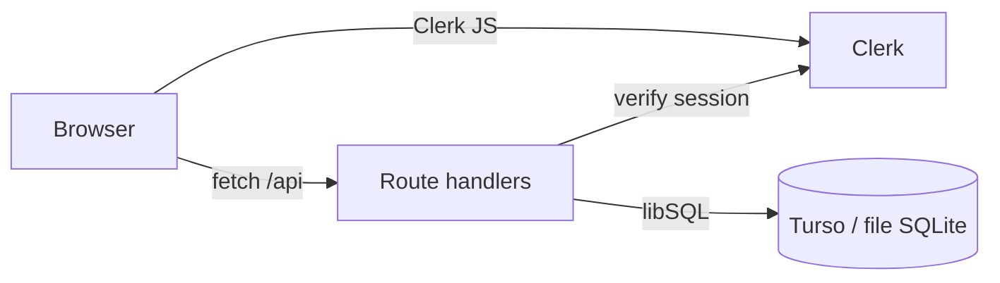

# Connectivity

The Clerk proxy (`src/proxy.ts`) guards routes; API handlers read the session and query the DB through Drizzle.

## Env vars
See the table in `README.md`.

## Hosting topologies
| Topology | Build | Notes |
|---|---|---|
| Vercel | `npm run build` | Full stack; Clerk and Turso vars set in the dashboard |
| Docker | `DOCKER=1` standalone | Port 3000; use Turso or a mounted volume |
| GitHub Pages | `scripts/pages-build.mjs` | Static export, demo mode, no API or auth; basePath is the repo name |
