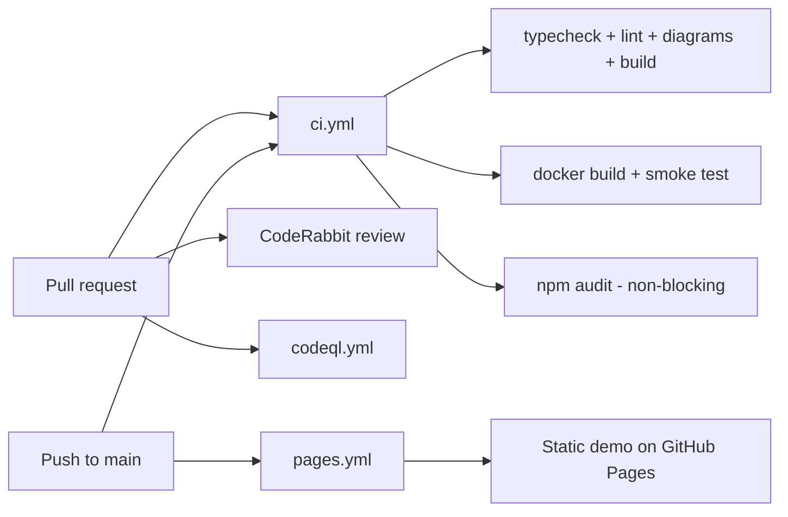

# DevOps guide

## Pipelines at a glance



| Workflow | Trigger | What it does |
|---|---|---|
| `ci.yml` | PR, push to main | `npm run typecheck`, `lint`, `docs:check` (Mermaid parse), `build`; separate `audit` job (`npm audit --audit-level=high`, never fails the run); `docker` job builds the image, starts it and curls `/api/health`, and checks it does not run as root. |
| `pages.yml` | push to main, manual | `scripts/pages-build.mjs` stashes `src/app/api` and the proxy, runs a static export (`GITHUB_PAGES=true`, `NEXT_PUBLIC_DEMO=1`, base path = `/<repo name>`), uploads `out/` and deploys. Enable Pages with source "GitHub Actions" in repo settings. |
| `codeql.yml` | PR, push, weekly | Security scanning for JS/TS. |
| Dependabot | weekly | npm, GitHub Actions and Docker base image updates. |
| CodeRabbit | every non-draft PR | AI review; see [coderabbit.md](coderabbit.md). |

## Docker

```bash
npm run docker:build        # image ghost-ai-web:local
docker compose up --build   # http://localhost:3000, data in volume ghost-data
```

- Multi-stage on `node:24-bookworm-slim` (glibc; libsql ships prebuilt gnu binaries).
- `DOCKER=1` makes Next emit `output: "standalone"`; the runner copies `.next/standalone`, `.next/static` and `public`.
- Runs as non-root user `app` (uid 1001). SQLite lives at `/data/local.db` (`DATABASE_URL=file:/data/local.db`) on a volume.
- `HEALTHCHECK` calls `/api/health`.
- Secrets (Clerk keys, `DATABASE_AUTH_TOKEN`) go in `.env` (compose `env_file`) or `-e`; they are never baked into the image.

## Vercel
`vercel.json` uses `npm ci` and `npm run build`. Set env vars in the Vercel dashboard. Use a Turso `DATABASE_URL` (plus `DATABASE_AUTH_TOKEN`) there; local files do not persist on serverless.

## Diagrams
`npm run docs:diagrams` parses every Mermaid block in `README.md` and `docs/**/*.md` and renders SVGs to `docs/diagrams/` (needs Edge or Chrome locally; set `PUPPETEER_EXECUTABLE_PATH` if not auto-detected). `npm run docs:check` only parses and is what CI runs.

## Useful scripts
`typecheck`, `lint`, `build`, `build:pages`, `docs:diagrams`, `docs:check`, `docker:build`, `docker:up`, `test:e2e` (placeholder).
